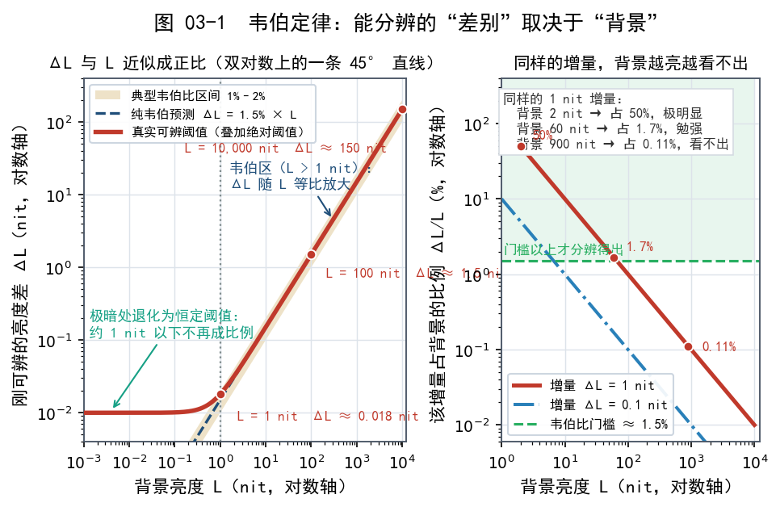
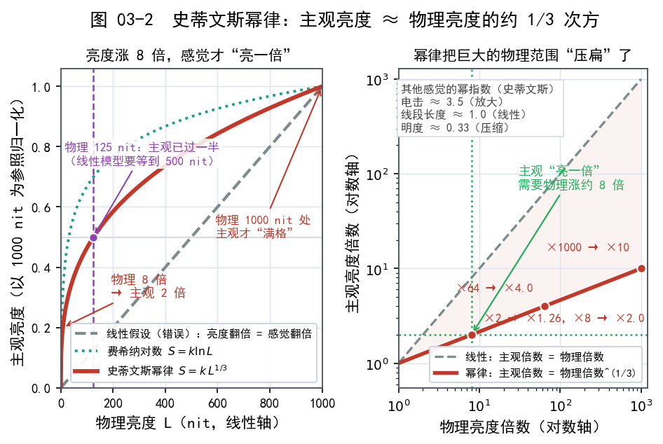
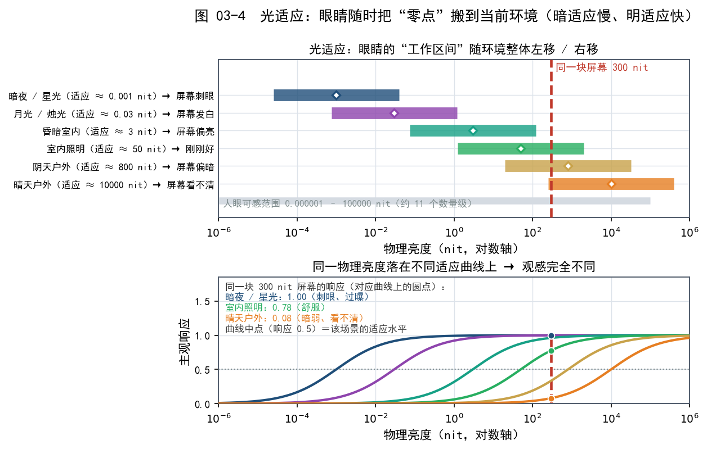
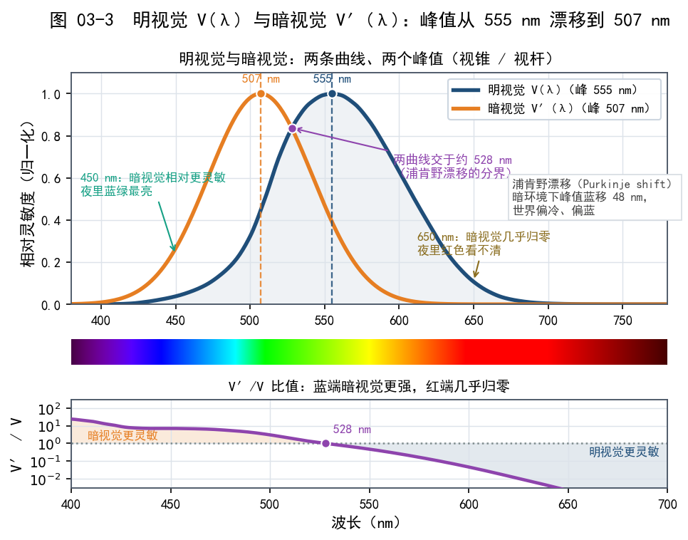
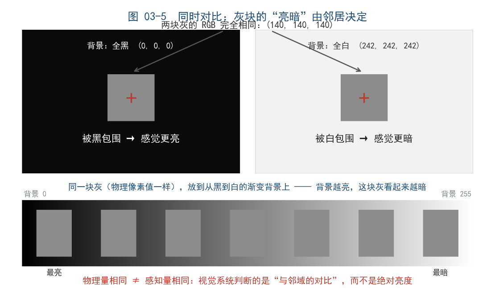

# 第 03 章 人眼如何看光：对数视觉与 HDR 的意义

> 这一章回答一个根本问题：人眼的瞬时对比度只有约一万比一，凭什么说 HDR 有必要？答案要从人眼的特性里找。它对光的响应接近对数/幂律，还会随环境"随时调零"。弄明白这一点，"亮度翻倍"为什么看起来远不到亮一倍、后面的 Gamma 和 PQ 为什么长成那个样子，就都讲得通了。本章还要讲明视觉、暗视觉、中间视觉以及同时对比这些"视觉副作用"，它们是所有显示设计的隐藏前提。

## 一、先记住一句话：人眼不是尺子，是"对比探测器"

拿一把尺子量桌子，2 米就是 2 米，跟放在哪没关系。**人眼完全不是这样工作。**

人眼真正擅长的判断，是"**这里比那里亮多少、暗多少**"；至于"这束光有多强"，它并不在行。所以才会出现下面这些情况：

- 同一块手机屏，在漆黑的被窝里看觉得刺眼，走到户外阳光下看又觉得暗得看不清。
- 一张纸在室内看着是"白"，拿到太阳底下也看着是"白"，虽然它的物理亮度差了上百倍。

**人眼的工作方式接近一台带自动增益控制（AGC，Automatic Gain Control）的摄像机**：它根据环境不断调整"零点"和"增益"，好让昏暗处和明亮处都能看清东西。副作用有哪些，就是本章的全部内容。

## 二、韦伯定律：你能分辨的"差别"取决于"背景"

19 世纪，德国科学家韦伯（Weber）做了一个朴素但影响深远的观察：

> **你能察觉出来的最小亮度变化（ΔL），和背景亮度（L）成正比。**

写成公式就是：

```text
ΔL / L = 常数（韦伯比，通常约 1%~2%）

ΔL：刚好能分辨出的亮度变化量
L ：当前的背景亮度
常数：不同条件下不同，量级约 0.01–0.02
```

道理不复杂：**环境本来就亮，变化必须更大才察觉得到；环境一暗，微小的变化就够。**

举个例子：把一根蜡烛放在正午的阳光下，你几乎感觉不到；把同一根蜡烛放在漆黑的房间里，它就是全屋最亮的东西。**同样的物理增量，感受完全不同——因为"分母"变了。**

HDR 里一个常见现象也能由此解释：**暗部细节为什么这么重要？** 人眼在暗部极其敏感，一点层次变化都看得见；亮部就算差几百 nit，感觉也不明显。HDR 内容只把高光拉亮、暗部却没有层次，观感提升会大打折扣。



## 三、费希纳定律：感受 ≈ 对数量的对数

韦伯的学生费希纳（Fechner）把上面的观察推了一步。既然"能察觉的变化"总是当前亮度的固定百分比，那么把无数个这样的"小小步"累积起来，得到的规律就是：

> **主观感受的强度，与物理刺激量的"对数"成正比。**

用公式表示：

```text
S = k · ln(L)

S：主观感受到的强度
L：物理亮度
k：比例常数
ln：自然对数
```

**这是全书最重要的思想之一**：亮度每翻一倍，你感受到的增量大致恒定。

几组数字对照着看：

| 物理亮度 L | 亮度翻倍次数（档） | 主观感受（费希纳模型，示意） |
|---|---|---|
| 1 nit | 0 | 基准 |
| 2 nit | 1 | 加"一份" |
| 4 nit | 2 | 加"两份" |
| 8 nit | 3 | 加"三份" |
| 1024 nit | 10 | 加"十份" |

最后一行最能说明问题：**从 1 nit 到 1024 nit，物理上翻了 1024 倍，主观上只多了"十倍左右"的感受。** 反过来也成立：把亮度砍一半，你并不会觉得"暗了一半"。

这就直接回答了一个常见困惑：

> **"亮度翻倍 = 看起来亮一倍"是错的。** 按对数/幂律模型，亮度翻倍带来的主观增量，大约只相当于"多一档"的感觉。

JND（Just Noticeable Difference，最小可觉差）指人眼能察觉到的最小亮度差异。它不是常数，会随背景亮度变化。


## 四、史蒂文斯幂律：为什么是"三分之一"

费希纳的对数模型很优雅，但后来的心理学家史蒂文斯（Stevens）发现，用**幂函数**描述更灵活、也更贴合实际数据（心理学上叫"史蒂文斯幂律"，Stevens' power law）：

```text
S = k · L^n     （n 是每种感觉自己的指数）

S：主观感受强度
L：物理强度
k：比例常数
n：幂指数（与感觉类型有关）
```

对不同感觉，"指数 n"不一样：电击感约 3.5，线段长度约 1，**亮度大约 0.33**。写成一句话：

> **主观亮度 ≈ 物理亮度的约 1/3 次方。**

这个"1/3 次方"落到实际：**物理亮度涨到 8 倍，主观上才大致"翻一倍"**（8^(1/3) = 2）。

| 物理亮度倍数 | 主观感觉倍数（≈1/3 次方） |
|---|---|
| ×2 | 约 ×1.26 |
| ×4 | 约 ×1.59 |
| ×8 | 约 ×2.0 |
| ×64 | 约 ×4.0 |
| ×1000 | 约 ×10 |

**公式不必背，三个结论够用：**

1. **人眼压缩了巨大亮度范围**，所以能同时应付"月光"和"阳光"。这是演化送给我们的礼物。
2. **压缩是非线性的、接近对数或幂律的**，所以"线性地"分配数值或带宽是低效的。
3. **显示系统因此必须用 Gamma / PQ 这类"非线性编码"**，才和人的感觉对得上（见第 6、7 章）。**HDR 的编码不是随便定的，是照着人眼的曲线倒推出来的。**



## 五、光适应：人眼的"自动调零"

上面的规律是"瞬时"的，但人眼还有一个更强的能力：**随着环境变化，把自己重新校准。** 这叫**光适应（light adaptation）**。

- **暗适应（dark adaptation）**：从亮处走进黑暗，一开始什么都看不见，需要几十秒到几十分钟才逐渐看清（视紫红质的恢复）。这就是你从电影院出来/进电影院时那段"瞎一会儿"。
- **明适应（light adaptation）**：从暗处走到阳光下，一开始刺眼发白，几秒到一两分钟就适应了。

光适应的意义在这里：**它让人在截然不同的环境亮度下都能工作，代价是"绝对亮度感"被抹平了**。你没办法靠"感觉"说出眼前的东西是 10 nit 还是 1000 nit，只能靠"比周围亮多少"来判断。

```text
光适应的"调零"过程（示意）

暗环境 ──► 自动调高增益 ──► 0.01 nit 也看得见
        
环境光变化后：

亮环境 ──► 自动调低增益 ──► 1000 nit 也不刺眼

结果：同一块屏，暗室 vs 户外，感觉亮度完全不同（但物理发光没变）
```

> **"物理发光没变"这几个字很关键**：它说明"感受亮度"从来不是"绝对亮度"的单一函数，而是取决于"**绝对亮度 + 当前适应状态**"。



## 六、明视觉、暗视觉、中间视觉：眼睛的"三套系统"

我们的视网膜上住着两种 photoreceptor（感光细胞）：

- **视锥细胞（cone）**：负责颜色和细节，但需要较亮的光。它们工作的状态叫**明视觉（photopic vision）**，对应白天、室内照明，约从几 nit 以上开始占主导。
- **视杆细胞（rod）**：对光极其敏感但**不辨颜色**，只提供明暗。它们工作的状态叫**暗视觉（scotopic vision）**，对应星光、暗夜，通常低于约 0.01 nit 量级。
- **两者交接的灰色地带**叫**中间视觉（mesopic vision）**，大概在 0.01 到几 nit 之间——黄昏、夜晚街道、暗房看片，都属于这个区间。

| 状态 | 主要细胞 | 颜色？ | 大致亮度区间 | 典型场景 |
|---|---|---|---|---|
| 暗视觉 | 视杆 | 几乎无色（"夜盲"世界） | 约 0.01 nit 以下 | 星空、暗夜 |
| 中间视觉 | 两者混合 | 颜色会偏淡、偏蓝 | 约 0.01–几 nit | 黄昏、暗室看视频 |
| 明视觉 | 视锥 | 正常色彩 | 约几 nit 以上 | 白天、室内 |

**这一节对 HDR 有什么意义？**

1. 暗视觉的**峰值波长**偏短（偏蓝），所以极暗环境下我们看到的颜色是"偏冷"的；这也解释了为什么夜色画面常被艺术化处理成冷色调。
2. **暗部画面被推得极暗（比如 0.01 nit 以下）时，人眼会切换到"没有颜色"的模式**，此时画面细节还在，但色彩感受大减。因此调色师不会无脑把暗部压到最低，而是要保证关键信息落在"能看见、能辨"的区间。
3. 由此还能推出一层：**HDR 的深黑位并不追求"越黑越好"，要的是"黑到能让暗部层次恰好看得见"**。这跟第 2 章"动态范围要同时扩两头"是同一个道理。



## 七、同时对比：眼睛会被"邻居"骗

**同时对比（simultaneous contrast）**是视觉里最经典、也最容易验证的现象。

两个灰块物理亮度一模一样，一个被黑色包围，一个被白色包围，后者看起来更暗。视觉系统处理画面并不靠"绝对数值"，它算的是**和邻居的对比**。于是：

- **画面里有一块真的亮，会让旁边的中灰显得更暗**；
- **HDR 里真正的高光能显著提升旁边区域的"立体感"**，因为它给整幅画面提供了一个新的"参考点"；
- 反过来，**如果一块 HDR 屏黑位很差（黑是灰的），那么高光再亮，也会显得"浮"、缺乏层次**——因为对比关系被破坏了。

还有一个相关概念叫**局部适应（local adaptation）**：你看画面时，视线焦点附近的区域感受最强，边缘逐渐被忽略。所以显示器厂商会特别在意"高光周围会不会出现灰雾"（也就是光晕，见第 11 章），因为人眼对高光旁边的异常尤其敏感。



## 八、为什么"绝对亮度"对 HDR 这么重要

现在把所有线索收束起来。人眼有几条关键特性：

- 响应接近**对数/幂律**，所以"翻倍"不等于"感知翻倍"；
- 有**光适应**，会随环境调零，所以感受不取决于绝对亮度，而取决于"这一刻的相对关系"；
- 有**同时对比**和**局部适应**，所以"邻居"和"焦点"会显著影响判断。

几条特性合起来，得出一个有点反直觉的结论：

> **人眼会调零、会压缩、会被邻居影响，画面反而更需要提供"足够的绝对亮度跨度"，才能表达真实世界。**

设想画面里只有 0–100 nit："阳光下的白墙"和"阴影里的白纸"都挤在同一个亮度附近，人眼再怎么调零，也只能得出"它们一样亮"。真实世界里两者的**绝对亮度水平**差得远，人眼的适应状态也不同，这种差异就是站在阳光下会眯眼的原因。

**HDR 做的事，是补回被 SDR 抹掉的那段绝对亮度信息，谈不上"讨好眼睛"。** 借用第 2 章的比喻：SDR 是小水杯，HDR 是大水桶。人眼的"自动调零"相当于桶的位置可以上下挪，**桶本身能装多少水，还得看显示硬件**，这就是 HDR 显示器和 HDR 内容存在的理由。


## 本章小结与常见误区

- **人眼不是线性仪器，而是一个"对比探测器"**，它会像带自动增益控制（AGC）的摄像机一样随时调零。
- **韦伯定律**：刚能察觉的亮度变化 ΔL 与背景亮度 L 成固定比例（约 1%–2%），所以"同样的增量在不同背景下感受不同"。
- **费希纳定律**：主观感受与物理亮度的对数成正比——**亮度每翻一倍，感受只加"一份"**。
- **史蒂文斯幂律**：主观亮度 ≈ 物理亮度的约 1/3 次方，所以**物理亮度要涨到约 8 倍，主观才"亮一倍"**。
- **光适应**分暗适应（慢，数十秒到数十分钟）与明适应（快，数秒到一两分钟）；它让同一块屏在暗室与户外的感受截然不同，尽管物理发光完全没变。
- **明视觉（视锥）/ 中间视觉 / 暗视觉（视杆）**是眼睛的三套模式；暗视觉几乎不辨颜色，这决定了暗部调色的边界。
- **同时对比**与**局部适应**说明：感受取决于"相对关系"与"注意力焦点"，所以**黑位不好会毁掉高光带来的立体感**。
- **结论**：人眼会压缩、会调零，显示系统就必须提供足够大的**绝对亮度跨度**，画面才能表达出真实世界的光照差异。这既是人眼"配得上" HDR 的原因，也决定了后面 Gamma、PQ 等编码的设计方向。

**几个容易混淆的点：**

1. **误区：把"亮度翻倍"理解成"看起来亮一倍"。** 按对数/幂律模型，亮度翻倍只会带来"大约一档"的主观增量；想"看起来亮一倍"，物理上通常要涨好几倍。
2. **误区：以为"亮处更亮"能弥补"暗处发灰"。** 人眼靠同时对比判断层次，黑位差会让画面整体发雾，高光反而显得"浮"。

## 下一章预告

既然人眼看到的"颜色"和"亮度"是一套被压缩过的感知，那颜色本身能不能被数学精确描述？下一章我们进入色彩科学，认识 CIE 色度图、三刺激值和白点，看看"颜色是怎么被放进坐标系里的"。
