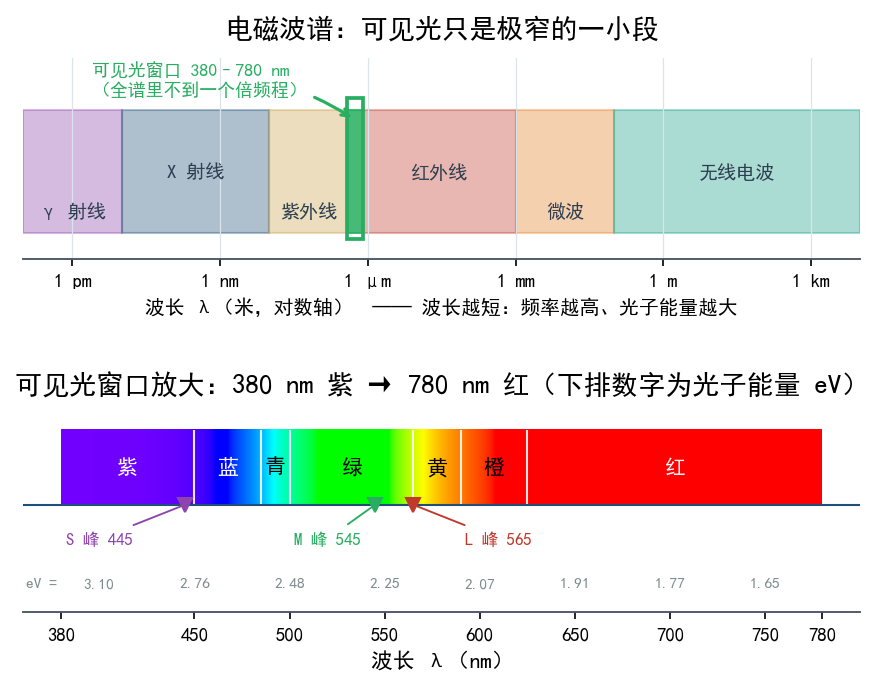
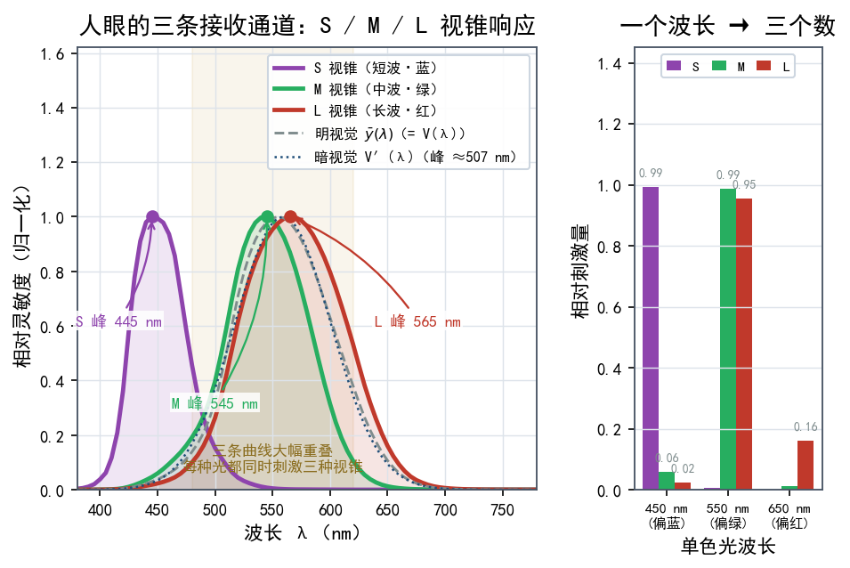
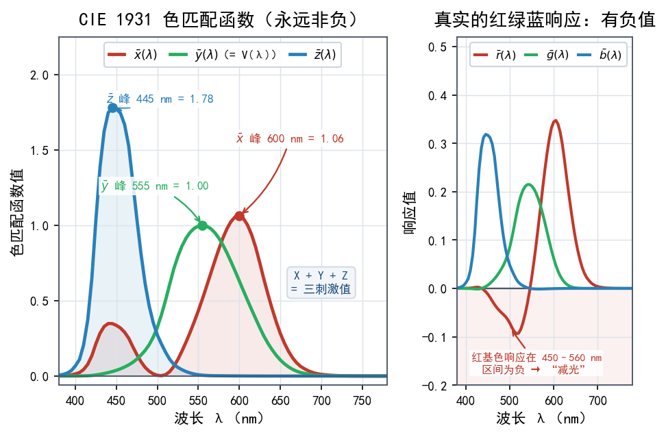
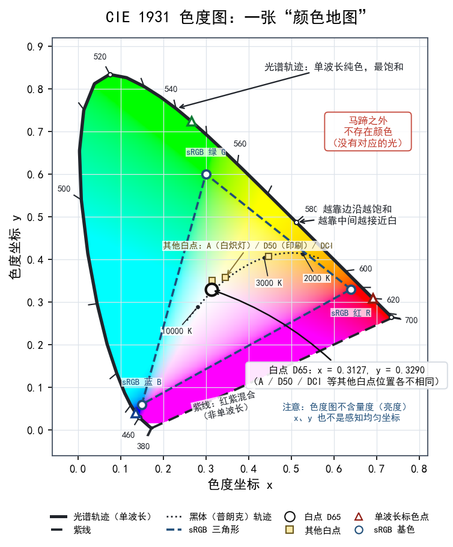
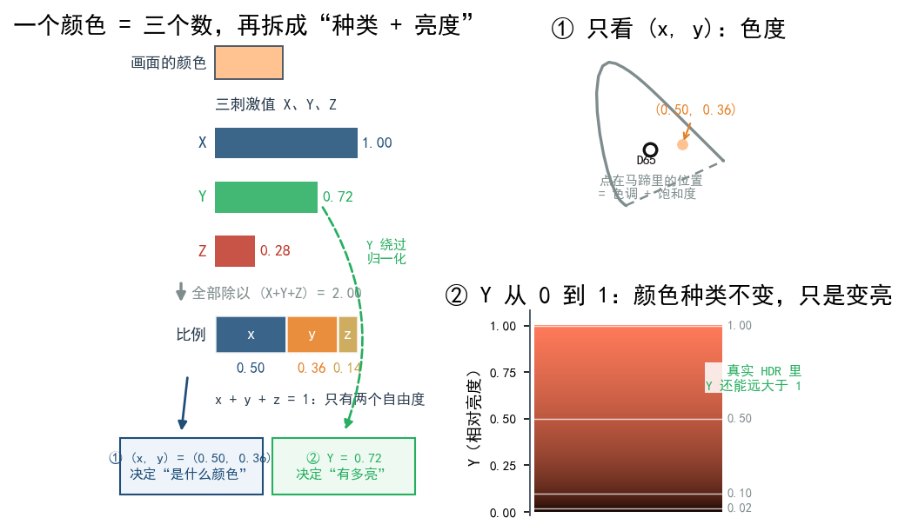

# 第 04 章 颜色的坐标系：CIE、色度图与三刺激值

本章要回答一个听起来有点哲学的问题：颜色到底是什么？为什么"红色"这种主观感受，可以用两个数字描述出来？答案要靠一套**颜色的坐标系**——有了它，颜色才能被计算、被比较，后面讲色域、白点、色彩空间时也不至于变成天书。这一章几乎不需要数学，跟着几个比喻走完就行。

## 4.1 颜色不在光里，而在"光 + 眼睛 + 大脑"里

先纠正一个直觉：**颜色不是光的物理属性，而是人脑的感知结果。**

光是电磁波。按波长排开，就是熟悉的电磁波谱：无线电、微波、红外、可见光、紫外、X 射线……其中**可见光**只占窄窄的一小段，波长大约从 380 nm（纳米，十亿分之一米）到 780 nm。

这段区间里，不同波长给人的感觉大致是：短波偏紫蓝，中段是绿，长波偏红。但**波长本身没有"颜色"**。380 nm 和 780 nm 的电磁波，物理上都是振动，差别只在频率。是眼睛里的接收器把不同波长翻译成不同信号，大脑再把它读成"紫"或"红"。

可以这样想：刀割在手上，刀是物理的，**痛**是感觉。电磁波是物理的，**颜色**是感觉。要研究颜色，就得同时研究"光"和"这双眼睛怎么接收光"。



## 4.2 人眼的三种接收器：三条并行的传感器通道

人眼视网膜上有两类感光细胞：

- **视杆细胞（rods）**：数量多、极其敏感，负责在暗处看清轮廓，但不分辨颜色。
- **视锥细胞（cones）**：数量少一些（约几百万个），负责明亮环境下的颜色和细节。

关键在于：视锥细胞不止一种，而是分成 **S、M、L 三种**，分别对短波（Short，偏蓝）、中波（Medium，偏绿）、长波（Long，偏红）最敏感。它们的响应曲线又宽又彼此重叠，所以并不存在"蓝光只刺激 S、红光只刺激 L"这种事，任何一种光都会按不同比例同时刺激三种视锥。

这样一来，人眼对颜色的"输入"只剩 **3 个数字**——三种视锥各被刺激了多少。这个事实叫**三色视觉（trichromacy）**。

推论相当有力：**只要两种光能让 S/M/L 产生完全相同的刺激比例，人眼就认为它们是同一种颜色**，哪怕这两种光的物理光谱差得很远。电视用三种原色（红、绿、蓝）就能模拟出千千万万种颜色，靠的就是这一点。



## 4.3 三刺激值：把颜色写成三个数

既然眼睛只认三个数，能不能反过来，用三个数描述任意一种颜色？可以。这三个数叫**三刺激值（tristimulus values）**。

它的实验基础是"色匹配实验"：让人看左边一个待测颜色，右边用三种原色（红、绿、蓝）的灯光混合，调节三种灯的比例，直到两边看起来一模一样。这时三种原色所用的比例，就是这种颜色的三刺激值。

色匹配函数描述的正是这件事：对每一个波长，三种原色各需要多少量才能把它配出来。

不过这早期用真实红绿蓝原色搭起来的系统有个麻烦：有些颜色（比如非常饱和的青），靠加光怎么都配不出来，得"往待测色里加红"才能匹配，数学上于是出现负数，很不方便。

1931 年，国际照明委员会（Commission Internationale de l'Éclairage, CIE）做了一件聪明事：**用数学变换把真实的红绿蓝响应，换成一组人为构造的、永远非负的曲线**，记作 X、Y、Z。这就是**CIE 1931 XYZ** 色彩空间的来历。

- **X、Y、Z**：三种"虚拟原色"的刺激量，都由光谱能量乘以对应的**色匹配函数（color matching functions）**再积分得到。
- 其中 **Y 被特意设计成正好等于亮度（luminance）**，这一点后面会反复用到。

**XYZ 并不对应真实的光，它是一套为了计算方便而发明出来的"翻译坐标系"。**

| 概念 | 是什么 | 类比 |
|---|---|---|
| S/M/L 视锥 | 人眼真实的三种接收器 | 相机里的三种传感器 |
| 色匹配函数 | 人为定义的响应曲线 x̄(λ)、ȳ(λ)、z̄(λ) | 参照标准，方便换算 |
| 三刺激值 X, Y, Z | 一种颜色的三个坐标 | 一个点的三个坐标值 |

补充一句：CIE 1931 用的是约 2° 的小视场（只看视野中心），后来还有 10° 视场的版本，数据略有不同。知道"实验条件会影响数据"就够了。



### 从 RGB 到 XYZ 的流程

负值在工程和计算里很麻烦：光强不能为负，很多颜色计算也希望三个刺激值都非负；再加上还希望其中一个量直接代表亮度。于是 CIE 做了一次线性变换：

$$ 
\begin{bmatrix}
X \\
Y \\
Z
\end{bmatrix}
=
M
\begin{bmatrix}
R \\
G \\
B
\end{bmatrix}
$$

这里的 R,G,B 是原来实验得到的 CIE RGB 三刺激值，M 是一个精心选择的 3×3 矩阵。 变换后得到新的三条色匹配函数 

$\bar{x}(\lambda),\ \bar{y}(\lambda),\ \bar{z}(\lambda)$

这个变换做的事情，是换一组新的“虚拟原色”作为基。

颜色混合满足叠加原理，这是 Grassmann 定律的核心： 如果光谱 A 产生三刺激值 $(X_A, Y_A, Z_A)$； 光谱 B 产生 $(X_B, Y_B, Z_B)$； 那么光谱 $A + B$ 产生 $(X_A + X_B, Y_A + Y_B, Z_A + Z_B)$。系统是线性的，这一点由此而来：复杂光谱无非是许多单色光相加，它的三刺激值也就是各个单色光三刺激值之和。

再往前一步，无论 RGB 色度曲线还是 XYZ 色度曲线，都可以理解成一组基函数。但严格来说， $\bar{x},\bar{y},\bar{z}$ 不是颜色空间的基，而是线性泛函的核。对于任意一个光谱功率分布 $S(\lambda)$，它的 XYZ 三刺激值是：

$$
X = k \int S(\lambda)\bar{x}(\lambda)\,d\lambda $$

$$
Y = k \int S(\lambda)\bar{y}(\lambda)\,d\lambda $$

$$
Z = k \int S(\lambda)\bar{z}(\lambda)\,d\lambda
$$

其中，$S(\lambda)$ 是光源或物体反射光的光谱能量分布； $\bar{x},\bar{y},\bar{z}$ 是CIE 1931 XYZ 色匹配函数； $k$ 是归一化常数，常取 683 lm/W，使 Y 直接对应亮度； 积分范围一般是 360–830 nm 或 380–780 nm。物理意义很直观：把光谱里每个波长的能量，乘上该波长对 X、Y、Z 三种虚拟原色的“贡献权重”，再全部加起来。只是要分清，功率谱有强弱之分，色度曲线本身并不含强弱。


## 4.4 从 XYZ 到色度图：把"亮度"从坐标里抽走

X、Y、Z 三个数放在一起，既描述了"颜色种类"，又混进了"有多亮"。可我们通常想分开谈：这块红**是什么红**，和它**有多亮**，是两件事。

于是引入**色度坐标（chromaticity coordinates）**：

```text
x = X / (X + Y + Z)
y = Y / (X + Y + Z)
z = Z / (X + Y + Z)
```

因为 x + y + z = 1，所以**只需要 x、y 两个数**就能定位"是什么颜色"，第三个数被自动确定。亮度 Y 则单独拿出来表示"多亮"。

把所有可能颜色的 (x, y) 画在一张二维图上，就得到著名的 **CIE 色度图（chromaticity diagram）**，形状像一个马蹄或舌头。



怎么读这张图：

- **外侧弯曲的边界**（光谱轨迹，spectral locus）是单波长纯色，最饱和，人眼能看到的最极端颜色都在这一圈上。
- **底边那条直边**（紫线，line of purples）不是真实光谱，而是人为把红端和紫端连起来，代表"红紫混合"这类颜色。
- **越靠中间越"白"、越不饱和**；越靠边缘越鲜艳。
- 图外（马蹄之外）的点**不存在**——没有任何光能对应那些坐标。

**色度图就是一张"颜色地图"**：图上的位置对应"什么颜色"，某台显示设备能覆盖的区域，就是它在这张地图上的"领土"。

有一点容易混淆：用 R、G、B 三原色做匹配实验得到的响应值，并不是所谓的 sRGB。那套实验要尽可能全面地囊括所有光的颜色，而 sRGB 只是这全部颜色里的一个子集。

从色度图上也能看出来，有色区域并不紧贴坐标轴，最小的 X、Y 坐标值都不为 0。原因在于向 XYZ 的变换要求把 Y 对应到亮度。


### 虚拟原色

X、Y、Z 是“虚拟原色”，它们不是真实存在的三种光，而是数学坐标轴。 在色度图上，所有真实可见颜色构成一个马蹄形区域，边界是光谱轨迹。 而 X、Y、Z 三个原色对应的点，落在这个马蹄形外面。 你没法用一台由 X、Y、Z 三种灯组成的显示器把它们物理实现出来，它们只是数学上的基向量。任何真实颜色都可以写成： 

$$ C = X \cdot X_{\text{原色}} + Y \cdot Y_{\text{原色}} + Z \cdot Z_{\text{原色}} $$

其中 X,Y,Z 非负。 三个原色本身不可实现，它们的非负线性组合却能覆盖所有可见色。

Y 直接代表亮度，这是 CIE 设计 XYZ 时故意做的。 他们让 $\bar{y}(\lambda)$ 等于人眼的明视觉光谱光视效率函数 $V(\lambda)$。 $V(\lambda)$ 描述人眼对不同波长光的亮度感知效率，峰值在 555 nm 附近。 于是：

$$Y = k \int S(\lambda)\bar{y}(\lambda)\,d\lambda$$

就直接正比于人眼感知的亮度。 而 X 和 Z 对亮度没有贡献。 XYZ 空间的好处就在这里： Y 管亮度； X、Z 只贡献色度。


## 4.5 白点：颜色地图的"原点"

地图需要原点。色度图上的"纯白"也不唯一，不同光源的"白"色度并不相同：白炽灯的白偏黄，正午天空的白偏蓝。

所以每种色彩空间都得**指定一个白点（white point）**，也就是"把哪一对 (x, y) 当作纯白"。常见的有：

| 白点 | 大致含义 | 用在哪 |
|---|---|---|
| A | 典型白炽灯，偏暖黄 | 部分照明计算 |
| D50 | 偏暖的日光 | 印刷、摄影 |
| **D65** | 平均正午日光，约 6500 K | sRGB、BT.709、BT.2020 通用 |
| DCI 白点 | 略暖（约 6300 K 量级） | 数字电影 DCI-P3 |

这里的"K"是**色温（color temperature）**的单位：把理想黑体加热到某温度时发出的光色，用来描述"这个白偏冷还是偏暖"。6500 K 大致算中性偏冷。

**sRGB 和 BT.709 都以 D65 为白点**，这条值得单独记一下。白点不一致，是"同一张图在两台设备上颜色不一样"的常见原因之一（见第 5 章、第 19 章）。

## 4.6 亮度住在 Y 里

XYZ 里最容易记混的一点，是 **Y 分量就是亮度（luminance）**。

- **x、y** 描述"什么颜色"（色调 + 饱和度）。
- **Y** 描述"有多亮"。

同一个 (x, y) 下把 Y 慢慢调大，颜色会从深红变到亮红，再往刺眼的白红走。这也解释了后面讲视频编码时，为什么要把图像拆成"亮度 + 两个色度"通道——亮度对人眼重要得多，可以多分配数据（见第 10 章）。



## 4.7 用这张地图描述"能到哪儿"

最后把工具用起来。一台显示设备的三种基色，在色度图上是三个点，连起来就是一个**三角形**。三角形内部是这台设备能显示的全部颜色，三角形之外它显示不了——这就是**色域（color gamut）**的几何含义。


三角形越大，设备"能到的领土"越广。第 5 章我们就用这套语言，把 sRGB、DCI-P3、BT.2020 挨个量一遍。

## 4.8 三个必须避开的坑

1. **XYZ 不等于"绝对颜色"**：它仍依赖观察者（标准观察者模型）和观测条件（视场大小、光源）。不同人、不同条件下，同一组数值带来的感受并不完全一致。
2. **色度图的 x、y 不是感知均匀的**：图上距离相等，不代表"看起来差得一样多"。后来出现 1960 均匀色度标尺、1976 u'v' 图，原因就在这里。
3. **三角形面积大 ≠ 观感提升成正比**：面积大只说明"领土大"，不代表日常画面就一定好看，还要看覆盖是否落在常用颜色区间、白点准不准、内容是否真用到那些颜色。


## 本章小结与常见误区

- 颜色是**感知**，不是光的物理属性；光只是电磁波的一段（约 380–780 nm）。
- 人眼有三种视锥（S/M/L），因此颜色可以用**三个数**描述，这是"三色视觉"。
- **三刺激值**用三个数表示一种颜色；**CIE 1931 XYZ** 是为计算方便人为构造的一套非负坐标系。
- 引入**色度坐标 x、y** 后，颜色种类（x, y）与亮度（Y）可以分开描述。
- **色度图**是一张"颜色地图"：外圈是纯色光谱轨迹，中间越来越白，图外颜色不存在。
- **白点**是地图的"原点"，D65 是 sRGB/BT.709/BT.2020 的通用白点。
- **色域**就是设备三基色在色度图上连成的三角形，三角形越大，能显示的颜色范围越广。

**几个容易混淆的点：**

1. **误区：XYZ 能描述"绝对颜色"。** 不对。它依赖标准观察者和观测条件，只是"足够好用的约定"，不是物理真理。
2. **误区：色度图面积大一倍，观感就好一倍。** 不对。xy 不是感知均匀坐标，面积差和"看得出的提升"不成正比。

## 下一章预告

有了这张颜色地图，下一章就拿它当尺子，把 sRGB、DCI-P3、BT.2020 这几个常见色域挨个量一遍，顺便破除"色域越大越好"的迷信。
