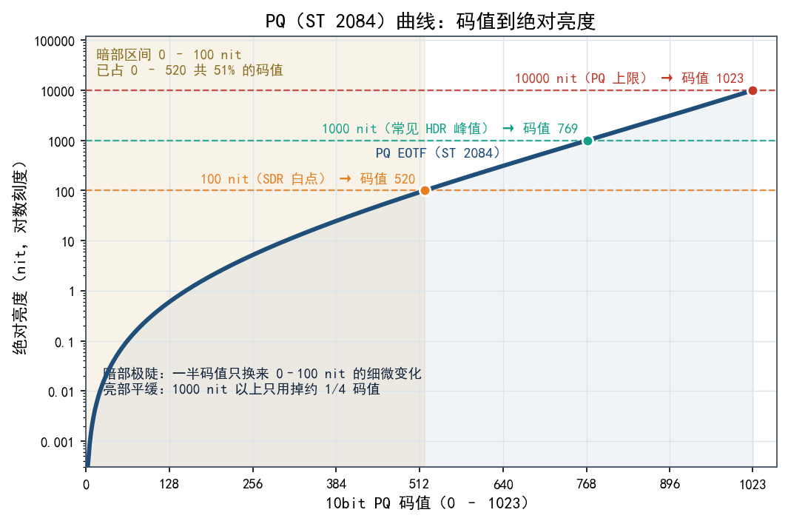
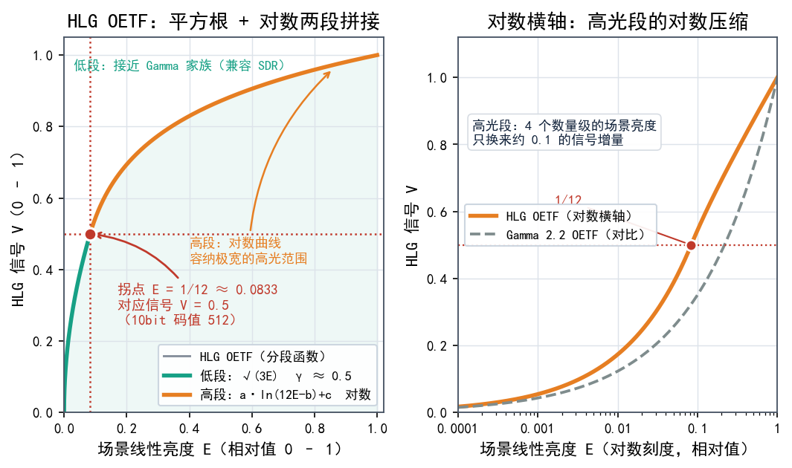
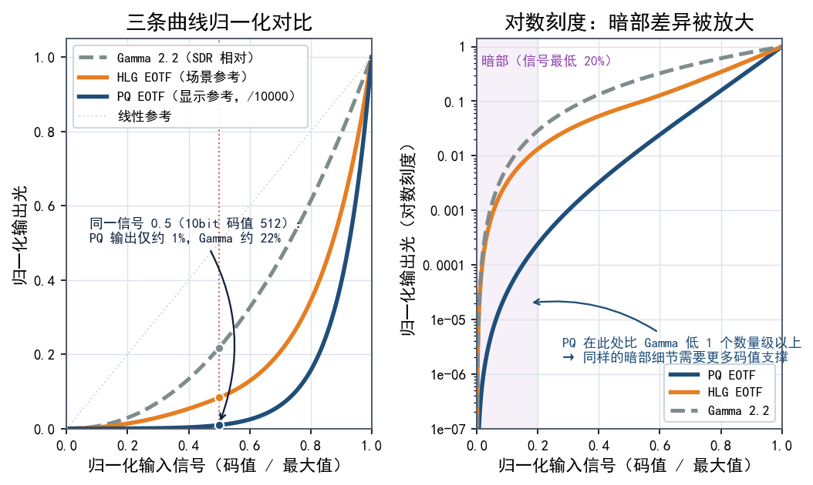
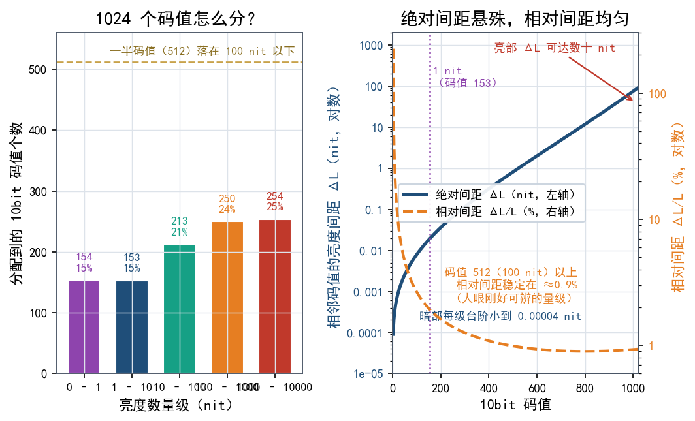
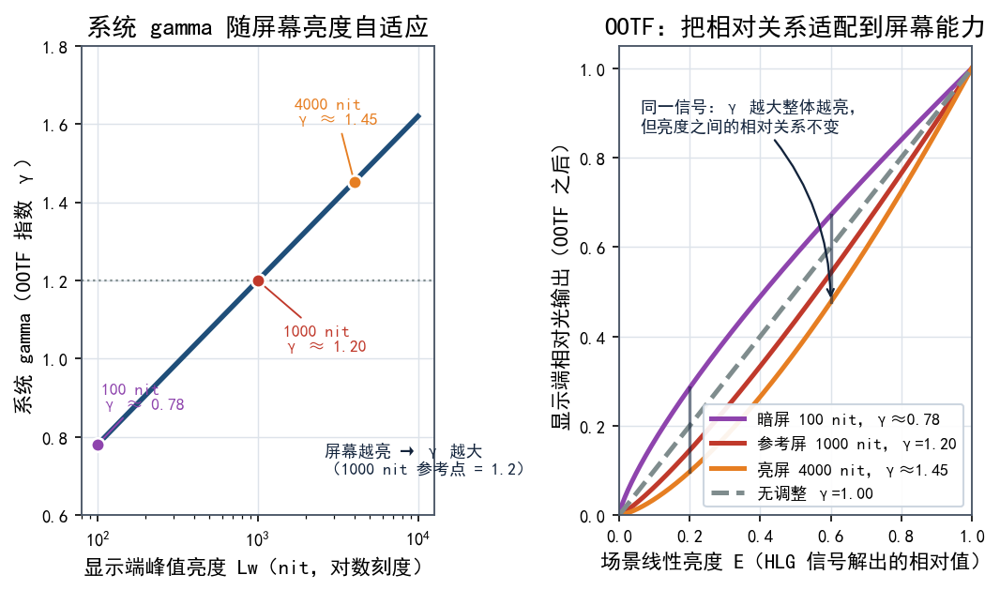
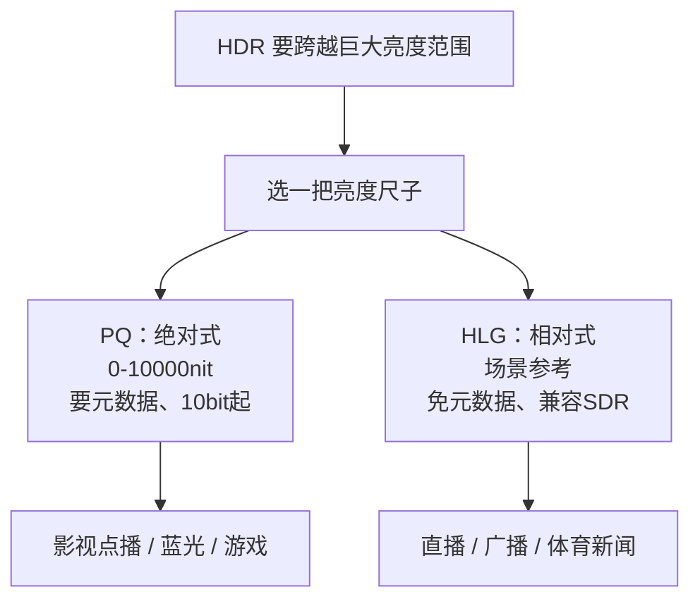

# 第 07 章 HDR 的两把尺子：PQ（ST 2084）与 HLG

这是全书最关键的章节之一。前面我们说过，SDR 的亮度被"约定"死在大约 100 nit（nit 即 cd/m²，二者等价）附近；而 HDR 想跨越从几乎全黑到上万 nit 的巨大范围。老的 Gamma 曲线扛不住这么宽的跨度，于是行业造了两把**全新的尺子**——**PQ** 和 **HLG**。它们不是两种画质，而是两种"怎么衡量亮度"的规则。搞懂这一章，你后面看 HDR10、Dolby Vision、HLG 直播就都不会迷路。

## 7.1 为什么 Gamma 不够用了

回忆第 6 章：SDR 用的 gamma 约 2.2，是"相对"的——它只知道"最亮到最暗"这个比例，不关心最亮到底是 100 nit 还是 200 nit。而且它的曲线偏"平"，适合描述几百 nit 以内的世界。

HDR 的要求完全不同：

- 范围要大得离谱：从约 0.001 nit 的黑位，一直到 10000 nit 的高光，跨了约 **7 个数量级**。
- 暗部要极细腻：人眼在暗处极其敏感，低亮度区必须分配足够多的码值。
- 要能描述"绝对亮度"：内容里那个太阳到底是 1000 nit 还是 4000 nit，最好有个准数。

一条简单的幂函数做不到这些。于是人们设计了两类新曲线，走的是**两条完全不同的哲学路线**。

## 7.2 PQ（SMPTE ST 2084）：一把带刻度的"绝对尺子"

**PQ** 的全称是**感知量化（Perceptual Quantizer, PQ）**，标准编号是 **SMPTE ST 2084**。

它的出发点可以概括成一段很朴素的话：**按照人眼"刚好能看出差别"的节奏，把 0 到 10000 nit 整个范围切成台阶，再给每个台阶分配一个码值。**

这里的"感知"是关键。人眼对亮度的分辨能力不是均匀的：暗处一点点变化就能察觉，亮处变化很大也不明显。PQ 用的正是人眼**对比敏感度模型**（基于亮度阶梯实验的结果）来设计曲线，让相邻码值之间的"感知差别"尽量相等。所以它才叫"感知量化"。

于是 PQ 有两个决定性特征：

1. **它是绝对式的（absolute）。** 码值直接对应一个**确定的绝对亮度**：码值 0 对应 0 nit，最大码值对应 10000 nit，中间每个码值都有唯一确定的 nit 值。这意味着**同一段 PQ 信号，在任何设备上"承诺的亮度"都是同一个数**。
2. **它需要一个"参考"才能显示。** 因为内容可能标称 1000 nit 的高光，而你的屏幕只能到 600 nit，就必须有人来做映射（见第 17 章）。

**PQ 像一把带刻度的绝对尺子**：不管谁来量、在哪里量，1 米就是 1 米。影视后期和游戏要的正是这种确定性，创作者可以精确指定“这盏灯是 1000 nit”。



### PQ 的位深要求（理解难度：⭐⭐⭐）

PQ 要覆盖 0 到 10000 nit 的巨大范围，同时还要让人眼在暗部看出足够多的细节。人眼在暗部能分辨的亮度层次非常多，PQ 只能把大量“感知台阶”挤进暗部，它的曲线在暗部因此**非常陡**。但 PQ 要表示的亮度跨度本身也比 SDR 大得多，暗部即便分到了更多台阶，总量依然不够。

先回头看 SDR（BT.1886/Rec.709）。SDR 用相对亮度，典型范围 0.1-100 nit，本来就不存在物理上特别暗的值。它的暗部黑位是大约 0.1 nit，而非 0；SDR 从不要求显示 0.0001 尼特、0.001 尼特这种极暗亮度。PQ 是绝对亮度，它就真的要求显示到 0.0001 尼特。

SDR 的暗部大约从 0.1 到 1 尼特，只跨 1 个数量级，8bit 能分到几十个码值，足够平滑。PQ 的暗部从 0.0001 到 1 尼特，跨了 4 个数量级；8bit 下即便把更多码值分给暗部，极暗段仍然只剩很少几个码值，相邻码值的亮度差巨大。再加上 HDR 常在暗室观看，人眼暗适应后对极暗处的差异极其敏感，色带就藏不住了。症结不在 PQ 分给暗部的码值少，而在暗部要覆盖的范围太宽，总码值又只有 256 个。

人对亮暗的感知本来就是相对的。SDR 使用的 gamma 曲线（约 2.2–2.4）本身就是一种感知编码，它和 8bit 量化配合了几十年。在 0.1–100 尼特这个范围内，8bit SDR 的量化步长基本在人眼 JND 附近或以下，所以不容易看到色带。

SDR 也不是完全看不到色带，天空渐变、雾气、暗部背景里都有。只是 SDR 黑位高，极暗处的色带被黑电平掩盖；观看环境通常有环境光，瞳孔不会完全暗适应；内容制作中又常用抖动、噪声、胶片颗粒把色带打散。8bit SDR 的量化误差本来就小，抖动很容易盖住。

把它硬压到 8bit，只剩 256 个码值，平均每个码值要覆盖约 16 个 JND，暗部首先崩掉。PQ 8bit 的暗部量化误差太大，抖动也只能缓解，不能根治。

PQ曲线正是基于Barten视觉模型设计的，其目标就是让每两个相邻的编码码值之间的亮度差异，尽可能地接近 1 个JND。而且，它其实是专门为 12bit 设计的感知量化曲线，目标是让 4096 个码值在 0.0001–10000 尼特范围内接近每码值约 1 个 JND。如果PQ曲线完美实现了这个目标，那么用足够多的码值（如12位）编码时，每一个码值台阶对人眼来说都“刚好能察觉”，从而避免色带。

在1尼特左右的暗部，一个JND大约是 0.01-0.02 尼特。在 8 位PQ编码下，第一个码值（V=1/255）到第二个码值（V=2/255）的亮度跳跃，从 0.0004 尼特直接跳到 0.0014 尼特。这个 0.001 尼特的跳跃，在1尼特的背景亮度下可能不明显，但在0.001尼特的极暗背景下，它可能相当于几十甚至上百个JND，因此人眼会看到一个非常生硬的亮度台阶，即色带。

把这些串起来，PQ 有一个硬性要求：**至少 10 位（10bit），理想是 12bit**。如果用 8 位，暗部台阶不够用，渐变就会糊出一条条**色带（banding）**，这就是 HDR"10bit 起步"的根本原因（见第 10 章）。

顺便说，PQ 标准里定义的是**显示端的 EOTF**，编码时取它的反函数——和第 6 章的道理一样，只是换了一条更陡的曲线。

## 7.3 HLG(BT.2100 的 HLG):一把"相对曝光表"

另一条路是 **HLG**，全称**混合对数伽马（Hybrid Log-Gamma, HLG）**。它由英国广播公司（BBC）和日本 NHK 联合开发，后来被纳入 **BT.2100** 标准。

它的哲学和 PQ 正好相反：**相对式、场景参考（scene-referred）。** 它不承诺"这个像素是 1000 nit"，只描述**场景里各部分的相对亮度关系**（哪块比哪块亮多少倍）。至于最终显示多亮，交给**显示器自己的亮度范围**去决定。

HLG 的名字里"混合"二字，指它的 OETF 是**两段拼起来的**：

```text
低段（暗部）：  γ ≈ 0.5   （平方根曲线，接近 Gamma 家族）
高段（亮部）：  对数曲线   （能容纳极宽的高光范围）
```

两段的分工很清楚：**低段用平方根，高段用对数**，中间平滑接上。低段照顾兼容性，高段照顾宽范围。



在显示端，HLG 还会乘上一个**系统 gamma（OOTF）**，把相对信号映射到显示器实际的亮度能力上。屏幕越亮，画面整体就越亮，但相对关系不变。关于 OOTF 的内容将会在后面再详细展开。

**HLG 像一台相机上的相对曝光表**：它只告诉你"这里比那里亮几档"。换一块亮度不同的屏幕，它会自动适配，不用你重新测光。

### HLG 的两大杀手锏

1. **兼容 SDR。** 因为 HLG 的低段就是接近平方根的曲线，而 SDR 屏幕的 gamma 约 2.2，**把 HLG 信号直接送进普通 SDR 显示器，也能显示出一幅"大致正常"的画面**（不会像 PQ 那样明显偏暗或偏亮）。这就是所谓的"向后兼容"。
2. **免元数据。** PQ 常常要靠**元数据（metadata）**告诉显示端"内容峰值多少、怎么做映射"（见第 8、9 章）；而 HLG **不需要任何元数据**就能正确显示。链路越简单，播出越可靠。

正因如此，**广播和直播（体育赛事、新闻、大型晚会）特别钟爱 HLG**——链路里可能有各种老旧设备，不能要求每一环都升级。

## 7.4 两把尺子对比

| 对比项 | **PQ（ST 2084）** | **HLG（BT.2100）** |
|---|---|---|
| 类型 | **绝对式**（显示参考） | **相对式**（场景参考） |
| 亮度范围 | 明确 0–10000 nit | 相对范围，映射到屏幕能力 |
| 码值含义 | 唯一确定的绝对亮度 | 场景内的相对亮度关系 |
| 元数据 | 通常**需要** | **不需要** |
| 位深 | **10bit 起步**，理想 12bit | 通常 10bit |
| 兼容 SDR | 不兼容（会明显偏暗/异常） | **兼容**（可近似直出） |
| 显示端处理 | 需按峰值做映射 | 乘系统 gamma 自适应 |
| 开发方 | SMPTE | BBC + NHK |
| 典型场景 | 影视点播、UHD 蓝光、游戏、HDR10/DV | 直播、广播、体育、新闻 |



## 7.5 为什么需要两把尺子

你可能会问：不能统一用一把吗？答案是不能，因为两类需求差别太大：

- **点播影视、游戏**：讲究"精确还原创作者的意图"，可以配元数据、可以要求 10bit 链路 → 用 **PQ** 最合适。
- **直播广播**：链路长、设备杂、要求"无论如何都能播出去，老设备也别黑屏" → 用 **HLG** 最稳妥。

两者之间不存在谁淘汰谁，只是**分工**不同：PQ 管"精确"，HLG 管"兼容"。

## 7.6 关键澄清：PQ / HLG 不是"色域"

有个常被搞混的前提要先说清：**PQ 和 HLG 是"亮度怎么编码"的传递函数，不是色域。**

- 色域（能显示哪些颜色）由 **BT.2020 容器**那套基色坐标决定（第 5 章）。
- PQ / HLG 决定的是**亮度轴怎么排码值**。

这也是常见组合出现的原因：**HDR10 = PQ + 10bit + BT.2020 容器**。三者分别管亮度曲线、精度、颜色范围，各司其职。

另外，别把 PQ/HLG 和 Gamma 想成"敌对的"。它们都是**传递函数家族**的成员，只是目标截然不同：Gamma 面向几百 nit 的相对世界，PQ/HLG 面向上千 nit 的 HDR 世界。



## 7.7 三个常见疑问与OOTF

**Q：把 PQ 内容直接丢给 HLG 屏幕会怎样？**
会明显偏暗或偏亮，因为两者的曲线根本不是一回事。正常链路里，播放器或显示端必须靠元数据或转换把两者桥接起来（见第 17 章）。

**Q：HLG 常说的"1000 nit"是什么意思？**
HLG 有一个推荐的**参考显示峰值**(通常在 1000 nit 量级)。同一段 HLG 信号,放到更亮的屏幕上整体更亮,放到更暗的屏幕上整体更暗,但画面内部的相对关系不变。这就是“相对式”的含义：它描述关系，而不锁死绝对亮度。

**Q：手机、电视上的 HDR 视频到底用哪种？**
看内容来源。影视点播平台多用 PQ（HDR10、Dolby Vision），广播与直播多用 HLG，两种在消费设备上都能见到。



不同颜色的曲线： 
- 紫线（100 nit 暗屏，γ≈0.78）曲线向上凸起。屏幕很暗，如果不把暗部提亮（系统 Gamma < 1），画面会看起来非常灰暗、丢失细节，所以它整体提亮了暗部。
- 红线（1000 nit 参考屏，γ=1.20）是基准，曲线接近标准的对角线。橙线（4000 nit 亮屏，γ≈1.45）向下凹陷：屏幕极亮，如果还按原来的比例输出，中间调会亮得刺眼，于是它把中间调压暗（Gamma > 1），把更多的亮度余量留给高光。 

同一信号下，γ 越大整体越亮，但亮度之间的相对关系不变。屏幕本身的峰值亮度更高，最终输出的绝对亮度也就更高（比如 4000 nit 屏幕上的中间调，绝对亮度依然是 100 nit 屏幕的好几倍）。经过 OOTF 的补偿，画面里“亮部比暗部亮多少”这种相对层次感（对比度）在人眼看来保持一致。

### 详述 OOTF（理解难度：⭐⭐⭐⭐⭐）

前面聊过 PQ 的特点：绝对亮度，8bit 下暗部容易出色带。HLG 走的是完全不同的另一套 HDR 逻辑，关键在 OOTF（Opto-Optical Transfer Function，光-光传递函数），以及它随屏幕亮度自适应的“系统 Gamma”。PQ 做的是“绝对亮度映射”：不管屏幕多亮，信号要求你显示多少尼特，你就得显示多少。HLG 做的是“相对亮度映射”：它按屏幕的实际亮度自动调整整体 Gamma，让画面看起来“感觉一样”。这里的“感觉一样”，主要指画面色彩尽量一致，也别出现明显色带。

HLG 的信号本身不包含绝对亮度信息，当这个信号送到不同亮度的屏幕上时，系统会自动计算出一个 Gamma 值（OOTF），屏幕越亮，系统的 Gamma 值就越大。当把 HLG 信号直接输送给普通的 100 nit SDR 电视时，系统会自动套用 γ≈0.78，画面看起来就像普通的 SDR 电视，不会出现 PQ 那种“暗部死黑、亮部过曝”的灾难性色带。

HLG / PQ / SDR Gamma 都是传递函数，可以理解成“信件的语言和语法”。HLG 信号携带的是“场景的相对亮度关系”，并不在意显示是多少位的，10 bit 可以，8 bit 也能用。

显卡驱动读取 EDID，把显示器的能力汇报给操作系统（Windows/macOS）。SDR 模式下，系统默认输出 SDR 信号（通常是 8bit RGB，Gamma 2.2）；HDR 模式下，用户在 Windows 里打开“HDR”开关，系统切换到 HDR 输出（通常是 10bit RGB 或 YCbCr 4:2:2，传递函数为 PQ/ST 2084）。
操作系统通常没有直接的“HLG 模式”，**HLG 通常是视频内容本身的编码格式**。播放器要播 HLG 视频，要么在内部把 HLG 转成 PQ 输出给显示器（如果显示器支持 HDR10），要么转成 SDR 输出。电视那边不同：机顶盒/电视芯片直接接收 HLG 信号并处理。

HLG 内置了一套自适应显示端的规则（OOTF）。HLG 的设计初衷是让 HDR 信号既能被 HDR 电视完美播放，也能被 SDR 电视正常播放（不偏色、不灰暗）。它携带的信息分为两部分：
- 相对场景亮度（E）：HLG 信号记录了画面里“亮部比暗部亮多少”。它不记录绝对亮度（比如它不会说“这个灯泡是 1000 尼特”），它只说“这个灯泡比背景亮 10 倍”。 
- 混合对数曲线（Hybrid Log-Gamma）：为了在 8bit 或 10bit 的有限容器里装下这个相对关系，HLG 在暗部用了 Gamma 曲线（保留暗部细节），在亮部用了对数曲线（压缩高光），这就是“混合”的由来。

HLG 信号送到显卡或电视芯片时，芯片不能直接输出电压，必须做多步计算： 
- 第一步：逆 OETF，把 HLG 信号（混合对数曲线）还原成场景的线性相对亮度。 
- 第二步：应用 OOTF（光-光传递函数），芯片读取当前屏幕的峰值亮度（比如你的电视是 1000 尼特），算出一个系统 Gamma（比如 1.2）。 
- 第三步：映射输出，把相对亮度取 Gamma 次方（幂运算），再乘以屏幕峰值亮度，最终算出每一个像素应该输出多少尼特的绝对光。

不同的编码格式（PQ/HLG）主要在解决同一件事：怎么把 0-1 的原始信号存下来、又怎么放出来。8bit 的存储条件下，用 HLG 存线性信号比较合理：先对线性信号做变换，让暗部占比更大，再写进文件格式；显示是另一个层面的问题，需要把存下的内容转换回线性相对亮度，再按屏幕亮度调节。

### 系统 Gamma 公式如何得到（理解难度：⭐⭐⭐⭐⭐）

1000 nit 的屏幕要求显示 SDR 内容时，信号链路和显示 EOTF 仍然是 SDR 那一套：sRGB/Rec.709/BT.1886，gamma 通常约 2.2 或 2.4，而不是 PQ/HLG。 

关键区别在于，SDR 没有绝对亮度元数据。SDR 码值 255 只代表“参考白”，并不规定必须是 100 nit。100 nit 只是传统参考监看条件，不是硬上限。屏幕可以把 SDR 的参考白映射到 200 nit、500 nit、1000 nit，甚至广场 LED 大屏的几千 nit。 显示端可以写成类似： 

$$ L ( V ) = L _b + ( L_w − L_b ) \cdot V_{\gamma} $$

其中， $V$ 是 SDR 码值归一化到 0–1。

广场 LED 大屏峰值亮度很高，环境光又强，工程上通常会把 SDR 亮度调得很高，比如几百到几千 nit，同时黑位也会抬高。抬高峰值不一定要改变白点（例如 SDR 常见的标准 D65 白点），这是两个不同的概念。

当光被调得更亮时，线性 RGB 同比例缩放，CIE XYZ 也同比例缩放，因此：
- 色度坐标不变；
- 色相、饱和度在色度图上不变；
- 亮度整体提高；
- 色域三角形在色度图上不变。
只是亮度维度被放大了，色彩并不改变，这也对应了光亮度线性叠加的原理。

接下来难度再上一级：屏幕颜色是 RGB 三个通道，而不只是一个亮度数值。先把亮度说清楚，再回到三通道，各种联系才讲得透。

OOTF 有一个目标，是让整体亮度满足幂律。在能同时满足 “匹配人眼视觉特性” 与 “实现跨亮度主观一致性” 这两个目标的模型里，幂律是最简洁、也经过实验验证的那一个。

史蒂文斯幂律指出，主观亮度感觉与物理光强之间近似呈幂函数关系，即感知亮度 $\psi$ 正比于 $L^n$ 。具体指数在不同条件下会变化，但这种幂律形式的非线性是人眼亮度感知的一个基础特征。 到了 HDR 电视的语境，BBC 等机构的研究进一步明确，人眼对光强度的敏感度近似为对数关系。幂律和对数律为什么会同时出现？这得放在一起对比。

史蒂文斯幂律和韦伯-费希纳定律（对数律）是心理物理学中描述“物理刺激”与“主观感觉”关系的两种经典模型，它们的争论持续了很长时间。之所以两者都能描述亮度感知，是因为它们往往捕捉了同一复杂系统的不同侧面。 

- 史蒂文斯幂律 (Power Law)：认为主观感觉是物理刺激的幂函数。对于亮度，实验测得的指数 $n$ 通常在 0.33 左右，这意味着物理光强增加，主观亮度也会增加，但增速会逐渐放缓（一种压缩关系）。它常被用来描述对刺激的绝对感觉量（Sensation Magnitude）。 
- 韦伯-费希纳定律 (Logarithmic Law)：其基础是韦伯定律——人眼能察觉到的最小亮度变化（JND），与当前的背景亮度成正比。对这个关系进行数学积分，就得到了感觉与刺激强度的对数成正比（$\psi$ 正比于 $\log L$ ）。它更擅长描述在特定背景下，人眼对亮度变化的辨别能力（Discriminability）。

有研究指出，幂律可能描述的是适应刺激之前的感觉量，而费希纳的对数律描述的是适应之后的感觉量。另外，在对数坐标下，指数较小的幂函数曲线和对数曲线形状非常相似，两者难以彻底区分，这也是原因之一。

ITU-R BT.2390报告明确指出，在图像的亮部和镜面高光区域，人眼感知量化误差的阈值大致恒定，这符合韦伯定律。要在有限的比特深度下最有效地利用编码空间，理想的 OETF 在高光部分就应该是对数形式。HLG 的“Hybrid Log-Gamma”之名也来源于此：低光/中间调区域用与传统 SDR 类似的伽马（幂律）曲线，高光区域则过渡到对数曲线，以压缩高动态范围信号，防止过曝和细节丢失。

HLG 信号到显示器要经过：拍摄场景的光 → 摄像机用 OETF 编码成 HLG 信号 → 电视收到信号 → 先做 逆 OETF，还原出“场景线性光” → 再做 OOTF，转换成“显示器线性光” → 屏幕发光。

OETF 在摄像机端，把场景光压成信号，方便编码。HLG 的 OETF 低中段像 Gamma，高光段像对数，所以叫 Hybrid Log-Gamma。 

OOTF 是在显示端，把场景光映射成显示光，系统 Gamma 就在 OOTF 里。

假设逆 OETF 后得到场景亮度 $Y_S$，显示器峰值亮度是 $L_W$。

最直觉的做法是线性映射： $Y_D = L_w \cdot Y_S$ ，场景最亮 1.0 对应屏幕最亮 ​$L_w$，中间按比例。 但这样在 1000 尼特电视和 2000 尼特电视上，同一个中间调会变成不同绝对亮度。人眼在更亮的自发光屏幕上观看时，视觉适应状态会变，结果就是，亮屏上画面显得过亮、高光刺眼、暗部比例不对，主观观感和参考显示器不一致。 所以不能简单线性缩放。

为了让同一段 HLG 信号在不同峰值亮度显示器上“看起来感觉一致”，显示亮度不能和场景亮度成线性，而要成一种压缩关系。实验让观看者在不同亮度显示器上调画面，直到主观感觉和参考显示器一致。结果发现，最佳匹配关系近似是 $Y_D=L_w Y_S^{\gamma}$，这就是整体亮度满足幂律。

人眼对亮度的主观感觉本来就不是线性的，近似是压缩的，幂律是描述这种压缩的经典简单模型。 主观实验数据在双对数坐标下近似直线，而直线对应的就是幂律。更详细地说，幂律函数 $Y = X^\gamma$ 在双对数坐标下是一条直线（ $\log⁡ Y = \gamma \log ⁡X$ ），这意味着幂律 OOTF 恰好能够在“对数感知”的尺度上，维持场景与显示之间的线性比例关系。

幂律形式简单、可逆、容易标准化和实现。整条因果链是这样：
线性映射会导致跨亮度观感不一致 → 需要非线性补偿 → 实验发现幂律能匹配主观观感 → OOTF 采用整体亮度幂律。

幂律关系有了，$\gamma$ 的值还没有定。在 ITU-R BT.2100 标准中，HLG 的系统 Gamma $\gamma$ 根据显示器的标称峰值亮度 $L_w$ 动态调整，公式为:

$$ γ=1.2+0.42 \log_{10} ​ (L_w​ /1000) $$

这里的对数关系来自 BBC 等机构组织的主观视觉实验。实验让观看者在不同峰值亮度的显示器上，调整 Gamma 值，直到图像的主观亮度与参考显示器（通常为 1000 尼特）下的观看效果相匹配。

实验数据点覆盖了约 400 至 2000 尼特的显示器亮度范围，将这些最佳匹配的 Gamma 值绘制在 “γ - $\log_{10}(L_W)$” 坐标系中，发现它们近似呈线性关系，因此用一条直线去拟合。拟合得到的斜率约为 0.42，截距为 1.2（在 1000 尼特处），于是得到了上述公式。这里的 10 并不是精确底数，只是一个比较合适的整数值罢了。

OOTF 要的是整体亮度满足 $Y_D=L_w Y_S^{\gamma}$，但屏幕有 R、G、B 三个分量。如果直接对每个分量分别取 γ 次方：

$$ R_D=L_w R_S^{\gamma},\ \ \ G_D=L_w G_S^{\gamma}, \ \ \ B_D=L_w B_S^{\gamma} $$

颜色比例会变，导致色相偏移。为了保持颜色不变，三个分量必须乘同一个比例因子，而不是各自非线性缩放。这个公共比例因子是：

$$ \frac{Y_D}{Y_S}=L_w \frac{Y_S^{\gamma}}{Y_S} = L_w Y_S^{\gamma-1} ​ $$

于是，每个分量写成：

$$ R_D=L_w  Y_S^{\gamma-1} R_S,\ \ \ G_D=L_w Y_S^{\gamma-1} G_S,\ \ \ B_D=L_w Y_S^{\gamma-1} B_S $$

这就是针对每个颜色分量的 OOTF 定义式。

### sRGB Gamma 与 HLG系统 Gamma 的关系（理解难度：⭐⭐⭐）

sRGB Gamma (≈2.2) 描述的是显示设备（显示器）自身的电-光转换特性（EOTF）。它解决的是“给显示器一个信号电压，它应该发出多亮的光”这个问题。传统CRT显示器的物理特性近似于一个γ≈2.2的幂函数，sRGB的传输函数就是为了匹配这种显示特性而设计的。

HLG系统Gamma (100nit 屏幕上大约为 0.78) 描述的是整个HLG系统在显示端进行的亮度映射（OOTF）。它解决的问题是“如何将拍摄到的场景光，映射到不同亮度的屏幕上，才能让观众的主观感受与在现场观看时一致”。它不是显示器的物理特性，而是一个系统级的渲染意图。

sRGB Gamma 位于**显示端**，是信号处理的终点，直接决定屏幕的发光。 HLG系统Gamma 位于**HLG的OOTF**中，HLG的信号在到达这个环节之前，还需要先经过逆OETF，从HLG编码信号还原出场景线性光，然后才由OOTF（包含系统Gamma）进行显示映射。

100nit 屏幕上，HLG Gamma 值小于1，意味着在低亮度显示器上，HLG的OOTF实际上是在提升中间调的相对亮度，以补偿屏幕整体亮度不足带来的观感暗淡。在高亮度显示器上，HLG的OOTF则是降低中间调的相对亮度，以避免屏幕整体都太亮降低画面细节。

## 7.8 一张图看懂分工



## 本章小结与常见误区

- **PQ（SMPTE ST 2084，感知量化）是绝对式**：码值对应确定的绝对亮度，范围 0–10000 nit，按人眼对比敏感度切台阶，需要 **10bit 起步**（理想 12bit）。
- **HLG（BT.2100，混合对数伽马）是相对式、场景参考**：OETF 为"平方根 + 对数"混合，显示端乘约 1.2 的系统 gamma；**兼容 SDR、免元数据**。
- **PQ 适合影视、蓝光、游戏等"精确优先"场景**；**HLG 适合直播、广播等"兼容优先"场景**。
- 两者是**亮度传递函数，不是色域**；HDR10 的典型组合是 PQ + 10bit + BT.2020 容器。
- PQ 的暗部极陡，所以 HDR 才"10bit 起步"。

**几个容易混淆的点：**

1. **误区：以为 PQ / HLG 是一种色域。** 它们是亮度编码曲线，色域由 BT.2020 那套基色坐标决定。
2. **误区：以为开 HDR 就是把亮度拉到 10000 nit。** PQ 只是"允许"描述到 10000 nit，实际内容峰值和屏幕能力都远低于此，靠映射衔接（见第 17 章）。

## 下一章预告

尺子有了，接下来要把它们装进具体的标准里。下一章我们讲 **HDR10**——最通用、所有 HDR 显示器的"最低门槛"，看看 PQ、10bit、BT.2020 和静态元数据是怎么凑成一套完整方案的。
