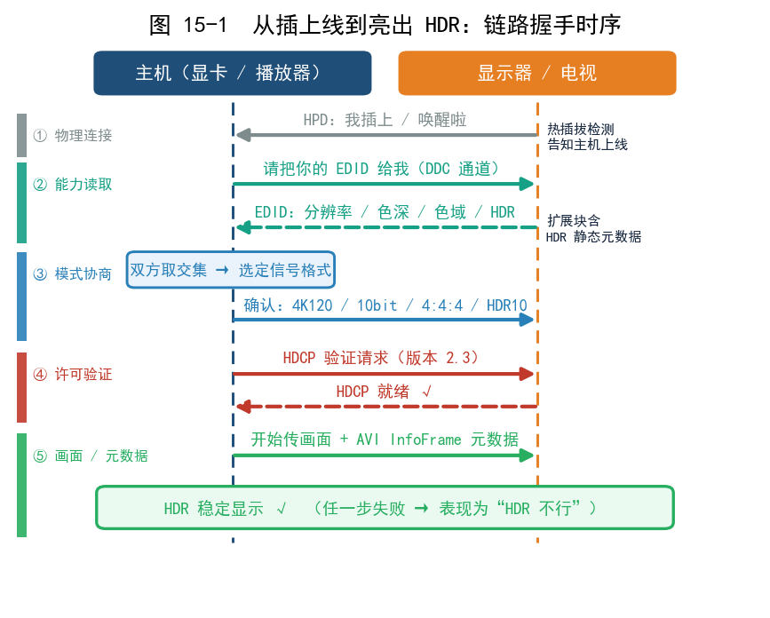
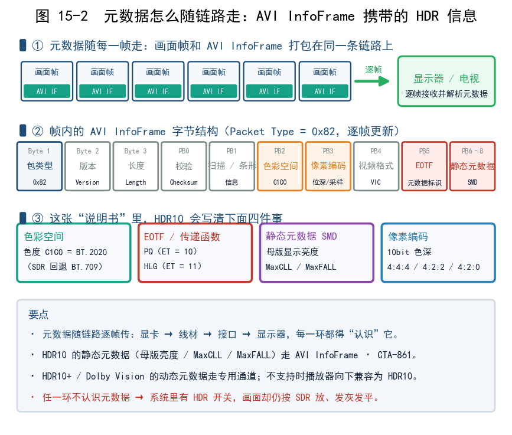
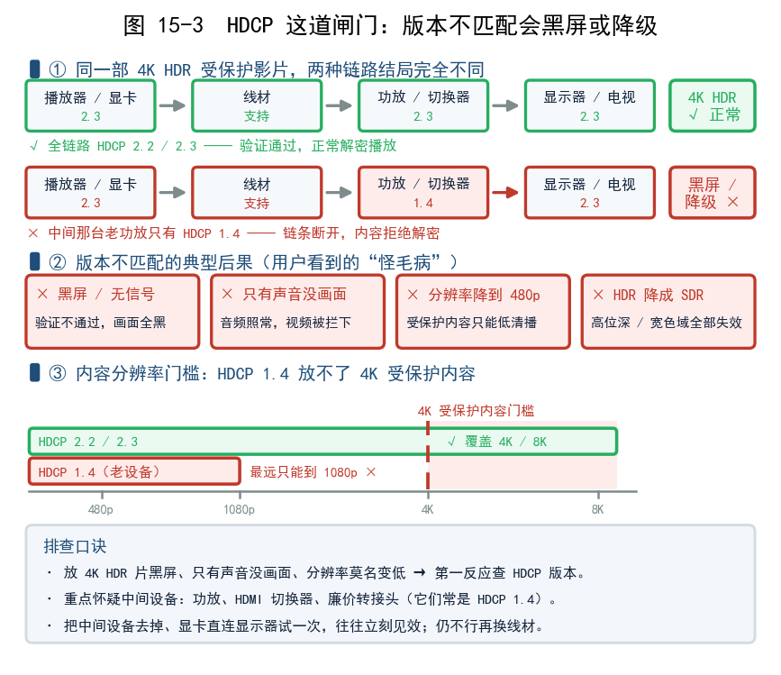
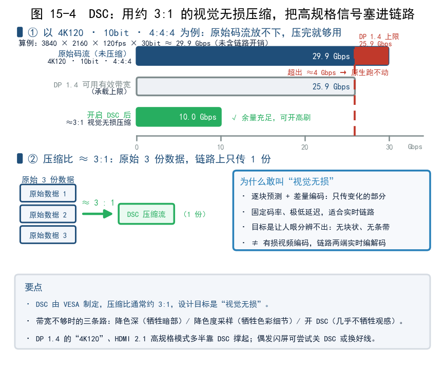

# 第 15 章 链路握手：EDID、元数据、HDCP 与 DSC

上一章搞明白了"水管有多粗"，但两根水管接上，并不代表它们会自动说出同样的话。这一章讲的是**显卡和显示器之间那场看不见的"谈判"**：显示器先告诉主机"我会什么"，主机再决定"给你发什么信号"，中间还要核对"你有没有播放许可"，带宽不够时还得临时压缩。HDR 能显示出来之前，链路上必须完成这么几次关键握手。看懂了，以后遇到"开了 HDR 黑屏""画面发灰""只有 480p"这类怪毛病，就知道该往哪儿查。

---

## 一、EDID：显示器递给主机的"能力清单"

去医院看病，进门总得先递一张**体检报告**。显示器也有这么一张，叫 **EDID（Extended Display Identification Data，扩展显示标识数据）**。

它是一小块存在显示器里的数据，插上线的瞬间自动读给主机听，大致包含：

- **支持的分辨率与刷新率**：比如"我能上 4K120"；
- **支持的色深**：8bit 还是 10bit、12bit；
- **支持的色域/色彩格式**：RGB、YCbCr 4:4:4 / 4:2:2 / 4:2:0；
- **HDR 相关的静态元数据块**：明确告诉主机"我支持 HDR10"（含支持的 EOTF、色域等）。

主机收到这份报告，才知道这台屏可以放 HDR，设置里才会出现开 HDR 的选项。**如果 EDID 没有正确上报 HDR 能力，你在系统里根本看不到 HDR 开关，或者开了也没效果。**

配套还有两个词：

- **DDC（Display Data Channel，显示数据通道）**：用来读 EDID、做通信的"小电话线"。
- **HPD（Hot Plug Detect，热插拔检测）**：显示器告诉主机"我刚插上了/刚拔了/我刚睡了"的一根信号线。

所以有时会出现这种情况：**换了线、换了转接头、显示器休眠再唤醒之后，得重新插拔一次，HDR 才正常**。多半就是 HPD 或 EDID 谈判没走顺。

### 握手是怎么一步步发生的

把整条链路的"谈判"串起来，大致是这个顺序：



**流程本身就是"先问能力、再定格式、再做许可"，任何一步卡住，最后都只表现为一句模糊的"HDR 不行"。**

### EDID 也会"说谎"或"漏报"

EDID 并不是永远正确，常见的小毛病有：

- **老设备只写了 SDR 信息**：主机看不到 HDR 能力，系统中干脆不给 HDR 选项；
- **中间设备不转发或篡改 EDID**：一些廉价切换器、转接头会把显示器的真实能力"截断"，主机以为对端很弱；
- **EDID 扩展块损坏**：冷启动、热插拔后偶发识别异常，重启/重插往往能恢复。

以后再碰上"开不了 HDR""只认 1080p""换个口就变好了"，心里要有根弦：**这很可能是 EDID/HPD 层面的问题，不一定是硬件坏了。**

---

## 二、元数据怎么随链路走

第 8、9 章说过，HDR 画面身上带**元数据（metadata）**，"告诉屏幕这段画面该按什么亮度/色彩来放"。问题来了：这份"说明书"怎么送进显示器？靠的是链路上的**信息帧**。

在 HDMI 里，画面之外的这些小信息装在 **AVI InfoFrame** 里，随每一帧一起传。里面会写明：

- 当前用的是哪种**色彩空间**（BT.2020 还是 BT.709）；
- 当前的 **EOTF**（传递函数，是 PQ 还是传统 Gamma）；
- 以及 HDR10 的**静态元数据**（母版显示亮度、MaxCLL/MaxFALL 等，见第 8 章）。

**元数据不跟内容文件"绑死"，它随链路一帧一帧送过去**。这条链路上任何一环不认识它，HDR 效果就打了折扣，甚至被当成 SDR 播。

不同类型的 HDR，走的"元数据通道"也不同：

| HDR 格式 | 元数据形态 | 传输方式 |
|---|---|---|
| HDR10 | 静态（一部片一套） | AVI InfoFrame / CTA-861 静态元数据 |
| HDR10+ | 动态（逐场景） | 随码流，走 HDMI 2.1 的动态元数据机制 |
| Dolby Vision | 动态（更细） | 随码流的 RPU，需专用链路支持 |

这也是为什么"内容支持 DV，但显示器和线只支持 HDR10"时，播放器往往会**向下兼容**成 HDR10（见第 9 章）——更高级那条元数据通道没打通。

> 记忆点：**元数据像随车附带的"驾驶指令"，不是贴在货物上的标签。** 它一路要经过显卡、线、接口、屏幕，每个关卡都得放行。



杜比视界中，RPU是一组附着在视频每一帧上的动态元数据。它不直接包含画面像素，里面是一套处理指令，告诉显示设备如何对当前这一帧画面进行优化。对于每一帧，RPU都会精确规定：应该如何进行色调映射（Tone Mapping），以便在峰值亮度有限的屏幕上，依然能呈现出导演想要的对比度和高光细节；以及如何进行色彩重塑，以还原更丰富的色彩层次。这些逐帧变化的指令，把杜比视界与使用静态元数据的HDR10区分了开来，也意味着杜比视界对链路的要求更为严格。

---

## 三、HDCP：内容保护这道闸门

带宽管的是"管子够不够粗"，**HDCP（High-bandwidth Digital Content Protection，高带宽数字内容保护）** 管的则是"门卫有没有放行许可"。

它是保护影视内容不被非法录制的一套加密机制。播放蓝光、流媒体等受保护内容时，**从播放端到显示端整条链路都必须是"可信设备"**，内容才会正常解密显示；一旦链路里有个设备不配合，就会：黑屏、只出雪花、或者把分辨率降到 480p、把 HDR 降成 SDR。

HDR 时代的关键门槛是版本：

- **HDCP 2.2 / 2.3**：播放 4K 及以上的受保护内容（含 HDR）通常要求 HDCP 2.2 以上；
- 只有 HDCP 1.4 的老设备，遇到 4K HDR 内容往往直接黑屏或降级。

```mermaid
flowchart LR
    A[播放器/显卡<br>HDCP 2.3] --> B[线材<br>需支持]
    B --> C[中间设备<br>功放/切换器]
    C --> D[显示器<br>HDCP 2.3]
    A -.版本不匹配.-> E{结果}
    C -.老版本 HDCP 1.4.-> E
    E --> F[黑屏]
    E --> G[降到 480p]
    E --> H[降成 SDR]
```

**排查口诀：** 放 HDR 片黑屏、只有声音没画面、分辨率莫名变低，第一反应就该怀疑 **HDCP 版本不匹配或中间设备(功放、HDMI 切换器、廉价转接头)拖后腿**。把中间设备去掉、直连显示器试试，往往立刻见效。



HDCP（High-bandwidth Digital Content Protection，高带宽数字内容保护） 是一套链路加密与设备认证协议，主要用在 HDMI、DisplayPort、DVI 等数字音视频接口上，防的是数字视频/音频在播放器到显示器/电视的线缆链路上被非法截获和复制。

源设备（机顶盒、显卡、播放器）和显示设备（电视、显示器、功放）连接时，先进行 HDCP 握手，确认双方都是“合法授权设备”。认证通过后，源端对通过接口传输的音视频数据加密，显示端解密。中间如果被录制设备截获，拿到的也只是加密数据。

---

## 四、DSC：带宽不够时的"视觉无损压缩"

带宽不够，除了降色深、降帧率，还有一条更聪明的路：**DSC（Display Stream Compression，显示流压缩）**。

它的思路是：与其砍画质，不如把数据**压一压再传**。压缩比通常约 **3:1**，而且被设计成**"视觉无损"**——正常人眼基本看不出差别。带宽一下被解放出来，4K 高刷、甚至 8K 都能在没那么粗的管子里跑起来。

```text
带宽不够时，你有三条路：
  ① 降色深（10bit → 8bit）        ——牺牲 HDR 暗部层次
  ② 降色度采样（4:4:4 → 4:2:0）    ——牺牲色彩细节
  ③ 开 DSC（约 3:1 压缩）          ——几乎不牺牲观感 ✅ 优先选它
```

所以会有这么几种情况：

- **DP 1.4 的"4K120"**：有效带宽约 25.9 Gbps 并不够原生跑，多半靠 DSC；
- **HDMI 2.1 的高规格模式**：也想足带宽，DSC 是常客。

DSC 通常默认开启，用起来很省心，代价是它的存在感往往被忽略：**"支持 4K120"这类规格，背后可能就是 DSC 的功劳**。遇到兼容性小毛病（偶尔一闪、切分辨率黑一下），也多半和它有关。这类问题一般关掉 DSC 或换根好线就能缓解。



### DSC 的基本概念

DSC是为显示链路设计的，服务于“现在就要把这一帧画面送到屏幕上”的场景。它的三个核心目标是：
- 视觉无损：压缩后的画面，人眼无法察觉与原始画面的区别。
- 低延迟：处理速度必须极快，不能引入可感知的延迟。
- 固定压缩比：通常为3:1，确保带宽需求是可预测的，不会因画面复杂而波动。

DSC是一个显卡和显示器协同完成的过程，由显卡（或输出设备）负责压缩（编码），然后由显示器负责解压缩（解码），最终显示出画面。这需要两端都支持并参与，缺一不可。

在发送信号之前，显卡或设备的显示控制器会作为编码端，将原始的视频数据流压缩成DSC格式。
- 执行压缩：显卡内部的DSC编码器会按照VESA的标准算法，对画面进行高效的帧内压缩。
- 降低带宽：这样做的目的，就是把庞大的数据量压缩到接口（如HDMI 2.1或DisplayPort）能够承载的带宽范围内。

显示器端负责“解压缩”（解码），当显示器通过线缆接收到压缩过的数据流后，它会作为解码端，将数据还原成完整的视频信号，然后再显示在屏幕上。
- 执行解压：显示器内部的显示驱动IC或控制器中集成了DSC解码器，负责实时解压这些数据。
- 还原画面：解压后的像素数据再被送到显示面板上，最终呈现出我们看到的画面。

与H.264/HEVC等利用前后帧相似性（时间冗余）来大幅压缩不同，DSC完全只使用当前这一帧画面内部的信息（空间冗余），不参考任何其他帧。只做“帧内压缩”，不做“帧间压缩”，这是理解DSC原理最重要的一点。原因是，参考其他帧需要缓存，会带来延迟和巨大的内存开销。对于需要即时显示的屏幕来说，低延迟是比高压缩率更优先的目标。因此，DSC放弃了“帧间压缩”，只专注于把单帧画面“打包”得更小。

为了更高效地压缩，DSC常将RGB信号转换为YCoCg色彩空间。这样做的好处是能将亮度（Y）和色度（Co, Cg）分离，而人眼对色度细节不敏感，便于后续针对性地处理。对于原生4:2:0/4:2:2信号，DSC甚至可以直接压缩，省去转换步骤，效率更高。

编码器会预测当前像素的值，并只传输实际值与预测值之间的“残差”。因为相邻像素通常很相似，这个残差往往很小，甚至为零，数据量就大大减少了。预测出的残差数据，会根据速率控制模块的指令进行量化。量化的本质是降低精度，丢弃一些不重要的细节。它是实现“固定压缩比”的关键：当画面复杂、数据量大时，量化会更“激进”一些；当画面简单时，则更“精细”一些。量化后的数据会通过熵编码（DSC中使用的是DSU-VLC，一种变长编码）进一步压缩。它会根据数据出现的频率，用更短的码字表示常见值，用更长的码字表示罕见值，从而挤出最后一点冗余。

速率控制是其中非常重要的反馈机制。它实时监控编码输出的数据量，并动态调整量化的强度，确保每一行或每一个数据块的大小都严格符合目标带宽，实现恒定码率输出。

### VESA 简介

VESA 的全称是 Video Electronics Standards Association，中文叫视频电子标准协会，是一个国际非营利性标准组织。它在显示行业里的位置，有点像"联合国"或"立法委员会"：由一群显卡厂商（如NVIDIA、AMD、Intel）、显示器厂商（如三星、LG、戴尔）、芯片厂商等组成联盟，坐在一起制定大家都要遵守的技术规则。

它最核心的作用，是保证不同厂家生产的显卡、显示器、线缆插在一起就能用，不会因为标准不同而黑屏。这个组织制定的技术标准很多：
- DisplayPort (DP) 接口：VESA发明。
- DSC 压缩技术：VESA制定。
- VESA 壁挂孔：显示器背后那四个螺丝孔的距离标准。
- DisplayHDR 认证：用来给显示器画质分级、防厂商虚假宣传。

---

## 五、HDMI 2.1 顺带带来的新本领

带宽拉高之后，HDMI 2.1 还捎带了几项和体验强相关的新功能。它们不直接等于"更亮的 HDR"，但和 HDR 时代一起成套出现：

| 功能 | 全称 | 大白话作用 |
|---|---|---|
| VRR | Variable Refresh Rate（可变刷新率） | 让刷新率跟着帧率变，减少撕裂、卡顿 |
| ALLM | Auto Low Latency Mode（自动低延迟模式） | 一进游戏自动切到低延迟，省得手动调 |
| eARC | enhanced Audio Return Channel（增强音频回传） | 把高质量音频（如无损、对象音频）回传给功放 |

- **VRR**：以前刷新率是固定的（60Hz 就是一刻不停跑 60），游戏帧率一波动就撕裂。VRR 让它"跟着变"，画面更顺，在游戏 HDR 场景里几乎算标配。
- **ALLM**：接上游戏主机，电视自动切进"游戏模式"，延迟更低、手感更跟手。
- **eARC**：一根线把音频回传给音响/功放，支持更高码率、更多声道，影音党很在意。

这些功能都需要**主机、线材、显示器三方面都支持**才能生效。绕回来还是同一件事：**HDR 是全链路一致的事**。

---

## 六、把整条链路串起来：HDR 自检清单

以后遇到"HDR 不对劲"，可以按这个顺序自查（也见第 20 章的排查流程图）：

| 环节 | 要确认什么 | 出问题的典型现象 |
|---|---|---|
| 内容 | 片源/游戏真的含 HDR 吗 | 全程平平无奇，从没亮过 |
| 播放端/显卡 | 是否开了 HDR 输出、驱动是否正常 | 系统里 HDR 开关灰的 |
| EDID/HPD | 显示器能力是否被正确识别 | 看不到 HDR 选项、分辨率被锁低 |
| 元数据链路 | AVI InfoFrame 能否送达 | 有 HDR 开关但画面就是 SDR |
| HDCP | 版本是否 2.2/2.3、中间设备是否拖后腿 | 黑屏/只有声音/降成 480p |
| 带宽/DSC | 当前组合放得下吗、DSC 是否生效 | 掉到 8bit、4:2:0、30Hz 或闪屏 |
| 显示器/设置 | 屏本身 HDR 能力与设置 | 无 HDR 认证、开了也没感觉 |

两条结论值得记住：

> **HDR 是"全链路一致"的事：内容 + 显卡 + 线 + 接口 + 显示器 + HDCP，任一环不满足都失败。**
>
> **遇到怪毛病，先问"哪一环没谈成"，而不是直接把锅丢给屏幕。**

---

## 本章小结与常见误区

- **EDID** 是显示器递给主机的"能力清单"，上报分辨率、色深、色域和 HDR 能力；**DDC** 负责通信，**HPD** 负责告知插拔/唤醒。
- **元数据随链路传**：HDMI 用 **AVI InfoFrame** 携带色彩空间、EOTF 和静态元数据；HDR10+/Dolby Vision 的动态元数据另有专用通道，不支持时**向下兼容**。
- **HDCP** 是内容保护闸门，放 4K HDR 受保护内容通常需 **HDCP 2.2/2.3**；版本不匹配会黑屏或降级。
- **DSC** 是约 **3:1 的视觉无损压缩**，让高分辨率高刷在有限带宽上跑起来，"4K120"常靠它。
- HDMI 2.1 还带来 **VRR / ALLM / eARC**，让游戏与影音体验更顺。
- 收口一句：**HDR = 内容 + 显卡 + 线 + 接口 + 显示器 + HDCP，任一环不满足都失败。**

**几个容易混淆的点：**

1. **误区：买了 HDR 显示器就全程自动 HDR。** 实际上 EDID、元数据、HDCP、带宽任何一环掉链子，都会退化成 SDR。
2. **误区：放片黑屏/发灰是显示器坏了。** 别忘了先查 HDCP 版本和中间设备(切换器、老功放)。
3. **误区：把 DSC 当成"画质缩水"。** 它是视觉无损压缩，多数人看不出差别，属于"该开就开"。

## 下一章预告

链路谈妥了，最后一步是把它落到系统里——下一章我们讲 Windows、macOS、游戏主机和手机上的 HDR 到底怎么开、怎么调、怎么别踩坑。
