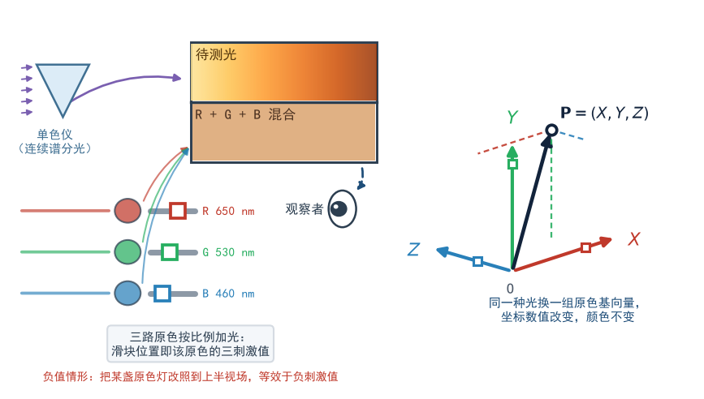
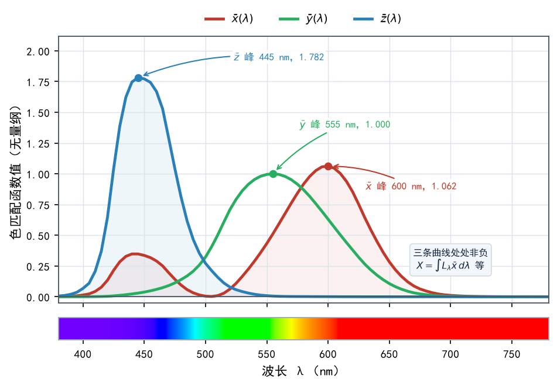
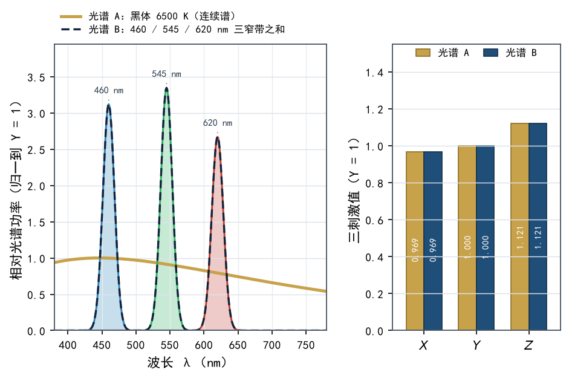

# 第 1 章 颜色的测量与 CIE 标准观察者

颜色可以测量，但先要说清楚测的是什么。进入瞳孔的光是一条随波长变化的功率曲线，而颜色判断是这条曲线经过眼睛和视觉神经之后的结果。把一条连续曲线压缩成三个数字，靠的是 1928 年到 1931 年间几个实验室的目视匹配实验，以及 CIE 在 1931 年做的一次线性变换。本章沿这条线索走一遍：光如何被计量，观察者如何被标定，这套标定在什么条件下会失效。

## 1.1 光谱功率分布与两套计量

任何发光体在可见光范围内的辐射功率随波长的分布，称为光谱功率分布（spectral power distribution，SPD），记作 $L_{e,\lambda}(\lambda)$，单位是 $\mathrm{W\cdot sr^{-1}\cdot m^{-2}\cdot nm^{-1}}$。自发光的屏幕、反射环境光的纸张、LED 背光加荧光粉的白光，都有自己的 SPD。线谱光源（低压钠灯、激光）的 SPD 是几根竖线，热辐射光源是平滑的连续曲线，白光 LED 通常是蓝光峰加一段宽的黄绿带。

不发光的东西也可以换算成 SPD。物体表面的反射由光谱反射率 $\rho(\lambda)$ 描述，照明光为 $L_{e,\lambda}(\lambda)$ 时，反射光的 SPD 是两者相乘，三刺激值仍然用上面的积分算，只是被积函数换成 $\rho(\lambda)L_{e,\lambda}(\lambda)$。这就是为什么同一块布料在 D65 和白炽灯下颜色不同：反射率不变，照明光的 SPD 变了，乘积也就变了。印刷、纺织、涂料行业因此把"标准光源下测反射率"写进规范。

对 SPD 的计量有两套并行体系。辐射度量学只关心能量，用辐射通量（W）、辐射亮度（W·sr⁻¹·m⁻²）、辐照度（W·m⁻²）描述。光度量学在此之上加权人眼灵敏度，把能量换算成"看起来有多亮"。

$$ \Phi_v = K_m \int_{380}^{780} \Phi_{e,\lambda}(\lambda)\, V(\lambda)\, \mathrm{d}\lambda $$

其中 $V(\lambda)$ 是 CIE 1924 年采纳的明视觉光谱光视效率函数，峰值在 555 nm 处取 1，$K_m = 683\ \mathrm{lm/W}$ 是 555 nm 处的最大光谱光视效能（频率 540 THz）。亮度同理：

$$ L_v = 683 \int L_{e,\lambda}(\lambda) V(\lambda)\,\mathrm{d}\lambda \quad [\mathrm{cd/m^2}] $$

这两个式子说明了光度量的局限：积分把整条曲线压成一个标量，色度信息在积分过程中全部丢失。一块 1000 cd/m² 的白色屏幕和一块 1000 cd/m² 的橙色屏幕，亮度读数相同。

作为数量级参照，反射率 0.8 的白纸放在 500 lx 的照度下，亮度约为 $\rho E/\pi = 0.8 \times 500/\pi \approx 127\ \mathrm{cd/m^2}$；HDR 电视的峰值亮度标称值常见 1000 cd/m²，部分型号做到 2000 cd/m² 以上；正午直射阳光下的白纸可以超过 $2.5\times10^4\ \mathrm{cd/m^2}$。这些数字在第 6 章讨论色调映射时还会用到。

## 1.2 目视匹配实验

要建立颜色的数值体系，需要回答一个问题：给定一种光，用三种固定原色按什么比例混合，才能让它和那种光看起来一样。

1928 年到 1929 年，W. D. Wright 在伦敦做了系统的实验。他让观察者通过一个 2° 视场的目镜看双视场，一半是待测的单色光（由棱镜单色仪分光得到，波长可调），另一半是 650 nm、530 nm、460 nm 三个原色光的混合。观察者调节三路原色的强度，直到两半视场看不出分界。这样对每一个波长，都得到一组三个匹配量。10 位观察者的数据被平均，得到 CIE 1931 RGB 系统的色匹配函数 $\bar r(\lambda)$、$\bar g(\lambda)$、$\bar b(\lambda)$。

1931 年，J. Guild 在伦敦用另一套装置做了同类实验，原色换成了 460 nm、540 nm、620 nm 的滤光片组合，7 位观察者。两组实验的原色波长不同，装置不同，观察者不同，但把 Guild 的数据经过线性变换换到 Wright 的原色下之后，两条色匹配函数曲线在实验误差内重合。这个结果相当有分量，它支持了 Grassmann 早先提出的加色混合定律：颜色匹配是线性的，如果光 A 与混合色 M 匹配，光 B 与混合色 N 匹配，那么 A+B 的混合体就与 M+N 匹配，强度按比例缩放也成立。

线性成立，意味着可以用三个数表示一种颜色，也意味着三刺激值可以像向量一样做加减。这是整个色度学的代数基础。

实验里有一个绕不开的麻烦。对于很饱和的青绿色（约 490 nm 到 510 nm），任何比例的红、绿、蓝混合都配不出同样的颜色，无论怎么加。观察者只能把红原色的一小部分光改照到待测光那一侧，把待测光"往红的方向推"，两边才重新匹配。这在数学上等于红原色的匹配量取负值。Wright 的原始数据里，$\bar r(\lambda)$ 在 450 nm 到 550 nm 之间确实是负的。

负值对计算很不友好。积分时会遇到负的刺激值，色度坐标也可能落到不合理的位置，工程实现上还要额外处理符号。CIE 在 1931 年决定保留数据、换掉坐标系。

## 1.3 从 RGB 到 XYZ 的线性变换

CIE 1931 的做法是找一组虚拟原色，使色匹配函数处处非负。变换矩阵由三个条件定出：

1. 新的色匹配函数 $\bar x$、$\bar y$、$\bar z$ 在可见光范围内不为负；
2. $\bar y(\lambda)$ 直接取 $V(\lambda)$，于是三刺激值中的 $Y$ 就是亮度；
3. 等能光谱（各波长功率相同）的色度定为 $x = y = 1/3$。

第三条要求三个积分的总和相等。用 5 nm 间隔的表格数值做梯形积分，$\int \bar x\,\mathrm{d}\lambda$、$\int \bar y\,\mathrm{d}\lambda$、$\int \bar z\,\mathrm{d}\lambda$ 分别是 106.85、106.86、106.84，差异在万分之二以内，这解释了为什么等能白的色度坐标几乎是精确的 $(1/3, 1/3)$。

原色取 700 nm、546.1 nm、435.8 nm 三个波长（后两者是汞灯的谱线），从 CIE RGB 到 XYZ 的变换写成矩阵形式：

$$
\begin{bmatrix} X\\ Y\\ Z \end{bmatrix}
=
\begin{bmatrix}
2.7689 & 1.7517 & 1.1302\\
1.0000 & 4.5907 & 0.0601\\
0.0000 & 0.0565 & 5.5943
\end{bmatrix}
\begin{bmatrix} R\\ G\\ B \end{bmatrix}
$$

矩阵第二行全是正数且以 G 为主，这正是"Y 等于亮度"的代价：绿光对亮度的贡献最大，符合 $V(\lambda)$ 在 555 nm 附近达到峰值的事实。任意光谱的三刺激值由三个积分给出：

$$ X = \int L_{e,\lambda}(\lambda)\bar x(\lambda)\,\mathrm{d}\lambda,\quad
   Y = \int L_{e,\lambda}(\lambda)\bar y(\lambda)\,\mathrm{d}\lambda,\quad
   Z = \int L_{e,\lambda}(\lambda)\bar z(\lambda)\,\mathrm{d}\lambda $$

图 1-2 是这三条曲线的实际形状。$\bar x$ 有两个峰，主峰 600 nm 处 1.062，次峰 445 nm 附近约 0.35，两峰之间的凹陷是这套坐标系的一个特征，它来自变换时对"非负"和"等能白"两个约束的折中。$\bar z$ 在 445 nm 处达到 1.783，是三条曲线里最高的，550 nm 之后迅速衰减，600 nm 以上基本为零，所以 $Z$ 只反映短波部分。$\bar y$ 与 $V(\lambda)$ 完全重合。

把矩阵求逆，可以从 XYZ 反推原色的匹配量。以 sRGB 基色为例，逆矩阵中对应红通道的一行是 $R = 3.2406X - 1.5372Y - 0.4986Z$，系数里有负数，意味着饱和的颜色在反推时会出现负的"红光用量"。这正是色域概念的来源，也解释了为什么显示器只能覆盖色度图上的一个三角形，三角形之外的色度需要负的基色分量，物理上做不到。

XYZ 不是三个真实存在的原色。没有任何一束光能单独刺激出 $(1,0,0)$ 这样的响应，这就是它被称为虚拟原色的原因。它是一套为计算方便而构造的坐标，工程上够用，物理上并不对应某个光源。

## 1.4 1964 补充标准观察者

CIE 1931 的数据基于 2° 视场，相当于一臂距离上看一枚硬币。这个视场只覆盖中央凹附近很小的一块视网膜，而中央凹区域有黄斑色素，对 400 nm 到 500 nm 的吸收明显强于周边视网膜。视场一大，参与判断的视网膜区域变化，短波段的灵敏度就跟着变。

1955 年，Stiles 与 Burch 发表了 10° 视场的匹配实验，用了约五十位观察者；Speranskaya 在苏联也做了独立的 10° 实验。CIE 在 1964 年把这些数据整合为 CIE 1964 补充标准观察者，色匹配函数记作 $\bar x_{10}$、$\bar y_{10}$、$\bar z_{10}$。

两套数据在长波段基本一致，差别集中在短波端，400 nm 到 500 nm 区间相对差异最大，因为这一段正好是黄斑色素吸收的窗口。把同一块白（D65 光谱）分别用两套数据积分，得到的色度坐标在第三位小数上不同，视觉上难以察觉，但在按 1 到 2 个 $\Delta E$ 判定合格与否的校准场景里已经不可忽略。

选择哪一套取决于被测对象的视角大小。小于 4° 的视场（远距离看电视、看手机、看仪表）用 1931 的 2° 数据；大面积色块（涂料样板、纺织面料、印刷品）用 1964 的 10° 数据。视频标准没有这个选择余地，BT.709、BT.2020、BT.2100 全部指定 CIE 1931 2° 观察者，SMPTE ST 2084 的 PQ 曲线也建立在同一套数据上。这意味着测量显示器时，仪器的观察者设置必须与标准一致，用 10° 数据去核 2° 标准的容差，会引入系统偏差。

## 1.5 同色异谱

两条 SPD 完全不同的光，积分得到的三个三刺激值完全相同，人眼看起来一样，这种关系叫同色异谱（metamerism），这样的一对光叫同色异谱对。

数学上这件事毫不意外。三刺激值是三个积分约束，而 SPD 是一个连续函数，有无穷多个自由度，满足三个线性约束的函数有无穷多条。屏幕上由三个窄带原色合成的一种颜色，与自然界某块物体反射的连续光谱，原则上总能调成同色异谱对。

图 1-3 给出一对具体的例子。左边是 6500 K 黑体的连续光谱，右边是 460 nm、545 nm、620 nm 三条带宽 20 nm 的窄带，三条窄带的强度由解三元一次方程组定出，使两组三刺激值相等。计算结果为 $X = 0.9687$、$Y = 1.0000$、$Z = 1.1206$，色度坐标 $x = 0.3136$、$y = 0.3237$，两组数值在四位小数上一致。两条曲线的形状相差极大，峰值相差三十倍以上。

同色异谱的成立有前提，前提一变，等号就断。三种典型情形：

**观察者差异。** 标准观察者是平均人眼，个体之间在晶状体黄化程度、黄斑色素密度、视锥光谱灵敏度上都不同。一对光谱对甲是同色异谱对，对乙可能差出 2 到 3 个 $\Delta E$。年龄越大，晶状体对短波的吸收越强，蓝紫区的偏差越明显。

**光源差异。** 两个物体在 D65 下同色，换到 A 光源（白炽灯）下可能明显不同。这就是"同色异谱失败"（metameric failure），在纺织、印刷、涂料行业是常规检验项。

**视场与几何差异。** 2° 与 10° 观察者的差别属于这一类，观察距离、光泽、观察角度也会改变结论。

对 HDR 显示，同色异谱有额外的分量。宽色域显示（BT.2020 覆盖 75.8% 的 CIE 1931 色域，sRGB 只有 33.3%）常用窄带光源：激光投影的谱宽只有几纳米，量子点背光的半高宽在 20 nm 到 30 nm 之间。窄带越窄，与自然连续光谱的同色异谱关系越依赖观察者，不同观众对同一画面的颜色判断分歧越大。这也是 CIE 近年推动"平均观察者"（average observer）与观察者分类研究的原因，CIE 170-2 给出了按年龄和视场分类的观察者模型。

## 1.6 测量实践中的数值细节

分光辐射度计是获取 SPD 的主力工具。它把入射光色散后投到阵列探测器上，直接给出波长与功率的对应关系，再由仪器内部乘上色匹配函数、积分得到 XYZ。这里有几个容易忽略的误差来源。

**采样间隔与光谱带宽。** CIE 标准表格给的是 5 nm 间隔的数，但仪器实际带宽可以是 1 nm 到 5 nm 的任何值。用 5 nm 间隔对带宽 20 nm 的光源做梯形积分，与 1 nm 积分的差异在 0.01% 量级；10 nm 间隔也在 0.1% 以内；换到 20 nm 间隔，误差会跳到 5% 以上，因为这时采样点已经落在光源谱峰的两侧，峰顶被漏掉。测窄带激光时这个误差更敏感，需要 1 nm 甚至更细的采样。

**波长精度。** 波长轴上 0.3 nm 的偏移，会沿着色匹配函数最陡的斜坡把结果推偏。蓝光 LED 的谱峰上升沿陡峭，1 nm 的波长误差可能带进 0.5% 以上的 $Z$ 误差。

**几何条件。** 测屏幕时要正对法线，测反射样品要用积分球或 45/0 几何，否则余弦响应和镜面反射分量会让读数偏离。

**观察者设置。** 如前所述，仪器里选 2° 还是 10°，取决于被测对象与所依据的标准。

**仪器类型的选择。** 分光辐射度计给出 SPD，可以事后按任意观察者、任意光源重算，代价是灵敏度低、价格高、测暗场慢。滤光片式亮度计（色度计）用三组滤光片模拟色匹配函数，响应快、灵敏度高，适合产线抽检和暗场测量，但它的滤光片与 CIE 曲线只是近似匹配，遇到窄带光源时误差会放大，而且结果被锁死在出厂时的那套观察者上。

**定标。** 仪器读数需要溯源。常用做法是用一盏光谱已知的标准灯（色温 2856 K 的钨丝灯，即光源 A）定标绝对亮度和波长轴，再用一块漫反射白板检查几何条件。定标周期一般是半年到一年，仪器老化会让短波端的响应缓慢下降。

这些细节在普通色度测量里可以容忍，但在 HDR 校准中会被放大。显示器的低亮度端（0.01 cd/m² 到 1 cd/m²）信噪比差，暗部的 $Z$ 值本来就小，相对误差大；高亮度端又要考虑仪器自身的热漂移。第 6 章讨论测量与校准时会回到这些约束。

## 本章要点

- 颜色的物理入口是光谱功率分布，它是一条连续函数，携带的信息远多于三个数字。
- 光度量用 $V(\lambda)$ 加权积分，$K_m = 683\ \mathrm{lm/W}$，峰值在 555 nm；积分后只剩一个亮度标量，色度信息全部丢失。
- Wright（1928，10 位观察者，650/530/460 nm）与 Guild（1931，7 位观察者，460/540/620 nm）的目视匹配实验构成了 CIE 1931 标准观察者的数据来源，两套数据经线性变换后一致，验证了颜色匹配的线性。
- 饱和青色配不出来，只能把原色加到待测侧，于是出现负的匹配量，这是 CIE 改用虚拟原色的直接原因。
- CIE 1931 XYZ 的三个约束是：色匹配函数非负、$\bar y = V(\lambda)$、等能白色度在 $(1/3,1/3)$。因此 $Y$ 就是亮度，但 XYZ 不对应任何真实光源。
- CIE 1964 的 10° 补充观察者面向大视场，与 2° 数据的差别集中在 400 nm 到 500 nm；视频标准一律规定使用 1931 的 2° 观察者。
- 同色异谱对在观察者、光源、视场任一条件改变时都可能失效，窄带光源（激光、量子点）会把这种失效放大。
- 分光测量中，5 nm 采样对宽带光源足够，对 20 nm 带宽的光源需要 1 nm 采样；波长精度和几何条件的影响与采样间隔同量级。
