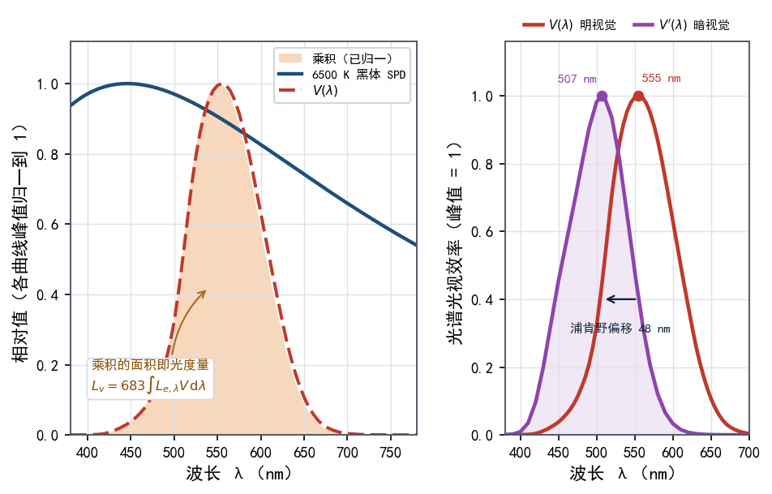
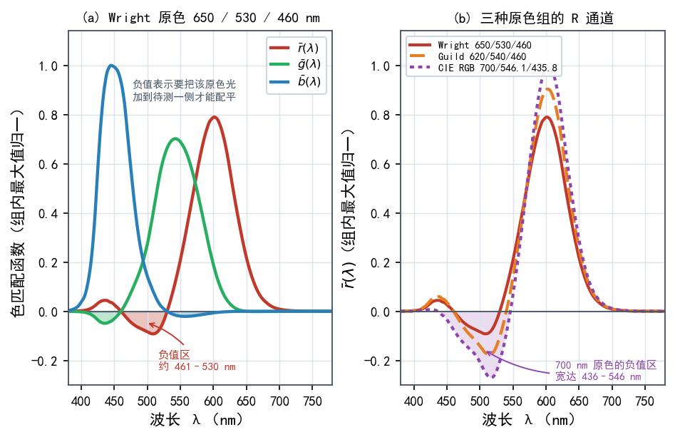
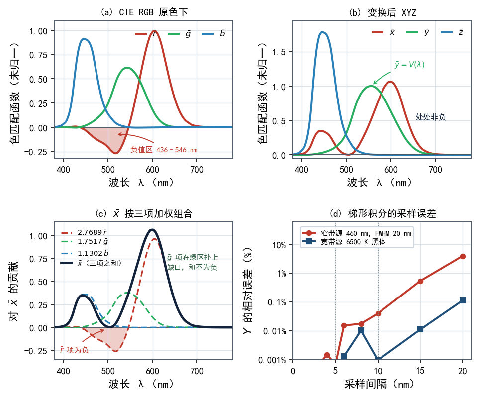
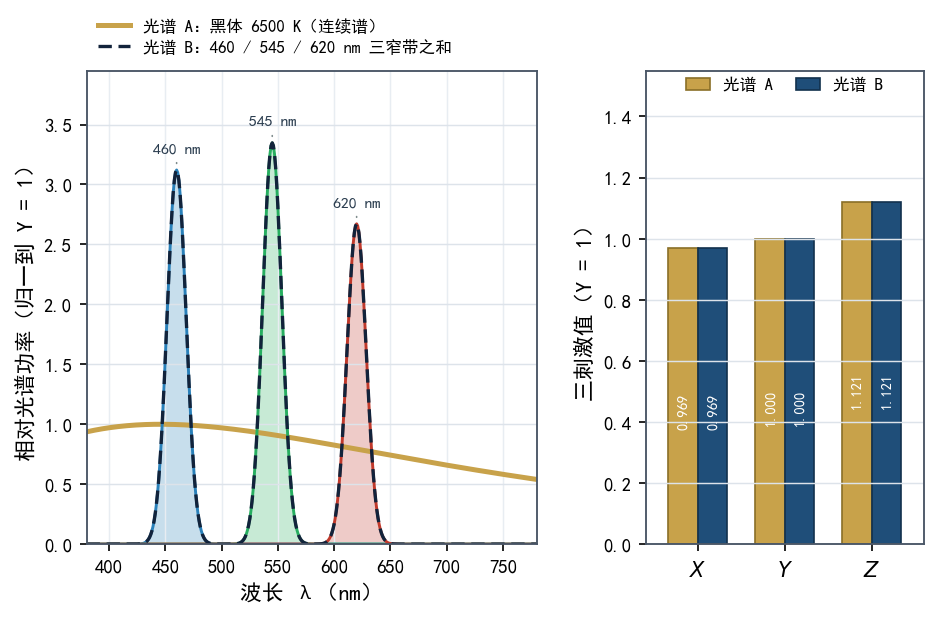
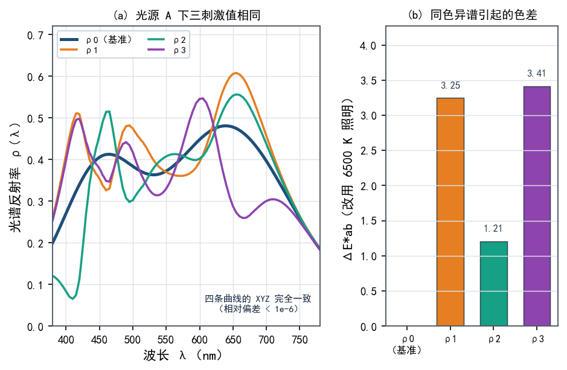
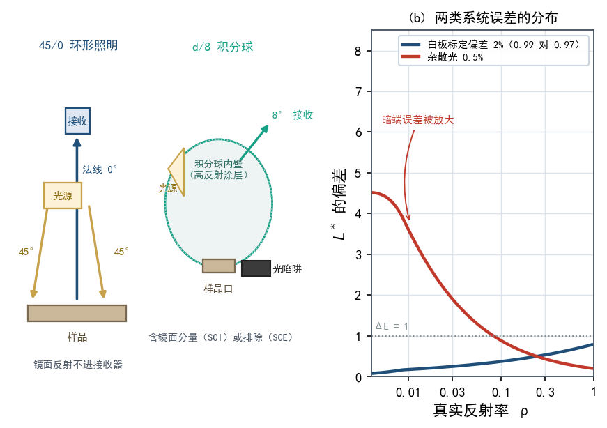

# 第 1 章 颜色的测量与 CIE 标准观察者

颜色可以测量，但先要说清楚测的是什么。进入瞳孔的光是一条随波长变化的功率曲线，而颜色判断是这条曲线经过眼睛和视觉神经之后的结果。把一条连续曲线压缩成三个数字，靠的是 1928 年到 1931 年间几个实验室的目视匹配实验，以及 CIE 在 1931 年做的一次线性变换。本章沿这条线索走一遍：光如何被计量，观察者如何被标定，这套标定在什么条件下会失效。

## 1.1 光谱功率分布与两套计量

任何发光体在可见光范围内的辐射功率随波长的分布，称为光谱功率分布（spectral power distribution，SPD），记作 $L_{e,\lambda}(\lambda)$，单位是 $\mathrm{W\cdot sr^{-1}\cdot m^{-2}\cdot nm^{-1}}$。自发光的屏幕、反射环境光的纸张、LED 背光加荧光粉的白光，都有自己的 SPD。线谱光源（低压钠灯、激光）的 SPD 是几根竖线，热辐射光源是平滑的连续曲线，白光 LED 通常是蓝光峰加一段宽的黄绿带。

这三种形态决定了后续计算能否简化。连续谱可以按较粗的间隔采样，误差控制在千分之一以内；线谱源必须细采，否则峰顶会被漏掉。屏幕的光谱介于两者之间：液晶背光经过液晶层和彩色滤光片后，蓝通道的谱宽在 15 nm 到 25 nm，绿通道略宽，红通道最宽，激光投影则把三个通道压到 5 nm 以下。

不发光的东西也可以换算成 SPD。物体表面的反射由光谱反射率 $\rho(\lambda)$ 描述，照明光为 $L_{e,\lambda}(\lambda)$ 时，反射光的 SPD 是两者相乘，三刺激值仍然用后面的积分算，只是被积函数换成 $\rho(\lambda)L_{e,\lambda}(\lambda)$。这就是为什么同一块布料在 D65 和白炽灯下颜色不同：反射率不变，照明光的 SPD 变了，乘积也就变了。印刷、纺织、涂料行业因此把"标准光源下测反射率"写进规范，测的不是颜色，是一组与照明条件绑定的反射率数据。

对 SPD 的计量有两套并行体系。辐射度量学只关心能量，用辐射通量（W）、辐射强度（W·sr⁻¹）、辐射亮度（W·sr⁻¹·m⁻²）、辐照度（W·m⁻²）描述。光度量学在此之上加权人眼灵敏度，把能量换算成"看起来有多亮"。

| 量 | 辐射度量 | 单位 | 光度量 | 单位 |
|---|---|---|---|---|
| 通量 | $\Phi_e$ | W | $\Phi_v$ | lm |
| 强度 | $I_e$ | W·sr⁻¹ | $I_v$ | cd |
| 亮度 | $L_e$ | W·sr⁻¹·m⁻² | $L_v$ | cd·m⁻² |
| 照度 | $E_e$ | W·m⁻² | $E_v$ | lx |
| 出射度 | $M_e$ | W·m⁻² | $M_v$ | lm·m⁻² |

两套量的换算只在一处发生，就是通量这一层：

$$ \Phi_v = K_m \int_{380}^{780} \Phi_{e,\lambda}(\lambda)\, V(\lambda)\, \mathrm{d}\lambda $$

其中 $V(\lambda)$ 是 CIE 1924 年采纳的明视觉光谱光视效率函数，峰值在 555 nm 处取 1，$K_m = 683\ \mathrm{lm/W}$ 是 555 nm 处的最大光谱光视效能。强度、亮度、照度都由通量推出，所以它们的换算也只需乘上同一个 $V(\lambda)$ 权重。亮度写成：

$$ L_v = 683 \int L_{e,\lambda}(\lambda) V(\lambda)\,\mathrm{d}\lambda \quad [\mathrm{cd/m^2}] $$

683 这个数字不是测出来的拟合常数，而是定义值。1979 年第十六届国际计量大会把坎德拉定义为：给定方向上频率为 $540\times10^{12}$ Hz 的单色辐射，若辐射强度为 $1/683$ W·sr⁻¹，则该方向上的光强为 1 cd。540 THz 对应真空波长 555.016 nm，正好落在 $V(\lambda)$ 的峰顶。这条定义把光度量的基准从实物（蜡烛、铂凝固点黑体）换成了可复现的辐射量，$K_m$ 从此不再有不确定度。

在 1979 年之前，$K_m$ 是两套基准比对出来的。1960 年代低温辐射计成熟，能把一束激光的绝对功率测到 0.1% 以内，光度量的绝对值就这样被拉进辐射度量的坐标系，比对结果与 683 相差在 0.2% 以内。这段历史留下一个后果：$V(\lambda)$ 的形状没有再测过，它来自 1923 年 Gibson 与 Tyndall 用 52 位观察者做的异色匹配实验，取样点稀疏、观察者样本偏年轻，之后近百年只有局部修订。

人眼有两套感受器系统。明视觉由视锥细胞承担，暗视觉由视杆细胞承担，两者的光谱灵敏度不同。CIE 在 1951 年采纳了暗视觉光谱光视效率 $V'(\lambda)$，峰值移到 507 nm，对应的最大光谱光视效能 $K'_m \approx 1700\ \mathrm{lm/W}$。峰值移动 48 nm 的现象叫浦肯野偏移（Purkinje shift）：黄昏时最亮的花从红色变成蓝色，是天黑之后视杆细胞的响应接管了亮度判断。

图 1-1 左边画出了这个加权过程。6500 K 黑体的 SPD 在红外段仍有一半以上的相对功率，$V(\lambda)$ 在那里已经归零，这部分能量对光度量没有贡献。乘积曲线只保留了 480 nm 到 650 nm 这一段，光度量的数值就是它的面积。右边是两条光视效率曲线，明视觉的峰在 555 nm，暗视觉的峰在 507 nm，两者的短波端差异最大，400 nm 处相差两个数量级。

用这两条曲线可以算出光源的辐射光效（luminous efficacy of radiation，LER），即每瓦辐射功率换多少流明。按普朗克公式对全波段积分，2856 K 黑体约 17.5 lm/W，5000 K 约 82.6 lm/W，6500 K 约 96 lm/W。同样一瓦电功率，色温越高看起来越亮，原因就在这里：高色温光谱把更多能量放进了 $V(\lambda)$ 的高响应区。实际灯具还要乘上电光转换效率，白光 LED 整灯做到 120 lm/W 到 200 lm/W，已经超过同色温黑体的理论值，因为它不是热辐射，光谱被人为裁剪过。

光度量有一个根本局限：积分把整条曲线压成一个标量，色度信息在积分过程中全部丢失。一块 1000 cd/m² 的白色屏幕和一块 1000 cd/m² 的橙色屏幕，亮度读数相同。要保留色度，必须回到三刺激值那条路。

作为数量级参照，反射率 0.8 的白纸放在 500 lx 的照度下，亮度约为 $\rho E/\pi = 0.8 \times 500/\pi \approx 127\ \mathrm{cd/m^2}$；HDR 电视的峰值亮度标称值常见 1000 cd/m²，部分型号做到 2000 cd/m² 以上；正午直射阳光下的白纸可以超过 $2.5\times10^4\ \mathrm{cd/m^2}$。这几个数字跨度超过两个数量级，正好是 HDR 要处理的动态范围。

## 1.2 目视匹配实验

要建立颜色的数值体系，需要回答一个问题：给定一种光，用三种固定原色按什么比例混合，才能让它和那种光看起来一样。

这个问题的实验形式很朴素。观察者通过一个双目目镜看一个圆形视场，视场被一条细线分成两半：一半是待测光，一半是三路原色的混合光。待测光由棱镜或光栅单色仪从白光中分出，波长可调；三路原色的强度各有一个滑块控制。观察者反复调节三个滑块，直到两半视场看不出分界。此时的三个读数就是这个波长下的三刺激值。

图 1-2 左边是这套装置的几何关系，右边是三刺激值的坐标解释：三个原色相当于三个基向量，任意一种光的三个匹配量就是它在这组基下的坐标。换一组原色，坐标数值全变，颜色本身不变，这正是后面做线性变换的依据。

1928 年到 1929 年，W. D. Wright 在伦敦做了系统的实验。视场 2°，相当于一臂距离上看一枚硬币。原色取 650 nm、530 nm、460 nm 三条谱线，来自汞灯和氖灯的放电管加滤光片。10 位观察者参与，每人把 380 nm 到 780 nm 之间的十几个波长各匹配若干次，取重复设定的平均值，再把 10 个人的数据平均。原始数据经过平滑和少量外推，得到 CIE 1931 RGB 系统的色匹配函数 $\bar r(\lambda)$、$\bar g(\lambda)$、$\bar b(\lambda)$。

1931 年，J. Guild 在伦敦用另一套装置做了同类实验。他的原色是 460 nm、540 nm、620 nm 的滤光片组合，靠一盏钨丝灯照明，用积分球把三路光混匀。观察者 7 位。Guild 的实验在仪器稳定性上比 Wright 好，读数重复性更高，代价是原色波长受滤光片限制，不像单色仪那样可以随意选。

两组实验的原色波长不同，装置不同，观察者不同。要把它们放在一起比较，必须做一次线性变换：把 Guild 的数据从他的原色基换算到 Wright 的原色基，或者两者都换算到一套共同的原色上。换算的依据是 Grassmann 加色混合定律。换算之后，两条色匹配函数曲线在实验误差内重合，重合程度在多数波长上优于 1%。

图 1-3 用 2° 观察者数据做了这个换算。任取一组原色波长，用它们的 XYZ 坐标组成矩阵，求逆后乘上 $\bar x$、$\bar y$、$\bar z$，就得到这组原色下的色匹配函数。左图是 Wright 原色下的三条曲线，右图把 Wright、Guild 和 CIE 最终采用的 700/546.1/435.8 nm 三组原色的 R 通道放在一起。三条 R 通道曲线的负值区宽度差别明显：Wright 组 461 nm 到 530 nm，Guild 组 460 nm 到 540 nm，700 nm 原色组宽到 436 nm 到 546 nm。

这个规律可以这样理解。红原色的波长越靠近长波端，它的色品坐标越贴近光谱轨迹的右端，要配出中间的青绿色就越费劲，需要"借"更多的红光到待测侧，于是负值区越宽。CIE 最终选 700 nm 做红原色，是因为它能把色域三角形的红色顶点推到极限位置，代价是负值区最宽、数值最不友好。

负值的物理含义很具体。对于很饱和的青绿色（约 490 nm 到 510 nm），任何比例的红、绿、蓝混合都配不出同样的颜色，无论怎么加。观察者只能把红原色的一小部分光改照到待测光那一侧，把待测光"往红的方向推"，两边才重新匹配。这在数学上等于红原色的匹配量取负值。Wright 的原始数据里，$\bar r(\lambda)$ 在 450 nm 到 550 nm 之间确实是负的。

负值对计算很不友好。积分时会遇到负的刺激值，色度坐标也可能落到不合理的位置，工程实现上还要额外处理符号。CIE 在 1931 年决定保留数据、换掉坐标系。

实验能成立，靠的是 Grassmann 在 1853 年提出的加色混合定律。它由四条组成，用现代语言表述：

1. **三色性**：任何颜色都可以用三个适当选择的原色按非负比例配出（或者把其中一个原色加到待测侧，等价于取负系数）。
2. **连续性**：原色强度连续变化时，匹配结果也连续变化，不存在跳变。
3. **比例性**：如果光 A 与混合色 M 匹配，那么把两者的强度同乘一个系数，仍然匹配。
4. **加和性**：如果 A 与 M 匹配、B 与 N 匹配，那么 A+B 与 M+N 匹配。

第四条是最强的一条，它把颜色匹配变成了向量加法。有了它，三刺激值可以像坐标一样做线性组合，混合色的三刺激值等于各分量三刺激值之和。整个色度学，包括色品坐标、色域三角形、色适应矩阵，都建立在这条性质上。

Grassmann 定律不是无条件成立的。它要求观察条件固定：相同的视场大小、相同的适应状态、相邻色块之间没有强对比干扰。两个颜色在暗背景上匹配，换到亮背景上可能就不匹配了，这叫同时对比效应，是色貌模型要处理的内容。在常规的测量条件下，误差足够小，线性假设可以接受。

线性假设还有一个推论：颜色的"维数"是 3。不管光谱有多少个采样点，能被人眼区分的信息只有三个自由度。第 1.6 节会看到，这个推论既是三刺激值体系的根基，也是同色异谱现象的来源。

## 1.3 从 RGB 到 XYZ 的线性变换

CIE 1931 的做法是找一组虚拟原色，使色匹配函数处处非负。变换矩阵由三个条件定出：

1. 新的色匹配函数 $\bar x$、$\bar y$、$\bar z$ 在可见光范围内不为负；
2. $\bar y(\lambda)$ 直接取 $V(\lambda)$，于是三刺激值中的 $Y$ 就是亮度；
3. 等能光谱（各波长功率相同）的色度定为 $x = y = 1/3$。

第三条要求三个积分的总和相等。用 5 nm 间隔的表格数值做梯形积分，$\int \bar x\,\mathrm{d}\lambda$、$\int \bar y\,\mathrm{d}\lambda$、$\int \bar z\,\mathrm{d}\lambda$ 分别是 106.854、106.857、106.842，最大相对偏差 $1.4\times10^{-4}$，这解释了为什么等能白的色度坐标几乎是精确的 $(1/3, 1/3)$。用表值直接求和乘 5 nm 得到的三个数是 106.858、106.857、106.858，偏差更小，因为求和法相当于矩形积分，在两端截断误差恰好部分抵消。

矩阵可以按四个步骤解出来，每一步都能用计算器复算。

图 1-4 是三条曲线的形状。$\bar x$ 有两个峰，主峰 600 nm 处 1.062，次峰 445 nm 附近约 0.35，两峰之间的凹陷是这套坐标系的一个特征。$\bar z$ 在 445 nm 处达到 1.783，是三条曲线里最高的，550 nm 之后迅速衰减，所以 $Z$ 只反映短波部分。$\bar y$ 与 $V(\lambda)$ 完全重合。

**第一步，写出三原色的色品坐标。** 取 700 nm、546.1 nm、435.8 nm（后两者是汞灯的谱线），从 2° 观察者表插值得到：

| 原色 | 波长 | $x$ | $y$ | $z$ |
|---|---|---|---|---|
| R | 700 nm | 0.7347 | 0.2653 | 0.0000 |
| G | 546.1 nm | 0.2737 | 0.7174 | 0.0089 |
| B | 435.8 nm | 0.1665 | 0.0089 | 0.8246 |

**第二步，把每个原色写成单位亮度的三刺激值向量。** 色品坐标只定方向，亮度系数待定，所以第 $i$ 个原色的三刺激值是 $k_i\,(x_i/y_i,\ 1,\ z_i/y_i)$，$k_i$ 是它的亮度系数。

**第三步，用等能白约束解出 $k_i$。** 等能白的三刺激值满足 $X=Y=Z$，而它是三个原色按等量混合得到的，所以矩阵三行的和必须相等。这给出两个独立方程，再加一个尺度约定（取 $k_g$ 为基准），解出 $k_r : k_g : k_b = 1.0004 : 4.5907 : 0.0603$。

**第四步，把 $k_i$ 代回，得到矩阵。**

$$
\begin{bmatrix} X\\ Y\\ Z \end{bmatrix}
=
\begin{bmatrix}
2.7691 & 1.7514 & 1.1265\\
1.0000 & 4.5907 & 0.0601\\
0.0000 & 0.0570 & 5.5782
\end{bmatrix}
\begin{bmatrix} R\\ G\\ B \end{bmatrix}
$$

这个结果与 CIE 公布的标准矩阵

$$
\begin{bmatrix}
2.7689 & 1.7517 & 1.1302\\
1.0000 & 4.5907 & 0.0601\\
0.0000 & 0.0565 & 5.5943
\end{bmatrix}
$$

在第二行上完全一致，在第一、三行上相差 0.3% 上下。差异的来源是插值：546.1 nm 与 435.8 nm 不落在 5 nm 网格上，用单调三次插值得到的色品坐标与 1931 年手算的结果有末位差别，这个差别被 5.5782 这样的系数放大了。用 1 nm 表重做，差异会缩小到 0.05% 以内。这一段的意义在于：矩阵不是凭空给定的，它完全由"原色波长 + 等能白 + 亮度归一"三个条件决定，换一组原色就换一个矩阵。

第二条约束（$\bar y = V$）是这套坐标好用的一半原因。它让 $Y$ 直接等于亮度，其余两个量只承担色度。代价也在这里：矩阵第二行全是正数且以绿原色的系数 4.5907 为主，因为 $V(\lambda)$ 的峰在 555 nm，绿光对亮度的贡献最大。

图 1-5 把这次变换拆开来看。左上是 700/546.1/435.8 nm 原色下的色匹配函数，$\bar r$ 在 436 nm 到 546 nm 之间有一个负值区，最低到 $-0.094$。右上是变换后的三条曲线，全部非负。左下给出一个更细的视角：$\bar x$ 恰好等于 $2.7689\bar r + 1.7517\bar g + 1.1302\bar b$，负的 $\bar r$ 项在 470 nm 到 540 nm 区间被正的 $\bar g$ 项补上，三项之和逐点非负。数值上这个恒等式的误差是 $4\times10^{-16}$，只受浮点舍入限制。虚拟原色之所以能消掉负值，机制就在这里：新坐标是旧坐标的线性组合，负的部分被其他通道的正值抵消。

$\bar z$ 在 600 nm 以上基本为零，所以 $Z$ 只反映短波部分，蓝色通道的品质主要由这一段决定。

把矩阵求逆，可以从 XYZ 反推某个设备基色下的用量。以 sRGB 为例，它的三基色色品坐标是 $(0.64, 0.33)$、$(0.30, 0.60)$、$(0.15, 0.06)$，白点取 D65。用同样的四步解一遍，得到

$$
\mathbf{M}_{sRGB} =
\begin{bmatrix}
0.4124 & 0.3576 & 0.1805\\
0.2126 & 0.7152 & 0.0722\\
0.0193 & 0.1192 & 0.9505
\end{bmatrix}
$$

第二行的三个系数 $0.2126$、$0.7152$、$0.0722$ 是 sRGB 三基色的亮度系数，任何人都可以从基色坐标和白点复算出来。逆矩阵是：

$$
\mathbf{M}_{sRGB}^{-1} =
\begin{bmatrix}
3.2410 & -1.5374 & -0.4986\\
-0.9692 & 1.8760 & 0.0416\\
0.0556 & -0.2040 & 1.0570
\end{bmatrix}
$$

逆矩阵的第一行有两个负系数，第二行有一个。负系数意味着某些颜色要显示出来，需要给某个通道送负的信号，物理上做不到。这正是色域概念的来源，也解释了为什么显示器只能覆盖色度图上的一个三角形，三角形之外的色度需要负的基色分量。同一个矩阵在 HDR 链路里也出现，PQ 编码之后的三基色信号与线性光之间就是靠它和它的逆来回换算。

值得注意的是，这里用的白点是 D65，而 sRGB 矩阵的数值与白点的 $X_n Y_n Z_n$ 直接相关。若把白点换成 D50，$0.4124$ 这一行会变成 $0.4361$、$0.3851$、$0.1431$，整条链路的结果都跟着变。这就是色彩管理里"白点必须跟着矩阵走"的原因。

XYZ 不是三个真实存在的原色。没有任何一束光能单独刺激出 $(1,0,0)$ 这样的响应，这就是它被称为虚拟原色的原因。它是一套为计算方便而构造的坐标，工程上够用，物理上并不对应某个光源。

还有一个归一化常数值得一提。实际计算里通常写成

$$ X = k\sum_\lambda S(\lambda)\bar x(\lambda)\Delta\lambda,\qquad k = \frac{100}{\sum_\lambda S(\lambda)\bar y(\lambda)\Delta\lambda} $$

这个 $k$ 让参考白（通常是完美漫反射体在标准照明体下）的 $Y$ 等于 100，于是 $L^*$ 的取值范围恰好是 0 到 100。$k$ 的数值随照明体变化：D65 下 $\sum S\bar y\Delta\lambda$ 归一之后 $k$ 的绝对值没有意义，因为它总是把 $Y$ 拉到 100；但在比较不同照明体下的绝对亮度时，必须用同一个 $k$，否则两个照明体之间的亮度比会被抹掉。用等能光谱时 $k = 100/106.857 = 0.9358$，这个数在教科书里出现频率很高。

## 1.4 色匹配函数的数据来源与数值处理

标准观察者的数据在 CIE 15:2004（等同采用为 ISO 11664-1）里以表格形式给出。2° 观察者有 5 nm 间隔、380 nm 到 780 nm 共 81 组值，以及 1 nm 间隔、360 nm 到 830 nm 共 471 组值。5 nm 表是原始的公布形式，1 nm 表是 1931 年之后按内插与平滑规则补出来的，两套表在 5 nm 网格上的数值完全一致。

表值的有效位数是五位，看似充裕，实际精度没这么高。1931 年的原始数据来自 10 位观察者，每人每波长重复十几次，取平均后的重复性在 0.5% 到 2% 之间，个体之间的分歧更大。Wright 与 Guild 两组数据的加权平均方式在 1931 年有过争议，最终的处理是把 Guild 的数据变换到 Wright 的原色下，再按观察者人数加权。因此现行表格代表的是"1928 年到 1931 年这批观察者的平均"，而不是某个绝对真理。这一点在讨论个体差异时有实际后果。

实际计算里很少直接用表值，多半要插值到更细的网格。插值方法有两种常见选择。线性插值实现简单，但在 5 nm 间隔下会引入折角，$\bar z$ 在 445 nm 附近的峰顶会被削掉一点。单调三次插值（PCHIP）保持曲线的单调性，不产生过冲，峰顶更准确，代价是需要四个相邻点。用 5 nm 表插值到 1 nm，两种方法的 XYZ 差异在 0.01% 量级；把 5 nm 表插值到 0.5 nm 再积分，与直接用 1 nm 表的差异也在同一量级。差别真正明显的地方是窄带光源：如果光源的半高宽只有 5 nm，插值方法造成的形状差异会直接带进三刺激值。

采样间隔的影响更直接。图 1-5(d) 把同一套 SPD 用不同间隔做梯形积分，纵轴是 $Y$ 的相对误差。宽带源（6500 K 黑体）在 20 nm 间隔下的误差是 0.11%，10 nm 以下都低于 0.01%。窄带源（460 nm，半高宽 20 nm）在 5 nm 间隔下误差 0.001%，10 nm 间隔 0.04%，15 nm 间隔 0.53%，20 nm 间隔 3.9%。若采样网格的起点挪动 2.5 nm，20 nm 间隔的误差升到 6.0%，因为采样点落到了峰顶两侧的陡坡上。

这组数字给出一个实用判据：宽带光源用 10 nm 间隔足够，误差在 0.01% 以下；窄带光源（LED、激光、荧光粉的窄带发射）要用 1 nm 到 2 nm 间隔；判断依据是采样间隔不应大于光源谱宽的十分之一。CIE 与 ASTM E308 都给出了"加权纵坐标"表，把色匹配函数预先乘上采样间隔做成权重，直接与测得的 SPD 相乘求和，省掉每次积分，同时把特定照明体下的计算标准化。这套表对 A、C、D65 等标准照明体分别给出，间隔有 1 nm、5 nm、10 nm、20 nm 几种，用哪一套要与仪器的实际带宽匹配。

仪器带宽是另一层误差。光谱仪的狭缝函数近似三角形，卷积之后 SPD 的总面积基本不变，所以对宽谱源的影响很小：用 20 nm 三角带宽测 20 nm 半高宽的窄带源，$Y$ 的变化只有 0.014%，色度变化在 $10^{-5}$ 量级。真正的问题出在两处。一是线谱光源，比如荧光灯的 435.8 nm 汞线，谱宽不到 1 nm，带宽一宽峰就被压平，峰值高度不再可靠，而很多仪器用峰值做波长与强度校准。二是狭缝函数不对称，重心偏离标称波长零点几纳米，在 $\bar z$ 的陡坡上就是 0.5% 以上的误差。

截断误差也值得一提。CIE 表格从 380 nm 开始，多数 SPD 在 380 nm 以下的功率可以忽略，紫外截止型光源（白炽灯加滤光片）更明显；但蓝光激发的荧光材料在紫外有发射，太阳光在 350 nm 附近还有可观的能量。把积分下限设成 380 nm 会漏掉这一段，对 $Z$ 的影响在 0.1% 到 1% 之间，对 $Y$ 的影响小一个数量级。严谨的做法是取 360 nm 到 830 nm，或者先用仪器的全谱数据检查被截断的部分占多少。

## 1.5 1964 补充标准观察者

CIE 1931 的数据基于 2° 视场，相当于一臂距离上看一枚硬币。这个视场只覆盖中央凹附近很小的一块视网膜，而中央凹区域有黄斑色素，对 400 nm 到 500 nm 的吸收明显强于周边视网膜。视场一大，参与判断的视网膜区域变化，短波段的灵敏度就跟着变。

1955 年，Stiles 与 Burch 发表了 10° 视场的匹配实验，用了约五十位观察者，原色取自单色仪，观察者用"最大饱和度法"调节匹配，即先把一个原色推到头，再逐步加亮另外两个。Speranskaya 在苏联也做了独立的 10° 实验，观察者 27 人。CIE 在 1964 年把这两批数据整合为 CIE 1964 补充标准观察者，色匹配函数记作 $\bar x_{10}$、$\bar y_{10}$、$\bar z_{10}$，同样是三刺激值形式，同样满足 $\bar y_{10}$ 与 10° 视场的明视觉函数一致。

两套数据在长波段基本一致，差别集中在短波端。400 nm 到 500 nm 区间的相对差异最大，因为这一段正好是黄斑色素吸收的窗口。差异的表现形式是曲线形状不同，不是简单缩放：10° 观察者在 440 nm 附近的响应明显高于 2°，在 460 nm 附近又反过来略低，两条曲线在中途交叉。把同一块白（D65 光谱）分别用两套数据积分，得到的色度坐标差别在千分之几，视觉上难以察觉，但在按 1 到 2 个 $\Delta E$ 判定合格与否的校准场景里已经不可忽略。

选择哪一套取决于被测对象的视角大小。小于 4° 的视场（远距离看电视、看手机、看仪表）用 1931 的 2° 数据；大面积色块（涂料样板、纺织面料、印刷品）用 1964 的 10° 数据。这条 4° 分界来自 CIE 的推荐，理由是 4° 以内的视场基本落在黄斑区，超出之后周边视网膜的贡献迅速增加。视频标准没有这个选择余地，BT.709、BT.2020、BT.2100 全部指定 CIE 1931 2° 观察者，SMPTE ST 2084 的 PQ 曲线也建立在同一套数据上。这意味着测量显示器时，仪器的观察者设置必须与标准一致，用 10° 数据去核 2° 标准的容差，会引入系统偏差。

两套观察者都只代表"平均人眼"，个体之间的差异没有被包含进去。文献里报告的个体差异可以很大：同一条 SPD，不同观察者匹配出的三刺激值差异换算成色差，在饱和色上可达 2 到 4 个 $\Delta E_{2000}$。差异有三个来源。晶状体随年龄黄化，短波透过率下降，70 岁的人眼里 450 nm 的光比 20 岁的人少一半以上，等效于给光谱加了一层黄色滤片。黄斑色素的光密度个体差异可达两倍，影响 400 nm 到 500 nm 的吸收量。三种视锥的光谱灵敏度曲线本身也有位移，L 锥的峰值波长在个体间相差几个纳米。

CIE 160:2004 专门处理观察者差异引起的同色异谱问题，给出了评估方法；CIE 170-2:2015 则给出了一套"生理学观察者"，用视锥基函数、黄斑色素密度、晶状体密度、视场大小四个参数描述观察者，可以按年龄和视场生成不同的观察者。工程上更实用的是 Asano 等人 2016 年提出的个体观察者模型，它用两个参数概括观察者的差异，可以直接嵌入显示器一致性评估的流程。对 HDR 显示，这套工具的价值在于能回答"这批面板在 5% 的极端观察者眼里会不会偏色"，而不是只给一个平均人的结论。

## 1.6 同色异谱与光谱重建

两条 SPD 完全不同的光，积分得到的三个三刺激值完全相同，人眼看起来一样，这种关系叫同色异谱（metamerism），这样的一对光叫同色异谱对。

数学上这件事毫不意外。三刺激值是三个积分约束，而 SPD 是一个连续函数，有无穷多个自由度，满足三个线性约束的函数有无穷多条。离散化之后这个说法可以写得更具体：若光谱在 380 nm 到 780 nm 之间按 1 nm 采样，SPD 是一个 401 维向量，三条色匹配函数构成三个线性方程，解空间的维数是 398。也就是说，给定一组 XYZ，对应着 398 维的一族光谱。

图 1-6 给出一对具体的例子。左边是 6500 K 黑体的连续光谱，右边是 460 nm、545 nm、620 nm 三条带宽 20 nm 的窄带，三条窄带的强度由解三元一次方程组定出，使两组三刺激值相等。计算结果为 $X = 0.9687$、$Y = 1.0000$、$Z = 1.1206$，色度坐标 $x = 0.3136$、$y = 0.3237$，两组数值在四位小数上一致。两条曲线的形状相差极大，峰值相差三十倍以上。

同色异谱的成立有前提，前提一变，等号就断。三种典型情形：

**观察者差异。** 标准观察者是平均人眼，个体之间在晶状体黄化程度、黄斑色素密度、视锥光谱灵敏度上都不同。一对光谱对甲是同色异谱对，对乙可能差出 2 到 3 个 $\Delta E$。年龄越大，晶状体对短波的吸收越强，蓝紫区的偏差越明显。

**光源差异。** 两个物体在 D65 下同色，换到 A 光源（白炽灯）下可能明显不同。这就是"同色异谱失败"（metameric failure），在纺织、印刷、涂料行业是常规检验项。

**视场与几何差异。** 2° 与 10° 观察者的差别属于这一类，观察距离、光泽、观察角度也会改变结论。

定量描述这件事用同色异谱指数。CIE 15 给出的做法是：在参考照明体下把两个样品配成同色（色差在规定阈值内），再换到测试照明体下算色差，这个色差值就是同色异谱指数 $M$，单位是 $\Delta E_{ab}$。照明体与观察者的组合决定了指数的含义，常用的组合是"参考 D65、测试 A"，或者"参考 2°、测试 10°"。工程上要求 $M$ 小于 1 到 2，具体阈值取决于行业：汽车内饰件常用 $M < 1.0$，纺织品的容忍度稍宽。

同色异谱对的存在方式可以系统地构造出来。给定一条光谱 $\rho_0$，任何满足"三刺激值为零"的光谱都可以加进去而不改变颜色，这类光谱叫同色异谱黑（metameric black）。Wyszecki 在 1950 年代用正交化方法构造了一批这样的函数，做法是从一个平滑的钟形函数出发，减掉它在三条色匹配函数张成的子空间里的分量，剩下的部分对任何照明都不产生三刺激值。Cohen 与 Kappauf 在 1982 年把这件事讲得更彻底：给定一组 XYZ，所有可能的光谱构成一个凸集，其顶点（fundamental metamer）唯一，而所有同色异谱光谱都可以表示成基本同色异谱体加上若干个同色异谱黑的组合。

图 1-7 把这件事画了出来。左边四条反射率曲线在光源 A（2856 K）下的三刺激值完全一致，相对偏差小于 $10^{-6}$；三条派生曲线由基准曲线加上同色异谱黑并补回残余三刺激值得到。右边是换到 6500 K 黑体照明后算出的 $\Delta E_{ab}$，分别是 3.25、1.21、3.41。四条曲线在一种照明下是同一个颜色，换一种照明就分家了，这就是同色异谱的工程含义。

从三刺激值反推光谱是另一条相关但不同的路。如果只有三个数，光谱无法唯一确定；如果能对光谱做统计约束，可以求出一个"最像真实光谱"的解。做法是对一批实测光谱做主成分分析（principal component analysis，PCA），取前三个主成分作为基函数，再用三个三刺激值解出这三个基的系数。这条路的可行性来自实测数据的低维性：Judd、MacAdam 与 Wyszecki 在 1964 年分析日光光谱时发现，前三个主成分已经能解释 99% 以上的方差，这三个分量后来直接成了 D 系列照明体的构造基础；Cohen 在 1964 年对孟塞尔色卡的反射率做同样的分析，前三个主成分的累计解释率约 99%；Parkkinen 等人在 1989 年用更完整的孟塞尔光谱库重复了这个结论，并给出 3 到 6 个主成分的重建误差曲线。

低维性对工程有两面影响。好处是用少量通道就能近似完整光谱，多光谱相机取 6 到 8 个波段重建可见光谱，误差换算成色差在 1 以内；坏处是任何"从 RGB 恢复光谱"的算法都必须假设光谱服从某种统计分布，遇到分布之外的光谱（激光、荧光增白剂、金属干涉色）就会失效。在显示行业，同色异谱的直接影响是面板一致性：两台显示器用不同的原色光谱合成同一个白点，在三刺激值上一致，在窄带观察者或不同视场下就会显出差异。

对 HDR 显示，同色异谱有额外的分量。宽色域显示（BT.2020 覆盖 75.8% 的 CIE 1931 色域，sRGB 只有 33.3% 左右）常用窄带光源：激光投影的谱宽只有几纳米，量子点背光的半高宽在 20 nm 到 30 nm 之间。窄带越窄，与自然连续光谱的同色异谱关系越依赖观察者，不同观众对同一画面的颜色判断分歧越大。这也是 CIE 近年推动"平均观察者"（average observer）与观察者分类研究的原因，CIE 170-2 给出了按年龄和视场分类的观察者模型。

## 1.7 测量实践中的数值细节

分光辐射度计是获取 SPD 的主力工具。它把入射光色散后投到阵列探测器上，直接给出波长与功率的对应关系，再由仪器内部乘上色匹配函数、积分得到 XYZ。这里有几个容易忽略的误差来源。

**采样间隔与带宽。** 仪器带宽可以是 1 nm 到 5 nm 的任何值，而标准表格给的是 5 nm 间隔的数，两者不匹配时误差取决于光源谱宽。窄带源在 20 nm 间隔下的 $Y$ 误差是 4% 以上，宽带源只有 0.1%；带宽本身的卷积误差小得多，三角狭缝近似保面积，20 nm 带宽对 20 nm 半高宽光源的 $Y$ 只改变 0.014%。危险的是线谱光源和不对称的狭缝函数，前者峰值被压平，后者让重心偏移零点几纳米。

**波长精度。** 波长轴上 0.3 nm 的偏移，会沿着色匹配函数最陡的斜坡把结果推偏。蓝光 LED 的谱峰上升沿陡峭，1 nm 的波长误差可能带进 0.5% 以上的 $Z$ 误差。

**几何条件。** 测屏幕时要正对法线，测反射样品要用积分球或 45/0 几何，否则余弦响应和镜面反射分量会让读数偏离。这两种几何的差别不只是光路，还决定了测量结果是否包含镜面反射。

图 1-8 左边是两种几何的示意。45/0 让照明光以 45° 入射、法线方向接收，镜面反射的光沿另一个 45° 方向走掉，接收器看不到，所以读数只含漫反射分量。d/8 用积分球收集所有方向的反射光，样品放在球壁上，8° 方向接一个接收器或光陷阱；光陷阱打开时镜面分量被吸收，得到排除镜面反射（SCE）的结果，光陷阱关闭时镜面分量参与积分，得到包含镜面反射（SCI）的结果。同一块光泽样品，SCI 与 SCE 的读数可以差十几 Delta，换算成 $L^*$ 是几个单位的差别。规范里必须写清用的是哪一种，ISO 7724 与 ASTM E1164 对此有明确规定。

**定标。** 仪器读数需要溯源。常用做法是用一盏光谱已知的标准灯（色温 2856 K 的钨丝灯，即光源 A）定标绝对亮度和波长轴，再用一块漫反射白板检查几何条件。白板的反射率标称值通常写 0.98 或 0.99，实际值与标称值差 1% 到 2% 是常态，因为白板会老化、沾污、在紫外下变黄。图 1-8 右边给出这个误差的分布：白板标定偏高 2%，等价于把所有反射率乘一个固定系数 1.0206，$L^*$ 的偏差在反射率 0.01 处是 0.17，在 0.9 处是 0.77。偏差随反射率增大而增大，暗端反而小。

**杂散光。** 杂散光是另一类误差，量级看起来小，影响分布完全不同。仪器内部的散射光和二级衍射会把长波能量漏到短波段，效果相当于在测得的 SPD 上加一个与波长有关的偏移。若偏移量是白板读数的 0.5%，对反射率 0.9 的样品只改变 $L^*$ 0.21，对反射率 0.01 的样品却改变 3.6。暗端误差被放大的原因很直观：偏移量是绝对量，暗样品的信号本来就小，加上一个相对大的常数，比例就变了。这解释了为什么测深色样品（黑布、深色漆）时仪器之间的一致性最差，也解释了为什么 HDR 校准里低亮度端的重复性总是不如高亮度端。

**观察者设置。** 仪器里选 2° 还是 10°，取决于被测对象与所依据的标准。

**仪器类型的选择。** 分光辐射度计给出 SPD，可以事后按任意观察者、任意光源重算，代价是灵敏度低、价格高、测暗场慢。滤光片式亮度计（色度计）用三组滤光片模拟色匹配函数，响应快、灵敏度高，适合产线抽检和暗场测量，但它的滤光片与 CIE 曲线只是近似匹配，遇到窄带光源时误差会放大，而且结果被锁死在出厂时的那套观察者上。滤光片失配的典型量级是：对 D65 白场，色度误差 0.002 到 0.005；对窄带激光，误差可以到 0.02 以上。

这些细节在普通色度测量里可以容忍，但在 HDR 校准中会被放大。显示器的低亮度端（0.01 cd/m² 到 1 cd/m²）信噪比差，暗部的 $Z$ 值本来就小，相对误差大；高亮度端又要考虑仪器自身的热漂移，长时间测量时探测器温度升高，暗电流上升。PQ 编码把 0.01 cd/m² 到 10000 cd/m² 压进 10 位码值，暗端的每个码值只有 0.0001 cd/m² 的间隔，测量误差与码值量化误差同量级，这时上面这些系统性偏差就成了主要矛盾。

## 本章要点

- 颜色的物理入口是 SPD，一条连续函数，携带的信息远多于三个数字；光度量用 $V(\lambda)$ 加权积分，$K_m = 683\ \mathrm{lm/W}$ 是 1979 年写进坎德拉定义的值。
- 明视觉峰值 555 nm，暗视觉峰值 507 nm，$K'_m pprox 1700\ \mathrm{lm/W}$，48 nm 的位移叫浦肯野偏移；2856 K 黑体约 17.5 lm/W，6500 K 约 96 lm/W。
- Wright（1928 到 1929，10 位观察者，650/530/460 nm）与 Guild（1931，7 位观察者，460/540/620 nm）的实验构成 CIE 1931 的数据来源，两套数据经线性变换后一致，验证了 Grassmann 加色定律。
- 饱和青色配不出来，只能把原色加到待测侧，于是出现负的匹配量。负值区宽度取决于红原色：650 nm 对应 461 到 530 nm，700 nm 对应 436 到 546 nm。
- CIE 1931 XYZ 的三个约束是色匹配函数非负、$ar y = V(\lambda)$、等能白在 $(1/3,1/3)$；矩阵由原色色品坐标与亮度系数解出，系数比例 $1 : 4.5907 : 0.0601$，因此 $Y$ 就是亮度，但 XYZ 不对应任何真实光源。
- 20 nm 采样间隔对窄带源的 $Y$ 误差是 4% 到 6%，对宽带源只有 0.1%；1964 年 10° 补充观察者与 2° 数据的差别集中在 400 nm 到 500 nm，视频标准一律规定使用 2° 观察者。
- 给定 XYZ 对应 398 维的一族光谱，同色异谱黑叠加不改变颜色；换光源后的同色异谱指数可以到 1 到 3 个 $\Delta E_{ab}$，窄带光源会把这种偏差放大。
- 白板标定偏差按比例缩放，暗端影响小（2% 偏差对应 $L^*$ 偏差 0.17 到 0.77）；杂散光是绝对偏移，暗端影响大（0.5% 杂散在反射率 0.01 处带来 3.6 的 $L^*$ 偏差）。
