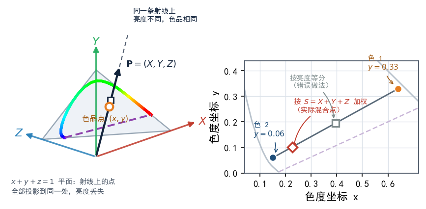
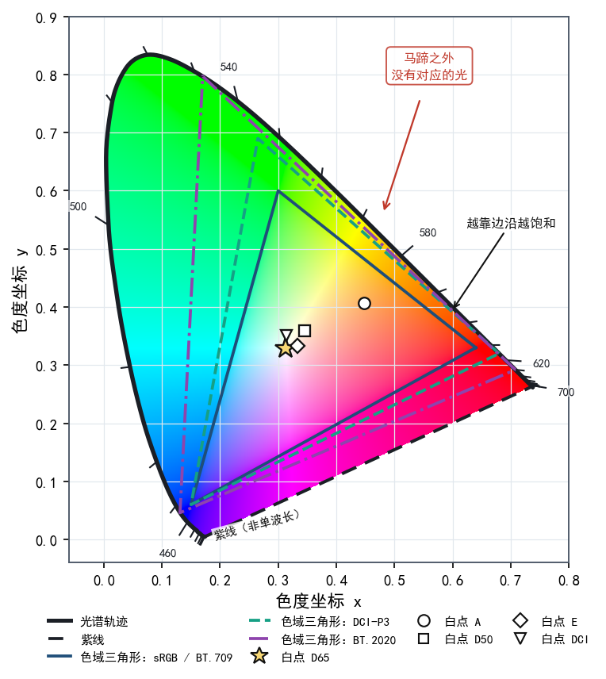
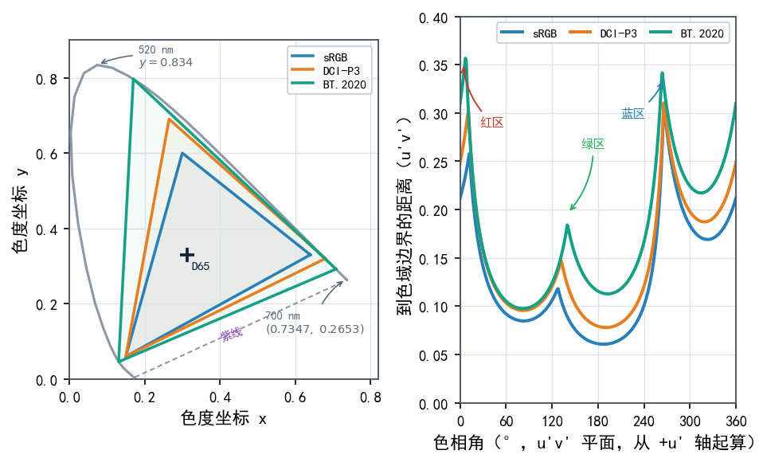
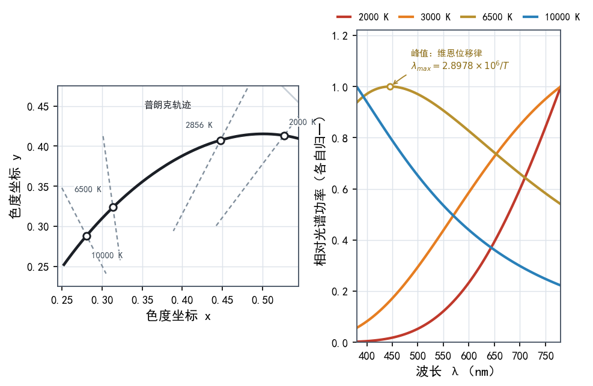
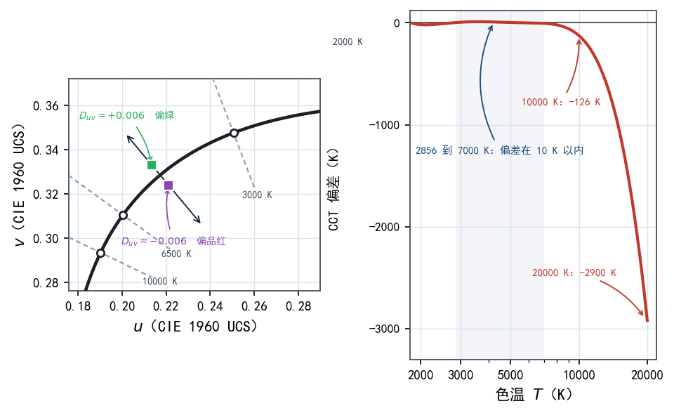
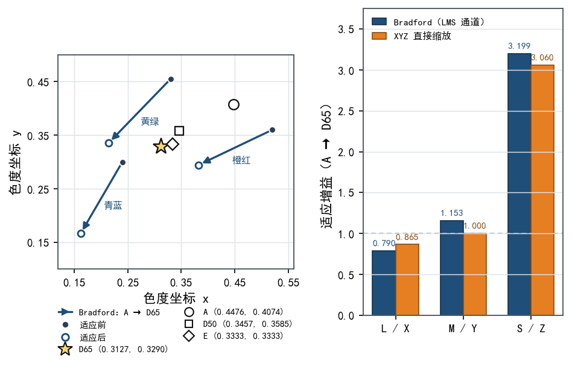

# 第 2 章 色度学与光源

第 1 章得到了三刺激值，三个数放在一起还不方便比较颜色，也不方便判断两台设备的白是不是同一个白。色度学做的第一件事是把亮度与色度拆开，让颜色落到一张二维图上，于是"这个红比那个红更饱和"这类判断有了可以画出来的位置关系。有了图，第二件事才能成立，也就是给光源定坐标。黑体辐射给出了从暖到冷的一条标准曲线，色温、相关色温、$D_{uv}$ 都从这条曲线上量出来。最后一步是换算，同一个白在两种照明下怎么对应，要靠色适应模型。

这三件事串起来，构成了 HDR 链路里所有白点约定的底层依据。BT.2100 为什么写 D65，影院为什么写 $(0.314, 0.351)$，校色软件里那个 Bradford 勾选项在做什么，答案都在本章。

## 2.1 色品坐标与色度图

三刺激值 $X$、$Y$、$Z$ 中，$Y$ 承担亮度，另外两个自由度承担色度。把三个数除以它们的和，得到色品坐标：

$$ x = \frac{X}{X+Y+Z},\qquad y = \frac{Y}{X+Y+Z},\qquad z = 1-x-y $$

三个坐标之和恒为 1，所以只有两个独立变量。把 $(x,y)$ 画在平面上，颜色就落进一张二维地图。

这个除法在几何上是一次中心投影。三刺激值张成一个三维空间，锥体顶点在原点。$X+Y+Z=\text{常数}$ 是一族平行平面，取其中 $X+Y+Z=1$ 的那一张，叫等和平面。从原点出发沿某个刺激向量 $\mathbf{P}=(X,Y,Z)$ 画一条射线，射线上所有点满足 $(tX,tY,tZ)$，投影到等和平面上都落在 $X/(X+Y+Z)$ 与 $Y/(X+Y+Z)$ 相同的位置。换句话说，一条射线对应一种色品，射线上的位置只说明亮度不同。色度图是二维的，因为它把整条射线压成了一个点。

图 2-1 左边画的就是这件事。三根轴线张成刺激空间，灰色三角是等和平面，彩色弧线是光谱色在平面上的投影，白色方块与三角标出同一条射线上亮度不同的两个点，橙色小圈是它们共同的色品落点。虚线从原点穿过这两点，再延长到平面之外，说明整条射线上所有的刺激都投到同一个位置。这也解释了为什么两个亮度相差一百倍的颜色可以在图上完全重合，色度图能告诉你的只有比例，不含量级。

$z$ 是冗余的，因为 $z=1-x-y$，所以只需要两个数就能确定色品。反过来，给定 $(x,y)$ 和亮度 $Y$，三刺激值可以唯一还原：

$$ X = \frac{x}{y}Y,\qquad Z = \frac{1-x-y}{y}Y $$

推导只有一步。由 $y = Y/(X+Y+Z)$ 得 $X+Y+Z = Y/y$，再乘回 $x$ 与 $z$ 的定义即可。这是色度学里最常用的换算。

它有一个数值上的软肋，$y$ 出现在分母。深蓝和深紫的 $y$ 很小，460 nm 单色光的 $y$ 只有 0.0297。$y$ 越小，同样的舍入误差被放得越大。假设 $y$ 只存到四位小数，$y=0.0050$ 时的相对误差就有千分之一，还原出的 $X$ 与 $Z$ 会偏离百分之一以上。工程上有三种处理。一是给 $y$ 设下限，低于 $10^{-4}$ 的点直接判为非法；二是内部计算不经过色度图，始终用 XYZ 或 RGB 线性值传输，只在需要显示或标定时才转成 $(x,y)$；三是改用 $u'v'$ 这类分母更温和的坐标。第三条在第 3 章展开。

色度图上还有一个常用操作，加色混合。设两种颜色分别为 $(x_1,y_1,Y_1)$ 和 $(x_2,y_2,Y_2)$，混合后的色品坐标是两者按三刺激值之和加权的结果：

$$ x_m = \frac{x_1 S_1 + x_2 S_2}{S_1+S_2},\qquad S_i = X_i + Y_i + Z_i = \frac{Y_i}{y_i} $$

这个形式在图上就是杠杆定则。混合点落在线段上，把线段分成两段，长度之比等于 $S_2 : S_1$。权重是 $S_i$ 而非亮度 $Y_i$，两者只在 $y$ 接近时才近似相等。

差别有多大可以算一遍。取红色 $(0.64, 0.33)$ 与蓝色 $(0.15, 0.06)$，各给 50 cd/m²。红色的 $S_1 = 50/0.33 = 151.5$，蓝色的 $S_2 = 50/0.06 = 833.3$，两者相差五倍多。按 $S$ 加权，红色只占 15.4% 的份额，混合点落在 $(0.225, 0.102)$。若图省事按亮度各占一半来算，会得到 $(0.395, 0.195)$，与正确结果在 $x$ 上差了 0.17，在色度图上是一大段距离，肉眼能分辨出完全不同的颜色。图 2-1 右边就是这个算例，红色菱形是按 $S$ 加权的实际混合点，灰色方块是按亮度等分的错误位置。

杠杆定则的物理来源是亮度的定义。$Y$ 是 CIE 1931 亮度函数 $\bar{y}(\lambda)$ 的加权积分，它只关心人眼对亮度的敏感度，不关心这个颜色有多"浓"。深蓝的 $y$ 小，说明它的能量大部分落在 $\bar{y}$ 值很低的短波段，要产生 50 cd/m² 的亮度，需要比红色多得多的辐射功率，三刺激值之和自然更大，在混合里的话语权也更重。所以往红里加一点点蓝，色品就已经明显偏紫了。色域三角形、白点合成、色温计算里反复出现的加权，都是这个道理。

## 2.2 光谱轨迹、紫线与色域

逐个波长取单色光，把它的色品坐标连起来，得到一条马蹄形的曲线，叫光谱轨迹。它以 5 nm 间隔的 CIE 1931 标准观察者数据积分得到，从 380 nm 附近的紫端出发，沿左侧上升到 520 nm 附近到达顶点，然后沿右上方向下滑，到 700 nm 的红色端点收尾。

几个关键位置的坐标值得记住。520 nm 处 $y$ 取极大值 0.8338，坐标为 $(0.0743, 0.8338)$，这是整条轨迹最高的地方，也是人眼在白天视觉下最亮的单色光所在。500 nm 落在左边界最靠外的位置 $(0.0082, 0.5384)$，$x$ 只有 0.0082，几乎贴着 $y$ 轴。580 nm 的黄色是 $(0.5125, 0.4866)$，620 nm 的橙红是 $(0.6915, 0.3083)$。红端 700 nm 为 $(0.7347, 0.2653)$，再往长波走轨迹几乎不动，780 nm 只到 $(0.7368, 0.2632)$，收敛在一个极限点上。紫端 380 nm 为 $(0.1741, 0.0050)$，再往短波同样收敛。

轨迹上的点代表纯单色光，饱和度最高。往马蹄内部走，饱和度下降，中心附近接近白。

380 nm 与 700 nm 两个端点之间用直线相连，这条直线叫紫线。线上的颜色由红端与紫端的单色光相加得到，物理上是混合光，没有对应的单波长，可它的饱和度仍然是边界值。这是色度图一个反直觉的地方，饱和度最高的区域不止一条曲线，还包括一条不属于任何波长的直线。紫线上的点对应的光谱是两条窄带之和，用光谱仪能看到两个峰，而不是一个。

马蹄之外的点没有任何对应的光。原因是色品坐标必须满足 $x \ge 0$、$y \ge 0$、$x+y \le 1$，这三条约束来自 $X,Y,Z \ge 0$。色匹配函数本身非负，任何真实光的光谱功率也非负，积分结果不可能出现负的三刺激值，于是色度图被限制在这个三角形里。光谱轨迹已经贴在这三条边界的极限位置，再往外就只能靠负的三刺激值来实现，那是数学上的外推，不是光。

图 2-2 把这些元素放在一起。粗黑实线是光谱轨迹，虚线是紫线，三条彩色折线分别是 sRGB/BT.709、DCI-P3、BT.2020 的色域三角形，五个空心符号标出 A、D50、D65、E、DCI 五个白点。图上还标了两个端点附近的注释，460 nm 落在左下，700 nm 落在右端，520 nm 的顶点在左上。彩色底纹是把马蹄内部的 $(x,y)$ 换算成 sRGB 显示值画出来的，只用于示意色相分布，色域外的部分被截断，不代表真实颜色。从这张图上可以直接读出一件事，三个色域三角形的绿基色顶点一个比一个靠外，BT.2020 的绿点 $(0.170, 0.797)$ 已经逼近 520 nm 附近的轨迹，几乎没有余量了。

设备的色域是三个基色点在色度图上连成的三角形。三角形内部的所有颜色都能由三个基色按非负比例混合得到，三角形外的颜色做不到。原因还是杠杆定则，三个基色能混出的所有色品，恰好是它们围成的三角形，混合权重非负就保证了混合点不会跑到三角形外面。要让混合点越出边界，某个权重必须取负值。这就是第 1 章里逆矩阵出现负系数的几何解释，也是"显示器显示不出某个颜色"这件事的准确含义，不是亮度不够，是色度点根本不在三角形里。

用面积比衡量色域大小是行业习惯，麻烦在于不同资料的分母取得不一样。按 5 nm 的 CIE 1931 数据把轨迹与紫线围成的多边形算一遍，马蹄形面积是 0.3342，于是 sRGB 三角形 0.1121 占 33.5%，DCI-P3 的 0.1520 占 45.5%，BT.2020 的 0.2119 占 63.4%。换成 CIE 1976 $u'v'$ 平面，马蹄面积变成 0.1966，三个三角形分别是 0.0649、0.0815、0.1118，占比变成 33.0%、41.4%、56.9%。

两组数字的对比很有意思。sRGB 几乎没变，33.5% 对 33.0%；BT.2020 从 63.4% 掉到 56.9%，掉了六个半百分点。原因是 $u'v'$ 把绿区压缩、把蓝区摊开，而 BT.2020 的优势恰恰集中在绿区，摊薄之后面积占比就下来了。面积比因此是个粗糙指标，依赖用哪个平面量。

文献里还会遇到 BT.2020 占 75.8% 的说法。这个数与 63.4% 的差别不在算法，在分母。要让 0.2119 的三角形报成 75.8%，分母得取到 0.28 上下，比按 5 nm 数据算出的 0.3342 小了一截，可能来自不同的积分波长范围或不同版本的轨迹数据。看到这类数字先确认分母，再谈大小。

色域覆盖率有两种算法。一种取被测设备三角形与目标三角形的交集，除以目标面积，得到覆盖率（coverage），这个数不会超过 100%；另一种直接用被测面积除以目标面积，得到相对面积（relative area），可以超过 100%。

两种算法的差别在具体的色域对上能看出量级。把三个三角形两两求交，sRGB 完整落在 DCI-P3 与 BT.2020 内部，覆盖率都是 100%。DCI-P3 只有 73.7% 落在 sRGB 里，说明用 sRGB 显示器看 P3 内容，超过四分之一的色域面积是缺的，主要在绿和红的深处。BT.2020 有 71.7% 落在 P3 里，剩下 28% 是 P3 也到不了的部分。反过来看相对面积，P3 相对 sRGB 是 135.7%，BT.2020 相对 P3 是 139.4%，正是厂商标称里那种好看的数字。

厂商标称因此要分两种情况读。标"覆盖 95% DCI-P3"用的是前一种，含义是 P3 范围内还有 5% 的面积做不到，判断一部电影能否按原意还原要看这个数。标"色域达到 110% sRGB"多半指后一种，含义只是总面积更大，完全可能出现 sRGB 的某个角落没覆盖到、别处却多出一大块的情况。

图 2-3 从另一个角度衡量同一件事。左图是三个三角形叠在马蹄上，标注了 520 nm 顶点、700 nm 端点与紫线的位置。右图以 D65 白点为原点，按 CIE 1976 $u'v'$ 的色相角走一圈，量出每个方向上到三角形边界的距离，单位是 $u'v'$。这条曲线回答的是"这个方向上还能走多远"，比面积更有工程意义。

曲线在三个基色顶点方向上各有一个尖峰，顶点之间落下来。红方向 0° 到 10°，BT.2020 从 0.31 升到 0.36，DCI-P3 从 0.25 升到 0.28，sRGB 从 0.21 升到 0.24，三条线拉开的绝对差接近 0.12。绿方向 130° 到 150°，绝对值最小，sRGB 0.076 到 0.112、DCI-P3 0.102 到 0.141、BT.2020 0.146 到 0.184，可比值最大，BT.2020 是 sRGB 的两倍左右。蓝方向 260° 到 270°，sRGB 与 DCI-P3 都在 0.28 到 0.31 之间，BT.2020 是 0.30 到 0.33，三条线几乎贴在一起，说明三套色域在蓝方向上差别很小，BT.2020 的蓝基色 $(0.131, 0.046)$ 与 sRGB 的 $(0.150, 0.060)$ 本来就靠得很近。BT.2020 相对 P3 的增量主要落在绿与红，绿区尤其明显，这与面积比给出的印象一致，但曲线把"增量在哪"说得更清楚。做色域映射时，这张距离图直接告诉算法哪个色相要压缩得多、哪个可以少动。

三角形之外还有一层限制。色度图不含亮度，一个设备能覆盖的色域其实是三维体积，还要考虑每个色度点能达到的最大亮度。BT.2020 的基色点在色度图上很靠外，但实际显示器的绿基色亮度往往只有白场的 60% 到 70%，红色也类似，色域的"体积覆盖率"通常低于二维面积比。三基色同时开到最大才是白，白光要分给三个通道，单个通道的峰值亮度必然低于白场，这个约束在 HDR 里更明显，因为高亮度下的色域会向内收缩。这一层在第 5 章讨论色域体积时展开。

## 2.3 黑体辐射与色温

任何温度高于绝对零度的物体都向外辐射电磁波。理想化的黑体是一个能完全吸收、也完全发射的物体，其光谱辐射出射度由普朗克定律给出：

$$ M_{e,\lambda}(\lambda,T) = \frac{2hc^2}{\lambda^5}\cdot\frac{1}{e^{hc/(\lambda kT)}-1} $$

其中 $h = 6.62607015\times10^{-34}\ \mathrm{J\cdot s}$，$c = 2.99792458\times10^{8}\ \mathrm{m/s}$，$k = 1.380649\times10^{-23}\ \mathrm{J/K}$。这三个常数在 2019 年国际单位制修订后都成了定义值，没有不确定度，所以按公式算出来的黑体光谱在数值上是精确的，不确定度只来自色匹配函数与积分方法。

公式有两块。前面那个 $\lambda^{-5}$ 是单位波长间隔内的模式数与几何因子，温度越高它越压不住长波；后面那个指数项是玻色统计给出的光子占据数，$\lambda T$ 越小，$e^{hc/(\lambda kT)}$ 越大，占据数越接近零。两项相乘，短波被指数压死，长波被 $\lambda^{-5}$ 压低，中间出现一个峰。

第二辐射常数把指数项写短后更常用：

$$ c_2 = \frac{hc}{k} = 1.4388\times10^{-2}\ \mathrm{m\cdot K},\qquad M_{e,\lambda} \propto \frac{1}{\lambda^5}\cdot\frac{1}{e^{c_2/(\lambda T)}-1} $$

这个 $c_2$ 的历史值得一提。1948 年之前，$c_2$ 的推荐值是 $1.4350\times10^{-2}\ \mathrm{m\cdot K}$，之后改成 $1.4380\times10^{-2}$，1986 年以后又随基本常数的修订定为 $1.4388\times10^{-2}$。数值只差 0.26%，落到色品坐标上却是可测的。以 2856 K 为例，用 $1.4388\times10^{-2}$ 算出的色品是 $(0.44754, 0.40744)$，用 $1.4380\times10^{-2}$ 算出的是 $(0.44742, 0.40740)$，$x$ 差了 $1.2\times10^{-4}$。这个差看起来很小，可标准照明体 A 的定义就卡在这个量级上。A 最初由 2848 K 黑体定义，用的是老 $c_2$。换上新的 $c_2$ 之后，要得到同一组色品坐标 $(0.44757, 0.40745)$，黑体温度得改成 2856 K。所以"照明体 A 是 2856 K 黑体"这句话是有条件的，条件就是 $c_2 = 1.4388\times10^{-2}$。老文献里写 2848 K，不是笔误，是常数版本不同。读数之前先确认它用的是哪版常数。

温度升高，曲线整体抬高。斯特凡-玻尔兹曼定律给出总辐射与 $T^4$ 成正比，但峰值位置移动得更快，峰值波长与温度的关系是维恩位移定律：

$$ \lambda_{max} T = 2.8978\times10^{6}\ \mathrm{nm\cdot K} $$

几个温度下的峰值位置列出来更有感觉。2000 K 时峰值在 1449 nm，深红外，肉眼完全看不到；2856 K 的钨丝灯在 1015 nm，也在红外；3000 K 在 966 nm；4000 K 到 724 nm，刚进可见光的红端；5000 K 到 580 nm，落在黄区；6500 K 到 446 nm，在蓝紫区；10000 K 到 290 nm，已经进了紫外。

可见光只占 380 到 780 nm 这一小段。低温时峰值远在长波侧，可见区看到的是曲线的左尾巴，尾巴随波长单调上升，蓝色端极弱，所以偏红偏黄；高温时峰值移到可见区甚至紫外，可见区看到的是右尾巴，蓝色端反而更强，所以偏蓝。6500 K 是个有意思的位置，峰值 446 nm 刚好在蓝区，可见区内的能量分布已经相当平，白感最中性。

把不同温度黑体的色品坐标连起来，得到普朗克轨迹，图 2-4 左边那条粗黑曲线。它从 1700 K 附近的深橙红出发，经过 2856 K 的暖白、5000 K 的中性白，穿过 6500 K，向 25000 K 的蓝白延伸。图上标了 2000 K、2856 K、6500 K、10000 K 四个位置。色品坐标对温度的敏感度随温度升高迅速下降，低温段每 100 K 在图上是一段明显的位移，6000 K 到 7000 K 之间只挪了一小步，所以轨迹在高色温端看起来几乎是水平的。

轨迹的形状值得琢磨。它整体向右弯，在中温段 $y$ 反而上升，2250 K 附近 $y$ 取到极大值 0.4153，之后才随温度继续升高而下降。这个弯折来自两种效应的竞争。温度从 2000 K 往上升，红端的峰值向短波移动，可见区内的红能量开始减少，蓝能量开始增加，色品本应沿左下方走。可同时蓝端的增长还没跟上，绿色段的相对份额先涨了一截，$y$ 就先抬高。等温度过了 2500 K 左右，蓝端的增长成为主导，轨迹才继续向蓝白方向滑下去。低温段的这个小鼓包是黑体轨迹的标志性特征，也是它和很多"理想化白光轨迹"示意图的区别所在。

色温的定义建立在这条轨迹上。如果某个光源的色品坐标恰好落在轨迹上某一点，该点对应的黑体温度就是它的色温（color temperature，CT）。绝大多数光源做不到这么巧，白光 LED、荧光灯、显示器白场的色度点通常偏离轨迹 0.001 到 0.01 的量级。这时改用相关色温（correlated color temperature，CCT），定义为轨迹上距离该点最近的那一点的温度。

"最近"要在感知上大致均匀的空间里量，CIE 规定用 CIE 1960 UCS 的 $(u,v)$ 坐标：

$$ u = \frac{4x}{-2x+12y+3},\qquad v = \frac{6y}{-2x+12y+3} $$

只有在这个空间里，等温线才是垂直于轨迹的直线。图 2-4 左边那几条灰色虚线就是等温线，它们是轨迹各点处法向的延长线。注意它们在 $xy$ 平面上并不垂直于曲线本身的切线，斜率看起来是歪的，原因正是 $xy$ 到 $(u,v)$ 的变换不是保角的。要把等温线画成垂直，就得在 $(u,v)$ 里画。

这个"必须用 1960 UCS"的要求不是随口定的。1960 UCS 是 CIE 在 1960 年从 Judd 的提案改出来的，它的设计目标就是让等距的 $(u,v)$ 距离大致对应等量的感知差。后来 1976 年又出了 $u'v'$，把 $v$ 拉伸 1.5 倍，均匀性更好，可 CCT 的定义没有跟着改，因为改了之后所有历史数据都要重算。所以今天 CCT 与 $D_{uv}$ 在 1960 $(u,v)$ 里算，色差与色域面积在 1976 $u'v'$ 里算，两套坐标差一个 1.5 的因子在 $v$ 上。写代码时不小心混用，$D_{uv}$ 会莫名大 50%。

CCT 的工程近似有 McCamy 公式，输入色品坐标直接给出数值：

$$ n = \frac{x-0.3320}{0.1858-y},\qquad CCT = 449n^3 + 3525n^2 + 6823.3n + 5520.33 $$

这个三次多项式是 1992 年从轨迹上采样拟合出来的，不用迭代、不用查表，一行代码就出结果。代价是适用范围有限，2856 K 到 7000 K 之间偏差在 10 K 以内，出了这段迅速上升。

图 2-5 把这两个量画在一起。左图是 CIE 1960 $(u,v)$ 平面里的轨迹与几条等温线，标出 3000 K、6500 K、10000 K 的位置。从 6500 K 那一点沿法向各偏移 0.006，向上的绿色方块是 $D_{uv}=+0.006$，向下的紫色方块是 $D_{uv}=-0.006$，两者与轨迹的距离相同，观感却一个偏绿一个偏品红。右图是 McCamy 近似的偏差曲线，横轴是色温，纵轴是多项式给出的值与真实值之差。

右图读数很清楚。2856 K 处偏差 +1.6 K，3000 K 处 +4.9 K，4000 K 处 +8.7 K，5000 K 处 +2.3 K，6500 K 处 -2.8 K，7000 K 处 -5.8 K。整段 2856 到 7000 K 都落在 ±10 K 以内，与文献里"2 K 以内"的说法略有出入，差异来自采样密度与积分方法，量级一致。再往外走，9300 K 处偏 -76 K，10000 K 处偏 -126 K，15000 K 处偏 -1042 K，20000 K 处偏 -2920 K。偏差随温度升高急剧增大，而且符号始终为负，说明多项式在高温段系统性地低估色温。

这个规律对实际工作有指导意义。影视灯光的色温多在 2800 到 6500 K，用 McCamy 完全够；显示器校色偶尔要处理 9300 K 的冷白预设，这时 -76 K 的偏差已经接近校色仪的重复性极限，最好换成迭代求最近点；天光模拟或特殊光源到了 10000 K 以上，McCamy 就不能用了，误差上千开尔文，按它标的色温去选灯，颜色会明显偏冷。

CCT 只说"离轨迹最近的点在哪"，不说"离多远"。偏移量用 $D_{uv}$ 表示，单位是 CIE 1960 $(u,v)$ 中的距离：

$$ D_{uv} = \operatorname{sign}(v-v_p)\cdot\sqrt{(u-u_p)^2+(v-v_p)^2} $$

下标 $p$ 指轨迹上的最近点。符号约定轨迹之上（偏绿）为正，之下（偏品红）为负。这个约定与轨迹的走向有关，取 $v$ 增大的一侧为绿侧，于是正号对应偏绿。

常见光源的 $D_{uv}$ 有几个典型值。纯黑体的 $D_{uv}$ 恒为 0，照明体 A 就是 2856 K 黑体，算出来约 $10^{-5}$，可以当零看。D65 与 D50 严格说不落在轨迹上，按定义算出的 $D_{uv}$ 都在 $+0.0032$ 左右，偏绿一点点，这正是日光含天空散射成分的结果。DCI 白点 $(0.314, 0.351)$ 的 $D_{uv}$ 高达 $+0.0134$，偏绿非常明显，从光谱上看是因为氙灯在绿区的强线。白光 LED 的 $D_{uv}$ 常在 $+0.003$ 到 $+0.010$ 之间，偏绿；影视灯具出厂前通常调到 $|D_{uv}| \le 0.003$，因为这个量级已经能被训练有素的眼睛在并排比较时看出来。

同样标 6500 K 的两块屏幕，$D_{uv}$ 一个为 $+0.006$、一个为 $-0.002$，并排看就能分出差别，这类差异在灰阶和肤色上最容易被察觉。灰阶最敏感，因为低饱和区离轨迹近，同样的 $D_{uv}$ 在低饱和色上占的比例大；肤色则受记忆色基准影响，偏绿一点点就会觉得气色不对。

CCT 加 $D_{uv}$ 是两个数，还不足以描述一个光源。它们只说明白点在哪，不说明光谱长什么样。两个 $D_{uv}$ 为零、CCT 都是 6500 K 的光源，可以是连续谱的日光模拟器，也可以是红绿蓝三窄带的 LED 组合，前者照红色物体仍是红的，后者可能把红色照成灰褐。描述这件事要用显色性指标，2.4 节展开。

## 2.4 标准照明体与标准光源

要比较两台设备、交换一份素材、复现一次测量，光有白点不够，还需要一条明确的光谱功率分布。CIE 为此定义了一组标准照明体（standard illuminant），用字母编号，每一个都给定了 SPD 或至少给定了色品坐标。这套编号按历史顺序累积，从 A 到 F 并不是一路升级。

标准照明体和标准光源（standard source）是两个容易混淆的概念。照明体是纸面上的定义，一条相对光谱功率分布加一组色品坐标，不要求能用实物做出来。光源是能真实点亮的实物。一个照明体可能有多种实现方式，也可能至今没有满意的实现。E 照明体就是典型，它要求每个波长的功率完全相同，这在物理上不可能，纯粹是理论参考，用来检查计算程序是否正确，比如把一条平直光谱积分一遍，看结果是不是 $(1/3, 1/3)$。

照明体 A 是这条线索上最扎实的一个。它代表白炽灯与卤钨灯，SPD 取 2856 K 黑体，$c_2$ 用 $1.4388\times10^{-2}\ \mathrm{m\cdot K}$，色品坐标 $(0.44757, 0.40745)$。可贵之处在于可复现，实验室里一盏稳流钨丝灯就能把光谱做到与定义相差几个百分点，色温可用辐照度比法现场标定。

正因为可复现，A 成了仪器定标的基准。分光计的波长刻度要用汞氩灯的特征谱线校准，光度线性要用双光路或叠加法验证，色度计的读数最终要追到某个可溯源的钨丝灯或积分球上。整条溯源链的锚点常常就是它。影视行业的钨丝灯常标 3200 K，比 A 略高，色度点在同一段轨迹上偏蓝一点，灯具手册里写"与照明体 A 接近"，意思是可以按 A 的色适应参数处理。

照明体 B 与 C 是 1931 年前后加入的。B 代表直射日光，约 4870 K，C 代表平均日光，约 6770 K。它们不是独立的光谱定义，而是用 A 加一组液体滤光器（Davis-Gibson 滤光器）实现，滤光器由硫酸铜、硫酸钴铵等溶液配成，光路穿过不同厚度的溶液得到不同色温。

问题出在光谱形状。液体滤光器只是把 A 的光谱在长波侧削弱，得到的曲线在短波端仍远低于真实日光，紫外与蓝紫不足，红光偏高。用它做视觉比较实验尚可，测色就暴露偏差，尤其在黄色与紫色样品上。1960 年代 D 系列出现后，B 与 C 就退成历史名词，今天只在老文献与一些遗留的色差公式里见到。

D 系列代表自然日光，覆盖面从 4000 K 到 25000 K。日光由太阳直射光与天空散射光混合而成，SPD 随天气、时段、纬度、气溶胶含量变化，没法用一条曲线概括。CIE 的做法是从大量实测日光光谱里做主成分分析，取出前三个特征向量 $S_0(\lambda)$、$S_1(\lambda)$、$S_2(\lambda)$，再加一组平均功率，任意日光的 SPD 由这三个向量的线性组合近似：

$$ S_D(\lambda) = S_0(\lambda) + M_1 S_1(\lambda) + M_2 S_2(\lambda) $$

其中 $S_0$ 是平均值，形状接近 6500 K 附近的实际日光；$S_1$ 主要描述蓝黄方向的倾斜，对应色温变化；$S_2$ 描述一个更细的结构，与天空散射比例有关。三个向量覆盖了实测日光样本 99% 以上的方差，所以两条系数就能把整个日光族描述清楚。

系数 $M_1$、$M_2$ 由目标色品坐标算出。先由 CCT 得到 D 系列自身的色品坐标，两个经验式分别管低温和高温段：

$$ x_D = \begin{cases}
-4.6070\times10^{9}/T^3 + 2.9678\times10^{6}/T^2 + 0.09911\times10^{3}/T + 0.244063, & 4000 \le T \le 7000 \\
-2.0064\times10^{9}/T^3 + 1.9018\times10^{6}/T^2 + 0.24748\times10^{3}/T + 0.237040, & 7000 < T \le 25000
\end{cases} $$

$$ y_D = -3.000x_D^2 + 2.870x_D - 0.275 $$

$y_D$ 这个二次式定义了 D 系列专用的日光轨迹，它与普朗克轨迹不是同一条，在低色温端差别大，在 6500 K 附近几乎重合。代入 6504 K 得到 $x_D = 0.31271$、$y_D = 0.32912$，与标准表里的 $(0.31272, 0.32903)$ 相差不到 $10^{-4}$，这个差来自经验式的拟合误差，工程上可以忽略。

有了 $(x_D, y_D)$，系数按下面两式算：

$$ M_1 = \frac{-1.3515 - 1.7703x_D + 5.9114y_D}{0.0241 + 0.2562x_D - 0.7341y_D},\qquad M_2 = \frac{0.0300 - 31.4424x_D + 30.0717y_D}{0.0241 + 0.2562x_D - 0.7341y_D} $$

分母是同一个量，把"三个特征向量的组合要落在指定色品上"这个约束解出来就得到这两个分式。代入几个温度可以看系数的走向。4000 K 时 $M_1 = -1.50$、$M_2 = +2.83$；5003 K 时 $-1.04$、$+0.36$；6504 K 时 $-0.29$、$-0.69$；10000 K 时 $+1.00$、$-0.37$；25000 K 时 $+2.91$、$+1.66$。$M_1$ 从负变正，对应光谱从中性偏黄一路走到偏蓝。

D65 的 CCT 是 6504 K，色品坐标 $(0.31272, 0.32903)$，它是 sRGB、BT.709、BT.2020、BT.2100 共同指定的白点，几乎所有消费级显示设备的出厂目标都是它。D50 的 CCT 是 5003 K，色品坐标 $(0.34567, 0.35850)$，用于印刷与 ICC 色彩管理，国际标准化组织把 D50 定为图形艺术的参考白，原因是 5000 K 附近的日光在观片灯箱里更容易稳定复现，而且偏暖一点的白对纸张与油墨的观感更友好。

三个白点的光谱差异值得单独说。D65 在 400 nm 附近有一段较强的紫外与蓝紫，560 nm 之后缓慢下降，整体是"蓝端不缺、红端适中"的曲线。D50 的红端更强、蓝端更弱，同一条白纸在 D50 下看偏暖。DCI 白点 $(0.314, 0.351)$ 不是 D 系列成员，它是氙灯的实际光谱经滤光后得到的，绿区有一段明显的抬升，所以 $D_{uv}$ 高达 $+0.013$。

把 DCI 的内容直接拿到 D65 显示器上播，画面会偏绿偏黄，把 D65 的内容拿到 DCI 放映机上播，画面会偏品红偏冷。两条链路的换算是确定性的，做法是用色适应矩阵把白点搬过去，2.5 节给矩阵，2.6 节讲它在 HDR 链路里的具体用法。这里只需记住一件事，白点互换不是简单地把三个通道乘一组系数就完，因为白点变化会带动所有颜色的位置，而它们在色度图上的移动量并不相同。

F 系列代表荧光灯，共 12 种，编号 F1 到 F12，覆盖冷白、暖白、日光色、三基色等类型。它们的 SPD 有两类成分，一类是汞蒸气放电产生的线谱，435.8 nm、546.1 nm、577.8 nm 几条特别强，另一类是荧光粉被紫外激发后发出的宽带。线谱让 F 系列的显色性参差不齐，三基色荧光灯（F11、F12）用了窄带荧光粉，效率高但光谱更尖，同色异谱问题比宽带荧光粉（F2、F7）更突出。

| 照明体 | CCT | $x$ | $y$ | 典型用途 |
|---|---|---|---|---|
| A | 2856 K | 0.44757 | 0.40745 | 仪器定标、白炽灯 |
| D50 | 5003 K | 0.34567 | 0.35850 | 印刷、ICC |
| D65 | 6504 K | 0.31272 | 0.32903 | 视频、显示器 |
| E | 5455 K | 0.33333 | 0.33333 | 理论参考 |
| DCI | 约 6300 K | 0.31400 | 0.35100 | 数字影院 |

表里的 CCT 一栏有两个需要说明的地方。E 的 5455 K 是按等能光谱算出的相关色温，它的 $D_{uv}$ 是 $-0.0044$，落在轨迹的品红一侧，并不落在轨迹上，所以严格说 E 没有"色温"，只有 CCT。DCI 的 6300 K 是近似值，按最近点算得到 6305 K，同样带着 $+0.0134$ 的 $D_{uv}$，它离轨迹很远，用 CCT 描述它本身就是一种将就。

显色指数用来衡量光谱的连续性。CRI 的 $R_a$ 计算分几步。先取 8 块中等饱和度的标准色样，编号 TC01 到 TC08，包括淡红、黄、黄绿、绿、蓝绿、淡蓝、紫、淡紫，明度都在 6 附近，饱和度不高。再选参考光源，5000 K 以下用同色温的黑体，5000 K 以上用同色温的 D 系列日光，参考光源与被测光源的 CCT 与 $D_{uv}$ 要对齐，否则比较的就不是显色性而是白点差。然后把 8 块色样分别放在两种光源下算色品，用 CIE 1964 均匀色空间的 $W^*U^*V^*$ 坐标算色差 $\Delta E_i$，最后按

$$ R_i = 100 - 4.6\Delta E_i,\qquad R_a = \frac{1}{8}\sum_{i=1}^{8} R_i $$

映射到 0 到 100。系数 4.6 是从实验数据定出来的，让 100 对应色差为零、50 对应明显可见的失真。特殊显色指数里 $R_9$ 是饱和红、$R_{12}$ 是饱和蓝，这两块色样不在 8 块之内，测 LED 时经常单独报出来。

这套方法对连续谱光源正常，对窄带 LED 会给出偏高的分数。原因是 8 块色样太少、饱和度不够，主要落在中等饱和区，而窄带 LED 的失真恰恰在高饱和色上。一支蓝光芯片加黄色荧光粉的白光 LED，光谱是 450 nm 一个尖峰加 550 到 600 nm 一个宽包，红端几乎没有能量。8 块色样里偏蓝紫的那几块色差可能还不大，可一块饱和红（$R_9$）会掉到 20 甚至负值。$R_a$ 报 82 的灯，$R_9$ 只有 15，这不是计算错误，是指标的盲区。

TM-30 是针对这个盲区设计的。它用 99 块色样（CES，Color Evaluation Sample），覆盖整个色相环与更大的饱和度范围，同时给出两个数。保真度 $R_f$ 与 CRI 的 $R_a$ 概念相近，也是与参考光源比较色差，但用 99 块样、用 CIECAM02 或 CAM16 做色适应与色貌换算，数值范围 0 到 100。色域指数 $R_g$ 描述被测光源让颜色变艳还是变淡，100 表示与参考光源相同，大于 100 偏艳，小于 100 偏淡。

两个指标的组合能区分出 CRI 分不出的情况。$R_f = 85$、$R_g = 105$ 的光源是"温和增艳"型，常见于优化过的荧光粉配方，观感讨喜但严格说不准；$R_f = 85$、$R_g = 88$ 的光源是"整体偏淡"，肤色会显得灰。同样的 $R_a = 85$，可能是这两种里的任一种，CRI 给不出区分。影视照明里越来越多的规范开始同时要求 $R_f \ge 90$ 与 $85 \le R_g \le 105$，就是为了堵住这个漏洞。

白光 LED 不在标准照明体之列。它的 SPD 由蓝光芯片的峰值波长、荧光粉的配方与配比决定，各厂家差异很大，无法用一条曲线代表。描述它只能用 CCT 加 $D_{uv}$ 两个参数定位白点，再用 $R_a$ 或 $R_f$/$R_g$ 衡量光谱的连续性，三个数一起才勉强够用。

## 2.5 白点与色适应

白点在色度图上是一个位置，在数值上是一个三刺激值比例。显示器显示白色时三个通道都开到最大，输出的色度由基色坐标和驱动比例决定，这个色度就是该显示器的白点。白炽灯的白点是灯丝温度的函数，日光灯的白点随天色变化，投影仪的白点由光源与光路镀膜决定。同一张白纸在不同照明下白点不同，这是物理事实；人眼看过去并不觉得"白变了"，这是生理事实。两者之间的落差，就是色适应要处理的问题。

两台白点不同的显示器并排显示同一张白色图片，观者会觉得左边偏黄、右边偏蓝。这种差异在单独观看时几乎察觉不到，因为视觉系统会自动把当前环境的最亮中性色当作白，并据此重新标定其他颜色。这个机制叫色适应（chromatic adaptation）。它的时间尺度从几秒到几十秒，比瞳孔反应慢，比色彩恒常的长期记忆快。

色适应的工程模型都来自 von Kries 在 1902 年提出的系数定律。视觉系统在三个独立的感受器通道上分别做增益调整，把白点的响应拉到同一水平。写成三步，转到感受器空间，乘对角增益矩阵，再转回原空间：

$$ \mathbf{c}' = \mathbf{M}^{-1}\cdot\operatorname{diag}\!\left(\frac{\mathbf{M}\mathbf{w}'}{\mathbf{M}\mathbf{w}}\right)\cdot\mathbf{M}\,\mathbf{c} $$

其中 $\mathbf{c}$ 是待适应颜色的三刺激值，$\mathbf{w}$、$\mathbf{w}'$ 是适应前后的白点，$\mathbf{M}$ 是 XYZ 到感受器空间的转换矩阵。中间那个对角矩阵的三个对角元就是三个通道的增益 $L'_w/L_w$、$M'_w/M_w$、$S'_w/S_w$，与教材里常见的写法一致。整个式子是线性的，可以用一个 $3\times3$ 矩阵一次乘完：

$$ \mathbf{CAT} = \mathbf{M}^{-1}\operatorname{diag}(\mathbf{g})\mathbf{M},\qquad \mathbf{g} = \frac{\mathbf{M}\mathbf{w}'}{\mathbf{M}\mathbf{w}} $$

问题在于用哪组感受器，也就是 $\mathbf{M}$ 取什么。直接在 XYZ 上做缩放最省事，等于取 $\mathbf{M} = \mathbf{I}$，效果却不好。XYZ 的三个基向量不是生理上的感受器响应，彼此之间有大量重叠积分，一个通道的能量会渗到另外两个里。换成接近视锥响应的矩阵，效果明显改善。

Bradford 变换是工业界用得最多的一个，它用一组由实验数据拟合出的锥体响应矩阵：

$$
\mathbf{M}_{BFD} =
\begin{bmatrix}0.8951 & 0.2664 & -0.1614\\
-0.7502 & 1.7135 & 0.0367\\
0.0389 & -0.0685 & 1.0296\end{bmatrix}
$$

它来自 1990 年代在英国 Bradford 做的对应色实验，观察者调整一个颜色直到它"看上去和参考色一样"，再把数据拟合成矩阵。注意矩阵里有负元素，尤其第一行第三列的 -0.1614，这是拟合结果，不必对应物理上的负响应。

另外三个常用矩阵值得一并列出，方便对照：

$$
\mathbf{M}_{CAT02} =
\begin{bmatrix}0.7328 & 0.4296 & -0.1624\\
-0.7036 & 1.6975 & 0.0061\\
0.0030 & 0.0136 & 0.9834\end{bmatrix},
\qquad \mathbf{M}_{CAT16} =
\begin{bmatrix}0.401288 & 0.650173 & -0.051461\\
-0.250268 & 1.204414 & 0.045854\\
-0.002079 & 0.048952 & 0.953127\end{bmatrix}
$$

CAT02 是 CIECAM02 色貌模型里用的，CAT16 是 CAM16 用的，两者都出自 CIE 技术委员会。CAT16 的第一行系数比 CAT02 大得多，说明它的"长波通道"混入了更多来自 $X$ 与 $Y$ 的成分，这是为了修正 CAT02 在极端蓝光下的失效。第四个是 CMCCAT2000，面向工业应用，形式与 Bradford 很接近：

$$
\mathbf{M}_{CMCCAT2000} =
\begin{bmatrix}0.7982 & 0.3389 & -0.1371\\
-0.5918 & 1.5512 & 0.0406\\
0.0008 & 0.0239 & 0.9753\end{bmatrix}
$$

从光源 A 适应到 D65，四组矩阵给出的增益差别不小。Bradford 是 $L$ 0.7896、$M$ 1.1529、$S$ 3.1989；CAT02 是 0.8067、1.1172、2.9639；CAT16 是 0.9095、1.0747、2.8116；CMCCAT2000 是 0.8126、1.1282、2.9224。短波通道都在三倍附近，因为 A 光源的短波能量本来就少，要让它在新的白点下"看起来一样"，必须大幅提亮短波。长波通道的差别最大，Bradford 是 0.79，CAT16 是 0.91，相差 15%，这个差别会直接落在暖色的亮度上。

直接在 XYZ 上缩放得到的增益是 0.8652、1.0000、3.0600。与 Bradford 相比，$L$ 通道差了 0.075，$M$ 通道差了 0.15，只有 $S$ 通道接近。$M$ 通道差这么多是因为 $Y$ 在 XYZ 里就是亮度，缩放系数被强行定成 1，与"白点变了但亮度感觉不变"的实际情况不符。

合成后的 Bradford 适应矩阵（A 到 D65）是：

$$
\mathbf{M}_{A\to D65} =
\begin{bmatrix}0.8447 & -0.1179 & 0.3948\\
-0.1366 & 1.1041 & 0.1292\\
0.0799 & -0.1349 & 3.1926\end{bmatrix}
$$

负系数出现在非对角位置，意味着适应后的 $X$ 会受原始 $Z$ 影响，适应后的 $Y$ 会受原始 $X$ 影响。这类交叉项正是 Bradford 优于 XYZ 缩放的原因。若只用对角矩阵，纯蓝适应之后仍然是纯蓝，只是亮度变了；用完整的矩阵，纯蓝会带出一部分红与绿，因为视觉系统在短波响应变化时，长中波的感受也跟着调整。

图 2-6 左边画出了三个颜色在色度图上的位移，分别是橙红 $(0.520, 0.360)$、黄绿 $(0.330, 0.455)$、青蓝 $(0.240, 0.300)$。箭头从适应前指向适应后，方向大体朝 D65，幅度各不相同。以 $(u,v)$ 距离计，青蓝挪了 0.122，橙红 0.087，黄绿 0.078。青蓝挪得最远，因为它的短波成分多，正是 A 与 D65 差别最大的地方；黄绿挪得最少，因为它的能量集中在两者已经比较接近的中波段。位移长度不同说明色适应相当于随颜色位置变化的仿射变换，并非简单的整体平移。图里还标出 A、D50、D65、E 四个白点，可以看出 D65 与 E 很近而 D50 在它们与 A 之间。

右图是增益对比，蓝色柱是 Bradford 的 $L/M/S$ 增益 0.790、1.153、3.199，橙色柱是 XYZ 直接缩放的 $X/Y/Z$ 增益 0.865、1.000、3.060。$S$ 与 $Z$ 那两根柱子高度接近，$L$ 与 $X$、$M$ 与 $Y$ 的差别就明显了，尤其 $M$ 那一组，一个 1.15 一个 1.00，差 15%。这张图解释了一件常被忽略的事，色适应误差主要不在短波，短波通道谁算都是三倍左右，误差集中在中长波，而中长波恰好是肤色与暖色所在。

不同矩阵算出的结果能差多少，可以用具体的颜色量一遍。同样把 A 下的四个颜色适应到 D65，以 Bradford 为基准，CAT02 在 $u'v'$ 上的最大偏差是 0.0066，CMCCAT2000 是 0.0056，CAT16 是 0.0112，XYZ 直接缩放是 0.0458。拿 2.6 节那组换算式对照，0.002 的 $u'v'$ 偏移在参考白亮度上约合 1.7 个 $\Delta E_{2000}$，照这个斜率，0.0066 约合 5 个，0.0112 约合 9 个，0.0458 则在三十个以上。

这组数字对工程选择有直接含义。CAT02 与 Bradford 差 0.0066，在多数消费级内容上看不出来，但在并排比较或大面积渐变的场合会有可见的色相偏移。ICC 规范推荐 Bradford，因为它的实验数据来自表面色匹配，与印刷、显示器这类反射或自发光表面的场景更贴。视频领域常用 CAT02，因为 CIECAM02 与 BT.2100 的色貌相关计算都以它为基础。选择哪一个要看链路，关键是全程一致。

混用会带来系统性偏差。一条链路上游用 Bradford 把 DCI 白点搬到 D65，下游用 CAT02 把 D65 搬到显示器的实测白点，两次变换的矩阵不互逆，残差不会被抵消，而是叠加。0.0066 量级的偏差在暗部与低饱和区最容易被放大，因为暗部的色度容差更小。真正麻烦的是这类偏差有方向性，所有颜色一起往某个方向偏，看起来像"这台机器整体偏绿"，很难在后期逐个修正。

von Kries 模型有个前提，观察者完全适应了新白点，真实场景很少做到。CIE 用一个适应度因子 $D$ 折中，取值 0 到 1，0 表示完全没适应，1 表示完全适应。$D$ 的经验式与适应场亮度有关，适应场越暗 $D$ 越小：

$$ D = F\left[1 - \frac{1}{3.6}\exp\left(-\frac{L_A - 42}{92}\right)\right] $$

其中 $L_A$ 是适应场的绝对亮度，$F$ 是环绕因子，平均环境取 1.0，暗环境取 0.8，很暗的影院环境取 0.9。这是 CIECAM02 里的形式，CAM16 做了小幅修改。$F$ 取 1 时，$L_A$ 从 1000 cd/m² 降到 10 cd/m²，$D$ 从 1.00 掉到 0.84；若同时取暗环境的 $F=0.8$，只剩 0.67，适应明显不完整。

暗环境下适应不完全的后果很具体。影院里银幕亮度只有 48 cd/m² 左右，环境全黑，观众的视觉系统处在中间视觉区间，锥体与杆体同时工作，色适应的增益既不是明视觉的三通道模型，也不是暗视觉的单通道模型。按 CIECAM02 的式子，$L_A$ 取 48 cd/m²、$F$ 取 0.9，$D$ 只有 0.81，仍有近两成的残差留给未适应。放映机按 DCI 白点校准，银幕又是视野里唯一的亮面，这一部分适应足以让 $+0.013$ 的绿偏在观感上被压掉大半，白看起来仍然是白。同一部片子拿到明亮客厅、换成 D65 投影，环境亮度上去了，$D$ 接近 1，绿偏立刻显出来。

影院版本与家庭版本必须分别调色，不能指望一个白点两边通用，根源就在这里。家庭环境的适应场亮度通常是几十到几百 cd/m²，$D$ 更高，残差更小，可观众看的白点也换成了 D65，两个变化叠加，最后落在屏幕上的观感差别并不只是白点那 0.013。

## 2.6 HDR 链路中的白点问题

HDR 内容的参考白与 SDR 不同。SDR 时代白场亮度就是显示器峰值，约 100 cd/m²，BT.1886 把这条写成了显示器的电光转换函数，参考白与峰值白是同一个数。HDR 把两者拆开，BT.2100 把 HDR 的参考白定为 203 cd/m²，PQ 编码下对应码值 0.5807，峰值可以到 1000 cd/m² 甚至 10000 cd/m²。

203 这个数不是随手挑的。PQ 的码值分布是按人眼对亮度的感知均匀性设计的，0.58 附近大致对应"室内环境里一块白纸的亮度"，也就是所谓的图形白（graphics white）。SDR 的 100 cd/m² 在 PQ 上对应码值 0.508，与 0.58 之间只差 0.07，换算成亮度却差一倍。把 SDR 的 100 cd/m² 白场按 PQ 重新编码，需要乘一个 2.03 的系数才能落到 203，这个系数就是两条链路亮度锚点的比值。

203 cd/m² 的图形白是字幕、UI、纯白的锚点，也是色适应计算的参考，色调映射时以它为基准做亮度压缩。BT.2408 把这套做法写成操作报告，规定了参考白的取值、图形白的叠加范围，以及不同峰值亮度下如何把高光压进去。报告里还给了几条实践建议，比如峰值 1000 cd/m² 的显示器上，参考白保持 203 不动，把余量全留给高光；峰值只有 400 cd/m² 的显示器上，参考白可以降到 100 附近换取更多高光余量，观感上更接近 SDR。

白点则统一在 D65。BT.2020、BT.2100、DisplayHDR 认证、流媒体的交付规范，都要求白点落在 D65 容差内，常见容差是色品坐标偏差不超过 $\pm0.003$、$D_{uv}$ 不超过 0.003。这两个写法说的是同一件事，只是单位不同。$x,y$ 各偏 0.003，换算到 $u'v'$ 上的距离是 0.0021 左右；$y$ 方向偏 0.003 对应 0.0019。所以 $\pm0.003$ 的 $xy$ 容差大致等于 0.002 的 $u'v'$ 容差。

这个容差换算成视觉差有多大，可以直接算。以 D65 白点为基准，把 $x$ 或 $y$ 各偏 0.003，在 203 cd/m² 的亮度下算 CIEDE2000，得到 0.6 到 1.5 之间；偏 100 cd/m² 时是 0.5 到 1.2；偏 18 cd/m² 的暗部只有 0.3 到 0.7。$y$ 方向的偏差比 $x$ 方向大一倍多，因为 $y$ 变化直接带动亮度变化，$\Delta L^*$ 那一项贡献了额外的一半。所以同样是 0.003，往绿方向偏比往红方向偏更容易被看出来。

这组数字的含义是，$\pm0.003$ 的容差在参考白亮度上对应 1 到 1.5 个 $\Delta E_{2000}$，属于并排比较才能看出、单独观看几乎察觉不到的量级。若按 0.002 的 $u'v'$ 容差来看，203 cd/m² 的中性灰在 $u'v'$ 上偏 0.002 对应 1.7 个 $\Delta E_{2000}$，也是同一量级。业界之所以接受这个容差，是因为它刚好卡在"看不出"与"看得出"的交界上，再收紧会让量产成本急剧上升。

$D_{uv}$ 的容差与观感的关系更陡。以 D65 白点、100 cd/m² 的灰为基准，$D_{uv}$ 偏 +0.003 对应 3.3 个 $\Delta E_{2000}$，偏 +0.006 对应 6.6，偏 +0.010 对应 10.8；往品红侧偏同样量级，-0.003 是 2.9，-0.006 是 5.5，-0.010 是 8.3。这个斜率比 $xy$ 容差陡得多，因为 $D_{uv}$ 是沿法向量的距离，方向恰好是人眼最敏感的方向。影视灯具把 $|D_{uv}|$ 卡在 0.003，不是过度严格，而是这个值已经到 3 个 $\Delta E_{2000}$ 了。

内容从影院链路转到家庭链路时要处理 DCI 白点到 D65 白点的换算。做法是构造一个色适应矩阵，作用在已编码的三刺激值上。用 CAT02，DCI 白点到 D65 的增益是 $L$ 1.0205、$M$ 0.9642、$S$ 1.1388，合成矩阵为

$$
\mathbf{M}_{DCI\to D65} =
\begin{bmatrix}1.0095 & 0.0270 & 0.0214\\
0.0188 & 0.9753 & 0.0082\\
0.0001 & 0.0022 & 1.1387\end{bmatrix}
$$

短波通道要抬 13.9%，长波与中波各压 2.0% 与 3.6%。用 Bradford 算出来是 1.031、0.9657、1.1484，系数不同但量级一致。两个白点在 $u'v'$ 上相距 0.0135，适应之后新白点落在 D65 上，中间所有颜色按各自的距离插值移动。

这里有个容易被忽略的细节，矩阵作用的对象。如果内容已经编码成非线性信号（比如 PQ 或 gamma 编码），不能直接乘矩阵，必须先解码到线性光，乘完再编码回去。有些工具为了省事直接在编码域乘系数，结果是阴影部分被压得过狠而高光被抬得过多，因为编码曲线是非线性的，同一个系数在暗部和亮部代表的亮度比例不一样。

从 HDR 转到 SDR 时要处理 203 cd/m² 参考白与 100 cd/m² 白场的映射。这一步比白点换算更简单，也更粗暴，把三刺激值整体乘一个系数：

$$ \mathbf{c}_{SDR} = \frac{100}{203}\,\mathbf{c}_{HDR} \approx 0.4926\,\mathbf{c}_{HDR} $$

系数 0.4926 是两条链路参考白的比值。乘完之后白点不变，D65 还是 D65，只是整体亮度腰斩。实际链路里不会这么简单，HDR 的高光要压进 SDR 的 100 cd/m²，需要一条色调映射曲线，而曲线又会改变局部的色彩关系。BT.2390 给出的 EETF（电光转换函数）是一条带肩部的曲线，把 1000 cd/m² 以上的部分平滑压到 100 以内，同时保持中低亮度段的斜率，避免整体变灰。

反方向的换算，SDR 转 HDR，系数是 2.03。这条路上要小心 SDR 内容里超过 100 cd/m² 的部分，乘 2.03 之后会突破 203，与图形白的定义冲突。BT.2408 建议先用一条拐点曲线把超过的部分压回 203 以内，再叠加 HDR 的高光。

最后一件在整条链路里常被漏掉的事，显示器自身的白点漂移。HDR 显示器为了拉高峰值亮度，往往把背光开到最大，这时面板的温度升高，白点的色度会跟着漂，几个 $\Delta u'v'$ 单位是常见的量级。以 D65 为基准，白点在 $u'v'$ 上漂 0.002，参考白亮度处的色貌残差是 1.7 个 $\Delta E_{2000}$；漂 0.004 是 3.5；漂 0.006 是 5.4。暗部的残差小一些，18 cd/m² 处分别是 0.9、1.7、2.6。

白点漂移一旦到 0.004 以上，任何按 D65 做的色貌计算都会留下可见残差，色调映射的结果与参考监视器对不上。工程上的处理是在显示器内部做闭环校正，用一块内置或外置的色度计定期测量白点，把漂移吃掉；或者在链路末端加一个 3D LUT，把实测白点映射回 D65。前者反应快但成本高，后者便宜但只能修正静态漂移，对温度引起的动态漂移无能为力。

第 4 章会把这套色貌计算展开，讲清观察条件怎么进入模型；第 6 章会把白点、亮度、色域这三件事放进编码与测量的完整流程。本章给出的是地基，后面所有关于 HDR 色彩的讨论都踩在色品坐标、轨迹、白点与色适应矩阵这几块石头上。

## 本章要点

- 色品坐标 $x = X/(X+Y+Z)$、$y = Y/(X+Y+Z)$ 把颜色沿等和平面做中心投影，一条射线上的所有点色品相同、只有亮度不同。$z$ 由 $x+y$ 决定，所以只需要两个数。
- 由 $(x,y)$ 与 $Y$ 还原三刺激值是 $X = xY/y$、$Z = (1-x-y)Y/y$。$y$ 极小的深蓝区域数值不稳定，工程上要么设下限，要么全程用 XYZ 传输，只在显示与标定时才转成 $(x,y)$。
- 加色混合是杠杆定则，权重是 $S_i = X_i+Y_i+Z_i = Y_i/y_i$，不是亮度 $Y_i$。红色 $y=0.33$ 与蓝色 $y=0.06$ 各 50 cd/m² 混合，按 $S$ 加权落在 $(0.225, 0.102)$，按亮度等分会落在 $(0.395, 0.195)$，两者肉眼可辨。
- 光谱轨迹顶点在 520 nm、$y = 0.8338$，红端 700 nm 为 $(0.7347, 0.2653)$，紫端 380 nm 为 $(0.1741, 0.0050)$。紫线连接两端，对应红紫混合光，没有单波长。马蹄之外要求负三刺激值，没有对应的光。
- 色域面积比按 5 nm 数据算，马蹄为 0.3342，sRGB 占 33.5%、DCI-P3 占 45.5%、BT.2020 占 63.4%；换到 $u'v'$ 平面变成 33.0%、41.4%、56.9%，BT.2020 掉得最多，因为它的优势集中在绿区。
- coverage 取交集除以目标面积，不超过 100%；relative area 可以直接超过 100%。DCI-P3 落在 sRGB 内只有 73.7%，BT.2020 落在 DCI-P3 内是 71.7%，标称值要按这两种口径分别判读。
- 普朗克公式的两项分别限制短波与长波。$c_2$ 从 1948 年前的 $1.4350\times10^{-2}$ 改到现在的 $1.4388\times10^{-2}$，照明体 A 因此从 2848 K 改成 2856 K。维恩位移给 $\lambda_{max}T = 2.8978\times10^{6}\ \mathrm{nm\cdot K}$。
- 普朗克轨迹在 2250 K 附近 $y$ 取极大 0.4153，之后才随温度下降。CCT 是轨迹上最近点的温度，距离必须在 CIE 1960 $(u,v)$ 里量，只有这个空间里等温线才垂直于轨迹。
- McCamy 近似在 2856 到 7000 K 内偏差在 ±10 K 以内，9300 K 偏 -76 K，10000 K 偏 -126 K，20000 K 偏 -2920 K，高温段系统性低估。
- $D_{uv}$ 以 CIE 1960 $(u,v)$ 距离计，偏绿为正。D65 与 D50 约 $+0.0032$，DCI 白点 $+0.0134$，白光 LED 常在 $+0.003$ 到 $+0.010$。$D_{uv}$ 偏 0.003 已对应 3 个 $\Delta E_{2000}$，比 $xy$ 容差陡得多。
- 标准照明体是纸面定义，标准光源是实物。A 是 2856 K 黑体，可复现性最好；B、C 用 A 加液体滤光器实现，短波不足已经退役；D 系列由 $S_0,S_1,S_2$ 三个特征向量线性组合，D65 用于视频、D50 用于印刷；E 是等能白，不落在轨迹上；F 系列是 12 种荧光灯。
- CRI 的 $R_a$ 用 8 块中等饱和色样、按 $R_i = 100-4.6\Delta E_i$ 算，对窄带 LED 有盲区；TM-30 用 99 块样给出 $R_f$ 与 $R_g$，能区分同样 $R_a$ 下的"增艳"与"偏淡"。
- 色适应按 von Kries 系数定律在感受器空间做通道缩放。A 到 D65 的 Bradford 增益是 0.790、1.153、3.199，合成矩阵含非对角负项，这是它优于 XYZ 直接缩放（0.865、1.000、3.060）的原因。
- Bradford 与 CAT02 在同一批颜色上的最大偏差是 0.0066（$u'v'$），CAT16 是 0.0112，XYZ 缩放是 0.0458。ICC 用 Bradford，视频用 CAT02，混用会让偏差叠加而不是抵消。
- HDR 用 D65 白点加 203 cd/m² 参考白。203 对应 PQ 码值 0.5807，SDR 的 100 对应 0.508，亮度比 2.03。白点容差 $\pm0.003$ 约合 0.6 到 1.5 个 $\Delta E_{2000}$，正好在"看不出"与"看得出"的交界。
- 显示器白点在 $u'v'$ 上漂 0.004，参考白处残留 3.5 个 $\Delta E_{2000}$，需要闭环校正或末端 3D LUT 才能压住。
