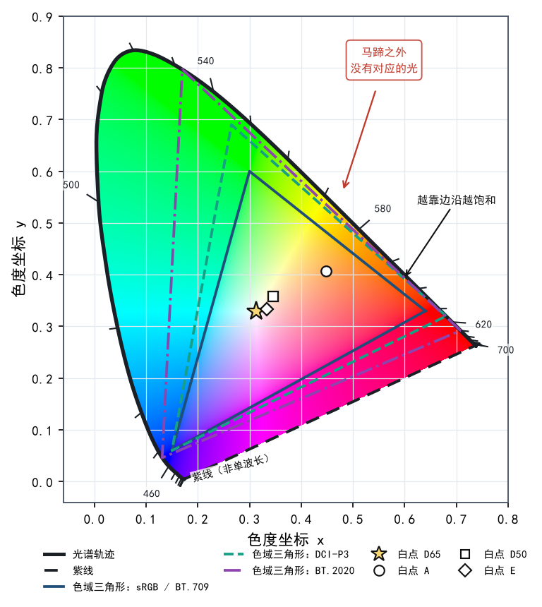
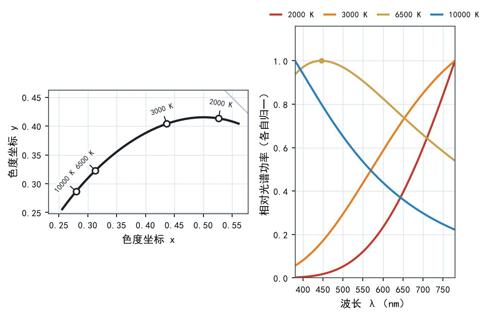
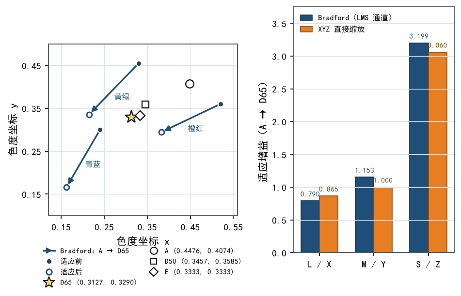

# 第 2 章 色度学与光源

第 1 章得到了三刺激值，三个数放在一起还不方便比较颜色。色度学把亮度和色度拆开，让颜色落到一张二维图上，于是"这个红比那个红更饱和"这类判断有了可以画出来的位置关系。本章先建立色品坐标和色度图，再引入黑体辐射与色温这套描述光源的语言，最后讨论白点与色适应，也就是同一个白在两种照明下如何换算。

## 2.1 色品坐标与色度图

三刺激值 $X$、$Y$、$Z$ 中，$Y$ 承担亮度，另外两个自由度承担色度。把三个数除以它们的和，得到色品坐标：

$$ x = \frac{X}{X+Y+Z},\qquad y = \frac{Y}{X+Y+Z},\qquad z = 1-x-y $$

三个坐标之和恒为 1，所以只有两个独立变量。把 $(x,y)$ 画在平面上，颜色就落进一张二维地图。同一组 $(x,y)$ 配不同的 $Y$，得到的是同一种色相、不同亮度的颜色。反过来，给定 $(x,y)$ 和 $Y$，三刺激值可以唯一还原：

$$ X = \frac{x}{y}Y,\qquad Z = \frac{1-x-y}{y}Y $$

这一步是色度学最常用的换算，写代码时几乎每页都会出现。它的代价也很直接：一个点代表一整条亮度轴，色度图上看不出亮度信息。

加色混合在色度图上是一条线段。设两种颜色分别为 $(x_1,y_1,Y_1)$ 和 $(x_2,y_2,Y_2)$，混合后的色品坐标是两者按三刺激值之和加权的结果：

$$ x_m = \frac{x_1 S_1 + x_2 S_2}{S_1+S_2},\qquad S_i = X_i + Y_i + Z_i = \frac{Y_i}{y_i} $$

权重是 $S_i$ 而非亮度 $Y_i$，两者只在 $y$ 接近时才近似相等。这条"杠杆定则"是色域三角形、混色计算、白点合成等一系列操作的几何基础。

## 2.2 光谱轨迹、紫线与色域

逐个波长取单色光，把它的色品坐标连起来，得到一条马蹄形的曲线，叫光谱轨迹。图 2-1 中它是那条深色实线，从 380 nm 附近的紫端出发，沿左侧上升到 520 nm 附近，在 $y \approx 0.83$ 处达到最高点（约 520 nm 到 521 nm 的绿色），然后沿右上方向下滑，经 580 nm 的黄色、620 nm 的橙红，到 700 nm 的红色端点 $(0.7347, 0.2653)$。

轨迹上的点代表纯单色光，饱和度最高。往马蹄内部走，饱和度下降，中心附近接近白。马蹄之外的点没有任何对应的光，因为色品坐标必须满足 $x \ge 0$、$y \ge 0$、$x+y \le 1$，而光谱轨迹已经贴在这三条边界的极限位置。

380 nm 与 700 nm 两个端点之间用直线相连，这条直线叫紫线。线上的颜色由红端与紫端的单色光相加得到，物理上是混合光，没有对应的单波长。紫线上的饱和度同样是边界值。

设备的色域是三个基色点在色度图上连成的三角形。三角形内部的所有颜色都能由三个基色按非负比例混合得到，三角形外做不到，因为需要负的基色分量。这也是第 1 章里逆矩阵出现负系数的几何解释。

用面积比衡量色域大小是一个常用指标。以 CIE 1931 色度图中整个马蹄形区域的面积为 100%，sRGB 三角形约占 33%，BT.2020 约占 76%。这个比值只说明"领土"大小，不说明观感差异，因为 $xy$ 平面本身不均匀，面积与感知差不成比例。第 3 章会专门讨论这一点。

色域覆盖率有两种算法。一种取被测设备三角形与目标三角形的交集，除以目标面积，得到覆盖率（coverage），这个数不会超过 100%；另一种直接用被测面积除以目标面积，得到相对面积（relative area），可以超过 100%。厂商标称的"覆盖 95% DCI-P3"通常指前一种，判断一部电影能否按原意还原要看这个数；标称"色域达到 110% sRGB"多半指后一种，数值好看，却不保证 sRGB 范围内的颜色都被完整覆盖。

三角形之外还有一层限制。色度图不含亮度，一个设备能覆盖的色域其实是三维体积，还要考虑每个色度点能达到的最大亮度。BT.2020 的基色点在色度图上很靠外，但实际显示器的绿基色亮度往往只有白场的 60% 到 70%，色域的"体积覆盖率"通常低于二维面积比。这一层在第 5 章讨论色域体积时展开。

## 2.3 黑体辐射与色温

任何温度高于绝对零度的物体都向外辐射电磁波。理想化的黑体辐射体，其光谱辐射出射度由普朗克定律给出：

$$ M_{e,\lambda}(\lambda,T) = \frac{2hc^2}{\lambda^5}\cdot\frac{1}{e^{hc/(\lambda kT)}-1} $$

其中 $h = 6.62607015\times10^{-34}\ \mathrm{J\cdot s}$，$c = 2.99792458\times10^{8}\ \mathrm{m/s}$，$k = 1.380649\times10^{-23}\ \mathrm{J/K}$。工程上常用第二辐射常数 $c_2 = hc/k = 1.4388\times10^{-2}\ \mathrm{m\cdot K}$ 把指数项写成 $e^{c_2/(\lambda T)}$。

温度升高，曲线整体抬高，峰值向短波移动。峰值波长与温度的关系是维恩位移定律：

$$ \lambda_{max} T = 2.8978\times10^{6}\ \mathrm{nm\cdot K} $$

2000 K 时峰值在 1449 nm（红外，肉眼看不到），3000 K 在 966 nm（仍在红外），6500 K 在 446 nm（蓝紫区），10000 K 在 290 nm（紫外）。可见光区看到的只是曲线的一段尾巴，温度越高，这段尾巴在整条曲线中的占比越大，颜色也就越偏蓝。

把不同温度黑体的色品坐标连起来，得到普朗克轨迹（图 2-2 左）。它从 1000 K 附近的深橙红出发，经过 2856 K 的暖白，穿过 6500 K 的中性白，向 20000 K 的蓝白延伸，形状是一条略向右弯的弧线。

色温的定义建立在这条轨迹上。如果某个光源的色品坐标恰好落在普朗克轨迹上某一点，该点对应的黑体温度就是它的色温（color temperature，CT）。绝大多数光源做不到这么巧，白光 LED、荧光灯、显示器白场的色度点通常偏离轨迹 0.001 到 0.01 的量级，这时改用相关色温（correlated color temperature，CCT），定义为轨迹上距离该点最近的那一点的温度。

"最近"要在感知上大致均匀的空间里量，CIE 规定用 CIE 1960 UCS 的 $(u,v)$ 坐标。只有在这个空间里，等温线才是垂直于轨迹的直线。图 2-2 左中那几条灰色虚线就是等色温线，它们是轨迹各点处法向的延长线。

CCT 的工程近似有 McCamy 公式，输入色品坐标直接给出数值：

$$ n = \frac{x-0.3320}{0.1858-y},\qquad CCT = 449n^3 + 3525n^2 + 6823.3n + 5520.33 $$

在 2856 K 到 6504 K 范围内，这个多项式与严格定义的偏差在 2 K 以内，够日常使用。超出这个范围，尤其低于 2500 K 时，误差会上升。

CCT 只说"离轨迹最近的点在哪"，不说"离多远"。偏移量用 $D_{uv}$ 表示，单位是 CIE 1960 $(u,v)$ 中的距离，符号约定轨迹之上（偏绿）为正，之下（偏品红）为负。常见白光 LED 的 $D_{uv}$ 在 $+0.003$ 到 $+0.010$ 之间，偏绿；影视灯具出厂前通常调到 $|D_{uv}| \le 0.003$。同样标 6500 K 的两块屏幕，$D_{uv}$ 一个为 $+0.006$、一个为 $-0.002$，并排看就能分出差别，这类差异在灰阶和肤色上最容易被察觉。

## 2.4 标准照明体与标准光源

CIE 定义了一组标准照明体（illuminant），用字母编号，每一个都给定了 SPD。这套编号按历史顺序累积而成，与技术先进程度无关。

**照明体 A** 代表白炽灯和卤钨灯，SPD 取 2856 K 黑体，$c_2$ 用 $1.4388\times10^{-2}\ \mathrm{m\cdot K}$ 计算。色品坐标 $(0.44757, 0.40745)$，CCT 2856 K。它是最容易用实物复现的标准，实验室里一盏稳流钨丝灯就能做到，因此成为仪器定标的基准。

**照明体 E** 是等能光谱，各波长功率相同，色品坐标 $(1/3, 1/3)$。物理上做不出来，纯属理论参考，主要用来检查计算程序是否正确。

**D 系列** 代表自然日光。日光由太阳直射光、天空散射光混合而成，SPD 随天气、时段、纬度变化，无法用一条曲线概括。CIE 的做法是给出一组特征向量 $S_0(\lambda)$、$S_1(\lambda)$、$S_2(\lambda)$，任意日光的 SPD 由这三个向量的线性组合近似：

$$ S_D(\lambda) = S_0(\lambda) + M_1 S_1(\lambda) + M_2 S_2(\lambda) $$

系数 $M_1$、$M_2$ 由目标色品坐标算出，于是整个 4000 K 到 25000 K 的日光族可以用一条公式覆盖。其中 D65 的 CCT 为 6504 K，色品坐标 $(0.31272, 0.32903)$，是 sRGB、BT.709、BT.2020、BT.2100 共同指定的白点；D50 的 CCT 为 5003 K，色品坐标 $(0.34567, 0.35850)$，用于印刷和 ICC 色彩管理。

**F 系列** 代表荧光灯，共 12 种，覆盖冷白、暖白、三基色等类型。它们的 SPD 有明显的汞灯线谱和荧光粉宽带，色域表现与连续谱光源差别较大，同色异谱问题也更突出。

| 照明体 | CCT | $x$ | $y$ | 典型用途 |
|---|---|---|---|---|
| A | 2856 K | 0.44757 | 0.40745 | 仪器定标、白炽灯 |
| D50 | 5003 K | 0.34567 | 0.35850 | 印刷、ICC |
| D65 | 6504 K | 0.31272 | 0.32903 | 视频、显示器 |
| E | 5455 K | 0.33333 | 0.33333 | 理论参考 |
| DCI | 约 6300 K | 0.31400 | 0.35100 | 数字影院 |

表里 DCI 一行值得单独说明。数字影院倡导组织（Digital Cinema Initiatives）规定的放映白点是 $(0.314, 0.351)$，比 D65 偏绿偏黄，CCT 约 6300 K，$D_{uv}$ 明显为正。这个选择来自放映氙灯的实际光谱，后来被写进标准，成了影院内容的基准白。一部按 DCI 白点调色的电影拿到 D65 白点的家用显示器上播放，画面会显得偏冷偏品红，这是影院与家庭两条链路的固有差异之一。

显色指数用来衡量光谱的连续性。CRI 的 $R_a$ 取 8 块中等饱和度的标准色样，在 5000 K 以下用同色温黑体作参考光源、以上用 D 系列日光作参考，比较两者照射下色样的色差，再线性映射到 0 到 100。这套方法对连续谱光源表现正常，对窄带 LED 会给出偏高的分数，因为它用的色样太少、饱和度也不够。TM-30 改用 99 块色样，同时给出保真度 $R_f$ 与色域指数 $R_g$，对白光 LED 的区分度更好。

白光 LED 不在标准照明体之列。它的 SPD 由蓝光芯片和荧光粉决定，各厂家差异很大，无法用一条曲线代表，描述它只能用 CCT 加 $D_{uv}$ 两个参数，再加显色指数（CRI 或 TM-30 的 $R_f$、$R_g$）衡量光谱的连续性。

## 2.5 白点与色适应

白点在色度图上是一个具体位置，在数值上是一个三刺激值比例。显示器显示白色时，三个通道都开到最大，输出的色度由基色坐标和驱动比例共同决定，这个色度就是该显示器的白点。

两台白点不同的显示器并排显示同一张白色图片，观者会觉得左边偏黄、右边偏蓝。这种差异在单独观看时几乎察觉不到，因为视觉系统会自动把当前环境的最亮中性色当作白，并据此重新标定其他颜色。这个机制叫色适应（chromatic adaptation）。

色适应的工程模型都来自 von Kries 在 1902 年提出的系数定律：视觉系统在三个独立的感受器通道上分别做增益调整，把白点的响应拉到同一水平。

$$ \begin{bmatrix} L'\\ M'\\ S' \end{bmatrix} =
\begin{bmatrix} L_w'/L_w & 0 & 0\\ 0 & M_w'/M_w & 0\\ 0 & 0 & S_w'/S_w \end{bmatrix}
\begin{bmatrix} L\\ M\\ S \end{bmatrix} $$

问题在于用哪组感受器。直接在 XYZ 上做缩放最省事，效果却不好；用生理上更接近的视锥响应空间，效果明显改善。Bradford 变换是工业界用得最多的一个，它用一组经验拟合的锥体响应矩阵：

$$
\mathbf{M}_{BFD} =
\begin{bmatrix}
0.8951 & 0.2664 & -0.1614\\
-0.7502 & 1.7135 & 0.0367\\
0.0389 & -0.0685 & 1.0296
\end{bmatrix}
$$

从光源 A 适应到 D65，在 $\mathbf{M}_{BFD}$ 空间算出的三个增益分别是 $L$ 0.7896、$M$ 1.1529、$S$ 3.1989。短波通道的增益是三倍多，因为 A 光源的短波能量本来就少。同一组白点在 XYZ 上直接缩放得到的增益是 0.8652、1.0000、3.0600，与 Bradford 的差别集中在 $L$ 和 $M$ 通道，这个差别在饱和色上会放大成可见的色相偏移。

图 2-3 左边画出了三个颜色在色度图上的位移。位移方向一致朝向 D65，幅度各不相同，说明色适应相当于随颜色位置变化的仿射变换，并非简单的整体平移。合成后的适应矩阵为：

$$
\mathbf{M}_{A\to D65} =
\begin{bmatrix}
0.8447 & -0.1179 & 0.3948\\
-0.1366 & 1.1041 & 0.1292\\
0.0799 & -0.1349 & 3.1926
\end{bmatrix}
$$

负系数出现在非对角位置，意味着适应后的 $X$ 会受原始 $Z$ 影响。这类交叉项是 Bradford 优于 XYZ 缩放的原因，也解释了为什么色彩管理系统不能只做通道缩放。

除了 Bradford，常用的还有 CAT02（用于 CIECAM02 色貌模型）和 CMCCAT2000（面向工业应用），三者在多数场景下差异很小，只在极端白点或高饱和色上有可见区别。ICC 规范推荐 Bradford，视频领域常用 CAT02，选择哪一个需要在链路里保持一致，混用会引入系统性偏差。

## 2.6 HDR 链路中的白点问题

HDR 内容的参考白与 SDR 不同。SDR 时代，白场亮度就是显示器峰值，约 100 cd/m²；BT.2100 把 HDR 的参考白定为 203 cd/m²，PQ 编码下对应码值 0.58，峰值可以到 1000 cd/m² 甚至 10000 cd/m²。这个 203 cd/m² 的"图形白"（graphics white）是字幕、UI、纯白的锚点，也是色适应计算的参考，色调映射时以它为基准做亮度压缩。BT.2408 把这套做法写成操作报告，规定了参考白的取值、图形白的叠加范围，以及不同峰值亮度下的映射建议。

白点则统一在 D65。BT.2020、BT.2100、DisplayHDR 认证、流媒体的交付规范，都要求白点落在 D65 容差内，常见容差是色品坐标偏差不超过 $\pm0.003$、$D_{uv}$ 不超过 0.003。这个容差换算成视觉差大约是 1 到 2 个 $\Delta E_{2000}$，属于并排比较才能看出的量级。

内容从影院链路转到家庭链路时要处理 DCI 白点到 D65 白点的换算，从 HDR 转到 SDR 时要处理 203 cd/m² 参考白与 100 cd/m² 白场的映射。两件事都用到本章的色适应矩阵，只是作用对象从 SPD 换成了已编码的三刺激值。

## 本章要点

- 色品坐标 $x = X/(X+Y+Z)$、$y = Y/(X+Y+Z)$ 把颜色投影到二维平面，代价是丢掉亮度；给定 $(x,y)$ 与 $Y$ 可以唯一还原三刺激值。
- 加色混合在色度图上是线段，混合点按三刺激值之和 $S_i = Y_i/y_i$ 加权，$y$ 接近时可以近似为按亮度加权。
- 光谱轨迹是单色光的轨迹，饱和度最高；紫线连接两端，对应红紫混合光；马蹄之外没有对应的光。
- 设备色域是基色三角形，三角形外的颜色需要负的基色分量。sRGB 约占 CIE 1931 色域面积的 33%，BT.2020 约占 76%。
- 普朗克定律给出黑体光谱，维恩位移 $\lambda_{max}T = 2.8978\times10^{6}\ \mathrm{nm\cdot K}$ 决定峰值位置，黑体的色品坐标连成普朗克轨迹；色温要求色度点落在轨迹上，否则改用最近点的相关色温 CCT，距离在 CIE 1960 $(u,v)$ 中度量，偏移量记作 $D_{uv}$，偏绿为正。
- 标准照明体中，A 是 2856 K 黑体，D65 是 6504 K 日光（视频通用白点），D50 用于印刷，E 是理论等能白，DCI 白点 $(0.314, 0.351)$ 用于数字影院。
- 色适应按 von Kries 系数定律工作，Bradford 变换在锥体响应空间做通道缩放，A 到 D65 的增益为 0.79、1.15、3.20，明显不同于 XYZ 直接缩放的 0.87、1.00、3.06。
- HDR 用 D65 白点加 203 cd/m² 参考白，白点容差通常取 $\pm0.003$，约合 1 到 2 个 $\Delta E_{2000}$。
