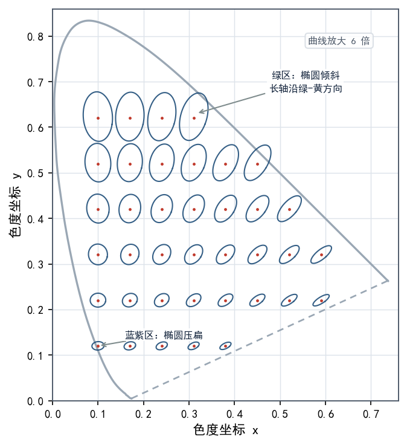
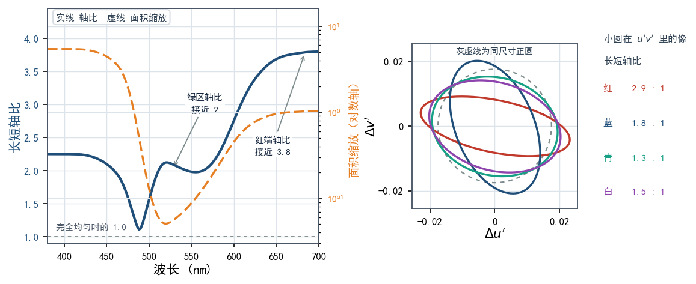
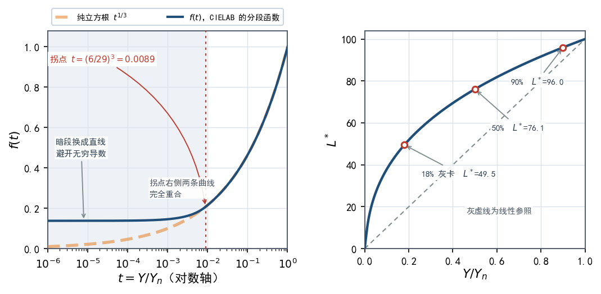
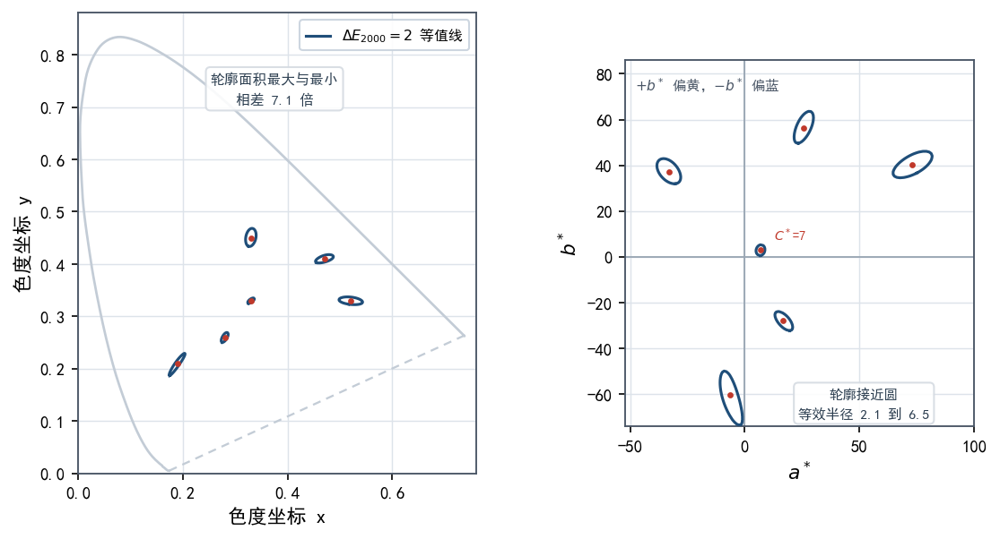
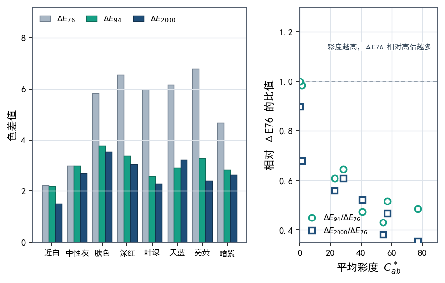
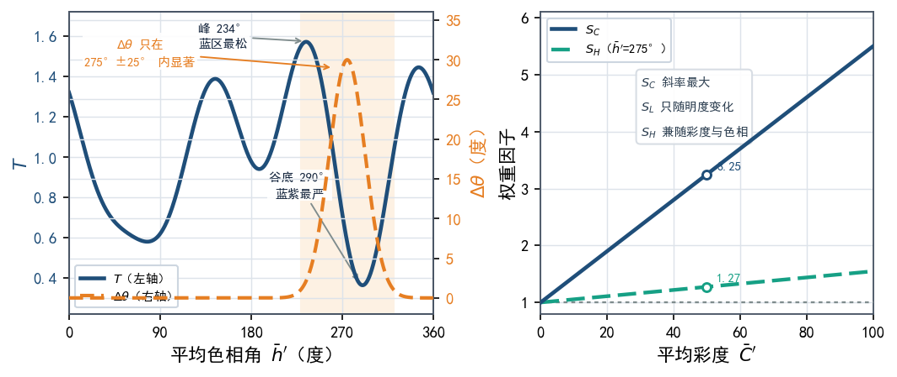
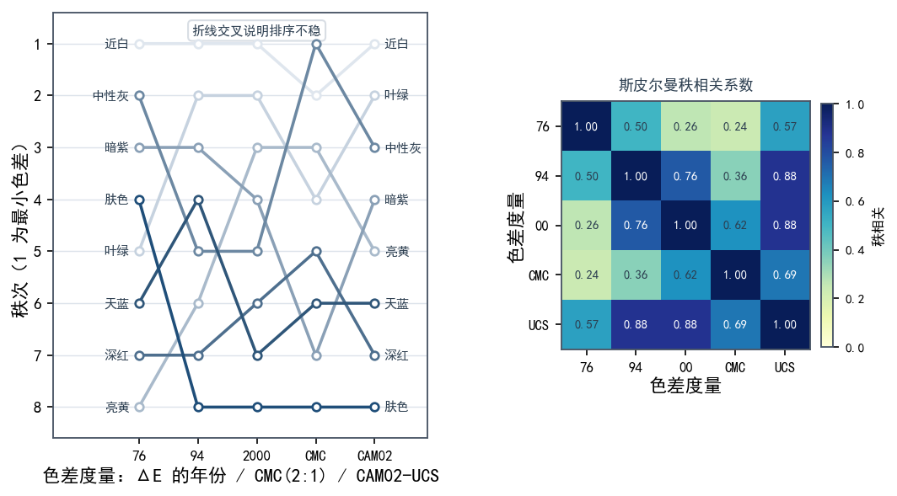

# 第 3 章 均匀色彩空间与色差

色度图能告诉你两个颜色落在哪里，却不能告诉你它们差多少。在 $xy$ 平面上量出来的距离与人的感觉没有固定比例，绿色区域走一大步可能看不出区别，蓝紫区域挪一点点已经很刺眼。要让"差多少"变成一个可比的数字，得先把坐标换成一种距离与感知大致成比例的度量空间。这次变换在 1960 年与 1976 年分两步完成，由此得到的几个色差公式至今还在互相打架，账要一笔一笔算。

## 3.1 感知距离不是几何距离

1942 年，David MacAdam 在柯达实验室做了一系列目视匹配实验。他用一台双目比色计，让观察者在给定的中心色附近反复调节，找出"还能分辨"与"已经分辨不出"之间的边界，再把边界连成围绕中心色的闭合曲线。实验由少数训练有素的观察者完成，其中大部分观测是 MacAdam 本人做的，每个中心色重复数十次，最后得到 25 个闭合轮廓。

结果画在同一张 $xy$ 图上，形状可谓五花八门。这些轮廓的长短轴之比从小到 2 比 1，大到 20 比 1，长轴的方向也在转，绿区的长轴大致沿绿黄方向倾斜，蓝区的长轴几乎垂直于等色相线。所谓"同一条 $xy$ 平面上画等距网格，落在不同轮廓里的格子数相差很多"，说的就是这件事。

感知差的单位有一个通用名称，恰可察觉差（just noticeable difference，JND）。严格的 JND 不是"能看见"与"看不见"的绝对分界，而是观察者在一半的试次中判断正确的那个量级，因此它本身带有统计性质，重复实验的结果会在一个区间内浮动。MacAdam 的轮廓正是在这个意义上给出的等 JND 等值线，轮廓大小不统一，说明 JND 在 $xy$ 平面上没有固定尺码。

图 3-1 用另一种方式重现了这个现象。绘制方法是先在 CIE 1976 $u'v'$ 坐标里画半径相同的小圆，圆在 $u'v'$ 中代表相同的感知步长，再把这族圆逐个映射回 $xy$ 平面。映射结果在绿色区域被拉长、倾斜，在蓝紫区域被压扁，中央接近白点的位置则近似圆。图上线条放大了 6 倍，真实尺寸只有图上的六分之一，否则按原尺寸画出来会细得看不清。这组曲线并不是 MacAdam 当年的原始测量数据，它是用 $u'v'$ 空间反推的示意，真实椭圆比图上更极端，长轴与短轴之比最大超过 20，这个差距无法只靠一次坐标变换消掉。

实验方法上的细节值得补一句，否则很容易误读这 25 个轮廓。观察者做的是重复匹配，每一次把测试色调到看起来与参考色完全一致，记录落点相对参考色的偏移；同一方向做几十次，偏移量服从一个分布，取其标准差作为一个方向的"可辨尺度"；25 个方向上都量一遍，再把标准差相等的点连起来，就得到围绕中心色的椭圆。所以这些轮廓是匹配偏差的等标准差线，不是"能看见与看不见"的硬边界。按当时发表的图形，椭圆通常放大 10 倍画出，放大后的长轴相当于几十个 JND，放到真实尺度只有图上的一小块，这也是它在此后几十年里被反复引用的原因。同一位置重复整套实验，标准差会有约 10% 的波动，长短轴比也会变，文献里引用的"20 比 1"是多个中心色里的极端值，拿单个椭圆去说事并不严谨。

另一件容易混淆的事是椭圆的方向。$xy$ 图上椭圆的倾斜角不等于色相方向，它反映的是该位置上感知度量张量的主轴方向，与人眼在这个色度区域对不同方向差异的敏感度有关。绿区的长轴指向黄绿方向，意味着沿这个方向改变色度时人眼最不敏感，要移动很远才跨过阈值；短轴垂直于它，稍动一点就能看出来。这个各向异性不是测量误差，而是视觉系统的真实性质，后面 $\Delta E_{2000}$ 的 $R_T$ 项正是为了补上蓝区的类似倾斜。

用 CIEDE2000 当尺子，同一件事可以量得更具体。在 $xy$ 上取固定的 0.01 步长，$Y$ 固定为 0.5，从绿区的 $(0.30, 0.60)$ 沿 $y$ 方向移动 0.01，色差只有 0.72，同一位置沿 $x$ 方向移动 0.01 则是 1.46。到了蓝区 $(0.16, 0.06)$，沿 $x$ 是 2.61，沿 $y$ 变成 3.74。而在白点 $(0.313, 0.329)$ 附近沿 $x$ 走 0.01，色差高达 5.59。同一个 0.01，落到色差上相差接近八倍，这还只是四个采样点。

1949 年 Brown 与 MacAdam 把实验扩展到明度，同时改变亮度与色度，得到三维的等感知差椭球。结论是椭球在 $xyY$ 空间里的三个主轴长度也随位置变化，明度方向的容差与色度方向的容差之间还耦合，单独固定 $Y$ 去量色度只是三维问题的一个切面。这一批数据后来成了 CIE 1960 UCS 与 1976 两个空间的拟合基础，也是判断任何新色彩空间够不够均匀时最常用的一组检验数据。

既然 $xy$ 平面上的等距不代表等感知差，能不能构造一个变换把它拉平。数学上的障碍在于，感知空间里每一点附近都可以定义一个度量张量，把微小的坐标变化映射成感知差，这个张量在 $xy$ 平面上的主轴方向随位置转动、特征值随位置变化，因此它描述的是一张弯曲的空间。想用一组全局坐标把一个弯曲的空间完全拉平，在数学上做不到，任何"均匀色彩空间"都只能是局部近似。工程上能做的是选择关注区域，让该区域的失真降到可接受，这也是 CIELAB 至今无法彻底解决问题的根本原因。

## 3.2 从 xy 到 u′v′

第一次系统性修正出现在 1960 年。CIE 采纳的 CIE 1960 UCS 用两个新坐标替代 $x$、$y$：

$$ u = \frac{4X}{X+15Y+3Z},\qquad v = \frac{6Y}{X+15Y+3Z} $$

这两个式子的来历并不是从某个感知模型推导出来的，而是用 MacAdam 椭圆做拟合得到的经验结果。Judd 在 1935 年就提出过类似形式，用一组线性组合去逼近椭圆的等值线，1960 年的版本在此基础上调了系数。变换之后，原本细长的椭圆被压缩、拉直，同一区域内的形状差异明显缩小，虽然做不到完全均匀，已经可以用来量距离。CIE 1960 UCS 至今仍是相关色温与 $D_{uv}$ 的法定度量空间，第 2 章的等温线就是在这个空间里垂直于普朗克轨迹。

1976 年，CIE 又做了一次小修改，把纵轴放大 1.5 倍：

$$ u' = u = \frac{4X}{X+15Y+3Z},\qquad v' = 1.5v = \frac{9Y}{X+15Y+3Z} $$

改动的原因并不复杂。$v$ 轴的尺度偏小，$u'v'$ 平面上的等距离轮廓在纵向上被压扁，放大 1.5 倍之后圆更接近正圆。这 1.5 是个纯粹的缩放因子，不改变任何比值关系，只把纵轴的刻度重排。这套坐标记作 CIE 1976 $u'v'$，也写作 UCS 1976。

反算的关系同样简单，从 $u'$、$v'$ 回到 $x$、$y$ 只需要一次代数整理：

$$ x = \frac{9u'}{6u' - 16v' + 12},\qquad y = \frac{4v'}{6u' - 16v' + 12} $$

分母里出现常数 12，是因为 $u'$ 的分子只保留了 $X$，而 $X+Y+Z$ 这三项在归一化时被消去了。用 D65 白点 $(0.3127, 0.3290)$ 代入，得到 $u'_n = 0.1978$、$v'_n = 0.4683$，这两个数在做任何 $u'v'$ 相关的计算时都要用到。

$u'v'$ 最好用的性质是两个色度之差可以直接写欧氏距离：

$$ \Delta u'v' = \sqrt{(u'_1-u'_2)^2 + (v'_1-v'_2)^2} $$

显示行业用它判断白点偏差，容差常取 0.003 到 0.005。这个区间不是随手定的。把 D65 白点沿 $v'$ 方向挪 0.002、0.003、0.005，对应的 $\Delta E_{2000}$ 分别是 1.71、2.53、4.06，0.003 正好卡在"并排比较能看出来、单屏观看还在容忍范围"的分界上。取 0.005 时色差已经到 4，稍有经验的观察者一眼就能发现色偏，所以它只能当作低端产品的上限。同一套坐标还给出了 $D_{uv}$，也就是色度点偏离普朗克轨迹的垂直距离，符号规定为轨迹上方为正（偏绿）、下方为负（偏品红），照明行业用 $|D_{uv}| \le 0.006$ 作为"落在轨迹上"的判据。

这套坐标的局限要交代清楚。1960 年的修正是用椭圆拟合出来的，拟合误差在绿区仍然不小；1976 年的 1.5 倍因子只解决了纵轴压缩，椭圆本身的形状差异依然存在。

图 3-2 把残余失真量出来。左图沿光谱轨迹取 380 到 700 nm 的波长，对每一个色度点计算映射 $xy \to u'v'$ 的雅可比矩阵，两条曲线分别是奇异值之比（也就是"圆变成椭圆后的长短轴比"）和行列式（面积缩放）。长短轴比在可见光谱范围内于 1.1 到 3.8 之间起伏，490 nm 附近的青区最小（约 1.1），红端最大（3.8）；面积缩放跨越两个数量级，从 520 nm 附近的 0.05 一直升到 400 nm 处的 5.4，说明这个映射连面积都不守恒。右图把四个位置的小圆及其在 $u'v'$ 里的像叠在同一坐标系中比较，像被归一化到同一中心，虚线是同样大小的正圆作为参照。四个像的长短轴比分别是 2.9、1.8、1.3、1.5，方向各不相同。

换句话说，$u'v'$ 把 $xy$ 上 20 比 1 的失真压到了 4 比 1 以内，改善是实打实的，但没有压到 1。这不是实现上的疏忽，而是一个只含三个自由系数的线性分式变换所能达到的极限。要再往前一步，必须改变映射的函数形式，让压缩强度随位置变化，这条路通向 1976 年的两个 $L^*$ 空间。

用数字再验一遍。在 $u'v'$ 上取 0.004 的固定步长，$Y$ 仍固定 0.5，白点处沿 $u'$ 方向移动得到 $\Delta E_{2000} = 3.68$，沿 $v'$ 方向是 2.86；绿区两个方向分别是 1.02 和 1.60；蓝区是 1.01 和 0.55；红区是 0.30 和 3.95。同一个 0.004，落到色差上从 0.30 到 3.95，跨度超过一个数量级。这个结果说明 $u'v'$ 依然不能当色差的尺子，它只能当"色度距离"的近似。反过来也成立，$\Delta u'v' = 0.004$ 在白点附近约等于 $\Delta E_{2000} = 3.7$，在红端只有 0.3，两套数字之间没有换算系数。

工程上判断白点偏差、算色域面积、比较两个色度点的远近，这些用途对均匀性的要求不高，$u'v'$ 够用而且通用。量色差就要回到 $L^*$ 空间或色貌模型，这一点没有捷径。

## 3.3 CIE 1976 Luv 与 CIELUV

把 $u'v'$ 与亮度结合起来，得到 CIE 1976 $L^*u^*v^*$，简称 CIELUV。明度部分与 CIELAB 共用同一套公式：

$$ L^* = \begin{cases}
116\,(Y/Y_n)^{1/3} - 16, & Y/Y_n > (6/29)^3 \\[2pt]
(29/3)^3\,(Y/Y_n), & Y/Y_n \le (6/29)^3
\end{cases} $$

色度部分则是把 $u'v'$ 的差值乘上明度：

$$ u^* = 13L^*(u' - u'_n),\qquad v^* = 13L^*(v' - v'_n) $$

下标 $n$ 表示参考白。$L^*$ 的取值范围是 0 到 100，$Y/Y_n = 1$ 时正好 100。乘上 $13L^*$ 的目的是让色度量随亮度缩放。同一个色度，在亮处比在暗处看起来更"有颜色"，暗处的色差自然变小，这与视觉经验一致。系数 13 来自 1976 年的实验拟合，没有更深的物理含义，记住它是一个标定常数就够了。

CIELUV 的色差用欧氏距离：

$$ \Delta E_{uv} = \sqrt{(\Delta L^*)^2 + (\Delta u^*)^2 + (\Delta v^*)^2} $$

它的强项是加色系统。显示器、灯具、投影这类直接发光的设备，颜色由三原色叠加而成，混合过程在 $XYZ$ 里是线性的，在 CIELUV 里做线性混合、色域映射都比较自然。饱和度也可以直接写出来：

$$ s_{uv} = \frac{C^*_{uv}}{L^*} = 13\sqrt{(u'-u'_n)^2 + (v'-v'_n)^2} $$

$s_{uv}$ 只与色度有关，与明度无关，这个性质在描述"同一个色相在不同亮度下饱和度如何变化"时很方便。CIELUV 也有自己的彩度与色相角，$C^*_{uv} = \sqrt{(u^*)^2+(v^*)^2}$，$h_{uv} = \arctan(v^*/u^*)$。两套角度的数值不同，$h_{uv}$ 与 $h_{ab}$ 不能混用，跨软件传数据时得看清楚角标。

两套空间的数值尺度差别很大，不能拿 $u^*$ 与 $a^*$ 直接比大小。表 3-1 列出 sRGB 六种原色与两种灰的计算结果，全部按 CIE 公式在 D65、2° 观察者下算出。

| 色样 | $L^*$ | $a^*$ | $b^*$ | $u^*$ | $v^*$ |
|------|------|------|------|------|------|
| 红 (255,0,0) | 53.24 | 80.09 | 67.20 | 175.02 | 37.76 |
| 绿 (0,255,0) | 87.73 | -86.18 | 83.18 | -83.08 | 107.40 |
| 蓝 (0,0,255) | 32.30 | 79.19 | -107.86 | -9.41 | -130.34 |
| 黄 (255,255,0) | 97.14 | -21.55 | 94.48 | 7.71 | 106.79 |
| 青 (0,255,255) | 91.11 | -48.09 | -14.13 | -70.48 | -15.20 |
| 品红 (255,0,255) | 60.32 | 98.23 | -60.82 | 84.07 | -108.68 |
| 50% 灰 (128,128,128) | 53.59 | 0.00 | 0.00 | 0.00 | 0.00 |
| 白 (255,255,255) | 100.00 | 0.00 | 0.00 | 0.00 | 0.00 |

表里 sRGB 的蓝在 CIELUV 里 $u^*$ 只有 $-9.4$，看起来离中性轴很近，这与蓝在 $u'v'$ 图里靠近白点是同一件事的两种表述。做色域比较时如果用错了空间的坐标去算面积，结论会偏得很离谱。表中省掉了彩度一列，用 $\sqrt{a^{*2}+b^{*2}}$ 现算即可，纯红 104.55，纯绿 119.78，纯蓝 133.81。

拿一个具体色样算一遍能看清 $13L^*$ 的实际效果。sRGB 纯红 $L^* = 53.24$，$u' - u'_n = 0.4507 - 0.1978 = 0.2529$，乘上 $13 \times 53.24$ 得到 $u^* = 175.02$；同一支红的 $a^*$ 只有 80.09，两个数差了一倍多。差别的来源是 $a^*$ 已经按明度归一化过，$u^*$ 没有。这意味着在 CIELUV 里比较两个不同亮度颜色的彩度，必须先除以 $L^*$，直接比 $C^*_{uv}$ 会把亮误当成艳。$s_{uv}$ 就是为这件事准备的。三个 sRGB 原色的 $s_{uv}$ 分别是红 3.36、绿 1.55、蓝 4.05，蓝色最艳，这与直观相符；而 $C^*_{uv}$ 给出的 179.04、135.78、130.68 几乎并列，看上去三种原色饱和度差不多，完全掩盖了蓝色明度低、饱和度高的特征。原因是 $C^*_{uv}$ 里乘了明度，红的 $L^*$ 是蓝的 1.65 倍，这个倍数把两者的差距抹平了。

这套缩放的代价是暗部的数值被压得很小。$L^* = 10$ 时，$\Delta u'v' = 0.01$ 只能得到 $\Delta u^* = 1.3$，色差几乎被抹平，而视觉上暗部的色相分辨力并没有差到这个程度。做暗部色域映射时如果直接用 $\Delta E_{uv}$ 作判据，很容易把暗部的色偏放过去。CIELUV 在照明行业主要描述光源色度，在显示行业主要用于色域体积与饱和度的计算，两个用途都不太碰暗部，这个缺陷因此被掩盖。

弱项是它没有处理好明度恒常。两块反射率不同但被认定同色的纸，在 CIELUV 里可能差得很远，因为它只按绝对三刺激值计算，不知道观察者已经把照明因素归一化掉了。另外蓝紫区域的色相均匀性也差，这一段在 3.6 节还会碰到。印刷与涂料领域基本被 CIELAB 取代，这个分工从 1976 年延续至今。

## 3.4 CIE 1976 Lab 与 CIELAB

同一年采纳的另一个空间是 CIE 1976 $L^*a^*b^*$，简称 CIELAB。它同样从 XYZ 出发，但走的是另一条路。CIELUV 直接拿色度坐标做差再乘明度，CIELAB 则先把三个通道各自压缩一次，再在压缩后的差值上做线性组合：

$$ f(t) = \begin{cases}
t^{1/3}, & t > (6/29)^3 \\[2pt]
\frac{1}{3}\left(\frac{29}{6}\right)^2 t + \frac{4}{29}, & t \le (6/29)^3
\end{cases} $$

$$ L^* = 116 f(Y/Y_n) - 16,\qquad a^* = 500\,[f(X/X_n) - f(Y/Y_n)],\qquad b^* = 200\,[f(Y/Y_n) - f(Z/Z_n)] $$

分段点选在 $(6/29)^3 \approx 0.008856$ 不是随手取的。立方根在 $t \to 0$ 时导数趋于无穷，直接用到黑附近会放大小到无意义的测量噪声，一条 8 位相机拍出来的近黑区域误差在 1/255 量级，经过立方根放大后 $L^*$ 会跳好几格。用一段直线替换原点附近的立方根，既避开了无穷导数，又保持了连接处的平滑。检验方法是对两边求导，立方根的导数是 $\frac{1}{3}t^{-2/3}$，在 $t=(6/29)^3$ 处等于 $\frac{1}{3}(29/6)^2 \approx 7.787$；直线段的斜率也是 $\frac{1}{3}(29/6)^2$，两者相等。函数值同样接得上，立方根在这一点给出 $6/29 \approx 0.2069$，直线段代入也得到 $6/29$。位置和一阶导数都连续，二阶导数不连续，好在视觉对二阶不连续不敏感，肉眼看不到折角。

$L^*$ 与 $Y$ 的关系因此是一条先直后弯的曲线。在 $Y/Y_n = 1$ 处 $L^* = 100$，在 $Y/Y_n = (6/29)^3$ 处 $L^* = 116 \times \frac{6}{29} - 16 = 8$，在暗段的斜率是 $116 \times 7.787 \approx 903$，也就是说 $Y/Y_n$ 每变化 0.001，$L^*$ 变化约 0.9。

图 3-3 左图把 $f(t)$ 与纯立方根 $t^{1/3}$ 画在一起，横轴取对数以便看清暗段。两条曲线在 $t > 0.008856$ 之后完全重合，在更暗的一段分岔，$f(t)$ 用直线代替了趋于无穷的立方根，图中红色虚线标出拐点位置。右图画 $L^*$ 随 $Y/Y_n$ 的变化，横轴仍是 $Y/Y_n$，纵轴是 $L^*$，标注了三处常被引用的数值：18% 反射率的灰卡对应 $L^* = 49.50$，50% 反射率对应 76.07，90% 对应 96.00。注意 50% 反射率只给出 76 的明度，不是 50，这条曲线的上凸形状正是"中灰看起来比数值亮"的原因。多数显示系统的 gamma 2.2 到 2.4 也在逼近同一件事，只是函数形式不同，sRGB 用 2.4 次幂加一段线性，PQ 用对数型的分段压缩。

$a^*$ 从绿到红，$b^*$ 从蓝到黄。中性灰对应 $a^* = b^* = 0$，这要求 $X/X_n = Y/Y_n = Z/Z_n$，也就是说只有参考白的三刺激值比例才落在中性轴上。参考白选错，灰色就会带上色偏，这是 CIELAB 使用中最常见的错误。举个具体数字，把 D65 的白 $(0.9505, 1.0000, 1.0888)$ 按 D50 参考白 $(0.9642, 1.0000, 0.8252)$ 去算，得到的 $a^* = -2.39$、$b^* = -19.36$。$b^*$ 掉到 $-19$ 意味着本该中性的白被算成了明显偏蓝，整个色域跟着一起偏。用错了参考白的图像看起来"发青"，往往就是这个原因，而不是显示器本身的问题。

由 $a^*$、$b^*$ 可以导出彩度与色相角：

$$ C^*_{ab} = \sqrt{(a^*)^2 + (b^*)^2},\qquad h_{ab} = \arctan\frac{b^*}{a^*} $$

$h_{ab}$ 按逆时针从 $+a^*$ 轴量起，$0°$ 是红，$90°$ 是黄，$180°$ 是绿，$270°$ 是蓝。这四个角度是教材上的约定，实际色样的色相角与它们并不重合。sRGB 的纯红 $a^* = 80.09$、$b^* = 67.20$，$h_{ab} = 40.0°$；纯绿 $h_{ab} = 136.0°$；纯蓝 $h_{ab} = 306.3°$。红原色偏向橙，绿原色偏向青绿，蓝原色偏向紫，这是 sRGB 基色波长的直接后果。把 sRGB 红当成"标准红"去调色，方向会差 40 度。

参考白的选择不是可以含糊的事。CIE 给了两张标准表，D65 对应 $(X_n, Y_n, Z_n) = (95.047, 100.000, 108.883)$，D50 对应 $(96.422, 100.000, 82.521)$，两者在 $Z_n$ 上差了 24%。印刷业统一用 D50，因为纸张与油墨的观察习惯如此；显示与电视统一用 D65，因为屏幕的原始白点在这里。把同一份 Lab 数据从 D50 换到 D65 不能只换标称值，必须先把 XYZ 做一次色适应（Bradford 或 CAT02），否则灰色会整体偏色。ICC 规范把这件事写进了 PCS 的定义，profile 里必须声明所用的白点，转换时由 CMM 负责适配。

$L^*$ 与孟塞尔明度 $V$ 的对应可以查得更细。孟塞尔明度的定义给出 $V$ 对应的反射率，$V = 1$ 是 1.21%，$V = 3$ 是 6.55%，$V = 5$ 是 19.77%，$V = 7$ 是 43.06%，$V = 10$ 是 100%；代入 $L^*$ 公式得到 10.6、30.8、51.6、71.6、100。相邻两级的间隔在 8.9 到 10.5 之间，中间几级最宽，两端略窄。这个非线性来自孟塞尔体系本身的排列方式，观察者靠肉眼把明度等分，得到的是一个近似对数的序列，而 $L^*$ 的立方根只是对它的一阶逼近。工程上把 $L^* \approx 10V$ 当速算公式足够用，做色彩管理查表时还是要用实测的对应关系。

CIELAB 的强项是物体色。印刷、涂料、纺织、塑料这些行业测的是反射率，观察条件相对固定，光照归一化之后 CIELAB 的表现比 CIELUV 稳定，因为立方根压缩在中等亮度区域与视觉数据的吻合度更好。ICC 色彩管理里的 PCS（profile connection space）就是 CIELAB 或 XYZ，v4 规范里 Lab 用 16 位定点编码，$L^*$ 从 0 到 100 映射到 0 到 65535，$a^*$、$b^*$ 从 $-128$ 到 $+127$ 映射到 $-32768$ 到 $+32767$，编码精度约为 $\Delta E$ 的 0.002，远小于任何有意义的色差。

两个空间在工程中的分工大致如此。显示器校准软件报容差时用 $\Delta E_{2000}$，因为它建立在 CIELAB 上；做色域映射、饱和度压缩时用 CIELUV，因为它的色度量随亮度线性缩放，处理加色混合更自然。同一台显示器可以用两套空间描述，只要在链路内部保持一致，不要在中间把 $h_{uv}$ 当成 $h_{ab}$ 用。

两张空间在链路里并存时还有一个容易忽略的细节，Lab 与 Luv 的明度共用同一个 $L^*$，但色度项的定义完全不同，软件界面上的"a"与"u"如果标错，操作者按数值调参就会调反方向。显示器的 3D LUT 校准通常以 Lab 为目标色，因为它与 ICC 的 PCS 一致；而投影与灯具的色度容差更多用 $u'v'$，因为它直接对应 CCT 与 $D_{uv}$。同一条产线上两种表述混用时，必须在文件里写清楚坐标系的名称，不能只写"色差"。

图 3-4 把同一组等色差线画在两个平面上，用来检验"均匀"到底做到了什么程度。左图的曲线是 $xy$ 平面上的等色差线，六个中心色固定 $Y = 0.5$，等值线取 $\Delta E_{2000} = 2$。右图把同样这些曲线放到 $a^*b^*$ 平面上。整个过程没有做任何近似，等值线由 $xy$ 网格上的逐点 $\Delta E_{2000}$ 计算再插值得到，因此两张图画的是同一批颜色。在 $xy$ 上形状与大小相差很大，按轮廓围出的面积算，最小与最大相差 7.1 倍，最扁的一个长短轴比 4.7，接近圆的一个只有 1.6；到了 $a^*b^*$ 上，六个轮廓的形状明显规整，轴比落在 1.1 到 2.7 之间，多数在 2 附近，等效半径从彩度 7 那一组的 2.1 涨到彩度 60 那一组的 6.5。半径随彩度增大，这部分增大是 $\Delta E_{2000}$ 的彩度权重 $S_C$ 造成的，与坐标均匀性无关，它反映的是"彩度越高，同样的感知差对应的 $a^*b^*$ 距离越大"。把权重项去掉，用纯欧氏距离画等值线，$a^*b^*$ 上得到的就是严格的圆。

## 3.5 三个色差公式

有了空间，还需要一个把坐标差压缩成一个数字的规则。规则不同，同一个色差会给出不同的值。下面依次看 1976 年的欧氏距离、1995 年的加权版本、纺织业沿用很久的 CMC，以及 2001 年的现行推荐公式。

**$\Delta E_{76}$** 是 CIELAB 空间的欧氏距离：

$$ \Delta E_{76} = \sqrt{(\Delta L^*)^2 + (\Delta a^*)^2 + (\Delta b^*)^2} $$

计算简单，理解直观，缺陷同样明显。它把三个方向的权重当作相等，也不考虑色相与位置，结果在饱和色上严重高估，在中性色附近偏松。用表 3-1 的 sRGB 绿与黄举例，两者的 $L^*$ 差 9.4、$a^*$ 差 64.6、$b^*$ 差 11.3，$\Delta E_{76}$ 算出 66.3，同一对颜色在 $\Delta E_{2000}$ 下是 23.4，相差近三倍。66 这个数字不能对应"66 倍 JND"这样的感知量，只能说明两者差得很远。

**$\Delta E_{94}$** 在 1995 年被 CIE 技术报告 116 推荐，针对纺织业的实验数据，给彩度和色相加了权重：

$$ S_L = 1,\qquad S_C = 1 + K_1 C^*_1,\qquad S_H = 1 + K_2 C^*_1 $$

$$ \Delta E_{94} = \sqrt{\left(\frac{\Delta L^*}{k_L S_L}\right)^2 + \left(\frac{\Delta C^*}{k_C S_C}\right)^2 + \left(\frac{\Delta H^*}{k_H S_H}\right)^2} $$

其中 $\Delta H^*$ 由勾股关系反解，$\Delta H^{*2} = \Delta a^{*2} + \Delta b^{*2} - \Delta C^{*2}$，平方根取非负。图形艺术取 $K_1 = 0.045$、$K_2 = 0.015$，纺织取 $0.048$ 与 $0.014$。$S_C$、$S_H$ 随参考色的彩度线性增大，$C^*_1 = 60$ 时 $S_C$ 已经到 3.7，色差被压到三分之一，这正是 $\Delta E_{76}$ 高估的地方。遗留问题有两个，色相差的权重只与彩度有关、与色相角无关，深蓝区域的偏差仍然处理不好。

还有一处细节必须点明。$S_C$ 与 $S_H$ 用的是参考色的 $C^*_1$，所以交换两个颜色的角色会得到不同的数值，$\Delta E_{94}$ 是非对称的。取一对中等彩度的色样 $(50, 60, 20)$ 与 $(50, 55, 18)$，前者当标准算得 1.41，反过来算得 1.50；换成彩度更低的 $(50, 20, 7)$ 与 $(50, 15, 5)$，两个方向分别是 2.76 与 3.15。差 14% 在容差判定上足以翻转结论。测量仪器给出"样品相对于标准"的色差时方向是被约定的，跨软件交换数据时如果搞反了，高彩度样品的偏差会明显不对。$\Delta E_{2000}$ 改用两个颜色彩度的平均值 $\bar C'$，这个问题就不存在。

**CMC(l:c)** 是英国染色工作者协会 1984 年提出的公式，在纺织业沿用很久。它同样对三个分量分别加权，$S_L$、$S_C$、$S_H$ 的形式比 $\Delta E_{94}$ 复杂，$S_H$ 里还带一个与色相角有关的 $T$ 因子：

$$ S_L = \frac{0.040975 L^*_1}{1 + 0.01765 L^*_1},\qquad S_C = \frac{0.0638 C^*_1}{1 + 0.0131 C^*_1} + 0.638 $$

$$ T = \begin{cases} 0.56 + |0.2\cos(h_1 + 168°)|, & 164° \le h_1 \le 345° \\ 0.36 + |0.4\cos(h_1 + 35°)|, & \text{其他} \end{cases} $$

$$ S_H = S_C\,(FT + 1 - F),\qquad F = \sqrt{\frac{C^{*4}_1}{C^{*4}_1 + 1900}} $$

$l:c$ 是明度与彩度的权重比，纺织品验收常用 2:1（明度差容忍度加倍），塑料行业用 1:1。CMC 是 $\Delta E_{94}$ 的直接前身，$\Delta E_{94}$ 把 $S_C$ 与 $S_H$ 简化成线性形式，就是为了让计算便宜。$L^*_1 < 16$ 时 $S_L$ 固定取 0.511，这是公式里唯一明显的分段处理。

**$\Delta E_{2000}$** 是现行的推荐公式，出自 CIE 142-2001，在 $\Delta E_{94}$ 的基础上做了三处修改。第一处用一个 $G$ 因子把 $a^*$ 轴拉伸，修正中性色附近的偏差：

$$ G = 0.5\left(1 - \sqrt{\frac{\bar C^7}{\bar C^7 + 25^7}}\right),\qquad a' = (1+G)a^* $$

$G$ 是彩度的函数，$\bar C$ 越接近 0 越大。$\bar C = 0$ 时 $G = 0.5$，$a'$ 被拉长一半；$\bar C = 10$ 时 $G = 0.48$；$\bar C = 30$ 时降到 0.058；$\bar C$ 超过 50 之后基本为 0。这条曲线的形状解释了为什么近中性色的容差在旧公式里总是偏紧，彩度很低时 $a$ 轴上的微小差别被视觉放大，而公式没跟上。

第二处用色相角相关的 $T$ 因子给色相权重，让蓝、红、绿方向的容差各不相同：

$$ T = 1 - 0.17\cos(\bar h' - 30°) + 0.24\cos(2\bar h') + 0.32\cos(3\bar h' + 6°) - 0.20\cos(4\bar h' - 63°) $$

$T$ 在 $0.36$ 到 $1.57$ 之间起伏，最小值出现在 $290°$ 附近（蓝紫），最大值出现在 $234°$ 附近（蓝）。$T$ 越小，$S_H = 1 + 0.015\bar C' T$ 越小，色相方向的容差越严，也就是说蓝紫区的色相偏差人眼最敏感，公式把这里的门槛收紧。

第三处加一个旋转项 $R_T$，处理蓝色区域椭圆长轴倾斜的问题：

$$ R_T = -\sin(2\Delta\theta)\,R_C,\qquad \Delta\theta = 30\exp\left[-\left(\frac{\bar h' - 275°}{25°}\right)^2\right],\qquad R_C = 2\sqrt{\frac{\bar C'^7}{\bar C'^7 + 25^7}} $$

$\Delta\theta$ 是一个以 $275°$ 为中心、宽约 25° 的高斯窗，窗内 $R_C$ 大，$R_T$ 因此显著。$\Delta\theta > 1°$ 的范围是 $229°$ 到 $321°$，$\Delta\theta > 0.1°$ 的范围是 $215°$ 到 $335°$，蓝区之外这个项几乎为零。它的几何含义是：在 $a'b'$ 平面上，蓝区的等感知差椭圆长轴不是沿色相方向，而是斜着，$R_T$ 就是给这个倾斜补上的交叉项。$R_T$ 的幅度最大可以到 $-1.73$（$R_C = 2$ 时），把两个偏差分量相乘再乘上它，得到的就是椭圆的倾斜修正。后面那对蓝紫色样上，这一项把总色差拉低了 5.6%，是 $\Delta E_{94}$ 完全没有的机制。

$$ \Delta E_{00} = \sqrt{\left(\frac{\Delta L'}{k_L S_L}\right)^2 + \left(\frac{\Delta C'}{k_C S_C}\right)^2 + \left(\frac{\Delta H'}{k_H S_H}\right)^2 + R_T \frac{\Delta C'}{k_C S_C}\frac{\Delta H'}{k_H S_H}} $$

三个权重项分别是 $S_L = 1 + \frac{0.015(\bar L' - 50)^2}{\sqrt{20 + (\bar L' - 50)^2}}$、$S_C = 1 + 0.045\bar C'$、$S_H = 1 + 0.015\bar C' T$。$k_L$、$k_C$、$k_H$ 是应用相关的修正系数，纺织业常用 $k_L = 2$，因为纹理对明度差的容忍度更高，图形艺术默认全取 1。

$S_L$ 的形状值得单独看一眼。它在 $\bar L' = 50$ 处等于 1，往两端对称增大，$L^* = 0$ 与 $100$ 处达到 1.75，$L^* = 20$ 与 $80$ 处是 1.45。极端明度处的色差被压到约 57%，这与"亮部与暗部的明度分辨力都变差"的观察一致。这也解释了图 3-5 里近白那组的数值，$\Delta E_{76} = 2.24$ 而 $\Delta E_{2000} = 1.52$，差值就是从 $S_L = 1.67$ 来的。

图 3-5 用 8 组设定的色样对把公式放在一起比较，数值全部按公式计算。色样对覆盖了近白、中性灰、肤色、深红、叶绿、天蓝、亮黄、暗紫，每一对的两个颜色都在明度、彩度、色相上同时有小幅差别，模拟真实测量中"标准与样品"的典型间距。近白与中性灰两组的 $\Delta E_{94}$ 与 $\Delta E_{76}$ 几乎相同（2.20 对 2.24、3.00 对 3.00），$\Delta E_{2000}$ 则降到 1.52 和 2.70，原因是明度权重 $S_L$ 在偏离 50 的位置大于 1，明度差被压小。饱和色对的差距很大，深红组 $\Delta E_{76} = 6.56$、$\Delta E_{2000} = 3.06$，前者是后者的两倍多，这就是 $\Delta E_{76}$ 在饱和区高估的量化结果。天蓝组的 $\Delta E_{2000}$（3.22）反而高于 $\Delta E_{94}$（2.92），这组的平均色相在 $254°$ 附近，正好落在 $R_T$ 的作用区间，而 $R_T$ 是 $\Delta E_{94}$ 没有的。右图的散点把比值对平均彩度作图，$\Delta E_{2000}/\Delta E_{76}$ 从近白那组（彩度 1.5）的 0.68 一路降到亮黄那组（彩度 77）的 0.35，趋势相当干净，说明"彩度越高，$\Delta E_{76}$ 高估越多"不是个别现象而是一个系统性偏差。天蓝那组在彩度 41 处回升到 0.52，是旋转项在起作用，这条散点因此偏离了单调趋势。

图 3-6 把 $\Delta E_{2000}$ 内部的两个主要修正项拆开画。左图是 $T$ 与 $\Delta\theta$ 沿色相角的变化，横轴 $0$ 到 $360$ 度。$T$ 的曲线有四个起伏，谷底在 $290°$ 附近（蓝紫区），值降到 $0.362$，峰在 $234°$ 附近（蓝区），升到 $1.572$，两者相差四倍多，意味着同样大小的色相偏移在蓝紫区被判为严重得多。$\Delta\theta$ 只在 $275°$ 附近隆起，半宽 25 度，图中浅色带标出 $\Delta\theta > 1°$ 的范围（$229°$ 到 $321°$）。两个函数的峰谷位置并不同步，$T$ 的谷底在 $\Delta\theta$ 的峰右侧十几度，这正是公式要同时保留两者的原因，一个管色相权的整体起伏，另一个管蓝区椭圆的倾斜。

右图把 $S_C$ 与 $S_H$ 随平均彩度的变化画出来。$S_H$ 取 $\bar h' = 275°$，这是 $T$ 取小值时最严的情形。两条曲线都从 1 出发，$S_C$ 的斜率 0.045，$\bar C' = 50$ 时到 3.25；$S_H$ 的斜率是 $0.015 \times 0.362 = 0.0054$，同样位置只有 1.27。斜率差八倍多，压缩主要来自彩度项，色相项是次要修正。$S_L$ 只与明度有关，画不进这张图，它在 $\bar L' = 50$ 处等于 1，$\bar L' = 0$ 与 100 处升到 1.75，$\bar L' = 20$ 与 80 处是 1.45。三条权重曲线的形状合在一起说明 $\Delta E_{2000}$ 的三个分量各自压什么区域，彩度项压全局，明度项压极端亮度，色相项压蓝紫。

把深红那一对 $(40, 52, 30)$ 与 $(37, 47, 27)$ 代进公式，能看清每一项在做什么。两个颜色的彩度是 60.03 与 54.20，平均 57.12，代入 $G$ 的式子得到 $G = 0.0008$，几乎为零，说明这个彩度下 $a^*$ 轴不需要拉伸；拉伸后 $a'$ 分别是 52.04 与 47.04，彩度 60.07 与 54.24。两个色相角几乎相同，29.96° 与 29.86°，平均 29.91°，于是 $T = 0.809$。三项权重分别是 $S_L = 1.161$、$S_C = 3.570$、$S_H = 1.693$。$\Delta L' = -3$、$\Delta C' = -5.83$、$\Delta H' = -0.11$，色相几乎没动，$R_T$ 那一项也接近零。最后合起来得到 $\Delta E_{00} = 3.06$，与 $\Delta E_{76}$ 的 6.56 相比压掉一半多，压缩几乎全部来自 $S_C = 3.57$。这一对是典型的彩度差大、色相差小，正是 $\Delta E_{76}$ 最不擅长的情形。

换到另一对蓝紫色样 $(40, 15, -45)$ 与 $(38, 13, -40)$，$\Delta C' = -5.38$，色相差 $-0.34$，$S_C = 3.01$，$S_H = 1.25$，$R_T = -1.41$。交叉项是两个小量相乘再乘 $-1.41$，量级不大，但足以把结果从 2.50 拉到 2.36，降了 5.6%。这说明旋转项不是主项，它只在彩度差与色相差同时不为零时才有意义。同一对颜色如果只剩明度差，$\Delta E_{94}$ 与 $\Delta E_{2000}$ 的差别只来自 $S_L$，两者在 $\bar L' = 50$ 附近几乎重合。

$\Delta E_{2000}$ 的实现有几处容易写错，几乎每个色彩库的 issue 列表里都能翻到。第一处是平均色相角的计算，当两个色相角之差超过 180 度时必须先调整再平均，否则跨 0 度的一对颜色（比如 350 度与 10 度）会被算成平均 180 度，整个 $T$ 与 $R_T$ 全错。第二处是两个颜色之一彩度为 0 时的处理，此时色相角没有定义，标准要求直接把 $\Delta H'$ 置零，并把平均色相取另一支的色相；直接代 $\arctan(0/0)$ 会得到 NaN。第三处是 $\Delta\theta$ 的单位，高斯式里的 275 度与 25 度必须与平均色相同用度，混用弧度会让旋转项完全失效。Sharma、Wu 与 Dalal 在 2005 年发表过一组 34 对的测试数据，专门覆盖这些边界，验收实现时逐对过一遍，误差应小于 $10^{-4}$。本章的公式实现已用其中 12 对校验，最大偏差 $4\times 10^{-5}$。

三个公式都建立在"颜色已按参考白归一化"这个前提上。测量时必须交代光源、观察者、背景、色样尺寸，这些条件不同，同一个 $\Delta E$ 的物理含义就不同。ISO 12647 对印刷品的色差检验规定标准照明体 D50、2° 观察者、45/0 几何；显示器校准用 D65、2° 观察者、正对法线。跨行业直接比较 $\Delta E$ 数值没有意义，只有在同一套条件下才有可比性。

工业实践里常把 $\Delta E_{2000} = 1$ 当作刚好可辨的门槛。这个说法只在特定条件下成立，不同实验给出的阈值在 0.5 到 2 之间浮动，观察条件、色样大小、观察者经验都会影响。更稳妥的用法是把 $\Delta E_{2000}$ 当相对量，用同一套条件测出的基线来定容差，显示器的出厂校准常取 $\Delta E_{2000} \le 2$，专业监视器取 $\le 1$。用绝对值判断"这个颜色准不准"很容易踩坑，因为不同测量几何给出的基线本身就差一截。

## 3.6 均匀性的局限与替代方案

CIELAB 与 CIELUV 都没有真正做到"等距离即等感知差"。图 3-4 已经显示，六个方向上等色差线的面积相差 7 倍；文献里更严格的检验是 Munsell 色样的分布，理想均匀空间里这些色样应该排成等间距的点阵，实际在 $a^*b^*$ 平面上仍有明显的疏密不均，蓝紫区的点挤在一起，红黄区的点被拉开。这类偏差在中小色差范围内可以靠权重项修补，在大色差上修不回来，因为权重项是给局部微调用的，跨区域的形状错误无法用一个乘积因子抵消。

蓝区的色相不均匀是最顽固的一处。$\Delta E_{2000}$ 用了 $R_T$ 去补，但 $R_T$ 只是一个二次交叉项，能调整椭圆的长轴方向，改不了椭圆的偏心，蓝区椭圆的中心与最敏感方向之间的错位它还留着。更实际的问题是 $R_T$ 的生效范围太窄。前一段那对蓝紫色样的平均色相落在 288°，正好在窗内，修正有效；把同一对颜色沿色相方向挪二十几度，就滑出了 $\Delta\theta$ 的有效区间，修正量归零。这在产线上表现为某些蓝的容差判定忽严忽松，同一批产品换个色相角就换一套结论。改进思路是明显的，把窗函数换成随色相平滑变化的偏心修正，让 $R_T$ 的强度连续过渡而不是突然开关。这类方案在文献里有若干变体，但都还没有进入标准，现行的 CIE 142 仍然用高斯窗。

改进方向大致两条。一条是在 CIELAB 之上再做一次坐标扭曲，得到 CAM02-UCS、CAM16-UCS 这类色貌模型派生的空间。它们引入 CIECAM02 的色适应与非线性压缩，在大色差、跨白点、不同观察条件下表现更好，代价是计算量大、参数多，还得先确定观察条件。UCS 版本的压缩是这样做的：

$$ J' = \frac{(1+100c_1)J}{1+c_1 J},\qquad M' = \frac{1}{c_2}\ln(1+c_2 M) $$

其中 $c_1 = 0.007$、$c_2 = 0.0228$，$J$ 是色貌模型的明度，$M$ 是彩度。$J'$ 用的是双曲压缩，$J$ 趋于 100 时 $J'$ 趋于 $(1+100c_1)/c_1 \approx 143$，不会像线性映射那样在端点堆积；$M'$ 用的是对数压缩，彩度越高压缩越强。指数与对数的形式比立方根更贴感知数据，代价是要先算完整的色貌模型。$M'$ 的对数形式还有一个附带好处，彩度极高时色差不会爆炸，这对 HDR 宽色域内容很重要。

另一条是换度量对象。HDR 与宽色域内容的色差不再用 CIELAB，而是用 BT.2124 定义的 $\Delta E_{ITP}$，在 ICtCp 空间里计算：

$$ \Delta E_{ITP} = 720\sqrt{(\Delta I)^2 + 0.25(\Delta C_T)^2 + (\Delta C_P)^2} $$

ICtCp 的三个分量分别是亮度、蓝黄对抗、红绿对抗，定义在 BT.2100 的 PQ 或 HLG 传函之后，覆盖 0 到 10000 cd/m² 的全动态范围。系数 720 是把 $\Delta E_{ITP}$ 的尺度标定到"1 大致对应 1 JND"得来的，0.25 的 $C_T$ 权重则是为了让蓝黄方向的敏感度与红绿方向对齐。CIELAB 的立方根压缩在 100 cd/m² 附近标定，往上到 1000 cd/m² 时，同样的亮度比对应的感知差已经变小，直接套用会高估暗部、低估亮部。

用 PQ 编码算几个数字可以看清这一点。100 cd/m² 与 101 cd/m² 之间的 $\Delta E_{ITP}$ 是 0.72，100 与 102 之间是 1.43，100 与 105 之间是 3.53。同样 1% 的绝对差，在 1000 cd/m² 处给出 0.78，与 100 cd/m² 处几乎相同，而 10 nit 只占 1000 nit 的百分之一。这就是 PQ 的作用，它把绝对亮度差压成近似等感知的编码差，1% 的相对变化在 100 与 1000 cd/m² 处得到几乎相同的数字。CIELAB 没有这个性质。以 100 cd/m² 为参考白，$Y/Y_n = 1$ 时 1% 的亮度变化只给出 $\Delta L^* = 0.39$；换成 1000 cd/m²，$Y/Y_n = 10$，同一支 1% 的变化给出 $\Delta L^* = 0.83$，翻了一倍。CIELAB 因此认为高亮度处同样的相对差异更明显，与视觉数据相反。更麻烦的是 $Y/Y_n$ 超过 1 之后 $L^*$ 会冲过 100，公式本身没有为这个区间设计过，用它算 HDR 的绝对亮度差会系统性偏离。

$\Delta E_{ITP}$ 的适用域要讲清楚。它只衡量编码后的差异，不做色适应，也不考虑观察环境。判断两台显示器的亮度一致性、检查色调映射是否保持层次、评估宽色域转换的色偏，这些用途合适。判断印刷品与屏幕是否"看起来一样"，它不合适，因为跨媒体比较必须先做色适应，那是色貌模型的活。BT.2124 还规定了一些实现细节，比如 $\Delta E_{ITP}$ 应在 PQ 编码域计算，用 HLG 时要先转到 PQ 或线性域，混用两种传函会得到无意义的结果。

图 3-7 把 8 组色样对在 $\Delta E_{76}$、$\Delta E_{94}$、$\Delta E_{2000}$、CMC(2:1) 与 CAM02-UCS 下的结果按秩次排列。左图是平行坐标式的秩次图，每个色样对是一条折线，横轴是五种度量，纵轴是秩次 1 到 8。折线的交叉说明排序不稳。亮黄在 $\Delta E_{2000}$ 下排第 3，在 $\Delta E_{76}$ 下掉到第 8；天蓝在 $\Delta E_{2000}$ 下排第 7，在 CMC 与 $\Delta E_{76}$ 下都是第 6；中性灰在 $\Delta E_{2000}$ 下排第 5，在 CMC 下升到第 1。右图给出五种度量两两之间的斯皮尔曼秩相关系数矩阵，$\Delta E_{94}$ 与 CAM02-UCS 的相关性最高（0.88），$\Delta E_{2000}$ 与 CAM02-UCS 也是 0.88，而 $\Delta E_{76}$ 与 $\Delta E_{2000}$ 只有 0.26。0.26 意味着两者对"哪些颜色对差得更多"的判断几乎无关，用 $\Delta E_{76}$ 排出的容差顺序去指挥 $\Delta E_{2000}$ 的判定，很可能会放过问题批次。

同一批色样对在 CAM02-UCS 下的数值也能看出方向。观察条件取 $L_A = 64$ cd/m²、$Y_b = 20$、平均环绕，正是 CIE 159 的参考情形。8 组的结果是近白 1.96、中性灰 3.04、肤色 4.21、深红 4.18、叶绿 2.83、天蓝 3.72、亮黄 3.33、暗紫 3.11，全部落在 1.96 到 4.21 之间，跨度与 $\Delta E_{2000}$ 的 1.52 到 3.55 相当。两处偏移值得注意，暗紫从 $\Delta E_{2000}$ 的 2.63 涨到 3.11，与深红的距离反而拉开了，说明色貌模型认为低明度这一对的实际差别比 CIELAB 判的更大；亮黄从 2.40 涨到 3.33，秩次由 3 掉到 5，红黄方向被放松。这些差异全部来自 CIECAM02 的亮度压缩与色适应，CIELAB 里没有对应机制。

两套公式的绝对值不能直接比较。CAM02-UCS 在自己的标定下 1 个单位大致对应 1 JND，$\Delta E_{2000}$ 也是照这个目标设计的，但两者的实验数据不同，尺度只能对着看。能比的只有排序与比例，这也是所有色差公式的通病，每个公式都有自己的单位。跨公式做换算需要另行标定，标准里没有给出换算表。

把这几种度量放在同一条流水线上会碰到一个实际问题，它们的单位不同，无法直接换算。工程上的做法是给每种度量各定一条独立的门槛，而不是试图把它们折算成一个统一指标。显示器产线的典型配置是白点 $\Delta u'v' \le 0.003$、灰阶 $\Delta E_{ITP} \le 2$、色块 $\Delta E_{2000} \le 2$，三条同时满足才判合格。这三条各自管一类失效，白点管整体色偏，灰阶管色调曲线与暗部层次，色块管色域内的局部偏差，互相不能替代。曾经有产品白点合格、色块也合格，灰阶却在 20% 附近有一段 $\Delta E_{ITP}$ 超标，原因是背光的局部调光在低亮度段引入了色温漂移，只查前两项根本发现不了。

具体设定容差时，常规做法是先测一批已知可接受的产品，取色差的 95 分位数作为上限，再留 20% 到 30% 的余量。直接照搬其他产品类别的数字，往往要么过松以致放过了问题批次，要么过紧以致良率下降。对 HDR 显示器的验收，行业里更常用的是分段的实测判据，灰阶的 $\Delta E_{ITP}$、色域的 $\Delta u'v'$、白点的 $\Delta u'v'$、以及 $\Delta E_{2000}$ 在中间调的表现，四条一起看。单看任何一条都可能漏掉问题角落。

## 本章要点

- $xy$ 平面的距离与感知不成比例，MacAdam 1942 年的椭圆实验给出了直接证据，长短轴比可达 20 比 1，长轴方向随位置转动。用 $\Delta E_{2000}$ 量化，$xy$ 上同样 0.01 的步长在白点附近对应 5.6，在绿区只有 0.7。
- CIE 1960 UCS 的 $(u,v)$ 是第一个为均匀性设计的色度坐标，用椭圆拟合得到，至今仍是 CCT 与 $D_{uv}$ 的度量空间；1976 年把 $v$ 放大 1.5 倍得到 $u'v'$，把 $xy$ 上 20 比 1 的失真压到 4 比 1 以内。残余的长短轴比沿光谱轨迹仍在 1.1 到 3.8 之间，面积缩放跨越 0.05 到 5.4，所以它能当色度距离用但不能量色差。
- CIELUV 用 $L^*$ 加 $u^*$、$v^*$，色度量随亮度线性缩放，饱和度为 $13\Delta u'v'$，适合加色光与显示设备，对物体色的明度恒常处理较差。
- CIELAB 先对三通道做 $f(t)$ 压缩，拐点取 $(6/29)^3$ 保证一阶导连续；$a^*$ 绿红、$b^*$ 黄蓝，中性轴要求参考白的三刺激值比例匹配，把 D65 白按 D50 参考算会让 $b^*$ 掉到 $-19$。
- $\Delta E_{76}$ 是 Lab 欧氏距离，饱和色区高估近三倍；$\Delta E_{94}$ 引入 $S_C$、$S_H$ 与 $k_L,k_C,k_H$，但用参考色彩度导致非对称（1.41 对 1.50）；CMC(l:c) 是它的前身，多一个色相相关的 $T$。
- $\Delta E_{2000}$ 加入 $G$ 拉伸、$T$ 色相权重与 $R_T$ 旋转项，$\Delta\theta$ 只在 $275°$ 附近 25° 宽的窗内起作用，蓝区色差因此下降约 5%，尚未解决椭圆的偏心问题。
- $\Delta E_{2000} = 1$ 只是工程约定的近似门槛，实际阈值在 0.5 到 2 之间浮动，容差应结合测量条件自己测基线。
- 大色差与 HDR 场景改用 CAM02-UCS 或 BT.2124 的 $\Delta E_{ITP}$，后者在 ICtCp 空间覆盖 0 到 10000 cd/m²，系数 720 把尺度标到 1 约等于 1 JND。
