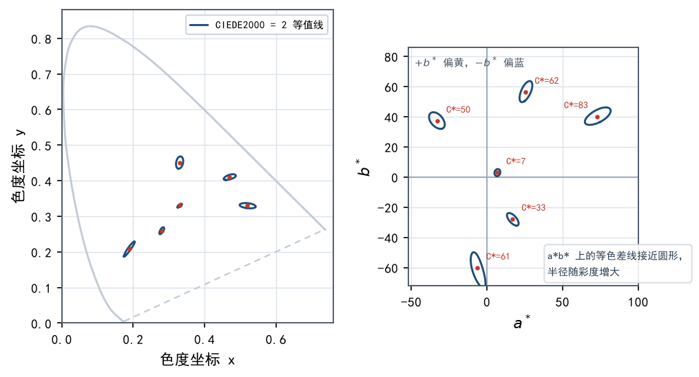
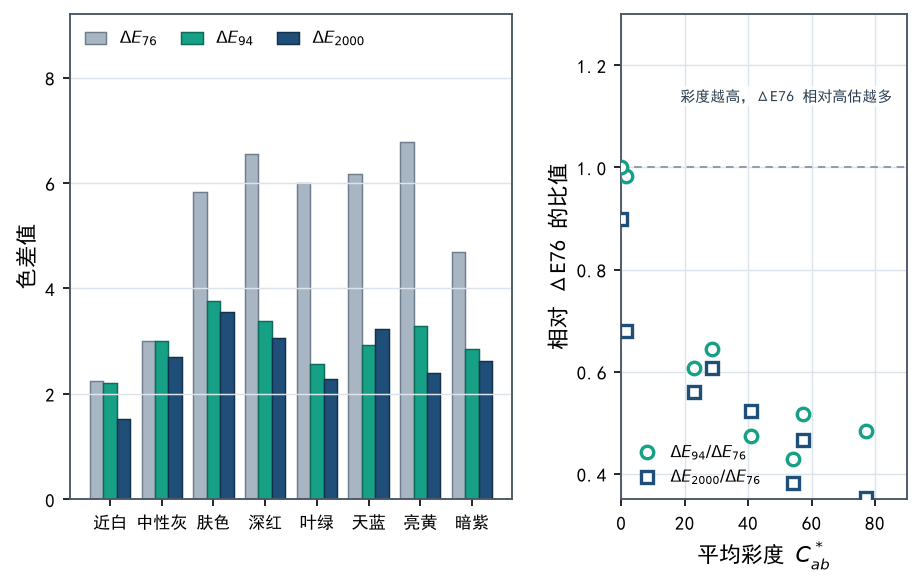

# 第 3 章 均匀色彩空间与色差

色度图能告诉你两个颜色在哪里，却不能告诉你它们差多少。在 $xy$ 平面上量出的距离与人的感觉没有固定比例，绿色区域一大步可能看不出区别，蓝紫区域一小步已经很刺眼。要给出一个"差多少"的数字，需要先把坐标换成一种距离与感知大致成比例的度量空间。本章讲这次变换怎么做，以及由此得到的几个色差公式之间为什么会有分歧。

## 3.1 xy 平面为什么不可用

1942 年，David MacAdam 在柯达实验室做了一系列目视匹配实验。他用一台双目比色计，让观察者在给定的中心色附近反复调节，找出"还能分辨"与"已经分辨不出"之间的边界，把边界画成围绕中心色的椭圆。实验由一位训练有素的观察者完成，每个中心色重复数十次，最终得到 25 个椭圆。

结果很清楚。椭圆的形状随位置剧烈变化，长轴与短轴之比从 2 比 1 到 20 比 1 不等，长轴的方向也在转。在绿色区域，椭圆被拉得很长，说明在这个方向上要移动很远才能看出差别；在蓝紫区域，椭圆被压扁，移动一点点就跨过了可辨阈值。同一条 $xy$ 平面上画出的等距网格，落在不同椭圆里的格子数相差很多，这就是不均匀的直接表现。

感知差的单位有一个通用名称，恰可察觉差（just noticeable difference，JND）。MacAdam 的椭圆可以理解为在不同色度位置上画出的等 JND 轮廓，轮廓大小不统一，说明 JND 在 $xy$ 平面上没有固定尺码。

图 3-1 给出一组等感知差轮廓。绘制方法是把 CIE 1976 $u'v'$ 坐标中半径相同的小圆映射回 $xy$ 平面，圆在 $u'v'$ 中代表相同的感知步长。映射结果在绿色区域被拉长、倾斜，在蓝紫区域被压扁，中央接近白的位置则近似圆。线条在图上放大了 6 倍，实际尺寸只有图上的六分之一。

这组曲线不是 MacAdam 当年的原始测量结果，它是用 $u'v'$ 空间反推的示意。真实的 MacAdam 椭圆比图上更极端，长轴与短轴之比最大超过 20，这个差距无法只靠 $u'v'$ 变换消掉。这一点后面还会提到。

结论是 $xy$ 平面只能当作位置地图，不能当作尺子。要在上面量色差，必须先换坐标。

对均匀性的需求可以用更严格的语言表述。如果感知空间中真的存在一个“距离”，那么在每一点附近都能定义一个度量张量，把微小的坐标变化映射成感知差。$xy$ 平面上这个张量随位置剧烈变化，且主轴方向也变，所以它是一个非欧空间。想用一组全局坐标把弯曲的空间拉平，在数学上不可能，任何“均匀色彩空间”都只能是局部近似，这是 CIELAB 至今无法彻底解决问题的根本原因。工程上能做的，是选择一个关注区域，让该区域的失真降到可接受。

## 3.2 CIE 1960 UCS 与 1976 u′v′

第一次系统性修正出现在 1960 年。CIE 采纳的 CIE 1960 UCS 用两个新坐标替代 $x$、$y$：

$$ u = \frac{4X}{X+15Y+3Z},\qquad v = \frac{6Y}{X+15Y+3Z} $$

这两个式子的来历是"让 MacAdam 椭圆尽量变成圆"。变换之后，原本细长的椭圆被压缩、拉直，同一区域内的形状差异显著缩小，虽然做不到完全均匀，但已经可以用来量距离。CIE 1960 UCS 至今仍是相关色温与 $D_{uv}$ 的法定度量空间，第 2 章的等温线就是在这个空间里垂直于普朗克轨迹。

1976 年，CIE 又做了一次小修改，把 $v$ 放大 1.5 倍：

$$ u' = u = \frac{4X}{X+15Y+3Z},\qquad v' = 1.5v = \frac{9Y}{X+15Y+3Z} $$

改动的原因是 $v$ 轴的尺度偏小，$u'v'$ 平面上的等距离轮廓在纵向上被压扁，放大 1.5 倍之后圆更接近正圆。这套坐标记作 CIE 1976 $u'v'$，也叫 UCS 1976。

$u'v'$ 是 1976 年两个均匀色彩空间的色度底座。它有一个好用的性质，两个色度的差可以直接用欧氏距离表示：

$$ \Delta u'v' = \sqrt{(u'_1-u'_2)^2 + (v'_1-v'_2)^2} $$

在显示行业，这个量常被用来判断白点偏差，容差通常取 0.003 到 0.005。

这套坐标的局限也要交代清楚。1960 年的修正是用 MacAdam 椭圆拟合出来的，拟合误差在绿区仍然不小；1976 年的 1.5 倍因子只解决了纵轴压缩，椭圆本身的形状差异依然存在。$u'v'$ 在工业上的价值主要在于简单、可逆、与 CCT 体系兼容，而不是它真的均匀。判断白点偏差、算色域面积、比较色度距离，这几个用途对均匀性的要求不高，$u'v'$ 够用；量色差还是要回到 Lab 或色貌模型。

## 3.3 CIE 1976 L\*u\*v\*

把 $u'v'$ 与亮度结合起来，得到 CIE 1976 $L^*u^*v^*$（简称 CIELUV）：

$$ L^* = \begin{cases}
116\,(Y/Y_n)^{1/3} - 16, & Y/Y_n > (6/29)^3 \\[2pt]
(29/3)^3\,(Y/Y_n), & Y/Y_n \le (6/29)^3
\end{cases} $$

$$ u^* = 13L^*(u' - u'_n),\qquad v^* = 13L^*(v' - v'_n) $$

下标 $n$ 表示参考白。$L^*$ 的取值范围是 0 到 100，$Y/Y_n = 1$ 时正好 100。$u^*$、$v^*$ 描述色度，乘上 $13L^*$ 的目的是让色度量随亮度缩放，暗处的色差自然变小，这与视觉经验一致。

CIELUV 的色差用欧氏距离：

$$ \Delta E_{uv} = \sqrt{(\Delta L^*)^2 + (\Delta u^*)^2 + (\Delta v^*)^2} $$

它的强项是加色系统。显示器、灯具、投影这类直接发光的设备，颜色由三原色叠加而成，在 CIELUV 里做线性混合、色域映射都比较自然，饱和度也能直接算出来：

$$ s_{uv} = 13\sqrt{(u'-u'_n)^2 + (v'-v'_n)^2} $$

CIELUV 也有自己的彩度与色相角，$C^*_{uv} = \sqrt{(u^*)^2+(v^*)^2}$，$h_{uv} = \arctan(v^*/u^*)$。两套角度的数值不同，$h_{uv}$ 与 $h_{ab}$ 不能混用，跨软件传数据时得看清楚角标。

弱项是它没有很好地处理"明度恒常"这件事。两块反射率不同但被认定同色的纸，在 CIELUV 里可能差得很远，因为它只按绝对三刺激值计算，不知道观察者已经把照明因素归一化掉了。

## 3.4 CIE 1976 L\*a\*b\*

同年采纳的另一个空间是 CIE 1976 $L^*a^*b^*$（CIELAB）。它同样从 XYZ 出发，但走的是另一条路，先对三个通道分别做立方根压缩：

$$ f(t) = \begin{cases}
t^{1/3}, & t > (6/29)^3 \\[2pt]
\frac{1}{3}\left(\frac{29}{6}\right)^2 t + \frac{4}{29}, & t \le (6/29)^3
\end{cases} $$

$$ L^* = 116 f(Y/Y_n) - 16,\qquad a^* = 500\,[f(X/X_n) - f(Y/Y_n)],\qquad b^* = 200\,[f(Y/Y_n) - f(Z/Z_n)] $$

分段点 $(6/29)^3 \approx 0.008856$ 保证 $f$ 在连接处一阶导连续，避免暗部出现折角。$L^*$ 与 $Y$ 的立方根关系来自 Stevens 幂律（指数约 1/3）。显示传函追求的是同类目标，具体函数形式不同，sRGB 用 2.4 次幂，PQ 用对数型的分段压缩。

$a^*$ 从绿到红，$b^*$ 从蓝到黄。中性灰对应 $a^* = b^* = 0$，此时 $X/X_n = Y/Y_n = Z/Z_n$，也就是说只有参考白的三刺激值比例才落在中性轴上。参考白选错，灰色就会带上色偏，这是 CIELAB 使用中最常见的错误。

由 $a^*$、$b^*$ 可以导出彩度与色相角：

$$ C^*_{ab} = \sqrt{(a^*)^2 + (b^*)^2},\qquad h_{ab} = \arctan\frac{b^*}{a^*} $$

$h_{ab}$ 按逆时针从 $+a^*$ 轴量起，$0°$ 是红，$90°$ 是黄，$180°$ 是绿，$270°$ 是蓝。

CIELAB 的强项是物体色。印刷、涂料、纺织、塑料这些行业测的是反射率，观察条件相对固定，光照归一化之后 CIELAB 的表现比 CIELUV 稳定。ICC 色彩管理里的 PCS（profile connection space）就是 CIELAB 或 XYZ。

两个空间在工程中的分工大致如此。显示器校准软件报容差时用 $\Delta E_{2000}$，因为它建立在 CIELAB 上；做色域映射、饱和度压缩时用 CIELUV，因为它的色度量随亮度线性缩放，处理加色混合更自然。同一台显示器可以用两套空间描述，只要在链路内部保持一致。

$L^*$ 与孟塞尔明度 $V$ 近似成线性，斜率约 10，这是立方根压缩带来的一个附带结果。孟塞尔体系是 20 世纪初用大量视觉实验排出的色卡序列，$V$ 从 0 到 10 等分，$L^*$ 能与它对齐，说明立方根压缩在明度维度上已经接近视觉经验。

图 3-2 把同一组等色差线画在两个平面上。左图的曲线是 $xy$ 平面上的等色差线，六个中心色取亮度 $Y = 0.5$，等值线取 $\Delta E_{2000} = 2$。右图把同样这些曲线放到 $a^*b^*$ 平面上。在 $xy$ 上形状与大小都相差很大，在 $a^*b^*$ 上接近圆形，半径随彩度缓慢增大。半径增大是 $\Delta E_{2000}$ 的彩度权重 $S_C$ 造成的，与坐标均匀性无关，它反映的是"彩度越高，同样的感知差对应的 $a^*b^*$ 距离越大"。

## 3.5 三个色差公式

**$\Delta E_{76}$** 是 CIELAB 空间的欧氏距离：

$$ \Delta E_{76} = \sqrt{(\Delta L^*)^2 + (\Delta a^*)^2 + (\Delta b^*)^2} $$

计算简单，理解直观，缺陷同样明显。它把三个方向的权重当作相等，也不考虑色相与位置，结果在饱和色上严重高估，在中性色附近偏松。

**$\Delta E_{94}$** 在 1995 年被 CIE 推荐，针对纺织业的实验数据，给彩度和色相加了权重：

$$ S_L = 1,\qquad S_C = 1 + K_1 C^*_1,\qquad S_H = 1 + K_2 C^*_1 $$

$$ \Delta E_{94} = \sqrt{\left(\frac{\Delta L^*}{k_L S_L}\right)^2 + \left(\frac{\Delta C^*}{k_C S_C}\right)^2 + \left(\frac{\Delta H^*}{k_H S_H}\right)^2} $$

图形艺术取 $K_1 = 0.045$、$K_2 = 0.015$，纺织取 $0.048$ 与 $0.014$。$S_C$、$S_H$ 随参考色的彩度线性增大，把高彩度区域的色差压下来，这正是 $\Delta E_{76}$ 高估的地方。遗留问题有两个：色相差的权重只与彩度有关，与色相角无关；深蓝区域的偏差仍然处理不好。

还有一处细节值得注意。$S_C$ 与 $S_H$ 用的是参考色的 $C^*_1$，所以交换两个颜色的角色会得到不同的数值，$\Delta E_{94}$ 是非对称的。测量仪器给出“样品相对于标准”的色差时，方向是被约定的，跨软件交换数据时如果搞反了，高彩度样品的偏差会明显不对。$\Delta E_{2000}$ 改用两个颜色彩度的平均值 $\bar C'$，这个问题就不存在了。

**$\Delta E_{2000}$** 是现行的推荐公式，在 $\Delta E_{94}$ 的基础上做了三处修改。先用一个 $G$ 因子把 $a^*$ 轴拉伸，修正中性色附近的偏差：

$$ G = 0.5\left(1 - \sqrt{\frac{\bar C^7}{\bar C^7 + 25^7}}\right),\qquad a' = (1+G)a^* $$

再用色相角相关的 $T$ 因子给色相权重，让蓝、红、绿方向的容差各不相同：

$$ T = 1 - 0.17\cos(\bar h' - 30°) + 0.24\cos(2\bar h') + 0.32\cos(3\bar h' + 6°) - 0.20\cos(4\bar h' - 63°) $$

最后加一个旋转项 $R_T$，处理蓝色区域椭圆长轴倾斜的问题：

$$ R_T = -\sin(2\Delta\theta)\, R_C,\qquad \Delta\theta = 30\exp\left[-\left(\frac{\bar h' - 275°}{25°}\right)^2\right] $$

把三项合起来：

$$ \Delta E_{00} = \sqrt{\left(\frac{\Delta L'}{k_L S_L}\right)^2 + \left(\frac{\Delta C'}{k_C S_C}\right)^2 + \left(\frac{\Delta H'}{k_H S_H}\right)^2 + R_T \frac{\Delta C'}{k_C S_C}\frac{\Delta H'}{k_H S_H}} $$

$k_L$、$k_C$、$k_H$ 是应用相关的修正系数。纺织业常用 $k_L = 2$，因为纹理对明度差的容忍度更高；图形艺术默认全取 1。

三个公式都建立在“颜色已按参考白归一化”的前提下。测量时必须交代光源、观察者、背景、色样尺寸，这些条件不同，同一个 $\Delta E$ 的物理含义就不同。ISO 12647 对印刷品的色差检验规定标准照明体 D50、2° 观察者、45/0 几何；显示器校准用 D65、2° 观察者、正对法线。跨行业直接比较 $\Delta E$ 数值没有意义，只有在同一套条件下才有可比性。

图 3-3 用 8 组设定的色样对把三个公式放在一起比较，数值全部按公式计算。近白与中性灰两组的 $\Delta E_{94}$ 与 $\Delta E_{76}$ 几乎相同（2.24 对 2.20、3.00 对 3.00），$\Delta E_{2000}$ 则降到 1.52 和 2.70，原因是明度权重 $S_L$ 在偏离 50 的位置大于 1（$L^* = 95$ 处约 1.67），明度差被压小。饱和色对的差距很大，深红组 $\Delta E_{76} = 6.56$、$\Delta E_{2000} = 3.06$，前者是后者的两倍多，这就是 $\Delta E_{76}$ 在饱和区高估的量化结果。天蓝组的 $\Delta E_{2000}$（3.22）反而高于 $\Delta E_{94}$（2.92），这组的色相角在 254° 附近，正好落在旋转项 $R_T$ 的作用区间，而 $R_T$ 是 $\Delta E_{94}$ 没有的。

工业实践里常把 $\Delta E_{2000} = 1$ 当作刚好可辨的门槛。这个说法只在特定条件下成立，不同实验给出的阈值在 0.5 到 2 之间浮动，观察条件、色样大小、观察者经验都会影响。更稳妥的用法是把 $\Delta E_{2000}$ 当相对量，用同一套条件测出的基线来定容差，显示器的出厂校准常取 $\Delta E_{2000} \le 2$，专业监视器取 $\le 1$。

## 3.6 均匀性的局限与替代方案

CIELAB 与 CIELUV 都没有真正做到"等距离即等感知差"。图 3-2 已经显示，同一条等色差线在不同位置的尺寸差几倍；文献里常用的检验是 Munsell 色样的分布，理想均匀空间里这些色样应该排成等间距的点阵，实际在 $a^*b^*$ 平面上仍有明显的疏密不均。

改进方向大致两条。一条是在 CIELAB 之上再做一次坐标扭曲，得到 CAM02-UCS、CAM16-UCS 这类色貌模型派生的空间。它们引入 CIECAM02 的色适应与非线性压缩，在大色差、跨白点、不同观察条件下表现更好，代价是计算量大、参数多。UCS 版本的压缩是这样做的：

$$ J' = \frac{(1+100c_1)J}{1+c_1 J},\qquad M' = \frac{1}{c_2}\ln(1+c_2 M) $$

其中 $c_1 = 0.007$、$c_2 = 0.0228$，$J$ 是色貌模型的明度，$M$ 是彩度。指数式的压缩比立方根更贴感知数据，代价是要先算完整的色貌模型。

另一条是换度量对象。HDR 与宽色域内容的色差不再用 CIELAB，而是用 BT.2124 定义的 $\Delta E_{ITP}$，在 ICtCp 空间里计算：

$$ \Delta E_{ITP} = 720\sqrt{(\Delta I)^2 + 0.25(\Delta C_T)^2 + (\Delta C_P)^2} $$

ICtCp 的三个分量分别是亮度、蓝黄对抗、红绿对抗，定义在 BT.2100 的 PQ 或 HLG 传函之后，覆盖 0 到 10000 cd/m² 的全动态范围。CIELAB 的立方根压缩在 100 cd/m² 附近标定，往上到 1000 cd/m² 时，同样的亮度比对应的感知差已经变小，直接套用会高估暗部、低估亮部。

对 HDR 显示器的验收，行业里更常用的是分段的实测判据：灰阶的 $\Delta E_{ITP}$、色域的 $\Delta u'v'$、白点的 $\Delta u'v'$、以及 $\Delta E_{2000}$ 在中间调的表现，四条一起看。单看任何一条都可能漏掉问题角落。

具体设定容差时，常规做法是先测一批已知可接受的产品，取色差的 95 分位数作为上限，再留 20% 到 30% 的余量。直接照搬其他产品类别的数字，往往要么过松以致放过了问题批次，要么过紧以致良率下降。

## 本章要点

- $xy$ 平面的距离与感知不成比例，MacAdam 1942 年的椭圆实验给出了直接证据，椭圆长短轴比可达 20 比 1，长轴方向随位置转动。
- CIE 1960 UCS 的 $(u,v)$ 是第一个为均匀性设计的色度坐标，至今仍是 CCT 与 $D_{uv}$ 的度量空间；1976 年把 $v$ 放大 1.5 倍得到 $u'v'$。
- CIELUV 用 $L^*$ 加 $u^*$、$v^*$，适合加色光与显示设备，饱和度可以直接算出，但对物体色的明度恒常处理较差。
- CIELAB 用立方根压缩，$a^*$ 绿红、$b^*$ 黄蓝，中性轴要求参考白的三刺激值比例匹配，参考白选错会让灰色带色偏。
- $\Delta E_{76}$ 是 Lab 欧氏距离，简单但在饱和色区高估；$\Delta E_{94}$ 引入彩度权重，仍缺色相相关项；$\Delta E_{2000}$ 加入 $G$ 拉伸、$T$ 色相权重与 $R_T$ 旋转项，是目前推荐公式。
- 同一组色样对，深红组 $\Delta E_{76} = 6.56$ 而 $\Delta E_{2000} = 3.06$，天蓝组 $\Delta E_{2000} > \Delta E_{94}$，说明旋转项在蓝色区域起了作用。
- $\Delta E_{2000} = 1$ 只是工程约定的近似门槛，实际阈值在 0.5 到 2 之间浮动，容差应结合测量条件确定。
- HDR 与宽色域的色差改用 BT.2124 的 $\Delta E_{ITP}$，在 ICtCp 空间覆盖 0 到 10000 cd/m²，避免 CIELAB 在高亮度段的系统性偏差。
