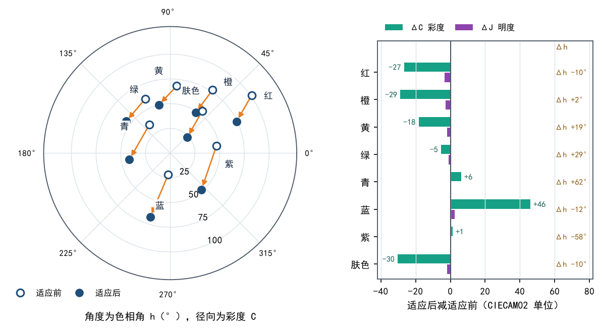
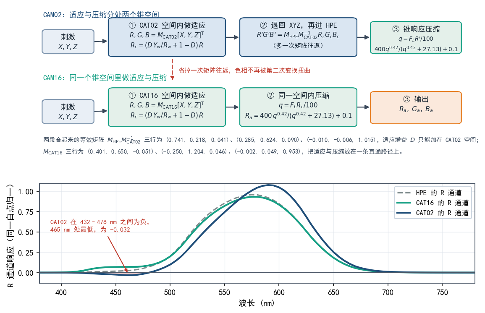

# 第 4 章 色貌模型

一个像素的 XYZ 值只说明它发出了多少、什么光谱的光，说不清它看上去是什么颜色。同一块灰卡放在钨丝灯下和正午阳光下，测出的三刺激值相差很远，人眼看到的却都是"灰"。反过来，两张印刷品在 D50 灯箱里匹配得很好，拿到窗边就一偏黄一偏蓝。要让数字描述"看起来"，就得把观察条件一起写进模型，这类模型叫色貌模型（color appearance model）。本章从观察条件出发，讲清 CIECAM02 的计算结构、CAM16 对它的修补、反解的实现要点，以及这套在 1997 至 2004 年间定型的模型放进 HDR 亮度范围后需要小心的地方。

## 4.1 从三刺激值到外观量

CIE 1931 的 XYZ 描述的是刺激，与人怎么看无关。测量上这很方便，用作色彩管理的传递空间也够用，但它回答不了一些日常问题：同一种白在白天和黄昏看起来为什么不一样；画面周围变暗以后，中间的灰为什么会显得更亮；把亮度调高，红色为什么会更鲜艳。

这三个现象各有名字。亮度升高时彩度随之上升，叫 Hunt 效应（Hunt, 1952）；亮度升高时明度按幂函数增长、指数约 0.33 至 0.5，叫 Stevens 效应（Stevens & Stevens, 1963）；画面周围的环境变暗，图像整体显得更亮、对比更强，叫 Bartleson-Breneman 效应（1967）。三者指向同一个结论，外观由刺激和它所在的观察条件共同决定，缺一不可。

把这句话拆开，就有了色貌模型的基本结构。输入是刺激的三刺激值，加上一组描述观察条件的参数；输出是一组"外观坐标"，每个坐标对应一种可以被人报告出来的主观属性。CIE 159:2004 定义的相关量有六个。

| 相关量 | 符号 | 含义 | 量纲 |
|---|---|---|---|
| 明度 lightness | $J$ | 相对参考白判断的明亮程度 | 0–100（参考白为 100） |
| 亮度 brightness | $Q$ | 绝对明亮程度，随绝对亮度增长 | 无上限 |
| 彩度 chroma | $C$ | 相对同亮度灰色的色彩强度 | 无上限，常用 0–100 |
| 色彩量 colorfulness | $M$ | 绝对色彩强度 | 无上限 |
| 饱和度 saturation | $s$ | 相对自身亮度的色彩强度 | 0–100 |
| 色相 hue | $h$ / $H$ | 色相角与色相四分之一圆 | 0–360° / 0–400 |

六个数之间不是独立的，两组关系必须先对齐。明度与亮度的换算通过适应亮度级因子完成，色彩量与彩度的换算同时用到了亮度级因子与绝对亮度：

$$M=C\,F_L^{1/4},\qquad s=100\sqrt{M/Q}$$

$F_L$ 只与适应亮度 $L_A$ 有关，随 $L_A$ 单调增，$L_A$ 从 1 增到 1000 cd/m² 时 $F_L$ 从 0.17 增到 1.71。这一项把"亮度升高、颜色更艳"的经验塞进模型，后面每一处出现 $F_L^{1/4}$ 的地方都是这件事在起作用。

明度与亮度的区别值得单独讲。$J$ 是"相对白有多亮"，$Q$ 是"绝对有多亮"。白场亮度提高十倍，白仍然是 $J=100$，但 $Q$ 会明显变大。SDR 时代没人关心这个区分，因为屏幕白点亮度基本固定；HDR 里同一幅画面在 200 cd/m² 与 1000 cd/m² 的显示器上，$J$ 的分布几乎一样，$Q$ 却差几倍。

彩度、色彩量、饱和度三个词在中文里常被混用，含义各有分工。彩度 $C$ 是相对"同亮度的灰"而言的，把一块红放在黑背景上，$C$ 不变。色彩量 $M$ 是绝对量，亮度升高、颜色显得更艳时 $M$ 变大而 $C$ 可以不变。饱和度 $s$ 再除一次亮度，用来描述"这个颜色有多纯"，与明暗无关，用它在同一幅画面里比较不同明度的色块最方便。

三刺激值到外观量之间的缺口由三种机制填上：色适应把光源色从画面里扣掉一部分；亮度级的非线性让同样比例的亮度变化在暗处与亮处产生不同的增量；空间诱导让周围像素把中心像素的外观往反方向推。前两种在 CIECAM02 里有显式公式，第三种只用一个环绕因子粗略概括，这是模型最大的简化，也是它在复杂画面上失准的主要来源。

色貌模型的用处集中在三处：跨媒体复制要在白点、亮度、环绕都不同的两端之间匹配图像；色域映射要用外观坐标判断"超出多远"；图像质量评价要在不同亮度下给出可比分数。代价是参数变多，任何一项取错都会带来系统性偏差。

## 4.2 观察条件：白、亮度、背景、环绕

色貌模型的输入除了待测色，还必须有完整的观察条件。CIE 159 把它拆成四项。

- **适应白**：视场中占主导的白色刺激，用三刺激值 $X_w Y_w Z_w$ 描述，通常归一化到 $Y_w=100$。
- **适应亮度** $L_A$：观察者适应的绝对亮度，单位 cd/m²，实践上取白场亮度的 20% 左右。
- **背景亮度因数** $Y_b$：紧邻色块的那圈背景的相对亮度，通常 $Y_b=20$（相当于 $L^*\approx 50$ 的中灰）。
- **环绕**：视场外围的相对亮度，用三个诱导因子 $F$、$c$、$N_c$ 概括。

四项里前三项是连续量，第四项被压缩成三档离散值。这个压缩是 CIECAM02 好用的一部分原因，也是它粗糙的一部分原因。

环绕对明度的影响由 Bartleson 与 Breneman 的实验确立，CIE 159 把它归纳成三档标准值：

| 环绕类型 | $F$ | $c$ | $N_c$ | 典型场景 |
|---|---|---|---|---|
| 平均 average | 1.0 | 0.69 | 1.0 | 客厅、影厅、白底上的印刷品 |
| 昏暗 dim | 0.9 | 0.59 | 0.95 | 暗室投影、夜间看电视 |
| 黑暗 dark | 0.8 | 0.525 | 0.80 | 影院、只留屏幕光的房间 |

$c$ 直接决定明度的压缩指数，$c$ 越小，暗环境下的画面明度被压得越低、对比显得越强。这就是同一个视频在亮房间里看着发灰、关灯后变得通透的数值化解释。$N_c$ 作用于彩度，$N_c$ 变小则彩度略降；$F$ 同时进入适应程度 $D$ 与 $F_L$ 无关的几处，是三者里最"上游"的一个。

适应亮度 $L_A$ 的取法在实践中比公式更容易出错。它不是白场亮度，也不是环境照度，经验做法是取白场亮度的 20%，因为视场里有暗部，平均下来低于白。影院银幕 48 cd/m² 时 $L_A$ 取 10 左右；母版监看的 1000 cd/m² 画面取 200 是行业常见值。$L_A$ 错一个数量级，$F_L$ 会错三倍，色貌坐标整体偏移。

色适应是观察条件里最需要建模的一环。人眼进入新的照明环境后，锥细胞的增益重新调整，几分钟内大致完成。von Kries 在 1902 年提出最简单的描述，三种锥细胞的响应各自按比例缩放，使白物体的响应回到中性，称为系数定律。

$$L_c = \frac{Y_w}{L_w}\,L,\qquad M_c = \frac{Y_w}{M_w}\,M,\qquad S_c = \frac{Y_w}{S_w}\,S$$

式中 $L_w M_w S_w$ 是适应白的锥响应。这个式子意味着适应只改增益、不改光谱形状，工程上好用，物理上当然只是近似。后来的改进集中在两点：用哪组锥响应做缩放，以及适应程度取多少。

适应程度 $D$ 是 CIECAM02 的一个实用设计。完全适应取 $D=1$，完全不适取 $D=0$，模型按经验公式在两者之间插值：

$$D = F\left[1-\frac{1}{3.6}\exp\frac{-L_A-42}{92}\right]$$

$L_A$ 越大，$D$ 越接近 1。办公室里 $L_A$ 取 200 cd/m²，平均环绕下 $D=0.980$；暗室投影的 $L_A$ 只有 5 cd/m²，平均环绕下 $D$ 落到 0.833，换成昏暗环绕（$F=0.9$）则约 0.75。适应越不完整，白点误差留在画面上的比例越高，这是"暗室里的投影总觉得偏色"这个经验的数值解释。$L_A$ 趋近无穷时 $D$ 趋近 $F$，所以平均环绕下 $D$ 的上限是 1，昏暗环绕下上限只有 0.9，永远达不到完全适应。

白点从哪里来，这件事在实践中比公式更容易出错。印刷用 D50，因为纸和油墨的观察习惯如此；sRGB 与 BT.709 用 D65；数字影院用 DCI 白点（$x=0.314$，$y=0.351$）；HDR 制作又回到 D65。跨这些标准传递图像时，白点必须显式声明，否则等比缩放就会算错。更难的是自适应显示器，实测白点会随背光和局部调光漂移几个 $\Delta u'v'$ 单位，用标称值做色貌计算会留下可见残差。

图 4-1 用一组色样演示适应前后的差别。假定每个色样的反射特性可以用 D65 下的 XYZ 表示，用 CAT02 做完全 von Kries 换算得到它在光源 A 下的 XYZ，然后算两次色貌：一次假装观察者仍按 D65 解读，一次把参考白换成 A。前者是刚进门的瞬间，后者是适应完成后的稳定状态。彩度变化最大，橙、红、肤色在未适应时彩度高出 20 至 30 个单位，蓝和青反而低了 46 与 6；色相同时转动，青转了 62°，紫转了反方向 58°。明度几乎不动，变化都在 4 个单位以内。这些数字说明适应主要作用在色度通道上，明度通道由亮度决定，与环境色关系不大。

## 4.3 色适应变换在模型里的位置

色适应变换（chromatic adaptation transform，CAT）在模型里不是孤立的一步，它的位置决定了模型的性质。CIECAM02 的做法是先在 CAT02 的锥空间里完成适应，退回 XYZ，再换到 Hunt-Pointer-Estevez 锥空间做压缩。CAM16 把两步并成一步，在 CAT16 空间里同时做适应与压缩。这个差别看起来只是矩阵的乘法顺序，实际影响不小，4.7 节会看到它带来的数值后果。

先看三个矩阵本身。

$$M_{\mathrm{CAT02}}=\begin{bmatrix}0.7328&0.4296&-0.1624\\-0.7036&1.6975&0.0061\\0.0030&0.0136&0.9834\end{bmatrix},\qquad
M_{\mathrm{HPE}}=\begin{bmatrix}0.38971&0.68898&-0.07868\\-0.22981&1.18340&0.04641\\0&0&1\end{bmatrix}$$

$$M_{\mathrm{CAT16}}=\begin{bmatrix}0.401288&0.650173&-0.051461\\-0.250268&1.204414&0.045854\\-0.002079&0.048952&0.953127\end{bmatrix}$$

Bradford 变换（Lam, 1985）用的是另一组"更锐"的锥响应，它在投影与印刷的实测对比里比 HPE 更准，至今仍是 ICC 与多数色彩管理软件默认的适应变换。CAT02 是 Bradford 与 HPE 之间的折中，为的是让适应空间与压缩空间可以互换；CAT16 又把折中往 Bradford 的方向推了一点，使它在短波段不再出现负响应。

"锐"与"钝"描述的是矩阵各行对光谱的选择性。三个矩阵的行和都是 1，说明它们都把等能白映射成等响应，差别在通道之间。以 450 nm 单色光为例，CAT02 给出的长波通道响应是 -0.025，中波是 -0.161，短波是 1.744；CAT16 给出 0.068、0.043、1.690；HPE 给出 0.018、0.050、1.772。CAT02 在短波段给长波通道一个负值，意味着"蓝光会压低长波锥的读数"，这在生理上不合理，却是矩阵拟合的副产物。

负响应本身不可怕，矩阵乘法允许它出现；麻烦的是它后面紧跟一步取幂运算。CIECAM02 的压缩函数含有 $x^{0.42}$，$x$ 为负时实数域无解。标准给出的处理是对绝对值取幂再补符号，工程实现里若忘了这一步，程序会返回 NaN；若用了复数幂而没有取实部，会得到莫名其妙的结果。4.7 节会看到 CAM16 如何从源头减少这种情形。

工程实现里还有一个细节：白点的处理方式。von Kries 要求用适应白的锥响应做分母，而当白点的三刺激值含有零分量（例如某些虚拟白点）时，除法会溢出。稳妥的做法是把白点归一化到 $Y_w=100$ 后检查各分量，必要时给分母加一个极小量，并在文档里写明这个保护。

## 4.4 CIECAM02 的前向计算

CIECAM02 于 1997 年提出，2002 年由 CIE 第 8 分部推荐，2004 年成为标准 CIE 159:2004。它继承 Hunt 模型和 RLAB 的思路，把计算压到可以写进固件的程度，正向与反向变换都有闭式解，这正是它被 ICC 采纳为色域映射基础的原因。

整个正向计算分七步，图 4-2 是它的数据流。

第一步做色适应。把 XYZ 乘 CAT02 矩阵进入锥空间，按 $D$ 缩放，再转回来：

$$R_c=\left(D\frac{Y_w}{R_w}+1-D\right)R,\qquad G_c=\left(D\frac{Y_w}{G_w}+1-D\right)G,\qquad B_c=\left(D\frac{Y_w}{B_w}+1-D\right)B$$

$D=1$ 时就是标准 von Kries；$D=0$ 时保持原样。中间值意味着"部分适应"，画面上的白既不完全归零，也不保留全部光源色。三个通道各有一个增益，增益之和不必等于 3，所以适应会改变颜色的饱和度，这正是它能解释"暖光下白色仍显中性、而其他颜色略微变淡"的原因。

第二步换到 Hunt-Pointer-Estevez 空间。这一步在数学上只是乘一个矩阵，但它把适应用的锥空间和压缩用的锥空间分开了：CAT02 为适应拟合，HPE 为生理响应拟合。

$$\begin{bmatrix}R'\\G'\\B'\end{bmatrix}=M_{\mathrm{HPE}}\,M_{\mathrm{CAT02}}^{-1}\begin{bmatrix}R_c\\G_c\\B_c\end{bmatrix}$$

第三步做非线性压缩，含亮度级因子 $F_L$：

$$F_L=0.2k^4(5L_A)+0.1(1-k^4)^2(5L_A)^{1/3},\qquad k=\frac{1}{5L_A+1}$$

$$R_a=400\frac{(F_LR'/100)^{0.42}}{(F_LR'/100)^{0.42}+27.13}+0.1$$

$F_L$ 把绝对亮度带进模型：$L_A$ 越大，$F_L$ 越大，压缩曲线的肩部越靠右，同样比例的刺激能得到更大的响应。$L_A$ 取 1、100、1000 cd/m² 时，$F_L$ 分别约为 0.17、0.79、1.71。末尾的 $+0.1$ 是一个偏置，防止压缩后的响应落到零，代价是黑色不再是零响应，反解时要记得减掉。

第四步算消色差响应 $A$，第五步取对立色坐标 $a$、$b$ 与色相角 $h$：

$$A=(2R_a+G_a+B_a/20-0.305)N_{bb}$$

$$a=R_a-\frac{12G_a}{11}+\frac{B_a}{11},\qquad b=\frac{R_a+G_a-2B_a}{9},\qquad h=\arctan\frac{b}{a}$$

$N_{bb}$ 是背景诱导因子，把背景的明暗对明度的影响带进来。第六步用 $A$ 与白的 $A_w$ 得到明度和亮度：

$$J=100\left(\frac{A}{A_w}\right)^{cz},\qquad z=1.48+\sqrt{n},\qquad n=\frac{Y_b}{Y_w}$$

$$Q=\frac{4}{c}\sqrt{\frac{J}{100}}\,(A_w+4)F_L^{1/4}$$

指数里的 $z$ 与背景有关，$n=0.2$ 时 $z=1.927$，再乘环绕因子 $c=0.69$ 得 1.33。四个派生量 $n$、$z$、$N_{bb}$、$N_{cb}$ 全部由背景亮度因数与白场之比决定，与待测色无关，可以先算好放在常量表里。

$n=Y_b/Y_w$ 最容易被忽略。取 $Y_b=20$、$Y_w=100$ 时 $n=0.2$，这是 CIE 159 的参考情形；换成白底杂志上的图片，背景接近纸白，$Y_b$ 可能只有 5 到 10，$n$ 落到 0.05 至 0.1。$n$ 越小，$z=1.48+\sqrt{n}$ 越小，指数 $cz$ 随之变小，同样一个 $A/A_w$ 得到的 $J$ 差别可以到十来个单位。背景越暗，$z$ 越小，明度对消色差响应的变化越敏感，这就是"暗背景让画面显得对比更强"的数值形态。

$N_{bb}$ 与 $N_{cb}$ 同取 $0.725(1/n)^{0.2}$，$n=0.2$ 时等于 1.0003，几乎不改变数值；$Y_b=10$ 即 $n=0.1$ 时升到 1.149，$Y_b=30$ 即 $n=0.3$ 时降到 0.922。两个因子一个进 $A$，一个进 $t$，方向相同而作用点不同。$A$ 被放大意味着同一刺激的消色差响应变大，$J$ 随之上移；$t$ 被放大意味着同样的 $a$、$b$ 得到更大的彩度，暗背景因此同时抬高明度与彩度，与 Bartleson-Breneman 的实验方向一致。标准把两者取成相等是一个简化，Hunt 模型里它们本来是分开的，CIECAM02 为了少一个自由度合并了。

$$N_{bb}=N_{cb}=0.725\left(\frac{1}{n}\right)^{0.2}$$

第七步从 $a$、$b$ 得到彩度、色彩量与饱和度：

$$t=\frac{50000}{13}N_cN_{cb}e_t\frac{\sqrt{a^2+b^2}}{R_a+G_a+21B_a/20}$$

$$C=t^{0.9}\sqrt{\frac{J}{100}}\,(1.64-0.29^n)^{0.73},\qquad M=CF_L^{1/4},\qquad s=100\sqrt{\frac{M}{Q}}$$

$e_t$ 是偏心因子，随色相角变化，用来修正红绿与黄蓝方向的彩度敏感度差异：

$$e_t=\frac{1}{4}\left[\cos\left(h+2\right)+3.8\right]$$

$e_t$ 的细节值得说清。括号里的 $+2$ 是弧度，约合 114.6°，它把余弦的极小值从 $h=180°$ 挪到 $h=65.4°$，极大值挪到 $h=245.4°$。这两个位置分别在黄绿与蓝紫，正是实验里彩度敏感度最低与最高的两处；$h=0°$ 与 $h=180°$ 只落到 0.846 与 1.054，并非极值点。$e_t$ 的取值从 0.700 到 1.200，跨度 1.71 倍。不乘 $e_t$ 时，黄绿区的彩度被高估约 43%，蓝紫区被低估约 17%，色域映射在绿角的尖点会明显偏出，蓝色方向的饱和色反而压缩不足。这个因子没有生理学解释，纯粹是为拟合视觉数据加的经验项，CIE 159 的正文里也只说明它与色相有关。

色相角 $h$ 之外还有一个色相四分之一圆 $H$，把 360° 的不均匀色相压到 0–400 的近似均匀刻度上，用在需要线性插值色相的场合（如色域映射与色差公式）。计算方式是按四个锚点分段：

| 锚点 | $h_i$ | $e_i$ | $H_i$ |
|---|---|---|---|
| 红 | 20.14° | 0.8 | 0 |
| 黄 | 90.00° | 0.7 | 100 |
| 绿 | 164.25° | 1.0 | 200 |
| 蓝 | 237.53° | 1.2 | 300 |

$$H=H_i+\frac{100\,(h'-h_i)/e_i}{(h'-h_i)/e_i+(h_{i+1}-h')/e_{i+1}}$$

其中 $h'=h+360°$ 当 $h<20.14°$ 时，这样色相角接近零的样品会落到最后一个区间（红锚点 20.14° 与下一轮 380.14° 之间），$H$ 才能从 380 平滑收回到 400 而不是跳成负值。这一步漏掉是常见实现错误，程序不会报错，只是在红色附近给出 $H=-24$ 这类荒谬数值，而红色恰恰是色域映射最常打交道的区域。

对 $h=22.3°$ 的红样，落在红锚点与黄锚点之间，$(h'-h_i)/e_i=2.725$，$(h_{i+1}-h')/e_{i+1}=96.7$，得 $H=2.7$。$H$ 在小数值上看起来别扭，它的好处是等间隔的 $H$ 对应近似相等的色相感觉，做插值时不会在某个色相区间里"走得太快"。

插值式的形式本身也在传递信息。它是两个加权量之比，权重分别是 $"(h'-h_i)/e_i"$ 与 $"(h_{i+1}-h')/e_{i+1}"$，分母里的 $e_i$ 把每个区间的角度宽度重新标定。红到黄只跨 70°，$H$ 却要走 100 个单位；黄到绿跨 74°，也走 100；绿到蓝跨 73°，同样 100。三段的角度宽度相近，$e_i$ 却从 0.8 升到 1.2，说明同样的角度在三段里对应的感知步长并不相同。$e_i$ 越大，该区间的角度被压得越紧，这也解释了为什么蓝区的 $H$ 变化最快。反过来用 $H$ 求 $h$ 时需要解二次方程，标准给出了闭式解，实现时要按 $H$ 落在哪一段选根。

拿一个具体色样走一遍，每一步的中间值都列出来。色度 $x=0.55$、$y=0.33$、$Y=18$，白点 D65，$L_A=200$ cd/m²，$Y_b=20$，平均环绕。三刺激值是 $X=30.000$、$Y=18.000$、$Z=6.545$。

| 步骤 | 中间量 | 数值 |
|---|---|---|
| 输入 | $XYZ$ | 30.000, 18.000, 6.545 |
| 1 | CAT02 锥响应 $RGB$ | 28.654, 9.487, 6.772 |
| 1 | 白点锥响应 $R_wG_wB_w$ | 94.925, 103.542, 108.718 |
| 1 | $D$ 与三个增益 | 0.980; 1.0524, 0.9665, 0.9214 |
| 2 | $R'G'B'$ | 24.599, 14.892, 5.992 |
| 3 | $F_L$ 与 $R_aG_aB_a$ | 1.000; 8.117, 6.618, 4.570 |
| 3 | 白的 $R_{aw}G_{aw}B_{aw}$ | 14.317, 14.321, 14.330 |
| 4 | $a$, $b$, $h$ | 1.313, 0.622, 25.34° |
| 4 | $A$, $A_w$ | 22.782, 43.380 |
| 5 | $J$, $Q$ | 42.47, 179.0 |
| 6 | $e_t$, $t$ | 0.7587, 217.0 |
| 7 | $C$, $M$, $s$, $H$ | 73.93, 73.93, 64.3, 6.6 |

几个数字值得停下来看。三个增益之和是 2.940，不等于 3，这意味着适应在把白拉回中性的同时轻微改变了整体响应，色度上表现为饱和度的小幅抬升。第三步算出的白点压缩响应是 14.317、14.321、14.330，三个通道的差异只有 0.09%，这是验证实现是否正确最快的一招：如果适应步骤写对了，白在 HPE 空间里必然是等响应的；若三个数差到 1% 以上，多半是 $D$ 的钳位或者增益的归一化弄错了。第四步的 $A/A_w=0.525$，取指数 $cz=0.69\times1.927=1.330$ 后得到 42.47，与直接用 $L^*$ 算出的 49.5 差 7 个单位。第七步的 $e_t=0.7587$ 略高于黄绿极小值 0.700，因为色相角 25.34° 已经离开极小点二十多度。

换白点或换 $L_A$，这组数就会变，而 XYZ 一直是那三个数。$L_A$ 从 200 降到 40，$F_L$ 从 1.000 降到 0.585，$Q$ 从 179 降到 128，掉了 28%；$J$ 只从 42.47 变到 42.23，几乎不动，因为 $J$ 是相对白定义的量。$D$ 从 0.980 降到 0.886，增益更不平衡，白点色偏留在画面上的比例从 2% 升到 11%。彩度几乎不变，色彩量却跟着 $F_L^{1/4}$ 降到 0.875 倍。这一组对比正好把 $J$ 与 $Q$、$C$ 与 $M$ 的分工显出来。

有一个容易误解的地方：CIECAM02 的 $J$ 与 CIELAB 的 $L^*$ 都是"明度"，数值却不等。同一块中性灰在 $L_A=200$、平均环绕下，$Y=18$ 时 $J=39.3$ 而 $L^*=49.5$，$Y=50$ 时 $J=68.7$ 而 $L^*=76.1$。差别来自 $c$、$z$ 这两个与观察条件有关的指数，$L^*$ 用的是固定立方根，$J$ 的指数随环绕和背景变化。做跨模型的数值比较时不能把两者直接互换。

## 4.5 明度、彩度与绝对亮度的关系

图 4-3 把明度与彩度的变化趋势画出来。固定色度（$x=0.50$、$y=0.40$ 的橙红），相对亮度从 0.5 拉到 1000，三个适应亮度下的明度曲线几乎重合，说明 $J$ 主要由相对亮度决定，$L_A$ 的影响被"相对参考白"的定义吸收；彩度曲线同样几乎重合，色彩量曲线却明显分开，$L_A$ 越大、同色度下的 $M$ 越大。$Y=100$ 处在 $J=100$ 附近，之后不封顶，$Y=1000$ 时 $J\approx 350$。

$J$ 无上限在 SDR 时代不构成问题，因为超过参考白的亮度在屏幕上不存在；HDR 把它变成现实问题。1000 cd/m² 的峰值白是参考白的 5 倍，$J$ 会到 200 左右，做色调映射时若把 $J$ 当 0–100 的封闭区间用，高光部分的相对关系会被压平。$Q$ 没有上限也不能与 $J$ 混用，它的用处是比较"绝对亮度差多少"，例如评估两台峰值不同的显示器上同一幅画面的观感差异。

## 4.6 反变换与可逆性

色貌模型的正向计算把三刺激值变成外观量，反向计算把外观量变回三刺激值。后者在工程上比前者更有用：给定"我想要这个颜色看起来是这样"，反解出应该发什么光，这正是色域映射、跨媒体复制、显示器校准每天要做的事。

CIECAM02 的反向是一串闭式解，顺序与正向相反。给定 $J$、$C$、$h$ 与观察条件：

第一步，由 $J$ 反解 $A$：

$$A=A_w\left(\frac{J}{100}\right)^{1/(cz)}$$

第二步，由 $C$ 反解 $t$：

$$t=\left[\frac{C}{\sqrt{J/100}\,(1.64-0.29^n)^{0.73}}\right]^{1/0.9}$$

$C=0$ 时 $t=0$，公式出现 $1/t$，需要单独处理成 $a=b=0$，否则会除零。

第三步，由 $t$、$A$、$h$ 解出 $a$、$b$。这一步是整套反解里最别扭的地方，因为 $t$ 的定义式里 $a$、$b$ 同时出现在分子与分母。标准把 $p_1=(50000/13)N_cN_{cb}e_t/t$、$p_2=A/N_{bb}+0.305$、$p_3=21/20$ 三个量先算出来，再按 $|\sin h|$ 与 $|\cos h|$ 的大小分两种情况：

$$b=\frac{p_2(2+p_3)\frac{460}{1403}}{\frac{p_1}{\sin h}+(2+p_3)\frac{220}{1403}\frac{\cos h}{\sin h}-\frac{27}{1403}+p_3\frac{6300}{1403}}\quad(|\sin h|\ge|\cos h|)$$

另一支把 $\sin$ 与 $\cos$ 互换、$a$ 与 $b$ 互换即可。这样选支的理由是避免除以接近零的三角函数，在色相角接近 0°、90°、180°、270° 时保持数值稳定。

第四步，由 $p_2$、$a$、$b$ 解回三个压缩后的响应：

$$R_a=\frac{460p_2+451a+288b}{1403},\quad G_a=\frac{460p_2-891a-261b}{1403},\quad B_a=\frac{460p_2-220a-6300b}{1403}$$

第五步，压缩函数的逆：

$$R'=\text{sign}(R_a-0.1)\cdot\frac{100}{F_L}\left[\frac{27.13|R_a-0.1|}{400-|R_a-0.1|}\right]^{1/0.42}$$

绝对值与符号不能省。$R_a$ 落在 0 到 0.1 之间时 $R_a-0.1$ 为负，直接取 $0.42$ 次幂会报错；$R_a$ 超过 400 时分母为负，公式失去意义，这是"外观量超出模型适用范围"的信号。

第六步，退回 XYZ：乘 $M_{\mathrm{HPE}}^{-1}$ 到 XYZ 空间，再乘 CAT02 矩阵、除以增益、乘 $M_{\mathrm{CAT02}}^{-1}$ 回到 XYZ。CAM16 在这一步简单得多，因为压缩与适应在同一个空间，只需除一次增益、乘一次矩阵的逆。

可逆性可以数值验证。对 500 个随机三刺激值（$X$、$Z$ 取 0.5 到 95，$Y$ 取 2 到 95）走一遍正向再走一遍反向，CAM16 的最大绝对误差是 $1.5\times10^{-12}$，中位数 $5\times10^{-14}$，属于双精度浮点的舍入水平。这说明在数学上正反映射是一一对应的，工程上不会因为往返而丢精度。

但"有闭式解"不等于"处处可逆"。有三个区域需要特别处理。

$A/A_w$ 为负时 $J$ 无定义。这在物理上对应"比黑还黑"的刺激，只有当输入的 XYZ 有负分量时才会出现，处理方式是裁剪到零。

$t$ 极大时 $p_1$ 极小，反解对 $h$ 的舍入误差变得敏感。$C$ 超过 200 的输入在实践中几乎不会出现，但色域映射的中间结果可能越界，稳妥的做法是先把 $C$ 裁到合理范围。

$J$ 极小时 $\sqrt{J/100}$ 接近零，$t$ 的公式里 $C$ 与 $\sqrt{J}$ 的比值被放大。低亮度区域的色貌坐标对误差非常敏感，这也是 HDR 暗部最容易出现色偏的地方。

第三种失效可以用一个具体输入说明。取 $XYZ=(1.0,\,2.3,\,70.8)$，D65 白点，$L_A=200$，正向算出的 $a=-6.40$、$b=-2.42$、$C=0.004$，而 $A=-0.449$ 为负，$A/A_w$ 落在零以下，程序把它钳到 $10^{-8}$ 后得到 $J=0.000$。此时反解 $A=A_w(J/100)^{1/(cz)}=0$，$t$ 由 $C$ 反解出来是 $7\times10^{-4}$，$p_1$ 因此达到 $10^{11}$ 量级，第三、四步的除法把舍入误差放大成 $R_a=-0.75$、$G_a=-0.79$、$B_a=-13.7$，压缩逆函数再把它放大一次，最终还原出的三刺激值是 $(-11.4,\,-16.3,\,-476.7)$，与输入差了 565 个单位。整条链路里没有一步报错，全是合法浮点运算。修法是把 $J$ 的下限设到 1，也就是把"比黑还黑"的输入当作 $L^*$ 约 1 的深灰处理，误差降到 0.03 个单位以内，代价仅是这个样品的外观量被高估了几个单位。

实现上还有几个细节值得固定下来。观察条件里有七个量（$F$、$c$、$N_c$、$F_L$、$D$、$N_{bb}$、$z$）只与白点、$L_A$、$Y_b$ 有关，正反变换都要用，应该一次算好缓存，不要每处理一个像素重算；$A_w$ 与白点的三个压缩响应同理，每帧算一次就够。$t=0$ 时必须走 $a=b=0$ 的分支，不要让它进入 $p_1$ 的除法，否则 $C$ 略低于零的中间结果会把 $p_1$ 推到无穷。压缩函数的逆里 $|R_a-0.1|$ 要裁到 399.999 以下，$R_a$ 逼近 400 时那条曲线趋于竖直，一个 $10^{-3}$ 的扰动能让 $R'$ 跳几千。这些处理都不改变模型本身，只决定它在边界上是返回一个坏数还是一条合理的截断。

## 4.7 CAM16 的改动

CIECAM02 上线后，工业界陆续发现几个问题。反解在高彩度区域可能无解或者不唯一，因为 $t$ 里含有 $J$ 和 $A$ 的耦合；色相均匀性不理想，CIECAM02 空间里等色相差的轨迹并不等距，红区和蓝区偏差明显；还有一些颜色在 CAT02 适应之后、HPE 变换之中出现负的锥响应，取幂运算时符号处理不当就会得到异常值。

第三条最要命。图 4-4 的下半部分把原因画出来了：把 380 至 780 nm 的单色光逐个送进三个矩阵，看长波通道的响应。CAT02 的曲线在 432 至 478 nm 之间是负的，465 nm 处最低，为 -0.032；同一段波长上 CAT16 的响应是 0.065 到 0.071，HPE 是 0.014 到 0.038，都是正的。负响应的直接后果是后续的 $x^{0.42}$ 落在实数域之外，实现者必须做符号处理，而符号处理会引入不连续，色相在蓝紫区出现可见的断层。

上半部分对比两条路径。CAM02 要先把适应后的锥响应退回 XYZ，再乘 $M_{\mathrm{HPE}}$ 进入压缩空间，两段矩阵的积是

$$M_{\mathrm{HPE}}M_{\mathrm{CAT02}}^{-1}=\begin{bmatrix}0.741&0.218&0.041\\0.285&0.624&0.090\\-0.010&-0.006&1.015\end{bmatrix}$$

这个矩阵的第三行含有两个负数，说明压缩空间里的短波通道对 $X$、$Y$ 有负感度，蓝紫端的负响应就从这里来。CAM16 用单一矩阵 $M_{\mathrm{CAT16}}$ 取代这两段，适应增益与压缩在同一个空间完成，负感度的来源被掐掉。

Li 等人 2017 年提出的 CAM16 针对的正是这些结构性毛病。它的做法很克制，把"适应"和"压缩"放进同一个锥空间，用单一矩阵 CAT16 取代 CAT02 加 HPE 的两步。这个矩阵在 4.3 节已经列出，这里只强调它的来历：由 CAT02 与 HPE 折中拟合得到，两端的折中使适应后的白在压缩空间里仍是中性，同时避免了两次矩阵变换造成的色相扭曲。其余结构与 CIECAM02 一致，$J$、$Q$、$C$、$M$、$s$ 的公式原样保留，所以两者的数值接近但不相同。

用同一组条件算前面那个红色样：CAM02 给出 $J=42.5$、$C=73.9$、$h=25.3°$，CAM16 给出 $J=41.8$、$C=75.7$、$h=22.3°$。明度差 0.7，彩度差 1.8，色相差 3°。单看一个色样并不惊人，但偏差不是常数。沿 $L^*=60$、$C_{ab}=45$ 的等亮度色环取 24 个色样，两模型的色相差在 $-2.5°$ 到 $+10.8°$ 之间摆动：橙红区（$h_{ab}$ 约 30°）CAM16 比 CAM02 低 2.5°，青绿区（约 120°）高 6.6°，紫区（约 300°）高 10.8°。彩度差同向放大，紫区相差 5 个单位以上。

这个量级在色域映射里是要命的。沿等色相线找尖点时，$10°$ 的色相偏差会把尖点移到相邻色相上，映射结果偏色肉眼可见，这才是 CAM16 值得替换 CAM02 的实际理由。

## 本章要点

- 三刺激值只描述刺激，明度、彩度、色相描述外观。同一组 XYZ 放在不同白点、不同适应亮度与不同环绕下，观感差别可以大到无法用同一组外观量表示，CIECAM02 与 CAM16 就是把观察条件写进公式的那一层。
- 观察条件有四个输入：适应白 $X_wY_wZ_w$、适应亮度 $L_A$、背景因子 $Y_b$、环绕因子 $c$。$L_A$ 进入 $F_L$，$Y_b$ 进入 $n$ 与 $z$，环绕改变指数。少一个参数，模型就退化成一个换了缩放的 CIELAB。
- 色适应变换在模型里负责把白归到中性，$D$ 是适应程度，$D=1$ 才是完全 von Kries。实践中的 $D$ 落在 0.8 到 1.0 之间，取 1 会让暖光下的画面偏冷。
- CAM16 用单一矩阵 CAT16 取代 CAT02 加 HPE 的两步，消除了蓝紫端的负锥响应，色相均匀性更好。与 CAM02 的色相差在 -2.5° 到 +10.8° 之间摆动，紫区最大，做等色相搜索时不能混用。
- 正向与反向都是闭式解，数值上可以往返到双精度舍入水平；但 $A/A_w<0$、$C$ 过大、$J$ 接近零三处必须单独处理，否则会出 NaN 或剧烈放大误差。
- CAM16-UCS 的 $J'a'b'$ 才是可以算欧氏距离的空间，$ΔE'$ 带着观察条件，不能与 $ΔE_{ab}$ 直接比较。
