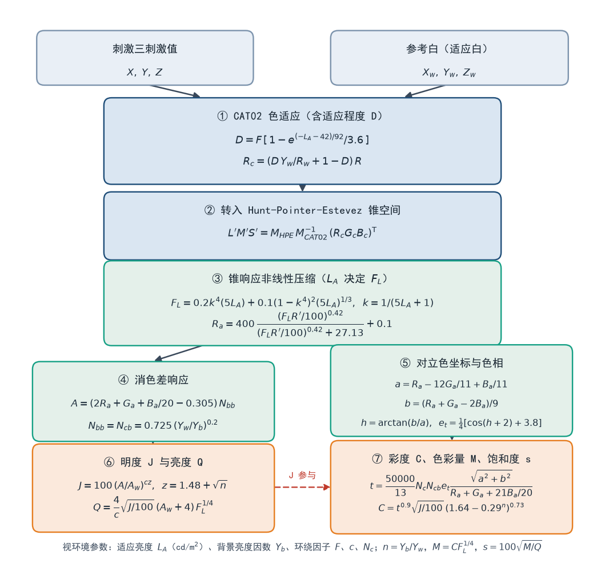
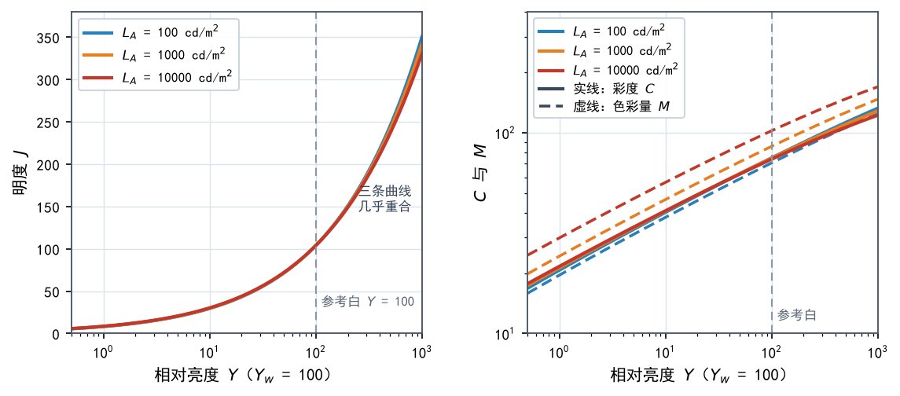

# 第 4 章 色貌模型

一个像素的 XYZ 值只说明它发出了多少、什么光谱的光，说不清它看上去是什么颜色。同一块灰卡放在钨丝灯下和正午阳光下，测出的三刺激值相差很远，人眼看到的却都是"灰"。反过来，两张印刷品在 D50 灯箱里匹配得很好，拿到窗边就一偏黄一偏蓝。要让数字描述"看起来"，就得把观察条件一起写进模型，这类模型叫色貌模型（color appearance model）。本章从观察条件出发，讲清 CIECAM02 的计算结构、CAM16 对它的修补，以及这套在 1997 至 2004 年间定型的模型放进 HDR 亮度范围后需要小心的地方。

## 4.1 测量量与外观量之间的缺口

CIE 1931 的 XYZ 描述的是刺激，与人怎么看无关。测量上这很方便，用作色彩管理的传递空间也够用，但它回答不了几个日常问题：同一种白在白天和黄昏看起来为什么不一样；画面周围变暗以后，中间的灰为什么会显得更亮；把亮度调高，红色为什么会更鲜艳。

这三个现象各有名字。亮度升高时彩度随之上升，叫 Hunt 效应（Hunt, 1952）；亮度升高时明度按幂函数增长、指数约 0.33 至 0.5，叫 Stevens 效应（Stevens & Stevens, 1963）；画面周围的环境变暗，图像整体显得更亮、对比更强，叫 Bartleson-Breneman 效应（1967）。这些现象共同指向一个结论，外观由刺激和它所在的观察条件共同决定。

色貌模型的做法是给刺激配一套"外观坐标"，每个坐标对应一种主观属性。CIE 159:2004 定义的相关量有六个。

| 相关量 | 符号 | 含义 | 量纲 |
|---|---|---|---|
| 明度 lightness | $J$ | 相对参考白判断的明亮程度 | 0–100（参考白为 100） |
| 亮度 brightness | $Q$ | 绝对明亮程度，随绝对亮度增长 | 无上限 |
| 彩度 chroma | $C$ | 相对同亮度灰色的色彩强度 | 无上限，常用 0–100 |
| 色彩量 colorfulness | $M$ | 绝对色彩强度 | 无上限 |
| 饱和度 saturation | $s$ | 相对自身亮度的色彩强度 | 0–100 |
| 色相 hue | $h$ / $H$ | 色相角与色相四分之一圆 | 0–360° / 0–400 |

几组关系先对齐一遍，后面看公式时能对上：$M = C\,F_L^{1/4}$，$s = 100\sqrt{M/Q}$。明度与亮度的区别也在这里，$J$ 是"相对白有多亮"，$Q$ 是"绝对有多亮"。把白场亮度提高十倍，白仍然是 $J=100$，但 $Q$ 会明显变大。

色貌模型在工程里有三个典型用途。跨媒体复制要把屏幕上的图像印到纸上，两边的白点、亮度、环绕全不一样，需要先换算成共同的外观量再比较。色域映射要判断"这个颜色超出目标设备多远"，判断依据只能是外观坐标而不是 XYZ。图像质量评价要在不同亮度的显示器上给出可比的分数，也依赖外观量的归一化能力。代价是参数变多：XYZ 三个数变成六个外观量，观察条件再添四项，任何一项取错都会带来系统性偏差，后面几节会反复看到这类误差的来路。

## 4.2 观察条件与色适应

色貌模型的输入除了待测色，还必须有完整的观察条件。CIE 159 把它拆成四项。

- **适应白**：视场中占主导的白色刺激，用三刺激值 $X_w Y_w Z_w$ 描述，通常取 $Y_w=100$。
- **适应亮度** $L_A$：观察者适应的绝对亮度，单位 cd/m²，实践上取白场亮度的 20% 左右。
- **背景亮度因数** $Y_b$：紧邻色块的那圈背景的相对亮度，通常 $Y_b=20$（相当于 $L^*\approx 50$ 的中灰）。
- **环绕**：视场外围的相对亮度，用三个诱导因子 $F$、$c$、$N_c$ 概括。

环绕对明度的影响由 Bartleson 与 Breneman 的实验确立，CIE 159 把它归纳成三档标准值：

| 环绕类型 | $F$ | $c$ | $N_c$ | 典型场景 |
|---|---|---|---|---|
| 平均 average | 1.0 | 0.69 | 1.0 | 客厅、影厅、白底上的印刷品 |
| 昏暗 dim | 0.9 | 0.59 | 0.95 | 暗室投影、夜间看电视 |
| 黑暗 dark | 0.8 | 0.525 | 0.80 | 影院、只留屏幕光的房间 |

$c$ 直接决定明度的压缩指数，$c$ 越小，暗环境下的画面明度被压得越低、对比显得越强。这就是同一个视频在亮房间里看着发灰、关灯后变得通透的数值化解释。

色适应是观察条件里最需要建模的一环。人眼进入新的照明环境后，锥细胞的增益会重新调整，几分钟内大致完成。von Kries 在 1902 年提出最简单的描述，三种锥细胞的响应各自按比例缩放，使白物体的响应回到中性，称为系数定律。

$$L_c = \frac{Y_w}{L_w}\,L,\qquad M_c = \frac{Y_w}{M_w}\,M,\qquad S_c = \frac{Y_w}{S_w}\,S$$

式中 $L_w M_w S_w$ 是适应白的锥响应。这个式子意味着适应只改增益、不改光谱形状，工程上好用，物理上当然只是近似。后来的改进集中在两点：用哪组锥响应做缩放，以及适应程度取多少。Bradford 变换（Lam, 1985）用一组偏"锐"的锥响应，在投影和印刷的实测中比 Hunt-Pointer-Estevez 更准；CIECAM02 采用的 CAT02 则在 Bradford 与 von Kries 之间取折中。

适应程度 $D$ 是 CIECAM02 的一个实用设计。完全适应取 $D=1$，完全不适取 $D=0$，模型按经验公式在两者之间插值：

$$D = F\left[1-\frac{1}{3.6}\exp\frac{-L_A-42}{92}\right]$$

$L_A$ 越大，$D$ 越接近 1。办公室里 $L_A$ 取 200 cd/m²，$D\approx0.98$；暗室投影的 $L_A$ 只有几 cd/m²，平均环绕下 $D$ 落在 0.83 上下，换成昏暗环绕（$F=0.9$）则约 0.75。适应越不完整，白点误差留在画面上的比例越高，这是"暗室里的投影总觉得偏色"这个经验的数值解释。

白点从哪里来，这件事在实践中比公式更容易出错。印刷用 D50，因为纸和油墨的观察习惯如此；sRGB 与 BT.709 用 D65；数字影院用 DCI 白点（$x=0.314$，$y=0.351$）；HDR 制作又回到 D65。跨这些标准传递图像时，白点必须显式声明，否则等比缩放就会算错。更难的是自适应显示器，实测白点会随背光和局部调光漂移几个 $Δu'v'$ 单位，用标称值做色貌计算会留下可见残差。

图 4-1 用一组色样演示适应前后的差别。假定每个色样的反射特性可以用 D65 下的 XYZ 表示，用 CAT02 做完全 von Kries 换算得到它在光源 A 下的 XYZ，然后算两次色貌：一次假装观察者仍按 D65 解读，一次把参考白换成 A。前者是刚进门的瞬间，后者是适应完成后的稳定状态。彩度变化最大，橙、红、肤色在未适应时彩度高出 20 至 30 个单位，蓝和青反而低了 46 与 6；色相同时转动，青转了 62°，紫转了反方向 58°。明度几乎不动，变化都在 4 个单位以内。这些数字说明适应主要作用在色度通道上，明度通道由亮度决定，与环境色关系不大。

## 4.3 CIECAM02 的结构

CIECAM02 于 1997 年提出，2002 年由 CIE 第 8 分部推荐，2004 年成为标准 CIE 159:2004。它继承 Hunt 模型和 RLAB 的思路，把计算压到可以写进固件的程度，正向与反向变换都有闭式解，这正是它被 ICC 采纳为色域映射基础的原因。

整个正向计算分七步，图 4-2 是它的数据流。

第一步做色适应。把 XYZ 乘 CAT02 矩阵进入锥空间，按 $D$ 缩放，再转回来：

$$R_c=\left(D\frac{Y_w}{R_w}+1-D\right)R$$

$D=1$ 时就是标准 von Kries；$D=0$ 时保持原样。中间值意味着"部分适应"，画面上的白既不完全归零，也不保留全部光源色。

第二步换到 Hunt-Pointer-Estevez 空间。这一步在数学上只是乘一个矩阵，但它把适应用的锥空间和压缩用的锥空间分开了：CAT02 为适应拟合，HPE 为生理响应拟合。第 4.4 节会看到，这个"分两步"正是 CAM16 要改的地方。

第三步做非线性压缩，含亮度级因子 $F_L$：

$$F_L=0.2k^4(5L_A)+0.1(1-k^4)^2(5L_A)^{1/3},\qquad k=\frac{1}{5L_A+1}$$

$$R_a=400\frac{(F_LR'/100)^{0.42}}{(F_LR'/100)^{0.42}+27.13}+0.1$$

$F_L$ 把绝对亮度带进模型：$L_A$ 越大，$F_L$ 越大，压缩曲线的肩部越靠右，同样比例的刺激能得到更大的响应。$L_A$ 取 1、100、1000 cd/m² 时，$F_L$ 分别约为 0.17、0.79、1.71。

第四步取消色差响应 $A$，第五步取对立色坐标 $a$、$b$ 与色相角 $h$。随后用 $A$ 与白的 $A_w$ 得到明度和亮度：

$$J=100\left(\frac{A}{A_w}\right)^{cz},\qquad z=1.48+\sqrt{n},\qquad n=\frac{Y_b}{Y_w}$$

$$Q=\frac{4}{c}\sqrt{\frac{J}{100}}\,(A_w+4)F_L^{1/4}$$

指数里的 $z$ 与背景有关，$n=0.2$ 时 $z=1.927$，再乘环绕因子 $c=0.69$ 得 1.33。第七步从 $a$、$b$ 得到彩度：

$$t=\frac{50000}{13}N_cN_{cb}e_t\frac{\sqrt{a^2+b^2}}{R_a+G_a+21B_a/20}$$

$$C=t^{0.9}\sqrt{\frac{J}{100}}\,(1.64-0.29^n)^{0.73}$$

$e_t$ 是偏心因子，随色相角变化，用来修正红绿与黄蓝方向的彩度敏感度差异。$N_{bb}$、$N_{cb}$ 为背景诱导因子，$N_{bb}=N_{cb}=0.725(Y_w/Y_b)^{0.2}$，$n=0.2$ 时约 1.00。

拿一个具体色样走一遍。色度 $x=0.55$、$y=0.33$、$Y=18$，白点 D65，$L_A=200$ cd/m²，$Y_b=20$，平均环绕，得到 $D=0.98$、$J=42.5$、$C=73.9$、$h=25.3°$、$M=73.9$、$Q=179$。换个白点或换个 $L_A$，这组数就会变，而 XYZ 一直是那三个数。

有一个容易误解的地方：CIECAM02 的 $J$ 与 CIELAB 的 $L^*$ 都是"明度"，数值却不等。同一块中性灰在 $L_A=200$、平均环绕下，$Y=18$ 时 $J=39.3$ 而 $L^*=49.5$，$Y=50$ 时 $J=68.7$ 而 $L^*=76.1$。差别来自 $c$、$z$ 这两个与观察条件有关的指数，$L^*$ 用的是固定立方根，$J$ 的指数随环绕和背景变化。做跨模型的数值比较时不能把两者直接互换。

## 4.4 CAM16 的改进

CIECAM02 上线后，工业界陆续发现几个问题。反解在高彩度区域可能无解或者不唯一，因为 $t$ 里含有 $J$ 和 $A$ 的耦合；色相均匀性不理想，CIECAM02 空间里等色相差的轨迹并不等距，红区和蓝区偏差明显；还有一些颜色在 CAT02 适应之后、HPE 变换之中出现负的锥响应，取幂运算时符号处理不当就会得到异常值。

Li 等人 2017 年提出的 CAM16 针对的正是这些结构性毛病。它的做法很克制，把"适应"和"压缩"放进同一个锥空间，用单一矩阵 CAT16 取代 CAT02 加 HPE 的两步：

$$M_{CAT16}=\begin{bmatrix}0.401288&0.650173&-0.051461\\-0.250268&1.204414&0.045854\\-0.002079&0.048952&0.953127\end{bmatrix}$$

这个矩阵由 CAT02 与 HPE 折中拟合得到，两端的折中使适应后的白在压缩空间里仍是中性，同时避免了两次矩阵变换造成的色相扭曲。其余结构与 CIECAM02 一致，$J$、$Q$、$C$、$M$、$s$ 的公式原样保留，所以两者的数值接近但不相同。

用同一组条件算前面那个红色样：CAM02 给出 $J=42.5$、$C=73.9$、$h=25.3°$，CAM16 给出 $J=41.8$、$C=75.7$、$h=22.3°$。明度差 0.7，彩度差 1.8，色相差 3°。单看一个色样并不惊人，但在色域映射里要沿等色相线找尖点，3° 的偏差会带来可见的色相偏移，这正是 CAM16 值得替换的原因。

CAM16 还配了一套均匀色彩空间 CAM16-UCS，把 $J$、$M$、$h$ 变成近似均匀的直角坐标：

$$J'=\frac{1.7J}{1+0.007J},\qquad M'=\frac{1}{0.0228}\ln(1+0.0228M),\qquad a'=M'\cos h,\quad b'=M'\sin h$$

$J'$ 与 $M'$ 是两个压缩函数，作用是把 CIECAM02 里偏大的动态范围压到接近感知均匀的尺度。CAM16-UCS 上的欧氏距离就是色差 $\Delta E_{16}$，在跨媒体比较里比 CIEDE2000 更稳，因为它显式带着观察条件。CAM02 也有对应的 CAM02-UCS（Luo 等，2006），两者形式相同，只是底层的 $J$、$M$ 来自不同模型。

## 4.5 HDR 下的色貌问题

CIECAM02 的实验基础来自二十世纪八九十年代的视觉实验，刺激多是反射样品或 CRT，$L_A$ 在几十到几百 cd/m²，视场 2° 或 10°，色块均匀、无眩光。HDR 显示把亮度推到 1000 至 4000 cd/m²，黑位压到 0.005 cd/m²，动态范围跨六个数量级；画面是自发光的，周围可能是全黑的影院，也可能是明亮的客厅。三个条件同时越界，模型只能外推。

外推的第一处风险在彩度。Hunt 效应说明亮度升高会带来彩度增长，CIECAM02 只通过 $M=CF_L^{1/4}$ 体现这一点：$L_A$ 从 100 升到 1000，$F_L$ 从 0.79 升到 1.71，$M$ 随之增加约 21%。实测的高亮度色块彩度增长往往更快，尤其在红和品红方向。图 4-3 右侧把这条关系画了出来，实线是彩度、虚线是色彩量，三条实线几乎重合，说明 $C$ 对亮度级不敏感，$M$ 才随亮度上升；$L_A$ 从 100 到 10000，同样色度下 $M$ 从 70 涨到 100 以上。

左侧的明度曲线也值得看。相对亮度超过 100 以后，$J$ 继续上升，没有上限，$Y=1000$ 时 $J\approx350$。这与"明度 0 到 100"的直觉不符，因为 $J$ 的 100 只对应参考白，高光比参考白更亮，自然超过 100。做色调映射时若把 $J$ 当 0–100 的封闭区间用，高光部分的相对关系会被压平。

第二处风险在参考白。SDR 时代白色就是显示峰值，HDR 里"白"分成了两层：漫反射白（BT.2408 规定 203 cd/m²）和峰值白（可达 1000 cd/m² 以上）。CIECAM02 的 $Y_w=100$ 假设只有一个白，把它当作参考白，$J=100$。HDR 画面里同时存在这两个白，取哪个做 $Y_w$，直接决定整幅画面的明度标定。取漫反射白，高光会得到 $J>100$；取峰值白，中间调整体被压暗。这也是 HDR 色貌研究里分歧最大的一点。

第三处风险在环绕与眩光。影院的环绕接近"黑暗"，客厅接近"平均"，两者的 $c$ 相差 0.165，明度指数从 1.33 变到 1.71，同一幅画面的明度关系会明显不同。高亮度屏幕上还会出现眩光，视场内的光散射抬高了眼内的等效适应亮度，模型里没有这一项。

工业界的处理办法是分层。亮度映射交给 BT.2390 的 EETF，逐段压缩，不碰色度；色域映射用 CAM16-UCS 或 ICtCp 里的等色相线保持色相；色貌差异则通过显示端的参考环境约定来控制，BT.2408 给出了 1000 cd/m² 峰值、203 cd/m² 漫反射白的制作环境，让后期和家庭两端有共同基准。真正需要色貌模型介入的场合，是跨亮度级的映射和不同环境间的匹配，CAM16 目前是这一层的默认选择，HDR 专用的色貌模型（如 iCAM06 的后续工作）仍停留在研究阶段。

与 PQ 的衔接值得单独说一句。PQ（SMPTE ST 2084）是一条绝对亮度编码曲线，码值直接对应 0 至 10000 cd/m²，因此 HDR 信号本身带着可测量的绝对亮度，不需要靠 $Y_w$ 去猜。ICtCp 就在 PQ 编码的 LMS 上构建，做色貌计算时可以直接从码值取绝对亮度，再决定 $L_A$ 的取法。SDR 时代这一步是缺失的：非线性传递函数只规定相对关系，显示亮度靠 OSD 菜单里的一个滑块，色貌模型拿不到真实亮度，只能按典型值假设。HDR 把绝对亮度变成信号的一部分，色貌模型的输入才第一次完整。

## 本章要点

- 色貌模型把观察条件写进计算，输出明度 $J$、亮度 $Q$、彩度 $C$、色彩量 $M$、饱和度 $s$、色相 $h$ 六类外观量，XYZ 本身不含这些信息。
- 观察条件由适应白、适应亮度 $L_A$、背景亮度因数 $Y_b$ 和环绕因子 $F$、$c$、$N_c$ 四项构成，缺一项模型就无法求解。
- von Kries 系数定律是色适应的基本形式，CIECAM02 用 CAT02 加适应程度 $D=F[1-e^{(-L_A-42)/92}/3.6]$ 描述部分适应，$L_A$ 越低 $D$ 越小。
- CIECAM02 的七步流程为：CAT02 适应、转 HPE、锥响应压缩、消色差响应、对立色与色相、明度亮度、彩度色彩量饱和度；$F_L$ 把绝对亮度带入压缩。
- CAM16 用单一矩阵 CAT16 取代 CAT02 加 HPE 的两步，缓解了负锥响应与色相不均，公式结构不变，色相角与 CAM02 相差几度。
- CAM16-UCS 给出近似均匀的 $J'$、$a'$、$b'$，其欧氏距离 $\Delta E_{16}$ 带观察条件，适合跨媒体的色差比较。
- HDR 下模型需要外推：彩度随亮度的增长被 $M=CF_L^{1/4}$ 低估，明度 $J$ 超过 100 后无上限，参考白有漫反射白与峰值白两种取法，眩光未被建模。
- 工程上把亮度映射、色域映射、色貌匹配分层处理，亮度交给 BT.2390，色相与彩度交给 CAM16-UCS 或 ICtCp，环境差异靠 BT.2408 的参考环境约束。
