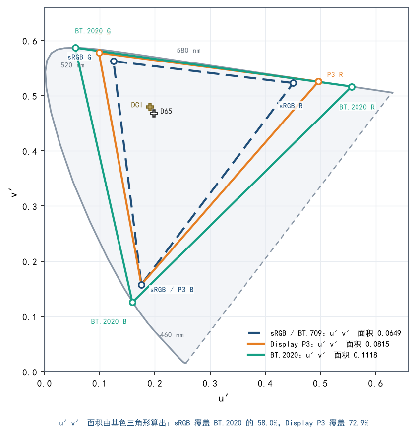
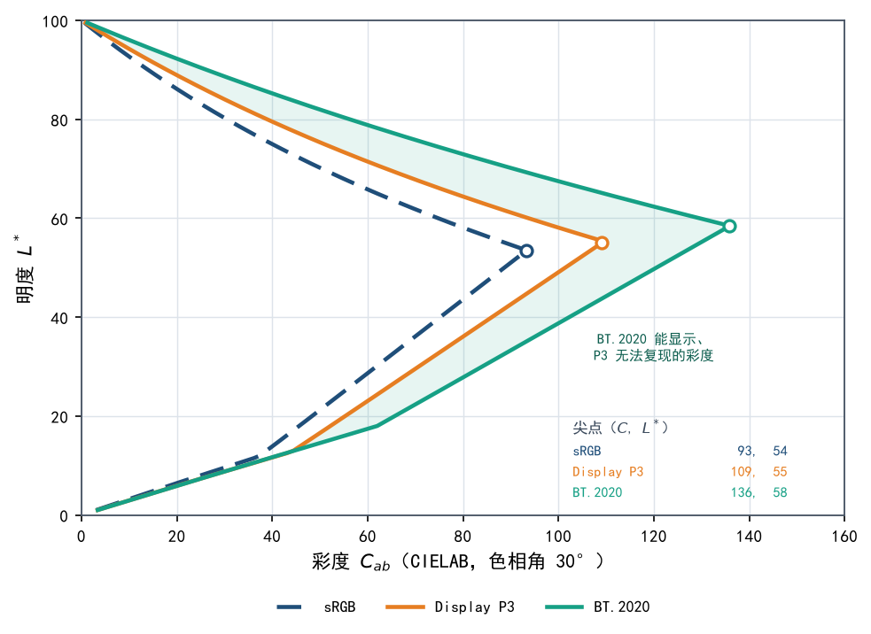
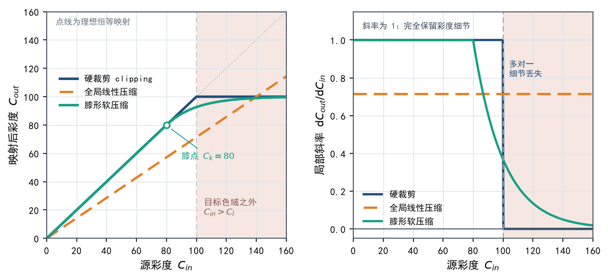
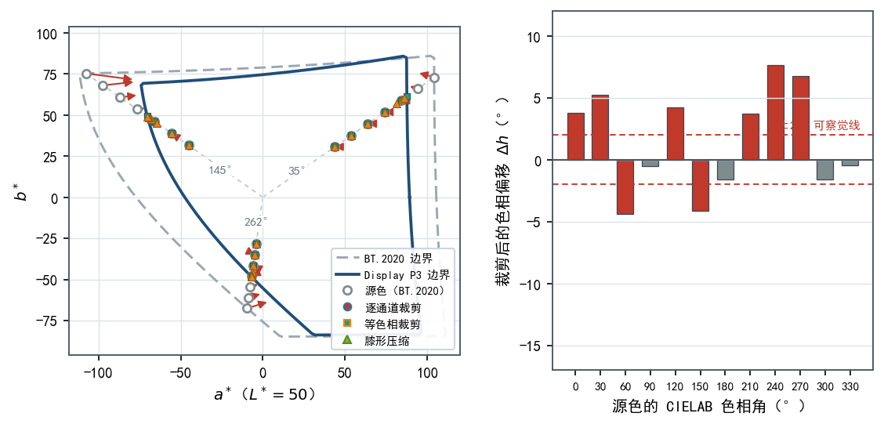
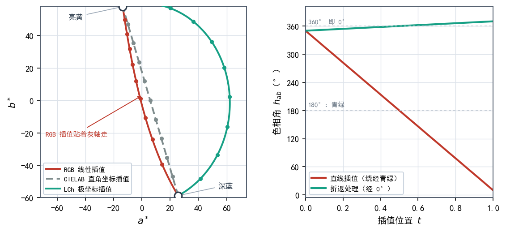
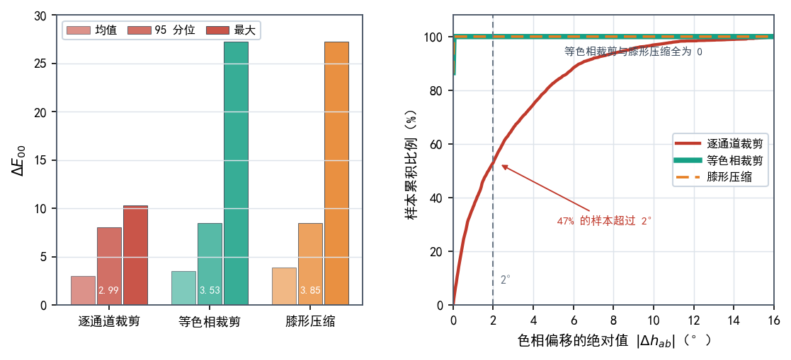
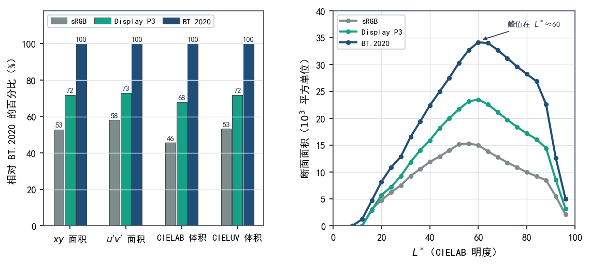

# 第 5 章 色域、色域体积与映射

规格书上那句"覆盖 95% DCI-P3"，分母是 DCI-P3 的色度面积还是它的体积，量在哪张色度图上，用的是哪个白点，四个问题各有一个答案，数字就有四种可能。同一台显示器按 xy 面积算覆盖 BT.2020 的 52.9%，按 u′v′ 面积算 58.0%，按 CIELAB 体积算 45.6%，按 CIELUV 体积算 53.3%。四个数都对，含义各不相同，混着比较就得出错误结论。更麻烦的是，覆盖率高的设备不一定能显示更多颜色，体积大的设备不一定能把某个具体的红显示对。要弄清这些差别，得先回到色域的几何形状，再谈怎么把超界的颜色搬回去。

## 5.1 色域是一个三维体

色域（gamut）指一个设备能复现的全部颜色。颜色有三个维度，色域因此是一个三维体，由四件事共同定死：三个基色的色度坐标、白点、传递函数、峰值亮度。前两项决定色度图上的三角形边界，后两项决定这个三角形能沿亮度方向拉多长、在暗部能分出多少级。色度图上那个三角形只是三维体在某一亮度平面上的投影，把三角形当成色域，是讨论色域时最常见的偷懒。

四件事里缺一件，色域就没被说清楚。只给基色坐标，等于说"这个设备能到多鲜艳"，却没说亮着的时候能不能到；只给峰值亮度，等于说"能多亮"，却没说亮到那个程度时还能不能保持饱和度。液晶面板在高亮度下要靠提高背光并打开液晶阀，漏光让对比度下降，深色变浅，实际色域在高亮度端会收缩；OLED 的每个像素自己发光，高峰值亮度靠提高电流，色度漂移的方向与液晶不同。这些差异都藏在"四要素"里，画在色度图上的三角形看不出来。

度量色域大小有三条路，各有用途，不能互相替代。

- **色度面积**：把 RGB 立方体投到色度图上，算三角形面积。只反映色度范围，与亮度无关，适合快速对比"谁的颜料更鲜艳"。
- **体积**：把色域换算到某个三维均匀空间，算它占的体积。反映"能显示出多少种可分辨的颜色"，数值与坐标选择有关。
- **覆盖率**：与某个参考色域求交，算比例。分母必须写清楚，否则没有意义。

三者的关系可以用一句话概括：面积看边界，体积看体量，覆盖率看交叠。面积不关心亮度，所以一台只能在 100 cd/m² 以下工作的显示器和一台能到 1000 cd/m² 的显示器，只要基色相同，面积完全一样。体积关心亮度，但会把"暗部只有几十个码值"这类细节抹平，因为连续积分不区分台阶。覆盖率最贴近采购语境，也最容易被做手脚，换个分母就能从 71% 变成 95%。

下面的数字由基色坐标与矩阵直接算出，用 5.2 节的矩阵可以逐位复现。

| 色域 | 基色三角形面积（xy） | 占马蹄面积 | 面积（u′v′） | 占马蹄面积 | CIELAB 体积 |
|---|---|---|---|---|---|
| sRGB / BT.709 | 0.1121 | 33.5% | 0.0649 | 33.0% | 8.99×10⁵ |
| Display P3 | 0.1520 | 45.5% | 0.0815 | 41.5% | 1.34×10⁶ |
| BT.2020 | 0.2119 | 63.4% | 0.1118 | 56.9% | 1.97×10⁶ |

马蹄面积按 CIE 1931 光谱轨迹围成的区域计算，xy 下是 0.3342，u′v′ 下是 0.1966。以 BT.2020 为 100%，sRGB 的体积比是 45.6%，Display P3 是 67.9%；换到 CIELUV 下算，同一批色域的体积比变成 53.3% 与 71.9%。BT.2020 的 CIELUV 体积是 2.64×10⁶，比 CIELAB 下的 1.97×10⁶ 大了三成。坐标不同，体积不同，这是坐标系的选择问题，不是测量误差。

面积与体积的增长并不成比例。从 sRGB 到 Display P3，xy 面积增加 35.6%，CIELAB 体积增加 48.9%；从 P3 到 BT.2020，面积增加 39.4%，体积增加 47.3%。体积涨得比面积快，原因是新扩出来的那部分基色落在亮度较高的区域，红绿两端向外推的同时把高亮度处的彩度也撑开了。这条经验反过来也成立：两个色域的色度面积相同，体积可以差出一截，差在亮度方向的填充程度上。

覆盖率好看而体积小的现象，根源在于覆盖率的分母是一个三角形，而三角形在高饱和区的"面积密度"很高。BT.2020 的绿基色几乎顶到光谱轨迹，围绕它的一小片区域在 xy 图上占的面积不大，在感知上却是极其鲜艳的绿，实际内容里很少出现。一台标称覆盖 BT.2020 九成的显示器，缺的那一成往往正好是这些用不上的极端色，所以"覆盖率 90%"听起来比"体积 45%"体面得多，两者描述的是同一件事的两个侧面。

传递函数不进面积公式，却实际影响可用色域。线性编码下暗部的相邻码值亮度差极小，量化噪声会把 0 到 0.5 cd/m² 这一段压成几条带。按 sRGB 曲线编码、峰值 100 cd/m² 的 8 bit 信号，0.5 cd/m² 落在码值 15.6，0.05 cd/m² 落在码值 1.6，中间只剩十几个台阶；换成 10 bit 的 PQ 编码，0.1 cd/m² 对应码值 64，1 cd/m² 对应 153，同样一段亮度有 90 个台阶。亮度分辨率也差得远，8 bit 伽马 2.4 在 0.5 cd/m² 处每级码值跳 8.8% 的亮度，10 bit PQ 在 0.5 cd/m² 处只跳 0.36%，相差二十多倍。色域边界由基色和白点固定，边界内能分辨出多少个不同颜色，由传递函数与位深共同决定。这就是 HDR 链路普遍要求 10 bit 的原因，也是"支持 BT.2020"这句话必须补上"多少位、什么曲线"才完整的原因。

图 5-1 画的是 u′v′ 而不是 xy。u′v′ 是 CIE 1976 的改进坐标，$u'=4X/(X+15Y+3Z)$，$v'=9Y/(X+15Y+3Z)$，它的等距线比 xy 更接近人眼的色差感受，用来看"哪个方向扩得多"更直观。图的左下角是蓝基色，三套色域在这里几乎重合，sRGB 与 P3 的蓝基色完全相同，都是 (0.150, 0.060)，BT.2020 只往外挪了一点。真正的差距在红绿两端，P3 的红基色沿光谱轨迹向上推，绿基色向左上推，BT.2020 再往光谱轨迹贴近一步，绿基色落在 532 nm 附近。图中标出的 520 nm、580 nm 与 460 nm 三个波长点给出参照，可以看出 BT.2020 的三角形三条边都贴着光谱轨迹走，而 sRGB 的绿边离轨迹还有明显距离。三块面积分别是 0.0649、0.0815、0.1118，图下方的注记用的是同一组数，可以直接和 5.3 节的覆盖率对照。

## 5.2 七套基色与白点

讨论色彩管理的文献里出现频率最高的七套色域，参数都来自公开标准，可以逐项引用。下表把基色坐标、白点与出处列在一起。

| 色域 | 红基色 | 绿基色 | 蓝基色 | 白点 | 出处 |
|---|---|---|---|---|---|
| sRGB / BT.709 | (0.640, 0.330) | (0.300, 0.600) | (0.150, 0.060) | D65 | IEC 61966-2-1；BT.709 |
| DCI-P3 | (0.680, 0.320) | (0.265, 0.690) | (0.150, 0.060) | DCI (0.3140, 0.3510) | SMPTE RP 431-2 |
| Display P3 | 同上 | 同上 | 同上 | D65 | Apple 规范，基色沿用 RP 431-2 |
| BT.2020 | (0.708, 0.292) | (0.170, 0.797) | (0.131, 0.046) | D65 | ITU-R BT.2020 |
| Adobe RGB (1998) | (0.640, 0.330) | (0.210, 0.710) | (0.150, 0.060) | D65 | Adobe RGB (1998) |
| ACES AP0 | (0.7347, 0.2653) | (0.0000, 1.0000) | (0.0001, −0.0770) | ACES (0.32168, 0.33767) | SMPTE ST 2065-1 |
| ACES AP1 | (0.713, 0.293) | (0.165, 0.830) | (0.128, 0.044) | ACES | SMPTE ST 2065-2 |
| ProPhoto / ROMM | (0.734699, 0.265301) | (0.159597, 0.840403) | (0.036598, 0.000105) | D50 | ISO 22028-2 |

几处容易看漏的细节。sRGB 与 BT.709 的基色和白点完全相同，差别只在传递函数与量化，前者是分段曲线，后者在历史上有过 2.2 与 2.4 两种约定，BT.1886 后来把 2.4 定为参考显示器的电光转换。DCI-P3 的蓝基色和 sRGB 完全一样，红绿向外扩，白点是氙灯放映机的 (0.3140, 0.3510)，比 D65 偏黄偏绿；Display P3 沿用同一组基色，把白点换成 D65 用于消费电子。BT.2020 的三基色都推到接近光谱轨迹的位置，蓝基色甚至落在 465 nm 附近。Adobe RGB 只把绿基色从 (0.300, 0.600) 挪到 (0.210, 0.710)，红蓝不动，所以它在青绿方向扩张而在红蓝方向与 sRGB 一致，色度面积 0.1511，恰好比 P3 的 0.1520 略小。

AP0 的绿基色取 (0.0000, 1.0000)，纯虚构，不在光谱轨迹上；蓝基色的 $y$ 是负值，落在色度图下方。这样取值是为了让 AP0 完全包住光谱轨迹围成的所有真实颜色，作为存档与合成的中间空间。代价是三个基色都不对应任何真实光源，AP0 的 Y 权重里蓝通道是 −0.0721，出现负值。负权重意味着提高蓝通道的码值会让整体亮度下降，这与直觉相反，却正是"虚拟基色"的数学后果。ProPhoto 的蓝权重只有 0.0001，几乎不贡献亮度，同样是虚构基色带来的。

从基色坐标到 RGB→XYZ 矩阵只差一步线性代数。设 $P$ 的三列是三个基色的 XYZ（各自归一化到 $Y=1$），$W$ 是白点的 XYZ，则存在对角矩阵 $S$ 使 $P\,S$ 的列和为 $W$，即

$$S=P^{-1}W,\qquad M=P\,S,\qquad \begin{bmatrix}X\\Y\\Z\end{bmatrix}=M\begin{bmatrix}R\\G\\B\end{bmatrix}$$

$S$ 的三个分量就是三个基色在白点处的亮度权重，也是矩阵第二行（$Y$ 行）的三个数。算出来的矩阵如下，前三套是最常用的。

$$M_{\mathrm{sRGB}}=\begin{bmatrix}0.4124&0.3576&0.1805\\0.2126&0.7152&0.0722\\0.0193&0.1192&0.9505\end{bmatrix},\quad
M_{\mathrm{2020}}=\begin{bmatrix}0.6370&0.1446&0.1689\\0.2627&0.6780&0.0593\\0.0000&0.0281&1.0610\end{bmatrix}$$

$$M_{\mathrm{P3,\,D65}}=\begin{bmatrix}0.4866&0.2657&0.1982\\0.2290&0.6917&0.0793\\0.0000&0.0451&1.0439\end{bmatrix},\quad
M_{\mathrm{P3,\,DCI}}=\begin{bmatrix}0.4452&0.2771&0.1723\\0.2095&0.7216&0.0689\\0.0000&0.0471&0.9074\end{bmatrix}$$

七套色域的 $Y$ 行放在一起，能看出各家的取向。

| 色域 | $Y_R$ | $Y_G$ | $Y_B$ | 绿通道占比 |
|---|---|---|---|---|
| sRGB | 0.2126 | 0.7152 | 0.0722 | 71.5% |
| Display P3 | 0.2290 | 0.6917 | 0.0793 | 69.2% |
| BT.2020 | 0.2627 | 0.6780 | 0.0593 | 67.8% |
| Adobe RGB | 0.2973 | 0.6274 | 0.0753 | 62.7% |
| ACES AP1 | 0.2722 | 0.6741 | 0.0537 | 67.4% |
| ACES AP0 | 0.3440 | 0.7282 | −0.0721 | 72.8% |
| ProPhoto | 0.2881 | 0.7118 | 0.0001 | 71.2% |

三套常用色域里绿通道都占亮度的一大半，蓝通道不到 8%。这个分布解释了两件事。显示器的绿基色误差对亮度影响最大，一台绿基色色度偏了 0.005 的机器，白点亮度可能偏差 1% 以上，而蓝基色同样的偏移几乎不影响亮度。反过来，蓝基色的色度误差对亮度贡献极小，对色相却最敏感，深蓝区域在色度图上面积窄、边界陡，一点点坐标偏差就能让大片颜色落到色域外，校准时往往要单独为蓝色做一条查找表。

白点的差别常被忽略，后果却比基色误差更明显。Display P3 与 DCI-P3 基色相同，只换白点，两个矩阵的差别在第 3 行：$Z$ 行从 0.9074 变成 1.0439，相差 15%。同一个 RGB 三元组在两套定义下的 XYZ 并不相等，中性灰尤其明显。把 DCI-P3 编码的中性灰（$R=G=B=0.5$）直接用 DCI 矩阵解码、再当作 D65 图像显示，算出的 CIELAB 是 $(76.1,\,-7.9,\,6.8)$，与真正的 D65 中灰 $(76.1,\,0,\,0)$ 相差 $\Delta E_{00}=10.5$，肉眼一看就知道偏绿。这个误差不是矩阵精度问题，而是白点没适配。

正确处理要先做色适应，把 DCI 白点换算到 D65，再套矩阵。用 Bradford 变换算出的 $3\times3$ 适应矩阵乘以 DCI 矩阵，得到的矩阵与直接按 D65 解出的矩阵仍有差别，实测在六个饱和基色上 $\Delta E_{00}$ 落在 0.2 到 1.7 之间，中性色上正好为 0。这说明两件事：白点适配能消掉大头，剩下的差异来自"适配模型只缩放锥响应、不改变光谱形状"这个近似。做跨设备转换时，若两端白点不同却只取一组矩阵，误差会在中性色上最明显，而在饱和色上反而较小，这与常见的直觉相反。

## 5.3 覆盖率的算法与陷阱

覆盖率是最容易被误用的指标，因为它至少有三种算法，结果差得很远。

**按色度面积算**。取两个三角形，求交，除以参考色域的面积。sRGB 相对 BT.2020 得 52.9%（xy 面积）或 58.0%（u′v′ 面积）。两个数不同，因为 u′v′ 对绿区的面积做了压缩，权重变了。Display P3 相对 BT.2020 是 71.7%（xy）与 72.9%（u′v′），两个数接近，因为 P3 缺的那部分主要在红角与绿角，两处的面积权重变化方向相反，抵消了一部分。

**按体积算**。把两个色域都采样到 CIELAB，求交体积与参考体积之比。sRGB 相对 BT.2020 得 45.6%，P3 得 67.9%。换到 CIELUV 下算，两个数变成 53.3% 与 71.9%。体积覆盖率比面积覆盖率低，原因有两个：绿方向的收缩在体积上被放大，因为绿方向恰好是体积贡献最大的区域；CIELAB 的 $L^*$ 在高彩度处对色度差更敏感，边界内缩同样的 xy 距离，换算出来的彩度损失更多。

**按包含关系算**。判断一个色域的边界是否全在另一个之内，答案是二值的。这类判定能发现面积比看不出来的问题。Display P3 的三个基色里，绿 (0.265, 0.690) 和蓝 (0.150, 0.060) 都在 BT.2020 内部，红 (0.680, 0.320) 却落在 BT.2020 的 R–G 边外侧，到边的垂直距离约 0.0013 个 xy 单位。面积上 P3 明显小于 BT.2020，两者却不是严格的包含关系，宣传材料里"完全覆盖"的说法在这个尺度上并不成立。Adobe RGB 的三个基色则全在 BT.2020 内，是真正的子集。ACES AP1 三个基色全在 BT.2020 之外，色度面积 0.2253，是 BT.2020 的 106.3%，体积 2.27×10⁶，是 BT.2020 的 115%。AP0 更极端，色度面积 0.3956，达到 BT.2020 的 187%，但它包含大量虚构的、不可显示的颜色，体积数字没有实际意义。

四种口径算出的相对大小列在一起，差距一目了然。

| 色域 | xy 面积 | u′v′ 面积 | CIELAB 体积 | CIELUV 体积 |
|---|---|---|---|---|
| sRGB 相对 BT.2020 | 52.9% | 58.0% | 45.6% | 53.3% |
| Display P3 相对 BT.2020 | 71.7% | 72.9% | 67.9% | 71.9% |
| sRGB 相对 Display P3 | 73.7% | 79.6% | 67.2% | 74.1% |

同一对色域，最高与最低的数字能差出 12 个百分点。所以读到"覆盖 95%"时必须追问三件事：分母是哪个色域，量的是面积还是体积，在哪张图上量的。三条都答上来，数字才有可比性。

覆盖率还有两个具体陷阱，藏在行业习惯里。

第一个是 NTSC 比的遗产。老显示器标"72% NTSC"，NTSC 1953 的基色是 (0.67, 0.33)、(0.21, 0.71)、(0.14, 0.08)，色度面积 0.1582，比 sRGB 大。sRGB 相对 NTSC 的面积比是 70.9%，体积比更高，所以"72% NTSC"约等于"sRGB 全覆盖"，这个换算在 xy 上成立，在 u′v′ 上不成立，后者给出 87.2%。用 u′v′ 换算会让数字虚高，厂商自然愿意用这一套。

第二个是亮度条件的省略。色域是三维体，覆盖率却常按二维三角形算，等于默认"在任意亮度下都能达到这个色度范围"。实际显示器在高亮度端彩度会掉，在低亮度端受漏光影响也会掉。HDR 显示器的规范写法是"BT.2020 色度 + PQ 1000 cd/m² 峰值 + 在 200 cd/m² 下达到 90% P3 覆盖"，缺了最后一截，覆盖率就只是一句好听话。

覆盖率高的实际收益还要打折。人眼对绿区的色度分辨力低于红蓝区，BT.2020 相对 P3 多出的那部分面积里，相当比例落在分辨力较低的区域。广色域真正的价值往往体现在高饱和度的实物色上，比如激光显示的深红、青绿，以及彩妆、花卉、霓虹灯这些内容里出现频率不高却极具记忆点的颜色。用一张平均彩度只有 20 的风景照去对比两台显示器，广色域那台的观感优势可能完全看不出来。

## 5.4 体积怎么算

体积的计算在数值上不复杂。把 RGB 立方体按 $n^3$ 网格采样，逐点换算到目标空间，对点集求凸包，凸包体积就是色域体积。$n=44$ 时得到 85184 个点，CIELAB 里算出的三个体积分别是 8.99×10⁵、1.34×10⁶、1.97×10⁶。网格从 24 加密到 64，三个数分别只变 0.4%、0.4%、0.3%，$n=44$ 已经够用。

体积依赖坐标，这一点必须讲明白。CIELAB 的 $L^*$ 在 $Y=Y_w$ 处到 100，再往上只能靠公式外推，HDR 的高光部分因此没有自然的落点。CAM16-UCS 的 $J'$ 上限也是 100，$M'$ 无上限，同样的色域算出来的体积数值完全不同。CIELUV 与 CIELAB 的明度轴相同，色度平面的尺度不同。两篇文献报出的"色域体积"若坐标不同，数字不能直接比，连数量级都可能不一致。

参考白的选择同样会改变体积。sRGB 的立方体在 D65 参考白下算出 8.99×10⁵，把参考白换成 D50 再算，同样一组 RGB 码值得到 9.30×10⁵，大了 3.4%。差别来自 $L^*$ 的归一化：D50 的 $Z$ 分量比 D65 小，$b^*$ 的跨度被拉大，蓝紫方向的体积随之增加。Display P3 用 DCI 白点算体积得 1.35×10⁶，用 DCI 矩阵解码、却按 D65 白点解释，得 1.26×10⁶，掉了 6.4%，因为整个立方体被当成偏绿的色块挪离了中心。报体积时必须连着参考白一起写。

峰值亮度对体积的影响远大于基色。同一组基色，峰值亮度从 100 cd/m² 提到 1000 cd/m²，色域在亮度方向拉长，体积随之增长，但增长的幅度取决于坐标怎么处理高光。CIELAB 在 $Y>Y_w$ 之后 $L^*$ 增长很慢，$Y=10Y_w$ 时 $L^*$ 只有 227；CAM16-UCS 的 $J'$ 有软上限，$J$ 再大也只能逼近 100。这两种坐标都会把 HDR 的高光压缩成薄薄一层，算出的体积增长远小于十倍。更实在的做法是分亮度段报体积，或者干脆只报色度，把亮度维度单独写成"PQ 1000 cd/m²"。HDR 的规范写法是"BT.2020 色度 + PQ 1000 cd/m² 峰值"，而不是笼统地说"BT.2020 色域"，原因就在这里。

凸包法有一个前提，色域在目标空间里是凸的。CIELAB 下的 RGB 立方体确实接近凸，换到 CAM16-UCS 或 ICtCp 就不一定，那时凸包会把凹进去的部分填满，体积偏大。更稳的做法是按 $L^*$ 分层：把 RGB 立方体切成几十层等亮度的薄片，每层在 $a^*b^*$ 平面上求多边形面积，再沿 $L^*$ 积分。这个做法还有额外好处，每一层的面积曲线本身就是一张有用信息，能看出色域的"腰"在哪里最粗。

图 5-2 就是色相角 30° 的一张切片。三个色域的边界都呈橄榄形，底端收在黑色，顶端收在白色，中间鼓出一个尖点。尖点（cusp）的坐标差别很大，sRGB 在 $C=93$、$L^*=54$，Display P3 在 $C=109$、$L^*=55$，BT.2020 在 $C=136$、$L^*=58$。同一个颜色在 sRGB 里已经到顶的位置，在 BT.2020 里还有 40 多个单位的彩度余量，阴影区标的就是这一块。尖点的高度也值得注意，三个色域都在 $L^*=54$ 到 $58$ 之间，说明这个色相方向最饱和的颜色出现在中等明度，不在最亮处。切片把三维问题压成二维，既看清了彩度方向的富余量，也看清了富余量集中在哪个明度段。若只做全局彩度压缩、不区分明度，尖点附近的颜色会压不够、肩部的颜色会压过头，图中阴影区的上下宽度不同，正是这件事的量化形态。

把这类切片逐层积分，就得到体积。用 60 层、每层 140×140 网格的做法，sRGB 得到 8.67×10⁵，比凸包小 3.7%；加密到 200 层、400×400 网格，得 8.76×10⁵，比凸包小 2.7%，再加密收益很小。差距的来源在两端，$L^*$ 接近 0 与 100 的薄片面积趋近于零，有限层数总会漏掉一点。BT.2020 的对应差距是 2.4% 与 1.2%，比 sRGB 小，因为它的切片在明度两端更"钝"，漏掉的少。两种方法互相校验时，2% 到 4% 的偏差属于正常，把它当成精度指标写进报告即可。

切片法还有一个副产品，能看出体积主要由哪一段亮度贡献。sRGB 的切片面积在 $L^*=60$ 处达到峰值的 1.50×10⁴，BT.2020 在同样明度处到 34.2×10³，两者的峰值比是 2.28，而总体积比是 2.19，接近但不等。P3 的峰值 23.5×10³，比 sRGB 高 57%，它的总积比 sRGB 高 49%。峰值比总积略高，说明 P3 的优势集中在中等明度，在暗部与极亮部的增量小一些。这条信息对显示器设计有用，在中等明度保持高彩度比在极亮处保持高彩度容易，成本也低。

## 5.5 色域映射的裁剪路径

超出目标色域的颜色必须映射回去，这个过程叫色域映射（gamut mapping）。所有算法都要在三个属性之间取舍，色相、彩度、明度，最多保住两个，第三个一定被牺牲。取舍的方式决定了算法的类别，也决定了画面出什么样的问题。

最简单的做法是裁剪（clipping），把超界的彩度直接切到边界上，明度和色相不动。ICC 的比色意图（media-relative colorimetric）就是这一类。裁剪有三种常见变体，差别在"切到哪个点"。

逐通道裁剪最粗暴，在 RGB 空间把每个通道各自夹到 [0,1]。它的问题是三条通道独立截断，截断的比例不同，颜色的色相就跟着偏。ICC 的比色意图实际做的是这个动作，配合最小色差准则时称为 HPMinDE，即在等色相线上找到与源色色差最小的边界点，比逐通道温和得多。

等色相裁剪把彩度沿等色相线压到边界，$L^*$ 与 $h$ 都不动，只把 $C$ 换成 $C_{\max}(L,h)$。这是 HPMinDE 的简化版，省掉了色差搜索，代价是在边界弯曲剧烈的地方，等色相线与色域边界的交点不一定是色差最小点。真正的 HPMinDE 要在等色相线上做一维搜索，找使 $\Delta E_{00}$ 最小的那个点，实际实现里通常用三点二次插值近似，十几次边界求值就够。

图 5-3 左侧把三条曲线画在一起，源彩度到 160，目标边界 $C_l=100$，源的最大彩度 $C_s=140$，膝点 $C_k=80$。硬裁剪是一条折线，越过 100 立即水平，160 与 101 映射到同一个输出值，多对一的关系一目了然。全局线性压缩按 $C_{out}=C_{in}C_l/C_s$ 等比缩放，斜率恒为 $100/140=0.714$，整幅图的彩度都降到七成，边界内的颜色也被压了，代价过大。膝形压缩在 80 以内保持恒等，以外按指数逼近 100，到 $C_{in}=140$ 时输出 99.0，与边界的差只有 1 个单位。右侧的局部斜率更能说明问题。硬裁剪在 100 处从 1 直接跳到 0，这一段的信息被彻底抹掉；线性压缩的斜率是 0.714，处处有细节但处处变淡；膝形压缩的斜率从 1 连续降到 0.37 再趋近 0，既保留了边界内的原样，又让边界外的细节平滑收敛。斜率曲线与横轴围成的面积也值得看，硬裁剪在边界外面积为零，线性压缩是 0.714×60，膝形压缩介于两者之间，这个面积正比于"保住了多少彩度差别"。

裁剪的代价是信息丢失，图 5-3 已经把这件事量化。落在边界外的所有颜色都被压到同一个点，原本有细微差别的渐变会变成一块平色，电视画面上的天空、花瓣、布料的褶皱最容易暴露这个问题。图形、标志、纯色块则不怕，它们的颜色本来就少，一改反而认不出来。

图 5-4 的左图取 $L^*=50$ 的 $a^*b^*$ 平面，灰色虚线是 BT.2020 的边界，深蓝实线是 Display P3 的边界，两者在红角与黄角差得最多，蓝角几乎重合。三个色相方向（35°、145°、262°）上各取 7 个源色，红箭头指向逐通道裁剪的结果，青色方块是等色相裁剪的结果，橙色三角是膝形压缩的结果。35° 方向上源色从边界外被拉回，逐通道裁剪的落点偏离了原来的等色相线，橙色与青色落点则都留在半径方向上。262° 的蓝紫方向最明显，逐通道裁剪的落点几乎沿切向移动，色相整整偏了几度。右图把这个偏移按 12 个色相方向画出来，纵轴是裁剪前后的 CIELAB 色相角之差。正值出现在红、黄、品红一侧，0° 到 30° 偏 3.8° 与 5.3°，240° 与 270° 偏到 7.7° 与 6.7°，蓝紫与品红的偏移最大；负值出现在 60° 与 150°，分别偏 −4.4° 与 −4.1°，青色与黄绿方向往反方向跑。两条红色虚线是 ±2° 的可察觉线，12 个方向里有 9 个越线。这组数字说明逐通道裁剪不只是"压平细节"，它还会系统性改变色相，而且在蓝紫方向最严重，恰好是人眼对色相最敏感的区域。

色相偏移的机制并不神秘。RGB 三个通道的截断量由各自的溢出量决定，一个高饱和的紫红在 BT.2020 里可能只有红通道溢出，蓝通道也在边界外，截断后红蓝比例变了，合成出来的颜色就偏向另一边。等色相裁剪不碰这个比例，它固定 $h$，只缩 $C$，所以色相偏移为零。

图 5-5 讲的是另一个常被忽略的问题，插值路径。左图的端点取 sRGB 的深蓝 $(0.05,0.10,0.55)$ 与亮黄 $(0.95,0.90,0.20)$，换算到 CIELAB 是 $L^*=41.5$、$C=64$、$h=294°$ 与 $L^*=94.3$、$C=59$、$h=103°$。RGB 线性插值的路径几乎贴着灰轴走，中段颜色发灰发暗，因为两个端点在 RGB 里各通道混合时中间值都掉到 0.5 附近；CIELAB 直角坐标插值（灰色虚线）稍好，路径在 $a^*b^*$ 平面上仍是一条直线，中段的彩度被拉低；LCh 极坐标插值（青色实线）绕着一个大弧走，中段保持高彩度，颜色从蓝经紫、品红、红、橙过渡到黄，视觉上更像"颜色在变"而不是"颜色在褪"。三种路径的差别在动画、渐变、色带生成里都能看出来，用 RGB 插值做蓝到黄的渐变，中间会出一段脏灰。

右图是色相折返的陷阱。色相角从 350° 插到 10°，直观上只差 20°，但直接按数值线性插值会从 350 一路涨到 10，途经 180° 的青绿，画面上突然冒出绿色。正确做法是先算最短弧，$\Delta h=((10-350+180)\bmod 360)-180=20°$，再从 350 加到 370，越过 360 之后按 360 取模，路径经过 0° 即红色。青线在 $t=0.5$ 附近走到 360 以上，看起来"超出"了色相角的范围，实际是正确的表示。这段代码只有三行，写错的人不少，症状是渐变里多出一段不该有的颜色。

## 5.6 压缩与色差评价

压缩（compression）换一个思路，把整个彩度范围单调地压进目标色域，边界外的颜色不会被压成一点，而是按比例靠拢。代价是整体彩度下降，画面看起来"淡"，好处是渐变不断裂。

ICC v4 的感知意图用的是 SGCK 算法，名字来自 Süsstrunk、Gentile、Koh 与 Kovács 四个人的姓氏。它的结构可以拆成三段。第一段沿亮度方向压缩，把源的黑白端点映射到目标的黑白端点，用一条 sigmoid 曲线，端点处斜率为 1，中段斜率略大于 1，这样暗部与高光的细节都不会被压死。第二段沿彩度方向用膝函数，膝点取在目标边界彩度的 90% 附近，膝点以内保持原样，以外指数收敛到边界。第三段把亮度压缩与彩度压缩按色相角加权混合，红黄方向以彩度为主，蓝方向以亮度为主，因为蓝紫区域的色域尖点位置随亮度变化剧烈，只压彩度会让这些颜色变暗或不自然地发亮。

膝函数的形式在 5.5 节已经给过，这里补两个参数选择的经验。膝点 $C_k$ 越靠近边界，保留的彩度越多，可用的压缩余量越少，曲线在末端越陡；$C_k$ 取 0.9$C_l$ 时末端斜率约 0.1，取 0.8$C_l$ 时约 0.2。另一个参数是压缩的目标，SGCK 压到的是"参考媒体色域"，不是设备色域。参考媒体色域（reference medium gamut）是 ICC 定义的一个中等大小的虚拟色域，比多数打印机大、比宽色域显示器小，这样一套映射参数能在不同设备间通用，代价是在宽色域显示器上显得保守。

多锚点映射是压缩类里更精细的一支，Bala 在设备特性化的实践里把它总结成一套方法。基本想法是把映射从"一个源色域对一个目标色域"细化成"若干锚点对若干锚点"，锚点选白、黑、中灰、主要记忆色（天空蓝、肤色、草地绿），每个锚点单独给一个目标位置，锚点之间用平滑插值过渡。好处是可以把"肤色不许偏"这类业务要求直接写进映射，坏处是锚点之间可能相互冲突，需要一次全局优化。手机相机的色彩调校大量使用这类方法，参数不公开。

映射完要看效果，评价指标有两类。第一类是色差，$\Delta E_{00}$ 的均值、95 分位与最大值，分别反映整体偏移、多数样本的偏移与最坏情况。第二类是色相偏移，$\Delta h_{ab}$ 的绝对值分布，因为色相差比彩度差更显眼。两组指标必须一起看，只看色差会漏掉色相被拧的情况，只看色相会漏掉整体发灰。

图 5-6 的样本是 BT.2020 立方体按 26 格网格采样后落在 Display P3 之外的颜色，明度大于 10，共 7049 个。左图三组柱，每组三根，分别是均值、95 分位与最大值。逐通道裁剪的 $\Delta E_{00}$ 均值 2.99，95 分位 8.05，最大 10.28；等色相裁剪均值 3.53，95 分位 8.48，最大 27.26；膝形压缩均值 3.85，95 分位 8.49，最大 27.26。这个结果有点反直觉，逐通道裁剪的色差最小，因为它把颜色尽量留在原处，只做最小的坐标修改；等色相裁剪与膝形压缩为了保住色相，宁可牺牲彩度，色差自然大一些。后两者的最大值 27.26 远高于逐通道的 10.28，出现在色域尖点附近，那里等色相线上的边界距离最远，压缩量最大。

右图把色相偏移的累积分布画出来。逐通道裁剪的曲线从原点出发一路爬升，47% 的样本偏移超过 2°，中位数约 2.3°，尾部一直拖到 16°。等色相裁剪与膝形压缩的曲线在 0.5° 以内就直接冲到 100%，按构造它们的色相偏移严格为零。两条线重合在 100% 附近，几乎看不出差别，这是预期之中的，因为两者都固定了 $L^*$ 与 $h$。这张图把"色差小"与"色相准"的矛盾摆得很清楚，逐通道裁剪赢了左边的柱状图，输了右边的曲线，而人眼对色相偏移的容忍度远低于对彩度变化的容忍度，所以工程上一般不用逐通道裁剪。

评价指标还有一个坑，样本集合的选择会左右结论。图 5-6 的样本只取超界的颜色，得到的均值不能代表整幅图；如果混入边界内的颜色，所有方法的均值都会被稀释到 1 以下，看起来都不错。公平的做法是把超界与界内分开统计，或者在自然图像上按面积加权。另一件事是 $\Delta E_{00}$ 的参数，$k_L$ 取 1 适用于色差在中等大小的情况，若映射后整体亮度被压，$k_L$ 取 2 更贴近观感。

## 5.7 色相与饱和度的保持

色相保持几乎是所有色域映射算法的硬约束，理由是人对色相偏移极其敏感。彩度降低 20% 常常察觉不到，色相偏 5° 就会觉得"这块红不对"。记忆色的容差更小，肤色的色相偏 3° 就会被说成"气色不好"，天空蓝偏一点就显得脏。

难处在于"等色相"本身依赖模型。CIELAB 里的等色相线在靠近色域边界时会弯，这个现象叫 Abney 效应，往颜色里加白或提高饱和度，色相角会跟着变。Abney 在 1909 年就描述了它，一百多年过去，没有一个色空间能完全消掉。用 Lab 的 $h_{ab}$ 做等色相映射，边界附近的走向会偏离视觉上的等色相，红蓝两端的偏移最大。CAM16-UCS 的等色相线更直，Li 等人在 2017 年的对比里给出过量化结果，这也是 CAM16 被色域映射算法采纳的原因之一。ICtCp 的 $C_t$、$C_p$ 两个色度轴同样不严格等色相，用它做映射时一般要先把色相角固定，再在半径方向压缩。

饱和度与彩度要分开看。彩度 $C$ 是相对同亮度灰的色彩强度，饱和度 $s$ 还除了亮度，$s=100\sqrt{M/Q}$。压缩彩度时，暗部的饱和度会相对上升，画面上表现为暗处颜色变"艳"，这在 HDR 到 SDR 的映射里很常见。稳妥的做法是在 CAM16-UCS 的 $J'$–$M'$ 平面上做二维压缩，让明度和彩度同时收敛，而不是只压一个轴。二维压缩的边界是目标色域在 $J'$–$M'$ 平面上的截面，按色相角分片处理，每片是一个二维凸多边形，可以用径向压缩加锚点固定，几行代码就能实现。

图 5-7 左图把四种口径并排，都以 BT.2020 为 100%。xy 面积口径下 sRGB 是 53、P3 是 72；u′v′ 面积口径下变成 58 与 73；CIELAB 体积口径下掉到 46 与 68；CIELUV 体积口径下回到 53 与 72。同一台 sRGB 显示器，换一个口径就从"覆盖一半"变成"覆盖四成半"，差距 12 个百分点；P3 的波动小一些，因为它在红绿方向的扩张比较均匀，四种口径的权重变化方向部分抵消。右图是切片面积随明度的曲线，三条都在 $L^*\approx60$ 处达到峰值，sRGB 15.0×10³、P3 23.5×10³、BT.2020 34.2×10³，之后向两端下降，$L^*=20$ 处只剩峰值的 32%、24%、24%，$L^*=90$ 处剩 49%、50%、51%。曲线在低明度端下降得更快，说明暗部的色域收得很厉害，这也解释了为什么暗部的高饱和色最难做。两条信息合在一起，指向同一个结论：色域大小不能用一个数字概括，必须说明口径，而且要说明是在哪个明度段。做 HDR 映射时按 $L^*$ 分十层各画一条压缩曲线，比用一条全局曲线更贴合实际，代价是参数多了十倍，工程上要在精度与可维护性之间取平衡。

顺序也有讲究。HDR 内容同时超出目标设备的色域和亮度范围，先压亮度还是先压色域，结果不同。先压亮度时，高光被拉低，色域的尖点位置随之改变，后续的色域压缩要按新的亮度重新找边界；先压色域时，超界色被压到边界，再压亮度时这些颜色会跟着整体下移，可能出现"压过头"的暗色。BT.2390 的 EETF 只处理亮度，色域交给下游，这个分工的好处是每一步都可测、可回退。BT.2408 给出的实践顺序是先做色调映射、再做色域映射，理由是色调映射后的图像才是显示设备的实际输入，按它去找边界才不会错位。也有反过来的做法，在 ACES 体系里先把色域收到显示色域的 90% 再压亮度，留出一点余量避免二次裁剪，两种顺序各有拥护者，差别在极端高光色的处理上。

最后提一句多基色显示。三基色显示的色域是个三角形，六基色（多加黄、青）的色域在色度图上是六边形，同一亮度下能覆盖的面积更大，尤其黄绿区域。这类显示的色域映射不能沿用三基色的等色相线，需要按基色组合重新划分区域，把颜色分配给不同的基色对，同一目标色可以用不同的基色组合实现，选哪个要看亮度效率与色度精度。激光显示加上动态基色功率分配，理论上能把六边形填满，实际受散斑与成本限制，多数产品还是按三基色工作。

基色坐标只是设计值，实际产品受滤光片带宽与发光效率的约束，色度覆盖普遍低于标称。窄带滤光片能把基色推向光谱轨迹，代价是透过率下降、亮度做不上去；为了亮度放宽带宽，基色就会往白点方向收缩。标称的 BT.2020 与实测的 BT.2020 往往差出一截，校准时以实测为准，不要拿规格书的坐标直接算矩阵。测量本身也要注意条件，色度计在低亮度下的读数漂移、屏幕的视角特性、局部调光带来的空间不均匀，都会让"实测色域"变成一个带条件的数字。

## 本章要点

- 色域是三维体，由基色、白点、传递函数、峰值亮度共同决定；色度图上的三角形只是它在某一亮度平面的投影。
- 面积、体积、覆盖率是三种不同度量。sRGB 占 BT.2020 的 52.9%（xy 面积）、58.0%（u′v′ 面积）、45.6%（CIELAB 体积）、53.3%（CIELUV 体积），四个数都对但不可互换。
- 七套常用色域的基色与白点都来自公开标准，ACES AP0 与 ProPhoto 用虚构基色换取完整性，代价是出现负的亮度权重。
- 从基色与白点解矩阵只需一次线性代数，$S=P^{-1}W$；DCI-P3 与 Display P3 基色相同、白点不同，$Z$ 行相差 15%，未做白点适配时中灰的色差可达 $\Delta E_{00}=10$。
- 体积随坐标与参考白变化，sRGB 在 D50 参考白下比 D65 下大 3.4%；凸包法与切片积分法相差 2% 至 4%，可作为互校。
- 覆盖率有三种算法，分母必须写清；面积上 P3 小于 BT.2020，但 P3 的红基色落在 BT.2020 的 R–G 边外约 0.0013，两者并非严格包含。
- 逐通道裁剪色差最小却把 47% 的样本色相推过 2°，蓝紫方向最多偏 7.7°；等色相裁剪与膝形压缩的色相偏移严格为零，代价是色差峰值升到 27。
- 色相保持依赖模型的等色相线，CIELAB 在边界附近有 Abney 弯曲，CAM16-UCS 更直；HDR 映射应在 $J'$–$M'$ 平面做二维压缩，并明确亮度与色域的先后顺序。
