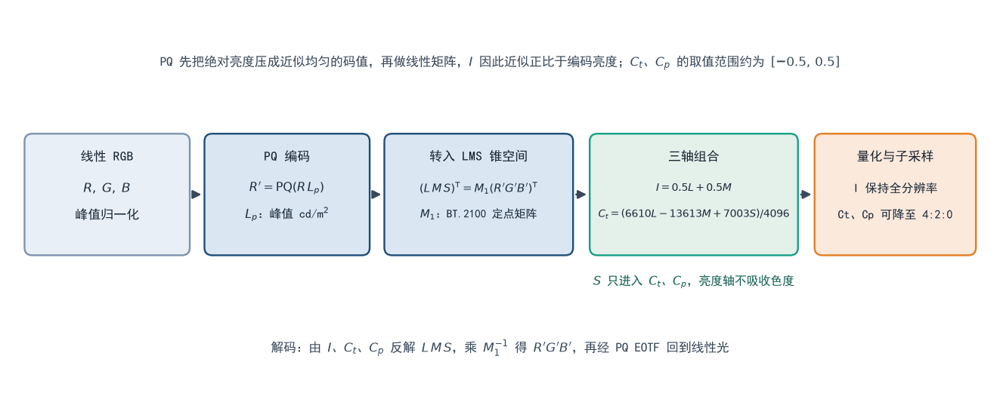

# 第 6 章 HDR/WCG 的色彩编码与测量

色域变宽、亮度范围变大之后，色彩编码要重新回答几个老问题：怎么把三原色分成一个亮度轴和两个色度轴，色度能不能降采样，色差该用什么公式算。SDR 时代的答案写在 BT.601 和 BT.709 里，到了 HDR 就换成了 BT.2100 的 ICtCp 与 BT.2124 的 ΔE_ITP。本章顺着编码结构讲下去，然后是 3D LUT 与 ICC 的工程实践，最后落在测量环节，讲分光计与色度计的分工和一条可复现的校准流程。

## 6.1 从 YCbCr 到 ICtCp

把 RGB 拆成"一个亮度加两个色度"，理由是人眼对色度的空间分辨力远低于亮度。YCbCr 用了几十年，结构简单：先对 $R'G'B'$ 做加权和得到 $Y'$，再取两个差分量。

$$Y'=0.2627R'+0.6780G'+0.0593B',\qquad C_b=\frac{B'-Y'}{1.8814},\qquad C_r=\frac{R'-Y'}{1.4746}$$

式中的系数是 BT.2020 的值，sRGB 用 0.2126、0.7152、0.0722。这套定义叫非恒定亮度（non-constant luminance，NCL），因为 $Y'$ 是三个**非线性**分量的加权和，与真实亮度不成正比。SDR 时代这个偏差可以接受，HDR 把亮度范围拉到六个数量级，偏差被放大，另一个问题也浮出水面：色度一变，解码出来的亮度跟着变。

BT.2100 给出的替代方案是 ICtCp。它把 PQ 编码后的信号送到 LMS 锥空间，再用两组加权差得到色度轴。

$$\begin{bmatrix}L\\M\\S\end{bmatrix}=\frac{1}{4096}\begin{bmatrix}1688&2146&262\\683&2951&462\\99&309&3688\end{bmatrix}\begin{bmatrix}R'\\G'\\B'\end{bmatrix}$$

$$I=\tfrac{1}{2}L+\tfrac{1}{2}M,\qquad C_t=\frac{6610L-13613M+7003S}{4096},\qquad C_p=\frac{17933L-17390M-543S}{4096}$$

结构上有一处细节值得停下来看：$I$ 只用 $L$ 与 $M$，$S$ 完全不进入亮度轴，只出现在 $C_t$、$C_p$ 里。$S$ 对应短波锥细胞，是三者中对亮度贡献最小的（在亮度函数里权重不到 2%），把它从亮度轴里摘出去，色度变化就不会再污染亮度。

为什么先 PQ 再矩阵，而不是先矩阵再 PQ？两条路都有人用，差别在精度分配。PQ 是绝对亮度编码，码值直接对应 cd/m²，先编码的好处是后续矩阵运算在感知均匀的域里进行，量化误差在暗部不会被放大；代价是矩阵不再作用于线性光，颜色混合的物理意义变淡。ICtCp 选了前者，因为它主要服务于传输与压缩，不是渲染。

编码侧还有一个约定：$C_t$、$C_p$ 的取值范围大致在 $[-0.5,0.5]$，$I$ 在 $[0,1]$。这个范围与 PQ 的码值范围配合，使三轴能用同样的位深存储。BT.2100 给出 10 bit 与 12 bit 两种精度，10 bit 时色度可以再降到 4:2:0，12 bit 则建议保持 4:4:4。

## 6.2 恒定亮度与色度子采样

色度子采样的规则写在采样格式里。4:4:4 每个像素都有独立的色度样本，4:2:2 每两个水平相邻像素共用一个，4:2:0 每 $2\times2$ 共用一个。HDR 视频里 4:2:0 很常见，码率能省下一半。

子采样的误差有多大，取决于内容的空间频率。平坦区域相邻像素的色度几乎一样，取平均没有损失；色块边界上一个像素之差就是两种颜色，取平均必然出错。用一组测试色走一遍能看清量级。取 BT.2020 的六个满饱和色（红、黄、绿、青、蓝、品红），各自与等亮度灰相邻构成 $2\times2$ 单元，色度取平均、亮度逐像素保留，重建后算 $\Delta E_{ITP}$，结果在 190 至 300 之间。

这两百多的数值说明 1 像素级的彩色细节超出了 4:2:0 的能力，属于预期内的损失。有意思的是两种编码的差别：YCbCr 的六个色平均 268，ICtCp 是 258，相差不到 4%。分解到分量上，ICtCp 的亮度项是 0，色度项承担全部 258；YCbCr 的亮度项是 10，色度项 258。

亮度项为零不是巧合。ICtCp 的子采样只改 $C_t$、$C_p$，$I$ 逐像素原样保留，解码端拿到的亮度轴与编码端完全一致。YCbCr 的 $Y'$ 同样逐像素保留，但它是非线性分量的加权和，色度误差经反变换后改变了 $R'G'B'$，重建的实际亮度随之偏离，这部分偏差在 ΔE 里就体现为那 10 个单位的亮度项。

这个对比回答了 ICtCp 存在的理由，也划出了它的边界。色度子采样的损失主要由色度样本数决定，换什么编码都躲不开；ICtCp 的收益是把损失限制在色度通道内，不让它渗到亮度上。真正拉开差距的场合是量化：同样 10 bit，ICtCp 的色度轴分布更均匀，量化误差略小于 YCbCr；降到 8 bit，两者的差距随之扩大。

工程上还有两个判断。HDR 内容的色度精度需求高于 SDR，深色背景上的高饱和光源在 4:2:0 下很容易糊成一团，BT.2100 因此把 4:2:2 也列为可选格式。另一个是位深与子采样的组合：10 bit 4:2:0 与 8 bit 4:4:4 的码率接近，前者保亮度精度，后者保色度分辨率，选哪个取决于内容里哪一类细节更多。

## 6.3 HDR 下色差的适用性

CIEDE2000（CIE 142:2001）是现阶段最常用的色差公式，它的实验基础是反射样品、D65 照明、约 1000 lx 的观察条件、$L^*$ 在 0 到 100 之间的色对。公式里的 $S_L$、$S_C$、$S_H$ 三个权重函数都是按这批数据拟合的。

HDR 把三个前提同时打破。自发光像素的亮度可以到 1000 cd/m² 以上，$L^*$ 超过 100；观察环境的亮度从影院的 5 cd/m² 到客厅的 200 cd/m² 不等；色域从 sRGB 扩到 BT.2020，绿和红的色度远离 D65 白点。CIEDE2000 在这些区域没有实验支撑，数值只能当参考，不能当判据。

BT.2124 给出的替代方案是 $\Delta E_{ITP}$，直接在 ICtCp 上算欧氏距离，并对三个轴加权：

$$\Delta E_{ITP}=720\sqrt{\Delta I^2+0.25\,\Delta C_t^2+\Delta C_p^2}$$

权重 720 是归一化因子，使数值量级与 CIEDE2000 接近，方便沿用旧经验。系数 0.25 是 $C_t$ 轴的权重，蓝黄方向（$C_t$）的视觉敏感度低于红绿方向（$C_p$），同样的数值差在 $C_t$ 上贡献更小。$\Delta E_{ITP}$ 的定义域跟着 PQ 走，从 0.0001 cd/m² 到 10000 cd/m² 全覆盖，不需要另设参考白。

第三套选择是 CAM16-UCS 上的 $\Delta E_E$，形式同样是欧氏距离，但带着完整的观察条件，适合做跨媒体的比较，比如屏幕与印刷、明室与暗室。它的代价是需要指定 $L_A$、$Y_b$ 和环绕，一旦这些参数与实际不符，结果会系统性偏移。

判断 HDR 色差是否合格，还要先知道量化底噪。图 6-3 把 10 bit 与 12 bit PQ 的相邻码值亮度差画了出来。左边是绝对差，从 0.01 cd/m² 处的 1 微尼特量级升到 10000 cd/m² 处的 40 cd/m²；右边换成相对差，10 bit 在 200 至 400 cd/m² 附近最细，约 0.9%，往两端都变粗，0.01 cd/m² 处一个码值就是 9% 的跳变。

换成 ΔE 单位，中性灰每级码值对应约 0.70 个 $\Delta E_{ITP}$（10 bit）和 0.18 个（12 bit）。这个数字与人眼在暗部的可察觉阈值接近，意味着 10 bit PQ 在接近黑的地方几乎没有余量，暗部渐变出现色带是位深不够而非算法问题。测量时若要求 $\Delta E_{ITP}$ 小于 1，10 bit 的底噪已经占掉七成；12 bit 才留得出空间。

## 6.4 3D LUT 与 ICC

显示器的色彩变换很少是线性的：面板的光谱、背光的色温、伽马曲线的形状都带非线性，一端还可能有饱和。用矩阵加一维查找表处理不了这些，工业界普遍用三维查找表（3D LUT）。

3D LUT 的结构是 $N^3$ 个格点，每个格点存一组输出值。$N$ 常取 17、33、65。33 格的 LUT 存 RGB 三个分量、每分量 2 字节，共 $33^3\times3\times2\approx210$ KB，可以直接放进显示器的固件。输入落在格点之间时用插值，三线性插值需要 8 个邻点，四面体插值用 4 个，速度快且在灰色轴附近不产生色偏，是显示器的默认选择。

LUT 的精度有两个来源：格点密度和每格点的位深。格点越密，插值误差越小，但存储与查找成本上升；位深不足时，输出的量化台阶会在暗部显现。HDR 校准里常见的配置是 33 格加 16 bit 输出，暗部再配一张一维 LUT 做精细调整。

格点里的值怎么来，取决于校准工具。常见做法是先测一批色块（几百到上千个），用样条或径向基函数拟合出一张平滑的三维映射，再采样到格点上；直接测 33³ 个点不现实，一张就需要三万多次测量。拟合时要加平滑约束，否则测量噪声会被固化成 LUT 里的纹波，反映在画面上是沿灰轴的色带。

ICC 色彩管理把 LUT 装进 profile。v4 版本的 profile 以 D50 为连接空间（PCS），用 `A2B0`／`B2A0` 这类标签存放多维变换，`lutAtoBType`（常写作 mAB）支持三条曲线加一个三维 CLUT 的串联结构，比 v2 的 `lut16Type` 灵活。渲染意图有四种， perceptual 用色域压缩，relative colorimetric 用裁剪并把白点对齐，absolute colorimetric 保留白点差异，saturation 针对图形。

ICC 在 HDR 上力不从心，原因在 PCS。D50 是印刷业的参考白，绝对亮度没有定义，$Y$ 只到 100；HDR 的 1000 cd/m²、4000 cd/m² 无处安放。行业因此把 HDR 的变换从 ICC 里拿了出来，交给 ACES 的 CTL、OpenColorIO 的配置或者显示端自带的 LUT，ICC 只负责 SDR 部分。跨 HDR 与 SDR 的转换靠 BT.2408 的参考环境和 BT.2390 的映射曲线约束，前者定制作端的亮度基准（漫反射白 203 cd/m²，峰值 1000 cd/m²），后者定映射的形状。

## 6.5 分光计与色度计

测颜色有两类仪器，原理不同，用途也不同。

**分光辐射计**（spectroradiometer）测量光谱功率分布，得到 380 至 780 nm 上每个波长的辐亮度。有了光谱，三刺激值就是积分：$X=k\int L(\lambda)\bar x(\lambda)\,d\lambda$，换观察者、换光源、算同色异谱都在这条式子上做。它的优点是信息完整，能算任意色度坐标、能判断两个光谱是否同色异谱、能测窄带光源；缺点是慢，一次测量要几百毫秒到几秒，价格也高一个量级。

**色度计**（colorimeter）用三个滤光片加光电二极管，直接输出三刺激值。滤光片的透射曲线被设计成逼近 CIE 色匹配函数，$X$、$Y$、$Z$ 三路各一套。它快、便宜、可以做成探头贴在屏幕上连续监测，缺点是滤光片与 CMF 永远有偏差。

偏差在宽色域显示上被放大。OLED 的窄带发射、激光显示的线状光谱，都会让滤光片失配的误差从百分之一升到百分之几。CIE 179:2007 用 $f_1'$ 指标量化这种失配，工程上更实用的做法是做一次矩阵校正：用分光计测若干色块的真值，同时用色度计测同样的色块，解一个 $3\times3$（有时 $4\times4$，含黑电平）的变换矩阵，把色度计的读数映射到分光计的口径。

分工因此很清楚。分光计做基准，负责建立显示的色彩模型、标定色度计、验证最终结果；色度计做日常，负责批量测量、长时间监测、产线抽检。只用色度计做 HDR 校准，在 BT.2020 覆盖的高饱和区会留下察觉不到的偏差；只用分光计，测量时间又撑不住几百个色块的验证。

测量几何还带来另一层不确定。屏光亮度随视角下降，OLED 的色度也会随视角漂移，探头贴在屏幕中心得到的数值与观众在座位上看到的并不一致。专业校准区分轴上测量与离轴测量，前者用于生成变换，后者用于评估均匀性。大尺寸屏幕还要按九宫格或二十五宫格测多个位置，报告里的亮度均匀性与色度均匀性就是这些点的统计结果。

## 6.6 校准流程

一条可复现的 HDR 显示校准流程，大致是六步。

**预热与就位**。显示器开机至少 30 分钟，让背光和面板温度稳定，OLED 还要跑一次补偿周期。探头贴在屏幕中心，遮光罩挡住环境光，暗室照度控制在 5 lx 以下。

**测暗电平与黑位**。输入全黑信号，测实际亮度。LCD 的漏光在 0.05 至 0.5 cd/m²，OLED 可以到 0.001 cd/m² 以下。这一步决定了对比度的上限，也决定了后面暗部色差的基准。

**定白点与峰值**。输入全白，调 RGB 增益使色度落到目标白点（HDR 用 D65，容差 $\Delta u'v'$ 0.003 以内），调背光使亮度落到目标峰值。BT.2408 的参考环境要求 1000 cd/m² 峰值、203 cd/m² 漫反射白，家庭环境可以按实际观看条件调整。

**测灰阶与色域**。从 0 到 100% 取 20 级左右的灰，记录每级的亮度和色度，画出灰度跟踪曲线；再取色域边界与内部的若干色块，记录三刺激值。这两组数据构成校准的输入。

**生成并加载变换**。SDR 部分通常是一维 LUT 加矩阵，HDR 部分用 33 格 3D LUT，同时处理色域映射与伽马。LUT 生成后要在显示器上加载，再重测一轮，确认变换生效。

**验证与报告**。重测同一批色块，统计 $\Delta E_{ITP}$ 的平均值、最大值与 95 分位，记录灰阶各点的色温偏差和 $\Delta u'v'$。合格线按用途定，母版监看要求平均值小于 1、最大值小于 2，消费级显示可以放宽一倍。报告里还要写明测量时的峰值亮度、环境照度、探头型号与校正状态，否则数据无法复现。

有一类误差不在上述流程里：APL 依赖。HDR 显示的峰值亮度随画面平均亮度变化，全白窗口能到 1000 cd/m²，满屏白可能只有 400 cd/m²。校准时用多大窗口、在哪个 APL 下测，会直接改变结果，测量报告必须写明。这一项也是 HDR 显示与 SDR 显示在测量上最大的差别。

## 本章要点

- YCbCr 用非恒定亮度的加权和定义 $Y'$，色度变化会污染解码亮度；ICtCp 把 PQ 后的信号送进 LMS 空间，$I$ 只取 $L$、$M$，$S$ 只进色度轴。
- BT.2100 的 ICtCp 矩阵为 $M_1$（分母 4096），$I=0.5L+0.5M$，$C_t$、$C_p$ 由 $L$、$M$、$S$ 的加权差给出，范围约 $[-0.5,0.5]$。
- 4:2:0 的误差由色度分辨率决定，与编码选择关系不大。测试中 YCbCr 与 ICtCp 的 $\Delta E_{ITP}$ 平均 268 与 258，差别只在亮度项（10 与 0）。
- CIEDE2000 的实验基础是反射样品与 $L^*\le100$，HDR 三个前提都不满足；$\Delta E_{ITP}$（BT.2124）定义在 ICtCp 上，覆盖 0.0001 至 10000 cd/m²。
- 10 bit PQ 的中性灰每级约 0.70 个 $\Delta E_{ITP}$，12 bit 约 0.18 个；暗部色带来自位深而非算法。
- 3D LUT 用 $N^3$ 格点加四面体插值，33 格 16 bit 是 HDR 的常见配置；ICC v4 的 PCS 固定在 D50、无绝对亮度，HDR 变换多交给 ACES CTL 或 OCIO。
- 分光计测光谱、信息完整但慢，色度计快但滤光片失配，宽色域下需用 $3\times3$ 矩阵校正，日常测量以分光计为基准。
- 校准流程为预热、暗电平、白点与峰值、灰阶与色域、生成变换、验证报告；报告必须写明 APL 与测量窗口，否则数据不可复现。
