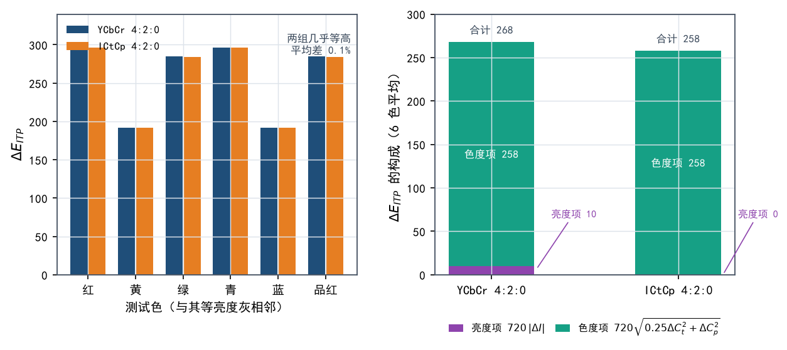
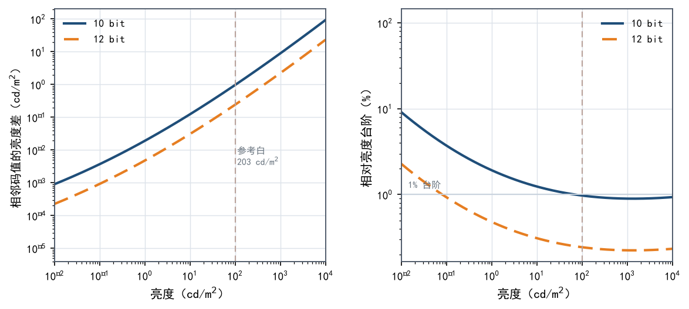
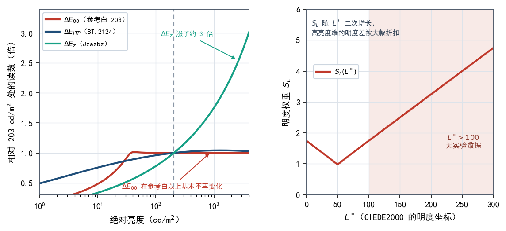
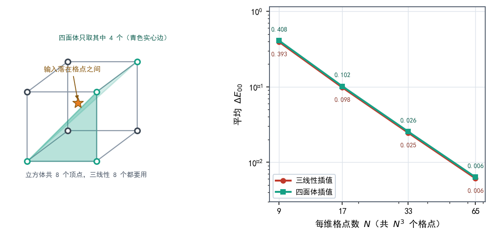
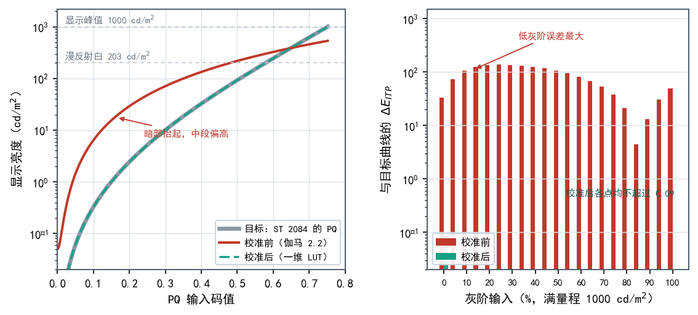
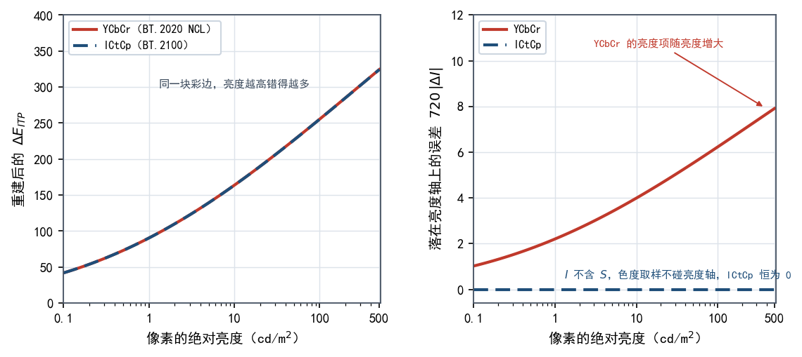

# 第 6 章 HDR/WCG 的色彩编码与测量

色域变宽、亮度范围变大之后，色彩编码要重新回答几个老问题。怎么把三原色分成一个亮度轴和两个色度轴，色度能不能降采样，色差该用什么公式算。SDR 时代的答案写在 BT.601 和 BT.709 里，到了 HDR 就换成了 BT.2100 的 ICtCp 与 BT.2124 的 ΔE_ITP。编码解决的是"怎么把光变成码"，测量解决的是"怎么确认码变成了想要的光"，中间还夹着 3D LUT 与 ICC 这一层变换。三件事的误差会叠加，所以最后一节把它们放进同一张误差预算表里看。

## 6.1 从 YCbCr 到 ICtCp

把 RGB 拆成一个亮度加两个色度，理由是人眼对色度的空间分辨力远低于亮度。这个不对称有生理基础，视网膜上的视锥细胞总数比视杆少一个量级，且色度通路的时间与空间带宽都更窄。工程上它意味着一件事，色度可以用更少的样本、更粗的量化，代价是画面里 1 像素宽的彩色细节会丢失。YCbCr 用了几十年，结构简单，先对 $R'G'B'$ 做加权和得到 $Y'$，再取两个差分量。

$$Y'=0.2627R'+0.6780G'+0.0593B'$$

$$C_b=\frac{B'-Y'}{1.8814},\qquad C_r=\frac{R'-Y'}{1.4746}$$

式中的系数是 BT.2020 的值，BT.709 用的是 0.2126、0.7152、0.0722。三者的来历是同一个，把线性 RGB 转 XYZ 的矩阵第二行取出来，也就是三个原色在 D65 白点下的亮度权重。BT.2020 的原色更饱和，绿原色挪到了 0.170/0.797（CIE 1931 色度坐标），绿更靠近光谱轨迹，同样一份绿能贡献的亮度反而少了，权重从 0.7152 降到 0.6780；红原色挪到 0.708/0.292，权重从 0.2126 升到 0.2627；蓝从 0.0722 降到 0.0593。三个数加起来是 1，全白时 $Y'$ 等于 1，这个归一化条件在任何一套原色下都必须成立。

两个差分量的分母也不是随手取的。要让 $C_b$、$C_r$ 落在 $[-0.5,0.5]$，需要把 $(B'-Y')$ 的最大可能值除到 0.5。$B'$ 最大为 1 时 $Y'$ 至少贡献 $k_B=0.0593$，于是 $B'-Y'$ 的极值是 $1-k_B=0.9407$，除以 $2(1-k_B)=1.8814$ 正好归一。同理 $R'-Y'$ 的极值是 $1-k_R=0.7373$，分母 $2(1-k_R)=1.4746$。这条推导在换色域时必须跟着换，写成常数的实现一旦遇到新原色就会溢出。

### 6.1.1 非恒定亮度的问题

上面这套定义叫非恒定亮度（non-constant luminance，NCL），名字点出了要害。$Y'$ 是三个**非线性**分量的加权和，与真实亮度不成正比。写开来对比一下，真实亮度是线性光的加权和

$$Y=0.2627E_R+0.6780E_G+0.0593E_B$$

而 $Y'=0.2627\,\mathrm{OETF}(E_R)+0.6780\,\mathrm{OETF}(E_G)+0.0593\,\mathrm{OETF}(E_B)$。OETF 是一条凹函数（PQ 在整个范围上都满足二阶导为负），由 Jensen 不等式，加权和落在函数值之下

$$\sum_i k_i\,\mathrm{OETF}(E_i)\;\le\;\mathrm{OETF}\Big(\sum_i k_iE_i\Big)$$

所以彩色像素的 $Y'$ 总是小于同亮度灰的 $Y'$，饱和度越高差得越多。把 $Y'$ 单独拿去解码，得到的是"如果这是一块灰，它该有多亮"，这个值可以比真实亮度低一到三个数量级。表 6-1 是 BT.2020 六个满幅色在峰值 1000 cd/m² 下的数字，全部由 PQ 与 BT.2020 的系数算出。

| 满幅色 | 真实亮度（cd/m²） | $Y'$ | 把 $Y'$ 当灰解码（cd/m²） |
|---|---|---|---|
| 红 | 262.7 | 0.1975 | 2.33 |
| 黄 | 940.7 | 0.7072 | 663.8 |
| 绿 | 678.0 | 0.5097 | 101.7 |
| 青 | 737.3 | 0.5543 | 157.5 |
| 蓝 | 59.3 | 0.0446 | 0.05 |
| 品红 | 322.0 | 0.2421 | 4.61 |

蓝原色最极端，真实亮度 59.3 cd/m²，$Y'$ 却只有 0.0446，按灰解码不到 0.05 cd/m²，差三个数量级。红和品红也在十倍以上。黄因为亮度权重集中在绿通道，反而只差 1.4 倍。

这张表容易被误读成"YCbCr 有 bug"。不是。NCL 是可逆的，$Y'$ 加上 $C_b$、$C_r$ 能无损还原 $R'G'B'$（忽略量化），显示端从来不把 $Y'$ 当亮度用。问题出在三条支路上。

第一条，任何把 $Y'$ 当亮度代理的环节都会错。自动曝光、峰值检测、色调映射的输入统计、HDR 到 SDR 的映射曲线，这些算法如果直接读 $Y'$，遇到大面积饱和色就会把画面判暗。BT.2390 的映射曲线因此明确作用在亮度上而不是 luma 上，实现时要先解码再统计。

第二条，色度通道的误差会渗到亮度上。子采样、量化、色度降噪都只动 $C_b$、$C_r$，解码时三通道一起反算，$Y'$ 虽然逐像素保留，重建出来的 $R'G'B'$ 却已经偏了，线性化之后真实亮度跟着偏。6.2 节会用数字量出这部分渗漏有多大。

第三条，跨饱和度比较亮度不成立。两块 $Y'$ 相同的像素，一块是灰一块是高饱和红，实际亮度可以差几十倍。色彩分级时用 $Y'$ 做示波器观察，看到的波形和光度计的读数对不上，原因就在这里。

### 6.1.2 恒定亮度与它的代价

修法很直接，先在**线性**域算亮度，再编码一次。这叫恒定亮度（constant luminance，CL）

$$Y_c=\mathrm{PQ}\Big(\sum_i k_iE_i\Big)$$

这样 $Y_c$ 严格对应绝对亮度，色度怎么折腾都不会改变它。代价有三个。编码端要先把 $R'G'B'$ 线性化，解出 $E_R E_G E_B$，再算加权和，再走一遍 PQ，每像素多做两次查表；解码端反过来，从 $Y_c$ 和色度解出三通道的线性值要解一个三元方程组，硬件流水线长了一截。第二个代价是色度轴变得不均匀，$C_b$、$C_r$ 的定义是围绕某个参考白点做的差分，在 CL 下这个差分不再有简单的闭式解，量化效率下降。第三个代价是兼容性，CL 的信号送进按 NCL 设计的解码器会得到完全错误的画面，广播链路上没人敢这么干。

CL 在学术上一直被讨论，BT.2020 也给了它的定义，但没有进入主流产品。原因不在理论，在成本与生态。ICtCp 走的是另一条路，不追求亮度轴严格等于亮度，而是追求"色度的扰动不要碰到亮度轴"。

### 6.1.3 ICtCp 的定义

BT.2100 给出的方案是 ICtCp。它把 PQ 编码后的信号送到 LMS 锥空间，再用两组加权差得到色度轴。

$$\begin{bmatrix}L\\M\\S\end{bmatrix}=\frac{1}{4096}\begin{bmatrix}1688&2146&262\\683&2951&462\\99&309&3688\end{bmatrix}\begin{bmatrix}R'\\G'\\B'\end{bmatrix}$$

$$I=\tfrac{1}{2}L+\tfrac{1}{2}M,\qquad C_t=\frac{6610L-13613M+7003S}{4096},\qquad C_p=\frac{17933L-17390M-543S}{4096}$$

矩阵 $M_1$ 的每行加起来是 4096（也就是 1.0），所以 $R'=G'=B'$ 时 $L=M=S$，白点不产生色度。$C_t$、$C_p$ 两行的系数和为零（$6610-13613+7003=0$，$17933-17390-543=0$），这是同一个条件在色度轴上的体现，灰轴上的三个分量必须抵消干净，否则整条灰阶都会带色。分母 4096 是 $2^{12}$，系数是 12 bit 定点整数，这样硬件可以用移位加法实现，不必上乘法器。这套整数是拟合结果的定点化，不是凑出来的整数。

把系数拆开能看清两条轴在做什么。$C_t$ 可以重写成

$$C_t=\frac{6610(L-M)+7003(S-M)}{4096}\approx1.61(L-M)+1.71(S-M)$$

它同时含 $L-M$ 和 $S-M$，$S$ 的权重与 $L-M$ 相当，所以 $C_t$ 主要沿蓝黄方向，对应三型色觉（tritan）轴。$C_p$ 拆成

$$C_p=\frac{17933(L-S)-17390(M-S)}{4096}\approx4.38(L-S)-4.25(M-S)$$

两项几乎抵消掉 $S$，剩下 $4.25(L-M)$ 加一点 $0.13(L-S)$，是一条接近纯 $L-M$ 的红绿轴，对应二型与一型色觉（deutan、protan）。$S$ 的系数在 $C_p$ 里只有 $-0.13$，等于把短波锥从红绿轴里赶了出去。这也是为什么 $C_p$ 轴上同样的数值差比 $C_t$ 轴更"贵"，BT.2124 的权重 $0.25$ 正是对这个不对称的补偿。

结构上还有一处细节值得停下来看。$I$ 只用 $L$ 与 $M$，$S$ 完全不进入亮度轴，只出现在 $C_t$、$C_p$ 里。$S$ 对应短波锥细胞，是三者中对亮度贡献最小的，在锥体亮度权重里通常只占百分之一二，把它从亮度轴里摘出去，色度变化就不会再污染亮度。同时 $I$ 对 $L$、$M$ 取等权，而不是按锥体密度加权。这样做的结果是灰轴上 $I$ 恰好等于 PQ 码值，与真实亮度之间只差 PQ 那条单调曲线，不会因为色温变化而在中性色上漂移；代价是 $I$ 只在灰轴上与编码亮度一致，离开灰轴就带一点系统偏差，这也正是它能容忍色度扰动的另一面。

三个轴的取值范围可以算出来。$R'G'B'$ 取遍整个 PQ 码值立方体时，也就是码值从 0 到 1、绝对亮度从 0 到 10000 cd/m²，$I$ 落在 $[0,1]$，$|C_t|$ 最大到 1.42（绿与品红），$|C_p|$ 最大到 1.09（红与青）。BT.2100 在量化前按各自的区间做映射，色度的区间要覆盖这个 $\pm1.4$，比 YCbCr 的 $\pm0.5$ 宽，所以同样 10 bit 下色度的量化步长更粗，这是 ICtCp 的一个隐性代价，到 6.2 节算量化台阶时还要回到这一点。

图的左端是线性光，右端是待量化的三轴信号，中间四步各有分工。第一步把线性 RGB 按峰值归一化后送进 PQ，得到 $R'G'B'$，这一步定下了绝对亮度的锚点，后面的所有运算都在这个锚点上做。第二步是 $M_1$ 矩阵，把 $R'G'B'$ 换成 $LMS$，注意它作用在**编码后**的值上，不是线性光，所以这一步不是物理上的锥体响应，而是一个在感知域里做的坐标旋转，好处是旋转不放大暗部的量化误差。第三步是三轴组合，$I$ 取 $L$、$M$ 的等权和，两条色度轴取加权差，图中标注了"$S$ 只进入 $C_t$、$C_p$"，这是整个设计的支点。第四步是量化与子采样，$I$ 保持全分辨率，$C_t$、$C_p$ 可以降到 4:2:0，降到什么程度由码率预算决定。图下方标出解码路径，反解 $LMS$ 要乘 $M_1^{-1}$，再经 PQ EOTF 回到线性光，这条路径上矩阵求逆的数值稳定性由 $M_1$ 的条件数保证，$M_1$ 的条件数不大，单精度浮点足够。

为什么先 PQ 再矩阵，而不是先矩阵再 PQ？两条路都有人用，差别在精度分配。PQ 是绝对亮度编码，码值直接对应 cd/m²，先编码的好处是后续矩阵运算在感知均匀的域里进行，量化误差在暗部不会被放大；代价是矩阵不再作用于线性光，颜色混合的物理意义变淡，两步运算不再可交换，先 PQ 后矩阵与先矩阵后 PQ 的结果在中高饱和处能差出几个 $\Delta E$。ICtCp 选了前者，因为它主要服务于传输与压缩，不是渲染。需要精确的物理混合时（比如加色混合、光学合成），还是要在编码前的线性光里做。

编码侧还有一个约定。BT.2100 给出 10 bit 与 12 bit 两种精度，10 bit 时色度可以再降到 4:2:0，12 bit 则建议保持 4:4:4。这个建议的分界不是随意划的，10 bit 的色度在 4:2:0 下每个样本要承担 4 个像素的色度，量化噪声被摊薄的机会少，12 bit 多出的两位正好补上这个缺口。BT.2390 在讨论 12 bit 制作链路时也倾向 4:4:4，理由相同。

| 特性 | YCbCr（NCL） | 恒定亮度 YCbCr | ICtCp |
|---|---|---|---|
| 亮度轴语义 | 非线性加权和，与亮度非线性相关 | 严格等于绝对亮度 | 近似编码亮度，灰轴精确 |
| 色度轴 | $B'-Y'$、$R'-Y'$ | 需解方程组，无闭式 | 锥体对立色，$C_t$ 蓝黄、$C_p$ 红绿 |
| 色度误差是否渗入亮度 | 会 | 不会 | 不会 |
| 实现成本 | 最低 | 高 | 中 |
| 生态支持 | 全部 HDR10 内容 | 几乎无产品 | 部分编码与传输链路 |

表 6-2 把三类编码并排放在一起。三者的差别在纸面上看是精度问题，在工程上是取舍问题。绝大多数 HDR10 内容至今用 NCL 的 YCbCr，因为它有现成的硬件和几十年的工具链；ICtCp 出现在对色度精度要求更高、或者需要 12 bit 的场合。这张表不是排名，是选型依据。

## 6.2 色度子采样

色度子采样的规则写在采样格式里。4:4:4 每个像素都有独立的色度样本，4:2:2 每两个水平相邻像素共用一个，4:2:0 每 $2\times2$ 共用一个。以 4:2:0 为例，亮度样本数与像素数相同，两个色度平面的样本数各是四分之一，总样本数从 3 降到 1.5，未压缩码率减半。HDR 视频里 4:2:0 很常见，消费级编码几乎默认用它。

### 6.2.1 误差是怎么产生的

子采样的操作是先低通再抽取。把 $2\times2$ 单元里的四个色度值取平均，等于用一个盒式滤波器做了低通，再留下一个样本。盒式滤波器的频响是 sinc 形状，通带内不平坦，阻带衰减也不够，所以它压不住所有的高频，同时把通带内的细节也削平了。真正规范的实现会用更长的滤波器，但道理一样，低通决定了什么能留下来。

误差因此取决于内容的空间频率。平坦区域相邻像素的色度几乎一样，取平均没有损失，这也是大面积天空、墙面在 4:2:0 下看不出问题的原因。色块边界上一个像素之差就是两种颜色，取平均得到的是一块谁也不是的中间色，重建后边界两侧都偏了，偏差的量级等于两种颜色色度差的一半。频率再高一些，比如 1 像素宽的彩色细线，平均之后色度被稀释到接近背景，细线直接消失或者变成灰线。

HDR 让这件事变严重，原因在亮度。SDR 的峰值 100 cd/m²，一块饱和色与相邻灰的绝对亮度差有限；HDR 峰值 1000 cd/m² 以上，同一块彩边的亮度对比可以是十倍，色度错位在视觉上的显著性随亮度一起上升。这不是编码的问题，是观看条件变了。

用一组测试色走一遍能看清量级。取 BT.2020 的六个满饱和色（红、黄、绿、青、蓝、品红），各自与等亮度灰相邻构成 $2\times2$ 单元，色度取平均、亮度逐像素保留，重建后算 $\Delta E_{ITP}$。

左图的六组柱子几乎等高，说明子采样的损失主要由内容决定，与编码选择关系不大。红、青两色最高，接近 297，黄和蓝最低，约 192，差别来自色度差在 $C_t$、$C_p$ 平面上的方向，红青沿 $C_p$ 轴走，黄蓝的偏移更多落在权重只有 0.25 的 $C_t$ 轴上。六个色平均，YCbCr 是 257.9，ICtCp 是 257.7，逐色比较的平均偏差 0.1%，两组柱子在图上看不出区别。这个结果初看有点意外，因为 ICtCp 常被宣传成更适合 HDR 的色度编码，但子采样这一步的损失确实与它无关，样本数才是决定因素。

真正的差别在左图看不出来的地方，也就是右图的分解。ICtCp 的亮度项是 0，色度项承担全部 258，两项相加还是 258；YCbCr 的亮度项是 10.1，色度项 257.7，相加得 268，比 ICtCp 多出来的那 10 就是渗到亮度上的部分。亮度项为零不是巧合。ICtCp 的子采样只改 $C_t$、$C_p$，$I$ 逐像素原样保留，解码端拿到的亮度轴与编码端完全一致。YCbCr 的 $Y'$ 同样逐像素保留，但它是非线性分量的加权和，色度误差经反变换后改变了 $R'G'B'$，重建的实际亮度随之偏离，这部分偏差在 ΔE 里就体现为那 10 个单位。

10 个单位听起来不多，占总量不到 4%，但这个数字随亮度增长。6.6 节的图 6-7 把同一块彩边放在 0.1 到 500 cd/m² 的范围里扫了一遍，YCbCr 的亮度项从约 1 涨到 7.9，ICtCp 一直是零。误差预算里这一项要按内容的峰值亮度取值，不能用一个固定数。

### 6.2.2 位深与量化台阶

子采样只解决样本数，每个样本还要量化。10 bit 的 $C_b$ 有 1024 级，摊到 $\pm0.5$ 的范围上，步长约 0.001；ICtCp 的 $C_t$ 要覆盖 $\pm1.4$，同样的 10 bit 步长变成 0.0027，粗了 2.8 倍。这意味着在平坦区域，ICtCp 的色度量化噪声比 YCbCr 大，只在子采样这一步占优，跨到量化这一步又吃回去一部分。两边的总账要看内容，大面积渐变的画面更在意量化，细密纹理的画面更在意子采样。

量化台阶在亮度轴上的表现更值得算清楚，因为它是所有色差判断的地板。图 6-3 把 10 bit 与 12 bit PQ 相邻码值解码后的亮度差画了出来。

左图的纵轴是绝对差，从 0.01 cd/m² 处不到 0.001 cd/m² 升到 4000 cd/m² 处的 36 cd/m²，靠近 10000 cd/m² 时相邻码值之差已经到 90 cd/m² 以上，10 bit 与 12 bit 两条曲线平行，后者是前者的四分之一。绝对差随亮度单调上升是 PQ 的设计意图，码值等距意味着感知等距，而感知等距在绝对亮度上必然表现为指数间隔。右图换成相对差就露出形状了，两条曲线都是先陡降再缓慢回升，10 bit 在 1000 cd/m² 附近最细，约 0.9%，往暗部一路变粗，0.01 cd/m² 处一个码值就是 9.3% 的跳变，到 10000 cd/m² 又回到 0.9%。谷底的位置由 PQ 的两个指数决定，$m_1=0.1593$、$m_2=78.84$，落在 1000 cd/m² 附近，比参考白 203 cd/m² 高五倍左右。这条曲线的形状解释了为什么 HDR 的位深讨论几乎只关心暗部，亮部的相对台阶一直在一度以内，暗部却可以粗到 9%。

换成 $\Delta E_{ITP}$ 单位更直观。中性灰每级码值对应 0.704 个 $\Delta E_{ITP}$（10 bit）和 0.176 个（12 bit），这个数在整个范围上恒定，因为 $\Delta I$ 对码值是线性的。0.7 与人眼在中等亮度下的可察觉阈值（约 1 个单位）已经接近，意味着 10 bit PQ 在暗部的余量不到一级半，暗部渐变出现色带是位深不够而非算法问题。测一块 10 bit 面板的 HDR 性能，如果报告上写 $\Delta E_{ITP}$ 平均 0.6，先要问这 0.6 里有多少是编码底噪。

编码器还有一个旋钮，色度 QP 偏移。HEVC 允许色度分量的量化参数相对亮度做偏移，常见的取值是让色度 QP 比亮度高几档，因为人眼对色度噪声不敏感。HDR 内容上这个偏移要收窄，原因是暗部的色度噪声在 PQ 曲线下被放大，深色背景上一点点色度偏差就能看出色块。BT.2100 之后的实践倾向于把亮度与色度的 QP 拉平，宁可多花码率。

还有一处细节要注意，图 6-3 的两条曲线在接近 10000 cd/m² 时都往下弯，这是 PQ 码值在顶端饱和造成的，最后一个码值覆盖的亮度区间被压缩。这段的量化看起来变细，实际是码值在顶端趋于平坦，标称峰值附近精度反而好于 4000 cd/m²。测量峰值亮度时如果落在最后几级，读数会不稳定。

### 6.2.3 什么内容不能降采样

三类内容在 4:2:0 下必然出问题。

彩色文字与图形界面。计算机图形、字幕、UI 叠加层都是硬边，1 像素的笔画在 4:2:0 下被平均掉一半色度，白底红字会变成粉字加灰边。HDR 影视内容里的字幕也属于这一类，制作时通常单独用 4:4:4 的图形层，在显示端叠加。

高饱和的小光源。夜景里的霓虹灯、车灯、LED 点阵，像素尺寸接近 1 到 2 个像素，色度被稀释后颜色变淡、边界发灰。这类内容的色度能量集中在高频，正好是子采样最不擅长的区间。

饱和色之间的小角度渐变。天空从橙到紫的过渡、肤色上的高光边缘，本身是低频，但两种颜色在色度平面上距离很远，取平均后在中间插入的颜色可能落到色域外，重建时被裁剪，形成一条看得见的硬边。

规避手段有三条。提高色度分辨率到 4:2:2，水平方向两个像素共用一个色度样本、垂直方向每个像素都保留，码率增加三分之一；提高位深到 12 bit 并保持 4:4:4，适合母版与归档；用感知优化的色度下采样滤波器，把色度误差按视觉敏感度加权，代价是计算量与实现复杂度。三条可以叠加，实际选择看链路哪一段有带宽余量。

## 6.3 HDR 下的色差

色差公式要回答一个问题，两个颜色差多少才算"看得出"。这个问题在 SDR 下有一批相当扎实的实验数据，到了 HDR 就变得模糊，因为实验条件整个换掉了。

CIEDE2000（CIE 142:2001）是现阶段最常用的公式，它的实验基础是反射样品、D65 照明、约 1000 lx 的观察条件、$L^*$ 在 0 到 100 之间的色对。公式里的 $S_L$、$S_C$、$S_H$ 三个权重函数都是按这批数据拟合的

$$S_L=1+\frac{0.015\,(L^*-50)^2}{\sqrt{20+(L^*-50)^2}}$$

$$S_C=1+0.045\bar C',\qquad S_H=1+0.015\bar C'\,T$$

$S_L$ 的形状值得单独看，它在 $L^*=50$ 处取最小值 1，往两端二次增长。这意味着同样的明度差，在很暗和很亮的地方被认为更小，公式会自动把它们折算掉。

### 6.3.1 三个前提同时失效

HDR 把三个前提同时打破。自发光像素的亮度可以到 1000 cd/m² 以上，按 CIE 1976 的 $L^*$ 定义、把 BT.2408 的漫反射白 203 cd/m² 当参考白，1000 cd/m² 对应 $L^*=181$，4000 cd/m² 对应 297，都远在拟合数据之外。观察环境的亮度从影院的 5 cd/m² 到客厅的 200 cd/m² 不等，$L^*$ 的参考白到底取多少没有共识。色域从 sRGB 扩到 BT.2020，绿和红的色度远离 D65 白点，$S_H$ 里的色相角依赖项也没在那些角度上验证过。

后果不是"稍微不准"，而是系统性的折扣。取一对中性灰，亮度相差 5%，在 203、1000、4000 cd/m² 三个位置算 $\Delta E_{00}$，得到 1.080、1.081、1.082，几乎不变。这说明 CIEDE2000 把"相对亮度差 5%"当成了一个恒定的感知量，与绝对亮度无关。这个假设在 $L^*\le100$ 的范围内是实验支持的，推到 4000 cd/m² 就没有依据了。人眼在高亮度下的韦伯分数会下降，同样的相对差应该更明显，公式给出的却是恒定值。

左图三条曲线在 203 cd/m² 处交汇，这是归一化的结果，三条都取该点的读数作 1。往高亮度走，$\Delta E_{00}$ 很快压到 1.0 附近并保持水平，标注写的是"在参考白以上基本不再变化"，这就是 $S_L$ 二次增长的直接后果。$\Delta E_{ITP}$ 从 0.49 缓慢升到 1 以上，在 1000 cd/m² 附近到峰值 1.04 倍然后微微回落，形状接近对数，因为它作用在 PQ 域，PQ 本身就是对数压缩，5% 的相对差在码值上等距，$\Delta I$ 几乎恒定，读数自然平缓。$\Delta E_z$ 涨得最快，到 4000 cd/m² 时是 203 处的 3 倍，因为 Jzazbz 的内核压缩在高亮度段没有那么强。三条曲线给出三个答案，说明"5% 的相对亮度差有多明显"在 HDR 下还没有定论，这也是 BT.2124 只规定公式、不规定阈值的原因。

右图把 $S_L$ 单独画出来，阴影区是 $L^*>100$ 的部分，标注"无实验数据"。$S_L$ 在 $L^*=300$ 处已经到 4.75，也就是明度差被折算到不足四分之一。这个外推没有数据支撑，用它去评判 HDR 的亮部误差，等于用一个为纸张设计的权重去衡量发光体。

### 6.3.2 BT.2124 的色差公式

BT.2124 给出的替代方案是 $\Delta E_{ITP}$，直接在 ICtCp 上算欧氏距离，并对三个轴加权。

$$\Delta E_{ITP}=720\sqrt{\Delta I^2+0.25\,\Delta C_t^2+\Delta C_p^2}$$

三个系数的来历不同。720 是归一化因子，使数值量级与 CIEDE2000 接近，方便沿用旧经验。它的取法可以反推，让 1 个单位落在 $1/720\approx1.4\times10^{-3}$ 的 $\Delta I$ 上，这个量级正好是中等亮度、中等饱和度处一个刚可察觉的明度差，于是"1 个单位约等于一个刚可察觉差"这条经验可以在两个公式之间平移。0.25 是 $C_t$ 轴的权重，蓝黄方向（$C_t$）的视觉敏感度低于红绿方向（$C_p$），同样的数值差在 $C_t$ 上贡献更小。这个 0.25 与 6.1 节算出的取值范围正好呼应，$C_t$ 的满幅值 1.42 比 $C_p$ 的 1.09 大三分之一，不加权的话蓝黄方向会明显压过红绿方向；乘上 0.25 之后满幅贡献变成 $0.5\times1.42=0.71$ 对 $1.09$，两条轴落回同一个量级，剩下的差距由视觉敏感度的实际差别吸收。$C_p$ 的权重是 1，不再调整。

$\Delta E_{ITP}$ 的定义域跟着 PQ 走，从 0.0001 cd/m² 到 10000 cd/m² 全覆盖，不需要另设参考白。这一点很关键，它把色差从"相对于某个白点"变成了绝对量，两块不同亮度的色块比较时不必先约定参考条件。代价是它继承了 PQ 的所有假设，PQ 在 0.0001 cd/m² 以下的延伸是外推，在 10000 cd/m² 以上没有定义，超出范围要先裁剪。

BT.2124 还规定了计算流程的几个细节。两个颜色都要先转到 ICtCp，$I$、$C_t$、$C_p$ 都按 BT.2100 的定义算，不做任何白点适配；如果两个颜色来自不同的峰值亮度，要统一到同一个 PQ 绝对刻度上再比较，不能各自归一化。这一条听起来琐碎，实际操作里经常出错，尤其是比较两个不同峰值显示器的测量结果时。

### 6.3.3 Jzazbz 与 HDR-CIELAB

除了 BT.2124，还有两条路线。

Jzazbz（Safdar 等，2017）用一套 PQ 型的压缩函数处理 XYZ，再转成 $J_z a_z b_z$ 三条轴，色差 $\Delta E_z$ 是同样形式的欧氏距离。它的设计与 ICtCp 平行，都在感知域里做压缩，区别在于 Jzazbz 作用在 XYZ 上，$J_z$ 是真正的明度而不是锥体响应的组合。它的优点是理论自洽，压缩函数的选择有明确的均匀性目标；缺点是在极暗处数值过小，1 cd/m² 附近的 5% 亮度差只给出 0.0005 的读数，与 203 cd/m² 处的 0.0043 差八倍左右，跨亮度段比较时不好用。图 6-4 左图里 $\Delta E_z$ 在高亮度端涨得最快，同一套权重在暗部就会显得过于迟钝。

HDR-CIELAB（Fairchild，2016）走的是另一条路，保留 CIELAB 的结构，换掉明度函数与色度压缩，把绝对亮度直接写进公式。它的定位是研究工具，用来解释为什么 CIELAB 在高亮度下失效，以及新的明度函数应该长什么样。工程上很少直接用，因为它的参数多、实现复杂，且缺乏跨实验室的验证。

实际选择可以按用途分。显示器的出厂校准、内容交换的合规检查用 $\Delta E_{ITP}$，因为它是标准、可复现、与 ICtCp 链路天然衔接。印刷与 SDR 参考监视器继续用 CIEDE2000，那套数据在它的适用范围内依然可靠。跨媒体的主观比较，比如同一内容在影院银幕与家用电视上的差异，用 CAM16-UCS 上的 $\Delta E_E$，它带着完整的观察条件，能把 $L_A$、$Y_b$、环绕都算进去，代价是这些参数一旦与实际不符，结果会系统性偏移。

### 6.3.4 阈值与底噪

把三个公式放在一起，还有一个实践上的问题，多大的 $\Delta E$ 才算不合格。

阈值不能凭空定，要先扣掉量化底噪。6.2 节算过，10 bit PQ 的中性灰每级码值是 0.704 个 $\Delta E_{ITP}$，12 bit 是 0.176 个。一块 10 bit 的显示链路，即便所有器件都理想，重测同一灰阶时也会因为量化落点不同而波动零点几个单位。要求平均值小于 1 的规范，在 10 bit 素材上加工程误差之后几乎不可能达成，除非测量取多个码值的平均。

母版监看的常见门槛是平均值小于 1、最大值小于 2，消费级显示放宽一倍。这套数字来自 SDR 时代的经验，搬到 HDR 上要打个折扣，因为 $\Delta E_{ITP}$ 在暗部的灵敏度比 CIEDE2000 高，同样的物理误差在暗部读出的数值更大。实际做法是在报告里按亮度分段统计，暗部、中灰、亮部各给一组数，而不是给一个总数，这样既能看出问题落在哪一段，也避免用亮部的好成绩掩盖暗部的偏差。

## 6.4 3D LUT 与 ICC

显示器的色彩变换很少是线性的。面板的光谱响应、背光的色温、逐通道伽马曲线的形状都带非线性，一端还可能有饱和，液晶的偏振漏光让黑位不干净，OLED 的亮度随电流密度非线性变化。用矩阵加一维查找表处理不了这些，矩阵只能描述线性混合，一维表只能独立处理每个通道，两者都表达不了通道之间的串扰。工业界普遍用三维查找表（3D LUT）。

### 6.4.1 结构、规模与插值

3D LUT 的结构是 $N^3$ 个格点，每个格点存一组输出值。$N$ 常取 17、33、65。存储量按 $N^3\times3\times$ 每分量字节数算，17 格单字节约 14 KB，33 格双字节约 210 KB，65 格双字节约 1.6 MB。33 格 210 KB 这个量级刚好能塞进显示器的固件和查找逻辑，也能用一片小容量片上 RAM 放下，所以它成了事实上的标准。

输入落在格点之间时要插值。三线性插值用立方体的 8 个顶点，按三个方向的小数部分做加权，实现简单，但它的等值面是双曲抛物面，在格点稀疏时会沿对角线出现色偏，灰阶上表现为轻微的色相偏移。四面体插值把立方体按对角线切成六个四面体，只用 4 个顶点，计算量小，且在灰色轴附近不产生色偏，是显示器的默认选择。

精度有两个来源，格点密度与每格点的位深。格点越密，插值误差越小，但存储与查找成本上升，片上的缓存也可能放不下；位深不足时，输出的量化台阶会在暗部显现，一格之内插出来的值被截到 8 bit，等于把前面用 10 bit 换来的暗部余量又丢掉了。HDR 校准里常见的配置是 33 格加 16 bit 输出，暗部再配一张一维 LUT 做精细调整，一维表能把暗部的码值重新分配，避免在低亮度处浪费格点分辨率。

格点里的值怎么来，取决于校准工具。常见做法是先测一批色块，几百到上千个，用样条或径向基函数拟合出一张平滑的三维映射，再采样到格点上。直接测 $33^3$ 个点不现实，一张表需要三万多次测量，按每次两秒算要二十小时，而且测量噪声会原样进入格点。拟合时要加平滑约束，否则测量噪声会被固化成 LUT 里的纹波，反映在画面上是沿灰轴的色带，这种纹波在渐变背景上特别明显。

左图画出的是一个 CLUT 单元。灰色细线是立方体的十二条棱，八个顶点里只有四个用青色实心标出，那是被选中的四面体的顶点，橙色星号是输入落点。四面体插值的做法是把立方体按主对角线切成六块，判断输入落在哪一块，再用那块四面体的四个顶点做线性组合。这样做的代价是分段函数在切面上不连续到一阶导，视觉上看不出来，但在极平滑的渐变上做二阶差分能测到微小的折角，好在人眼对这种折角几乎没有感觉。图中下方那句话是关键，三线性要 8 个顶点全部参与，四面体只用 4 个，查找次数减半，这是它在硬件里胜出的直接原因。

右图是同一个非线性器件模型下两种插值的误差。横轴是每维格点数，纵轴是四千个随机输入的平均 $\Delta E_{00}$。9 格时三线性 0.408、四面体 0.393；17 格降到 0.102 与 0.098；33 格是 0.026 与 0.025；65 格是 0.006 与 0.006。两条曲线几乎重合，说明在这个模型上四面体的几何优势很小，它的价值主要是计算量而不是精度。真正决定误差的是格点数，每翻一倍误差降到约四分之一，符合插值误差随格距平方下降的规律。这条规律给了一个实用判断，33 格的插值误差在 0.03 个 $\Delta E_{00}$ 量级，远小于测量本身的重复性（通常 0.1 以上），所以再加密格点没有意义，误差已经被测量端主导。

### 6.4.2 ICC 的结构与渲染意图

ICC 色彩管理把 LUT 装进 profile。profile 是一段二进制数据，描述设备的色彩行为，由色彩管理系统（CMM）读取并执行。它解决的问题是跨设备的一致性，同一张图片在相机、显示器、打印机之间流转时，颜色要保持在可接受的范围里。

v2 与 v4 的差别在连接空间和标签结构。v4 以 D50 为连接空间（PCS），用 A2B0、B2A0 这类标签存放多维变换，lutAtoBType（常写作 mAB）的结构是三输入曲线、可选的三乘三矩阵、一个三维 CLUT、三输出曲线依次串联，能表达比 v2 的 lut16Type 复杂得多的映射。mAB 里的矩阵这一步很关键，它承担线性混合，CLUT 只负责剩下的非线性残差，两段分工比单纯堆一张大表省得多。v2 的 PCS 也名义上是 D50，但白点适配的做法不统一，不同 CMM 会算出不同结果，这是 v4 要修的主要问题之一。v4 还规定了感知意图下的色域压缩要满足一定的参考条件，v2 在这块完全自由。

渲染意图有四种。perceptual 做色域压缩，把源色域整体缩到目标色域里，保持颜色之间的关系，适合照片；relative colorimetric 把白点对齐后裁剪超色域的部分，适合有明确色值的图形；absolute colorimetric 保留白点差异，用来模拟打样纸上的偏黄；saturation 优先保饱和度，适合图表和演示。四种意图对应四组不同的 A2B/B2A 标签，profile 里可以各存一套，也可以只存一套让 CMM 退化使用。

显示器 profile 有三种来源。厂商提供的通用 profile 按型号批量生成，只反映面板的典型行为，个体差异和老化都不管，精度最差。仪器测量生成的 profile 针对这一台设备，用分光计或校正过的色度计测一批色块再拟合，是校准的正路。按 CIE 色度坐标手工构造的 profile 只描述原色与白点，假设通道独立且伽马一致，适合快速搭一个能用的环境，精度有限但可复现。

### 6.4.3 HDR 下 ICC 的局限

ICC 在 HDR 上力不从心，原因在 PCS。D50 是印刷业的参考白，绝对亮度没有定义，$Y$ 只到 100，这个 100 是相对值，不是 cd/m²。HDR 的 1000 cd/m²、4000 cd/m² 无处安放，一个 HDR 显示器的 profile 如果硬塞进 v4 的结构，要么把 1000 cd/m² 映射成 $Y=1$ 丢掉与 SDR 的相对关系，要么超出编码范围落到未定义区。

行业因此把 HDR 的变换从 ICC 里拿了出来，交给 ACES 的 CTL、OpenColorIO 的配置或者显示端自带的 LUT。ICC 只负责 SDR 部分，这条分界线在实践中相当清晰，桌面系统的色彩管理管 SDR 窗口，HDR 播放走单独的渲染路径，两者在合成时还要做一次亮度对齐，这一段经常是问题的来源。跨 HDR 与 SDR 的转换靠 BT.2408 的参考环境和 BT.2390 的映射曲线约束，前者定制作端的亮度基准（漫反射白 203 cd/m²，峰值 1000 cd/m²），后者定映射的形状。

iccMAX（ISO 20677）试图补上这个缺口，它支持多光谱数据、任意维度的变换、浮点编码和绝对亮度，理论上能描述 HDR。但生态推进缓慢，硬件厂商支持有限，CMM 的实现也不全。目前的现实是 HDR 的显示校准报告和 LUT 文件自成一套格式，与 ICC 并行存在，两者之间靠人工对照。

## 6.5 分光计与色度计

测颜色有两类仪器，原理不同，用途也不同。这个分工在 SDR 时代就有，到了 HDR 被放大，因为亮度范围宽了三个数量级，任何仪器的非线性区间都变成了问题。

**分光辐射计**（spectroradiometer）测量光谱功率分布，得到 380 至 780 nm 上每个波长的辐亮度。有了光谱，三刺激值就是积分

$$X=k\int L(\lambda)\bar x(\lambda)\,\mathrm{d}\lambda$$

$Y$、$Z$ 用同样的形式，只是把色匹配函数换成 $\bar y(\lambda)$ 与 $\bar z(\lambda)$。换观察者、换光源、算同色异谱都在这条式子上做。它的优点是信息完整，能算任意色度坐标、能判断两个光谱是否同色异谱、能测窄带光源；缺点是慢，一次测量要几百毫秒到几秒，价格也高一个量级。积分里的 $k$ 是归一化常数，$k=100/\int L(\lambda)\bar y(\lambda)\,\mathrm{d}\lambda$ 使 $Y$ 在参考白下等于 100，做绝对测量时这个归一化要换成辐射度学的口径。

**色度计**（colorimeter）用三个滤光片加光电二极管，直接输出三刺激值。滤光片的透射曲线被设计成逼近 CIE 色匹配函数，$X$、$Y$、$Z$ 三路各一套。它快、便宜、可以做成探头贴在屏幕上连续监测，缺点是滤光片与 CMF 永远有偏差。

### 6.5.1 分光计的误差来源

分光计看着最可靠，实际也有一串误差项。

带宽。光谱仪的分光靠光栅或干涉，输出的是带宽内积分的能量，常见带宽 1 nm 到 5 nm。对连续光谱（白炽灯、荧光粉转换的白光 LED）影响不大，对线状光谱影响极大。激光显示的三个波长是 1 nm 量级的窄线，5 nm 带宽的仪器会把线能量摊到五个纳米上，峰值被削平，算出来的三刺激值偏低，红绿蓝三色的比例一起偏。窄带 OLED 的发射谱半高宽在 10 到 20 nm，5 nm 带宽还有 2% 到 3% 的误差。CIE 179:2007 专门讨论了这个问题，给出了带宽修正的方法。

杂散光。分光计内部的散射和二次衍射会让长波能量漏到短波段，深色屏幕的表现是黑位亮度虚高。HDR 的黑位测量正好落在这个陷阱里，0.001 cd/m² 的 OLED 黑与 0.01 cd/m² 的杂散光底噪一个量级，测出来的对比度直接失真。用好一点的仪器，或者在暗室做多次遮挡测量来估底噪，是常规的规避手段。

低亮度噪声。光电探测器的信噪比随光强下降，暗部的积分时间要拉长，长到几秒时温漂开始起作用。HDR 校准要在 0.01 到 10000 cd/m² 六个数量级上都准，这个要求在仪器选型时就划出了门槛，消费级的色彩色度计在暗部基本不可信。

### 6.5.2 色度计的误差与校正

色度计的误差集中在滤光片失配。理想的滤光片透射曲线要严格等于 CMF，实际镀膜的曲线有起伏，误差在 1% 到 5% 之间。这个误差对连续光谱的显示影响小，对窄带显示的放大倍数很高。

偏差在宽色域显示上被放大得最厉害。OLED 的窄带发射、量子点的窄半高宽、激光显示的线状光谱，都会让滤光片失配的误差从百分之一升到百分之几。原因是滤光片曲线在某个波长上的小偏差，遇到宽光谱时被平均掉，遇到窄线时原样暴露。显示器的原色越饱和，越接近单色，色度计的读数就越不可信。

CIE 179:2007 用 $f_1'$ 指标量化这种失配，定义为校正后仪器与 CIE 1931 观察者在若干典型光谱上的加权偏差。工程上更实用的做法是做一次矩阵校正：用分光计测若干色块的真值，同时用色度计测同样的色块，解一个 $3\times3$（有时 $4\times4$，含黑电平）的变换矩阵，把色度计的读数映射到分光计的口径。

校正矩阵的取法有讲究。色块要覆盖显示器的实际色域，不能只取灰阶，否则矩阵在饱和区外推得离谱。色块数量要多于待定参数，用最小二乘解，$3\times3$ 用 8 个以上色块，$4\times4$ 用 12 个以上。校正只在同一个显示技术上有效，换一台不同原理的显示器要重做，因为光谱形状变了。校正矩阵还应该记录在报告里，别人复现时可以直接用，或者判断是否需要重做。

### 6.5.3 四色与激光显示的特殊问题

三原色的显示，三刺激值到 RGB 的映射是 $3\times3$ 矩阵，可逆。四色显示（RGBW、RGBY、量子点加白子像素）就不行了，同样的三刺激值有无穷多组解，要靠额外的约束选一个。W 子像素的加入本来是为了提亮度，但它的光谱与 RGB 混合出来的白不完全一致，高亮度时会看到色温漂移。测量这类显示器，色度计的 $3\times3$ 校正不够，要靠分光计逐点测，或者在多个亮度下分别校正。

激光显示把问题推到极端。三个激光波长的半高宽不到 1 nm，色域覆盖接近 BT.2020 的 100%，任何滤光片失配都被放大到极限。更麻烦的是散斑，相干光在屏幕上干涉形成颗粒，探头的测量窗口内光强分布不均，读数随探头位置变化。这类显示器的测量要取多次平均，并把探头略微离焦，把散斑平均掉。

分工因此很清楚。分光计做基准，负责建立显示的色彩模型、标定色度计、验证最终结果；色度计做日常，负责批量测量、长时间监测、产线抽检。只用色度计做 HDR 校准，在 BT.2020 覆盖的高饱和区会留下察觉不到的偏差；只用分光计，测量时间又撑不住几百个色块的验证。合理的配置是一台分光计加一台已校正的色度计，分光计定期回来校验色度计的漂移。

### 6.5.4 测量几何

测量几何带来另一层不确定。屏光亮度随视角下降，OLED 的色度也会随视角漂移，探头贴在屏幕中心得到的数值与观众在座位上看到的并不一致。专业校准区分轴上测量与离轴测量，前者用于生成变换，后者用于评估均匀性。视角特性用亮度随角度的曲线描述，LCD 的对比度在 30 度时可能已经掉一半，OLED 的色偏更明显。

大尺寸屏幕还要按九宫格或二十五宫格测多个位置，报告里的亮度均匀性与色度均匀性就是这些点的统计结果。行业内常见的口径是九点最大偏差，亮度偏差在 10% 以内、色度偏差 $\Delta u'v'$ 在 0.003 以内算合格，专业监视器要求更严。测量时探头要垂直贴合，倾斜会让读数偏低，遮光罩要挡住环境光，暗室照度控制在 5 lx 以下。

## 6.6 校准流程

一条可复现的 HDR 显示校准流程，大致是六步。每一步都有明确的输入输出，任何一步跳过，后面都无法补救。

**预热与就位**。显示器开机至少 30 分钟，让背光和面板温度稳定，OLED 还要跑一次补偿周期。温度对亮度的影响在 3% 到 10% 之间，冷机测出的峰值亮度会偏高，白点也会偏蓝。探头贴在屏幕中心，遮光罩挡住环境光，暗室照度控制在 5 lx 以下。探头与屏幕之间留几厘米，避免接触压强改变液晶的间隙。

**测暗电平与黑位**。输入全黑信号，测实际亮度。LCD 的漏光在 0.05 至 0.5 cd/m²，OLED 可以到 0.001 cd/m² 以下。这一步决定了对比度的上限，也决定了后面暗部色差的基准。测黑位要先确认仪器的底噪，如果仪器本身的暗噪声就在 0.01 cd/m²，测出的 0.02 里有一半是仪器。

**定白点与峰值**。输入全白，调 RGB 增益使色度落到目标白点（HDR 用 D65，容差 $\Delta u'v'$ 0.003 以内），调背光使亮度落到目标峰值。BT.2408 的参考环境要求 1000 cd/m² 峰值、203 cd/m² 漫反射白，家庭环境可以按实际观看条件调整。白点与峰值会互相影响，改了增益亮度会变，通常要迭代两到三轮。

**测灰阶与色域**。从 0 到 100% 取 20 级左右的灰，记录每级的亮度和色度，画出灰度跟踪曲线；再取色域边界与内部的若干色块，记录三刺激值。这两组数据构成校准的输入。

### 6.6.1 EOTF 跟踪

灰阶测量里最要紧的一条曲线是 EOTF 跟踪，也就是实测亮度对输入码值的响应与目标曲线的偏差。图 6-6 用一条合成的显示链路把这件事画清楚了。器件模型取峰值 1000 cd/m²、黑位 0.05 cd/m²、未校准时逐通道伽马 2.2，目标是 ST 2084 的 PQ 曲线截到 1000 cd/m²。

左图的三条线，灰色粗线是目标，红色是未校准的伽马 2.2，青色虚线是一维 LUT 校准后。未校准的红线在暗部远高于目标，码值 0.16 处目标是 1.2 cd/m²，红线给到 17.8，差近 15 倍；中段继续偏高，码值 0.5 处目标 92 cd/m²，红线给到 218。两条曲线在码值 0.65 附近交叉，再往上红线就压在目标下面，码值 0.75 处目标 983 cd/m²，红线只到 531，不到目标的 55%。完整形状是暗部抬起、中段偏高、亮部压缩，交叉点的位置由伽马指数与 PQ 指数的相对斜率决定，不随峰值变化太多。校准后的青线与灰线几乎重合，两条线在图上只能靠颜色分辨。

右图把差值换成色差。21 级灰阶上，校准前最大 137，中位数 82，形状是低灰阶最高、往高处单调下降，因为伽马 2.2 与 PQ 在暗部的斜率差最大。校准后全部压到 0.09 以下，这个残差来自 21 级采样之间的插值与一维 LUT 的量化，已经落在 10 bit 的编码底噪（0.7）之下。这张图说明一件事，一维 LUT 对单通道非线性很有效，只要器件的通道之间不串扰，一维校正就能把 EOTF 拉到目标上。真机做不到这么干净，因为面板的通道串扰、背光的色温漂移、局部调光的亮度波动都会留下残差，这也是三通道 3D LUT 存在的理由。

读这张图还要注意纵轴是对数。左图的暗部一段被拉开，视觉上占了半张图，实际只是 0.01 到 10 cd/m² 这三个数量级，相对于 1000 cd/m² 的峰值只占很小一段。人眼在暗室适应之后对这个区间非常敏感，所以它值得占半张图。右图同样是对数，校准后的柱子矮得几乎看不见，这个"看不见"就是校准成功的样子。

### 6.6.2 生成变换与验证

**生成并加载变换**。SDR 部分通常是一维 LUT 加矩阵，HDR 部分用 33 格 3D LUT，同时处理色域映射与伽马。LUT 生成后要在显示器上加载，再重测一轮，确认变换生效。这一步常出问题，加载的路径不对、LUT 被后面的处理覆盖、色彩管理又叠加了一层，都会让校正失效。验证的办法是测一个已知的中间码值，看输出是否落到预期。

**验证与报告**。重测同一批色块，统计 $\Delta E_{ITP}$ 的平均值、最大值与 95 分位，记录灰阶各点的色温偏差和 $\Delta u'v'$。合格线按用途定，母版监看要求平均值小于 1、最大值小于 2，消费级显示可以放宽一倍。报告里还要写明测量时的峰值亮度、环境照度、探头型号与校正状态，否则数据无法复现。

### 6.6.3 误差预算

把上面各节的误差项放在一起，就是一张误差预算表。图 6-7 给出其中一项的量级，色度子采样在亮度轴上的渗漏。

左图是一条满饱和的 BT.2020 红像素与等亮度灰像素相邻、色度取平均后重建的结果。两个编码的总色差曲线几乎重叠，从 0.1 cd/m² 的 42 涨到 500 cd/m² 的 324，在双对数坐标上是一条接近直线的斜线。这条线说明同一块彩边的误差随亮度单调增长，HDR 的高亮度段比 SDR 的典型工作点差一个数量级。也就是说，4:2:0 在 SDR 里可以接受的损失，在 1000 cd/m² 的 HDR 内容上要重新评估。

右图是同一组数据的分解，只画落在亮度轴上的那部分。红色的 YCbCr 从 1.0 涨到 7.9，蓝虚线是 ICtCp，全程贴着零轴。这个零不是数值小到看不见，是恒等于零，因为 $I$ 不含 $S$，色度取样根本不碰亮度轴，图中标注写的就是这句话。7.9 这个数在总误差 324 里只占 2.4%，看着小，但它落在亮度轴上，意味着同一块彩边的亮度被改了，而人眼对亮度差的敏感度高于色度差，实际可察觉性比 2.4% 这个比例要高。

一张完整的误差预算大致分五层。编码层，10 bit 的量化底噪 0.7，12 bit 是 0.18；子采样层，按内容从几个单位到三百多；变换层，33 格 3D LUT 的插值误差 0.03，一维 LUT 的量化误差取决于位深；仪器层，色度计的重复性 0.1 到 0.3，滤光片失配在校正后残留 0.5 到 1；显示层，面板均匀性、视角、APL 依赖，这一层最大，可以到几个单位。五层按平方和开根号合成，通常仪器层与显示层占大头，编码层只在与位深较劲时才成为瓶颈。做预算的意义不是把数字加到一个总数，而是知道哪一层值得投入。

### 6.6.4 APL 与测量窗口

有一类误差不在上述流程里，APL 依赖。HDR 显示的峰值亮度随画面平均亮度变化，全白窗口能到 1000 cd/m²，满屏白可能只有 400 cd/m²。ABL（自动亮度限制）是主要原因，电源与散热限制了大面积高亮度输出；局部调光的 LCD 还有另一个机制，亮块周围的背光被压低，亮块的实测亮度会随邻域内容变化。

校准时用多大窗口、在哪个 APL 下测，会直接改变结果。行业里常见的口径是 10% 窗口测峰值、全屏白测 sustained 亮度，两个数可以差一倍以上。测量报告必须写明窗口尺寸、位置与 APL，否则数据不可复现。这一项也是 HDR 显示与 SDR 显示在测量上最大的差别，SDR 的峰值亮度基本不随内容变化，HDR 的峰值亮度是一个多变量函数。

读校准报告时，先看这几项。峰值亮度标的是窗口还是全屏，白点是在哪个亮度下测的，灰阶跟踪用的是绝对亮度还是相对百分比，色域覆盖报的是面积比还是体积比。这四项没写清楚，后面的色差数字就没有参照。参数写得越细的报告越长，但只有写全了才可复现，这也是专业校准报告和显示器评测文章的区别。

## 本章要点

- YCbCr 用非恒定亮度的加权和定义 $Y'$，彩色像素的 $Y'$ 远低于同亮度灰，BT.2020 满幅蓝的 $Y'$ 只有 0.0446，按灰解码不到 0.05 cd/m²。
- 恒定亮度把加权和搬到线性域再编码，亮度轴严格，但实现成本高、量化效率低、生态不支持；ICtCp 换一条路，不让色度扰动碰到亮度轴。
- BT.2100 的 $M_1$ 每行和为 4096，$C_t$、$C_p$ 的系数和为零，保证灰轴无色偏；$I=0.5L+0.5M$ 不含 $S$，这是色度误差不渗入亮度的结构原因。
- 4:2:0 的误差由色度分辨率决定，与编码选择关系不大。测试中 YCbCr 与 ICtCp 的 $\Delta E_{ITP}$ 平均 257.9 与 257.7，差别只在亮度项（10.1 与 0），且亮度项随亮度从约 1 涨到 7.9。
- 10 bit PQ 的中性灰每级码值是 0.704 个 $\Delta E_{ITP}$，12 bit 是 0.176；相对台阶在 1000 cd/m² 附近最细（0.9%），0.01 cd/m² 处粗到 9.3%。
- CIEDE2000 的实验基础是反射样品与 $L^*\le100$，HDR 三个前提都不满足，$S_L$ 在 $L^*=300$ 处到 4.75，把亮部的明度差折扣掉四分之三。$\Delta E_{ITP}$（BT.2124）定义在 ICtCp 上，覆盖 0.0001 至 10000 cd/m²，权重 720 与 0.25 分别对应归一化和 $C_t$ 轴的敏感度。
- 3D LUT 用 $N^3$ 格点加四面体插值，33 格 16 bit 约 210 KB，插值误差 0.026 个 $\Delta E_{00}$，已低于测量重复性；ICC v4 的 PCS 固定在 D50、无绝对亮度，HDR 变换多交给 ACES CTL 或 OCIO，iccMAX 尚未普及。
- 分光计测光谱、信息完整但慢，色度计快但滤光片失配，宽色域与激光显示下需用 $3\times3$ 或 $4\times4$ 矩阵校正，四色显示还需额外约束。
- 校准流程为预热、暗电平、白点与峰值、灰阶与色域、生成变换、验证报告；未校准的伽马 2.2 在码值 0.16 处高出目标 15 倍，0.75 处只有目标的 55%，一维 LUT 可把 21 级灰阶的色差从 137 压到 0.09 以下。
- 报告必须写明 APL、窗口尺寸与探头状态，HDR 的峰值亮度是内容依赖的多变量函数，不写清这些数据无法复现。
