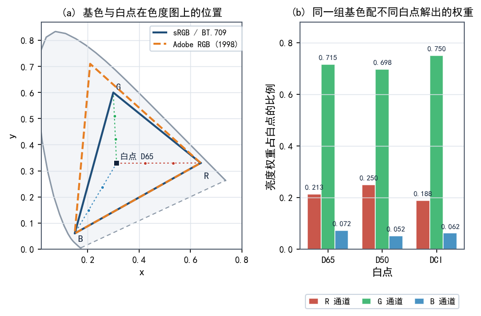
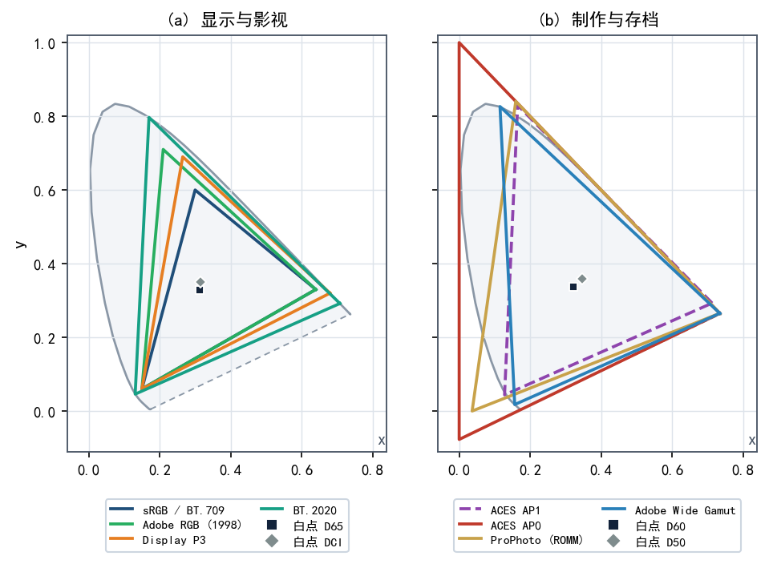
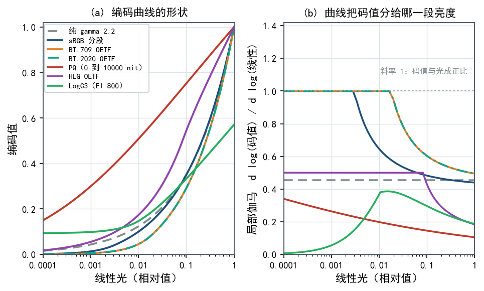
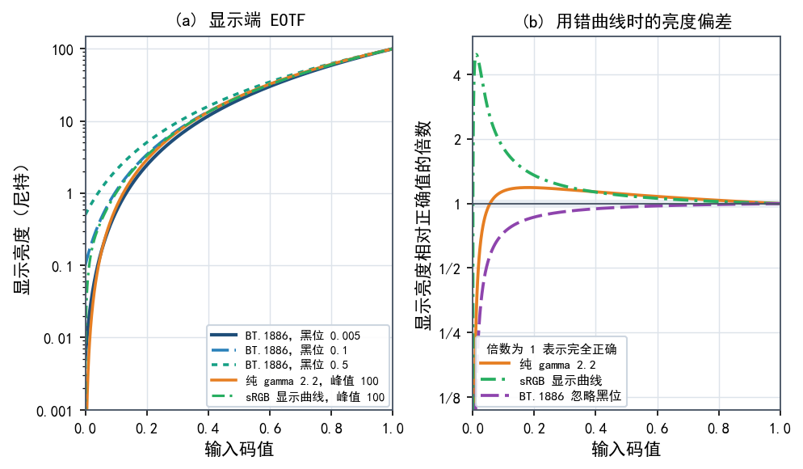
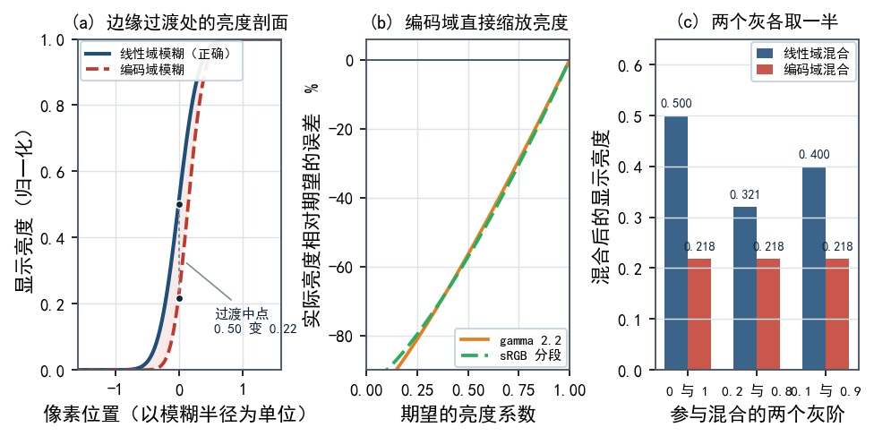
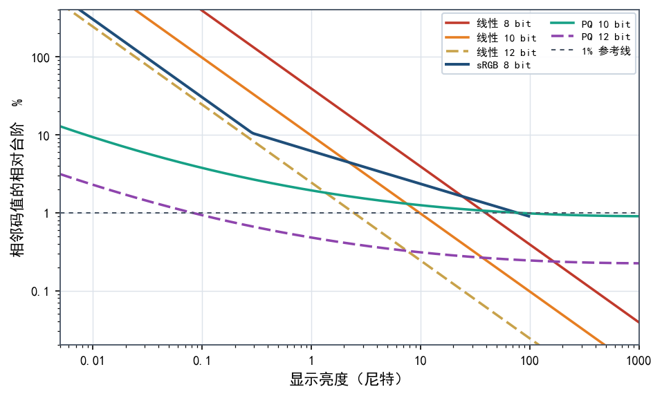

# 第 7 章 RGB 空间的构造：基色、白点与传递函数

一个三元组 $(200, 120, 60)$ 本身不含任何颜色信息。要知道它是什么颜色，必须先知道这套数字的约定：三个基色落在色度图的哪个位置，白色由三个通道按什么比例混合而成，码值与光量之间是什么关系。三件事彼此独立，任意换一件，同一个三元组就变成另一种颜色。工业上把这三件事打包成一个名字，于是 sRGB、Display P3、BT.2020 这些词既是坐标系，也是一份写明了参数的合同。理解了合同的条款，才能判断一份素材在另一台设备上会走样多少。

## 7.1 八个参数定死一个矩阵

从"基色坐标 + 白点"到"RGB 到 XYZ 的矩阵"，中间只有一步线性代数，但这一步把色度学最核心的一个事实讲清楚了：颜色空间之间的转换，在忽略整体亮度尺度之后，是一个射影变换。

先把已知量摆出来。三个基色各有一对色品坐标，共六个数字；白点也有一对，共两个数字。sRGB 的六个数字是红 $(0.640, 0.330)$、绿 $(0.300, 0.600)$、蓝 $(0.150, 0.060)$，白点是 D65 的 $(0.3127, 0.3290)$。

**把色品坐标还原成三刺激值。** 色品坐标只描述方向，不含亮度。由 $x = X/(X+Y+Z)$、$y = Y/(X+Y+Z)$ 可以反解出 $z = 1 - x - y$，并且

$$ (X, Y, Z) = k\left(\frac{x}{y},\ 1,\ \frac{z}{y}\right) $$

比例系数 $k$ 就是该基色单独的亮度。取 $Y = 1$ 是一种记账习惯，把亮度单独拎出来，让后面的式子只处理比例。

| 基色 | $x$ | $y$ | $z$ | $(x/y,\ 1,\ z/y)$ |
|---|---|---|---|---|
| 红 | 0.640 | 0.330 | 0.030 | 1.9394, 1, 0.0909 |
| 绿 | 0.300 | 0.600 | 0.100 | 0.5000, 1, 0.1667 |
| 蓝 | 0.150 | 0.060 | 0.790 | 2.5000, 1, 13.1667 |

**排成矩阵。** 三个列向量按红绿蓝的顺序拼起来，得到

$$
\mathbf{P} =
\begin{bmatrix}
1.9394 & 0.5000 & 2.5000\\
1.0000 & 1.0000 & 1.0000\\
0.0909 & 0.1667 & 13.1667
\end{bmatrix}
$$

$\mathbf{P}$ 的每一列是"该通道开到 1、其他通道为 0 时，屏幕发出的光的色度方向"。它还不是最终的矩阵，因为三个通道的亮度比例还没定。

**写出白点。** D65 的色品坐标换成三刺激值，同样归一化到 $Y = 1$

$$ \mathbf{W} = \left(\frac{0.3127}{0.3290},\ 1,\ \frac{0.3583}{0.3290}\right) = (0.9505,\ 1,\ 1.0891) $$

**解亮度系数。** 白是三个通道都开到最大时的颜色，所以

$$ \mathbf{P}\,\mathbf{S} = \mathbf{W},\qquad \mathbf{S} = (0.2126,\ 0.7152,\ 0.0722)^{\mathsf{T}} $$

$\mathbf{S}$ 的三个数就是三个基色在白点里的亮度份额。它们的和恰好是 1，因为 $\mathbf{W}$ 的 $Y$ 取的是 1，而 $Y$ 分量对三个通道是可加的。最终矩阵是 $\mathbf{M} = \mathbf{P}\operatorname{diag}(\mathbf{S})$，把 $\mathbf{S}$ 按列缩放进去：

$$
\mathbf{M}_{\mathrm{sRGB}} =
\begin{bmatrix}
0.4124 & 0.3576 & 0.1805\\
0.2126 & 0.7152 & 0.0722\\
0.0193 & 0.1192 & 0.9505
\end{bmatrix}
$$

用 $\mathbf{M}$ 乘 $(1, 1, 1)$ 得到 $(0.9505, 1, 1.0891)$，正是 D65。这一步可以当作验算：如果乘出来不是白点，说明 $x/y$ 的除法或 $z$ 的计算出了错。

**为什么八个数字刚好够。** 一个 $3\times3$ 矩阵有九个元素，要定死它需要九个独立条件。这里给出的条件分成三类：每个基色的色度固定，等于说每一列的 $X:Y:Z$ 比例固定，两个约束，三列共六个；白点的色度固定，等于说三列之和的 $X:Y:Z$ 比例固定，又是两个约束；最后一个是尺度，即白点的绝对亮度，用 $Y = 1$ 钉死。$6 + 2 + 1 = 9$，条件数与未知数相等，解唯一。

反过来读这条结论更有用。九个元素里有一个纯尺度，去掉它剩八个，正好对应三对基色坐标加一对白点坐标。所以"基色 + 白点"不是描述一个 RGB 空间的一种方式，而是唯一的方式，没有别的自由度可调。这也解释了为什么不能只给基色不给白点：给定三个顶点的三角形，白点可以在三角形内部任意游走，每换一个位置就换一套亮度权重，矩阵也就换了。

图 7-1 左图画了 sRGB 与 Adobe RGB 两套三角形，虚线从白点连向三个顶点。这条连线的含义很直接：把红通道从 0 加到 1、绿蓝保持为 0，色度沿着白点到红顶点的直线走，因为混合是线性的，色度必然走直线。三个顶点围出的三角形就是这套基色在 $Y$ 不受限时能覆盖的全部色度，第 5 章讨论过的色域边界就是这三条边。两组三角形共用红蓝顶点，差别只在绿顶点，Adobe RGB 的绿顶点从 $(0.300, 0.600)$ 外移到 $(0.210, 0.710)$，青绿方向的边界因此被推远，这是它给印刷 CMYK 留余量的原因。

右图是本节结论的直接后果。三个柱子分别是三个通道解出的亮度权重，横轴换了三种白点，基色始终是 sRGB 那一组。D65 下是 $0.213$、$0.715$、$0.072$，与标准矩阵的第二行一致；换成 D50，红通道从 $0.213$ 涨到 $0.250$，绿从 $0.715$ 降到 $0.698$，蓝从 $0.072$ 降到 $0.052$；换成 DCI 的 $(0.3140, 0.3510)$，绿的权重升到 $0.750$，红的掉到 $0.188$。三种情况下三个数之和都是 1，因为归一化条件没变。

方向可以这样理解。D50 比 D65 偏黄，要让三个通道混出更黄的白，红光必须多出一份，绿光相应少一份。DCI 白点更偏绿，绿通道的份额自然往上走，红通道被压下去。同一个红基色，在 D50 下贡献 $25.0\%$ 的亮度，在 DCI 下只贡献 $18.8\%$，相差三分之一。如果一批素材按 D65 的矩阵解释，却来自按 DCI 白点标定的设备，红色物体的亮度就会系统性偏高，而中性灰反而最不容易看出问题，因为中性灰的偏色会被人眼的部分适应吸收掉一部分（第 2 章讨论过适应度因子）。

权重出现负值也是正常的。ACES AP0 的蓝基色落在色度图下方 $(0.0001, -0.0770)$，解出的蓝权重是 $-0.0721$。负权重意味着提高蓝通道的码值，整体亮度反而下降。这不是错误，而是虚构基色的数学后果，第 5 章已经讨论过它的来历和代价。

把矩阵求逆，可以从 XYZ 反推某个设备基色下的用量：

$$
\mathbf{M}_{\mathrm{sRGB}}^{-1} =
\begin{bmatrix}
3.2410 & -1.5374 & -0.4986\\
-0.9692 & 1.8759 & 0.0416\\
0.0556 & -0.2040 & 1.0572
\end{bmatrix}
$$

逆矩阵的第一行有负数，意味着某些颜色需要负的红通道才能精确匹配，这正是"超出色域"在数值上的样子。工程上遇到负值有两种处理，裁到 0 会改变色相，做色域映射则要连带调整相邻通道，第 5 章讲过几条裁剪路径的差别。

矩阵系数的精度也值得一句。矩阵系数通常印到四位小数，用四位系数做往返变换，误差在 $10^{-4}$ 量级，对 8 bit 编码（每级 $3.9\times10^{-3}$）完全够用；但在 16 bit 或浮点流程里连续乘十几步矩阵，误差会累到可见的程度。做法是用双精度保存完整系数，只在最后输出时四舍五入。

## 7.2 常用空间的参数表

工业上并存着十来套 RGB 空间，每一套的出现都有具体约束：显示硬件的发光材料能做到什么色度，编码和存储有多少位宽，已有的片库和软件生态要不要兼容。把参数列在一起，很多"为什么不同"的问题就自动有了答案。

这些坐标不是抽象的点，每一个都对应一种具体的光源或材料。sRGB 的基色沿用 1990 年 BT.709 定下的 CRT 荧光粉色度，红粉是铕激活的氧化钇，绿粉是铜铝掺杂的硫化锌，蓝粉是银掺杂的硫化锌。这三个色度点当年是荧光粉能做到的上限，不是理论上的最优。BT.2020 的三组坐标反过来，先取 630 nm、532 nm、467 nm 三条窄带谱线，再看激光和窄带 LED 能不能做出来。影视一端的参数跟着光源走，制作一端的参数跟着"能不能被数学表示"走，两条线索分开看，两张表就不乱了。

先看显示与影视常用的五套。

| 空间 | 红基色 | 绿基色 | 蓝基色 | 白点 | 传递函数 |
|---|---|---|---|---|---|
| sRGB / BT.709 | 0.640, 0.330 | 0.300, 0.600 | 0.150, 0.060 | D65 | sRGB 分段 / BT.709 OETF |
| Adobe RGB (1998) | 0.640, 0.330 | 0.210, 0.710 | 0.150, 0.060 | D65 | gamma 2.2 |
| DCI-P3 | 0.680, 0.320 | 0.265, 0.690 | 0.150, 0.060 | 0.3140, 0.3510 | gamma 2.6 |
| Display P3 | 0.680, 0.320 | 0.265, 0.690 | 0.150, 0.060 | D65 | sRGB 分段 |
| BT.2020 | 0.708, 0.292 | 0.170, 0.797 | 0.131, 0.046 | D65 | BT.2020 OETF / PQ / HLG |

sRGB 与 BT.709 共用同一组基色和同一个 D65 白点，差别有两处。传递函数不同，sRGB 用带线性脚的分段曲线，BT.709 用 $0.45$ 次幂加一段线性；量化和历史约定也不同。这个"同基色不同曲线"的事实经常被简写成"sRGB 等于 BT.709"，在色度上成立，在码值上不成立，7.3 节会算出差多少。

Adobe RGB 只动了绿顶点。红蓝两个顶点与 sRGB 完全重合，所以它向红端和蓝端的边界一点没扩，扩的全在青绿方向。这是 1998 年为了容纳印刷 CMYK 色域做的取舍，代价是绿基色的波长更靠短波，屏幕的绿原色效率下降，同一亮度下功耗更高。

DCI-P3 的红顶点推到 $(0.680, 0.320)$，绿顶点 $(0.265, 0.690)$，蓝顶点沿用 sRGB 的 $(0.150, 0.060)$。白点是氙灯放映机的 $(0.3140, 0.3510)$，比 D65 偏绿，色温接近 6300 K 但离开普朗克轨迹一段距离。传递函数是纯 $2.6$ 次幂。还有一点容易被忽略：数字影院的发行包（DCP）里存的不是 P3，而是 XYZ，每个通道 12 bit，P3 是调色和监看环节的工作空间。发行端用 XYZ 是为了不把色域钉死在某套基色上。

Display P3 是消费电子领域的折中。基色沿用 DCI-P3 那一组，白点换成 D65，传递函数换成 sRGB 分段曲线。三个参数各取一半，好处是同一份码值在 sRGB 与 Display P3 的显示器上都能显示，只是饱和度不同；坏处是它既不是标准的影院 P3，也不是 sRGB，转换链条里多了一个容易搞混的名字。7.8 节会算一笔账，把 DCI-P3 的矩阵错用到 Display P3 的码值上，中性灰会偏绿到 $\Delta E_{00}$ 八点几。

BT.2020 的三组基色都在光谱轨迹附近，大致对应 630 nm、532 nm、467 nm 三条谱线。真实显示器做不到这么纯的基色，目前量产的广色域面板对 BT.2020 的色度覆盖率多在 70% 到 85% 之间，所谓"支持 BT.2020"通常指能接受这种编码，不等于能还原全部颜色。BT.2020 在传递函数上留了三个选项，SDR 用 $0.45$ 次幂的 OETF，HDR 用 PQ 或 HLG，一套基色配三条曲线，这是它与其他空间最大的结构差别。

同一组线性坐标在两套空间里换算是很直接的矩阵乘法，但结果往往不好看。纯的 sRGB 红换到 Display P3 是 $(0.823,\ 0.033,\ 0.017)$，需要往绿、蓝两个通道各加一点才能再现，因为 sRGB 的红顶点落在 P3 三角形内部。反过来，纯的 P3 红换到 sRGB 是 $(1.225,\ -0.042,\ -0.020)$，红通道超过 1，绿蓝变负，三重越界。BT.2020 的纯绿换到 sRGB 是 $(-0.588,\ 1.133,\ -0.101)$，负值大到超过一个通道的量程，说明 2020 绿远远落在 sRGB 三角形之外。这些数字说明一件事：色域大小的差别不是"轻微的宽一点窄一点"，顶点推到光谱轨迹附近的代价是另一端的负值爆炸，越靠近单色光的方向越没法用三基色混出来。

再看制作与存档用的四套。

| 空间 | 红基色 | 绿基色 | 蓝基色 | 白点 | 传递函数 |
|---|---|---|---|---|---|
| ACES AP0 | 0.7347, 0.2653 | 0.0000, 1.0000 | 0.0001, -0.0770 | D60 | 线性 |
| ACES AP1 | 0.7130, 0.2930 | 0.1650, 0.8300 | 0.1280, 0.0440 | D60 | 线性 |
| ProPhoto (ROMM) | 0.7347, 0.2653 | 0.1596, 0.8404 | 0.0366, 0.0001 | D50 | gamma 1.8 |
| Adobe Wide Gamut | 0.7347, 0.2653 | 0.1152, 0.8264 | 0.1566, 0.0177 | D50 | gamma 2.2 |

这四套的共同点是"宁可大，不可小"。AP0 的三个顶点几乎把整个光谱轨迹围住，绿顶点取 $(0, 1)$，蓝顶点落在 $y < 0$ 的区域，结果是任何真实颜色都能用非负的 AP0 坐标表示。这让它适合做存档与交换，不适合做计算，因为它的通道之间耦合极强，蓝通道的负权重会让亮度计算反直觉。AP1 缩小到与 P3 相近的范围，仍有少量负值，作为 ACES 的日常工作空间，兼顾色域与数值稳定。

ProPhoto 出自柯达的 ROMM 规范，后来进了 ISO 22028-2。它的蓝基色 $y$ 只有 $0.0001$，几乎贴在 $x$ 轴上，红基色与 AP0 相同。白点取 D50，这是印刷行业的标准观察条件；传递函数是 $1.8$ 次幂，对应早期 Mac 显示器的习惯。Adobe Wide Gamut 同样取 D50，红基色与 AP0 相同，绿基色比 ProPhoto 更靠外，曲线是 $2.2$ 次幂，定位是宽色域摄影的中间格式。

图 7-2 把九套放进了同一张色度图。左图的四个三角形在红、蓝两个方向上几乎重合，sRGB 的红顶点 $x = 0.640$，Display P3 是 $0.680$，差 0.04，在图上只隔一小段；蓝顶点三家完全相同。差异全都堆在绿方向，BT.2020 的绿顶点 $(0.170, 0.797)$ 远远高出其他三个，把整个三角形拉成一条细长的形状。白点标记也说明了问题，D65 那个方块四个空间共用，DCI 的菱形单独位于它上方，位置差别不到 0.03，却足以让同一组码值在中性灰上产生肉眼可见的偏色。

右图更能看出"虚构基色"的意思。AP0 的三角形沿光谱轨迹外缘铺开，绿顶点在 $(0, 1)$，蓝顶点落在图外看不见，底边贴着 $y = 0$ 附近延伸出去。ProPhoto 的蓝顶点 $y = 0.0001$，几乎就在 $x$ 轴上，所以它的底边看起来是水平的一段。两张图里四个白点标记集中在 $(0.32, 0.34)$ 与 $(0.3457, 0.3585)$ 两处，D60 夹在 D65 与 D50 之间。

有一件事从这张图上看不出来，却经常被人误用：色度图上的面积不等于感知上的色域大小。BT.2020 在 $xy$ 上的三角形面积只比 P3 大四成左右，但在 $u'v'$ 上大出一倍以上，因为 $xy$ 在绿区被严重压缩。用面积比来宣称"色域提升多少"时，必须先说清是在哪个坐标里量的，第 5 章讨论覆盖率时讲过三种算法的差别。

## 7.3 传递函数的家族

码值不是光。屏幕发出的光与图像文件里的整数之间隔着一层非线性映射，这层映射叫传递函数。它存在的理由与位深有关：8 bit 只有 256 级，如果按线性分配，最暗一级的亮度台阶是满量程的 $1/255$，在 0.4 cd/m² 处相对台阶已经到 100%，而人眼在暗部能分辨 1% 的差别。要让有限的码值覆盖从 0.01 cd/m² 到 1000 cd/m² 的五个数量级，只能把码值按"感知"而不是按"能量"来分，暗部一段给足码值，亮部一段压缩。

最朴素的方案是纯幂函数。编码写 $v = L^{1/\gamma}$，解码写 $L = v^{\gamma}$，$\gamma = 2.2$ 是最常见的取值。这个指数有历史来源，早期 CRT 的束流与栅压之间近似 $2.5$ 次幂关系，摄像机端用 $0.45$ 的反函数抵消，两者相乘约等于 1，画面亮度就对了。$2.2$ 是后来把整套链路凑成"看起来正确"的经验值，不是某个物理过程的精确测量。

纯幂函数的毛病在零点。$L^{1/2.2}$ 在 $L \to 0$ 处的导数趋于无穷，意味着最暗的几个码值对应极小的亮度间隔，传感器的暗部噪声会被放大成可见的块状；反过来，解码端在零附近的微小码值误差也会造成不成比例的颜色偏差。

sRGB 用分段函数绕开这个问题。编码端

$$
v =
\begin{cases}
12.92\,L, & L \le 0.0031308\\
1.055\,L^{1/2.4} - 0.055, & L > 0.0031308
\end{cases}
$$

解码端的拐点在码值 $0.04045$，即 $L = 0.0031308$ 时 $v = 12.92 \times 0.0031308 = 0.04045$。两个式子在拐点处数值相等，斜率也相等：幂函数那一段的导数是 $1.055 \times 2.4^{-1} \times L^{1/2.4 - 1}$，代进 $L = 0.0031308$ 得 $12.92$。斜率连续是设计出来的，不连续会在拐点处留下一条可见的亮度带。

线性脚的长度值得算一下。拐点以下码值只占 $0.04045 \times 255 \approx 10$ 级，覆盖的亮度只到 $0.31$ cd/m²（按 100 cd/m² 满量程）。这十级码值里，每级的亮度间隔是 $0.0031308/0.04045 = 0.0774$ 的线性比例，也就是满量程的 $0.0774/255 \approx 0.03\%$。没有线性脚的话，同样十级码值要覆盖从 0 到 0.31 cd/m² 的幂函数段，第一级的亮度间隔会大出十几倍。

BT.709 的 OETF 形状相同，参数不同

$$
v =
\begin{cases}
4.5\,L, & L < 0.018\\
1.099\,L^{0.45} - 0.099, & L \ge 0.018
\end{cases}
$$

斜率 $4.5$ 比 sRGB 的 $12.92$ 缓，拐点 $0.018$ 比 $0.0031$ 高，所以线性段覆盖的亮度范围宽得多，交给幂函数段的动态范围就窄。这条曲线是给摄像机用的，定义在场景光上，与显示端的电光转换不是一回事，7.4 节会展开。BT.2020 的 OETF 只在末位上有差别，把 $0.018$、$1.099$、$0.099$ 换成 $0.0181$、$1.0993$、$0.0993$，改动的目的是让两条曲线在拐点处衔接得更紧，对码值的影响小于一级。需要注意的是这条 OETF 属于 SDR 分支，BT.2100 规定 HDR 内容用 PQ 或 HLG 替代它，三者在同一套基色下并存。选哪条不看画面内容，看链路的目标：进广播发射与兼容老机顶盒用 HLG，进流媒体与光碟母版用 PQ，两条曲线之间没有无损转换，只能通过亮度映射近似。

PQ 是另一类东西。它由 SMPTE ST 2084 定义，设计目标是让 12 bit 码值在整个 0 到 10000 cd/m² 上保持近似恒定的感知台阶，因此它不是"某条伽马曲线的改进版"，而是一条按人眼阈值反推出来的曲线。公式写作

$$ v = \left(\frac{c_1 + c_2\,Y^{m_1}}{1 + c_3\,Y^{m_1}}\right)^{m_2},\qquad Y = \frac{L}{10000} $$

其中 $m_1 = 0.1593$、$m_2 = 78.8438$、$c_1 = 0.8359$、$c_2 = 18.8516$、$c_3 = 18.6875$。四个常数看着突兀，其实全部来自一个拟合：让 $v$ 的相邻码值在亮度上的相对变化尽可能接近 Barten 对比敏感度模型给出的阈值。几个锚点值得记住，1 cd/m² 编到 $0.150$，100 cd/m² 编到 $0.508$，1000 cd/m² 编到 $0.752$，10000 cd/m² 才到 $1.000$。也就是说 PQ 把四分之三的码值给了 1000 cd/m² 以下，最后那四分之一专门伺候 1000 到 10000 cd/m² 这段目前很少有显示器能做到的亮度。

HLG 走的是另一条路。它由 BT.2100 定义，形式上是一段平方根加一段对数

$$
v =
\begin{cases}
\sqrt{3L}, & L \le 1/12\\
a\ln(12L - b) + c, & L > 1/12
\end{cases}
$$

系数 $a = 0.1788$、$b = 0.2847$、$c = 0.5599$ 由两段在 $L = 1/12$ 处值与斜率连续定出。HLG 的信号是相对的，$L = 1$ 对应显示峰值，具体是 1000 cd/m² 还是 4000 cd/m² 由显示器决定；观感亮度靠一个系统伽马修正，BT.2100 在 1000 cd/m² 参考显示器上取 $1.2$。这种设计让同一份 HLG 信号在 SDR 显示器上也能显示，只是对比度低一些，广播链路因此可以平滑过渡。

LogC3 是对数编码，来自 ARRI 的摄影机，它的设计目标与前面几条都不同。EI 800 下的形式是

$$
v =
\begin{cases}
5.367655\,L + 0.092809, & L \le 0.010591\\
0.247190\log_{10}(5.555556\,L + 0.052272) + 0.385537, & L > 0.010591
\end{cases}
$$

它的目标不是显示，而是在有限的码值里塞进摄影机的全部动态范围，同时让中间调附近保持线性，方便套用胶片风格的调色。18% 灰在 LogC3 里编到 $0.391$，在 BT.709 里是 $0.409$，在 sRGB 里是 $0.461$。三个数各不相同，说明"中灰的码值"没有跨空间的可比性，把一条曲线的中灰数字直接搬到另一条上是常见的错误来源。

这些曲线在硬件里很少按公式逐像素算。更常见的做法是一维查找表，把 1024 或 4096 个节点存进显示控制器，中间线性插值。以 sRGB 的解码曲线为例，1024 个节点的表在 $[0,1]$ 上的最大相对误差是 $0.012\%$，比 8 bit 量化本身的 $0.39\%$ 小三十倍，4096 个节点是 $0.0025\%$。节点少于 256 个时误差升到 $0.08\%$，仍不影响 8 bit，但已经接近 10 bit 的量化间隔，做 HDR 时要把节点数加上去。查找表的好处是解码和编码可以不对称，显示器可以把实测的灰阶曲线直接写进表里，不必迁就标准公式。

图 7-3 左图的横轴是线性光，取对数，纵轴是编码值。七条曲线的形状差别在这个坐标下一目了然。PQ 在最左端（1 cd/m²）就已经到 $0.15$，整条曲线向上凸，说明它把大量码值留给了暗部；sRGB 与 BT.709 在 $10^{-3}$ 以下几乎贴着零，暗部码值极少，要靠线性脚勉强撑住，BT.2020 的 OETF 与它们几乎完全重合，在图上只能看到一条线；HLG 的曲线中段最陡，越过 0.1 之后逐渐变缓，终点正好落在 1.0；LogC3 的起点在 $0.09$，到 $L = 1$ 时只到 $0.57$，因为它的码值量程是按更大的动态范围留的，不在 $1.0$ 收口。

右图是局部伽马，即 $\mathrm{d}\log v / \mathrm{d}\log L$，它衡量曲线在每一段把多少码值分给了亮度变化。纯 gamma 2.2 是一条水平线，值恒为 $1/2.2 = 0.4545$，说明它在所有亮度上一视同仁。sRGB 在 $0.003$ 以上也是 $0.4545$，随亮度上升略降到 $0.44$，因为 $1.055$ 与 $-0.055$ 这一对系数让曲线在大码值处稍微变平；拐点以下它跳到 $1.0$，这就是线性脚的斜率，码值与光成正比。BT.709 的形状相近，平台在 $0.45$ 附近，拐点位置更靠右。PQ 的局部伽马从 $0.35$ 单调降到 $0.10$，反映它在中低亮度给的码值比伽马曲线更多，在 1000 cd/m² 以上给的极少，最后那 25% 的码值几乎不承担亮度分辨的任务。HLG 在平方根段是 $0.5$，越过 $1/12$ 的拐点后迅速掉到 $0.18$，所以它的曲线在 $0.08$ 附近有一个明显的转折。LogC3 的局部伽马从 $1.0$ 一路降到 $0.1$ 以下，暗部完全线性，亮部强烈压缩，这是为保留高光细节做的取舍。

## 7.4 编码曲线与显示曲线不是一条

传递函数这个词涵盖了至少三种不同的东西，混用会直接算错。第一种是 OETF，光转电，摄像机把场景光变成信号；第二种是 EOTF，电转光，显示器把信号变回光；第三种是编码曲线，为了存储和传输的位深效率而做的映射，可能既不是 OETF 也不是 EOTF。

SDR 视频里这三者的关系靠"系统伽马"维系。BT.709 的 OETF 是 $0.45$ 次幂，参考显示器的 EOTF 历史上是 $2.5$ 次幂左右，两者相乘约 $1.125$，比 1 大一点。这个偏差不是失误，而是故意留的。母版监看的环境比家庭客厅暗得多，同一幅画面在暗环绕下看起来对比不足，显示端把对比度放开一点，观感才对得上。整条链路的净效果是"看起来对"，而不是"数学上可逆"。

BT.1886 把这件事写成了规范。它规定 SDR 参考显示器的 EOTF 是

$$ L = a\left(\max(V + b,\ 0)\right)^{2.4},\qquad a = \left(L_W^{1/2.4} - L_B^{1/2.4}\right)^{2.4},\quad b = \frac{L_B^{1/2.4}}{L_W^{1/2.4} - L_B^{1/2.4}} $$

其中 $L_W$ 是峰值白，$L_B$ 是黑位。$b$ 是一个负偏移，作用是把黑位抬起来，让曲线在 $V = 0$ 处落在 $L_B$ 而不是 0。$L_B = 0$ 时 $b = 0$，式子退化成纯 $2.4$ 次幂。这个偏移量对暗部影响极大：$L_W = 100$、$L_B = 0.005$ 时，码值 $0.1$ 对应 $0.55$ cd/m²；把 $L_B$ 改成 $0.1$，同一个码值对应 $1.06$ cd/m²，亮了近一倍。两台显示器标称都是"gamma 2.4"，黑位不同，暗部就完全不是一回事。

sRGB 的显示曲线又是另一套。IEC 61966-2-1 规定 sRGB 显示器的 EOTF 是 $2.2$ 次幂，而它的编码曲线是 $2.4$ 次幂加线性脚。编码端用 $2.4$、显示端用 $2.2$，两者不互逆，净效果仍是 $1.09$ 倍的对比度提升，与 BT.709 那套做法同源。这条规定经常被误读成"sRGB 的伽马是 2.2"，准确的说法是编码用分段 $2.4$、参考显示用 $2.2$。

图 7-4 左图在半对数坐标上画了五条显示曲线，纵轴是绝对亮度。三条 BT.1886 分别是黑位 $0.005$、$0.1$、$0.5$ cd/m²，峰值都取 100 cd/m²；另外两条是纯 gamma 2.2 和 sRGB 的显示曲线。黑位 $0.005$ 那条在最暗处向下扎得很深，$V = 0.05$ 时只有 $0.14$ cd/m²；黑位 $0.5$ 那条几乎是一条平缓的直线，暗部被整体抬亮，$V = 0.05$ 时有 $1.1$ cd/m²。三条曲线在 $V > 0.6$ 之后收拢在一起，说明黑位只影响暗部，亮部由幂指数决定。

右图把差异换算成比值，基准是黑位 $0.005$ 的 BT.1886。纯 gamma 2.2 在码值 $0.1$ 到 $0.3$ 之间比基准高出两成左右，往两端都趋近 1，说明它与真正的 BT.1886 只差一个黑位偏移，形状几乎一样。sRGB 显示曲线在暗部的偏差最大，码值 $0.02$ 处是基准的 $4.5$ 倍，因为它的线性脚把暗部抬得比任何幂函数都高，越靠黑端比例越大。忽略黑位直接套 $2.4$ 次幂的曲线落在 1 以下，码值 $0.05$ 处只有基准的一半，$0.1$ 处是 $0.72$ 倍，因为少了 $b$ 那个负偏移，暗部被算暗了。

这组数字的实际含义是：一台标称 BT.1886 的显示器如果实际黑位是 $0.5$ cd/m² 而不是 $0.005$，暗部亮度会差三倍以上，而亮部几乎一致。校准报告里写"gamma 2.4"而不写黑位，信息量不足一半。反过来，如果一段素材按 sRGB 显示曲线编码、却在一台严格 BT.1886 的显示器上播放，暗部会被压掉四分之三，阴影里的细节全部糊成黑色，这就是把网页图片直接搬上广播监视器时常见的问题。

HLG 的系统伽马可以拿来验算一遍。信号的 $0.75$ 经过 OETF 的反变换得到相对亮度 $0.265$，再乘 $1.2$ 次幂得到 $0.204$，在 1000 cd/m² 的参考显示器上就是 204 cd/m²，与 BT.2408 规定的参考白 203 cd/m² 对上了。这条链路是 BT.2100 有意设计的，$0.75$ 的信号在 HLG 里代表漫反射白，高光部分（到 $1.0$）留给镜面反射和光源，SDR 与 HDR 的兼容就靠这个锚点维持。

HDR 这边没有这层混乱，因为 PQ 同时规定了 OETF 与 EOTF，两者严格互逆，且是绝对的，1000 cd/m² 就是 1000 cd/m²，不再依赖显示器的峰值。代价是 SDR 与 HDR 的码值不能直接比较，同一个 $0.5$ 在 SDR 里是 21% 的相对亮度，在 PQ 里是 92.6 cd/m² 的绝对亮度（按 10000 cd/m² 满量程），两者只有在具体显示器上才能对齐。

## 7.5 什么时候必须回到线性

线性光是一个物理量，两束光叠加，亮度相加。码值不是，两个码值取平均，得到的亮度不等于两束光的平均。凡是涉及"物理上应该相加"的运算，都必须先解码成线性光，算完再编码回去。这句话说起来简单，做起来极容易漏。

图 7-5 的三个子图各算了一笔账。左图是一条黑白边缘做高斯模糊后的亮度剖面，横轴以模糊半径为单位。蓝线是在线性域模糊再编码的结果，边缘中点落在 $0.50$，符合"一半黑一半白"的物理直觉。红线是直接对码值做同样的模糊，中点掉到 $0.22$，整条过渡带向下塌。原因很直接，码值取平均再解码，得到的是亮度的幂平均，指数 $2.2$ 大于 1，结果必然偏向暗的那一端，黑白各半的码值平均是 $0.5$，解码后只剩 $0.218$。视觉上的表现是边缘内侧出现一圈比背景更暗的"灰边"，专业术语叫晕影，电影修复和合成里经常要专门处理。

中间那张图是亮度缩放。把一张图整体调暗到系数 $\alpha$，正确做法是线性域乘 $\alpha$，错误做法是在编码域乘 $\alpha$。误差曲线是 $\alpha^{1.2} - 1$（对 gamma 2.2），$\alpha = 0.9$ 时暗 12%，$0.5$ 时暗 56%，$0.25$ 时暗 81%。曲线在两端收敛于 0，因为 $\alpha = 1$ 时不缩放，$\alpha \to 0$ 时两边都趋于全黑。这解释了为什么在老式图像软件里把亮度滑块拉到一半，画面会暗得远超预期；也解释了为什么"曝光补偿"这类操作必须放在线性域。

右图是三对灰阶各取一半混合的结果。$0$ 与 $1$ 混合，线性域得到 $0.500$，编码域得到 $0.218$；$0.2$ 与 $0.8$ 混合，线性域 $0.318$，编码域还是 $0.218$；$0.1$ 与 $0.9$ 混合，线性域 $0.397$，编码域依然是 $0.218$。三组数字的规律很清楚，只要两个码值的中点是 $0.5$，编码域混合的结果就固定落在 $0.218$，与两端差多少无关。混合后偏暗 30% 到 56%，取决于两端的亮度差，差异越大偏得越多。半透明叠加、淡入淡出、图层混合模式里的"正常"模式，全都受这条规律支配，做 UI 和视频合成的人对"半透明黑遮罩看起来比预期更黑"应该有印象。

需要线性化的运算可以列成一张清单。几何类的重采样、缩放、旋转、抗锯齿、运动模糊，全都要求在线性域做，否则细线条会变细变暗，缩小图像整体变暗。抗锯齿的误差可以算得很具体：一条白线只遮住某像素 30% 的面积，物理上这个像素应该是 $0.3$ 的亮度，码值 $0.584$；如果在编码域按面积加权，先把码值 $1$ 乘以 $0.3$ 得到 $0.3$，解码后只剩 $0.073$，白线暗了四倍，细线条在深色背景上会变成断续的暗灰。合成类的 alpha 混合、加法混合、辉光、镜头光晕，必须线性，否则叠加结果偏暗。物理类的光照计算、景深、粒子、体积散射，必须在物理单位下做。滤波类的降噪、锐化、频域变换，严格说也该线性，但实践中锐化常放在感知域，因为目的是视觉上的清晰感而不是物理保真，放在线性域反而会在高光边缘留下光晕。反过来，直方图统计、自动色阶、感知均匀的对比度调整，放在编码域反而更合理。

工程上有一个更省事的做法：让硬件承担转换。GPU 的 sRGB 纹理格式（OpenGL 的 GL_SRGB8_ALPHA8、Direct3D 的 sRGB 资源视图）会在采样时自动解码成线性，写入时自动编码，中间的计算全在线性空间。这要求纹理的格式标记正确，一旦某个环节把 sRGB 纹理当线性纹理采样，画面就会整体发暗，暗部细节丢失，而且这种错误很难在截图里看出来，因为截图工具往往又把它编码回去了。整条链路上，正确的转换次数只有两次，读入时一次解码，输出时一次编码，中间不该再有第三次。

## 7.6 位深与码值分配

位深讨论的从来不是"多少级够用"，而是"这些级该分给哪一段亮度"。同样是 8 bit，线性分配和 PQ 分配的结果差了两个数量级，原因在第 7.5 节已经埋下：码值是感知量的代理，不是光量本身。

衡量分配效率的指标是相邻码值之间的相对亮度台阶

$$ \delta(L) = \frac{L(n+1) - L(n)}{L(n)} $$

如果 $\delta$ 在某段亮度上远大于人眼阈值，这段就出现条带；如果远小于阈值，码值就浪费了。人眼在亮度判别上的阈值不是一个常数，暗部受量子噪声和神经噪声限制，阈值更大，中间亮度进入 Weber 区，阈值稳定在 1% 到 2%。工程上常用 1% 作为参考线，这个数字在 BT.2408 等实践指南里反复出现，它的意义是"台阶不超过 1% 就算够细"，不是一条严格的生理边界。

线性编码的台阶可以直接写出来。$b$ 位、峰值 $L_{\max}$ 时，相邻码值的亮度间隔恒为 $L_{\max}/(2^b - 1)$，相对台阶就是

$$ \delta(L) = \frac{L_{\max}}{(2^b - 1)\,L} $$

它与亮度成反比，亮度每降一个数量级，台阶就大一个数量级。8 bit、100 cd/m² 满量程时，$1\%$ 的台阶出现在 $L = 39.2$ cd/m²，也就是说 39 cd/m² 以下的暗部，8 bit 线性编码全部不够用；到 0.1 cd/m² 处台阶已经是 $392\%$，相邻两级差了近五倍。这就是为什么显示链路里没有一套标准用线性编码存 8 bit 图像。

图 7-6 把六条编码放在同一张双对数图上，横轴是显示亮度，纵轴是相对台阶，水平虚线是 1% 参考线。线性 8 bit 是一条斜率 $-1$ 的直线，从 0.4 cd/m² 处的 100% 一路降到 1000 cd/m² 处的 0.04%，只有 39 cd/m² 以上这一段落在参考线下方。线性 10 bit 与 12 bit 形状相同，整体下移，1% 的交点分别移到 9.8 cd/m² 和 2.45 cd/m²，换句话说，线性编码每加 2 bit，可用的暗部下限就降四倍，代价是文件体积涨四倍。

sRGB 8 bit 的曲线在图上有一个明显的折角。$0.3$ cd/m² 以下走线性脚，台阶按 $1/L$ 下降；拐点以上进入 $2.4$ 次幂段，曲线变得平缓，从 1 cd/m² 处的 $6.2\%$ 降到 10 cd/m² 处的 $2.3\%$，100 cd/m² 处才到 $0.9\%$。这条曲线有一个容易读错的地方。转折点以上它把台阶从 1 cd/m² 处的 $6.2\%$ 降到 10 cd/m² 处的 $2.3\%$，直到 100 cd/m² 才落到 $0.9\%$，整个量程上几乎都高于 1%，只在接近峰值时勉强达标。这不是设计缺陷，而是 8 bit 的固有限制：256 级要覆盖两个数量级的亮度，平均每级的相对台阶就是 $1\%$ 上下，sRGB 曲线把这个平均值摊得比较均匀而已。

PQ 10 bit 的曲线在最左侧是 0.005 cd/m² 处的 $12.9\%$，到 0.1 cd/m² 降到 $3.8\%$，1 cd/m² 处 $1.9\%$，10 cd/m² 处 $1.25\%$，一直到 74 cd/m² 才穿过 1% 参考线，之后在 1000 cd/m² 处稳定在 $0.90\%$。这条曲线有两个含义。好消息是 74 cd/m² 以上的整个 HDR 常用亮度区间里，10 bit PQ 的台阶都在 1% 以内，且几乎恒定，这正是 ST 2084 想要的效果；坏消息是 74 cd/m² 以下的暗部达不到 1%，0.005 cd/m² 处台阶超过 12%，暗场渐变里能看到条带。PQ 12 bit 把这部分补上，同样 0.005 cd/m² 处台阶是 $3.1\%$，0.1 cd/m² 处 $0.93\%$，全量程压在 3% 以内。

这张图还解释了一个常见的误判。有人把 8 bit 的 PQ 当作"够用的 HDR 编码"，理由是显示器面板只有 10 bit。实测数字不支持这个说法，8 bit PQ 在 0.005 cd/m² 处台阶 $56.7\%$，0.1 cd/m² 处 $15.6\%$，1 cd/m² 处 $7.9\%$，100 cd/m² 处仍有 $4.0\%$，全程比 1% 高一个数量级以上，暗部会出现明显的色块与断层。HDR 内容的最低交付位深是 10 bit，母版与中间片用 12 bit 或 16 bit 浮点，这条界线不是行业习惯，而是由码值分配算出来的。

位深的账还要算上存储和带宽，因为交付链路从来不是无损的。10 bit 4:2:0 的像素是 $10 + 5 + 5 = 20$ bit，8 bit 4:2:0 是 $8 + 4 + 4 = 16$ bit，涨四分之一；换成 8 bit 4:4:4 的 24 bit，反倒降了一点。这就是 HDR10 选择 10 bit 4:2:0 的原因，用色度分辨率的下降换位深的提升，而色度下降的可见度远低于暗部条带。12 bit 若同样用 4:2:0，是 24 bit，与 8 bit 4:4:4 持平，Dolby Vision 的 12 bit 母版因此只在制作环节用，交付仍压到 10 bit。位深与色度采样是一对可以互换的预算，怎么花取决于内容，暗场多的片子买位深，色彩细节多的片子买色度。

工程上还有两件补丁。抖动（dither）在编码前叠加一个小于一级的随机或有序噪声，把条带的硬边界打散成颗粒，视觉上能换回一到两级等效精度；时间抖动在相邻帧之间交替量化，对静态画面有效，对运动画面会留下闪烁。显示器端的 10 bit 面板常配 FRC（帧率控制），用相邻帧的时间平均凑出 10 bit 的观感，本质上也是同一类做法。这些手段能掩盖台阶，但不能改变"码值不够"这个事实，压缩到 8 bit 的 PQ 素材再怎么抖动，暗部的色阶仍然比 10 bit 少得多。

## 7.7 矩阵链的顺序

跨空间转换不是一次矩阵乘法，而是一条有五步的链：解码传递函数得到线性值，乘源空间的 RGB 到 XYZ 矩阵，做白点适配，乘目标空间的 XYZ 到 RGB 矩阵，最后编码成目标码值。顺序不能换，每一步的输入输出空间也不能错。

$$ \mathbf{v}_{\text{目标}} = \operatorname{enc}_{\text{目标}}\Big(\mathbf{M}_{\text{目标}}^{-1}\ \cdot\ \mathbf{CAT}_{w_s \to w_t}\ \cdot\ \mathbf{M}_{\text{源}}\ \cdot\ \operatorname{dec}_{\text{源}}(\mathbf{u})\Big) $$

三个矩阵各管一件事。$\mathbf{M}_{\text{源}}$ 把设备坐标搬到 XYZ，$\mathbf{CAT}$ 在 XYZ 上把源白点搬到目标白点，$\mathbf{M}_{\text{目标}}^{-1}$ 把 XYZ 搬到目标设备坐标。白点适配放在中间，是因为它定义在 XYZ 上，或者说定义在三刺激值这个"与设备无关"的公共语言上。放在别的位置都会出问题。

先看一个不需要适配的例子。Display P3 与 sRGB 的白点都是 D65，只换基色，矩阵链退化成两次乘法

$$
\mathbf{M}_{\mathrm{P3 \to sRGB}} =
\begin{bmatrix}
1.2250 & -0.2250 & 0.0000\\
-0.0421 & 1.0421 & 0.0000\\
-0.0196 & -0.0787 & 1.0983
\end{bmatrix}
$$

红通道增益 $1.225$，绿的负系数 $-0.225$，两者绝对值相等，这是白点不变时矩阵的一个特征：每一行的系数之和必须等于 1，因为 $(1,1,1)$ 要映射到 $(1,1,1)$。第二行、第三行的和也是 1，验算一遍就知道。负系数的含义是"Display P3 的饱和色在 sRGB 里表示不了"，比如纯 P3 红 $(1,0,0)$ 换到 sRGB 得到 $(1.225, -0.042, -0.020)$，绿蓝都是负的，说明它落在 sRGB 三角形之外。

拿一个具体颜色走一遍更有说服力。Display P3 里的码值 $(204, 51, 51)$，先解码成线性 $(0.604, 0.033, 0.033)$，乘上面的矩阵得到 $(0.732, 0.009, 0.022)$，再编码回 sRGB 是 $(222, 24, 41)$。红更红，绿蓝更暗，符合"P3 的色比 sRGB 更饱和"的直觉，而且整个过程没有出现负值，说明这个颜色在两边都合法。如果在同一组码值上直接套矩阵、跳过解码与编码，得到的是 $(248, 116, 120)$，一个粉得多的颜色，红通道高了 26 级，绿通道高了 92 级。同一个颜色，错一步就从正红变成浅粉。

再看需要适配的例子。DCI-P3 的白点是 $(0.3140, 0.3510)$，换到 sRGB 要先做一次 Bradford 适应

$$
\mathbf{CAT}_{\mathrm{DCI \to D65}} =
\begin{bmatrix}
1.0245 & 0.0152 & 0.0197\\
0.0256 & 0.9726 & 0.0047\\
0.0064 & -0.0123 & 1.1478
\end{bmatrix}
$$

第三行对角元 $1.1478$ 明显大于 1，因为 DCI 白点的 $Z$ 分量比 D65 小，要让白点搬到 D65，蓝通道必须整体提亮 15%。这个数也解释了第 5 章提到的现象，P3 与 Display P3 的矩阵差别主要落在第三行。把三个矩阵乘起来，得到 DCI-P3 到 sRGB 的完整变换

$$
\mathbf{M}_{\mathrm{DCI \to sRGB}} =
\begin{bmatrix}
1.1575 & -0.1550 & -0.0026\\
-0.0415 & 1.0456 & -0.0041\\
-0.0181 & -0.0786 & 1.0966
\end{bmatrix}
$$

用它乘 $(1,1,1)$ 仍然得到 $(1,1,1)$，白点适配的定义就是"把源白映射到目标白"，这一点必须成立，否则链路上任何一个中性色都会偏。三行系数之和都是 1，这一点也可以当作验算。

顺序错的后果可以算出来。假如把适应矩阵直接作用在设备坐标上（认为"白就是 $(1,1,1)$，把白点搬过去就行了"），$(1,1,1)$ 会被乘成 $(1.059,\ 1.003,\ 1.142)$。原本的中性白被抬成偏蓝的颜色，蓝通道多出 14%。这个错误在实际工程里不罕见，因为它的形式看起来很像"先做白平衡再做矩阵"，而在某些简易代码里白平衡就是三个增益系数。增益只能做对角缩放，做不出白点适配需要的通道间耦合，硬套的结果是把白点搬歪。

另一个常见的顺序错误是把裁剪放得太早。超出目标色域的颜色在线性域里可能出现负值，正确做法是保留负值一路乘到目标编码之前，再决定是裁到 0 还是做色域映射。如果在中途某一步就裁掉负值，后续的白点适配会把这些被裁过的值当成真实颜色，误差扩散到整个色相。裁得越早，误差越大；裁得越晚，需要的中间精度越高。实践中的折中是保持浮点直到最后一步，用 16 bit 浮点或 12 bit 定点承载中间结果。

合并矩阵时还要注意精度。三个 $3\times3$ 矩阵乘起来，系数会从四位小数变成六七位，如果每一步都四舍五入到四位，误差会累积到 $10^{-4}$ 量级，在暗部被放大成可见的色偏。安全的做法是只在最后输出时舍入，中间用双精度。如果要把整条链固化成一个 3D LUT（第 6 章讨论过），格点采样本身就会引入误差，此时中间矩阵的精度反而不是主要矛盾了。

硬件里的实现顺序还有一层讲究。显示控制器通常提供两级可调，一个 $3\times3$ 色域矩阵和一个每通道的一维 LUT。矩阵负责把输入基色搬到面板基色，一维 LUT 负责修正灰阶响应和黑位。正确的顺序是矩阵在前、LUT 在后，因为 LUT 描述的是面板自身的电光特性，必须在信号已经进入面板基色之后才成立。反过来先做 LUT 再做矩阵，LUT 里那些针对灰阶的修正量会被矩阵重新混合到三个通道上，灰阶跟踪立刻失效，中性色在不同亮度上偏出不同的色相。校准软件里这两个模块的位置是固定的，能调的只有里面的数值，这不是软件设计的随意选择，而是空间语义决定的。

## 7.8 六类常见错误

**把 sRGB 码值当线性。** 最常见的错误，也是后果最分散的错误。它对单点取色没影响，对任何求和、平均、缩放的运算都有影响。中灰码值 $0.5$ 对应的线性亮度是 $0.214$，不是 $0.5$；把一张图的码值直接乘 0.5 想让它暗一半，实际暗到 $0.11$，只有期望值的 $44\%$。判断一段代码有没有踩这个坑，看它有没有在运算前后调用解码与编码，或者有没有用带 sRGB 标记的纹理格式。

**P3 与 Display P3 混用。** 两者基色相同，白点不同，名字只差一个词，参数差在白点上。把 DCI-P3 的矩阵用在 Display P3 的码值上，中性灰 $0.5$ 解出来是 $(121, 130, 119)$，而不是 $(128, 128, 128)$，绿色的码值高出 9 级，CIELAB 上是 $(-6.0,\ 5.1)$，$\Delta E_{00} = 8.4$。这个量级在并排对比时一眼可见，画面整体偏绿。判断依据很简单，看矩阵第三行的对角元，Display P3 是 $1.0438$，DCI-P3 是 $0.9074$，两者差 15%。

**白点没适配。** 源与目标白点不同却只用一组矩阵，中性色会偏，而饱和色反而偏得少。这与直觉相反，因为白点差在色度图上只有 0.01 到 0.02 的距离，但中性色的容差最小，任何偏移都没有"饱和度"来分摊。D50 的内容直接当 D65 显示，白色会算成 $(100,\ 2.4,\ 17.7)$，$\Delta E_{00}$ 接近 9，肉眼看就是一层黄。修法是补一个 Bradford 矩阵，位置在两侧矩阵之间。

**用 $\gamma = 2.2$ 代替 sRGB 分段函数。** 在中间调影响很小，在暗部很大。两条曲线的最大码值差是 $0.0335$，8 bit 上是 8.5 级；码值 $0.1$ 处亮度差 $37\%$，码值 $0.5$ 处只差 $1.7\%$。所以这个近似的效果是"整体看起来差不多，暗部整体偏亮或偏暗"，做暗部调色、夜景合成、黑场匹配时不能接受。近似只在两种场合合理：一是实时渲染里为了省几条指令，二是精度本身就只有 8 bit、误差被量化噪声淹没。

**把 BT.709 的 OETF 当显示曲线用。** BT.709 的编码是 $0.45$ 次幂，显示曲线是 $2.4$ 次幂，两者不互逆，中间隔着系统伽马。18% 灰在 BT.709 里编到 $0.409$，若直接按 sRGB 的解码曲线解释，得到 $0.139$，比正确的 $0.18$ 暗了 $23\%$。把广播素材当网页图片处理，或者反过来，都会撞上这一条。

**把 PQ 当相对编码。** PQ 的 $0$ 到 $1$ 对应 0 到 10000 cd/m² 的绝对亮度，$0.508$ 是 100 cd/m²，不是"中等亮度的 50%"。把 PQ 码值当百分比做混合、缩放、直方图均衡，结果与把 sRGB 当线性一样错，只是错得更隐蔽，因为 PQ 曲线在中间段变化平缓，肉眼不容易发现。HDR 的运算要么在绝对亮度下做，要么先转到一条相对曲线（例如把 203 cd/m² 的参考白归一到 1），不能在 PQ 域里直接算。

## 本章要点

- 一个 RGB 空间由八个数字定死，三对基色色品坐标加一对白点坐标；$3\times3$ 矩阵的九个元素减去这八个约束，剩下的一个自由度用白点 $Y = 1$ 归一。矩阵的求法是 $\mathbf{S} = \mathbf{P}^{-1}\mathbf{W}$，$\mathbf{S}$ 就是三个基色的亮度权重，也是矩阵第二行。
- 同一组基色换白点，权重会明显变化。sRGB 基色配 D65 是 $0.2126$、$0.7152$、$0.0722$，配 D50 是 $0.250$、$0.698$、$0.052$，配 DCI 是 $0.188$、$0.750$、$0.062$。虚构基色会带来负权重，AP0 的蓝通道是 $-0.0721$。
- 传递函数分三类：纯幂函数、分段幂函数、对数型。sRGB 的拐点在 $0.0031308$ 与码值 $0.04045$，斜率 $12.92$ 与幂函数段连续；BT.709 用 $4.5$ 与 $0.018$；PQ 是绝对编码，四个常数由感知阈值拟合而来，1 cd/m² 编到 $0.150$，100 cd/m² 编到 $0.508$。
- 编码曲线与显示曲线不是一条。BT.1886 的 EOTF 是 $2.4$ 次幂加黑位偏移，黑位 $0.005$ 与 $0.5$ cd/m² 的两台显示器在码值 $0.05$ 处亮度差八倍；sRGB 的显示曲线是 $2.2$ 次幂，暗部比 BT.1886 高到 $4.5$ 倍。
- 任何物理上应该相加的运算都必须回到线性域。编码域模糊会把边缘中点从 $0.50$ 压到 $0.22$，编码域缩放 $\alpha = 0.5$ 会暗 $56\%$，两灰各取一半在编码域混合恒为 $0.218$，而正确值在 $0.318$ 到 $0.500$ 之间。
- 位深的实质是码值分配。线性 8 bit 的 1% 台阶在 39 cd/m²，sRGB 8 bit 全量程基本在 1% 以上，PQ 10 bit 在 74 cd/m² 以上满足 1%、暗部到 $12.9\%$，PQ 12 bit 全程压在 3% 以内。8 bit PQ 在暗部台阶 $56.7\%$，不能用于交付。
- 矩阵链的顺序是解码、源矩阵、白点适配、目标矩阵求逆、编码。适配必须在 XYZ 上做，放在设备坐标里会把白色乘成偏色，$(1,1,1)$ 变成 $(1.059,\ 1.003,\ 1.142)$。Display P3 到 sRGB 的矩阵系数和每行为 1，负系数表示超色域。
- 最常见的六个坑是码值当线性、P3 与 Display P3 混用、白点没适配、$\gamma 2.2$ 代替分段函数、BT.709 OETF 当显示曲线、PQ 当相对编码。它们的共同点是"看起来差不多"，误差只在暗部、中性色或并排比较时才暴露。
