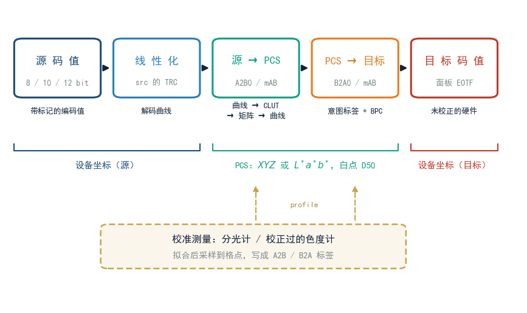
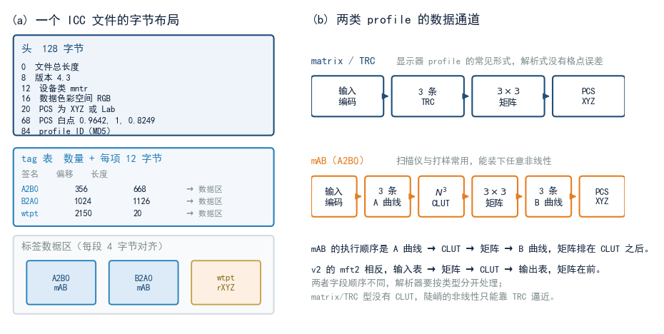
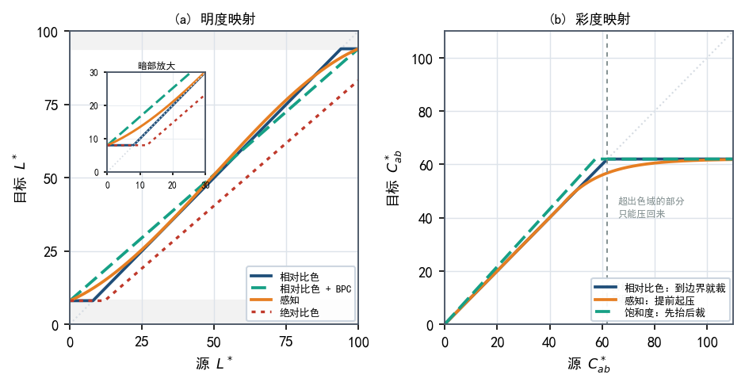
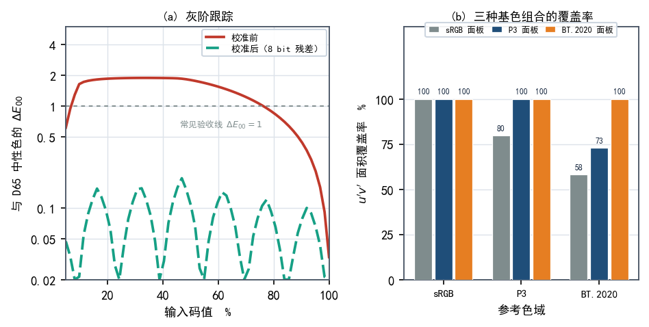
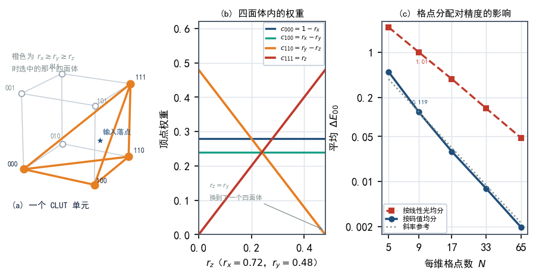
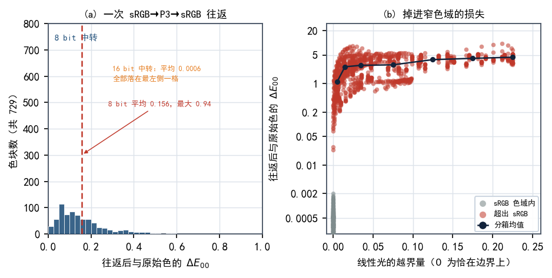

# 第 8 章 色彩管理：ICC、3D LUT 与显示校准

同一张照片，在修图机上看着正常，发到手机上略偏冷，投到客厅电视上又绿了一层。三次偏差方向不同，幅度也不同，靠手动调白平衡永远追不上。问题不在某台设备坏了，而在于每台设备的"同一组码值"背后是完全不同的物理过程。色彩管理要做的，是把这段翻译过程写成可交换的数据，让每一环都知道自己手里的数字该被解释成什么颜色。难点不在算法，而在数据格式的约定、查找表的精度账，以及这套约定在 HDR 面前为何不够用。

## 8.1 设备相关的边界在哪里

从一个具体的数字开始。屏幕上一个中性灰像素，码值 $(128, 128, 128)$。这三个数字孤立地看什么也不表示：它只说明三个通道各自被开到了满量程的约一半。要变成颜色，还得知道三件事，面板基色落在色度图的哪个位置，白点在哪里，码值与光量之间是什么关系。第 7 章把这三件事称为一份合同，合同定死了从码值到三刺激值的映射。

问题在于合同只是纸面上的约定。厂商在规格书里写"覆盖 sRGB"，意思是基色坐标接近 sRGB，并不保证逐台的偏差、也不保证伽马曲线严格是那条分段函数。同一型号的两块面板，红色基色的色度可以差 $0.005$，白点可以差 $300\ \mathrm{K}$，黑位可以差一倍。这些差异落在画面上就是偏色，而偏色的方向和大小都与内容有关，灰底上明显，饱和色上被掩盖。

**设备坐标的维度并不统一。** 显示器的设备坐标是三个通道的码值，打印机是四种油墨的网点面积率，六色打印机是六维，激光投影机可能还有色轮分段。这些坐标之间没有共同的几何含义，CMYK 的第四维和 RGB 的第三维不可比。要在它们之间传递颜色，必须先经过一个中间站，这个中间站就是连接空间（Profile Connection Space，PCS）。

**PCS 用三刺激值。** ICC 规定 PCS 只能是 XYZ 或 CIELAB，两个都是 CIE 体系里的三刺激值表示。选它们的理由有三条。第一，它们能表示人眼可见的全部颜色，任何设备的色域都落在里面，不会在连接处被裁掉。第二，它们有明确的参考白，白点的位置可以写进文件。第三，它们与色差公式有直接的换算关系，容忍度可以量化。

XYZ 与 Lab 各有取舍。XYZ 是线性的，矩阵乘法在它上面成立，profile 里的 $3\times3$ 矩阵和 CMM 的白点适应都在 XYZ 上做，串联两个 profile 时中间那一步可以合并成一个矩阵。Lab 是近似均匀的，同样的数值差在明处和暗处对应相近的视觉差，把 CLUT 的格点铺在 Lab 上比铺在 XYZ 上更省。代价是 Lab 由立方根构成，矩阵在它上面不成立，链路每过一次 Lab 就多一组非线性变换。多数显示 profile 声明 PCS 为 XYZ，印刷 profile 常声明 Lab，原因就在这里。

**白点为什么钉死在 D50。** 印刷业的观察条件长期以 5000 K 为参考，ISO 3664 把它写成标准，ICC 沿用了这个传统，规定 PCS 的照明体恰为 D50，三刺激值取 $(0.9642,\ 1.0000,\ 0.8249)$。这条规定看上去只是选了个数，实际解决了一个大问题：两个 profile 串联时，只要都按同一套白点记账，CMM 就不必每次重新商量"白该算多白"。

代价是所有非 D50 的设备都要做一次色适应。以 D65 的显示器为例，它的媒体白在自身坐标里是 $(0.9505,\ 1.0000,\ 1.0891)$，写进 profile 时要用 Bradford 变换搬到 D50

$$
\mathbf{CAT}_{\mathrm{D65\to D50}}=
\begin{bmatrix}
1.0479 & 0.0229 & -0.0502\\
0.0296 & 0.9905 & -0.0171\\
-0.0092 & 0.0150 & 0.7521
\end{bmatrix}
$$

用它乘 D65 白，得到 $(0.9642,\ 1.0000,\ 0.8250)$，与规定的 PCS 白一致，这一步可以当作验算，如果乘出来不等于 PCS 白，说明矩阵或白点取错了。矩阵第三行的对角元只有 $0.7521$，蓝通道被压掉近四分之一，因为 D50 的 $Z$ 分量比 D65 低得多。这个 $25\%$ 的压缩是数值上的适应，不是画面变暗，反变换会把它还原。

**PCS 里没有绝对亮度。** 这是 ICC 设计里最容易被忽略的一条。PCS 的 $Y$ 归一化到 1 表示媒体白，100 是百分数而不是 $\mathrm{cd/m^2}$。也就是说，一个 profile 只描述"相对于自身白点"的颜色关系，不描述这块屏到底有多亮。SDR 时代这条限制无所谓，因为显示亮度被 BT.1886 之类的规范钉在一百多 $\mathrm{cd/m^2}$ 的量级，相对值和绝对值差不多。到了 HDR，同一份素材的峰值可以是 1000 也可以是 4000 $\mathrm{cd/m^2}$，相对表示立刻失效，这是 8.7 节要展开的问题。

**一条链路有五个环节。** 图 8-1 把它画成一条横向的链，每一环下面标出它实际读写的文件内容。源码值进来，先按源 profile 的传递函数解码成线性光，再经源 profile 的 A2B 标签进 PCS，在 PCS 上按渲染意图与黑点补偿做调整，然后经目标 profile 的 B2A 标签落到目标设备坐标，最后被目标的编码曲线变成码值。

图 8-1 里有两点值得停下来看。第一，中间三段都工作在 PCS 上，只有两端是编码值。这条分界决定了运算顺序，所有需要"相加、平均、缩放"的操作都必须落在中间，落在两端就会犯第 7 章讲过的编码域运算错误。第二，最下方的测量框用两条虚线箭头指向链路的两个位置，意思是源 profile 和目标 profile 是同一套测量流程产出的两份数据，只是被测的设备不同。现实中源 profile 常常是标准空间（sRGB、Display P3）的解析式，由基色坐标和白点算出来，不需要测量；目标 profile 才是必须实测的那一份，因为它是唯一需要描述"这台设备实际怎么偏"的地方。

链路上有两个东西经常被混为一谈。profile 是说明书，描述设备的色彩行为，本身不含"怎么算"的算法，要靠色彩管理系统（Color Management Module，CMM）去解释；3D LUT 是数据表，直接存了一张"输入三元组到输出三元组"的采样。说明书可以描述任意复杂的非线性，只要 CMM 支持；数据表只能描述它采样过的那些点，中间靠插值。两者的文件格式、精度账、误差来源都不一样，混用会出很难查的错，8.6 节会回到这一点。

## 8.2 ICC 文件里装了什么

ICC 文件是一个大端序的二进制块，结构比想象中朴素，只有三层：128 字节的文件头、一张标签检索表、一片标签数据区。所有多字节整数按大端存放，所有标签数据的起始偏移必须四字节对齐。整个文件可以看作一个带索引的键值库，键是四字符签名，值是任意长度的数据块。

头部字段的位置是固定的，偏移量写死在规范里，解析器按偏移直接读，不靠顺序。下表列出常用的几个，完整的字段表见 ICC.1:2010 的第 7 章。

| 偏移 | 长度 | 字段 | 典型值 |
|---|---|---|---|
| 0 | 4 | 文件总长度 | 以字节计 |
| 8 | 4 | 版本号 | 4.3.0.0 |
| 12 | 4 | 设备类别 | `mntr`、`prtr`、`scnr` |
| 16 | 4 | 数据色彩空间 | `RGB `、`CMYK`、`GRAY` |
| 20 | 4 | PCS | `XYZ ` 或 `Lab ` |
| 36 | 4 | 固定签名 | `acsp` |
| 68 | 12 | PCS 照明体 | 0.9642, 1.0000, 0.8249 |
| 84 | 16 | profile ID | 内容的 MD5 |

`acsp` 这四个字节是识别文件类型最简单的手段，读到它基本可以确认这是一份 ICC profile。版本号按字节拆开，4.3 的十六进制是 `0x04300000`，前两字节是主次版本，后两字节留给修订号，多数实现只比较主版本，因为 v4 的不同修订之间很少有不兼容的改动。

**标签表是一张索引。** 偏移 128 处先读一个四字节的计数，随后是等长的 12 字节记录，每条记录由签名、偏移、长度三部分组成。签名是四字符码，比如 `A2B0` 表示"输入方向、感知意图"的变换，`wtpt` 表示媒体白点，`rXYZ` 表示红通道的三刺激值。同一个数据块可以被多条记录指向，规范允许这种共享，打印机 profile 里 RGB 三条 TRC 相同的时候常这么省空间。

必需的标签不多。所有 profile 都要有 `desc`（描述）、`cprt`（版权）、`wtpt`（媒体白点）。显示类 profile 还要么给三条 `rXYZ`、`gXYZ`、`bXYZ` 加三条 TRC，要么给 `A2B0` 与 `B2A0`，两者至少要有一样。输出类 profile 强制要求 `A2B0`、`A2B1`、`B2A0`、`B2A1` 和 `gamt`（色域描述）。规范对"缺标签"的处理是让 CMM 退化，退化路径各家实现不一致，所以一个写得不全的 profile 在不同软件里表现可以完全不同。

图 8-2 左侧画的是文件的三层结构。头部那一片字段里，真正被 CMM 频繁读取的是设备类别、数据空间、PCS 三项，它们决定了后续该按哪套规则解释标签。标签表是纯索引，不存数据，条目顺序无关紧要，实现可以在读入时按签名建哈希表，之后按名字取。数据区是各标签的实际内容，长度各不相同，对齐填充不算在任何标签的长度里，解析时要按偏移跳跃而不是顺序读。右侧对比了两类通道，matrix/TRC 型是一条解析式的链，输入编码经三条曲线变成线性光，再乘一个 $3\times3$ 矩阵落到 PCS；mAB 型是一条带查找表的链，输入曲线、CLUT、矩阵、输出曲线依次执行。

**matrix/TRC 型能成立，靠的是通道独立假设。** 它的数学形式是

$$
\begin{bmatrix}X\\Y\\Z\end{bmatrix}
=\mathbf{M}
\begin{bmatrix}f_r(r)\\f_g(g)\\f_b(b)\end{bmatrix}
$$

三条曲线各自只处理自己那一个通道，矩阵负责把三个线性通道混成三刺激值。这条式子隐含一个前提，某个通道的发光量不受其他通道影响。液晶面板的通道串扰在百分之几的量级，OLED 更低，所以这个假设在显示器上够用，误差通常落在 1 个 $\Delta E_{00}$ 以内。打印机的墨没有这个性质，青墨印在黄墨上和在白纸上呈现的反射谱完全不同，通道之间强耦合，matrix/TRC 完全失效，只能用 CLUT。

**mAB 型是给任意非线性准备的。** 它的标签类型叫 `lutAtoBType`，内部按顺序存放三组一维曲线、一个可选的三维 CLUT、一个 $3\times3$ 矩阵、三组输出曲线。执行顺序与字段顺序一致，A 曲线先做，把输入码值搬到一个均匀的中间坐标，CLUT 完成主体映射，矩阵做线性混合，B 曲线把结果压回 PCS 的取值范围。

这里有一处与直觉相反的地方值得记住。矩阵在 CLUT 之后，不在它前面。常规的思维是"先用矩阵把设备基色换成 XYZ 基色，再用 CLUT 修非线性"，mAB 恰好反过来。这样安排的好处是 CLUT 的输出可以停在一个中间线性空间里，矩阵只承担最后一段线性混合，CLUT 的格点就不必同时兼顾基色旋转和非线性校正，同样的格点数能换到更高的精度。v2 的通用元素 `mft2`（标签类型 `lut16Type`）正好相反，结构是输入表、矩阵、CLUT、输出表，矩阵在 CLUT 之前。同一个概念在两代规范里位置不同，写解析器时必须按类型分支，用一套索引去读两种结构一定会错位。

**同一个变换可以存四份。** A2B 有 `A2B0` 到 `A2B3` 四个标签，分别对应感知、相对比色、饱和度、绝对比色四种意图。B2A 同样有四份。profile 可以只存 `A2B0` 和 `B2A0`，让 CMM 在需要别的意图时退化使用，也可以四份全存，各自独立优化。四份全存的文件会大四倍，换来的是四种意图都能按设计者的意图实现，而不是由 CMM 猜。

**白点有两个，别搞混。** 头部偏移 68 处那个固定的 D50 是 PCS 的照明体，所有 profile 都一样。`wtpt` 标签里的三刺激值是设备媒体白在 PCS 里的位置，每台设备不同。前者回答"连接空间用什么白"，后者回答"这台设备的白在这个空间里落在哪"。做绝对比色时，正是后者参与了运算，前者只是坐标系的原点。

**拿到一份陌生 profile，读的顺序是固定的。** 先读头部的四个签名，确定它是显示、输入还是输出设备，数据空间是 RGB 还是 CMYK，PCS 是 XYZ 还是 Lab，这一步决定了后面哪些标签必须存在。再扫一遍标签表，看 A2B 与 B2A 各存了几份，只有 `A2B0` 的说明它只做了感知意图，别的意图全靠 CMM 退化。然后按需读 `wtpt` 与三条 TRC 或 CLUT，看白点与标准相比偏了多少，TRC 是幂函数还是采样表。接下来验证 `desc` 里的描述与头部字段是否一致，很多手工改过的文件在这一步暴露出矛盾。最后才去解析 CLUT，因为这一步最贵，前面任何一项不合预期都意味着这份文件不可信，没必要再看表。

**v2 与 v4 的差别不在功能多少，而在定义是否唯一。** 两者都能描述同样的设备，但 v4 把一些 v2 留给实现自由的地方钉死了。

| 项目 | v2 | v4 |
|---|---|---|
| 通用变换标签 | `mft2`（16 位定点） | `mAB`、`mBA`（曲线可参数化） |
| 色适应方法 | 未规定，各家自选 | 规定用 Bradford |
| 感知意图参考 | 无统一定义 | 定义参考介质色域 |
| 16 位 Lab 编码 | $L^*$ 0 到 100 对应 0 到 0xFF00 | 对应 0 到 0xFFFF |
| 文本标签 | ASCII 加可选 Unicode | 多语言 Unicode |
| profile ID | 无 | 内容 MD5 |

16 位 Lab 编码那条差异最隐蔽。v2 把 $L^*$ 的 0 到 100 映射到 0 到 0xFF00，留了低 8 位做小数；v4 映射到 0 到 0xFFFF。一个按 v4 规则写的解析器去读 v2 文件，白色会被读成 99.6 而不是 100，误差看起来只有 0.4，但它出现在每一个像素上，等于整幅图被压暗了千分之四，暗部还会被这条线性换算放大。判断依据只有版本号，所以解析器必须先读版本再决定怎么解释数字。

**profile ID 是缓存键。** 偏移 84 处那 16 字节是文件内容的 MD5，计算时把标志位、属性、ID 字段本身清零，其余原样哈希。它的用途是让 CMM 判断"这份 profile 是不是我上次处理过的那份"，避免重复解析。手工改过标签却没有重算 ID 的文件会让缓存返回旧结果，这类问题在批量处理流水线里很难复现，因为换一台机器、清一次缓存，现象就消失了。

**CMM 不是标准的一部分。** 规范只规定文件格式与语义，不规定怎么插值、怎么裁超色域、怎么做黑点补偿。于是同一份 profile 在 Little CMS、Adobe ACE、Apple ColorSync 上跑出来的结果可以有 1 到 2 个 $\Delta E_{00}$ 的差别，超色域边缘的差别更大。做严格的颜色比对时，除了锁定 profile，还要锁定 CMM 的版本，否则前后两次的差异会被误判成 profile 变了。

## 8.3 四种渲染意图与黑点补偿

源色域和目标色域不一样大，映射就不唯一。一个落在目标之外的颜色，可以裁到最近的边界上，可以整体缩进来，也可以只降彩度不动明度，每一种都自圆其说，结果却差很多。渲染意图就是把这种取舍写成选项，让使用者按内容类型挑一个。

四个意图由 ICC 编号 0 到 3，含义分别是感知、相对比色、饱和度、绝对比色。前三个都要先把源白点和目标白点对齐，第四个故意不对齐。

**相对比色是唯一"诚实"的那个。** 它的规则最简单，白点配准之后，色域内的颜色原样搬过去，一一对应，不做任何压缩；落在目标色域之外的颜色被裁到边界上。数学上就是把三刺激值按白点比例缩放后直接裁剪

$$
\mathbf{v}_{\text{目标}}=\operatorname{clip}\Big(\mathbf{M}_{\text{目标}}^{-1}\,\mathbf{S}\,\mathbf{M}_{\text{源}}\,\mathbf{v}_{\text{源}}\Big)
$$

$\mathbf{S}$ 是把源媒体白搬到目标媒体白的那一步。色域内的部分误差接近零，这正是它的价值，任何一个准确的颜色进来，准确的颜色出去。代价是超色域的部分全部塌到边界上，一大片不同的颜色变成同一个颜色，画面里原本有层次的红色天空会糊成一块。

**绝对比色保留介质白。** 它不做白点对齐，而是按绝对亮度关系换算。PCS 里的值都是相对于媒体白的，要还原成绝对量，得乘上媒体白与 PCS 照明体的比值

$$
X_{\text{abs}}=X_{\text{pcs}}\cdot\frac{X_{\text{wtpt}}}{X_{\text{PCS}}}
$$

三个分量各算一次。这条式子说明，绝对比色的输出依赖两个白点的实际亮度比，而不只是色度。打样就是靠这条性质，把印刷纸的偏黄如实搬到屏幕上，让人看见"印出来会是什么样"，包括那层黄。日常看图用绝对比色会显得整幅偏色，因为它忠实地保留了介质差，而人眼已经适应了这种差。

**感知意图压的是关系。** 它把整个源色域压缩进目标色域，色域内的颜色也一起被压，不追求单个颜色的准确，追求颜色之间的相对关系不变。一朵花和它旁边的叶子，压缩后各自的色值都变了，但两者的差别还在，看上去仍然是"这朵花配这片叶子"。ICC v4 为此定义了一个参考介质色域（Perceptual Reference Medium Gamut），把典型反射印刷能表现的范围写成一组边界条件，但只规定边界，不规定压缩路径，具体怎么做仍由 profile 的作者决定。这也解释了为什么同一个文件在不同 CMM 上"感知"的结果可能差得比"相对比色"更多。

**饱和度优先保鲜艳。** 它允许明度和色相有偏差，尽量把彩度顶在目标色域的边界上。图表、演示、地图配色适合用它，因为这些内容的目的是区分，不是还原。照片用它会出现塑料感，肤色尤其明显。

**黑点补偿解决另一个问题。** 显示器的黑接近零，印刷品的黑在 $L^*=4$ 到 $8$ 之间，纸张再黑也有反射。相对比色把源黑映射到目标黑，若源黑是 0 而目标黑是 6，色域内所有暗部都被压进 0 到 6 这一段，细节挤在一起，看上去一片死黑。黑点补偿（Black Point Compensation，BPC）在 PCS 上先把源黑搬到目标黑，再线性拉伸白点，公式是

$$
L_{\text{out}}=L_{\text{黑,目标}}+
\big(L_{\text{in}}-L_{\text{黑,源}}\big)\cdot
\frac{L_{\text{白,目标}}-L_{\text{黑,目标}}}{L_{\text{白,源}}-L_{\text{黑,源}}}
$$

效果是把 $[L_{\text{黑,源}},\,L_{\text{白,源}}]$ 整段线性映射到 $[L_{\text{黑,目标}},\,L_{\text{白,目标}}]$，暗部不再塌陷，代价是对比度整体下降一点，因为可用的动态范围被压缩了。BPC 只动明度，不动彩度与色相，这是它与感知意图的根本区别。实践中常见的组合是"相对比色加 BPC"，既能保住色域内的准确，又不让暗部糊掉。

图 8-3 的左图把四种意图画在同一张坐标里，横轴是源明度，纵轴是目标明度。目标介质取黑 $L^*=8$、白 $L^*=94$，灰色的两条横带表示被裁掉的区间。相对比色是一条斜率 1 的直线，两端被切平，$L^*$ 低于 8 的部分统统变成 8，高于 94 的变成 94。加 BPC 之后变成一条从 $(0,8)$ 到 $(100,94)$ 的直线，斜率 $0.86$，整段被压缩，暗部不再撞墙，亮部也不再顶格。感知那条是 S 形曲线，在中点与恒等线重合，暗部略抬、亮部略压，两个方向都比 BPC 温和，因为它在压明度的同时还要留余量给彩度。绝对比色那条斜率约 $0.83$，因为这里假设目标介质的白是源的 $1.6$ 倍亮，按绝对量折算之后白只到 $L^*=83$，整幅图偏暗。四条曲线说明同一件事，映射不是"转换"，而是"取舍"，选哪条取决于你要保住什么。

插图放大了 $L^*$ 从 0 到 30 的一段。这一段在整图里只占三成高度，却是差异最集中的地方。源 $L^*=20$ 处，相对比色给出 20，感知给出 21.1，BPC 给出 25.2，绝对比色只有 14.8。同一块深灰，四种意图的读数差出一大截，这就是"暗部对不上"最常见的来源。做印刷打样时如果不指定意图，CMM 会用 profile 头里写的默认意图，而那个值往往是制作者随手填的 0。

右图画的是彩度。目标色域在某色相上的彩度上限是 62，超过这个值的源颜色必须被处理。相对比色在 62 处一刀切，63 和 110 输出完全一样。感知从 $0.72$ 倍上限处开始平滑压缩，曲线连续、单调、渐近到上限，源彩度 110 落在 61 附近，保留了"很鲜艳"的相对印象。饱和度意图先把中间调抬 $8\%$，让 40 附近的中彩度看起来更跳，然后同样在边界处裁掉，这条曲线是三种里唯一在色域内部就偏离恒等映射的。

拿一组具体数字走一遍会更清楚。假设源是 Display P3 的一块饱和红，色度坐标 $(0.68, 0.32)$，要显示在只覆盖 sRGB 的屏上。相对比色把它裁到 sRGB 的红顶点 $(0.64, 0.33)$，彩度从 105 掉到 92，色相偏了一点点，画面上是一块略闷但仍然是纯红的色块。感知意图把整幅图的彩度按同一个比例压下来，这块红可能落到彩度 88，旁边原本在色域内的橙色也从 70 降到 62，两个颜色的关系没变，单看这块红却比相对比色更闷。绝对比色还要再乘一个白点比例，如果目标屏的白比参考白亮，整块会变暗。三种结果放在一起，红都不准，差别在于"不准的方式"，这就是意图要按内容选的原因。

| 意图 | 白点 | 超色域 | 适合的内容 |
|---|---|---|---|
| 感知 | 对齐 | 整体压缩 | 照片、影视画面 |
| 相对比色 | 对齐 | 裁到边界 | 品牌色、图形、有准确色值的元素 |
| 饱和度 | 对齐 | 保饱和 | 图表、演示、地图 |
| 绝对比色 | 不对齐 | 裁到边界 | 打样、屏幕模拟印刷 |

做交付时有两个细节容易漏。第一，意图要跟着文件走，同一批图用不同意图转换，颜色会不一样，事后很难判断是哪一步引入的差。第二，BPC 不是标准的一部分，Adobe 提出之后成了事实标准，但不同实现的曲线不完全相同，有的在线性光上做，有的在 Lab 上做，两者的视觉效果不一样，报告里要写清楚用的是哪一种。

## 8.4 显示 profile 从哪来，能信几分

显示器 profile 有三个来源，可信度差别很大，而它们在外观上几乎无法区分，都是一个几十 KB 的 `.icc` 文件放在系统色彩目录里。

**第一个来源是 EDID。** 显示器通过 DDC 通道把一段 E-EDID 数据交给显卡，基本块 128 字节，扩展块挂在后面，CTA-861 的扩展里还带着 HDR 静态元数据。基本块里有制造商、型号、生产周、基色坐标、白点、伽马。色度坐标是 10 bit 定点，精度大约 $0.001$，够描述基色，不够描述个体差异。伽马是一个字节，编码方式是 $(\text{值}+100)/100$，只能表示 $1.00$ 到 $3.54$ 之间的值，写 2.2 就是 120。

EDID 的问题不在精度，在来源。它是面板厂商按规格书写进去的典型值，同一型号的所有机器共用同一份，不反映这一台的偏差、老化、也不反映当前 OSD 设置。更麻烦的是 EDID 里的白点往往是"设计目标"而不是实测，写着 D65 的显示器实际可能是 6800 K。用 EDID 生成 profile，等于假设这台显示器是完美的样板。

EDID 里还有一块与 HDR 有关的内容。CTA-861 的扩展块可以带 HDR 静态元数据，写明显示器支持哪种电光转换（传统伽马、PQ、还是 HLG）、支持的色度坐标、以及最大最小亮度。这些数据是给播放器和显卡看的，用来决定送什么信号，不参与 ICC 的运算。也就是说，一台显示器的 HDR 能力由 EDID 报告，SDR 的色彩行为由 profile 描述，两者分属不同的通道，不能互相代替。

**第二个来源是厂商提供的 profile。** 安装驱动时会被塞进系统色彩目录，文件名通常是型号。这类文件有两类做法。认真一点的厂商会用一台样机实测，做一份覆盖典型表现的 profile；偷懒的直接按 EDID 数据生成，或者在文件里把白点写成 6500 K、伽马写成 2.2，等于声明"这台显示器是理想的 sRGB 设备"。

后一种做法造成一个很隐蔽的后果。系统加载这份 profile 之后，色彩管理会把显示器的行为当作已知的正确，于是画面里任何偏差都被当成内容本身的颜色保留下来。用户看到偏绿的白，以为是照片的问题，其实 profile 在骗系统。更糟的是有些厂商 profile 只写了基色和白点，没写 TRC 的实际形状，CMM 只能按伽马 2.2 近似，暗部的偏差全被丢掉。

**第三个来源是实测。** 用分光计或校正过的色度计，让显示器显示一批已知码值的色块，测出对应的三刺激值，再拟合成 profile。这才是正路，也是唯一能反映"这一台、这一刻"的方法。代价是时间与设备，一次完整的测量要几百到上千个色块，每个色块稳定几百毫秒，加上稳定时间，一小时上下。

实测有几个前提条件，缺一个结果就不可信。环境要暗，杂散光会让黑位虚高。显示器要预热，冷机与热机的白点可以差 $200\ \mathrm{K}$，面板温度稳定通常要三十分钟以上。动态对比、局部调光、自动亮度这些功能要关掉，否则同一码值在不同画面内容下亮度不同，测出来的曲线没有意义。测量的图案大小要固定，全屏白和小窗口白的亮度可能差两三成，也就是 8.8 节要展开的 APL 效应。

图 8-4 的左图是灰阶跟踪，横轴是输入码值，纵轴是与 D65 中性色的 $\Delta E_{00}$，纵轴取了对数。红色那条是校准前的模型结果，逐通道伽马取 2.24、2.19、2.13，再加 $0.5\%$ 的黑位泄漏，整条曲线在 1.3 到 1.9 之间，最高点出现在中间调，因为三个通道的伽马差异在中灰处拉得最开。这个量级在并排对比时能看出来，单看一块屏却不容易察觉，因为它是一层均匀的色偏，人眼会部分适应。青色虚线是校准后的残差，只剩 8 bit 输出的量化，平均值 $0.075$，最大 $0.20$，呈锯齿状起伏，周期对应码值每变化一级。锯齿的形状说明这不是拟合误差，而是量化本身，换 10 bit 输出锯齿会矮四倍。

右图是色域覆盖。三组柱子分别是 sRGB、Display P3、BT.2020 三种基色组合，横轴是三个参考色域，纵轴是按 $u'v'$ 平面凸多边形面积算出的覆盖率。sRGB 面板对 sRGB 是 100%，对 P3 只有 80%，对 BT.2020 只有 58%。P3 面板对 sRGB 和 P3 都是 100%，对 BT.2020 是 73%。BT.2020 面板三格全满。这几组数字是纯几何算出来的，只要基色坐标定了就没有争议。

这组数字最容易被误读成"覆盖率越高越好"。它其实是面积比，不是加权比。面积的算法把绿色方向的一大片都算进去，而人眼对绿色的敏感度和对红蓝不一样，所以厂商宣传的"覆盖 99% sRGB"和这里算出的面积覆盖率不是一回事。更要紧的是，P3 面板对 sRGB 的覆盖率必然是 100%，因为 sRGB 的三个顶点都落在 P3 三角形内部，拿这条当卖点毫无信息量。真正有区分度的是对 BT.2020 的覆盖率，以及色域边界的形状，这两项在报告里通常被一个面积百分比盖过去。

**广色域屏上跑 sRGB 内容是最常见的场景。** 浏览器拿到一张没打标记的 JPEG，按 sRGB 解释，系统把 sRGB 的 $(255,0,0)$ 转到 P3 屏上，变成 $(234,51,35)$ 左右，红不再是满值。这个转换是必须的，因为不转的话 sRGB 红会被当作 P3 红发出，颜色比原意鲜艳得多，而且所有颜色的关系都被拉开。很多人抱怨"换了广色域屏之后颜色变得很浓"，原因就在这里，不是屏的问题，是链路把没打标记的内容当成了 P3。

反过来，P3 素材在 sRGB 屏上显示，色域外的部分必须裁剪，这也是为什么同一张 HDR 海报在两块屏上看起来饱和度差很多。判断当前链路的标记是否正确，最简单的办法是看一个纯色块的码值。在 P3 屏上显示 sRGB 的纯绿，截屏取色得到的不应该还是 $(0,255,0)$，如果还是，说明转换没发生。

**profile 描述的是测量那一刻的状态。** 改了 OSD 的色温、伽马预设、亮度，或者换了输入接口、开了 HDR 模式，profile 就作废了。这一点和相机不同，相机的 profile 描述的是传感器，显示器的 profile 描述的是一个可调的系统。工程上的做法是把 OSD 锁死，把关键参数记在报告里，任何改动之后重测。

## 8.5 3D LUT 的规模、插值与烘焙

profile 能把设备行为描述清楚，但它要依赖 CMM 解释，而 CMM 只存在于操作系统和少数应用里。视频播放器、现场切换台、游戏引擎这些地方没有 CMM，也不允许一段二进制被解释两次。它们要的是一张能直接查的表，这就是 3D LUT 的生存空间。

一张 3D LUT 由 $N^3$ 个格点组成，每个格点存一组输出值。$N$ 是每维的格点数，常取 17、33、65。存储量按 $N^3\times3\times$ 每分量字节数算，下表列出常见的几档。

| $N$ | 格点数 | 8 bit 三分量 | 16 bit 三分量 | 32 bit 浮点 |
|---|---|---|---|---|
| 17 | 4 913 | 14 KB | 29 KB | 59 KB |
| 33 | 35 937 | 105 KB | 211 KB | 431 KB |
| 65 | 274 625 | 806 KB | 1.6 MB | 3.3 MB |

33 格加 16 bit 是 211 KB，这个量级刚好能放进显示控制器的片上存储，也能随固件一起分发，于是成了事实标准。65 格在精度上更好，但 1.6 MB 已经超出多数显示器的查找缓存，只能在主机侧做，靠 GPU 的三维纹理采样。

**插值决定了格点之间的行为。** 输入落在格点之间时，要把周围的格点值加权混合。三线性插值用立方体的八个顶点，权重是三个方向小数部分的乘积

$$
\mathbf{c}=\sum_{i,j,k\in\{0,1\}}
w_x(i)\,w_y(j)\,w_z(k)\;\mathbf{c}_{ijk}
$$

式中 $r_x,r_y,r_z$ 是输入在三个方向上的小数部分，每个方向的两个权重分别是 $r$ 与 $1-r$，$\mathbf{c}_{ijk}$ 是八个顶点的值。八个顶点全部参与，八次加权、七次加法，硬件实现简单，代价是等值面呈双曲抛物面，在格点稀疏时沿对角线方向会产生轻微色偏。

**四面体插值只用四个顶点。** 做法是把立方体按主对角线切成六个四面体，判断输入落在哪一个里，再用那个四面体的四个顶点做线性组合。判断依据是三个小数部分的排序，六种排列对应六个四面体。以 $r_x\ge r_y\ge r_z$ 为例，用到的顶点是 $000$、$100$、$110$、$111$，权重分别是

$$
\mathbf{c}=(1-r_x)\,\mathbf{c}_{000}+(r_x-r_y)\,\mathbf{c}_{100}
+(r_y-r_z)\,\mathbf{c}_{110}+r_z\,\mathbf{c}_{111}
$$

四个权重都是非负的，和恒等于 1，这一点可以直接验算。其余五种排列只要把下标按排序结果替换即可，代码里通常先把三个小数部分排序，记下排序的置换，再按同一个置换去累加顶点坐标，避免写六个分支。

图 8-5 的左图画的是一个 CLUT 单元，八个顶点标着它们的偏移下标，橙色那四条棱围出的是 $r_x\ge r_y\ge r_z$ 时被选中的四面体，星号是输入落点。这个四面体把立方体沿主对角线切开，四个顶点都靠近输入，远离输入的那四个顶点完全不参与，这是四面体比三线性省一半查找次数的原因。中图把四个权重画成 $r_z$ 的函数，固定 $r_x=0.72$、$r_y=0.48$，$r_z$ 从 0 扫到 0.48。两条水平线对应与 $r_z$ 无关的两个权重，斜线一个降一个升，四条线在 $r_z=r_y$ 处交接，越过这一点就换到下一个四面体。曲线是分段线性的，说明四面体插值在每个四面体内部是线性函数，跨四面体时一阶导不连续，视觉上看不出折角。

右图是这节最实用的一个结论。横轴是每维格点数，纵轴是平均 $\Delta E_{00}$，两条曲线用的是同一个器件模型，唯一的差别是格点铺在哪个坐标上。红色那条按线性光均分，$N=9$ 时误差 $2.46$，$N=33$ 时还有 $0.137$；蓝色那条按码值均分，$N=9$ 时 $0.119$，$N=33$ 时 $0.0078$。两条曲线都按 $N^{-2}$ 下降，斜率一致，垂直方向差了整整一个数量级。

差这么多，原因是格点的分布与人眼的敏感度不匹配。线性光均分把一半格点花在了 $0.5$ 到 $1.0$ 这一段，而这一段在编码上只占三成，人眼对它的差异也不敏感；暗部那一段只有少数几个格点，偏偏那里人眼最挑。按码值均分等于按感知均匀的坐标铺点，格点的密度跟着敏感度走，同样的 $N$ 自然更准。

**这就是 shaper LUT 的由来。** 一张"1D 曲线加 3D CLUT"的表，先用一条一维曲线把输入搬到一个感知均匀的坐标，再在均匀网格上查三维表。这条一维曲线可以是对数、PQ、或者任意单调曲线，作用就是把格点重新分布。ACES 的转换链里大量使用这种结构，把对数编码的输入接到均匀网格的 CLUT 上，既保证了暗部精度，又不需要把 $N$ 提到 65。代价是多一次一维查找，以及在曲线两端要做夹紧，否则外推会跑出定义域。

**精度不止看格点数。** 每个格点的输出位深同样决定下限。8 bit 输出意味着输出被量化到 256 级，在暗部每级对应的亮度差可以是百分之几，插值再准也救不回来。SDR 校准用 8 bit 输出勉强够，HDR 必须 16 bit 或者半精度浮点。半精度浮点在 $1.0$ 附近的分辨率约 $0.001$，PQ 编码的亮部对应几 cd/m²，够用；暗部的相对精度更高，因为浮点的指数会跟着数值缩小。

**烘焙是把测量变成表的过程。** 完整的流程有五步。

第一步是定网格。$N$ 取多少，输入是码值还是线性光，要不要 shaper，这些在开始测量之前就要定。$33^3$ 是三万五千多个点，逐个测量不现实，按每点一秒算是十小时，测量噪声还会原样写进表里。

第二步是设计测量集。常见做法是在三个维度上各取十几个层次，组成一个粗网格加上若干随机点，总量几百到两千。随机点的作用是把拟合的残差暴露出来，纯网格测量会让拟合在格点之间"想当然"。

第三步是拟合。用样条、径向基函数或者带正则的最小二乘，把离散测量拟合成一个光滑的三维映射。平滑约束必须有，否则测量噪声会被固化成表里的纹波，反映在画面上是沿灰轴的色带，在渐变背景上格外明显。

第四步是重采样。把光滑模型在 $N^3$ 个格点上取值，写成文件。采样时要注意边界，格点落在色域外时不能外推，要夹紧到边界值，否则极端饱和的输入会查出一个不存在的颜色。

第五步是验证。用一组没有参与拟合的色块测一遍，比较查表输出与实测值的差。这组验证点就是交付报告里的数据，拟合残差和验证误差要分开写，前者说明模型能力，后者说明真实精度。

**文件格式里还藏着语义。** 通用的三维表交换格式是 `.cube`，文本，开头几行是 `TITLE`、`DOMAIN_MIN`、`DOMAIN_MAX`，然后是 `LUT_3D_SIZE` 和数据行。数据行的排列顺序有约定，最靠右的维度变化最快，也就是先沿蓝通道走完 $N$ 个值，再进一格绿，最后进红。搞错顺序的表不会报错，只会让红蓝对调，画面上是颜色整体错位但饱和度分布正常，这种错误很难靠肉眼定位。

同一个文件里可以同时有一维表和三维表，用 `LUT_1D_SIZE` 与 `LUT_3D_SIZE` 分别声明。两段都存在时，一维表先执行，它的输出喂给三维表，这就是 shaper 结构。只声明三维表的文件，输入是 $0$ 到 $1$ 的归一化码值；同时声明一维表的文件，输入先被一维表搬到别的坐标。解析器如果不看 `LUT_1D_SIZE` 这一行，就会把带 shaper 的表当成普通表读，颜色整体偏移，而且偏得很有规律，容易被误判成显示器的问题。

**GPU 里的实现有一处精度陷阱。** 三维表在显卡上通常存成三维纹理，采样时由纹理单元做三线性插值，速度快到可以忽略。问题在于纹理的格式。如果每个格点存 8 bit，采样器会在 8 bit 的整数上做加权，插值结果再被截回 8 bit，暗部只有几级码值可用，插出来的渐变会出现台阶。正确做法是用 16 bit 定点或半精度浮点纹理，让插值在更高的位深里完成。另一个坑是纹理的 sRGB 标志，标上这个标志，采样器会把存进去的数值当成编码值做一次解码，而表里存的本来就是输出码值，解码之后整体变暗、中间调偏低，看上去像伽马被调大了。

**LUT 的常见故障有四种。** 一是外推，输入超出表的定义域时线性外推，结果在饱和色上炸掉。二是边界不连续，$N$ 太小加上平滑过强，灰轴两侧出现台阶。三是非单调，拟合时没有加约束，某一段输出随输入下降，画面上会出现反相的色带。四是与 OSD 打架，表是按某个色温标的，用户把 OSD 改成"暖色"，整张表就错位了。

## 8.6 链路顺序与三种典型错误

把 8.1 的五个环节和 8.5 的查找表放在一起，一条完整的显示链路就出来了。顺序是固定的：读源码值，按源传递函数解码成线性光，乘源到 PCS 的变换，在 PCS 上按意图与 BPC 调整，乘 PCS 到目标的变换，最后按目标的编码曲线写成码值。若中间用 LUT 代替变换，LUT 的输入域必须与它前面的信号处在同一个空间。

顺序错一步，误差就进来了。下面三种错误在工程里出现频率最高，而且都不容易靠肉眼发现。

**第一种是漏掉线性化。** 3D LUT 的格点通常铺在编码域上，因为编码域是感知均匀的，格点利用率高。这不代表信号可以在编码域里做线性运算。解码、矩阵乘法、亮度缩放这些操作都必须先回到线性光，做完再编码回去。把一张 sRGB 图直接乘一个色域矩阵，等于在线性光上乘了一个错的函数，误差随码值变化，中间调偏得最多。判断方法很简单，看链路上每一级之间传的是码值还是线性值，如果两级之间既没有解码也没有编码，却做了一次加法或乘法，那就错了。

**第二种是把 profile 当 LUT。** 这两者的文件长得像，都可以叫"色彩变换"，语义完全不同。profile 是描述，需要 CMM 解释，同一个文件在不同 CMM 上结果不同；LUT 是数据，谁读都一样。把 `.icc` 直接喂给渲染管线，管线会把它当二进制垃圾，或者更糟，按自己的猜测解析出错误的数值。反过来把 `.cube` 当 profile 加载进系统色彩目录，系统会拒绝，或者把它当作一份残缺的 profile 退化处理。

还有一层更细的区别藏在 LUT 文件内部。一个 `.cube` 可以只含三维表，也可以含一维表加三维表，两种结构的输入域不一样。只含三维表的文件，输入是归一化码值；带一维表的文件，一维表先做一次映射，三维表的输入是映射后的值。同一个文件被两种解析器读，出来的颜色可以完全不同，而且都不报错。

**第三种是双重转换。** 素材已经被转过一次，链路上又转一次。最常见的情形是播放器把 Display P3 的素材转成 sRGB 送进系统，系统再按显示器的 P3 profile 转回 P3。中间那次降域把超色域的颜色裁掉了，第二次转换无法把它们恢复。

图 8-6 的左图是 sRGB 与 Display P3 之间往返一次的结果，729 个色块，标准矩阵，只在编码处量化。8 bit 的往返误差平均 $0.156$、最大 $0.94$，分布集中在前几个柱子，长尾到 1 附近。这个量级单看不大，但它出现在每一张经过中转的图上，而且是系统性的，不是随机的。16 bit 的往返误差平均 $0.0006$、最大 $0.0037$，几乎可以当作无损。两条数据说明一件事，往返本身的损失主要来自位深，而不是矩阵。

右图是另一种损失，来自裁剪。把 Display P3 的 1728 个色块经 sRGB 中转再转回来，色域内的 668 个只剩量化误差，色域外的 1060 个平均差 $1.1$ 到 $4.5$，最大 $9.7$，而且越界越深、损失越大。这条曲线是整个 8.6 节的重点：双重转换真正可怕的地方不是矩阵往返，而是中间那个较窄的色域把颜色永久削掉了。矩阵可逆，裁剪不可逆。

**双重转换有可验证的征兆。** 最直接的一个是切换窗口时颜色变化，同一张图在浏览器里和在看图软件里不一样，说明至少有一个程序不敢相信系统的标记，自己又转了一次。第二个征兆是暗部与高光同时偏移，因为两次转换的曲线叠加，暗部被压两次、亮部被抬两次，中间调反而最接近正确。第三个征兆是渐变上出现色带，两次 8 bit 量化把原本连续的过渡切成台阶。发现这三条中的任何一条，先查链路上有几个软件在做色彩转换，再逐个关掉验证。

**还有两种容易被忽略的重复映射。** 一是显示器自带的"鲜艳模式""电影模式"，它在硬件里又做了一次饱和度提升或色温偏移，profile 描述的是标准模式，用户切到鲜艳模式，profile 立刻失真。二是显卡驱动的"数字振动""色彩增强"，这类开关在驱动层做矩阵，绕过了系统的色彩管理，profile 完全不知道它的存在。排查色偏时，这两处要先确认。

**用四类图卡能快速定位错误。** 第一类是灰阶渐变，从黑到白连续过渡，如果出现彩色条纹，说明三条 TRC 不一致或 LUT 的灰轴不连续；如果出现台阶，说明位深不够或量化位置不对。第二类是肤色块，几块不同亮度的肤色并排，偏色在这一类上最刺眼，因为它落在人眼最敏感的记忆色区域。第三类是饱和色块，红绿蓝青品黄各一块，超色域裁剪与矩阵错误都在这类上显形。第四类是高频细节，细线条或噪点纹理，用来检查处理链有没有在编码域做缩放，那会把边缘的对比度改掉。四类图卡加起来不超过十个色块，却能覆盖绝大多数链路错误。

**顺序正确的判据只有一个。** 拿一个已知色值的色块，从输入端一路跟到屏幕上，每一步都问"这里的数字是什么空间"。如果某一步答不上来，那一步就是错的来源。色彩管理的问题几乎都能用这一句话定位，因为绝大多数错误不是算错了，而是算在了错的坐标里。

## 8.7 HDR 把 ICC 留在了门外

ICC 的整套设计建立在一个前提上，颜色可以用相对于媒体白的比例来表示。这个前提在 SDR 时代成立，因为所有设备的目标亮度都在一百多 $\mathrm{cd/m^2}$ 的量级，相对值和绝对值差不多。到了 HDR，同一份素材的峰值可以是 1000 也可以是 4000 $\mathrm{cd/m^2}$，漫反射白在 100 到 300 之间浮动，"相对媒体白"这句话失去了确定含义。

**把 HDR 硬塞进 v4 会撞上两堵墙。** 第一堵是 PCS 的取值范围。规范要求 PCS 的三刺激值落在 $0$ 到 $1$ 之间（以媒体白归一），超出这个范围的行为未定义。一个峰值 1000 $\mathrm{cd/m^2}$、漫反射白 100 $\mathrm{cd/m^2}$ 的显示器，峰值是媒体白的十倍，$Y$ 要取到 10 才描述得对，这个值直接落在未定义区。把它压到 1，等于把 HDR 的绝对亮度关系丢掉，峰值和漫反射白变成同一个数。

第二堵是 Lab 的上界。$L^*=100$ 对应媒体白，再亮就只能超出 100，而 v4 的 Lab 编码把 $L^*$ 映射到 0 到 0xFFFF，超过 100 没有位置。有人试过把媒体白定义成峰值亮度，让 1000 $\mathrm{cd/m^2}$ 对应 $L^*=100$，这样确实能塞进去，但代价是 203 $\mathrm{cd/m^2}$ 的 SDR 白落到 $L^*=52$，与 SDR profile 完全不能互通。这不是技术障碍，是设计前提不成立。

**iccMAX 想补这个洞。** ISO 20677:2019 定义的 iccMAX 放开了几乎所有限制，支持浮点编码、任意维度的变换、多光谱数据、多个 PCS、以及绝对亮度。理论上它能描述 HDR，也能描述双色轮投影机这种非三刺激值的设备。现实中它的推进很慢，支持它的 CMM 屈指可数，硬件厂商几乎没有实现，工具链也不完整。目前它还停留在"规范存在、生态没有"的状态。

**行业绕开了 ICC，另建了一套。** HDR 的显示变换由三样东西约束，传递函数、元数据、映射曲线。

传递函数是 SMPTE ST 2084 定义的 PQ，BT.2100 把它和 HLG 一起收进了推荐书。PQ 的码值与绝对亮度一一对应，$0.508$ 就是 100 $\mathrm{cd/m^2}$，$0.751$ 是 1000 $\mathrm{cd/m^2}$，不需要"媒体白"这个中介。这一条直接绕过了 PCS 的死结。

元数据描述内容是什么。SMPTE ST 2086 定义主监视器的三基色、白点、最大与最小亮度，CTA-861.3 补充了内容亮度等级（MaxCLL）和帧平均亮度（MaxFALL）。这些数据告诉显示端"这份内容是在什么条件下做的"，显示端据此决定怎么映射。

映射曲线由 BT.2390 给出参考实现，核心是一条电光转换的函数，按显示峰值把内容峰值压下来，同时保持中间调不变。BT.2408 则规定制作端的参考环境，漫反射白 203 $\mathrm{cd/m^2}$、峰值 1000 $\mathrm{cd/m^2}$，让不同机房做出来的东西能对上。

**系统层各自为政。** Windows 的色彩管理（WCS）以 ICC 为核心，2023 年之后的自动色彩管理（ACM）把 SDR 窗口按各自的 profile 转到显示色域再合成，HDR 内容则走另一条路，用浮点或 10 bit PQ 直接送进合成器，由系统的色调映射处理。两条路在合成时要对齐亮度，这个对齐靠"SDR 白电平"这个设置，设错了整片 SDR 区域会偏亮或偏暗。

macOS 的做法是扩展动态范围（EDR），帧缓冲允许超过 1.0 的浮点值，系统把超出部分交给显示器的余量去呈现，SDR 部分仍由 ColorSync 按 ICC 管理。播放器如果自己不做色调映射，就把 PQ 值原样写进浮点缓冲，让系统去压。

专业播放器和调色软件干脆不用系统色彩管理。它们自带完整管线，读 PQ 码值、按自己的曲线映射、按自己的 LUT 输出，绕过 ICC 也绕过系统的合成器。这样做的好处是完全可控，坏处是每一家都要自己实现一遍，行为不一致。

**制作端的答案是 ACES 与 OCIO。** ACES 用 CTL 描述变换，用一套固定的场景参考空间把各种输入统一起来，输出变换负责落到具体的显示设备。OpenColorIO 提供配置驱动的管线，v2 支持显示变换、视图变换、以及按需的 GPU 实现。ACES 2.0 在 2024 年更新了输出变换，把色域压缩与色调映射分开处理。这些体系都不依赖 ICC，因为它们要处理的是"场景线性光到显示码值"的完整映射，比"设备到设备"的颜色翻译宽得多。

**HLG 走的是另一条路。** PQ 是显示参考的，码值直接对应绝对亮度，适合电影和流媒体；HLG 是场景参考的，码值对应相对场景光，显示端按自己的峰值做一次逆 OETF 加系统伽马，兼容 SDR 电视机。两者的元数据需求不同，PQ 需要 ST 2086 与 MaxCLL 才能正确映射，HLG 只需要一个标称峰值，变化由显示端自己吸收。校准 HLG 显示器时，测的是那条"HLG 到绝对亮度"的复合曲线，不能只看 OETF，因为显示端的系统伽马是未知量。

**显示端的色调映射有两种做法。** 静态映射只看元数据里的峰值，一条曲线管整部片子，实现简单，缺点是遇到暗场景会把高光压得过狠，遇到亮场景又压不住。动态映射逐帧甚至逐场景分析亮度分布，按帧决定映射曲线，效果更好，代价是要延迟几帧做统计，实时信号和游戏会受影响。两种做法都会改变画面的绝对亮度关系，所以校准 HDR 显示器时必须明确显示器工作在哪种模式下，否则测出来的 PQ 跟踪曲线没有意义。

**校准端也要换一套指标。** HDR 显示器校准测的是 PQ 全链，从码值到绝对亮度，误差用 BT.2124 定义的 $\Delta E_{ITP}$ 表示。CIEDE2000 在 1000 $\mathrm{cd/m^2}$ 上不适用，因为它的均匀性只在 SDR 的亮度范围内验证过，这一点第 6 章讨论过。报告里的阈值也跟着变，母版监看的常见要求是 $\Delta E_{ITP}$ 平均小于 1、最大小于 2，消费级放宽到 2 和 4。

**两套体系并行是当前的事实。** 桌面上看网页、修 SDR 照片，走 ICC；看 HDR 电影、做 HDR 调色，走 PQ 加元数据加 LUT。两套之间靠人工对照，没有自动的转换标准。这带来一个具体的工程问题，同一个画面里既有 SDR 窗口又有 HDR 视频时，两者要在同一个帧缓冲里合成，合成点在哪、按谁的亮度基准，不同系统的答案不一样。这也是 HDR 桌面体验里最容易出问题的地方。

## 8.8 校准流程与验证报告怎么读

校准和 profile 是两件事，经常被混着说。校准是改设备，把白点调到目标值、把伽马曲线调直、把亮度定在某个数值，改动发生在硬件或显卡的查找表里。profile 是描述，把校准之后剩余的偏差测量出来，写成文件交给 CMM。校准在前，profile 在后，顺序反了 profile 就白做。

**先定目标。** SDR 的目标通常是 BT.1886 的伽马 2.4 加 D65 白点，或者是 sRGB 的分段曲线，两者在暗部差别不小，做影视和做网页选的不一样。亮度目标按环境定，暗室监看常见 100 到 120 $\mathrm{cd/m^2}$，明亮办公室要更高。HDR 的目标是 PQ 全链，峰值按显示器能力定，漫反射白按 BT.2408 取 203 $\mathrm{cd/m^2}$。目标定不下来，后面的数字都没有参照。

**测量条件决定数字的含义。** 8.4 节列的那几条前提在这里直接改写结论。环境光漏进屏幕，黑位被抬高，同一台机器在白天测出的对比度可以只有暗室的一半。预热不够，白点偏蓝，灰阶前半段整段偏冷。动态对比或局部调光打开，大面积画面与小图案的亮度不同，换个窗口尺寸数据就不可比。报告里不写这几条，数字就没法与别处的数据比较。

**三项扫描构成报告的主体。** 灰阶扫描从中性灰的低端扫到高端，通常取 10 级或 21 级，每级测三刺激值，算与目标中性色的色差，同时看白点是否漂移。饱和度扫描在六个色相上各取几个饱和度等级，检查色域内部的线性，这一项能暴露 CLUT 或矩阵的问题。色域边界扫描测基色与次混合色的极限值，用来看实际色域与标称的差距。

报告里最容易被误读的是平均值。一组灰阶的 $\Delta E_{00}$ 平均 0.9 看起来合格，但如果 10 级里有 2 级超过 3，问题依然存在，因为那两级正好落在最常见的肤色亮度上。看报告要先看最大值和分布，再看平均值，最好按亮度分段统计，暗部、中灰、亮部各给一组，这样能立刻看出问题在哪一段。

**白点用 $\Delta u'v'$ 表示。** 它是色度图上两点之间的欧氏距离，$0.003$ 大约是 1 个最小可觉差，$0.002$ 是常见的验收线。用 $\Delta E$ 表示白点误差也可以，但它会把亮度差混进去，而亮度差通常另有指标。

**亮度线性单独看。** 把实测亮度对目标亮度作图，理想是一条过原点的直线。液晶在低亮度处会因为背光泄漏偏离，OLED 在高亮度处会因为电流限制压缩。这条曲线的形状比单个点的误差更能说明问题，压缩意味着高光细节丢失，泄漏意味着黑位不纯。

**一份能用的报告要带四样东西。** 目标值与容差，写明按什么标准、允许多少误差；测量条件，包括仪器型号与序列号、环境光、预热时间、窗口大小、显示器的 OSD 设置；原始数据，每个测量点的码值、实测三刺激值、目标值、色差，而不是只给汇总；结论，逐项对照容差给出通过或不通过，附上未通过项的分布。少了任何一样，报告都只能证明"当时看起来还行"，无法复现，也无法追责。

**黑位与对比度的数字最容易被夸大。** 黑位亮度取决于仪器底噪，分光计在 0.001 $\mathrm{cd/m^2}$ 量级的读数往往就是噪声，拿它去除峰值亮度，得到的对比度可以差好几倍。合理的做法是同时给出仪器在完全遮挡时的读数作为底噪，报告里注明"已扣除底噪"或"未扣除"。对比度也分两种，原生对比度是全屏白对全屏黑，动态对比度是靠调背光做出来的瞬时值，两者不能放在一起比较。

**灰阶的分段统计比总分更有用。** 把 10 级灰阶按 $L^*$ 分成暗、中、亮三段，各自的平均值与最大值分开列。暗部超标通常指向黑位泄漏与伽马偏离，中灰超标指向白点与矩阵，亮部超标指向峰值亮度不足或 ABL 压缩。同一份报告，分段看能直接指出问题在哪一环，只看总分则什么也看不出来。

**可重复性是报告的地基。** 同一块色块连续测五次，标准差应该在 $0.1$ 个 $\Delta E_{00}$ 以内，超过这个数说明仪器或环境有问题。不同仪器之间的差异更大，分光计与色度计在窄带光源上可以差 2 到 3 个 $\Delta E_{00}$，因为色度计的滤光片逼近的是 CIE 1931 观察者，遇到窄带光谱就失配。用色度计做校准必须先用分光计测一遍，算出这台显示器上的校正矩阵，否则测出来的红绿蓝比例本身就是错的。

**多机一致性是校准的另一个用途。** 片场摆三台同型号监视器，逐台校准到同一个目标，剩下的差异就是面板个体差与老化，通常能压到 1 个 $\Delta E_{00}$ 以内；不校准的话三台机器并排能差 5 个以上，导演看哪一台都会得到不同判断。多机校准有一个额外要求，测量必须用同一台仪器、同一套图案、同一天完成，因为仪器之间的系统差可以达到 2 到 3 个 $\Delta E_{00}$，比机器之间的差还大。

**报告证明的是链路，不是设备。** 一份合格的校准报告说明"这条链路在给定的容差内"，它不能证明"这块屏很好"。同一块屏在不同环境、不同仪器、不同目标下会得出不同的结论，报告要连同条件一起交付，否则数字没有意义。

## 本章要点

- 设备坐标之间没有共同几何，传色必须经过 PCS。ICC 的 PCS 只能是 XYZ 或 Lab，白点固定为 D50，媒体白由 `wtpt` 标签单独声明，而且 PCS 的 $Y$ 是相对值，没有绝对亮度。
- ICC 文件是 128 字节头加标签索引加数据区的三层结构，全部大端。matrix/TRC 型依赖通道独立，mAB 型用曲线与 CLUT 表达任意非线性，矩阵排在 CLUT 之后，而 v2 的 `mft2` 恰好相反。
- 四种渲染意图是取舍而不是转换，相对比色保住色域内的准确，绝对比色保留介质白，感知压关系，饱和度保鲜艳。BPC 只动明度，把源黑映射到目标黑再线性拉伸白点，代价是对比度下降。
- 显示 profile 的可信度从高到低是实测、厂商、EDID。EDID 只是规格书里的典型值，实测要求暗室、预热、关闭动态功能、固定 APL，改动 OSD 之后 profile 立刻作废。
- 3D LUT 按 $N^3$ 增长，33 格 16 bit 是 211 KB。决定精度的不是插值方式而是格点铺在哪个坐标上，按码值均分比按线性光均分好一个数量级，shaper LUT 的作用就在于此。
- 链路错误集中在漏线性化、把 profile 当 LUT、双重转换三处。8 bit 往返本身的损失平均只有 $0.156$ 个 $\Delta E_{00}$，经窄色域裁剪后超色域颜色的损失可以到 $9.7$，因为矩阵可逆而裁剪不可逆。
- HDR 用不了 ICC，因为 PCS 没有绝对亮度，替代方案是 PQ、ST 2086 元数据、BT.2390 映射与 BT.2408 参考环境。桌面上的 ICC 与 HDR 管线长期并行，两者的合成点是最容易出问题的地方。
