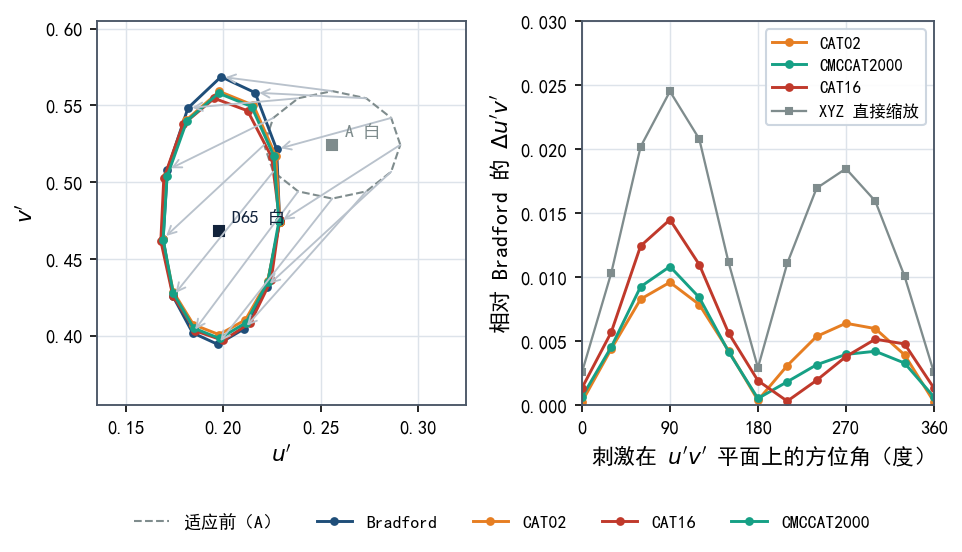
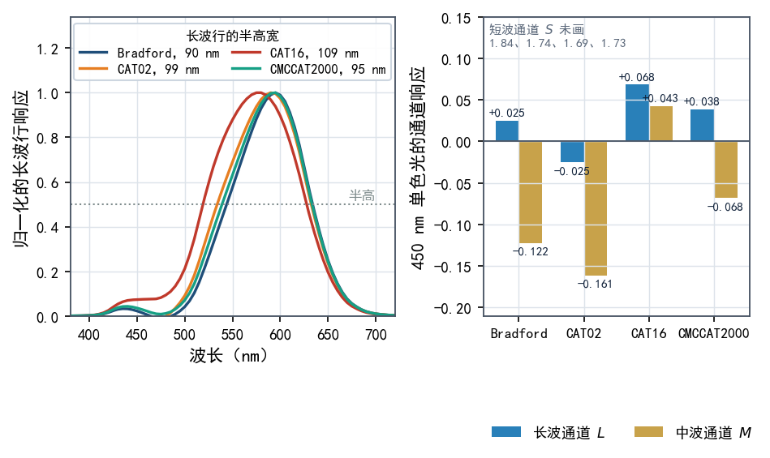
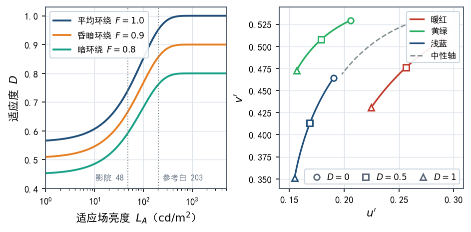
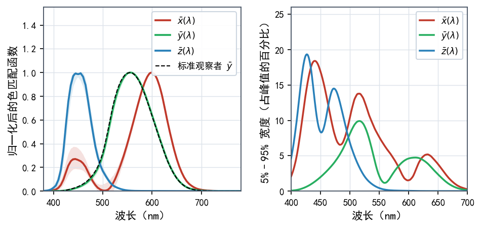
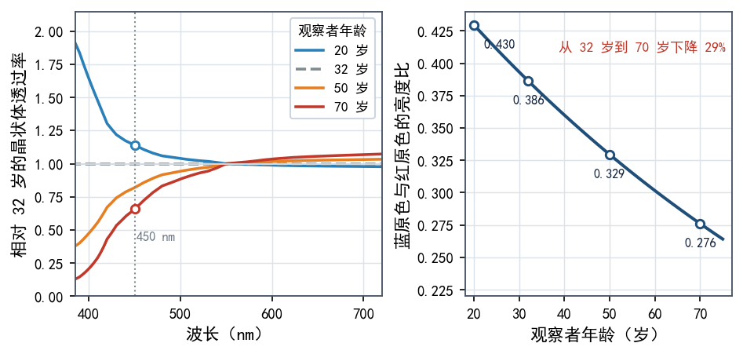
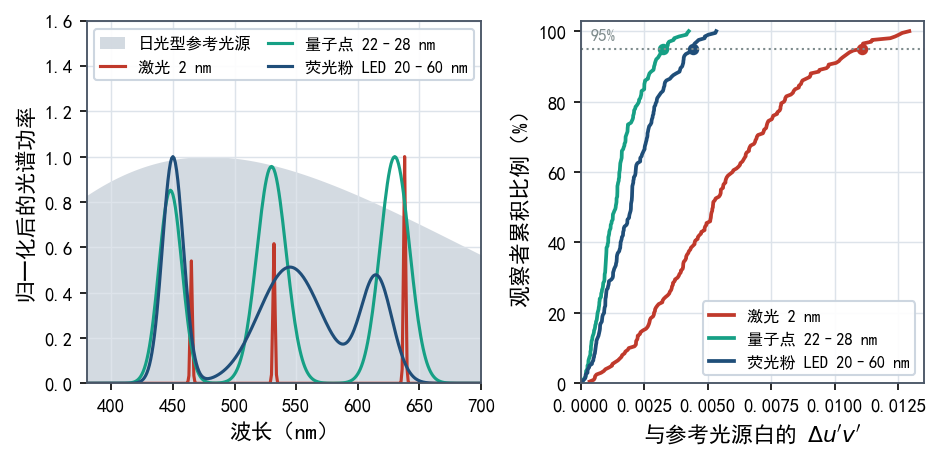

# 第 9 章 色适应与观察者差异

一块白纸在正午的日光下和在傍晚的钨丝灯下，测出来的色度差得很远，人看过去都叫白。同一台电视，两个人并排坐着看同一幅画面，一个人说白平衡没问题，另一个人说白里带绿。前一件事是适应，后一件事是观察者差异。两者都指向同一个结论：三个数字不足以描述颜色，还缺一份观察条件的说明书。第 2 章给过 von Kries 与 Bradford 的矩阵形式，第 4 章把色适应变换放进色貌模型的流程里。往下走有两个方向，一条往机制里走，看适应究竟发生在眼睛的哪一层、为什么一个增益矩阵只能算半张说明书；另一条往人身上走，看不同的眼睛在同样的光下为什么会得出不同的三刺激值。

## 9.1 适应发生在哪一层

von Kries 的系数定律把视觉系统简化成三路独立的增益，这是工程上最有用的一句话。它的代价是把好几层机制压成了一层。实际上，适应是若干个过程叠在一起，各自的时间常数、空间范围和神经位置都不一样。把它们分开，才能判断哪些差异可以靠算法补，哪些补不了。

最靠前的一层在光感受器本身以及与它相连的局部回路里。锥体对背景亮度有很强的压缩，同一个刺激放在暗背景上比放在亮背景上读出来更强。这种压缩发生在单个锥体与它零点几度视角内的邻居之间，空间尺度很小。它带来一个常被忽略的后果，适应的"白"是局部的。一间屋子里，靠窗的一面墙和背光的角落各有一套白点，两处的中性色在物理上并不相同，人看过去却都正常。全局白平衡算法在一幅画面里只认一个白，遇到这种场景就要出偏差，这不是算法不够好，而是它假设的模型比眼睛少了空间维度。

判定一层机制在视网膜还是在皮层，最直接的办法是让两只眼睛看到不同的东西。实验装置叫分视器，左右眼各看一块视场，中间用挡板隔开，两眼的适应状态可以独立控制。让右眼在红色照明下适应几分钟，然后闭上右眼，用已经适应了中性的左眼去看一块灰。如果适应完全发生在皮层，两眼共享同一套增益，左眼看到的灰应当仍是中性。实测左眼看到的灰偏青，说明增益至少有一部分留在被适应的那只眼里。偏青的幅度比完全适应的预测小，通常是预测值的一半上下，剩下的部分被更靠后的机制补上了。这类实验在 1960 到 1980 年代被反复做过，结论稳定：适应是分布式完成的，视网膜贡献显著但不是全部。

还有一个层次在锥体之后，容易被忽略。锥体信号到神经节细胞时已经重组成对立通道，亮暗一对、红绿一对、蓝黄一对。适应也发生在这一层，表现形式是单个通道的增益与对比度归一化。证据来自选择性适应实验，Webster 与 Mollon 在 1991 年让观察者长时间适应一种颜色，然后测各个色相方向上的辨别阈值。结果是彩度方向的阈值明显下降，色相方向的阈值几乎不动。这说明增益调整按对立通道走，不是三路锥体各调各的。von Kries 的三路独立增益是锥体层的近似，对立层的适应在色貌模型里只能用环绕因子与指数间接表示，表达得不完整。这也是为什么高饱和色的适应预测总是不如低饱和色准。

这个结论对工程有两处用处。一是说明单眼与双眼的适应结果不能互相替代，用分视装置测出来的对应色数据，不能直接当成日常观看条件下的预测。二是说明适应有"眼睛"这个粒度的个体差异，两只眼睛的适应状态可以不同，这也是为什么长时间盯着一侧强色光之后再看白墙会觉得偏色。

时间的维度同样重要。适应的进程可以分成两段。快的一段在几百毫秒内完成大半，来源是光色素的可逆漂白与神经增益的快速调整；慢的一段要几十秒到一两分钟，来源是光色素的再生与更靠后的重标定。Fairchild 与 Reniff 在 1995 年用连续外观判断的方法测过这个过程，白点切换之后，观察者的判断在前十几秒波动很大，一分钟左右趋于稳定。工程上的含义很直接，开机后的头一分钟不能作为判色依据，产线校色要等适应稳定；审片室里换一个片源，前几个镜头的感觉也不能当结论。

适应程度能不能测？能，但只能用行为方法，没法直接读神经信号。最常用的一种叫主观白点法。观察者在给定的照明下看一块可调色块，把它调到"看起来是中性的"，这个读数就是他的主观白。物理白与主观白之间的差，就是尚未适应的部分。在强色光下这个偏移可以到 0.01 以上（按 $u'v'$ 计），对应的 $D$ 落在 0.5 到 0.8 之间。这个方法简单，缺点是"中性"的判断本身受记忆色影响，做过色彩工作的人与没做过的人给出的主观白不一样。

另一种办法是分视器加匹配。一只眼适应待测的白，另一只眼在参考白下工作，观察者调参考侧的颜色去匹配适应侧的中性色。匹配读数与参考白的差就是残留偏色。这个方法把"中性"的判断换成了"两边一样"的判断，主观成分小一些，代价是装置复杂。两种方法在文献里给出的 $D$ 常常相差 0.1 上下，这个差距不是实验误差，而是两种任务测的不是同一件事，一个测的是主观中性，一个测的是跨眼匹配。

局部适应与全局模型之间的落差，在两类画面上最明显。一类是同一画面里有两种色温的光源，窗口透进来的日光约 6500 K，室内钨丝灯不到 3000 K，中间还夹着一段过渡；另一类是大面积单色背景上的小色块，色块的观感主要由它和周围的反差决定，而不是由它的绝对色度决定。前一类可以靠分区估计白点再做平滑过渡来近似，后一类要靠局部对比模型，两者都不是一个 3×3 矩阵能覆盖的。

还有一层不依赖光照，而依赖对物体的先验，叫记忆色。香蕉被记成比实际更黄，草地被记成更绿，肤色被压缩在一个很窄的范围内。Bartleson 在 1960 年代做过记忆色的匹配实验，发现回忆出来的色相比实际色样系统性地更饱和。这条效应对白点判断有直接影响，观察者判断"这是不是白"时，参照的不只是画面里最亮的中性色，还有对纸张、墙面、牙齿这些熟悉物体的记忆。显示器偏好白点的研究里，观察者手动选出的白点常常偏离测得的 D65，偏移方向取决于画面内容，暖色调的画面让人接受更暖的白。

把这几层放在一起，就能说清色适应与相机白平衡的区别。相机的白平衡在 RAW 域做一次全局对角缩放，等价于 $\mathbf{M}=\mathbf{I}$ 的 von Kries，而且它相信画面里最亮的像素是白。人眼的适应有局部性、有时间常数、有记忆色参与、还有随空间结构变化的对比归一化。把这四件事里的任何一件拿掉，剩下的模型就不再是人眼，而是一个够用的近似。近似在多数内容上不出错，在窄带光源、大面积饱和色块和并排比对这三种场合会露馅。

## 9.2 色适应变换族的构造与差别

第 2 章列出了 Bradford、CAT02、CAT16、CMCCAT2000 四组矩阵的数值，也指出了它们把 A 光源的白搬到 D65 时给出的增益差别。这一节要回答的是另一类问题，这些矩阵为什么长成这个样子，它们的差别落在颜色的哪个区域，选哪一个取决于什么。

四组矩阵有两条来路。第一条是从对应色数据直接拟合。实验里让观察者在两种白点下匹配同一个外观，得到一批"白点甲下的这个刺激，等价于白点乙下的那个刺激"的点对，然后用最小二乘求一个 3×3 矩阵，使所有点对的预测误差最小。Bradford 走的是这条路，数据来自 1980 年代在英国 Bradford 做的表面色匹配实验，Lam 在 1985 年的博士论文里给出了矩阵的具体形式。CMCCAT2000 也走这条路，Li、Luo 等人在 2002 年用一批显示器与表面色的对应色数据重新拟合，目标是把预测误差压到比 Bradford 更低。CAT02 介于两条路之间，它要满足一个额外的工程约束，即适应空间与压缩空间可以互相换算，所以矩阵不能随便取，只能在 Bradford 与 HPE 之间折中。

第二条路是从锥体基函数出发。Hunt-Pointer-Estevez 矩阵不是拟合出来的，它由 Smith 与 Pokorny 在 1975 年给出的锥体光谱灵敏度经线性变换得到，三个通道对应三种锥体，物理意义清楚，代价是预测精度不如拟合矩阵。CIE 170-1 与 170-2 用的 Stockman-Sharpe 基函数也属于这一类，它们由基因型已知的观察者实测得到，短波段比 Smith-Pokorny 更可靠。CAT16 是把两条路合起来的产物，它的矩阵在 CAT02 与 HPE 之间偏向 Bradford 一侧，同时保证三行在可见光范围里不出现负响应。

矩阵之间的差别落在两个层面。一层是它把一批颜色搬到新白点之后落在哪里，另一层是它的行对光谱有多强的选择性。先看第一个层面。

左图的十二个色样绕 A 的白点在 $u'v'$ 平面上排成一个半径 0.035 的圆，灰色细箭头指向适应后的位置。虚线是适应前的圆，实线多边形是适应后的结果，四种颜色对应四组矩阵。有两点值得看。第一，适应后的形状不是圆，而是一个沿蓝黄方向拉长的椭圆，$v'$ 的跨度从 0.489–0.559 扩到 0.394–0.569，长轴接近原来半径的三倍。原因是 A 到 D65 的短波增益在 3 倍附近，这个增益把蓝黄方向的偏差一起放大了。把片子从暖白搬到冷白，蓝紫部分看着更艳，与这条几何性质是同一件事。第二，四条多边形彼此贴得很近，在 A 白点附近几乎重合，往饱和方向走才逐渐分开。这符合预期，适应变换在白点附近被约束成恒等，差别要从彩度上找。

右图是定量比较。以 Bradford 为基准，CAT02 的平均偏差是 0.0050，最大 0.0096；CMCCAT2000 平均 0.0045，最大 0.0108；CAT16 平均 0.0057，最大 0.0145；直接在 XYZ 上缩放平均 0.0137，最大 0.0245。四条曲线都在 90° 方位出现峰值，也就是 $+v'$ 方向、绿的一侧。这个位置不难理解，绿刺激的能量集中在 520 到 560 nm，正好是长波与中波通道响应的交叠区，四组矩阵在这一段的划分差异最大。蓝紫一侧的偏差反而不大，因为所有矩阵在短波端的增益都被白点约束住了。

第二张图从锐度这个角度切同一件事。把四组矩阵的行分别当成权重乘上色匹配函数，得到四条随波长变化的响应曲线；曲线越窄，说明该通道对光谱越有选择性。

左图把四组长波行的响应画在一起，都归一化到峰值 1，横轴是波长。Bradford 最窄，半高宽 91 nm，峰值在 595 nm；CMCCAT2000 是 96 nm；CAT02 是 101 nm；CAT16 最宽，111 nm，峰值移到 580 nm。窄意味着选择性好，一个通道只对一段波长敏感，代价是对噪声和观测误差更敏感；宽意味着稳健，代价是通道之间互相渗漏，饱和色的预测会偏。四者的排序与它们的历史定位一致，Bradford 是按预测精度优化的，CAT16 为了让适应空间与压缩空间统一，牺牲了一部分锐度。

右图是 450 nm 处的三通道读数，只画了长波与中波两行，短波行的数值在 1.69 到 1.84 之间，量级差太多，画进去会压扁另外两根柱子。中波行是重点。Bradford 给 -0.122，CAT02 给 -0.161，CMCCAT2000 给 -0.068，CAT16 给 +0.043。负值的意思是"蓝光增强时中波锥的读数下降"，方向反了。从拟合的角度看，负系数是让整体误差最小的副产品；从生理的角度看，它不可能对应任何真实的光感受器。第 4 章讨论过这个负值在色貌模型里引起的麻烦，压缩函数含 $x^{0.42}$，底数为负时实数域无解。这里补一个更直接的影响：负响应会让蓝色区域内的适应量算得偏大，因为它把本该属于短波通道的变化记到了中波头上。

矩阵的选择因此要跟场景走。ICC 规范推荐 Bradford，依据是它的拟合数据来自表面色匹配，与印刷、涂料、纺织这些反射物体的场景对得上。视频链路常用 CAT02，因为 BT.2100 的色貌相关计算与 CIECAM02 是一套。CAM16 出现之后，新的实现倾向 CAT16，尤其是需要处理高饱和蓝紫的内容，负响应消失带来的稳定性比那一两个 $\Delta E$ 的精度更值钱。CMCCAT2000 在工业测色里还有一席之地，它的预测在中等饱和的样品上误差最小。

除了选矩阵，还有两个约定必须事先统一，否则结果对不上。

第一个是白点的亮度归一。所有 CAT 都要求两个白点的 $Y$ 处在同一尺度上，$Y=1$ 也好，$Y=100$ 也好，两边必须一致。若上游给的是 $Y=100$ 的绝对三刺激值，下游按 $Y=1$ 算增益，短波通道的比值会差两个数量级，画面直接变成一片蓝。工程上稳妥的做法是在进入变换之前把两个白点各自按自己的 $Y$ 归一，变换完再乘回去。

第二个是顺序。CAT 要放在色域映射之前做，因为映射的目标空间本身有白点，先映射再适应等于把截断的边界画在了错误的色相上。在 HDR 链路里还要多一层约束，色度适应与亮度压缩必须分开，先在线性域做 CAT，再做色调映射。把两件事混在一个非线性函数里，高光的色相会被压缩曲线扭偏，而这个偏差在后面任何一步都补不回来。

矩阵选定之后，还要落到文件格式里。ICC v4 的 profile 有一个专门的标签，叫 chromaticAdaptationTag，简称 chad，里面存一个 3×3 矩阵，作用是把测量白点下的三刺激值搬到 PCS 的白点 D50。规范推荐用 Bradford，这也是"ICC 用 Bradford"这句话的出处。v2 的 profile 没有这个标签，白点适应被隐式地做进了查找表，外部读不到用了哪组系数，跨版本转换时就会出现两段不同矩阵串联的情况，误差叠加上去还不留痕迹。检查一份 profile 有没有 chad、里面的数值是不是 Bradford 的，是排查跨平台偏色时最先做的一步。

不论选哪一组，有两条实现上的规矩值得写进文档。第一，所有 CAT 都可逆，矩阵满秩，往返一次回到原点，误差在双精度舍入水平。但 D 因子不对称时这条不成立，正向用 D=0.9 适应过去、反向再用 D=0.9 适应回来，得到的不是原值，因为两次的增益指数不同。第二，D 的插值要在锥空间里做，取增益的 D 次幂，而不是在 $u'v'$ 或者 XYZ 上线性插值。后者看似更直观，实际上会让中间状态偏离所有真实的观察条件。9.3 节把这件事展开。

## 9.3 D 因子与不完全适应

完全适应是一种理想。真实观看条件下，观察者只适应了一部分，剩下的部分留着未补偿的色偏。CIE 在色貌模型里用一个 0 到 1 的标量描述这件事，叫适应度 $D$。$D=0$ 表示完全没有适应，$D=1$ 表示完全 von Kries。它的经验式与适应场的绝对亮度挂钩，

$$ D = F\left[1-\frac{1}{3.6}\exp\left(\frac{-L_A+42}{92}\right)\right] $$

式中 $L_A$ 是适应场的亮度，单位 cd/m²，$F$ 是环绕因子，平均环境取 1.0，昏暗环境取 0.9，暗环境取 0.8。这个式子的形状值得琢磨。$L_A$ 很小时括号里的指数项接近 $\exp(42/92)=1.58$，除以 3.6 得 0.44，$D$ 趋近 $0.56F$；$L_A$ 增大，指数项迅速衰减，$L_A=203$ 时 $D$ 已经到 $0.95F$，$L_A$ 上千之后基本等于 $F$。也就是说，适应度对亮度的敏感区间落在 10 到 300 cd/m² 这一段，正好是室内观看的范围。

左图把三条曲线画在一起，分别对应三种环绕。$F=1$ 时，$L_A$ 取 48（影院银幕的典型亮度）给出 $D=0.740$，取 203（BT.2100 的 HDR 参考白）给出 0.952，取 1000 给出 1.000。$F=0.9$ 时这三个数变成 0.666、0.857、0.900，整体下移一档。两条竖虚线标出 48 与 203 两个位置，可以看出影院与家庭 HDR 观看分处曲线的两端，前者还在爬坡，后者已经平顶。这张图能解释一个常见现象，同一部影片在影院与客厅里需要不同的白点校正，原因不只是屏幕亮度不同，还因为适应度本身差了两成。

右图画的是 $D$ 对适应结果的影响。三个刺激在 A 光源下各有位置，白点换成 D65 之后位置沿曲线移动，曲线由 $D$ 从 0 扫到 1 得到。空心圆是 $D=0$，方块是 $D=0.5$，三角是 $D=1$。灰色虚线是中性轴，从 A 白一直走到 D65 白。三条轨迹都不是直线，因为增益在锥空间里取幂，投影到 $u'v'$ 之后变成一条弯的路径。以 $D=0.5$ 与 $D=1$ 的差距计，暖红是 0.056，黄绿 0.042，浅蓝 0.063，都在 $0.04$ 以上，远大于 9.2 节里几组矩阵之间的差别。这个对比说明一件事，$D$ 取错比矩阵选错严重得多。工程上把 Bradford 换成 CAT02，误差在 0.01 的量级；把 $D$ 从 1 改成 0.7，误差立刻上到 0.05 的量级。

把经验式在几个关键亮度上算出来，可以做成一张速查表。表 9-1 给出 10 到 1000 cd/m² 六个点、三种环绕的取值。

| 适应场亮度 $L_A$（cd/m²） | $F=1.0$ | $F=0.9$ | $F=0.8$ |
|---|---|---|---|
| 10 | 0.607 | 0.546 | 0.485 |
| 48 | 0.740 | 0.666 | 0.592 |
| 100 | 0.852 | 0.767 | 0.682 |
| 203 | 0.952 | 0.857 | 0.761 |
| 600 | 0.999 | 0.899 | 0.799 |
| 1000 | 1.000 | 0.900 | 0.800 |

表的用法是查，不是算。日常工作中遇到的条件不过几种，影院 48、调色棚 100 上下、HDR 监看 203、明亮客厅 300 到 600，查表比每次套公式快。看表还能读出一个界限，$L_A$ 过 200 之后 $D$ 就基本贴住 $F$，再往上调亮度对适应度几乎没有影响，HDR 的高亮度并不会让适应"更完全"，只是让 $D$ 停在 $F$ 上。

$D$ 的实现有几个容易出错的地方。

其一，增益要取 $D$ 次幂。von Kries 的增益是三个比值 $g_i = c_{w,i}'/c_{w,i}$，不完全适应时用 $g_i^{D}$，这等价于在对数域里做线性插值，$D=0$ 时增益为 1，$D=1$ 时回到完全适应。若改成在 XYZ 上把两个白点按 $D$ 线性插值再算增益，得到的中间状态既不对应任何真实的适应水平，也不满足 $D=1$ 时的边界条件。

其二，$D$ 要截断在 $[0,1]$。经验式在高亮度区会略微超过 $F$，$F=1$ 时就超过 1，不截断会让增益反向放大，画面出现负的色度值。

其三，$D$ 描述的是"眼睛适应了多少"，不是"光源有多亮"。同一个 $L_A$ 下，若画面里有大面积的高饱和色，有效的适应白会偏向那个颜色，这时用中性白算出来的 $D$ 只是上界。

其四，双白点的问题。显示器场景里有两个白，一个是屏幕的白，由面板与原色决定；一个是环境的白，由观看环境的照明决定。$D$ 应当作用在哪一对上，取决于模型。CIECAM02 的做法是把屏幕白当成适应白，环境亮度进 $L_A$，于是 $D$ 描述的是眼睛对屏幕的适应程度。这个选择在暗室里成立，在明亮客厅里就偏了，因为环境光会把眼睛往环境白的方向拉。实际处理时常见两种补救，一是把环境白与屏幕白按亮度加权得到一个等效白，二是把 $D$ 压到 0.6 到 0.8 之间，人为保留一部分未适应。

最后一条经验来自实践。在影院、调色棚这类控制环境里，$L_A$ 在 48 到 100 之间，$F$ 取 0.9 左右，$D$ 落在 0.67 到 0.77。做 DCI 白点到 D65 的换算时如果取 $D=1$，画面会偏冷，暖部的层次会被压掉，这个偏差在胶片转数字的老片子上尤其明显。反过来，在明亮环境下取 $D=0.7$ 会让画面偏黄，因为环境光本来就把眼睛拉向了暖侧，模型再保留三成未适应，等于重复计算了同一件事。

## 9.4 对应色数据是怎么测出来的

色适应变换的系数不是推导出来的，是拟合出来的。拟合需要数据，数据的学名叫对应色（corresponding colours）。定义很朴素，在两套不同的适应状态下，两个看起来一样的刺激互为对应色。写成一个式子，若刺激 $\mathbf{c}$ 在白点 $\mathbf{w}$ 下与刺激 $\mathbf{c}'$ 在白点 $\mathbf{w}'$ 下看起来相同，则 $\mathbf{c}'$ 是 $\mathbf{c}$ 的对应色。CAT 的任务就是给定 $\mathbf{c}$ 与两个白点，预测 $\mathbf{c}'$。

难点在于"看起来一样"这件事没法直接读取。观察者只能用调节的方式把它表达出来，而调节的方式决定了数据的性质。历史上用过三种办法。

记忆匹配是最早的一种。观察者先看参考色若干秒，然后把视线移开，等一段时间，再去调另一个色块直到"和刚才那个一样"。这种办法设备简单，缺点是误差大。同一观察者两次之间的差异常常超过 3 个 $\Delta E_{00}$，不同观察者之间更大。更麻烦的是误差有方向，记忆中的颜色比实际更饱和，于是匹配结果系统性地偏向高彩度。这类数据在 1960 年代之前很常见，现在只用来定趋势，不用来拟合系数。

第二种是单目同时匹配。一只眼没法同时适应两个白点，所以这类实验要么分时，要么分区。分时的做法是让观察者在两套照明之间快速切换，凭瞬间印象调匹配；分区的做法是在同一视场里放两块色样，各自被不同的光源照亮，中间用挡板隔开。两种做法的共同问题是切换与遮挡本身会干扰适应状态。

第三种是双目匹配，也叫分视匹配。两只眼睛各看一块视场，各自适应一种白，观察者同时看到两个色块，一眼一个。大脑把两眼的信号融合成一个知觉，于是观察者可以直接判断"这两块是不是一样"。装置叫分视器，需要两套独立的照明与光路，成本高，但它是三种办法里唯一能同时呈现两个适应状态的。Breneman 在 1987 年做的就是这类实验，他用投影系统把两种白分别送到两只眼，测了一批跨适应状态的对应色。Bradford 类的变换后来大量引用这批数据。

显示器普及之后出现第四种做法，两台显示器并排，各自校准到不同的白点，观察者调其中一台的 RGB 值去匹配另一台上的参考色。这种装置的优点是色样可以任意生成、实验可以自动化、观察者人数能做大；缺点是两台显示器的原色光谱往往相同，测出来的数据只覆盖"白点变化"这一个维度，对光谱差异引起的对应色关系没有约束。Luo 与 Rhodes 在 1999 年整理过这类数据集，把不同实验室的结果统一成同一种格式，后来的 CAT 评估大多以这批数据为基准之一。

实验设计里有几个选择会直接影响数据能不能用。白点组合要覆盖实际场景，最常见的是 A 与 D65，因为钨丝灯与日光灯是两个典型；印刷行业更关心 D50 与 D65，因为打样与看样分处两个白点。色样数量从几十到几百不等，太少则拟合出来的矩阵只在少数色相上准，太多则实验时间拉长，观察者的适应状态会漂移。观察者是否经过训练也有影响，训练过的人在匹配时更倾向于"看起来一样"而不是"数值接近"，这一点在跨实验室比较数据时要统一。重复次数决定数据的噪声水平，一般每对色样重复三到五次，取中位数而不是平均值，因为匹配的误差分布有长尾。

数据到手之后，评价 CAT 的办法很直接。把每一对对应色里的参考刺激送进变换，得到预测值，再和实测值算色差，统计平均、最大与 90 分位。色差可以用 $\Delta E_{ab}$，也可以用 $\Delta E_{00}$，后者更贴近视觉，数值大约是前者的六成。CIE 另外定义过一个专门的指标，叫颜色恒常性指数，记作 CMCCON02，它把"光源变化引起的色差"折算成一个 0 到 100 的分数，100 表示完全恒定，工程上用它比较不同 CAT 在同一批样品上的表现。算的过程分四步，把样品在测试光源下的三刺激值送进 CIECAM02，得到一组外观量；用同一模型预测它在参考光源下的外观；把两组外观量换算到同一套均匀坐标里求色差；最后按 $100-4.6\,\Delta E'_{00}$ 折算成分数。系数 4.6 来自视觉实验，让 50 分对应"明显可察觉的失真"，与显色指数用的是同一套标尺。

用这个指标比较 CAT 有一个好处，它把"预测得准不准"和"观感差多少"连了起来。0.005 的 $u'v'$ 误差听起来抽象，换成 CMCCON02 的分数下降两点，做产品的人立刻知道这是不是问题。

这些数字能说明的问题有限，但已经足够做出选择。CIE 160:2004 系统梳理过 1990 年代到 2000 年代初的十几组 CAT，结论是没有一组在所有数据集上都最好。Bradford 在多数集合上排名靠前，尤其表面色数据；CMCCAT2000 在显示器数据上略好；CAT02 与 Bradford 的差距在多数集合里小于 10%；直接在 XYZ 上缩放的版本稳定地排最后。这组结论支撑了 9.2 节里的分工，ICC 用 Bradford，视频用 CAT02，工业测色用 CMCCAT2000。

对应色数据还能回答一个理论问题，适应是不是线性的。若适应真的是三路独立增益，所有对应色点对都应当能被一个 3×3 矩阵精确描述，残差应当只剩测量噪声。实测不是这样。把一批点对拟合成矩阵之后，残差有系统结构，饱和色偏离大，暗色偏离大，中等明度中等彩度的色样偏离小。这个结构说明两件事，一是适应确实包含非线性成分，二是所有 CAT 都是最小二乘意义下的近似，误差分布本来就不均匀。

误差分布不均匀这一点解释了另一个困惑，为什么不同数据集拟合出来的矩阵不一样。原因不只是观察者群体不同，还因为数据集的色样分布不同。一个以低饱和表面色为主的数据集，会把权重放在白点附近，拟合出来的矩阵在中等彩度上准，在饱和色上飘；一个包含大量饱和色的数据集，会牺牲白点附近的精度去换饱和区的准确。两批数据各自最优，混在一起就不最优。知道这一点，选矩阵时就不会只看"哪组矩阵更权威"，而会先问"我的内容分布在哪个区域"。

数据本身的局限同样值得说清楚。第一，观察者人数普遍偏少，十几个人取平均，个体差异被抹平，模型学到的是"平均人"的对应关系。第二，色样范围窄，多数实验只用中等饱和的色块，饱和色的对应关系靠外推。第三，装置条件与真实观看差别大，视场通常小于 10°，没有环境光，没有纹理，没有画面内容。把在这三个条件下拟合出来的矩阵用到影院银幕或者手机屏上，误差一定比数据集上大。

所以对应色数据提供的是一份"平均观察者说明书"。它能把白点变化的平均效应算准，但算不出方差。要知道某个具体观众会看到什么，得换一套工具，从观察者本身的差异入手。

## 9.5 观察者差异从哪里来

一台校准到 D65 的显示器，两个观察者并排看，一个说白，一个说偏绿。这不是谁的眼睛坏了，而是两套光学系统与两套光化学系统给出的三刺激值本来就不同。差异可以分三层看，光学层、光化学层、神经层。

光学层最直观。光线从角膜到视网膜要穿过角膜、房水、晶状体、玻璃体，还要在黄斑区穿过一层色素。晶状体随年龄变黄，短波透过率下降；黄斑色素集中在中央凹，吸收峰在 458 nm 附近；角膜与玻璃体的散射随年龄增加，会把短波光散到更大的立体角里，等效于降低对比度而不只是降低透过率。

把这些来源叠加起来，得到的是一族互相平行又互不相同的色匹配函数。图 9-4 是四百个合成观察者的分布。

这批观察者由 9.6 节的参数化方法生成，年龄在 20 到 70 岁之间均匀分布，黄斑光密度 0.30 到 0.45，L 与 M 的峰值位移在 ±2 nm 以内。左图三条实线是中位数曲线，浅色带是 5% 到 95% 的分位区间，黑虚线是标准观察者的 $\bar{y}$，与绿色的中位数几乎重合，说明模型在参考条件下不引入系统偏差。带状区域集中在 420 到 500 nm，长波端三条曲线几乎贴在一起。

右图把离散度换成相对量，纵轴是 5% 到 95% 区间的宽度占该曲线峰值的百分比。$\bar{z}$ 在 426 nm 处达到 23%，$\bar{x}$ 在 435 nm 处 20%，$\bar{y}$ 在 517 nm 处 11%。短波端的个体差异按相对量算有两成，长波端不到一成。这个形状与文献报告一致，凡是涉及 420 到 480 nm 的测量，观察者之间的分歧永远是最大的一项。右图的数值依赖生成观察者时选的参数范围，年龄范围收窄曲线整体下移，黄斑密度的分布拉宽短波端的峰值上抬。用这类模型时参数范围要写进文档，否则算出来的分位数没有意义。

光学层里幅度最大的一项是晶状体。图 9-5 的左图把四个年龄的相对透过率画在一起，都以 32 岁为 1。

20 岁的曲线在 400 nm 处是 1.64，450 nm 处是 1.14，550 nm 以上基本平直；70 岁的曲线在 450 nm 处降到 0.657，400 nm 处只剩 0.21。两条线在 450 nm 上的比值是 0.575，也就是说 70 岁的人收到的 450 nm 光只有 20 岁的人的六成不到。这与"老年人看蓝色发暗"的日常观察一致，也是蓝光危害评估必须按年龄分档的原因。

右图把这件事换算成显示器的语言。取 465 nm、半高宽 2 nm 的蓝色原色与 638 nm 的红色原色，算两者在同一观察者眼里的亮度比。20 岁时 0.430，32 岁 0.386，50 岁 0.329，70 岁 0.276，从 32 岁到 70 岁下降 29%。显示器出厂时按标准观察者配平三原色的亮度，老年观众看到的蓝会比设计值暗三成，画面整体偏暖，蓝色里的细节塌陷。这不是校准能修好的，因为校准的目标是标准观察者，而问题出在观察者与标准之间的差距。

黄斑色素是第二个来源。它的吸收峰在 458 nm，半高宽大约 50 nm，对 400 到 520 nm 都有影响。个体的光密度差异很大，文献里报告的范围从 0.1 到 1.0 都有，2° 视场的典型值在 0.3 到 0.4。这个差异只作用于中央凹，视场一大就被周边冲淡，这也是 2° 与 10° 观察者在短波段分歧明显的原因之一。测黄斑色素密度有专门的仪器，临床上常用异色闪烁光度法，工程上一般不去测，直接用人群分布的抽样代替。

第三个来源是三种锥体的光谱位置。L 锥的峰值在 552 到 565 nm 之间，M 锥在 530 到 537 nm 之间，S 锥在 420 到 445 nm 之间。L 与 M 的差异主要来自基因，红绿视蛋白的基因在 X 染色体上串排，减数分裂时的重组会产生杂合基因，杂合基因编码的视蛋白吸收峰落在两个纯种之间。这个机制解释了为什么男性中红绿色觉异常的比例在 8% 左右，也解释了正常观察者之间 L 峰为什么会差几个纳米。S 锥的差异来源不同，主要是光密度与光程的个体差别。

第四个来源是光色素的光密度。锥体外段里的视蛋白浓度个体有别，浓度高时自屏蔽效应强，等效于把灵敏度曲线压平一点。这个效应对饱和色的判断影响比对中性色大。

第五个来源在神经层。中央凹的 L 锥与 M 锥数量比在个体之间从 1.1 到 2.5 都有，视网膜镶嵌的排布也不规则。这个比例影响亮度感觉与闪烁融合频率，但对颜色匹配的影响比想象中小，因为匹配实验要求三路响应分别相等，比例上的差别被吸收进了三个权重里。

把这六项放在一起，能得出一条对工程有用的排序。决定短波端分歧的是晶状体与黄斑，决定红绿方向分歧的是锥体峰值位置与数量比，长波端几乎不分歧。所以显示器一致性的讨论里，最该关心的不是红通道，而是蓝通道在 420 到 480 nm 这一段怎么算。

视场的选择也会改变个体差异的大小。2° 数据只覆盖中央凹，黄斑色素的作用被完整计入，短波端的个体差异因此被放大；10° 数据平均到了周边视网膜，黄斑的影响被冲淡，短波端的差异随之变小。换句话说，同一批观察者，用小视场测出来的分歧比大视场大。这条性质在工程上有直接含义，看手机、看仪表这类小视角的场合，观察者之间的分歧比看大屏、看投影更大，因为这些场合的视场落在 2° 到 4° 之间，正好是黄斑效应最强的区间。

还有一件事不能忽略，这些差异并不总是叠加。神经层有一定程度的重新标定，长期适应某种光照的人，其主观中性会往那个方向偏移，行为上表现为把偏色的白当成白。实验室里测出来的 CMF 差异，落到日常观看的观感上会被削弱一部分。削弱的比例没有定论，文献里给出的补偿量从两成到一半都有，这也是为什么模型算出来的色差常常大于实测的主观差异。

## 9.6 从标准观察者到个体观察者

第 1 章讲过 CIE 1931 与 1964 两套标准观察者的来历，2° 数据来自 Wright 与 Guild 两批实验合起来不到二十位观察者，10° 数据来自 Stiles 与 Burch 以及 Speranskaya 的几批实验。这些数字平均之后成了工业标准，也把方差抹掉了。用标准观察者做测量，等于假设所有人都长着同一双眼睛。

这个假设在三种场合失效。第一种是窄带光源，谱宽只有几纳米，任何一点 CMF 的差别都无处平均，9.7 节专门讲。第二种是跨设备的同色异谱，两台显示器的原色光谱不同，用标准观察者算出来的"同一个颜色"在个体眼里并不相同。第三种是评价本身带个体差异，比如显示器一致性的验收、印刷品的目视评审，这类工作里"平均人觉得可以"不等于"这批观众都觉得可以"。

要生成一个具体观察者的色匹配函数，CIE 170-2:2015 给了一条清晰的路线。它的思路是先算到达光感受器的光，再算吸收，两步分开。具体做法有五步。

1. 选基函数。2° 视场用 CIE 170-1 的 2° 锥体基函数，10° 视场用 10° 版本。这两套基函数来自 Stockman 与 Sharpe 在 1990 年代末的测量，观察者的基因型已知，短波段的可靠性比 Smith-Pokorny 那一代高。
2. 乘晶状体透过率。按观察者年龄查表或按模板算，得到 $T_{\text{lens}}(\lambda, \text{age})$。
3. 乘黄斑色素透过率。按黄斑光密度算，$T_{\text{mac}}(\lambda, d_{\text{mac}})$。
4. 归一化。可以归一到峰值 1，也可以归一到等能白下的 $Y=1$。归一方式影响绝对亮度，不影响色度，做同色异谱分析时选哪种都可以，但要在文档里写明。
5. 转到 XYZ。用固定的线性变换把三条锥体曲线转成 $\bar{x}$、$\bar{y}$、$\bar{z}$，变换矩阵与标准观察者用的是同一个，这样生成的 CMF 才能和标准数据直接比较。

第二步与第三步有一个陷阱，很容易踩。Smith-Pokorny 与 Stockman-Sharpe 的锥体基函数是"角膜处"的灵敏度，已经把平均的晶状体与黄斑吸收包含进去了。若在基函数上再乘一遍完整的透过率，等于把滤光片装了两层，蓝端会被压掉一半以上，算出来的观察者比现实中任何一个人都老。正确的做法是只乘相对于参考观察者的比值，$T(\lambda,\text{age})/T(\lambda,32)$，参考条件取 32 岁、黄斑光密度 0.35。这样在参考条件下比值为 1，偏离参考条件时才有变化。

这条路线给出的是"物理上可能的观察者"，但没有给出"人群里各有多少这样的观察者"。要回答后一个问题，需要人口分布的模型。Asano 与 Fairchild 等人在 2016 年提出过一个参数化模型，用黄斑密度、晶状体密度与锥体峰值位移这几个参数去拟合 Stiles 与 Burch 那批 10° 观察者的实测 CMF，拟合之后每个观察者对应参数空间里的一个点，一批观察者就在参数空间里形成一团分布。有了这团分布就可以做蒙特卡洛，抽几百个合成观察者，对同一个刺激算几百组三刺激值，再取分位数。

参数化的写法可以很紧凑。把观察者的 CMF 写成三样东西的乘积，晶状体透过率的幂、黄斑透过率的幂、以及一条沿波长平移的基函数，

$$ \bar{q}_i(\lambda)=T_{\text{lens}}(\lambda)^{c_1}\;T_{\text{mac}}(\lambda)^{c_2}\;\bar{q}_0(\lambda+c_3) $$

$c_1$ 与 $c_2$ 是密度的倍数，$c_3$ 是峰值位移。三个参数都有物理含义，也都落在可测的范围内，这一点很重要，因为可解释的参数才能在工程上被讨论。$c_1=1$、$c_2=1$、$c_3=0$ 对应参考观察者，$c_1=1.8$ 对应一位七十岁的老人，$c_2=1.4$ 对应黄斑色素偏浓的眼睛。

拟合的做法是把三个参数在合理的区间里取样，对每个观察者的实测 CMF 求一组最优参数，得到参数空间里的一批点，再用多元分布去描述这批点，通常是三维正态或者经验分布。抽样时从分布里取 $N$ 个点，按上式的形式生成 $N$ 条 CMF，这就是一个合成观察者群体。$N$ 取多少取决于要估的分位数，要估 95 分位至少要几百个，要估 99 分位要上千。

模型好不好用，靠独立数据验证。做法是拿一批没参与拟合的观察者匹配数据，比较模型预测的分布与实测的分布，看两者的宽度与偏斜是不是一致。这一步经常被跳过，后果是模型在拟合集上完美、在新数据上偏窄，用它算出来的 95 分位偏乐观。凡是报告"我们的显示器覆盖 95% 观察者"的文档，都该问一句分布是怎么来的。

把视场、年龄、黄斑密度、锥体峰值位移、光密度这五项一起放开，观察者空间是五维的。工程上不需要五维全开，通常固定视场（按观看距离算），把年龄按目标人群的构成加权，只放开黄斑与峰值位移两项，计算量就下来了。表 9-2 给出这几项常取的取值范围。

| 参数 | 常见范围 | 主要影响的波段 |
|---|---|---|
| 年龄（晶状体密度） | 20–75 岁 | 400–500 nm |
| 黄斑光密度 | 0.1–0.6，2° 视场典型 0.3–0.4 | 430–500 nm |
| L 锥峰值波长 | 552–565 nm | 520–620 nm |
| M 锥峰值波长 | 530–537 nm | 480–580 nm |
| 视场 | 2° 或 10°，4° 为分界 | 短波端差别最大 |

用这套工具的正确姿势不是"算出一个更准的平均观察者"，而是"算出一批观察者，看结论在他们之间稳不稳"。一个具体的做法是报三个数，中位数、95 分位、以及最坏的那个观察者的结果。若 95 分位落在容差之内，可以说这批产品对绝大多数观众都合格；若中位数合格而 95 分位超差，说明产品只对"平均人"合格，需要改原色光谱或者放宽容差。

实现层面还有几处细节。CIE 170-2 给的是表格，锥体基函数、晶状体密度、黄斑密度都在 1 nm 的网格上，做积分时要在这个网格上算，不要先在 5 nm 上插值再求和。窄带光源的半高宽只有两三纳米，5 nm 网格会把峰值整个漏掉，算出来的三刺激值偏低一两成，而这个偏差会伪装成观察者差异。视场参数也不是硬边界，4° 是两套数据的适用范围交叠的位置，落到具体任务上，看手机用 2°，看显示器用 2° 到 5° 之间都可以，看投影与大幅面印刷用 10°，选哪个要在报告里写明。

还有两个限制要写在前面。第一，这些模型描述的是匹配层面的差异，也就是"两个刺激在锥体响应上是否相等"，不含神经层的重新标定，也不含记忆色与偏好。第二，模型给出的分布依赖参数范围，不同研究给出的黄斑密度分布差别不小，换一组参数分位数会动。所以用模型算出来的数字适合做相对比较，比如 A 方案与 B 方案谁的观察者离散度更小，不适合当成绝对指标去卡一个固定的阈值。

## 9.7 窄带原色把观察者差异放大

三刺激值是光谱功率与色匹配函数的内积，

$$ X=\int_{380}^{780} S(\lambda)\,\bar{x}(\lambda)\,\mathrm{d}\lambda $$

换成两个观察者看同一束光，差值就是对 CMF 之差的内积，

$$ \Delta X=\int S(\lambda)\,\Delta\bar{x}(\lambda)\,\mathrm{d}\lambda $$

这个式子说明了带宽的作用。若 $S(\lambda)$ 是一条从 400 nm 铺到 700 nm 的连续谱，$\Delta\bar{x}$ 在正负之间摆动，积分时正负相消，$\Delta X$ 被平均掉一部分。若 $S(\lambda)$ 是三条几纳米宽的线谱，积分退化成三个点上的采样，$\Delta\bar{x}$ 在那三个波长上取什么值，$\Delta X$ 就是什么值，一点平均也没有。

可以用一个粗估说明"平均了多少次"。CMF 的个体差异在波长上的相关长度大约二三十纳米，一条半高宽 60 nm 的谱能覆盖两三个相关长度，一条半高宽 2 nm 的谱连一个都盖不住。采样点数从两三个掉到一个，方差自然上去了。

图 9-6 把这件事算了出来。三种原色方案都调到在标准观察者下恰好合成 D65 白，然后让两百个合成观察者去看这束光，比较它与日光型参考光源的差。

左图是光谱形状，四条曲线各自归一化到峰值。灰色填充是日光型参考光源，一条连续谱；红色三条竖线是激光方案，638、532、465 nm，半高宽 2 nm；绿色是量子点方案，630、530、448 nm；深蓝是荧光粉 LED 方案，615、545、450 nm，其中绿峰半高宽 60 nm，是三者里最宽的。三条彩色曲线在蓝端的峰位不同，激光在 465，量子点在 448，荧光粉在 450，这个位置差异在右图里变成了离散度的差异。

右图是累积分布，横轴是与参考光源白的 $\Delta u'v'$，纵轴是观察者的累积比例。激光那条红线的中位数是 0.0052，95 分位 0.0111；量子点是 0.0014 与 0.0032；荧光粉是 0.0020 与 0.0044。以 95 分位比，激光的观察者差异是量子点的三倍半。三条曲线的形状也有差别，激光那条从头到尾都比另外两条高，说明它不是少数极端观察者的问题，而是整个分布右移。

这个结果值得解释两处。第一，激光为什么最差。它的三条线谱分别落在长波峰、L 与 M 的交界附近、以及蓝区，每个点上 CMF 的个体差异都被完整保留。532 nm 尤其麻烦，那是 L 与 M 曲线交叉的位置，交叉点哪怕移动两三纳米，两路的分配比例就会变，而这个比例直接决定红绿方向。第二，荧光粉为什么比量子点差。它的蓝峰在 450 nm，正落在晶状体与黄斑吸收变化最陡的一段，蓝峰的个体差异被放大；量子点的蓝峰移到 448 nm 反而略好一点，三峰的半高宽也更均匀。这提示了一件事，原色的选择不只是色域问题，峰位落在哪个波段同样重要。

峰位怎么选，有三条经验性的准则。第一条是避开 450 nm 附近那一段，晶状体与黄斑的吸收在这段变化最快，峰落在坡上，吸收的个体差异会被放大成色度差。第二条是避开 L 与 M 曲线的交叉点，那个位置对两路的分配比例最敏感，绿原色落得越近，红绿方向的分歧越大。第三条是让三个峰的间距尽量均匀，间距不均会让某一段光谱被漏掉，白点要靠另外两路硬拉，拉的过程本身引入误差。

这三条准则与色域要求经常打架。把绿原色往 532 nm 挪能扩大色域，可那里正是交叉点附近；把蓝原色往 448 nm 挪能提高覆盖率，可那里是吸收坡。工程上的折中办法是用四条或五条原色，让其中一条专门负责补足光谱，剩下的负责色域。激光投影因为有独立的调制器，做这件事比面板容易，代价是光路复杂。

把 $\Delta u'v'$ 换成色差，量级更直观。按第 2 章给出的换算，低彩度色样上 0.002 的 $u'v'$ 偏移大约相当于 1.7 个 $\Delta E_{00}$。激光的 95 分位 0.011 按同样的斜率换算，落在 5 到 9 个 $\Delta E_{00}$ 之间，而显示器一致性的常规容差是 2 到 3 个。也就是说，对 5% 的观众来说，一台按标准校准的激光显示器在白场上的偏差已经超出容差。

激光方案还有两个与光谱有关的实际问题。一个是中心波长的批次差异，半导体激光器的峰值随结温漂移，同型号不同批次之间可以差一到两纳米。对宽带光源来说，一两纳米无关紧要；对半高宽 2 nm 的线谱来说，这等于换了一条谱线，观察者同色异谱的量级会跟着变。做多屏一致性时如果不测实际波长，只按标称值算，两台机器的差异会被低估。另一个是散斑，相干光在粗糙表面上干涉，画面出现颗粒状的亮度起伏。散斑不改变平均色度，但它给观察者加了噪声，局部区域的读数不再稳定，评价时要么平均多帧，要么用去散斑的光路。

色域与观察者稳健性之间有一个明确的取舍。BT.2020 的基色坐标把绿与蓝推到了光谱轨迹附近，要达到这个覆盖率，原色的谱宽必须窄，宽带荧光粉做不到，量子点勉强，激光轻松。谱宽越窄，色域越大，观察者同色异谱也越强。这条取舍没有两全的办法，能做的只有三件事，把峰位选在 CMF 个体差异较小的波长上，用多原色补足光谱，以及在验收标准里承认观察者分布。

HDR 让这个问题更明显。第一，HDR 的峰值亮度到 1000 cd/m² 以上，画面亮部进入眩光区间，瞳孔收缩，角膜边缘的光线被裁掉，等效的亮度分布改变。第二，高亮度下彩度随亮度上升，这是 Hunt 效应的方向，同一个色度在高亮度下看起来更饱和，观察者之间的彩度差异因此被放大。第三，大面积高亮画面会让局部适应白往画面内容的方向偏移，9.1 节说的局部性在 HDR 里更突出。第四，OLED 面板的自动亮度限制会让高亮画面的白点随电流密度漂移，这是器件效应，与观察者差异叠加在一起，很难在后期分开。

把这些串起来，"同一台电视两个人看法不同"这条链路就清楚了。面板的光谱决定了三刺激值对 CMF 有多敏感，观察者的眼睛决定了 CMF 偏离标准多少，两者相乘得到三刺激值的偏差，适应再消掉一部分，剩下的就是观感差。窄带面板让第一项变大，年龄与黄斑让第二项变大，两个因素同时出现时，两个人的判断就会分道扬镳。

## 9.8 工程上怎么补偿

补偿的前提是把不确定性拆开。一条链路上有三层，内容源、显示设备、观察者。内容源的不确定性来自创作端的监看条件，这一层能通过元数据传递一部分，比如标明母版监视器的白点与亮度。显示设备的不确定性可以测，分光辐射度计给出光谱，剩下的是计算。观察者的不确定性测不了，只能用模型给分布。三层里只有后两层能在工程上处理。表 9-3 把三层各自能测什么、常规不确定度有多大列在一起。

| 层级 | 能测的量 | 常规不确定度 |
|---|---|---|
| 内容源 | 母版白点、峰值亮度、传递函数 | 元数据缺失时不可知 |
| 显示设备 | 光谱、白点、电光转换 | 白点 0.002–0.005（$\Delta u'v'$） |
| 观察者 | 只能建模给分布 | 0.003–0.011（按原色方案） |

表里最有意思的是最后一行。设备的不确定度有明确的验收标准，观察者的不确定度比它大一个量级，却没有标准可依。这解释了为什么同一批显示器能通过验收，观众却仍然觉得两台不一样。验收测的是设备，观众看的是设备加眼睛。

第一步是把测量从"三刺激值"换成"光谱"。滤光片式色度计用三组滤光片近似 CMF，响应曲线与 CIE 曲线只是近似匹配，遇到窄带光源时误差会放大到 0.02 以上，而且它的响应被锁死在出厂时那套观察者上，换不了。分光辐射度计给出 SPD，之后按任意观察者重算都行，多花的那点测量时间换来的是可追溯性。

第二步是引入观察者库。做法是把测得的 SPD 与几百个合成观察者的 CMF 逐一做内积，得到几百组三刺激值，再统计。输出不只是一个色度坐标，而是三个数，中位数、95 分位、最坏值。工程判断用中位数，风险判断用 95 分位。这一步的计算量不大，四百个观察者乘四百个波长，在普通笔记本上是毫秒级的事。

第三步是决定怎么用这三个数。若 95 分位在容差内，可以按标准流程验收；若中位数达标而 95 分位超差，说明这块屏只对平均人合格，处理办法有三条，换原色方案、限制使用场景、或者在合同里写明按 95 分位验收。第三条听起来像推卸责任，实际上是诚实做法，因为没有任何面板能让所有观察者都满意。

HDR 的补偿还要多一层考虑。高亮度下自动亮度限制会介入，面板的总亮度被压低，白点跟着电流密度漂移，实测的色偏可以到 0.003 以上。处理办法是把 ABL 的行为测出来，做成一张亮度与白点的查找表，校准时按查找表逐级修正，而不是只校一个峰值白。另一件事是眩光，峰值亮度超过 600 cd/m² 之后，画面亮部在暗环境里会产生明显的散射，等效于给整幅图加了一层白纱，对比度与彩度一起下降。这层效应在测量数据里看不到，只能在观看条件下评估，工程上靠限制峰值亮度或者增加环境光来缓解。

多屏一致性是这套流程最典型的应用场景。做法可以拆成四步。

1. 测每块屏的白场与三原色的 SPD，记录测量条件，包括光谱分辨率与视场。
2. 用同一套观察者库算三刺激值，避免不同屏幕用不同观察者的低级错误。
3. 报中位数与 95 分位，并且把两者都写进报告。只报中位数的报告在争议时没有说服力。
4. 对 95 分位超差的屏，优先调原色配比而不是调白点。白点是三个通道的加权和，调它只能让平均人满意，改变不了光谱形状。

可调白点是另一条路。三原色功率独立可控的设备（激光投影、多原色显示器）可以在运行时改白点，改的方式有两种，一种是三个通道整体缩放，等价于改亮度；另一种是改配比，等价于改色度。后者才有用，因为它能补偿环境光的影响。但要注意，按单个观众调白点不可行，观众会换人，调好的白点在下一场就失效，实际做法是调到目标人群的中位。

多原色是更彻底的办法。六原色显示器可以在同一个色度上组合出多种光谱，选哪一种取决于要匹配的参考光源，这样能把观察者同色异谱压下去。代价是控制算法复杂、成本高、亮度效率低。工业上用在审片与高端监看上，消费级还看不到。

审片争议的处理有一个思路上的转变。争论"这块屏的白是不是偏绿"没有意义，因为这句话隐含了"存在一个正确的白"，而正确的白只对平均观察者存在。有用的问法是"在这批观众里，白点偏离 D65 超过 2 个 $\Delta E_{00}$ 的比例是多少"。这个问法可以量化，也可以复现。配套的做法是尽量用并排比较而不是绝对判断，人眼对绝对色度的记忆很差，对并排差异却很敏感。9.1 节讲记忆色的时候提到过这一点，工程上把它变成一个操作规范，就是审片时永远放一个参考屏。

相机能不能替代人眼。不能。相机的响应曲线与 CIE 曲线不同，白平衡算法又是按自己的假设做的，它给出的 RGB 与任何观察者的三刺激值都不是一回事。相机的用处在于测环境光，一台带光谱功能的小型相机可以实时给出环境光的 SPD，据此调整显示器的白点与亮度，这是闭环的做法，比预设几档白点灵活。用普通相机做"人眼模拟"则是常见误区，它模拟的是一台相机，不是一只眼睛。

最后要承认补偿的边界。观察者的偏好、记忆色、神经层的重新标定，这三样都不在模型里，也补不了。校准能做到的是让平均观察者的三刺激值对，让 95 分位的偏差可知，让争议有共同的量化语言。剩下的部分属于观看本身，不属于测量。

## 本章要点

- 适应不是一次全局增益，而是光学、光化学、神经三层叠在一起的过程，各有自己的空间范围与时间常数。局部性、一分钟量级的稳定时间、记忆色的参与，这三件事决定了色适应不能等同于相机白平衡。
- 四组常用矩阵有两条来路，拟合来的 Bradford 与 CMCCAT2000 精度高但缺乏生理意义，从锥体基函数出发的 HPE 与 Stockman-Sharpe 有物理依据但精度略逊，CAT16 是两者的折中。长波行的半高宽是衡量锐度的可用指标，Bradford 91 nm，CAT16 111 nm。
- 矩阵之间的差别落在 0.005 到 0.015 的 $u'v'$ 量级，$D$ 取错造成的差别在 0.04 以上，工程上先把 $D$ 统一，再讨论选哪组矩阵。$D$ 按 $L_A$ 查表，影院 48 对应 0.67 到 0.74，HDR 参考白 203 对应 0.86 到 0.95，一千以上基本等于环绕因子，而且只能在锥空间里按增益的 $D$ 次幂插值。
- 对应色数据有记忆匹配、单目匹配、双目匹配三类，双目最可靠但装置最贵。数据集普遍规模小、色样窄、条件理想，所以拟合出来的矩阵只代表平均观察者，给不出方差。
- 观察者差异的主要来源是晶状体黄化、黄斑色素密度、锥体峰值位置与光色素密度。短波端的分歧按相对量算有两成，长波端不到一成。70 岁时 450 nm 的透过率只有 20 岁的六成，窄带蓝原色的相对亮度下降近三成。
- 生成个体观察者的路线是先取锥体基函数，再乘相对于参考观察者的晶状体与黄斑透过率，最后转到 XYZ。基函数本身已含平均吸收，重复乘一次会把观察者算成老人。参数化模型能把观察者空间压到三维到五维，用蒙特卡洛抽几百个样本，报中位数与 95 分位。
- 窄带原色把三刺激值的积分退化成点采样，观察者差异随之放大。同一套观察者参数下，激光方案与参考白的 95 分位差是 0.011，量子点是 0.003，荧光粉是 0.004。色域与观察者稳健性之间是明确的取舍。
- 补偿的抓手在测量与验收，不在后期。用分光辐射度计替代滤光片色度计，用观察者库重算并报分位数，把验收标准从"平均人合格"改成"95 分位合格"。观察者的偏好与神经标定补不了，这部分要留在观看那一侧。
