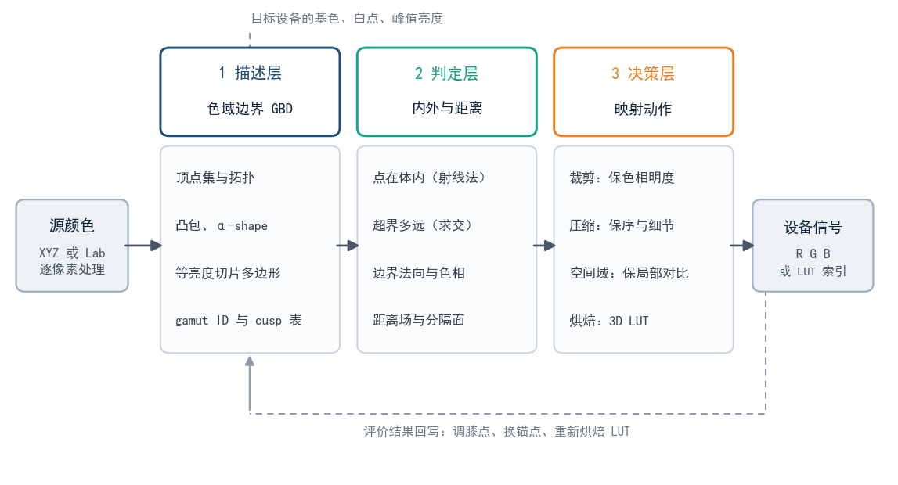
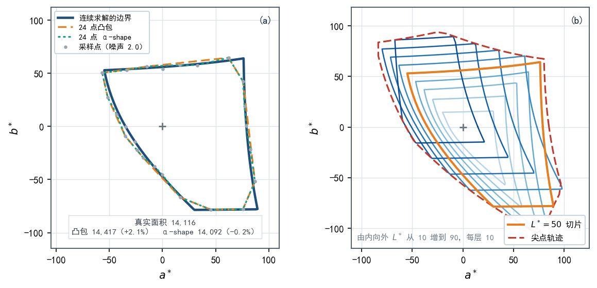
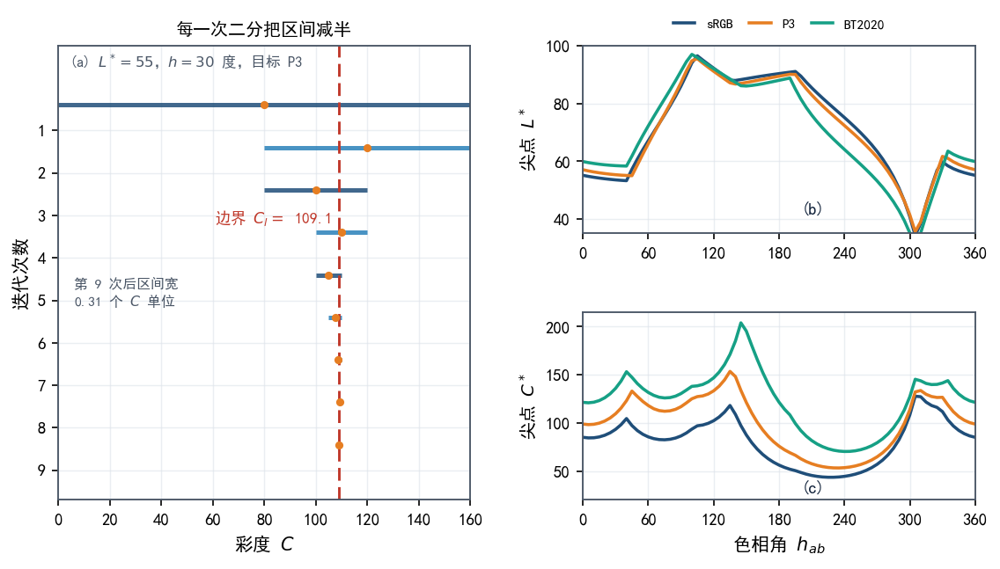
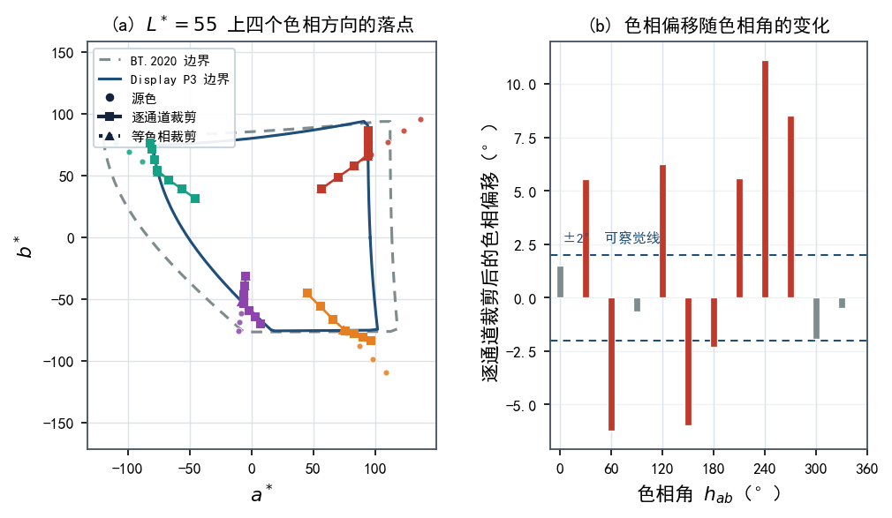

# 第 10 章 色域映射的算法与实现

色域映射在论文里通常被写成一条公式：给定源颜色 $c_s$ 和目标色域 $G_t$，求 $c_t=f(c_s)$。落到工程里，这条公式背后是一套分工明确的模块：一个能回答"边界在哪"的数据结构，一个能回答"这个点在不在里面、离边界多远"的判定器，一个决定"超界了往哪走"的决策器，最后还要把结果烘焙成查表数据塞进固件或驱动。同一条公式，模块划分不同，代码的可测性、可回退性和运行成本能差一个数量级。本章按这条工程链路的顺序讲，从色域边界描述开始，到 3D LUT 结束，中间把几类算法的实现细节拆到可以照着写的程度。

## 10.1 三层结构：描述、判定、决策

图 10-1 是这条链路的数据流。左侧是源颜色，右侧是设备信号，中间三层各管一件事。

描述层负责回答"目标色域的边界长什么样"。它的输出不是一个公式，而是一组可查询的数据结构：顶点集与拓扑、等亮度切片多边形、gamut ID 与尖点表。这些结构一旦建好就固定下来，与具体的源颜色无关，可以一次构建、反复使用。

判定层负责回答两个问题：这个点是否在色域内，如果不在，它离边界有多远、沿哪个方向最近。前者是一次布尔查询，后者是一次带方向的求交。两者都建立在描述层的数据上，本身不含任何"审美"决策。

决策层才是通常所说的映射算法。它拿到判定结果，决定往哪个方向移动多少距离：裁剪是移到最近的边界点，压缩是按比例缩小半径，空间域方法是先做保边分解再对细节层单独处理。

把这三层分开有一个直接的好处：判定层可以单独测试。给一批已知在界内、界外的点，检查判定器的输出是否与暴力采样的结果一致，这一步能在几秒钟内跑完，而且不需要任何视觉评估。如果判定层有 bug，上层的所有算法都会带着同样的偏差，而这种偏差在画面上表现为"整体偏了一点"，很难归因。反过来，如果判定层可信，那映射结果不理想时就可以专心调参数，不必怀疑底层。

图 10-1 的虚线给出了另一条回路：评价结果回写。映射效果的统计数据（色差分布、色相偏移量）会反过来影响参数选择，必要时重新构建边界或重新烘焙 LUT。这条回路在工程上是常态，一次调参就定稿的项目很少。



图 10-1 里三个层次的框内列出了各自的数据形态。描述层给的是顶点集、凸包或 α-shape、等亮度切片多边形、gamut ID 与尖点表；判定层给的是射线法求交、超界距离、边界法向与色相、距离场与分隔面；决策层给的是裁剪（保色相明度）、压缩（保序与细节）、空间域（保局部对比）、烘焙（3D LUT）。右侧两个框标出输入与输出的量：左边是 XYZ 或 Lab 的逐像素值，右边是 RGB 或 LUT 索引。中间那条从"设备信号"回到"描述层"的虚线是反查路径——映射后的结果要重新经过设备模型才能验证是否真的落在色域内，因为数值上的落点与设备能不能真发出来是两件事。

这一层分离还能解释一个常见现象：同一个算法在不同软件里结果不一样。原因往往不在算法本身，而在描述层的精度。用 24 个顶点做的凸包与用 200 个切片点重建的边界，在色域尖角附近的差异可以到 2 个 $\Delta E_{00}$，上层算法再精确也补不回来。

## 10.2 色域边界描述

色域边界是一个三维曲面。描述它的办法有几类，各自的精度、构建成本与查询成本不同，选哪一类取决于用途。

**解析式描述**适用于三基色显示的纯色域。给定 RGB→XYZ 矩阵与传递函数，边界由 RGB 立方体的六个面映射得到，每个面对应一个分量取 0 或 1，因此边界是六块曲面的并集。查询一个点是否在界内，只需把它转成 RGB 再检查三个分量是否都落在 $[0,1]$。这是最精确的描述，成本几乎为零。它的局限是只能描述"纯粹由三基色混出的颜色"：一旦加入局部调光、ABL 导致的色域收缩、或者多原色显示，边界就不再是六个面的并集，解析式失效。

**采样加凸包**是最通用的做法。在设备信号空间均匀采样（例如 $17^3$ 或 $33^3$ 个点），把每个点转到 Lab，然后求点集的凸包。凸包的好处是查询快（一次点与半空间的比较），构建也有成熟算法。问题在于色域通常**不是凸的**。液晶在高亮度端的饱和度收缩、局部调光带来的凹陷，都会让真实边界出现内凹，凸包会把这些凹陷填平，导致一个本来显示不出来的颜色被判为界内。

图 10-2 的 (a) 量化了这种差异。真实边界用连续求解得到（把每个色相方向上的最大彩度用二分法解到 1e-4），凸包用 24 个采样点构建，α-shape 同样用 24 个点。真实面积 14.116（单位是 $a^*b^*$ 平面上的面积），凸包 14.417，偏大 2.1%；α-shape 14.092，偏小 0.2%。凸包偏大的方向集中在边界内凹处，α-shape 用 $\alpha$ 参数把凹进去的部分挖掉，代价是对采样噪声敏感——图中采样点在 Lab 里加了 2.0 的随机噪声，α 取小了会把边界切成碎片，取大了退化成凸包。



图 10-2 的 (b) 展示了另一种组织方式：不建三维结构，而是按亮度切成一组二维多边形。图中 $L^*$ 从 10 到 90 每 10 一刀，共九片，每片是一个凸多边形；最外圈的红色虚线是尖点轨迹，把所有切片上彩度最大的点连起来。切片法的好处是查询简单（给定 $L^*$ 插值到相邻两片，再做二维点在多边形内的判定），而且能直接暴露色域随亮度收缩的形状——从图上看，$L^*=10$ 与 $L^*=90$ 的截面面积只有峰值的三成左右，暗部与高光端的色域收得很快。

切片法的代价是亮度方向的分辨率。层与层之间线性插值，遇到尖点随亮度剧烈移动的区域（例如 $L^*$ 从 50 到 60 的蓝色方向），插值出来的边界会切掉真实的凸起或保留不存在的凹陷。层数从 9 加到 19，边界误差能降一个数量级，构建成本也翻倍。实践中常见的折中是 17 层，在 $L^*\in[30,80]$ 区间加密，两端放稀。

**gamut ID** 是另一类描述，用一维函数表示每个色相方向的边界半径。它只适用于边界在径向上是"星形"的情形（每个方向只有一个边界点），对多数显示器成立，对某些多原色设备不成立。gamut ID 的查询成本最低（一维插值），常被用在实时渲染里。

**cusp 表**不是完整的边界描述，而是把每个色相上的尖点（该色相下彩度最大的点及其亮度）预先算好，存成一张按色相索引的表。裁剪与压缩类算法大量依赖尖点位置（见 10.4 与 10.5），单列一张表能省掉重复求解。

几类描述的实际成本差别很大。以 33 层切片、每层 72 个方向为例，构建期要做 $33\times72=2376$ 次边界求值，每次约 12 次二分，总计不到三万次设备模型调用，在一台普通机器上是零点几秒的量级；查询期一次判定只涉及两片多边形与几十次叉积，微秒级。凸包方案的构建更便宜，但如果要处理内凹，就得把采样点加密到几千个，查询时的半空间数量随之上升，反而更慢。这也是切片方案在中高端实现里更常见的原因。

采样密度还有一个隐性约束：设备模型的非线性。液晶在低灰阶的响应曲线很陡，采样点如果按信号均匀分布，转到 Lab 之后在暗部会稀得可怜，边界在那里几乎是用直线连起来的。正确的做法是按感知量均匀采样，或者按信号采样但在暗部加密。这一点在 HDR 内容上尤其明显，因为 PQ 编码已经把暗部摊开了，而设备模型本身仍是 gamma 型的。

## 10.3 内/外判定与带方向的求交

判定一个点是否在色域内，最简单可靠的办法是把它转成设备信号再检查范围：$r,g,b\in[0,1]$ 且不越界。这个办法隐含依赖设备模型（矩阵加传递函数）的准确性，对纯三基色显示是最优解。对采样描述的色域，则需要几何判定。

三维凸包的判定是一次线性规划：点在凸包内当且仅当它满足所有半空间约束。采样点数量到几千时，半空间的数量在几百量级，单点判定的成本与半空间数成正比。批量处理时通常先把半空间整理成面片，按法向排序，用空间划分（BVH 或 kd 树）把每次判定的比较次数压到十几个。

切片描述的判定是二维问题。给定点 $(L^*,a^*,b^*)$，先找相邻两片 $L_i\le L^*\le L_{i+1}$，在每片上做二维点在多边形内判定，再按亮度插值。多边形的边数在几十的量级，一次判定要做几十次叉积，成本可以接受。

带方向的求交是映射的核心操作。给定源色 $c_s$ 与一个方向 $\mathbf{d}$（通常沿等色相线，也可能是边界法向），求射线 $c_s+t\mathbf{d}$ 与边界的交点。对切片描述，这件事化成二维射线与多边形求交：遍历多边形的每条边，用参数方程解出 $t$，取最小的正解。

直接线性求解在边界是曲线时会引入误差。实际边界由设备模型决定，在多边形近似下是折线，线性求交得到的交点落在折线的顶点之间，与真实的曲面边界差半个折线段。要更精确，就用二分法：先在 $t\in[0,t_{\max}]$ 上判断端点是否越界，再反复折半直到区间宽度小于阈值。二分法的收敛速度是每步一位二进制，从 $t_{\max}$ 到 $10^{-3}$ 的相对精度需要 10 次左右，每次都要做一次判定，总成本比线性求交高一个数量级，但误差可控。

二维点在多边形内的判定用射线法，代码不长，但边界情况要处理干净：

```python
def point_in_poly(x, y, poly):
    """poly 为 (N,2) 顶点序列，逆时针。返回 True 表示在内部或边界上。"""
    inside = False
    n = len(poly)
    for i in range(n):
        x1, y1 = poly[i]
        x2, y2 = poly[(i + 1) % n]
        # 先判是否落在线段上（含端点），避免浮点误差把边界点判到外面
        cross = (x2 - x1) * (y - y1) - (y2 - y1) * (x - x1)
        if abs(cross) < 1e-12 and min(x1, x2) <= x <= max(x1, x2) \
                and min(y1, y2) <= y <= max(y1, y2):
            return True
        # 射线向右，统计穿越次数；半开区间避免顶点被数两次
        if (y1 > y) != (y2 > y):
            xt = x1 + (y - y1) * (x2 - x1) / (y2 - y1)
            if xt > x:
                inside = not inside
    return inside
```

这个实现有两处常见的错误写法值得点出来。第一处是边界点的归属：如果不单独判"落在线段上"，边界上的点会因为浮点误差被随机判成内或外，映射时在边界附近产生跳变。第二处是半开区间的处理：判断 `(y1 > y) != (y2 > y)` 而不是 `y1 <= y <= y2`，这样水平边与顶点不会被重复计数，穿越次数才不会出错。

射线与多边形求交同样要注意方向。给定源点 $p$ 与方向 $\mathbf{d}$，对每条边 $(p_1,p_2)$ 解 $p+t\mathbf{d}=p_1+u(p_2-p_1)$，用叉积写出 $t$ 与 $u$，要求 $t>0$ 且 $u\in[0,1]$，取最小的 $t$。$u$ 的边界情况（射线正好穿过顶点）要按顶点编号加一个微小偏移打破对称，否则同一个顶点会被两条边各算一次。

工程上常用的折中是"线性求交加一次修正"：先用多边形求交得到一个初值，再用设备模型在这个初值附近做一次牛顿迭代，把点拉到真实边界上。这一步对解析式描述的设备有效，对采样描述的色域没有意义，因为采样点之间没有可微的模型。

方向的选择同样影响结果。等色相线方向是 $a^*b^*$ 平面上过原点的径向，边界法向则是垂直于边界的方向。前者保色相，后者保"最近距离"。两者的差别在边界曲率大的地方最明显：绿区边界在 $a^*b^*$ 上是外凸的圆弧，法向与径向能差十几度；蓝紫区的边界接近直线，两者几乎重合。裁剪类算法用径向，最小色差类算法用法向或直接搜索。

距离场是另一种做法，适合需要反复查询"离边界多远"的场合。做法是在切片平面内把多边形内部填充成有符号距离（内部为正、外部为负），存成一张二维表，查询时插值。表的尺寸应与映射精度匹配：$L^*$ 方向 200 格、色相方向 360 格、径向 128 格，合计不到一千万个单元，用 float16 存是 20 MB 量级，对内存宽裕的实现可以接受；若只存峰值亮度附近的关键层，能压到几 MB。距离场的优势是查询变成两次插值，比射线求交快一个数量级；代价是构建成本与存储，而且距离场只给出距离，不给出"该往哪个方向走"——方向仍需从场量的梯度取。

一个实际例子能说明什么时候值得用距离场。如果映射需要逐帧对整幅图像跑三次以上（例如先做色调映射、再做色域映射、最后做一次显示端补偿），每次都重新求交就是三次成本；这时把距离场缓存下来，第一次构建后两次都变成查表，总成本反而更低。反过来，如果只跑一次，建场的开销比求交还大。

## 10.4 尖点查询与二分终止条件

尖点（cusp）是每个色相下彩度最大的点，写成 $(\mathrm{cusp}_L(h),\mathrm{cusp}_C(h))$。它在裁剪与压缩里都要用到：膝形压缩的膝点由它决定，cusp 裁剪的落点是它本身，某些色调映射的锚点也取它。

求尖点是一次一维极值搜索。固定色相 $h$，沿亮度扫描，每个 $L$ 上求该色相的最大彩度 $C_{\max}(L,h)$，再找使 $C_{\max}$ 最大的 $L$。难点在于 $C_{\max}(L,h)$ 本身没有解析式，每次求值都是一次二分。

图 10-3 的左图把一次二分的过程画了出来。目标是在 $L^*=55$、$h=30°$ 的射线上找到 P3 色域的边界彩度，初值区间取 $[0,160]$，每次折半，横轴是彩度，纵轴是迭代次数，蓝色线段是当前区间，橙点是区间中点。第 1 次折半后区间从 160 缩到 80，第 3 次之后中点已经贴在边界上，第 9 次时区间宽度只剩 0.31 个彩度单位。红色虚线标出真值 $C_l=109.1$。



图 10-3 右图是三个色域的尖点轨迹，横轴是色相角，上图画尖点亮度，下图画尖点彩度。三条曲线的形状一致：尖点亮度在 $h\approx110°$（黄绿）达到高峰，约 96 到 98；在 $h\approx310°$（品红偏蓝）跌到谷底，约 33 到 36；尖点彩度则在黄绿与蓝色两个方向各有一个峰。BT.2020 的尖点彩度最高到 204，P3 到 152，sRGB 到 118，比例与体积比大致对应。

这些数值有直接的工程用途。比如膝形压缩的膝点取尖点彩度的 90%，那么黄绿方向（$h\approx110°$）的膝点就在 $0.9\times204=184$ 附近，而品红方向只有 $0.9\times60=54$ 附近。如果用同一个绝对彩度值做膝点，黄绿方向压得过狠、品红方向几乎不起作用，这正是"按色相分别设参"的必要性来源。

求尖点的循环写成两层：外层沿亮度扫描，内层对每个亮度做彩度二分。外层的采样密度不必很密，17 个点足够定位峰值所在的区间，再在区间内做三点抛物线插值即可：

```python
def cusp(h, gamut, nL=17):
    """返回 (L_cusp, C_cusp)：固定色相 h，在亮度上找彩度极大值。"""
    Ls = np.linspace(5.0, 98.0, nL)
    Cs = np.array([cmax(l, h, gamut) for l in Ls])
    i = int(np.argmax(Cs))
    # 在峰值附近用三点抛物线插值细化
    if 0 < i < nL - 1:
        y0, y1, y2 = Cs[i - 1], Cs[i], Cs[i + 1]
        denom = (y0 - 2 * y1 + y2)
        if abs(denom) > 1e-9:
            dL = 0.5 * (y0 - y2) / denom          # 以格点为单位，∈(-1,1)
            L_c = Ls[i] + dL * (Ls[1] - Ls[0])
            C_c = y1 - 0.25 * (y0 - y2) * dL
            return L_c, C_c
    return Ls[i], Cs[i]
```

这段代码里有一个容易被忽略的取舍：内层 `cmax` 的精度决定了外层的可用精度。如果内层只做到 1 个彩度单位，外层插值再精确也没有意义。经验上内层做到 0.05 到 0.1 个彩度单位，外层 17 个点加抛物插值，尖点定位误差在 0.2 个彩度单位以内，够用。

二分的终止条件要写清楚，否则会引入不易察觉的偏差。三种常见写法：绝对容差（区间宽度小于 $\epsilon$，单位是彩度）、相对容差（宽度小于初值的 $\epsilon$ 倍）、固定迭代次数。绝对容差在低彩度区（例如灰色附近）会把区间宽度浪费在无意义的精度上；相对容差在大色域与灰色之间表现不均；固定次数最简单，但边界宽度随色相变化时精度不一致。

稳妥的做法是双层判据：区间宽度小于 $0.05$ 个彩度单位，或迭代次数超过 24 次，两者满足其一即停。$0.05$ 相当于 $\Delta E_{00}$ 的 0.05 量级，远低于可察觉阈值，够用。24 次的上限是为了防止在数值异常（例如设备模型在该色相无解）时死循环。

还有一个容易忽略的细节：$C_{\max}(L,h)$ 在设备模型的边界处可能不连续。局部调光与 ABL 会把某个亮度段的上限突然压低，形成台阶，这时二分收敛到台阶边缘，结果对初值敏感。解决办法是先在亮度方向上做一次粗扫描（例如 17 个点），找到 $C_{\max}$ 的单调段，再在段内二分。多花的这一次扫描能避免结果在相邻亮度上跳动。

## 10.5 裁剪类的实现

裁剪的思路是把超界的颜色搬到边界上，保留一部分属性。三类实现各有各的取舍。

**逐通道裁剪**最省事：把设备信号夹到 $[0,1]$。代码只有一行，运行成本为零，问题是色相会偏。第 5 章给过量化结果，12 个色相方向里有 9 个的偏移超过 2° 的可察觉线，蓝紫方向到 7.7°。它适合的场景只有一类：内容本身就是图形与标志，色相偏移不改变语义，而速度要求极高。

**等色相裁剪**固定 $L^*$ 与 $h$，把 $C$ 压到当前亮度的边界值。实现上就是一次边界求值，成本与二分次数成正比。它的色相偏移严格为零，代价是在边界曲率大处落点不一定最近。

**HPMINDE**（hue-preserving minimum $\Delta E$）在等色相线上做一维搜索，找使 $\Delta E_{00}$ 最小的边界点。注意"等色相线"与"最小色差"是两个约束，前者限制搜索方向，后者决定在哪一点停。标准做法是在 $L^*$ 方向上也放开，只在 $h$ 上固定，搜索范围是一个二维区域（$L$ 与 $C$ 都变，$h$ 固定），寻找使 $\Delta E_{00}$ 最小的边界点。这时问题变成"在一条曲线（等色相线与色域边界的交线）上找最优点"，可以沿边界采样 20 到 30 个点，再在最优邻域内用三点二次插值细化。

三点二次插值这一步值得单独说。沿边界取三个相邻点 $p_{i-1},p_i,p_{i+1}$，用它们的 $\Delta E_{00}$ 拟合一条抛物线，取顶点作为候选最优点，再把它投影回边界。相比纯采样，这一步把定位误差从采样间隔降到采样间隔的十分之一量级，额外成本只有一次投影。

**cusp 裁剪**把落点定在该色相的尖点上。它的好处是完全可预测（不依赖搜索），坏处是同一个色相的所有超界色都被压到同一个点，渐变断裂最严重。它适用于色彩数量少的图形内容，以及作为"保底"策略——当其他算法因数值问题失败时回退到 cusp。

图 10-4 把前两种算法的差别画在 $a^*b^*$ 平面上。取 $L^*=55$ 这一层，四个色相方向（红 35°、青绿 145°、蓝紫 262°、品红 315°）各放 7 个彩度递增的源色，其中一半落在 Display P3 之外。实心方块串是逐通道裁剪的落点，虚线三角串是等色相裁剪的落点。左半部分的红与青绿方向上，两者区别不大，因为那两个方向的边界法向与径向夹角很小；到了蓝紫与品红方向，逐通道裁剪的落点明显向切向偏，轨迹跟着边界拐了个弯，而等色相裁剪的落点始终在半径上。



右图把色相偏移按 30° 间隔画出来，红色柱是超过 ±2° 可察觉线的方向。偏得最厉害的是 240°（10.9°）与 270°（8.4°），150° 与 30° 也在 6° 上下，青绿与黄绿方向反而接近零。这个分布与 10.2 节提到的边界形状有关：蓝紫方向的边界在 $a^*b^*$ 上接近直线，三个通道的溢出量差别大，截断后比例失衡最明显。把两张图放在一起看，可以得出一个工程结论：如果内容以自然图像为主（肤色、天空、植物），逐通道裁剪的代价主要体现在蓝紫物体上（深蓝布料、蓝紫色灯光）；如果内容是图形与 UI，色相偏移不改变语义，逐通道裁剪仍然是成本最低的选择。

实现层面有一个共性问题：**边界求值的一致性**。同一条等色相线上，如果边界求值在相邻两个采样点用了不同的初值区间，得到的边界点会跳变，映射结果出现条纹。避免办法是把边界求值写成纯函数，初值区间由目标的峰值亮度与色域体积统一决定，不依赖源色的位置。

另一个问题是**批量处理的性能**。逐像素调一次二分，在 4K 分辨率下是 800 万次边界求值，即使每次只要 10 微秒也是 80 秒。实际实现几乎都会预先烘焙成 LUT（见 10.7），或者用分块策略：把画面按亮度与色相分成若干块，每块只算一次边界，块内插值。

分块的参数要按内容选。按 2° 色相、2 个 $L^*$ 单位分块时，$360\times50=18000$ 块，每块算一次边界花掉约 0.2 秒，块内插值带来的边界误差在 0.3 个彩度单位以内。再放大块尺寸，误差会快速上升：4° 色相分块时，蓝色方向的边界在 $h\approx305°$ 附近弯得很急，块内线性插值会把拐角切掉约 1.5 个彩度单位，落在尖角区的高饱和蓝紫会被判为界内，最终被截断，出现一条可见的硬边。

还有一个容易被忽略的成本：颜色空间的往返。逐像素做 Lab 转换、边界求值、再转回 RGB，每次都包含两次矩阵乘法与非线性运算。在 4K 60 fps 的链路上，这部分开销不可忽略，优化手段包括把转换合并成一次 3×3 矩阵、预先在设备信号空间建索引、以及把边界查询改成二分查找。

## 10.6 压缩类的实现

压缩的思路是把整个彩度范围单调地压进目标色域。ICC v4 的感知意图用 SGCK，它的实现可以拆成三段，顺序不能颠倒。

第一段沿亮度方向压缩。把源的黑白端点映射到目标的黑白端点，用一条 S 形曲线：端点处斜率为 1，中段斜率略大于 1。写成参数化形式：

$$L_{\text{out}}=L_{\min,t}+(L_{\max,t}-L_{\min,t})\cdot s\!\left(\frac{L_{\text{in}}-L_{\min,s}}{L_{\max,s}-L_{\min,s}}\right)$$

其中 $s(\cdot)$ 是归一化的 S 形函数，常用 $s(x)=x+a\,x(1-x)(2x-1)$ 的形式，$a$ 控制中段的斜率抬升量。$a=0$ 时退化为线性映射；$a=0.3$ 时中段斜率约 1.45，两端各留出约 0.55 的斜率。$a$ 取太大（例如 0.6）会让中段过陡，暗部与高光被压扁，画面出现"中间调发灰"。

第二段沿彩度方向用膝函数。设源彩度 $C_s$ 与目标边界 $C_l$，膝点 $C_k=\kappa C_l$，膝点以内恒等，以外按指数收敛：

$$C_{\text{out}}=\begin{cases}C_s, & C_s\le C_k\\[2pt] C_k+(C_l-C_k)\left[1-\exp\!\left(-\dfrac{C_s-C_k}{C_l-C_k}\cdot\dfrac{1}{\tau}\right)\right], & C_s>C_k\end{cases}$$

$\tau$ 控制末端斜率。$\tau\to0$ 时退化为硬裁剪，$\tau$ 越大收敛越平缓。$\kappa=0.9$、$\tau=0.5$ 是一组常见取值：膝点在边界的九成处，末端斜率约 0.1，与第 5 章的膝形曲线一致。

第三段把亮度压缩与彩度压缩按色相加权混合。红黄方向以彩度压缩为主，蓝方向以亮度压缩为主，因为蓝紫区的尖点位置随亮度变化剧烈，只压彩度会让这些颜色变得不自然地暗或亮。权重写成色相角的函数，在 $h\approx90°$（黄）处权重 0.2，在 $h\approx270°$（蓝）处权重 0.7，中间平滑过渡。

三段实现的顺序影响结果。先压亮度再压彩度时，彩度压缩用的边界 $C_l$ 应该是**压缩后亮度上的边界**，不是原亮度上的；反过来先压彩度再压亮度，亮度压缩的输入已经是压过彩度的颜色，S 形曲线的端点要相应调整。ICC 的参考实现用前者，理由是亮度压缩改变了颜色在色域内的相对位置，后续的彩度判断必须基于新位置。

膝函数的代码要防两处退化：$C_s\le C_k$ 时不做压缩，$C_l-C_k$ 接近零时指数项会爆。写法如下：

```python
def knee(C_in, C_lim, kappa=0.9, tau=0.5):
    """彩度方向的膝形压缩：膝点以内恒等，以外指数收敛到 C_lim。"""
    C_k = kappa * C_lim
    span = C_lim - C_k
    if span < 1e-6:                 # 膝点贴在边界上，退化为硬裁剪
        return min(C_in, C_lim)
    if C_in <= C_k:
        return C_in
    return C_k + span * (1.0 - np.exp(-(C_in - C_k) / span / tau))
```

检查它的末端行为：$C_{in}\to\infty$ 时输出趋于 $C_k+span=C_{lim}$，不会越界；$C_{in}=C_k$ 时两段在 $C_k$ 处连续；导数在膝点从 1 跳到 $1/\tau$，$\tau=0.5$ 时跳到 2，这是膝形压缩在膝点附近"先陡后缓"的来源。若希望导数也连续，把指数项换成 $1-\exp(-x)$ 的平方或三次形式，代价是多一个参数。

亮度那一段的 S 形函数也有参数陷阱。$s(x)=x+a\,x(1-x)(2x-1)$ 在 $a>0.5$ 时会在两端产生负斜率，映射出现非单调，暗部亮度反而升高。安全范围是 $a\in[0,0.45]$，超过就要换用真正的 sigmoid（例如 $1/(1+e^{-k(x-0.5)})$ 的归一化形式），并显式检查端点斜率。

**参数扫描**是调参时的常规动作。把 $\kappa$ 与 $\tau$ 在一组网格上扫描，对每个组合算色差统计与色相偏移，取帕累托前沿上的点。经验上 $\kappa\in[0.8,0.95]$、$\tau\in[0.3,0.8]$ 覆盖了多数可用的组合；$\kappa$ 偏小则边界内的颜色也被压（画面发灰），$\kappa$ 偏大则末端过陡（边界附近出现硬边）。

**多锚点映射**是压缩类里更精细的一支。锚点选白、黑、中灰与几个记忆色（肤色、天空蓝、草地绿），每个锚点给一个目标位置，锚点之间用平滑插值。它的实现难点在冲突消解：锚点的目标位置由人指定，彼此可能矛盾（例如"肤色要亮"与"整体要压暗"）。常见的做法是把它写成一个带约束的优化，目标函数是加权色差，约束是映射的单调性与色相保持。

**空间域方法**在实现上另成一路：先用保边滤波把图像分成基础层与细节层，基础层的色域映射照常做，细节层乘以一个由压缩比决定的增益。这样能保住局部对比，代价是可能出现光晕——滤波器的尺度越大，光晕越明显。改进办法是用引导滤波替代双边滤波，或者对细节层的增益做限幅。实际产品里用得不多，因为分层的参数难以统一，不同内容需要不同设置。

## 10.7 烘焙成 3D LUT

逐像素跑算法的成本太高，实际部署几乎都烘焙成 3D LUT：在输入空间取规则网格，每格算一次映射，运行时用插值查询。

网格数决定精度与体积。$17^3=4913$ 个格点，按 16 bit 存储是 29 KB；$33^3=35937$ 个格点，214 KB；$65^3=274625$ 个格点，1.6 MB。精度上，映射函数的局部曲率越大，需要的格点越密。色域映射在边界附近有折点（裁剪的拐角、膝函数的膝点），这些位置的插值误差最大，一套 $17^3$ 的 LUT 在拐角附近的误差可以到 1 到 2 个 $\Delta E_{00}$，$33^3$ 降到 0.3 到 0.5，$65^3$ 基本可以忽略。

烘焙的骨架很短，难点都在细节里：

```python
def bake_lut(map_fn, n=33, margin=1):
    """在输入空间取 n^3 网格，每格调用 map_fn；margin 为外延格数。"""
    grid = np.linspace(-margin / (n - 1), 1 + margin / (n - 1), n + 2 * margin)
    lut = np.empty((n + 2 * margin,) * 3 + (3,), dtype=np.uint16)
    for i, r in enumerate(grid):
        for j, g in enumerate(grid):
            for k, b in enumerate(grid):
                out = map_fn(np.clip([r, g, b], 0.0, 1.0) if margin else [r, g, b])
                lut[i, j, k] = np.round(np.clip(out, 0, 1) * 65535).astype(np.uint16)
    return lut
```

注意 `margin` 那一行：外延格里的输入超出 $[0,1]$ 时**不要**裁剪，否则端点又变成平台；只有真正参与映射时才裁剪。这个区别在渐变的两端最明显，裁剪与不裁剪的差别就是有没有一条硬边。

插值方式影响更大。三线性插值用立方体的 8 个顶点，四面体插值只用 4 个。对线性函数两者都精确；对非线性函数，四面体插值的误差通常比三线性小 30% 到 50%，因为它沿四面体的棱做插值，不引入"面内平面假设"。代价是四面体插值要做 6 次区域判定（把立方体切成 6 个四面体），计算量约是三线性的 2 倍。硬件上四面体插值有成熟实现，成本可以接受，所以 HDR 链路的 LUT 普遍用四面体。

**边界外延**是烘焙时必须处理的问题。输入落在网格第一格之前或最后一格之后时，插值需要外延。简单裁剪会在端点产生平台（多对一），在渐变里表现为色带。稳妥的做法是在构建网格时把范围略微超出实际输入范围（例如各方向多留一格），外延只发生在超出的那一格里，对正常输入不产生影响。

**量化**是另一个坑。输入是 10 bit 或 12 bit，输出也是 10 bit，LUT 的每个节点都要量化到输出位深。节点量化误差会通过插值传播，在平滑区域形成细小的台阶。解决办法是把 LUT 存成 16 bit（或 32 bit float），运行时再量化，或者对输出做一次抖动。

**LUT 的验证**不能只看生成日志。可靠的做法是抽样对比：随机取 1 万个输入，分别走"直接算"与"查 LUT"两条路，比较两者的 $\Delta E_{00}$，看 95 分位是否在可接受范围（通常要求小于 0.5）。这一步能发现网格不够密、外延处理错误、量化精度不足三类问题。

**增量更新**在调参时很有用。改一个膝点参数，整张 LUT 都要重算，$33^3$ 网格在普通 CPU 上大约几十秒。如果参数只影响彩度方向，可以只重算彩度相关的切片，把时间压到几秒。多参数联合调参时，把 LUT 生成写成纯函数、参数化输入，配合缓存，能把迭代周期从分钟级降到秒级。

## 10.8 数值与工程细节

**灰轴奇点**。色相角在 $C\to0$ 时没有定义。任何依赖 $h$ 的操作（等色相搜索、按色相加权）在灰色附近都会失效。实现上必须显式处理：当 $C$ 小于阈值（例如 1.0）时直接按灰轴映射，跳过色相相关的分支。不做这个判断的程序在灰色区域会输出随机的色相，表现为暗部出现彩色噪点。

**色相折返**。从 350° 插到 10° 时，数值上要按最短弧走，先算 $\Delta h=((h_2-h_1+180)\bmod360)-180$，再累加。直接线性插值会经过 180° 的青绿，画面上冒出一段不该有的颜色。三行代码，写错的人不少。

**NaN 传播**。设备模型在极端输入（负的 XYZ、超出量程的亮度）下可能返回 NaN。一次 NaN 会在后续的除法与幂运算里扩散，最终把整块区域染黑或染白。稳妥的做法是在每一层的出口做一次有限性检查，遇到非有限值就回退到最近的有效策略（通常是裁剪到边界）。

**单调性校验**。好的映射在径向上必须单调：同一个色相、同一个亮度下，源彩度越大，映射后的彩度不应更小。这个性质在实现里可能被破坏：边界求值的抖动、插值的过冲、多锚点映射的冲突都会造成局部非单调，表现为渐变里出现"回折"的暗带。校验办法很直接：在若干色相与亮度上采一条径向的源色序列，检查输出是否单调，不单调就报错。

**缓存与并行**。批量处理时，边界求值的结果可以按（色相、亮度）二维索引缓存，命中率在自然图像上通常超过 90%。并行化要小心：共享的缓存需要线程安全，或者改成每个线程独立缓存再合并。LUT 烘焙天然可并行，按网格切片分给多个线程即可。

**精度与性能的权衡**。用 float32 还是 float64，在单点计算上差别不大，但在 LUT 烘焙里 float64 能让量化误差降一个数量级。反过来，运行时用 float16 做插值能省一半带宽，误差在 1e-3 量级，可以接受。选择取决于链路的位置：烘焙离线，用高精度；运行时在线，用够用的精度。

## 10.9 评价与调参流程

评价分两层：数值指标与视觉复核。

数值指标用第 5 章给过的那一套：$\Delta E_{00}$ 的均值、95 分位与最大值，色相偏移的绝对值分布。样本集合要分层：边界内的颜色、刚超界的颜色、远离边界的颜色分别统计，混在一起会让结论失真。自然图像的样本还要按面积加权，否则大面积背景会淹没小面积的高饱和细节。

视觉复核不能省。数值指标好的方案在画面上可能仍然有问题：天空渐变出现色带、肤色变灰、纯色块边缘出现彩边。复核用的图像要覆盖几类典型内容：平滑渐变、高饱和纯色、肤色、文字与图形、暗部细节。每类看三个点：色相有没有偏、渐变有没有断、暗部有没有出现彩色噪点。

调参的流程通常是：先定色相保持策略（等色相还是允许偏移），再定压缩曲线的形状（膝点与末端斜率），最后定评价的容差。反过来调会陷入局部最优：先调容差，所有方案都能"通过"，但画面问题依旧。

回归测试要有固定样本。每次改参数或改实现，跑同一批样本，比较指标的变化。样本集合固定下来之后，指标的历史曲线比单次数值更有信息量：某个改动让均值降了 0.1 但最大值升了 3，说明它改善了多数颜色、恶化了少数极端色，这类信息只有对比历史才能看出来。

最后是版本管理。色域映射的参数与 LUT 都属于"配置"，必须与代码一起进版本库，并且记录每次变更的原因。实际项目里最常见的事故不是算法写错，而是某次调参后 LUT 没有同步更新，新旧版本混用，画面局部出现不一致。

把整条链路串起来看，一次 HDR 到 SDR 的完整映射大致是这个顺序：先把内容从 PQ 解码到绝对亮度，做色调映射把 1000 或 4000 nit 压到目标峰值，再做色域映射把 BT.2020 收到目标色域，然后线性化目标编码，最后写入 10 bit 信号。每一步都可能改变下一步的输入范围，因此边界必须按"上一步的输出"重建，不能拿内容原始的峰值去建。顺序倒过来也行，但边界需要两次重建，总成本更高。

实现层面的建议只有两条。一是把每个模块写成纯函数，输入输出都是显式参数，这样任何一环出问题都能单独复现；二是把中间结果（边界、尖点表、LUT、统计指标）落地成文件并版本化，调参时只改参数、重跑生成，而不是手工修补。做到这两点，映射这部分的排错时间会降一个量级。

## 本章要点

- 色域映射应该拆成描述、判定、决策三层。判定层可以脱离视觉评估单独测试，这是整条链路可靠性的基础。
- 全解析式描述只适用于纯三基色显示；采样加凸包会填平真实边界的内凹，24 个采样点的凸包面积偏大 2.1%，α-shape 偏小 0.2% 但对噪声敏感；按亮度切片是精度与成本的常见折中。
- 边界求交优先用"多边形线性求交加一次修正"，需要高精度时用二分，终止条件取区间宽度小于 0.05 个彩度单位或迭代 24 次。
- 尖点位置随色相剧烈变化，三套色域的尖点彩度从品红方向的 60 到黄绿方向的 204，按色相分别设参是必要的。
- 裁剪类里逐通道最省事但色相偏移最大，等色相裁剪色相偏移为零，HPMINDE 在等色相线上做一维搜索并用三点二次插值细化。
- 压缩类以 SGCK 为代表，三段顺序不能颠倒，亮度压缩后再求彩度边界；$\kappa\in[0.8,0.95]$、$\tau\in[0.3,0.8]$ 覆盖多数可用组合。
- 部署靠 3D LUT：$33^3$ 网格加四面体插值在拐角附近的误差约 0.3 到 0.5 个 $\Delta E_{00}$，$65^3$ 基本可以忽略；外延与量化必须显式处理。
- 灰轴奇点、色相折返、NaN 传播、单调性破坏是四类最常见的实现缺陷，每一类都能在画面上留下特征痕迹。
