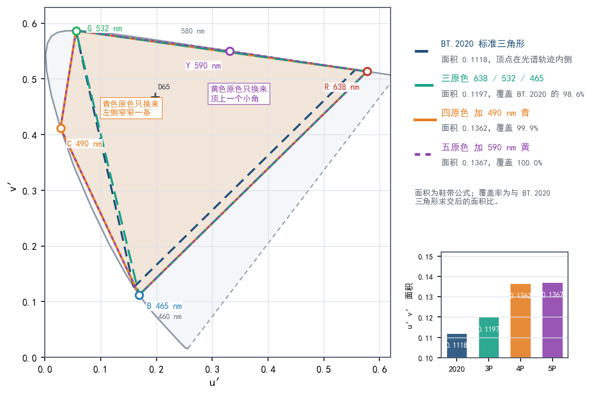
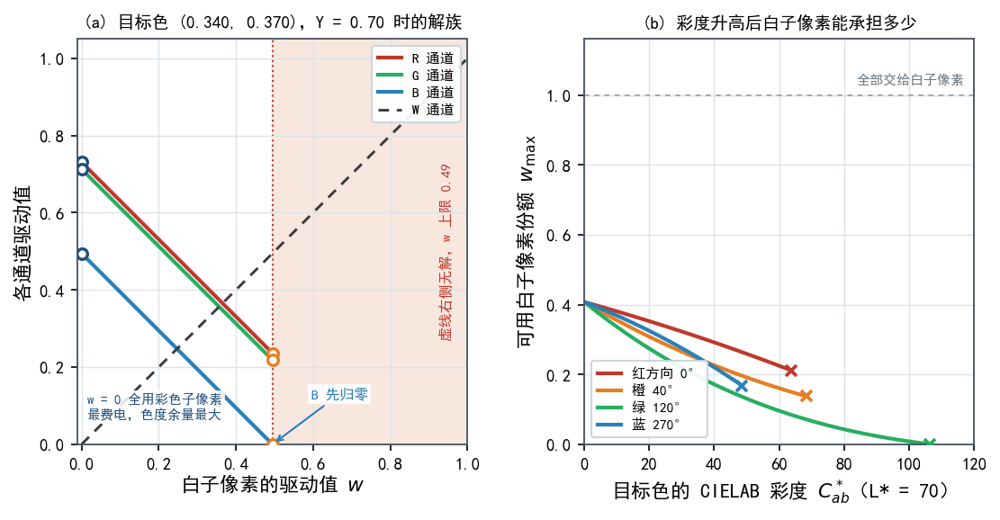
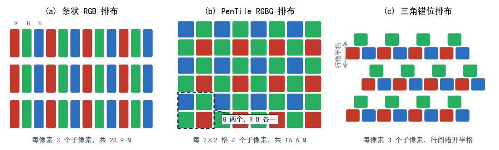
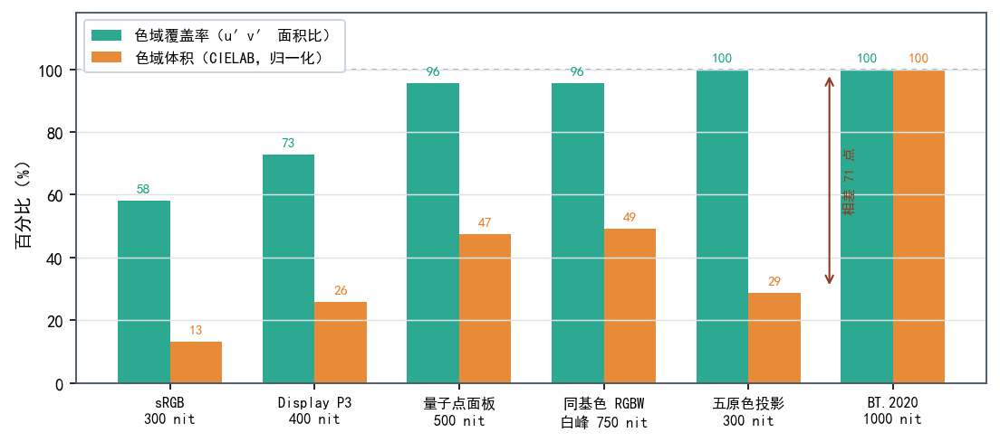
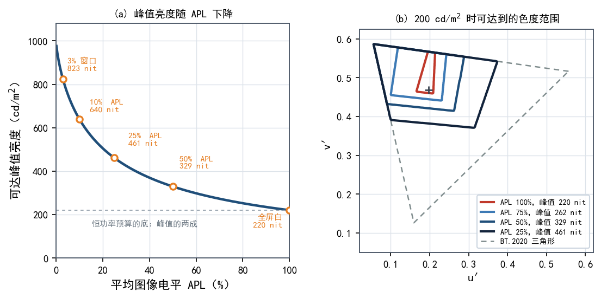

# 第 11 章 多原色显示与广色域工程

三原色是显示工业沿用了百年的约定，不是物理定律。它之所以成立，是因为人眼只有三种视锥细胞，三个数值就足以把一种颜色编码下来。可一旦光源不再是理想谱线，这个约定就开始漏风。荧光粉的绿光宽到六十纳米，红基色落在 625 nm 而标准要求 630 nm，蓝光为了效率不得不往长波挪一点，三角形于是比标准小了一圈。工程师有两条路可选，一是把光源做纯，二是加原色。前者是材料与工艺问题，后者是数学问题。两条路都撞在同一个事实上，颜色是三维的，屏幕却可以有四维、五维的驱动量。

## 11.1 三原色的物理极限

BT.2020 的三组基色坐标不是从现有材料里挑出来的，是从光谱上量下来的。红 (0.708, 0.292) 对应 630 nm，绿 (0.170, 0.797) 对应 532 nm，蓝 (0.131, 0.046) 对应 467 nm。三条都是单色光，落在 CIE 1931 光谱轨迹上。标准写的是"这些波长"，坐标只是它们的另一种写法。所以问题从来不是"能不能做出这个色度点"，而是"能不能做出这一段波长，并且足够窄"。

实际光源发出来的从来不是一根线。荧光粉的谱是一个鼓包，半高全宽几十纳米；量子点窄一些，二三十纳米；氟硅酸钾锰这类窄带荧光粉可以做到五纳米上下；激光只有零点几纳米。鼓包越宽，积分出来的色度点就越往三角形内部跑。用 532 nm 的高斯谱做一个算例，把半高宽从 0.5 nm 拉到 60 nm，观察绿基色坐标与整块色域的覆盖率怎么变。

| 绿基色半高全宽 | 绿基色坐标 $(x, y)$ | 覆盖 BT.2020（u′v′ 面积比） |
|---|---|---|
| 0.5 nm（激光） | 0.171, 0.796 | 99.9% |
| 10 nm | 0.173, 0.793 | 99.7% |
| 20 nm（量子点） | 0.179, 0.783 | 99.1% |
| 30 nm | 0.190, 0.763 | 97.8% |
| 40 nm | 0.205, 0.736 | 95.9% |
| 60 nm（荧光粉） | 0.239, 0.664 | 90.8% |

表里红蓝两项固定用标准值，只动绿。半高宽从二十纳米放到四十纳米，$y$ 从 0.783 掉到 0.736，覆盖率从 99.1% 掉到 95.9%。放到六十纳米，$y$ 只剩 0.664，比 sRGB 的 0.600 高不了多少，覆盖率掉到九成。这解释了广色域面板的一个常见现象，标称"覆盖 BT.2020 的 95%"，八成不是基色坐标错了，是绿光不够窄。二十纳米与六十纳米之间的差别，在样品上看到的是一点点偏青或者偏黄，在数字上是八个多百分点的色域面积。

方向的依赖并不对称。绿基色靠近 $y$ 的峰值，光谱轨迹在这里拐得急，波长稍一偏移，$y$ 就掉得很快；红基色那一段轨迹平缓得多，同样的带宽造成的 $y$ 变化小一半以上。所以窄带化的收益在绿光上最大，这也是量子点和窄带荧光粉都先把绿光做窄的原因。蓝光本身在 460 至 470 nm 附近，光谱轨迹的曲率也大，但蓝的亮度份额只有百分之几，掉一点在体积上看不出来，只在深蓝端看得出来。

半高宽不是唯一的参数。荧光粉的谱形往往不对称，长波一侧拖一条尾巴，这条尾巴把色度点往红的方向拉。用对称的高斯谱去拟合 sRGB 的绿基色 $(0.300, 0.600)$，无论怎么调峰位和带宽都拟合不出来。取 545 nm、半高宽 80 nm，得到 $(0.331, 0.593)$，$x$ 高了一截；取 540 nm、半高宽 65 nm，得到 $(0.291, 0.643)$，$y$ 又高了一截。真实的锌硫化物荧光粉靠那条长波尾巴把 $x$ 推上去、把 $y$ 压下来，才落在标准点上。这条尾巴恰恰是效率的负担，因为尾巴上的能量大部分被滤色片挡掉了。

滤色片的通带能把这个负担量化。假设红色通带取 600 至 655 nm，一条 631 nm、半高宽 5 nm 的窄带红谱几乎百分之百的能量落在通带内；换成 625 nm、半高宽 60 nm 的宽带红谱，只有 72.6% 落在里面；换回 630 nm、半高宽 85 nm 的老式红粉，只剩 56.1%。绿光同理，532 nm、20 nm 宽的谱有 99.9% 落在 505 至 560 nm 内，540 nm、70 nm 宽的谱只剩 63.9%。丢在通带外的能量不但没用，还会被滤色片吸收变成热，抬高面板温度，进一步让波长漂移。窄带化因此同时买到三样东西，色域、效率、热稳定性。

红基色的波长也是同一笔账。把红从 620 nm 挪到 638 nm，覆盖率从 92.7% 涨到 100%，红通道的亮度份额从 0.286 降到 0.251，同时视见函数从 0.381 降到 0.217。前一个数字是色域收益，后两个是效率代价，同样的辐射功率换来的亮度少了四成多。工程上多数产品选在 625 至 632 nm 之间，覆盖率能到 96% 以上，效率还留得住一半。再往长波走，色域涨不动了，亮度一路下滑，红色很快就比不过一盏卤钨灯。

现实产品的绿基色峰值波长大多落在 520 至 535 nm 之间，半高宽 20 至 35 nm。用光谱模型把这几个组合换算出来，525 nm、30 nm 宽对应 $(0.143, 0.775)$，比标准的 $y$ 低 0.023；535 nm、30 nm 宽对应 $(0.211, 0.753)$，低了 0.044。前者偏短波、偏青，后者偏长波、偏黄绿。选哪一头是效率与色域的交换，短波绿的视见函数值低，同样的辐射功率换来的亮度少，长波绿亮一些但色域小。这个取舍在面板规格书上表现为"覆盖率 92%"与"亮度 500 nit"这类互相牵制的数字，背后是同一颗荧光粉的配方。

激光是另一条路。半导体激光器的谱宽在零点几纳米，三基色坐标可以精确落在 BT.2020 的顶点上，覆盖率能到 99% 以上。代价是散斑、成本与安全。相干光在粗糙表面上干涉，形成随机的明暗颗粒，观众看到的是"磨砂"质感，抑制散斑要用振动屏幕、多波长叠加或者去相干光学，每一种都要损失亮度或者增加体积。影院投影愿意付这个代价，因为银幕大、亮度预算高、观众距离远，散斑被平均掉一部分；家用电视不愿意，因为观看距离近，一颗颗颗粒就在眼前。

量子点是折中。光致发光的谱宽由颗粒尺寸分布决定，做得整齐可以到 20 nm，比荧光粉窄一半，又不像激光那样相干。它不自己发光，要蓝光去泵，因此光谱里永远有一段蓝光的泄漏，蓝基色不是纯粹的 467 nm，而是泵浦光与转换光的混合。这一段泄漏在色度图上看不出来多少，在光谱上很清楚，它也让量子点电视的蓝基色比理论值偏紫一点。工程上把泵浦光的波长往短波挪、把转换层做厚，能压住泄漏，代价是效率。

## 11.2 加原色换什么

既然三原色的边界受材料限制，一个自然的想法是多加几个原色。四个、五个、六个原色的样机在投影和实验面板上都出现过，逻辑很直接，色域的凸包由原色点决定，点越多，凸包越贴近光谱轨迹。用谱线做一个算例，三原色取 638、532、465 nm，加一个 490 nm 的青变成四原色，再加一个 590 nm 的黄变成五原色，在 u′v′ 上算面积。

三原色的三角形面积是 0.1197，比 BT.2020 的 0.1118 还大 7%，覆盖率达到 98.6%。加青之后面积涨到 0.1362，覆盖率 99.9%，涨了 14%。再加黄，面积只到 0.1367，覆盖率 100.0%，只多了 0.0005。这条曲线说明一件事，加原色的边际收益取决于加在哪里。青色的点落在绿蓝这条弦的外侧，外扩的是一整条边，收益大；黄色的点几乎贴在红绿弦上，只把那条边顶出一个小角，收益几乎没有。



图 11-1 里最值得看的是那个橙色的小凸起。四原色的多边形是一条不规则的四边形，红绿之间的边被 590 nm 的黄点顶出一个极浅的尖角，肉眼几乎看不出来，面积只从 0.1362 变成 0.1367。这就是"五原色"这个词在色度图上的全部含义，如果第五个原色选在光谱轨迹的拐弯处（比如 490 nm 的青，或者更极端的 505 nm），收益会大一些，但那样的波长在激光器上更贵、在荧光粉上更难做。右下角的柱状图把四种情形的面积排在一起，四原色到五原色的那一格几乎是平的，这个平就是工程上"不值得"的量化表达。

色度面积只是故事的一半。加原色的真实动机在别处，效率、亮度、寿命，三个词概括了消费电子的全部诉求。

效率这一项在液晶上最直观。液晶自己不发光，靠背光穿过液晶层和滤色片，滤色片把三分之二的能量吸收掉，红绿蓝三个子像素加起来，透过率只有百分之几。如果加一个不经过滤色片的白子像素，这部分光原样透出去，白色亮度立刻上一个台阶。工业上常见的做法是四个子像素均分一个像素的面积，彩色子像素各拿四分之一，白子像素也拿四分之一。彩色子像素的面积从三分之一降到四分之一，峰值亮度按比例掉 25%；白子像素没有滤色片损失，同样面积下能出的光比三个彩色子像素之和还多，按常见的效率差估算，白峰可以到原来的 1.5 倍。

这笔账可以用色域体积算清楚。同一组量子点基色，峰值五百 nit 的三原色面板，CIELAB 体积是参考点的 47.4%；改成 RGBW，彩色子像素乘 0.75、白子像素追加 0.75 倍亮度，体积升到 49.1%。涨了两个点，不算多。付出的代价是高饱和色的峰值亮度掉了四分之一，色度覆盖率一点没变，因为白子像素落在三角形内部，凸包不变。

亮度这一项在投影上最直观。黄色是三个原色之外最亮的颜色，视见函数在 555 nm 附近取最大值，一条 570 至 590 nm 的黄光，同样的辐射功率换来的亮度比红和绿都多。四原色投影加黄，五原色投影加黄加青，目的都是抬高白场亮度，让画面在环境光下更抓眼。代价是时间。单片的时序投影靠色轮或者分时点亮，一帧的时间要在各原色之间分配，三原色各占三分之一，五原色各占五分之一，每个原色的峰值亮度掉到原来的六成。加黄买来的亮度，一转身又被占空比收走了。

寿命这一项在自发光器件上最要紧。有机发光材料的蓝光寿命最短，同样的亮度下衰减最快，蓝色子像素往往是最先老化的那个。RGBW 结构让白子像素分担一部分亮度，蓝光的电流密度下降，整块的寿命曲线被拉平。代价是长时间使用后白点会漂移，因为四个子像素的老化速率不同，补偿电路要按使用时长修正各通道的增益，这套补偿本身就是一笔研发成本。

还有一项代价容易被忽略，一致性。三原色面板的每个像素只有三个变量要匹配，四原色有四个，五原色有五个。面板上几百万个像素，每个像素的驱动特性略有差异，变量越多，要标定的参数越多，均匀性补偿的运算量越大。这是多原色显示在实验室里很漂亮、在量产线上很麻烦的根本原因之一。

驱动链的负担可以直接算。4K 面板有 829 万个像素，三原色 10 bit、60 Hz 的原始数据量是 $3840\times2160\times3\times10\times60\approx 14.9\ \mathrm{Gbit/s}$，四原色变成 19.9 Gbit/s，多出三分之一。多出来的不只是接口带宽，还有源极驱动器的通道数、时序控制器的一帧缓冲、以及面板上的数据线数量。手机上的四原色面板有时要把刷新率压低，才能把带宽塞回接口的量程内，而同一块屏用三原色可以做得更高。这笔账在规格表上看不到，在体验上却很明显。

分辨率的账也好算。像素尺寸固定时，一个像素塞进四个子像素，每个子像素只能分到像素面积的四分之一而不是三分之一，开口率下降，为了维持亮度只能加大电流，效率又掉回去。于是多数 RGBW 面板并不是"四个子像素等分"，而是白子像素做大、彩色子像素做小，或者干脆用两色共用一条数据线的驱动方式。这些细节决定了同样的"4K RGBW"在不同产品上观感差很远。

到这里可以给加原色一个粗略的定位，它买的是两样东西，色度边界往外推一点，白色亮度往上抬一截；它卖的是四样东西，子像素面积、驱动通道、映射自由度、标定工作量。四个原色里只有白子像素真正划算，因为它不改变色度边界，只改亮度，映射也简单。黄、青、品红这些"色度原色"的收益要小得多，多数情况下买不到它的价钱。

## 11.3 多原色到三刺激的映射是欠定问题

三个原色的显示，从目标颜色到驱动值是唯一解。给定 XYZ，解一个三元一次方程组，三个方程三个未知数，解出来就是三个通道的驱动值。超出色域时没有解，工程上就裁到边界。多一个原色，方程还是三个，未知数变成四个，解不再唯一，而是一条直线。

把这件事写成式子。设四个原色在满驱动时的三刺激值构成矩阵 $P$ 的四列，目标颜色是 $XYZ_t$，驱动向量是 $x$。方程

$$P x = XYZ_t,\qquad P\in\mathbb{R}^{3\times 4}$$

的解集是一个仿射子空间。$P$ 的秩一般是 3，零空间是一维的，所以解集是一条直线

$$x = x_0 + t\,n,\qquad P n = 0$$

$n$ 是零空间的方向。物理意义很清楚，往某个方向同时调整四个原色，总的三刺激值不变。白子像素是最直观的例子，因为白点等于三个原色的满驱动之和，把 $w$ 加进去、再把三个彩色通道各减掉 $w$ 对应的量，颜色分毫不动。

用一个具体颜色算一遍。取 Display P3 的基色，加一个 D65 白子像素，目标色是 $(0.340,\ 0.370)$，亮度取白场的 0.70。$w=0$ 时只有彩色子像素工作，解是 $R=0.731$、$G=0.713$、$B=0.495$，三个数加起来 1.939。$w$ 一路加大，三个数一路减小，到 $w=0.495$ 时蓝通道归零，剩下的 $R=0.236$、$G=0.218$、$B=0$，加上 $w=0.495$，四个数加起来 0.950。两端的颜色完全一致，驱动总量差了整整一倍。



图 11-2 左图的三条彩色曲线都是直线，因为它们都是 $w$ 的一次函数，斜率由零空间向量决定。蓝线的斜率最陡，先碰到零，可行域就在 $w=0.495$ 处截止。这不是巧合，蓝基色的亮度份额最小，几个百分点的亮度就能让蓝通道从 0.495 降到零，所以蓝通道几乎总是第一个被用光的。红绿两线相对平缓，还能再走一段，但再走就没有意义了，因为解必须所有分量非负。右图把这个结论推广到不同色相与彩度，$L^*=70$ 的浅色可以用掉四成的白子像素，彩度升到 $C^*=60$ 时红方向只剩 0.225、绿方向只剩 0.096，再往上白子像素就没有余地了。一句话，白子像素只服务低彩度内容。

解族摆在那里，选哪一个点要看判据。判据不止一条，彼此还打架。

最省电的判据把 $w$ 推到最大。白子像素没有滤色片损失，单位电功率换来的亮度比彩色子像素高一截，同样的画面，$w$ 取满时电功率明显下降。液晶上这个判据对应背光调暗，OLED 上对应电流降低，两者都直接延长寿命。

最保色的判据把 $w$ 压到零。白子像素的谱是蓝光泵浦加荧光转换的混合谱，与三个彩色通道叠加出来的白在光谱上并不相同，两者对标准观察者同色异谱，对不同观察者就不是同一回事。第 9 章讨论过观察者差异，两个观察者的锥体响应曲线差几个百分点，同色异谱对在他们眼里就能差出几个 $\Delta E_{00}$。$w$ 用得越多，光谱离三个原色混出来的白越远，观察者差异被放大的倍数越大。对色彩要求苛刻的场合，宁可费电也不用白子像素。

最稳妥的判据在两者之间取折中，按内容自适应。画面整体偏暗、偏灰的段落把 $w$ 开大，画面出现大面积饱和色时把 $w$ 收小。判断依据可以是整帧的平均彩度，也可以是局部的直方图。这类算法在电视的图像处理芯片里叫 RGBW 映射或者子像素增益控制，参数调得好，观众看不出切换，参数调不好，画面会在两个状态之间跳。

选择还可以用优化问题的语言写出来。给定线性代价 $c$，各通道的单位驱动成本，可以代表电功率，也可以代表老化速率，在约束 $P x = XYZ_t$、$0\le x_i\le 1$ 下最小化 $c^{\mathsf T}x$，这是一个线性规划，最优解一定落在可行域的顶点上。四个原色的顶点只有有限几个，穷举也不慢。要同时考虑多个目标，就换成加权最小二乘

$$\min_x\ \|W(P x - XYZ_t)\|^2 + \lambda\|x - x_{\mathrm{ref}}\|^2$$

第一项保证颜色准确，第二项把解往某个参考解上拉，$\lambda$ 控制两者的比重。这类解法在工程上更常见，因为它对测量误差不敏感，也不会在可行域的边界上跳变。

真正的实现不会在线性规划上跑实时。面板的每个像素每一帧都要算一遍，四原色、10 bit、4K，每秒几十亿次求解，通用处理器扛不住。实际做法是把映射预先算成一张查找表。输入是三维的，比如 $L^*a^*b^*$ 或者某个线性 RGB，输出是四维的驱动值，表的大小按 17 或者 33 的网格存，运行时做三维插值。表的生成用离线优化，把上面那个带约束的最小化在每个格点上解一遍，解不出来的格点向外扩，直到所有格点都有解。

欠定还带来一个隐蔽的问题，条件数。四个原色里如果有两个的色度很接近，零空间向量会变得很平，解族的方向几乎与某个坐标轴平行，微小的测量误差就会让解在两个极端之间跳。把三个基色加 490 nm 青的四原色算一遍，零空间向量归一化后是 $[0.116,\ -0.722,\ -0.072,\ 0.678]$，最大分量与最小分量相差十倍，意思是保持颜色不变地调整四个通道时，青与绿要反向大动，红蓝只是微调。把 490 nm 换成白点，向量变成 $[-0.198,\ -0.562,\ -0.041,\ 0.802]$，最大与最小差十九倍。极端的情形是两个绿基色只差 3 nm，向量是 $[0.010,\ 0.702,\ -0.712,\ 0]$，两个绿几乎等量反向，比值到两千倍。这时候任何一个像素的基色坐标偏 0.002，解就会在两个绿之间完全倒向一边，屏幕上出现成片的色块。补偿的办法是在映射里加约束，让相邻像素的解尽量连续，本质上是在做空间正则化。

还有一个更根本的限制。多原色的解只保证三刺激值一致，不保证光谱一致。三原色的显示，一个颜色往往只有一种光谱组合，多原色把这个自由度放开了，同一个三刺激值可以对应许多种光谱。对标准观察者，它们完全一样；对实际观众，它们的差别取决于各自的锥体响应。这就是为什么多原色显示在色度计上测得完美、在人眼里却说不清哪里不对。要压住这个问题，只能把观察者模型放进优化里，按目标观众群体加权，代价是计算量再翻几倍。

## 11.4 子像素排布与分辨率

讨论分辨率的时候，人们习惯说这块屏是 3840×2160。这个数字说的是可寻址的像素数，不是子像素数，也不是人眼能分辨的细节数。三件事在条状排布下大致对应，在别的排布下就分家了。

条状 RGB 是最老也最规整的排布，一个像素竖着切成三条，红绿蓝各一条，从上到下贯穿整个像素高度。4K 面板有 829 万个像素，每个像素三个子像素，一共 2488 万个。同色子像素在竖直方向排成一条不间断的线，水平方向的间距等于像素宽度。这种排布的好处是几何关系简单，任何图形算法都能直接套用，文字渲染也最干净，因为三个通道的采样点在同一列上对齐。

PenTile 换了一种思路。它把 2×2 的四个格子当成一个重复单元，绿色放在对角两个格子里，红蓝各占一个。一个像素只包含两个子像素，绿色一个，红或蓝一个。同样 4K 的寻址数，子像素总数只有 1659 万个，比条状少了三分之一。省下来的面积可以用来做更大的子像素、更高的开口率，或者干脆降低成本。



图 11-3 三个子图的格子数一样多，可以直接比子像素密度。条状那一格，每个像素三色齐备，同色子像素在竖直方向连成整列。PenTile 那一格，绿色的数量是红蓝的两倍，红蓝在自己的行列上每隔一格才出现一次。三角排布那一格，每一行相对上一行错开半个子像素，三色的重心构成三角点阵而不是矩形点阵。三种排布在同样的面板尺寸与同样的可寻址像素数下，绿色子像素的数量三者相同，都是一个像素一个，红蓝的差距却可以差出一倍。

数量差在哪里，分辨率就差在哪里。PenTile 的子像素总数是条状的三分之二，三种颜色的分配却不均匀，绿色一个像素一个，红蓝两个像素才有一个。人眼的亮度分辨力主要由绿通道贡献，视见函数在绿区取最大值，视网膜上负责空间细节的 midget 细胞也以接收绿信号为主，绿色数量不减，亮度细节就基本保住了；红蓝的数量减半，彩度细节跟着减半。这是 RGBG 的设计出发点，把省下来的面积让给开口率，赌人眼对彩度细节不敏感。

把角度算出来更直观。55 英寸 4K 面板的像素间距是 0.318 mm，在 900 mm 处观看，一个像素张角 1.21 角分，对应的奈奎斯特频率是 24.7 周期每度。这是条状排布下亮度细节的上限。PenTile 的红蓝采样周期加倍，彩色细节的上限掉到 12.3 周期每度。人眼对彩度细节的截止频率本来就只有 10 到 12 周期每度，远低于亮度的 40 到 60 周期每度，这是视网膜上色差信号通道带宽窄的结果。12.3 与 12 挨得很近，所以视频内容在 PenTile 上看不出问题，因为视频的彩度早就被 4:2:0 抽样砍掉一半。文字和细线条就不一样，它们的边缘是宽带的，红蓝的欠采样会在边缘两侧留下彩色的镶边。

这就是同样的像素数观感不同的第一层原因。第二层是开口率与亮度。子像素少了，每个子像素可以做大，同样的背光下亮度更高、寿命更长，这是 PenTile 在手机 OLED 上流行的真正原因，省的是电流不是分辨率。第三层是驱动方式，条状排布的三条数据线可以同时写一个像素的三个通道，PenTile 的两条线要分时复用，驱动时序更复杂，也更容易在与相机快门、PWM 调光的配合上出问题。

子像素渲染是把排布信息用起来的技术。常规的抗锯齿把每个像素当成一个点，算出覆盖率再混合颜色；子像素渲染把三个通道当成三个独立的采样点，各自算各自的覆盖率。一条竖直的黑白边缘落在像素中间时，条状排布可以让红绿蓝三个子像素分别取不同的值，边缘看起来比整像素的处理更平滑，等效水平分辨率提升接近三倍。Windows 的 ClearType 与 macOS 早期的次像素抗锯齿都用过这套方法，前提是渲染端知道屏幕的排布。一旦排布换了，参数不对，边缘反而会出现彩色条纹。

彩边也可以从采样角度看。白底上的一行黑字，边缘是亮度突变，绿通道的采样密度够，边缘清楚；红蓝通道采样稀疏，它们的边缘位置与绿通道差半个子像素，合成出来的白在黑边两侧就带上了淡淡的红或者青。条状排布下三个通道对齐，这个问题不存在；PenTile 与三角排布下它一直存在，只是多数时候被抗锯齿的模糊盖住了。把字号放大到屏幕的极限、或者把观看距离拉近到 30 cm，彩边就出来了。

这里有一个容易混淆的地方，视频的 4:2:0 抽样与子像素的欠采样不是一回事。4:2:0 在编码端就把色度矩阵降到了亮度的一半乘一半，一个 2×2 的像素块共用一个色度值，解码后上采样回全分辨率。子像素的欠采样发生在显示端，信号是满的，只是红蓝的物理采样点比绿少。两者叠在一起，结果是视频的色度细节早就不在了，子像素排布的影响只体现在亮度与边缘上。所以用静态测试图看 PenTile 的彩边很明显，换成电影片段就几乎看不出来，因为素材本身已经把彩边磨掉了。评测时拿文字截图做对比，得到的结论与看片完全不同，两边都没错，只是测的东西不一样。

QD-OLED 用的是另一种排布。蓝光 OLED 整面蒸镀，红绿由量子点转换层产生，蓝通道直接透射。蓝的子像素可以做得比红绿大，因为蓝光的效率最低、寿命最短，做大才能补上亮度。排布上它采用三角形的错位方式，每一行相对上一行错开半个子像素，同色子像素构成三角点阵。三角点阵的各向同性比矩形点阵好，斜线方向的锯齿更少，代价是渲染端要按三角网格做采样，通用的图形管线不直接支持。

开口率这条约束最后会把所有排布拉回同一个天花板。子像素不是都能发光的，驱动晶体管、数据线、扫描线、存储电容要占地方，能透光或者能发光的面积占比就是开口率。同样的像素尺寸下，子像素数量越多，每个子像素越小，金属走线的占比越高，开口率越低。开口率降一成，峰值亮度就少一成，或者要用更大的电流把它追回来，寿命又短一截。高端手机屏的开口率往往只有百分之几到十几，这个数字决定了同样的发光材料能做出多少 nit。多原色、高像素密度、高亮度三个诉求互相拉扯，能同时满足两个就已经不错。

同一块面板，把三种排布放在一起比，结论不一样。按子像素总数比，条状与三角都是每像素三个，PenTile 只有两个；按绿色数量比，三者相同；按红蓝数量比，PenTile 只有另两种的一半。规格书上的分辨率只对得上可寻址像素数，三种排布可以完全一样，而子像素总数与各色数量各不相同。消费者感受到的清晰度更接近后两个数字，这就是为什么同样标 4K 的两块屏，一块看文字锐利，另一块看文字发虚，参数表上却看不出差别。

## 11.5 覆盖率与体积的差异

第 5 章已经说过，覆盖率是二维的面积比，体积是三维的容积比。当时是一句提醒，到了多原色的语境里，它变成了决定产品命运的东西。把六个"设备"放在一起算一遍，每个设备的基色都是真实坐标，峰值亮度按各自工艺给一个量级值，覆盖率按 u′v′ 面积与 BT.2020 求交，体积按 CIELAB 凸包算，参考白取 1000 cd/m² 的 D65。

| 设备 | 红 / 绿 / 蓝 | 峰值亮度 | 覆盖率 | 体积 |
|---|---|---|---|---|
| sRGB | 0.640, 0.330 / 0.300, 0.600 / 0.150, 0.060 | 300 nit | 58.0% | 13.1% |
| Display P3 | 0.680, 0.320 / 0.265, 0.690 / 0.150, 0.060 | 400 nit | 72.8% | 25.7% |
| 量子点面板 | 630 / 525 / 462 nm 高斯谱 | 500 nit | 95.5% | 47.4% |
| 同基色 RGBW | 同上，白峰 750 nit | 750 nit | 95.5% | 49.1% |
| 五原色投影 | 638 / 590 / 532 / 490 / 465 nm | 300 nit | 100.0% | 28.6% |
| BT.2020 参考 | 标准值 | 1000 nit | 100.0% | 100.0% |



图 11-4 里最刺眼的是最后两组。五原色投影的覆盖率与 BT.2020 参考完全一样，都是满分，体积却只有后者的 29%，中间差了 71 个百分点。同一个"100%"，一个说的是"色度边界完全重合"，另一个说的是"能显示的颜色总量只有三成"。这 71 个点全在亮度上，投影的 300 nit 与参考的 1000 nit 差了 3.3 倍，而体积大致随亮度线性增长。把参考点降到 300 nit，它的体积也掉到 27.6%，与五原色投影的 28.6% 只差 1 个点。

体积与亮度的关系值得单独算一遍。同一套 BT.2020 基色，300 nit 时体积是 27.6%，600 nit 时 58.4%，亮度翻一倍，体积翻了一倍还多。原因在 $L^*$ 的立方根：亮度乘以 $k$，$L^*$ 大约乘以 $k^{1/3}$，而 Lab 体积是 $L^*$、$a^*$、$b^*$ 三个方向的乘积，三个方向都按 $k^{1/3}$ 缩放，体积就按 $k$ 缩放。这条关系不算精确，暗部的分段线性区会拉低一点，但量级上成立。它意味着任何跨亮度的体积比较都必须先把亮度对齐，否则比的是亮度不是色域。

对齐亮度之后，原色数量的收益就看清楚了。取 300 nit 做基准，sRGB 的体积是 13.1%，三原色激光（638 / 532 / 465 nm）是 28.4%，五原色投影是 28.6%。从 sRGB 换到激光基色，体积翻了一倍多，这一步的收益扎扎实实。从三原色激光到五原色，覆盖从 98.6% 升到 100%，体积从 28.4% 升到 28.6%，多了 0.2 个点。同样是"多几个原色"，前者是换更窄的基色，后者是在已经贴住光谱轨迹的边上再补两个点，收益差了五十倍。

把亮度提到 500 nit 再看一遍，三原色激光是 49.5%，五原色是 50.5%，差 1 个点。这一点的差距在色度计上看得到，在人眼里基本看不出来，因为差的那些颜色是 590 nm 附近极纯的橙黄，自然画面里几乎没有。这就是为什么五原色、六原色投影在影院站住了脚，在客厅没站住，影院要的是"能放出的最纯的单色"，客厅要的是"每一帧都好看"，两者的目标函数不一样。

RGBW 那一行是另一种情况。覆盖率与基色相同的三原色面板完全一样，95.5%，一个点没多，因为白子像素落在三角形内部，凸包不变。体积从 47.4% 升到 49.1%，多了 1.7 个点，全部来自白峰从 500 nit 抬到 750 nit 之后高亮度端撑开的那一块。这 1.7 个点换来的是白色亮度提升 50%，而高饱和色的峰值亮度掉了 25%。如果内容以白天场景、体育、新闻为主，这笔买卖划算；如果内容以夜景、霓虹、动画为主，饱和色掉亮度会被看出来，霓虹灯不如隔壁的屏幕亮。

覆盖率本身还有一个对顶点极敏感的问题。BT.2020 的三角形三个顶点贴着光谱轨迹，任何一顶点往里偏一点，覆盖率就掉得很快。把红基色从 $(0.708, 0.292)$ 沿轨迹方向内移到 $(0.690, 0.300)$，$x$ 只挪了 0.018，覆盖率从 100% 掉到 94.3%。绿基色的 $y$ 从 0.797 掉到 0.740，覆盖率掉到 95.9%。这两个数字说明覆盖率的分母是一个贴着轨迹的三角形，它的"面积密度"在顶点附近很高，顶点稍一内移就丢掉一大片分子。反过来，一台覆盖率 94% 的显示器和一台 96% 的，差别可能只是红基色的波长差了几纳米，在画面上完全看不出来。

还有分母的选择问题。用 BT.2020 做分母，五原色投影天然占便宜，因为它的多边形把整个三角形包住了；用 DCI-P3 做分母，所有广色域设备的覆盖率都会跳到 95% 以上，数字好看但区分度消失。这不是造假，是覆盖率这个指标的性质，它对分母极其敏感。规格书里写覆盖率必须同时写分母，就像写色差必须写公式一样。

测试窗口的大小也会改变数字，而且比分母更能做手脚。同一台机器，用 10% 的小窗口测，峰值亮度高、可用色域大，覆盖率能到 96%；换全屏白测，峰值掉到两成，高饱和色根本做不出来，覆盖率可以掉几个百分点。两个数字都是真的，写在规格书上的是前者，观众看到的是两者之间。看到一份覆盖率报告，先问三个问题，分母是什么，窗口多大，白点怎么定，答不上来就只能当广告看。

体积也有它的短板。凸包体积把"能不能显示"和"显示得好不好"混在一起，一个能显示但在暗部只有几十个码值的色域，与一个同样边界但暗部有几百个码值的色域，在连续积分下体积完全一样。体积也不区分"高饱和色有多少级"和"低饱和色有多少级"，而实际内容里低饱和色占了绝大多数。所以体积适合做总量比较，不适合做单点判断，判断某个具体颜色能不能显示，还是要回到色度图上看那个点在不在多边形里。

## 11.6 亮度与色度耦合

前面的讨论隐含了一个假设，峰值亮度是一个常数，色域边界不随画面内容变化。真实的显示器没有这么听话。液晶的背光是全局的，OLED 的电流是整块面板共享的，电源的功率预算是死的，画面越亮，能分给每个像素的亮度越少。这个机制叫平均图像电平限制，英文缩写 APL，几乎所有电视都有，只是触发点与下降曲线不同。

用一个最简单的模型描述它。假设总功率固定，峰值亮度与平均图像电平的关系写成

$$L(\mathrm{APL}) = \frac{L_{\mathrm{peak}}}{1 + c\,\mathrm{APL}^{p}}$$

$c$ 与 $p$ 是两个形状参数。取 $c = 1/0.22 - 1 = 3.55$、$p = 0.8$，让 1% 窗口时的峰值到 1000 nit、全屏白时降到 220 nit，这条曲线在 3% 处是 823 nit，10% 处 640 nit，25% 处 461 nit，50% 处 329 nit。形状参数是假设值，换一组参数曲线会陡一点或者缓一点，但"小窗口亮、全屏暗"这个走向是所有自发光器件共有的，因为功率与发热都有限制。



图 11-5 左图的曲线是上面那个式子，五个圆点标出常用的几个测试点。右图是它的直接后果。把目标亮度固定为 200 cd/m²，问"在这个亮度上还能做出哪些颜色"，答案随 APL 变化。APL 25% 时峰值还有 461 nit，能做出大部分色度，边界几乎贴着 BT.2020 的三角形；APL 50% 时峰值 329 nit，红色那一角先塌下去；APL 100% 时峰值只剩 220 nit，可达到的区域缩成 D65 附近的一小块。塌的顺序由各原色的亮度份额决定，红基色只占白场的 26.3%，220 nit 的白场里红最多出 58 nit，绿能出 149 nit，蓝只有 13 nit。200 nit 的饱和红需要红通道开到 200/58 即 3.4 倍，根本没有解。

这条链路解释了日常看到的现象。白底网页滚动时，整屏亮度会轻微跳一下；雪景镜头里雪的层次不如近景的雪；字幕出现的那一瞬间，背景的暗部会亮一点。这些不是压缩算法的错，是功率预算在起作用。工程师用局部调光缓解它，把背光分成几百个区，暗的区调暗、亮的区调亮，总功率不变而动态范围变大。代价是光晕，亮区边缘的光会漏到相邻的暗区，形成一圈淡淡的光圈，光晕的大小与分区的尺寸、扩散板的厚度直接相关。分区越多，光晕越小，驱动电路越复杂，成本越高。

自发光器件的耦合方向不同。OLED 的每个像素自己发光，局部调光天然存在，但高电流下发光层内的复合区会移动，光谱随之变宽，红基色的色点会往白点方向内移。内移的量取决于器件结构与电流密度，方向上是一致的，越亮越不纯。把红基色从 $(0.708, 0.292)$ 内移到 $(0.690, 0.300)$，BT.2020 覆盖率从 100% 掉到 94.3%，这就是"高亮时颜色发白"的量化版本。蓝色的情况更麻烦，蓝光材料的效率滚降最明显，高电流下效率掉得最快，为了维持亮度只能再加电流，色点继续漂，寿命继续短。

液晶的耦合还有一层温度。背光 LED 的结温升高，发射波长往长波漂，蓝光 LED 每升高 1 ℃ 大约漂 0.05 至 0.1 nm，几十度的温差累积起来就是几纳米，足以让蓝基色的色点移动肉眼可见的量。面板越大、亮度越高，温度分布越不均匀，屏幕中央与四角的色温就会有差别，专业显示器用多组温度传感器加补偿曲线来压这个偏差。

PQ 编码把这个问题又放大了一层。10 bit 的 PQ 在 1000 nit 处每级码值跨 9 nit，在 100 nit 处只跨 1 nit，绝对分级随亮度上升而变粗。这本来不是问题，因为人眼在高亮度处的相对分辨力也低；但 ABL 一来，原本该落在 800 nit 的像素被压到 400 nit，相邻几个码值挤到一起，渐变里的台阶就出来了。高 APL 画面上天空与水面的色带多半来自这里，与面板本身的位深无关，是亮度预算先把信息挤掉了。显示器做 tone mapping 时要在高光段格外小心，原因也在这里。

工程上有一类折中做法值得一说。既然全屏白时的色域缩水无法避免，干脆把缩水做得"聪明"一点，在亮度下降的同时保留色度，牺牲中性色的亮度而不是饱和色的饱和度。具体做法是在 tone mapping 里给高饱和像素更高的优先级，让白场先暗下去、彩色后暗下去。这样画面整体变暗，但红的还是红的，观感比"整体褪色"好。代价是中性色的亮度被压得多，白色物体的质感会差一些。哪一头更重要，取决于内容，也取决于厂商对自家用户的判断。

局部调光的账可以算得再细一点。设背光分成 $N$ 个区，每个区覆盖屏幕上的一条或一块面积，一个纯白小方块落在某个区里，只有那个区的背光开到最大，其余区压到最低。方块边缘往外一点，光从亮区漏到暗区，形成一圈亮度偏低的过渡带，宽度大致等于扩散板的厚度与混光距离之和，典型值在几毫米到一厘米之间。屏幕越大、分区越少，过渡带相对像素的宽度越大，光晕越明显。评价光晕要看两个参数，一个是分区数，一个是亮暗交界处的亮度比，两者相乘才是观众看到的对比度下降。这也是为什么同样的分区数，在小尺寸屏上光晕几乎看不见，到了大尺寸屏上就成了评测的扣分项。

把这几件事合起来看，色域不是一条固定的边界，而是一个随画面内容、随亮度、随时间变化的区域。规格书上的那个三角形是"在标准测试条件下、用标准图案测出来的"，它与观众看到的那一帧不是一回事。评价一台广色域显示器，除了看覆盖率，还要看它在 10% 窗口与全屏白两种条件下的体积差，这个差越小，说明功率预算越充裕、色域的"可用性"越好。

这一节的所有数字都依赖那个 $L(\mathrm{APL})$ 模型，模型的两个参数是假设值。真实的机器上，这条曲线由电源、散热、面板效率共同决定，不同产品之间可以差一倍。所以这里的结论应该读成"量级与方向"，而不是"某台机器的实测值"。要拿到实测值，只能把机器放在暗室里，用不同 APL 的测试图案逐点测，那是另一件事。

## 11.7 工程取舍

把前面的账合起来，一台广色域显示器要在五个指标之间找平衡，效率、寿命、成本、色偏、视角。它们不是独立的，动一个往往牵动另一个，而多原色恰恰是一个同时动五个的方案。

效率是第一个。发光的效率由材料决定，用光的效率由结构决定。液晶的滤色片把三分之二的光变成热，量子点把蓝光的一部分转成红绿，转换过程本身有量子效率损失，蓝光 OLED 的电流效率随电流密度上升而下降。多一个原色，就多一份要在像素面积里分的光，除非那个原色能绕过滤色片（白子像素），或者能用更窄的谱换更高的透过率（窄带荧光粉），否则效率只会更低。这也是为什么真正的效率提升总是来自材料与光谱，而不是来自原色数量。

寿命是第二个。有机材料的寿命与电流密度呈幂律关系，电流密度降一半，寿命涨好几倍。RGBW 之所以在电视上活得久，就是因为它能让蓝色子像素少出一点力。反过来，五原色投影的每个原色只工作五分之一的时间，看似省了，其实为了维持同样的白场亮度，每个原色的瞬时亮度要提高，灯或者激光器的峰值功率要更大，寿命的账要重新算。

成本是第三个，也是最难绕的。子像素数量增加三分之一，数据线的数量、驱动 IC 的通道数、掩模版的工序数都跟着涨。OLED 的精细金属掩模是其中最贵的一环，一块掩模对应一种颜色，三色三块，四色四块，蒸镀的对位精度要求随子像素变小而提高。QD-OLED 之所以能用三色而不增加掩模，是因为它只蒸一层蓝，红绿靠量子点转换层图案化，转换层的图案化用光刻而不是蒸镀，精度和成本都好一些。这是结构创新绕开成本约束的例子，比单纯加原色聪明。

色偏是第四个。多原色的混色依赖各原色的精确配比，任何一个原色的色点漂移，混出来的白就偏。三原色系统的白点由三个通道的增益决定，标定一次可以管很久；四原色系统的白点由四个通道的配比决定，解不唯一，标定要固定其中一个自由度，否则每次开机可能解出不同的组合。工程上的做法是把白点解钉死在"全彩色通道"那一端，$w$ 只用于非中性色，白点因此稳定，代价是白场用不上白子像素的效率优势。

视角是第五个，在液晶上尤其要紧。液晶分子的倾斜角随视角变化，同一子像素在不同视角下的亮度与色度都在变，三个子像素的变化曲线不一样，混出来的颜色就随视角漂。加一个白子像素之后，白子像素的视角特性与彩色子像素又不一样，大视角下白场会偏色。OLED 的视角特性好得多，因为它是朗伯发射，但顶发射结构加微腔效应之后，不同波长的视角特性也开始分家，蓝光的视角衰减比红光快，大视角下画面偏黄。这些问题都不在色度图上，只能在暗室里绕着屏幕走一圈看出来。

五个指标摆在一起，多原色的处境就清楚了。它在效率上不一定赢，在寿命上赢一点，在成本上输，在色偏上输，在视角上输，唯一确定赢的是色度边界。而色度边界这个指标，恰好是消费者最不敏感、内容最不常用、规格书最容易包装的那一个。

## 11.8 为什么没有普及

多原色的技术可行性从二十年前就没有问题了。六原色投影在 2000 年前后就有完整的实验报告，四原色液晶面板在 2010 年前后量产过，RGBY 的电视曾经作为卖点推过一轮。这些年过去，主流消费市场仍然是三原色，四原色只剩两种形态，一种是液晶与手机上的 RGBW，一种是投影与专业机型上的色度多原色。原因不在技术，在链条的另一端。

第一道墙是内容。绝大多数的影视内容在 BT.709 里调色，蓝光盘与流媒体上的 HDR 内容大多在 P3 的容器里做，BT.2020 更多是一个编码容器而不是调色目标。真正落在 BT.2020 极端色区域的颜色，在自然画面里极少出现，出现的时候往往是特效或者图形。多原色买的是那块极少用到的区域，收益在统计上被平均掉了。这与亮度不一样，亮度的收益在每一帧的高光里都能看到，色域的收益只在少数镜头里看得到。

第二道墙是链路。消费视频的色度早就被 4:2:0 抽样砍掉一半，色度分辨率是亮度的四分之一。色域再宽，色度的空间细节还是那么多。这条链路是为三原色显示设计的，多原色显示接在这条链路后面，能拿到的信息没有增加，只是把这些信息铺到了更大的色度范围上。要让多原色真正发挥，从拍摄、母版、编码到显示都要改，成本不在显示这一端。

第三道墙是元数据与映射。HDR 内容带着 ST 2086 的母版信息与 ST 2094 的动态元数据，显示器按这些信息做 tone mapping。多原色显示需要的映射比三原色复杂得多，因为它要在保持三刺激值的同时选择原色配比，而这个选择会影响观察者差异、影响功耗、影响寿命。现有的元数据格式没有为这件事留位置，显示器只能自己决定，不同品牌的实现不一致，同一份素材在两台机器上看起来不一样。

第四道墙是消费者对彩边的容忍度。PenTile 在手机上能活，是因为手机的观看距离近、像素密度高、文字渲染可以按排布优化。电视的观看距离远，像素密度低，同样的彩边在 3 米外看不见，但在 1 米处检查画面时看得见，评测媒体会拍下来放大。任何在纯色背景上出现彩色条纹的方案，在评测环节就会被扣分，厂商不愿意冒这个险。

第五道墙是收益的可测量性。多原色的色域提升在色度计上很明显，在双盲对比里不明显。人眼对色域的记忆很差，两台显示器并排看能分出差别，隔一天单独看就分不出。营销上"色域 100%"这个数字比"多两个原色"好卖得多，而三原色加窄带荧光粉就能把覆盖率做到 95% 以上，剩下的 5% 不值得为它改整条产线。

这五道墙加起来，结果就是现在的局面。影院投影用六原色，因为银幕大、亮度预算高、观众不与家用设备比较，色域的收益在巨幕上看得见。专业监视器用三原色加极窄的谱，把覆盖率做到 99%，因为专业人员要的是可重复而不是原色数量。消费电视用三原色加白子像素或者量子点，因为它们要的是亮度、价格与寿命。手机用 PenTile 加宽色域基色，因为要的是功耗与轻薄。

这条路径上还有一个反复出现的模式，每次材料进步，三原色的边界就往外推一点，多原色的必要性就少一点。荧光粉换成量子点，绿基色的半高宽从 60 nm 降到 25 nm，覆盖率从九成升到 95%；量子点换成窄带荧光粉或者钙钛矿，还能再窄几个纳米；激光把半高宽压到 1 nm 以下，覆盖率到 99%。每一次进步都在吃掉多原色的生存空间，因为多原色的价值等于"三原色做不到的那部分色域"，三原色越强，这部分越小。

反过来看，多原色的思路在另一个方向上仍然有价值，光谱重建。三原色只能控制三刺激值，控制不了光谱，同色异谱的问题永远存在。四个、五个、六个原色可以把光谱的自由度拿回来一部分，让显示器的光谱接近实物的光谱，从而在不同观察者、不同照明下都表现一致。这条路在实验室里做过，在文物复制、远程医疗、纺织打样这些对光谱有要求的场合有意义，在消费市场没有。它的对手不是三原色，是"够用就好"这四个字。

专业市场的账要单独算。影院愿意为六原色付钱，因为银幕的尺寸把一切误差都放大了，同一块颜色投在二十米宽的幕上，色相差别一眼就能看出来；而且影院的光环境是可控的，观众的观看条件一致，厂商可以把参数调到最优而不是兼顾各种环境。专业监视器愿意为极窄的谱付钱，因为调色师要在上面做判断，显示器偏一点，整部片子的色彩就跟着偏，这个风险比设备成本高得多。远程医疗与文物复制愿意为光谱付钱，因为它们比的是"实物与屏幕是否一样"，不是"屏幕与另一块屏幕是否一样"，后者可以用三刺激值打发，前者不行。

## 11.9 把色域差异换算成看得见的差别

覆盖率差几个点，落到画面上是多少，这是采购与评测都要问的问题，覆盖率本身回答不了。它给的是一个比例，比例的分母是一个三角形，三角形的边界上挤着一堆自然界里极少出现的颜色。要知道差的那几个点值不值得，得把边界上的颜色挨个拿出来，算它们在目标设备上偏离了多少。

做法不复杂。取 BT.2020 的三个顶点，加上红绿相加得到的黄，作为目标色；把它们在三原色面板的矩阵下求解，越界的通道裁到 $[0,1]$；再用裁边后的三刺激值算 $\Delta E_{00}$。以一个绿色谱为 525 nm、30 nm 宽的量子点面板为例，覆盖率 95.5%，四个目标色的裁边误差是红 1.6、绿 3.4、蓝 1.5、黄 3.6。把绿基色换成一条更差的 $(0.230, 0.720)$，覆盖率掉到 89.8%，纯绿的裁边误差升到 4.7，黄的反而降到 2.3，因为裁边的方向变了，黄被推向另一个角。

这组数字说明两件事。第一，覆盖率是一个很陡的指标，绿基色 $y$ 从 0.775 降到 0.720，覆盖率掉了 5.7 个点；而同一个变化在画面上只让最纯的绿多偏了 1.3 个 $\Delta E_{00}$，还在"刚能察觉"的门槛附近。第二，覆盖率与感知误差不是单调对应的，裁边往哪个方向走，误差就落在哪个色相上，黄被推向红还是推向绿，结果差一倍。

所以规格书上的覆盖率要配上极端色的 $\Delta E$ 才有意义。一台标称 95% 的显示器和一台标称 92% 的，如果前者的裁边误差集中在蓝端、后者集中在绿端，观众的感受可能反过来，因为人眼对绿端的判别力最强、对蓝端的记忆最差。这两项一起看，才能回答"我看的那块红会不会偏"。

把核算写成可以直接跑的代码并不长。下面的片段用一组基色坐标算出 u′v′ 上的多边形面积、与参考色域的交集面积，以及覆盖率，全部基于第 7 章那套矩阵函数。

```python
import numpy as np

def poly_area(p):
    x, y = p[:, 0], p[:, 1]
    return 0.5 * abs(np.dot(x, np.roll(y, -1)) - np.dot(y, np.roll(x, -1)))

def coverage(prim, ref):
    """prim / ref 都按 (R, G, B) 的 xy 给出，返回交集面积比。"""
    a = convex_hull(uv(prim))      # 见本章脚本 primaries11.py
    b = convex_hull(uv(ref))
    inter = clip_polygon(a, b)     # Sutherland–Hodgman
    return poly_area(inter) / poly_area(b)
```

真正麻烦的不是面积，是体积与感知两件事。体积要在某个三维空间里算，坐标选 CIELAB 还是 CIELUV、参考白取多少、采样网格多密，都会改变数值；感知误差要选色差公式与观察者，CIEDE2000 与 CAM16 在同一对颜色上给的数不同，标准观察者与实际观众给的数也不同。所以任何一组色域数字，都要连同这四个选择一起报告，否则无法比较。

测量端还有几条经验。基色坐标要在暗室里用光谱辐亮度计逐色扫，不能用色度计，因为色度计的滤光片本身有误差，测窄带光源时误差更大。测出来的基色坐标与标称值往往差 0.002 到 0.005，这个量在覆盖率上就是一到两个百分点。色域要按 APL 分别测，只测小窗口得到的数字会高出一截。白点要单独标定，因为多原色的白点解不唯一，厂家的默认解与你的测量条件可能不同。

最后一句提醒。色域数字在比较中总是被当成越大越好，实际使用里它是一条边际收益极低的曲线。覆盖率从 70% 提到 90%，画面上的差别明显；从 90% 提到 95%，差别要看特定的素材；从 95% 提到 99%，多数观众分不出来。把预算放在亮度、均匀性、暗部层次上，观感的回报往往更高。这条经验对三原色与多原色同样成立。

## 11.10 三条路线的分工

把全章的账合起来，扩大色域其实只有三条路，每条路的成本结构完全不同，适用的场合也不同。

第一条是把谱做窄。荧光粉换成量子点，半高宽从 60 nm 降到 25 nm；量子点换成窄带荧光粉，降到 5 nm；激光做到 1 nm 以下。这条路不改系统的维度，三个通道照旧，映射、驱动、内容链路都不动，收益直接落在绿基色的 $y$ 坐标上。代价在材料与工艺，窄带材料的量子效率、稳定性、成本都是瓶颈。这条路是过去十五年广色域的主要来源，也是未来最可能继续走的一条。

第二条是加原色。四原色、五原色的样机做了二十年，收敛到两个真实的落脚点，一是液晶与手机上的 RGBW，买的是白色亮度与功耗；二是影院投影的四原色与六原色，买的是极端色的纯度。消费市场里，"加色度原色"的方案基本没有活下来，因为多出来的色域在内容里用不上，而成本是实打实的。

第三条是光谱重建。用六个以上的原色去逼近目标光谱，不只匹配三刺激值，还匹配光谱形状。这条路解决的是同色异谱，不是色域，它的价值在文物、医疗、纺织这些对"在不同光下看起来一样"有要求的场合。消费市场没有这个需求，因为观众不会拿着分光计比较屏幕与实物。

三条路之间不是替代关系。窄带化是基础，它把三原色的边界推到接近光谱轨迹；在这个基础上，多原色能补的只剩边角，收益有限；光谱重建则是另一个维度的问题，与色域大小没有直接关系，它管的是"同一块颜色在不同条件下是否一致"。

对显示器设计者来说，这三条路对应三种不同的预算分配。窄带化花在材料上，每提高一个百分点的覆盖率，成本是线性的；多原色花在结构上，前期投入大、边际收益小；光谱重建花在算法与原色数量上，收益不在色域而在一致性。三者的性价比差得很远，这也解释了为什么产业界的实际选择高度一致。

对使用者来说，这三条路对应三种不同的判断依据。看规格书上的覆盖率，回答的是"边界推到哪儿了"；看不同 APL 下的体积，回答的是"亮度与色度能不能同时兑现"；看极端色的 $\Delta E_{00}$，回答的是"最纯的那几个颜色偏不偏"。三个问题都问一遍，一台显示器的色彩能力才算说清楚了。

## 本章要点

- 三原色的边界由材料的谱宽决定。绿基色的半高宽从 20 nm 放到 60 nm，$y$ 坐标从 0.783 掉到 0.664，BT.2020 覆盖率从 99% 掉到 91%，这是广色域面板最主要的短板。
- 窄带化同时买到色域、效率与热稳定。红色通带 600 至 655 nm 内，5 nm 宽的窄带红谱几乎全部透过，60 nm 宽的宽带红粉只有 73%，差的那部分变成热，反过来又让波长漂移。
- 加原色的边际收益递减得很快。加 490 nm 青把 u′v′ 面积从 0.1197 推到 0.1362，再加 590 nm 黄只推到 0.1367。第五个原色几乎买不到任何新色度。
- 多原色到三刺激的映射是欠定问题，解集是一条直线。同一个目标色，RGBW 的驱动总量可以从 1.939 降到 0.950，颜色分毫不变，差别在功耗、同色异谱与寿命。
- 白子像素只能服务低彩度内容。$L^*=70$ 的中性色可以用掉四成白份额，彩度到 $C^*=60$ 时红方向只剩 0.22，再高就没有余地。
- 子像素排布决定了同样像素数下的观感。4K 条状 2488 万子像素，PenTile 只有 1659 万，红蓝的采样周期加倍，彩度奈奎斯特频率从 24.7 周期每度掉到 12.3。
- 覆盖率是二维投影，体积含亮度。五原色投影的覆盖率满分而体积只有参考点的 29%，同一个亮度的三原色激光是 28.4%，两者只差 0.2 个点。
- 亮度与色度不是独立的。恒功率预算下全屏白的峰值只有小窗口的两成，220 nit 的白场里红基色最多出 58 nit，高饱和红在高 APL 的画面上根本做不出来。
