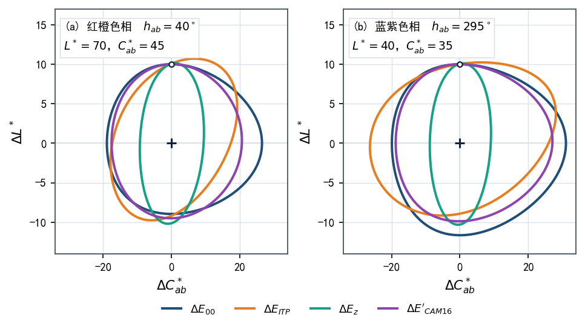
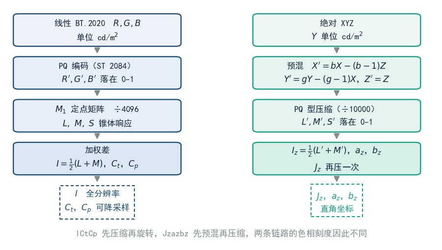
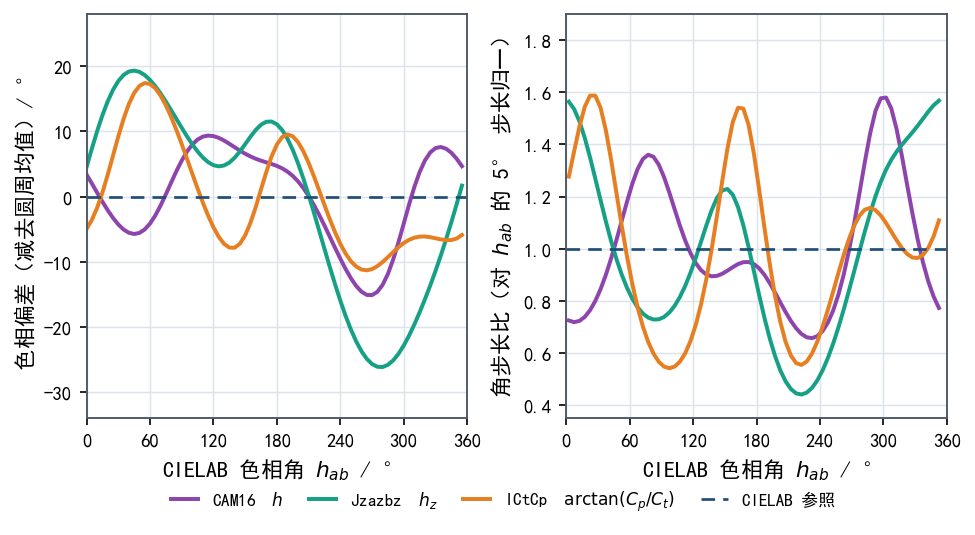
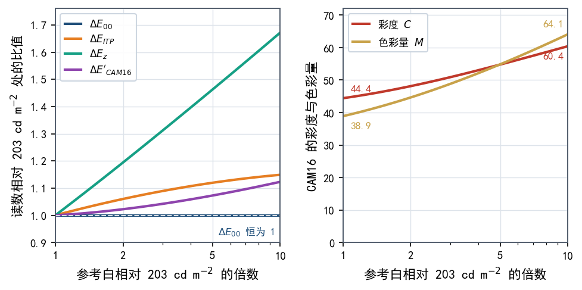
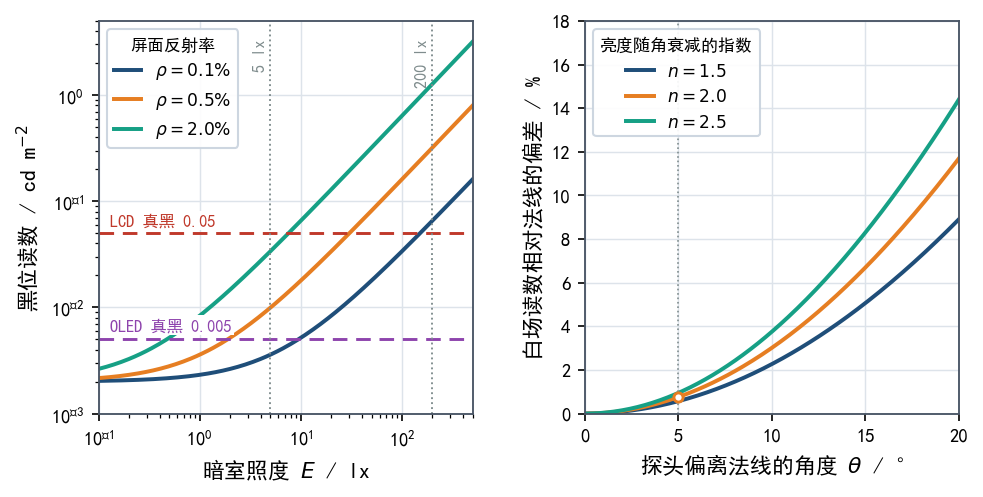

# 第 12 章 色彩科学的前沿问题

色差公式、色貌模型、编码空间各有各的出处，平时分开用，看不出矛盾。一旦把同一批 HDR 颜色同时送进几套度量，它们给出的排序会不一样，幅度能差几倍。这不是谁算错了，而是每套度量背后都有一批自己的主观实验，实验的亮度范围、色样色域、观察条件各不相同，外推到别处就没有共同的尺子。

这一章把散在前面的几条线索并到一处看。哪几套度量在争，争在什么地方，各自的证据到哪儿为止，剩下那些空白对工程意味着什么。收尾处列一张清单，写明每个指标缺的是什么，而不是笼统地说"还有待研究"。

## 12.1 四种度量放在同一批颜色上

HDR 的色差现在有四套常用的算法。$\Delta E_{00}$ 出自 CIE 142:2001，实验数据是反射样品、D65 照明、$L^*$ 从 0 到 100，第 3 章讲过它的三个权重项。$\Delta E_{ITP}$ 出自 ITU-R BT.2124，在 ICtCp 的三条轴上算加权欧氏距离，覆盖 PQ 的整个动态范围。$\Delta E_z$ 出自 Safdar 等人 2017 年的 Jzazbz，用类似的欧氏形式，但压缩函数作用在 XYZ 上。$\Delta E'$ 是 CAM16-UCS 的欧氏距离，带着完整的观察条件，CIE 248:2022 把 CAM16 写成了正式标准。

四者的定义域不一样。$\Delta E_{00}$ 的参考白必须由使用者指定，$L^*$ 超过 100 之后公式照算但权重函数是外推；$\Delta E_{ITP}$ 不需要参考白，但要求两个颜色在同一套 PQ 绝对刻度上；$\Delta E_z$ 也不需要参考白，代价是数值量级随亮度变化；$\Delta E'$ 需要 $L_A$、$Y_b$、环绕三组参数，参数取错，读数整体偏移。

同一批候选里还有两条没进主流的路线。Fairchild 的 hdr-CIELAB 与 hdr-IPT 保留 CIELAB 与 IPT 的骨架，把明度函数换成带绝对亮度的版本，色度压缩也相应调整。它们的定位是研究工具，用来解释 CIELAB 在高亮度下为什么失准，以及新的明度函数应该长什么样。工程上很少直接用，原因是参数多、实现复杂，又没有跨实验室的验证数据。之所以还要提一句，是因为它们把"绝对亮度必须显式进入公式"这件事讲得最直白，后来的 ICtCp 与 Jzazbz 都绕开了这个要求，改用 PQ 曲线间接带入。

拿同一批色样走一遍，差别就落到纸面上了。表 12-1 的 12 对色样按 CIELAB 的 $(L^*, C^*_{ab}, h_{ab})$ 构造，参考白取 BT.2408 的 203 cd/m²，每对的两个颜色在明度、彩度、色相上同时有小幅偏离，模拟实际测量里"标准与样品"的间距。全部数值由公式算出，没有一处是估的。

| 色样对 | $\Delta E_{00}$ | $\Delta E_{ITP}$ | $\Delta E_z$ | $\Delta E'$ |
|--------|------|------|--------|------|
| 近白 188 cd/m² | 1.38 | 3.17 | 0.0035 | 1.45 |
| 中性灰 108 cd/m² | 1.59 | 4.70 | 0.0044 | 1.90 |
| 暗部深灰 2.9 cd/m² | 2.70 | 8.84 | 0.0034 | 3.03 |
| 肤色 | 1.44 | 4.51 | 0.0061 | 1.46 |
| 深红 $L^*=40$ | 2.14 | 7.98 | 0.0110 | 2.67 |
| 叶绿 | 1.65 | 4.67 | 0.0075 | 1.89 |
| 天蓝 | 1.83 | 9.48 | 0.0129 | 2.09 |
| 深蓝紫 | 1.42 | 6.62 | 0.0081 | 1.69 |
| 亮黄 230 cd/m² | 1.70 | 6.10 | 0.0114 | 2.28 |
| 高饱和绿 290 cd/m² | 1.36 | 5.12 | 0.0093 | 1.96 |
| 暗部高饱和蓝 | 1.24 | 7.17 | 0.0093 | 1.71 |
| 亮部低饱和青 | 2.35 | 6.91 | 0.0095 | 3.01 |

表的构造方式本身带一个偏向，得说明。色样是按 CIELAB 的等色相射线构造的，也就是说 CIELAB 的色相在表里被当成了参照，$\Delta E_{00}$ 的排序因此占了便宜。换成按 $u'v'$ 的等色相射线构造，四套度量的具体数值都会变，但排序不一致这件事不会消失，因为不一致的根源在权重函数与压缩函数，不在取样方式。

先看量级。$\Delta E_{00}$ 全部落在 1.24 到 2.70 之间，跨度 2.2 倍；$\Delta E_{ITP}$ 从 3.17 到 9.48，跨度 3.0 倍；$\Delta E_z$ 从 0.0034 到 0.0129，跨度 3.8 倍；$\Delta E'$ 从 1.45 到 3.03，跨度 2.1 倍。四个公式对"哪一对差得更多"的判断不一致，这个不一致不是我挑色样的结果，而是四套权重函数本身就不同。

两两之间的比例也没有固定关系。$\Delta E_{ITP}$ 与 $\Delta E_{00}$ 的比值在 2.3 到 5.8 之间浮动，中位数 3.3。低彩度、中等明度的几对（近白、中性灰、肤色）比值在 2.3 到 3.1；高彩度与暗部的几对（天蓝 5.2、暗部高饱和蓝 5.8、深蓝紫 4.7）明显更高。原因在 $\Delta E_{00}$ 的 $S_C = 1 + 0.045\bar C'$，彩度到 60 时色度分量被压到三分之一不到，而 $\Delta E_{ITP}$ 的 $C_p$ 权重固定为 1。两套权重一个随彩度变、一个是常数，比值自然随彩度漂。

秩次比数值更能说明问题。把 12 对按各自的读数从大到小排，暗部深灰那一对在 $\Delta E_{00}$ 与 $\Delta E'$ 下都排第 1，在 $\Delta E_z$ 下垫底第 12。天蓝在 $\Delta E_{ITP}$ 与 $\Delta E_z$ 下都是第 1，在 $\Delta E_{00}$ 下第 4。算斯皮尔曼秩相关，$\Delta E_{00}$ 与 $\Delta E'$ 是 0.81，$\Delta E_{ITP}$ 与 $\Delta E'$ 是 0.69，$\Delta E_{ITP}$ 与 $\Delta E_{00}$ 只有 0.52，$\Delta E_{00}$ 与 $\Delta E_z$ 只有 0.18。0.18 意味着这两套度量对"哪些颜色差得更多"几乎不相关，用一套排出的容差顺序去指挥另一套的判定，很可能放过问题批次。

$\Delta E_z$ 排名的怪异来自它的设计。Jzazbz 的 $J_z$ 在低亮度处压得极狠。暗部那一对色样明度差 1.5 个 $L^*$，$\Delta E_{00}$ 给出 2.70，在 12 对里排第一；同一对的 $J_z$ 只从 0.0318 涨到 0.0340，$\Delta E_z$ 是 0.0034，在 12 对里垫底。Safdar 等人设计这个空间时把目标定在"图像信号的感知均匀"，权重偏向视觉上占多数的中高亮度区，暗部被牺牲掉了。所以在暗部用 $\Delta E_z$ 判断色差，会把明显的差异判成很小。

$\Delta E_{ITP}$ 在暗部则偏灵敏。同样的深灰对，它给出 8.84，是四个里最高的。这不是错误，BT.2124 的目标就是"预测色差的可察觉性"，PQ 在暗部的码值间隔对应很小的绝对亮度差，$\Delta I$ 因此较大。问题在于这个"灵敏"没有经过主观实验标定，它是 PQ 曲线的直接后果。

图 12-1 把差异从数字换成形状。做法是固定一个中心色，在 $(L^*, C^*_{ab})$ 平面上取网格，把每个网格点转成绝对 XYZ 后用四种度量相对中心色求值，再画等值线。四条等值线的水平各自取"该度量在中心色沿 $+L^*$ 方向走 10 个 $L^*$ 处的读数"，于是四条曲线都在 $\Delta L^* = 10$ 处交汇，剩下的差别就只剩各向异性本身。

先说交汇点上方那条线为什么都重合。这是定标方式决定的，交汇点的读数按各自度量取值，四条曲线必然过同一点。真正有信息的是往其他方向走多远才能达到同一个读数。

左图中心是 $L^*=70$、$C^*_{ab}=45$ 的红橙。往彩度正方向走，$\Delta E_{00}$ 要走到 $\Delta C^* = 26.4$ 才达到交汇水平，$\Delta E'$ 是 20.6，$\Delta E_{ITP}$ 是 17.2，$\Delta E_z$ 只要 9.3。同样一段感知差，四个公式认为彩度方向该走多远，最大与最小差了 2.8 倍。往彩度负方向走，半径分别是 18.9、17.5、17.2、9.2，$\Delta E_{00}$ 的正负不对称最明显（26.4 对 18.9），原因还是 $S_C$ 随平均彩度增大，往高彩度走权重变大、同样的彩度步长对应的读数变小。

往明度负方向走，$\Delta E_{00}$ 走 8.9 就到交汇水平，$\Delta E_z$ 要走 10.05。三个度量都认为"变暗"比"变亮"更敏感，$L^*$ 下降同样的量，读数涨得更快；只有 $\Delta E_z$ 认为两个方向差不多（10.0 与 10.05）。这个对称性来自 $J_z$ 的双曲压缩，它在中心两侧的斜率几乎一样。

右图换成 $L^*=40$、$C^*_{ab}=35$ 的蓝紫，形状整体更宽。彩度正方向的半径是 $\Delta E_{00}$ 31.0、$\Delta E'$ 27.0、$\Delta E_{ITP}$ 25.8、$\Delta E_z$ 9.0，$\Delta E_{00}$ 与 $\Delta E_z$ 差了 3.4 倍。蓝紫区的 $\Delta E_{00}$ 半径特别大，是因为 $R_T$ 旋转项把等值线拧成了斜椭圆，图上那条深蓝色曲线在下半部有个明显的折角，位置在 $\Delta C^* \approx 9$、$\Delta L^* \approx -10$ 附近，那里正是 $R_T$ 起作用的色相窗口边缘。

四条轮廓放在一起，能看出一件事。$\Delta E_z$ 在两种色相下都接近一个正圆，轴比 0.93 与 0.88；$\Delta E_{00}$ 最扁，轴比 2.6 与 3.1；$\Delta E_{ITP}$ 与 $\Delta E'$ 居中，1.7 到 2.7。轴比接近 1 说明该度量认为"明度方向与彩度方向的容差尺度相当"，轴比大说明它认为彩度方向的容差宽得多。视觉实验支持哪一种，取决于看好哪一批数据，四套公式各自拟合的数据集本来就不同。

这四套度量各自的证据基础很不相同，列在表 12-2 里更清楚。

| 度量 | 出处 | 实验基础 | 数据覆盖的亮度 | 参考白 |
|------|------|----------|----------------|--------|
| $\Delta E_{00}$ | CIE 142:2001 | 反射样品，D65 灯箱，中等视场 | $L^*$ 0–100，约 1–100 cd/m² | 必须指定 |
| $\Delta E_{ITP}$ | ITU-R BT.2124 | 在 ICtCp 上构造，未见公开的主观拟合数据 | PQ 全范围，0.0001–10000 cd/m² | 不需要 |
| $\Delta E_z$ | Safdar 等 2017 | 拟合 LUTCHI 与 COMBVD 等已有数据集 | 名义上全范围，实际偏中高亮度 | 不需要 |
| $\Delta E'$ | CIE 248:2022 | 继承 CIECAM02 的适应与压缩数据 | 由 $L_A$ 与参考白决定 | 是参考白本身 |

表 12-2 里最要紧的是 $\Delta E_{ITP}$ 那一行。"未见公开的主观拟合数据"不是贬义，BT.2124 的定位就是"给电视工程一个可实现的客观度量"，它的权重 720 与 0.25 是按工程经验与已有度量的量级对齐的，不是从一批新做的心理物理实验里拟合出来的。这意味着它在常见颜色上的表现能接受，在没见过的区域没有任何保证。

$\Delta E_z$ 那一行的"名义上全范围"也要打个折。Jzazbz 的压缩函数按全动态范围设计，但用来拟合的 LUTCHI 与 COMBVD 数据集主要是显示器与投影的色样，亮度到几百 cd/m² 为止，高饱和端也受当时显示器的色域限制。表 12-1 里它在暗部退化，就是这个局限的直接后果。

$\Delta E'$ 的证据最厚，因为它背后是一整套色貌模型，有适应、有压缩、有观察条件。代价是它对参数敏感，$L_A$ 取错一个数量级，色差读数整体偏移，这一点第 4 章讲过。四套度量里只有它要求使用者把观察条件写明，也只有它能在跨白点、跨环绕的比较里保持意义。

这套对比不能回答"哪个对"。它能回答的是另一个问题：如果生产线上用 $\Delta E_{00} \le 2$ 作为判据，换成 $\Delta E_{ITP}$ 之后同一条线要改成多少。表 12-1 给出的比值中位数是 3.3，但范围从 2.3 到 5.8，取一个固定系数换算一定会在某些色相上错判。正确的做法是重新做一遍基线测量，用新度量在同一批已知合格品上取分位数定阈值，不能靠系数搬。

## 12.2 两条构造路线

ICtCp 与 Jzazbz 都在感知域里做压缩，都被用来算 HDR 色差，但两条链路的排法不同。图 12-2 把两步并列画出来，左边是 BT.2100 的 ICtCp，右边是 Safdar 等人的 Jzazbz。

ICtCp 的顺序是编码、旋转、取差。线性 BT.2020 的 $R$、$G$、$B$ 先过 PQ 得到 $R'G'B'$，再用 $M_1$ 这个整数定标矩阵转成 $L$、$M$、$S$，最后由三路加权和得到 $I$、$C_t$、$C_p$。关键的一步在顺序上：矩阵作用在**编码之后**的值上，所以它不是一个物理上的锥体响应变换，而是感知域里的一次坐标旋转。这样排的好处是暗部的量化误差不会被后续矩阵放大，代价是矩阵不再作用在线性光上，颜色混合的物理意义变淡。

Jzazbz 的顺序是预混、压缩、取差。绝对 XYZ 先做一次线性预混，$X' = 1.15X - 0.15Z$、$Y' = 0.66Y + 0.34X$、$Z' = Z$，三个新量再各过一次 PQ 型压缩，然后组成 $I_z$、$a_z$、$b_z$，$I_z$ 最后还要过一次双曲压缩得到 $J_z$。预混那两个系数不是随手取的，$b=1.15$ 把 X 往 Z 的反方向推，$g=0.66$ 把 Y 往 X 的方向拉，作用是抵消 Hunt 效应带来的一部分亮度-彩度耦合。

两条链路都在某处插了一次 PQ 型压缩，插的位置决定了后面的性质。ICtCp 压缩在矩阵之前，于是 $L$、$M$、$S$ 三条曲线各自带着自己的非线性，取差之后色度轴上残留一点亮度依赖。Jzazbz 压缩在预混之后，三条曲线在压缩前已经被混过一次，色相的计算因此更接近"锥体响应之比"。

亮度轴的设计也不同。ICtCp 的 $I$ 只用 $L$ 与 $M$，$S$ 完全不进入亮度，这是刻意的，短波锥对亮度的贡献只有百分之一二，摘出去之后色度扰动碰不到亮度轴。Jzazbz 的 $I_z$ 用 $L'$ 与 $M'$ 的等权和，$S'$ 同样不进入，但 $I_z$ 之后还有一次压缩，$J_z = \frac{(1+d)I_z}{1+dI_z} - d_0$，$d=-0.56$，这一步让 $J_z$ 的范围压在 0 到 1 之间，同时把高段的斜率进一步压平。

两条链路都没有走恒定亮度那条路。BT.2020 允许一种恒定亮度的定义，先用线性光算加权亮度再编码，这样亮度轴严格等于绝对亮度，色度怎么动都碰不到它。代价是编码端要多做两次查表，解码端要解三元方程组，色度轴在恒定亮度下也没有闭式解。ICtCp 与 Jzazbz 都选了折中，让亮度轴"近似等于"绝对亮度，换来可逆的线性结构。这条取舍在 SDR 时代不成问题，在 HDR 里变成了一条隐性误差。饱和度越高的颜色，编码亮度偏离真实亮度越多，成对比较时这部分偏差会混进 $\Delta I$，而 $\Delta I$ 在 $\Delta E_{ITP}$ 里是权重最高的那一项。

被谁采用这件事，两条路线的分野很清楚。ICtCp 进了 BT.2100 与 BT.2124，是有标准编号的传输与度量空间，HDR 的编码、压缩、监测链路里能见到它，Dolby Vision 的工作链路内部就用它。Jzazbz 主要留在研究与评测里，用在 HDR 图像的质量评价、色调映射的比较、色域映射的误差统计，没有进入广播标准。这不是质量高低的问题，是生态位不同：标准需要一套能被硬件实现的定点运算，Jzazbz 的系数是浮点的，三个通道各过一次 PQ 型压缩再加一次双曲压缩，定点化的代价比一个整数矩阵高得多。

代价也在数值上露出来。Jzazbz 的 $J_z$ 与 $a_z$、$b_z$ 都在 0 到 1 的量级，色差的绝对值因此很小，表 12-1 里 $\Delta E_z$ 全在 0.013 以下。要用它做判定，得先自己定一个标定系数，把 0.005 或 0.01 之类的数当门槛。BT.2124 的 720 就是替 $\Delta E_{ITP}$ 做了这件事，Jzazbz 没有对应的归一化，所以文献里报 $\Delta E_z$ 时常带一句"乘以多少"。这也是它难进标准的一个实际原因，标准要的是可以直接写进验收文件的数。

两条链路还有一个共同点值得注意，都不能直接拿来做色域映射的距离判据。色域映射要判断"一个色域外的颜色离边界有多远"，这个距离要在某个空间里量。ICtCp 与 Jzazbz 都是为编码与评价设计的，它们的色度轴在色域边界附近的行为没有经过检验，尤其是 BT.2020 的绿角与蓝角，那里 $C_t$、$C_p$ 的数值贴着极值，微小的色域变化会让距离读数跳变。工程上做映射仍用 CIELAB 或 CAM16-UCS 的空间距离，虽然它们在边界处的均匀性也不好，至少数据多一点。

还有一处结构差异值得记下。ICtCp 的色度轴里，$C_p$ 几乎只含 $L-M$，$S$ 的系数只有 $-0.13$，等于把短波锥从红绿轴里赶了出去，$C_t$ 则同时含 $L-M$ 与 $S-M$。Jzazbz 的 $a_z = 3.524L' - 4.067M' + 0.543S'$，$S'$ 的系数占 $L'$ 的 15%，$b_z = 0.199L' + 1.097M' - 1.296S'$，三个系数差不多同等重要。两条轴的分工因此不完全对应，同一个色相变化在 $C_t$、$C_p$ 平面上的方向，与在 $a_z$、$b_z$ 平面上的方向能差出 20 度，图 12-3 里三条色相曲线的摆动就是这件事的另一面。

选择哪一套，取决于要做什么。传输与压缩的链路跟着标准走，用 ICtCp。做算法研究、比较两版色调映射曲线谁更保真，用 Jzazbz 或 $\Delta E'$ 都可以，只要在同一份报告里不混着报。混着报的后果是读者拿两个不同刻度的数去比大小，得出的结论纯属偶然。

## 12.3 色相均匀性、锥体对比与按亮度加权

三件事决定了"感知均匀"这四个字能不能落到数字上。色相刻度是不是等间距，亮度与色度能不能分开算，同样大小的色度差在不同亮度下权重是不是一样。现有的度量各答对了一部分，没有一套全答对。

先说色相。判断一套空间色相是否均匀，需要一个公认的等色相数据集。到目前为止最常被引用的还是 1943 年 Newhall、Nickerson 与 Judd 整理的孟塞尔新标数据，那是反射样品的目视排列，十位观察者，视场 2°，照明是光源 C，反射率在 2% 到 90% 之间。这批数据支撑了 CIELAB 之后几乎所有色相均匀性的修正，也带来了它自己的局限：样品是纸，观察在灯箱里，亮度上限只有几十 cd/m²，与 HDR 的自发光、上千 cd/m² 完全是两回事。没有一批"HDR 条件下的等色相数据"，这件事到今天仍然成立。

为什么没有一批 HDR 的等色相数据，原因不复杂。做等色相判断要观察者在给定亮度与色度下把样品排成一圈，判断"这两个是不是同一个色相、只是彩度不同"。反射样品做不到 1000 cd/m²，自发光样品要能独立调亮度与色度，那就得用一台可编程的显示器加一套稳定的光学系统。实验还要控制观察者的适应状态，因为在高亮度下看几分钟，适应亮度就上去了，判断标准跟着漂。这类实验的周期以年计，愿意做的实验室很少，做出来也只覆盖有限的原色方案。

数据缺失的后果，是各套空间对色相刻度的分配互相矛盾。图 12-3 把这种矛盾量了出来。做法是固定 $L^*=60$、$C^*_{ab}=50$，沿 CIELAB 的等色相射线取 72 个方向，每个方向 5 度，把 72 个色样转成绝对 XYZ，再读各空间自己的色相角。

左图的纵轴是"该空间色相角减去 CIELAB 色相角"，为了可比，每条曲线都减掉了自己的圆周均值，于是曲线只反映局部的摆动，不含整体偏移。CAM16 去掉均值后落在 $-15.1°$ 到 $+9.4°$ 之间，峰谷差 24.5°，谷底在 $h_{ab} \approx 270°$ 的蓝区，峰顶在 115° 的黄绿区。Jzazbz 的摆动更大，$-26.1°$ 到 $+19.3°$，峰谷差 45.5°，谷底在 280°，峰顶在 45°。ICtCp 的整体偏移最大，均值偏离 CIELAB 约 61°，去掉均值之后仍有 28.7° 的摆动。

右图换成角步长。沿 CIELAB 每走 5 度，在各空间的色相轴上走了多少度。理想均匀的空间里这条线应该恒等于 1。CAM16 的步长比在 0.66 到 1.58 之间，Jzazbz 在 0.44 到 1.57 之间，ICtCp 在 0.54 到 1.59 之间。Jzazbz 在 $h_{ab} \approx 220°$ 处压到 0.44，意味着在这一段里 CIELAB 走 10 度只对应它自己走 4.4 度，色相刻度被压掉一半以上。同一条曲线在 350 度附近升到 1.57，方向反过来。

这些数不能用来判"谁更均匀"，因为没有共同的参照。它们能说明的是另一件事：如果一套系统在 $\Delta E_{00}$ 里调色相，另一套在 Jzazbz 里验收，两边的"同一个色相偏移"根本不是一件事，蓝紫区的换算系数会随位置变。

近中性区的失真还有一层，来自 $\Delta E_{00}$ 自己的 $G$ 因子。$G$ 把 $a^*$ 轴拉伸，修正中性色附近的容差，代价是色相角被拧了一下。彩度 20 时，拉伸后的 $h'_{ab}$ 相对真色相能偏到 $\pm 7.3°$；彩度 40 时降到 $\pm 0.3°$；彩度 50 以上基本消失。所以同一套 $\Delta E_{00}$ 在低彩度区的色相判断与在饱和区不一致，做灰阶校准、近中性色的色偏检查时要留意这一点，不能拿彩度 60 处标定好的容差直接套到彩度 5 的地方。

第二条线是锥体对比空间。Derrington、Krauskopf 与 Lennie 在 1984 年用猕猴外侧膝状体的细胞响应定义了三条轴，Poirson 与 Wandell 在 1993 年把它整理成一个可以直接算的空间，三条轴是 $\Delta L/L$、$\Delta M/M$、$\Delta S/S$，也就是锥体响应的相对变化。这个空间的优点是亮度与色度分得干净，等亮度平面由 $L+M$ 恒定定义，色度差在这个平面内算，纯亮度差沿法线方向算，两者不串。缺点是它描述的是刺激层面，不含适应，也不含压缩，同一个相对变化在暗处与亮处给出同样的数，与视觉经验不符。

锥体对比空间还有一个实际问题没有解决，分母取什么。$\Delta L/L$ 里的 $L$ 是锥体响应，取哪一个亮度做归一化，结果差别很大。实验室里用均匀背景的平均值，实际画面里没有均匀背景，只能用局部平均或者全屏平均。用局部平均，暗背景上的亮色块算出的对比度极高，用全屏平均，同一块色的对比度被摊平。HDR 画面里这两种选择的差别比 SDR 大，因为亮度跨度大，取哪个当分母能把同一个色块的对比度算差三倍。

ICtCp 与 Jzazbz 都可以看成这条思路的工程近似。两者都先把三路响应变成对立色对，再给色度轴加权，区别只在于压缩插在哪一步。真正的锥体对比空间没有压缩，所以它在小范围内很准，在大范围内失准，这也是它没有成为色差标准的原因。反过来，凡是带压缩的空间，压缩函数的选择就成了一件必须交代的事，不同函数在小范围内给出几乎一样的结果，到了大范围才分道扬镳。

第三条线是按亮度加权。这一条最缺。$\Delta E_{00}$ 的 $S_L$ 只管明度差，彩度与色相两项的权重与绝对亮度无关，$S_C = 1 + 0.045\bar C'$ 里没有亮度。可 Hunt 效应说的是另一件事，亮度升高时彩度本身会上升，同一个色度差在高亮度下更显眼。这两件事在公式里没有对应关系。

把同一幅内容搬到更亮的屏上，四个度量的反应可以量出来。做法是取一对色样，按 203 cd/m² 的参考白定义好 CIELAB 坐标，然后把两个颜色的绝对 XYZ 与参考白一起乘 $k$，模拟"同样的相对内容显示在峰值高 $k$ 倍的屏上"。$\Delta E_{00}$ 保持不变，因为它只看得见相对参考白的坐标，参考白跟着一起放大，坐标原封不动。

图 12-4 左边是红橙那对色样的结果，横轴是参考白相对 203 cd/m² 的倍数，纵轴是读数相对该点的比值。深蓝色那条贴着 1.00 走完全程，它是 $\Delta E_{00}$ 的结构性盲区，不是数值巧合。青色那条涨到 1.67，紫色 1.12，橙色 1.15。换成天蓝那对，三条曲线的终点分别是 1.54、1.26、1.16，说明涨幅随色相变，没有统一系数。

右图解释这份涨幅的来源。同一个色度在 $k=1$ 时 CAM16 给出 $C=44.4$、$M=38.9$，$k=10$ 时变成 $C=60.4$、$M=64.1$，彩度涨了 36%，色彩量涨了 65%。彩度涨是因为 Hunt 效应，$F_L$ 随适应亮度上升，同一份色度在高亮度下显得更艳；色彩量涨得更多，因为 $M = C F_L^{1/4}$ 里还乘了一次亮度级因子。左图那三条上扬的线，本质上就是这个效应在色差里的体现，而 $\Delta E_{00}$ 里没有任何一项对应它。

这一段没有实验数据裁决。几乎没有哪批主观实验把同一组色样在 200 cd/m² 与 2000 cd/m² 上各做一遍，所以"彩度在 10 倍亮度下到底该涨多少"只能靠模型，模型之间差 36% 与 65%，落到色差上就是 15% 与 67% 的差别。

失效区间可以列得比较具体。近中性区，彩度低于 5 时色相角本身不稳定，$\Delta E_{00}$ 的 $G$ 因子在这里扭得最厉害，ICC 的绝对色度意图做白点检查时经常在这里出问题。高饱和区，BT.2020 三条边附近的颜色在 CIELAB 里 $C^*_{ab}$ 超过 100，$\Delta E_{00}$ 的二次权重是外推，$\Delta E_{ITP}$ 的 $C_t$、$C_p$ 取值范围也贴在边界上，两组权重都没在这个区域验证过。暗部，1 cd/m² 以下的色差只有 $\Delta E_{ITP}$ 还能给出单调读数，其余三套都在退化。亮部，1000 cd/m² 以上只有 $\Delta E_{ITP}$ 有明确的定义域，$\Delta E_{00}$ 的 $L^*$ 冲到 280 以上，$S_L$ 外推到 4 以上，色差被压到不足四分之一。

## 12.4 按人校准能做到什么程度

第 9 章讲过观察者差异的来源与合成观察者的生成方法，那里落点在"差异有多大"。这里问的是另一个问题，既然差异是已知的，能不能按每个人的眼睛校准显示器。

能做的部分先说清楚。观察者之间的差异，在数学上有一部分是线性的：如果观察者 A 与观察者 B 的色匹配函数只差一个 $3\times3$ 矩阵能表达的变换，那么把 A 的读数乘上这个矩阵就得到 B 的读数。三个以上色块的最小二乘就能解出这个矩阵，四个通道（加黑电平）时用 12 个以上色块。这是个体校正矩阵的做法，与第 6 章讲的仪器滤光片校正是同一套数学，只是把"仪器对标准观察者"换成了"这个人对标准观察者"。

线性部分能消掉多少，取决于差异是不是真线性的。晶状体黄化、黄斑色素、锥体光密度这三项，作用都是乘一个随波长变化的透过率，对三刺激值的改变是非线性的（因为它改变了光谱形状，不只是缩放），但落在一个 $3\times3$ 矩阵能拟合的范围内，残差通常不大。锥体峰值位移就不一样，它把灵敏度曲线整体平移，改变的是三条曲线的重叠区，这一部分用矩阵只能拟合到一阶。第 9 章图 9-4 给出的分位带里，420 到 480 nm 的离散度是 20% 以上，这一段的残差在个体校正之后仍然存在。

所以个体校正的实际效果有一个清楚的边界：白点与灰阶能修好，同色异谱修不好。修白点是三条通道增益的事，$3\times3$ 矩阵足够；同色异谱是两条光谱在同一个观察者眼里是否相等的问题，它取决于 CMF 的形状，不是增益能改的。窄带原色的显示器在这一点上最吃亏，第 9 章算过激光方案与参考白的 $\Delta u'v'$ 中位数 0.0052、95 分位 0.0111，按第 2 章的换算大致相当于 5 到 9 个 $\Delta E_{00}$，远超显示器一致性常用的 2 到 3。个体校正矩阵在这种屏上只能把中位数压一点，95 分位几乎不动。

第二个可做的方向是观察者分类。Asano 与 Fairchild 等人 2016 年提出的参数化模型，把一位观察者压缩成黄斑密度、晶状体密度、锥体峰值位移几个参数，一批观察者就在参数空间里形成一团分布。工程上不必为每个人单独建模，可以在这团分布里取几个代表点，做成"观察者档位"，让用户选一个最接近的。代价是档位之间的差异被抹平，选错档位的效果不如不选。

档位的做法有一个容易被忽略的细节。观察者空间是五维的，年龄、黄斑密度、L 锥峰值、M 锥峰值、视场，全放开就是无穷多档；工程上通常固定视场（按观看距离算），把年龄按目标人群的加权平均取定，只放开黄斑与峰值位移两项，再在这两维上取三到五个代表点。这样做的后果是档位之间的差异被压平，一个 65 岁、黄斑密度 0.55 的观察者与一个 30 岁、密度 0.30 的观察者可能被分到同一档，而这两个人的实际差异在图 9-4 的分位带里分得很开。档位制的价值在于让用户能做一次二选一，不在于精确。

拼接屏与沉浸式展厅是另一个场景。一面墙上十几块屏，观众站在不同位置看不同的屏，个体差异与屏间差异叠在一起，谁也没法给每个观众配一套校正。这类场合只能用分位数设计，把原色光谱选得宽一点、把白点容差放宽，让最坏的那位观众也不至于看出明显色差。代价是色域覆盖要让出一部分，宽光谱与高覆盖在物理上是矛盾的。

第三个方向是多观察者折中。产品卖给一群人，就该按这群人的分位数设计，而不是按平均人。具体做法是用合成观察者群体算出一批读数，取 95 分位作为设计约束，或者做极小极大优化，让最坏的那位观察者的偏差最小。这条路线在投影与激光显示的原色选择上已经有实际应用，因为这两类产品的光谱窄，观察者差异被放大得最厉害，不折中就没法交货。

做不到的部分也要说清楚。第一，个性化需要知道用户的 CMF，而测 CMF 要一台视觉比色计加一套匹配实验，一个人二十分钟到一小时，成本无法摊到消费产品上。第二，CMF 会随年龄变，四十岁测的矩阵到六十岁就不准了，重新测一次的成本与第一次一样。第三，色相判断的差异不在矩阵能表达的范围内，两个人对"这块蓝偏不偏紫"的分歧，用任何线性校正都消不掉，那是神经层的差异，第 9 章提到神经层有一定程度的重新标定，但没有可用的模型。

工程上因此落在一个折中位置：出厂按标准观察者校准，在固件里留两三档观察者预设，用白点微调代替完整的个体校正矩阵。这不是理想方案，是在成本与收益之间能站住的那个点。真要往前一步，缺的是低成本的 CMF 测量手段，而不是算法。

## 12.5 测量为什么不可复现

同一块屏，两家实验室各测一遍，白场亮度差 5%、黑位差十倍、色度差 $\Delta u'v'$ 0.002，这种事在行业里不稀奇。差额不是谁操作错了，是测量条件没有统一到能复现的精度。

先看黑位，这一端的误差最大也最好算。屏面不是全黑，环境光打上去会反射回来，反射亮度按 $\rho E/\pi$ 估算，$\rho$ 是屏面反射率，$E$ 是暗室照度。取 $\rho = 0.5\%$、$E = 5$ lx，反射亮度 0.008 cd/m²；同一个房间把照度提到 50 lx，变成 0.080 cd/m²；提到 200 lx，0.318 cd/m²。一块 OLED 的真黑 0.005 cd/m²，在 5 lx 的暗室里测出来是 0.013，在 50 lx 的房间里是 0.085，读数差 6.5 倍，而这个差别全部来自房间。

图 12-5 的左边把这件事画成曲线族，三条线对应屏面反射率 0.1%、0.5%、2.0%，底部那条平线是仪器自身的底噪 0.002 cd/m²。紫色虚线与红色虚线分别是 OLED 与 LCD 的典型真黑。三条曲线在低照度端都压在仪器底噪上，照度一过 1 lx 就陆续抬起来，抬到几十 lx 时已经把真黑完全淹没。图上的 5 lx 与 200 lx 是两条常见的参考线，BT.2408 的参考环境按 5 lx 量级设计，普通办公室的夜间照明在 200 lx 上下，两者的黑位读数差一个数量级。

这个差别直接改写对比度。一块峰值 1000 cd/m²、真黑 0.005 cd/m² 的屏，标称对比度 200000 比 1；在 5 lx、$\rho=0.5\%$ 的条件下测出来是 1000 比 0.013，即 76923 比 1，掉了六成。报告上写哪个数，取决于房间。

换成色差单位，0.005 到 0.013 这一段在 $\Delta E_{ITP}$ 上是 6.8，从 0.005 到 0.085 是 30.8，从 0.005 到 0.164 是 44.2。HDR 验收里常见的门槛是暗部 $\Delta E_{ITP}$ 小于 2。在 5 lx 的暗室里，光反射这一项就贡献 6.8，已经顶破门槛；换成 50 lx 的房间是 30.8，再怎么调屏也没用。

白场这一端的误差小得多，但来源更杂。图 12-5 右边是探头倾角的影响，按 $\cos^n\theta$ 的亮度衰减模型，指数 1.5、2.0、2.5 对应不同面板的视角特性。倾角 5 度时，$n=2$ 的屏读数低 0.8%；倾角 15 度时低 6.7%。探头贴在屏上时很难保证完全垂直，几度的倾斜是常态，这就是一两个百分点的来路。

预热是第二个来源。第 6 章给过数字，温度对亮度的影响在 3% 到 10% 之间，冷机测出的峰值偏高、白点偏蓝。一台开机十分钟的屏与一台开机一小时的屏，白场亮度差 3% 以上完全正常，这一项的贡献比倾角大。

第三个来源在仪器本身。光谱带宽对窄带原色的影响、杂散光对黑位的抬升、滤光片失配在宽色域屏上的放大，第 6 章都拆过。色度计做过度校正之后，剩余的失配在宽色域屏上还有 0.5 到 1 个 $\Delta E_{00}$ 的量级，换算成 $\Delta u'v'$ 约 0.001 到 0.002，与行业常用的 0.003 容差是同一个量级。

把这几项加起来，"差 5%"就不再是异常。倾角 0.8%、预热 3%、仪器定标 1%，三项平方和开根号约 3.2%；如果两边预热程度差得多，或者一家用分光计一家用未校正的色度计，5% 很容易凑到。黑位那端的差额不是 5%，是几倍，只不过黑位常常不进汇总表，报告里只写一个对比度数字。

还有一项经常被忽略，测量窗口与 APL。第 6 章讲过 HDR 显示的峰值亮度随画面平均亮度变化，10% 窗口测峰值、全屏白测持续亮度，两个数可以差一倍以上。两家实验室如果一家用 10% 窗口、一家用 18% 窗口，白场读数就差了百分之几，而这百分之几会被归到"设备差异"里去。

举一个具体的对照。实验室甲用 5 lx 的暗室、屏面反射率 0.5%、探头贴屏、开机预热一小时、10% 窗口测峰值；实验室乙用 50 lx 的普通房间、反射率 1%、探头离屏 5 cm 且倾斜 5 度、开机十分钟、18% 窗口。同一块峰值 1000 cd/m²、真黑 0.005 cd/m² 的屏，甲读到黑位 0.013、对比度 76923 比 1；乙读到黑位 0.164、对比度 6097 比 1，差别 12.6 倍。白场这一端，乙因为倾角少 0.8%、因为预热不足多 3%（冷机偏亮）、因为窗口更大少 5%，三个方向不必然互相抵消，净差落在几个百分点。两家的报告都"对"，因为它们各自内部一致，只是不可比。

还有一件事是测量不确定度的写法。规范的做法是给出每个量的不确定度分量，再合成一个扩展不确定度，比如"白场亮度 203.4 cd/m²，扩展不确定度 2.1 cd/m²（$k=2$）"。显示测量里很少这么写，多数报告只给一个数，读者不知道这个数的可信区间。没有不确定度，两个实验室的数差 5% 时就没法判断是设备差异还是落在各自的不确定度之内。

要让测量可复现，必须把条件写全：暗室照度与屏面反射率、探头型号与校正状态、探头倾角与距离、预热时间、窗口尺寸与位置、APL、测量时的环境温度。这些条件缺一项，数据就只能内部比较，不能跨实验室比。CIC 与 ICDM 这类显示测量推荐规程之所以写那么长，原因就在这里。

## 12.6 亮度、环境与时域

HDR 把"多亮才合适"这个问题重新提了一遍。SDR 时代屏幕白点基本固定在 80 到 200 cd/m²，环境照度也相对固定，亮度不是一个需要设计的变量。HDR 之后，峰值从 1000 到 4000 cd/m²，漫反射白从 100 到 300 cd/m²，同一个内容在不同屏上的绝对亮度能差一个数量级。

行业里现成的几个数是制作锚点，不是舒适阈值。数字影院的银幕亮度按 DCI 规范是 48 cd/m²，这是为了在暗室里配合 48 帧与 14 fL 的历史条件定的。BT.2408 的参考环境给的是峰值 1000 cd/m²、漫反射白 203 cd/m²、暗室照度 5 lx 量级，这是为了让调色师与导演看到同一个基准，不是为了让观众舒服。家用电视的推荐值各家不一，从 100 到 250 cd/m² 都有，而且随环境照度变。

舒适本身没有可复现的度量。偏好实验测的是"这群人在这个房间里更喜欢多亮"，结论随内容、房间、观看距离、甚至当天的心情变。CIE 有一批关于眩光与不适的推荐（统一眩光值 UGR 用在照明工程里），但那是针对室内照明的，不是针对自发光的显示屏。显示屏的眩光来自画面里的高亮度小面积，字幕、UI 白块、镜面高光，面积占比小、亮度高，与照明工程里的大面积光源不是一回事。

环境光的作用有两面，容易只看到一面。房间亮的时候，屏幕要更亮才能压住反射光、看清暗部；可屏幕越亮，屏面反射回眼睛的光也越多，黑位被抬高，暗部层次反而变差。图 12-5 左侧那条曲线就是这一面的量化，50 lx 的房间里，OLED 的黑位读数从 0.005 抬到 0.085，有效动态范围从 200000 比 1 掉到 12000 比 1。在这种条件下把峰值从 1000 提到 2000 cd/m²，动态范围只从 12000 提到 23500，收益远小于数字上的翻倍。

时域的问题在 HDR 里更突出。局部调光靠分区背光，亮的区域亮、暗的区域暗，画面一动，背光跟着动，暗部会出现亮度起伏与色温漂移。第 6 章提过，这种漂移在灰阶上表现为 $\Delta E_{ITP}$ 超标，测静态色块测不出来。另一条是 PWM 调光，用占空比控制亮度，频率低的屏在快速眼动或画面摇镜时能看出条纹，也就是频闪效应。频率越高越不明显，代价是驱动损耗与低灰阶的线性度。

环境照度与屏幕亮度的比例是实操里最常用的一条经验。屏幕的漫反射白要高于环境反射亮度一个数量级以上，否则暗部被反射光盖住；房间暗的时候又不该太亮，否则瞳孔在明暗之间来回调整，看久了累。具体倍数按内容与观看距离定，家庭环境取低倍数，明亮的客厅取高倍数。这条经验没有标准背书，不同厂商给的推荐值能差一倍。

观看几何也进来了。屏幕的角尺寸决定视场，视场决定用哪一套色匹配函数与哪一个色貌模型的参数，这一条第 9 章讲过。三米看 65 英寸屏，视场约 27 度，落在 10° 观察者的适用范围；三十厘米看手机，视场只有十几度，更靠近 2° 的条件，短波端的个体差异因此被放大。两块屏在亮度上也不同，前者是高亮度、后者是中亮度，适应状态跟着不同，暗部层次的主观感受差得远。厂商在描述 HDR 体验时很少区分这两类场景。

还有适应。人眼从亮画面切到暗画面，锥体与视杆的重新适应要几十秒到几分钟，HDR 内容的平均亮度跳动比 SDR 大得多，一场夜戏接一场日戏，观众的适应跟不上。这件事在影院里靠整体调暗解决，在家庭环境里没有对应的手段，只能靠内容端控制平均亮度（BT.2408 给的 203 cd/m² 漫反射白部分承担了这个职责）。

还有一层问题在内容与显示之间的接口上。HDR 内容的元数据分两类，ST 2086 的静态元数据描述母版显示器的峰值、黑位与三原色，ST 2094 系列的动态元数据逐场景给出亮度信息。显示端拿到这些数据之后怎么做映射，标准只给了约束，没给唯一解。BT.2390 规定了色调映射曲线的形状要满足单调、要保持色相，但曲线的拐点位置、滚降的陡度都可以调。结果是同一份母版在两台能力不同的屏上，中间调的亮度可以差 20% 以上，而两份结果都能自称合规。这不是执行的偏差，是规范留了自由度。

这些事放在一起，能量化的部分与不能量化的部分分得很清楚。亮度、对比度、色度都能测，也能算；"舒适"只能问卷，问卷结果与测量结果之间没有稳定的映射。这就是为什么 HDR 的亮度上限至今没有标准答案，能给出的只有制作端的基准与显示端的能力描述。

## 12.7 还没有答案的清单

把前面各节的问题归到一起，可以列成表 12-3。表里的每一项都能指到具体缺什么，而不是笼统的"有待完善"。

| 度量 | 缺的是 | 具体表现 |
|------|--------|----------|
| $\Delta E_{ITP}$ | 容差阈值与高饱和区数据 | 标准只给公式，验收线各厂自定 |
| $\Delta E'$ | $J>100$ 的实验支撑 | $J'$ 在 242.9 处饱和，亮部刻度被压 |
| 色相均匀性 | HDR 条件下的等色相数据 | 沿用 1943 年的反射样品数据 |
| 绝对亮度 | 跨媒体的普适锚点 | 203 cd/m² 只是制作参考 |
| 观察者 | 低成本的 CMF 测量 | 个体差异只能建模，不能测 |
| 测量 | 统一的报告口径 | 黑位与峰值随条件差几倍 |
| 舒适度 | 可复现的度量 | 只有偏好问卷 |

$\Delta E_{ITP}$ 的第一处空白是阈值。BT.2124 通篇只定义公式，不给"多少算不合格"。第 3 章讲过 $\Delta E_{00}=1$ 只是个工程约定，那个约定至少还有一批 SDR 实验撑着；$\Delta E_{ITP}$ 连这个都没有，720 这个系数是为了让数值量级接近 $\Delta E_{00}$ 选的，不是从数据拟合出来的 JND。表 12-1 里 $\Delta E_{ITP}$ 的中位数比值是 $\Delta E_{00}$ 的 3.3 倍，两者本来就不是同一个刻度，把 $\Delta E_{00}=1$ 的经验直接搬过来说"$\Delta E_{ITP}=1$ 是刚可察觉"，等于把两个刻度当成一个。

第二处是高饱和区。BT.2020 的三条边附近，$C_t$ 与 $C_p$ 的绝对值能到 1.4 与 1.1，这两个数是按 $R'G'B'$ 取遍整个码值立方体算出来的极值，实际的色域边界比极值小，但也在同一量级。主观实验里几乎没有这么饱和的样品，因为反射样品做不到，而自发光的高饱和样品要有窄带原色才能做出来。也就是说，$\Delta E_{ITP}$ 最需要验证的那片区域，恰好是最难做实验的区域。

$\Delta E'$ 的空白在亮部，而且可以算得很清楚。CAM16 的明度 $J$ 以参考白为 100，203 cd/m² 的白是 $J=100$，1000 cd/m² 的灰是 $J=219$，4000 cd/m² 是 421，10000 cd/m² 是 632。CAM16-UCS 的压缩把 $J$ 映射到 $J'$，

$$ J' = \frac{(1+100c_1)J}{1+c_1J},\qquad c_1 = 0.007 $$

这个函数在 $J \to \infty$ 时趋于 $(1+0.7)/0.007 = 242.9$。于是 203 cd/m² 对应 $J'=100$，1000 cd/m² 对应 147，4000 cd/m² 对应 181，10000 cd/m² 对应 198。从参考白到 PQ 的顶格，绝对亮度涨了 49 倍，$J'$ 只涨了不到一倍，最后一段 4000 到 10000 cd/m² 只涨 17。这意味着在 $\Delta E'$ 的刻度上，亮部的明度差被压得极扁，同一段绝对亮度差在暗部读出来大、在亮部读出来小。这个压缩的初衷是让 $J'$ 在 0 到 100 的常用区间内均匀，超出这个区间之后它变成了缺点。

色相均匀性的空白更根本。孟塞尔新标数据是 1943 年的，样品是纸，照明是光源 C，观察者十人，视场 2°。用它去修正 HDR 的色相，等于用纸张的规律去管发光体。图 12-3 里三条曲线互相矛盾的根源就在这里，各套空间拟合的是同一批 SDR 数据的不同侧面，拟合得好不好只能在 SDR 范围内检验，出了这个范围没有裁判。

绝对亮度的空白在跨媒体复制里最明显。印刷的参考白是 D50 的纸，绝对亮度由观察环境的照度决定，没有固定值；显示器的参考白是 203 cd/m² 或屏的峰值，有固定值；影院的银幕是 48 cd/m²。同一幅画面在三种媒介上"看起来一样"，需要先约定一个共同的外观目标，而外观目标的定义依赖观察条件，观察条件又随场合变。这个循环没有出口，工程上只能退到"在指定条件下匹配"，把条件写进合同。

还有一项空白在度量的前提里。四套公式都假设比较的是两块足够大的均匀色块，视场在 2° 到 10° 之间。HDR 画面里最刺眼的东西往往不是大色块，是像素级的镜面高光、LED 点阵、字幕边缘，尺寸只有几个像素。色块变小，可察觉阈值上升，这是空间 summation 的常识，但四套公式里没有尺寸项。用它们判断小面积高亮元素的色差，会系统性地低估。

观察者这一项的空白是成本。第 9 章给出的合成观察者方法能把差异算出来，算得也相当准，问题是算出来的分布没法验证到具体某个人身上，因为测一个人的 CMF 要专门的仪器与一小时的时间。窄带原色的显示器在这个问题上最尖锐，95 分位的观察者偏差已经超出容差，而产品没法按人定制。

测量这一项缺的是口径。ISO 与 CIE 有一批推荐规程，但显示行业实际执行的报告格式五花八门，黑位在什么照度下测、峰值用多大窗口、预热多久，各家写法不同。这不是技术问题，是行业没有强制统一，后果是数据没法横向比，采购时只能信自己测的那一份。

舒适度那一项缺的是度量本身。亮度、对比度、色度都有物理量与对应的视觉量，舒适没有。现有的做法是用偏好实验的均值加一个区间，作为设计参考，不能作为验收依据。

表里没写进去的还有两项，都属于时域。一项是局部调光的亮度起伏，它让同一块屏在静态色块上合格、在动画面部不合格，而现有验收规程全是静态的。另一项是 PWM 调光的可见性，频率与占空比的关系在小亮度下最敏感，HDR 的暗部恰好落在这一段，可用的数据只有显示行业自己做的几份白皮书，没有像样的心理物理实验。这两项的共同点是，测起来需要时间序列，而现在所有的色差度量都是针对单个静止色块定义的。

标准化这条路的进展也值得说一句。CIE 有分部在推 HDR 的色差与色貌（第 8 分部下有几个专门的工作组），ITU-R 的 SG6 在维护 BT.2100 与 BT.2408，SMPTE 在管母版与元数据。三条线各管一段，之间的缝隙由厂商自己补。缝隙最明显的地方是"显示端的能力描述"，一台屏的峰值、黑位、色域覆盖、局部调光分区数、ABL 曲线，这些参数没有统一的报告格式，采购方只能自己测。这不是技术难题，是协调成本。

这张表还可以再往下细分，但分得再细也改变不了一件事：色彩科学的这些工具，是在 SDR 的观察条件与反射样品的数据上长出来的，HDR 把使用范围推到了工具设计时没考虑的地方。修补的办法有两条，一条是继续在旧框架上打补丁，另一条是重新做一批覆盖新范围的实验。前者便宜，后者慢，行业现在两条都在走，走得都不快。

回到这一册的起点。颜色测量最初是为了让两个物体在指定条件下看起来一样，为此发展出观察者、色空间、色差、色貌这一整套工具。HDR 把这些工具的使用范围推到了它们设计时没考虑的地方，于是每一样都在边界附近露出破绽。破绽不是错误，是适用范围，写清楚适用范围比修补公式更有用。做工程的人需要的不是一套完美的度量，而是一套知道自己在哪里不算数的度量。

## 本章要点

- HDR 色差有四套常用度量。$\Delta E_{00}$ 建立在 $L^* \le 100$ 的反射样品数据上，$\Delta E_{ITP}$ 覆盖 PQ 全范围但没有主观拟合数据，$\Delta E_z$ 由 Jzazbz 派生且数值量级极小，$\Delta E'$ 带完整观察条件但要指明 $L_A$ 与 $Y_b$。
- 同一批 12 对色样上，四套度量的读数跨度分别是 2.2、3.0、3.8、2.1 倍，$\Delta E_{00}$ 与 $\Delta E_z$ 的秩相关只有 0.18，$\Delta E_{ITP}$ 与 $\Delta E_{00}$ 的比值在 2.3 到 5.8 之间浮动，没有固定换算系数。
- 等色差轮廓的轴比差别很大，红橙中心色处 $\Delta E_z$ 是 0.93、$\Delta E_{00}$ 是 2.6、$\Delta E_{ITP}$ 是 1.7。把同一对色样搬到大 10 倍的屏上，$\Delta E_{00}$ 恒为 1.00，$\Delta E_z$ 涨到 1.67，$\Delta E_{ITP}$ 1.15，$\Delta E'$ 1.12。
- ICtCp 先 PQ 编码再转锥空间，Jzazbz 先预混再压缩，两者的分歧就在这个先后顺序。ICtCp 进了 BT.2100 与 BT.2124，Jzazbz 留在研究与评测里，前者有定点化实现，后者缺归一化系数。
- 色相刻度没有共同参照。沿 CIELAB 等色相射线取 72 个方向，CAM16 的偏差峰谷差 24.5°，Jzazbz 45.5°，ICtCp 去掉均值后 28.7°，角步长比落在 0.44 到 1.59 之间。彩度 20 时 $\Delta E_{00}$ 的 $G$ 因子还能把色相拧 $\pm 7.3°$。
- 按人校准只能修线性部分。个体 $3\times3$ 矩阵能改白点与灰阶，改不了同色异谱；窄带原色的 95 分位偏差相当于 5 到 9 个 $\Delta E_{00}$，矩阵压不下来。观察者档位与分位数设计是当前可行的折中。
- 测量不可复现的主因在两端。黑位由环境反射 $\rho E/\pi$ 主导，5 lx 到 50 lx 能让 OLED 的黑位读数差 6.5 倍，对比度从 200000 比 1 掉到 76923 比 1；白场由倾角、预热、仪器定标叠加，倾角 5° 是 0.8%，预热是 3% 到 10%，凑出 5% 很容易。
- 未解决的清单可以点名。$\Delta E_{ITP}$ 缺阈值与高饱和区数据，$\Delta E'$ 在 $J>100$ 之后把明度压到 $J'$ 不到 243，色相数据停在 1943 年的反射样品，绝对亮度没有跨媒体锚点，观察者 CMF 测不起，测量没有统一口径，舒适度没有度量。
