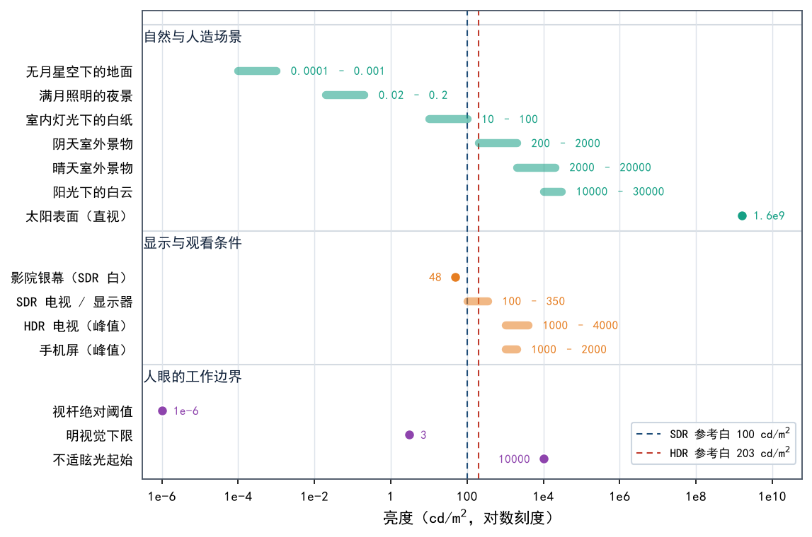
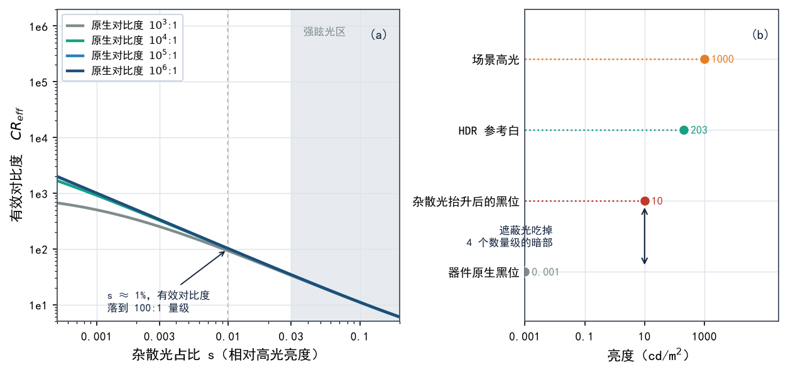
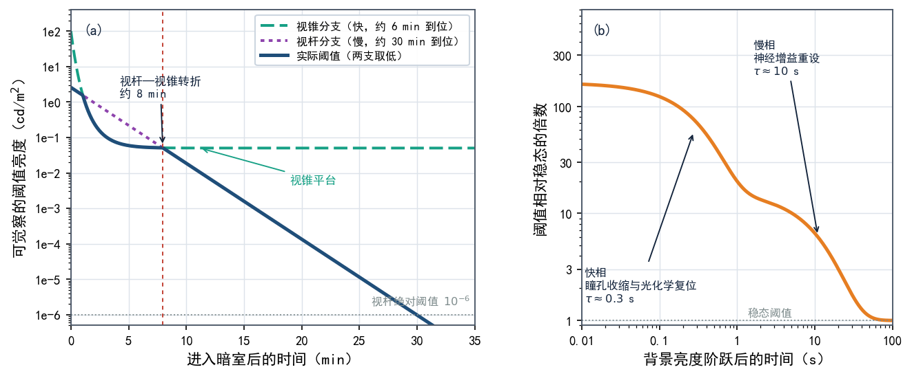
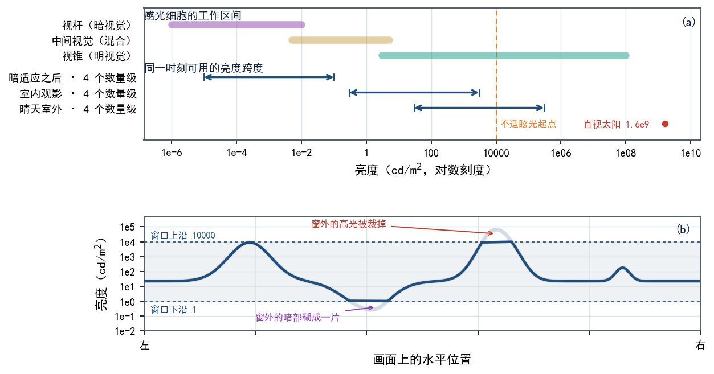
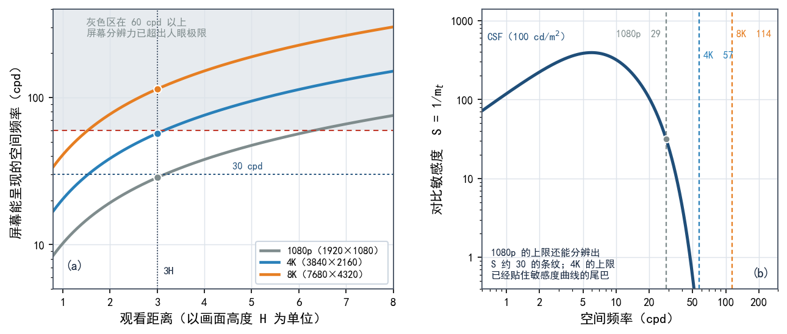
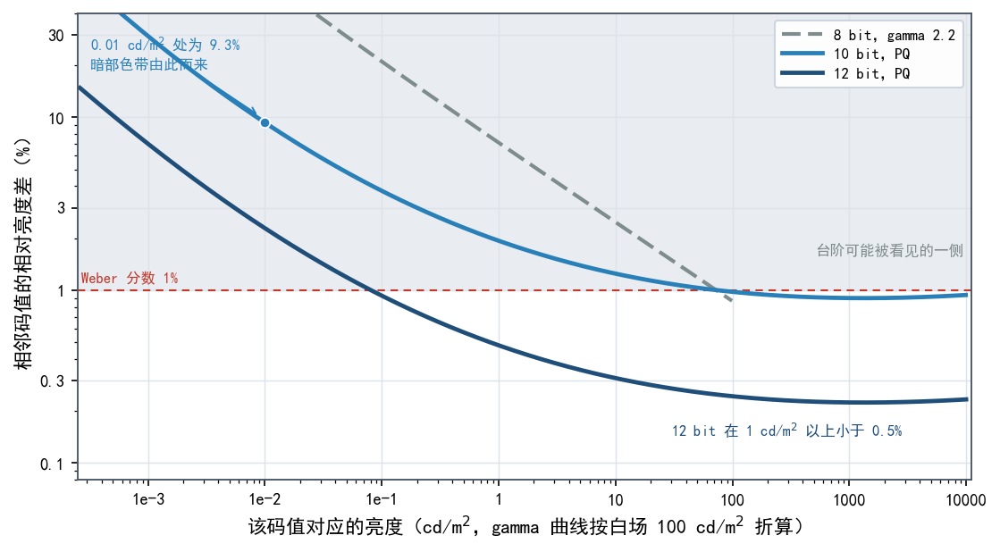

# 第 1 章 HDR 的物理与感知基础

> 高动态范围这件事，起点不在显示器，而在景物与人眼之间。真实景物的亮度跨度能到五六个数量级，人在单次注视里能同时分辨的却只有四个左右，剩下的靠适应、靠移动视线补上。这一章先把三个基础量讲清楚：绝对亮度、对比敏感度、眩光，再看它们怎样决定了哪些亮度值得被记录、被显示。后面几章的标准公式，全部建立在这一层人眼特性之上。

## 一、亮度与照度：两个容易混淆的量

讨论 HDR 最容易出问题的地方，是把“亮”当成一个可以随便标数字的属性。工程上说的亮度（luminance）有严格定义，它是单位面积、单位立体角内发出的光通量：

$$
L = \frac{\mathrm{d}^2\Phi}{\mathrm{d}A\,\cos\theta\,\mathrm{d}\Omega}\quad\left[\mathrm{cd/m^2}\right]
$$

其中 $\Phi$ 是光通量（流明），$A$ 是发光面面积，$\Omega$ 是立体角，$\theta$ 是观察方向与表面法线的夹角。$\mathrm{cd/m^2}$ 是标准单位，显示行业习惯写成 nit，两者完全等价。影院行业的老单位英尺朗伯还在用，数字影院规范把银幕中心亮度定在 48 cd/m²，折合 14 fL。

这个定义里有两个要点。第一，亮度带方向性。分母里那个 $\cos\theta$ 说明同一块屏幕正着看和斜着看亮度不同，测 HDR 面板的可视角就得把这一点算进去。第二，亮度是面积密度，不是总量。“屏幕亮度 1000 nit”说的是某个区域（通常取画面 10% 的白色窗口）能达到的峰值，和整屏全白的亮度差得远。液晶的背光在整屏点亮时会被分区调光压下来，OLED 则受材料电流限制，全屏白往往只有峰值的四分之一到三分之一。同一块屏，峰值 1000 nit、全屏白 300 nit，两个数字都对，说的是不同条件。

另有一个常被混淆的量是照度（illuminance，单位 lux），它描述“有多少光落在一个面上”，定义是 $\mathrm{d}\Phi/\mathrm{d}A$，与观察方向无关。两者通过反射联系起来。一块漫反射的表面（反射率 $\rho$，也称反照率）在照度 $E$ 下呈现的亮度为

$$
L = \frac{\rho E}{\pi}
$$

这个式子由朗伯余弦定律推出来。漫反射面向各个方向发出相同亮度，出射光通量等于入射光通量乘以反射率，$L\pi = \rho E$，整理即得上式。取 $\rho = 0.8$、$E = 100\ \mathrm{lux}$，得到 $L \approx 25\ \mathrm{cd/m^2}$。这个数字解释了为什么普通办公室的“白纸”只有二三十 nit，远低于显示器白场。人眼在室内看到的绝大多数“白”，其实是很低的绝对亮度。

表 1-1　常见表面在不同照度下的亮度（按 $L=\rho E/\pi$ 计算）

| 表面 | 反射率 | 100 lux 下 | 500 lux 下 |
|---|---|---|---|
| 黑绒布 | 0.04 | 1.3 cd/m² | 6.4 cd/m² |
| 18% 灰卡 | 0.18 | 5.7 cd/m² | 28.6 cd/m² |
| 报纸 | 0.60 | 19.1 cd/m² | 95.5 cd/m² |
| A4 白纸 | 0.85 | 27.1 cd/m² | 135 cd/m² |
| 标准白卡 | 0.90 | 28.6 cd/m² | 143 cd/m² |

把这个换算铺开到各类景物上，就得到图 1-1 的量级图。太阳表面在 $1.6\times10^9\ \mathrm{cd/m^2}$ 附近，阳光下的白云约 $10^4$ 至 $3\times10^4$，阴天室外景物一千上下，室内白纸只有几十。人眼能工作的下界在 $10^{-6}$ 量级（视杆细胞的绝对阈值），上界约 $10^8$，再高会出现明显不适与痛感，直视太阳表面几分钟就能造成视网膜损伤。

图中两条虚线是两个工程上的锚点：SDR 参考白 100 cd/m²，HDR 参考白 203 cd/m²。后者由 ITU-R BT.2408 给出，第 2 章会详细推导它的来历。可以看到，室内到阴天这段常见场景恰好横跨这两个锚点，而阳光直射的景物比 HDR 电视的峰值还高出三到四个数量级。这一段差距，正是高动态范围要处理的对象。

## 二、Weber 定律与它的适用条件

同一盏台灯，白天开着几乎察觉不到，深夜却刺眼。物理亮度没变，感知变了。十九世纪的 Weber 实验给出了这条规律的量化形式。实验的做法很朴素：给观察者一个均匀背景，在背景上叠加一小块亮斑，逐渐增加亮斑的亮度，直到观察者报告“看见了”。这个刚好能被察觉的增量 $\Delta L$ 与背景亮度 $L$ 的比值，在相当大的范围内是个常数。

$$
\frac{\Delta L}{L} = k
$$

比例常数 $k$ 就是 Weber 分数。它的数值不是唯一的，取决于目标的角尺寸、偏心度、呈现时间、颜色和观察者的状态。中央凹、大目标、中等亮度、长呈现时间这个组合下，典型值是 1% 到 2%。换成对比敏感度的语言，人眼在最佳条件下的分辨力约为 1/100 到 1/50。目标变小、移到周边视野、呈现时间缩到几十毫秒，$k$ 都会上升，因为参与判断的光子数和神经资源都变少了。

Weber 定律只在中间一段成立，这一点比定律本身更重要。亮度太低时，光子到达的随机性主导。设目标面积 $A$、呈现时间 $t$、量子效率 $\eta$，落到视网膜上的光子数 $N$ 与亮度成正比，$N \propto LAt\eta$。泊松统计给出到达数的标准差 $\sigma_N = \sqrt{N}$。视觉系统要判断“有光”与“没光”的区别，需要信号超过噪声若干倍，即 $\Delta N = k'\sqrt{N}$，于是

$$
\frac{\Delta L}{L} = \frac{\Delta N}{N} = \frac{k'}{\sqrt{LAt\eta}} \propto L^{-1/2}
$$

这一段叫 Rose–de Vries 区，阈值随亮度下降而变陡，而不是保持恒定比值。反过来，亮度很高时，光化学循环跟不上光子到达速率，感光色素的可用比例下降，瞳孔也已经缩到 2 mm 附近无法再收缩，Weber 分数又开始上升。三段合起来是一条 U 形曲线，平坦的底部大致从 1 cd/m² 延伸到 $10^4$ cd/m²，这正好覆盖了图 1-1 里室内到晴天的范围。

这条 U 形曲线对 HDR 有一个直接推论。既然人眼在 1 至 $10^4$ cd/m² 之间用比值度量亮度，那么编码亮度时也应当按比值分配精度，而不是按绝对值。PQ 与 HLG 两条曲线都是这个思路的产物，第 2 章会看到它们怎样把“每级码值对应固定百分比”写成公式。

工程上更常用的对比度定义有两种。电视与显示领域用 Weber 对比度，即白场比黑场：

$$
CR = \frac{L_{max}}{L_{min}}
$$

视觉科学更喜欢 Michelson 对比度，它把亮暗压进 0 到 1：

$$
C = \frac{L_{max}-L_{min}}{L_{max}+L_{min}} = \frac{CR-1}{CR+1}
$$

两种定义可以互相换算，后者更能说明一件事，对比度的感知收益是递减的。CR 从 100 提到 1000，C 只从 0.980 变到 0.998；再提到 10000，变成 0.9998；一百万比一对应 0.999998。当 CR 超过几百之后，$C$ 已经贴近 1，继续堆数字对人眼几乎没有意义。

这组换算关系是判断 HDR 宣传语的第一道门槛。面板厂商说“对比度一百万比一”，指的是最亮与最暗的极限值之比，两个极端不可能同时出现在一帧画面里，也不可能同时落在视网膜的同一适应状态上。真正决定观感的，是同一画面里高光与阴影的亮度差，以及这个差值在眼内杂散光和环境光下还剩多少。第五节会给出这笔账的具体算法。

Weber 分数其实是 CSF 在低频端的渐近值，CSF 峰值处对应的阈值比 Weber 分数低三四倍，因为人眼对 3 至 6 cpd 的条纹最敏感。真实画面上的细节都带空间结构，条纹越细越难看清，阈值就不再由固定的 Weber 分数决定。

## 三、对比敏感度：从条纹到 CSF 曲线

上一节说的是“多大的亮度差能被看出”，但人眼看的从来都是带空间结构的图像，均匀色块只在实验室里出现。要把空间因素纳入，标准做法是测对比敏感度函数（contrast sensitivity function，CSF）。

测量的经典方法是 Campbell 与 Robson 在 1968 年用的正弦光栅。屏幕上显示一条条明暗缓变的正弦条纹，调制度定义为

$$
m = \frac{L_{max}-L_{min}}{L_{max}+L_{min}}
$$

观察者调节 $m$，直到条纹刚好能被看出，这个 $m$ 就是该空间频率下的阈值 $m_t$。CSF 取其倒数：

$$
S(f) = \frac{1}{m_t(f)}
$$

空间频率的单位是周期每度（cycles per degree，cpd），描述一度的视角里塞进多少条明暗条纹。它把屏幕上的像素数和观看距离统一到视角上：一条周期对应两个像素，若一个像素张角为 $\alpha$ 度，则 $f = 1/(2\alpha)$。以 1 米外看 1 毫米周期的条纹为例，张角约 0.057 度，对应 17.4 cpd。

人眼 CSF 的形状很有特点。低频端缓慢上升，在 3 至 6 cpd 附近达到峰值，之后快速下降，到 50 至 60 cpd 左右彻底断掉。峰值位置对应约 0.2 度的条纹周期，差不多是一个手指宽在手臂距离上的张角。峰值处 $S$ 约 300 至 500，即刚可分辨的调制度 0.2% 到 0.3%。

这个带通形状由两段机制拼成。高频端的下降主要来自眼球光学系统的点扩散与像差，视网膜上的像已经被糊过一道，条纹对比度先损失了一次，这叫光学调制传递函数（MTF）。低频端的下降来自视网膜神经节中心—周边拮抗感受野，大范围均匀的亮度变化被侧抑制抵消掉。两段叠加，就得到中间隆起的带通曲线。这个形状有个实用推论，画面里最容易被看见的是细节，最难被看见的是缓慢的大面积明暗变化，而后者恰恰是 HDR 色带最容易出现的地方。

CSF 还强烈依赖适应亮度。亮度升高，峰值上移、截止频率抬高；亮度降到 1 cd/m² 以下，整条曲线明显塌陷。原因还是第二节那套噪声账，亮度低时光子噪声主导，视觉系统只能用更大的积分面积和更长的时间换取信噪比，空间分辨力随之下降。到 0.01 cd/m² 这个量级，截止频率只剩 10 cpd 上下，画面“发闷、细节糊掉”说的就是这件事。

CSF 有两个工程用途。一是判断量化台阶是否可见：给定显示亮度与位深，每级码值对应的亮度台阶是确定的，把它换算成调制度再和该空间频率下的阈值比较，就能判断会不会出现色带，第八节用的就是这个方法。二是判断编码噪声与压缩伪影的可见性，噪声落在 CSF 峰值附近就最刺眼。

## 四、Barten 模型：把 CSF 写成公式

要把 CSF 用于定量计算，需要一条能算的曲线。用得最广的是 Barten 模型，它把视觉系统拆成光学、量子噪声和神经噪声三段，写成一条闭式公式：

$$
S(u)=\frac{M_{opt}(u)}{k\sqrt{\dfrac{2}{T}\left(\dfrac{1}{X_0^2}+\dfrac{1}{X_{max}^2}+\dfrac{u^2}{N_{max}^2}\right)\left(\dfrac{1}{\eta p E}+\dfrac{\Phi_0}{1-e^{-(u/u_0)^2}}\right)}}
$$

其中 $M_{opt}(u)=\exp(-2\pi^2\sigma^2u^2)$ 是眼球光学传递函数，$\sigma$ 由光学点扩散 $\sigma_0$ 与色差 $C_{ab}d$ 合成；$E$ 是视网膜照度（troland），由适应亮度与瞳孔直径 $d$ 决定，$d$ 又随亮度按 $d=5-3\tanh(0.4\lg(L/40))$ 变化，100 cd/m² 时约 4.5 mm，1000 cd/m² 时约 3.5 mm；$k$ 是检测信噪比，$T$ 是积分时间，$\eta$ 是量子效率，$p$ 是 troland 到光子数的换算因子，$\Phi_0$ 是神经噪声谱密度，$u_0$ 是侧抑制的峰值频率。

表 1-2　Barten 模型的典型参数

| 符号 | 含义 | 取值 |
|---|---|---|
| $X_0$ | 目标角尺寸 | 2° |
| $X_{max}$ | 最大积分面积 | 12° |
| $N_{max}$ | 最大可积分周期数 | 15 |
| $k$ | 检测信噪比 | 3 |
| $T$ | 积分时间 | 0.1 s |
| $\eta$ | 量子效率 | 0.03 |
| $\Phi_0$ | 神经噪声谱密度 | $3\times10^{-8}$ |
| $u_0$ | 侧抑制峰值频率 | 7 cpd |
| $\sigma_0$ | 光学点扩散 | 0.5′ |
| $C_{ab}$ | 色差系数 | 0.08′/mm |

代入这些参数直接计算，得到图 1-2 左侧的五条曲线。

从计算结果能读出三件事。第一，100 cd/m² 下峰值约 390，出现在 5 至 6 cpd，对应刚可分辨的对比度约 0.26%；到了 1 cpd 附近敏感度降到 120 左右，阈值约 0.85%，与第二节的 Weber 分数 1% 至 2% 接上了，两者说的是同一件事的不同尺度。第二，100 与 1000 cd/m² 两条曲线几乎重合，说明亮度超过 100 cd/m² 后，视觉系统的噪声底已不再是量子噪声，继续提亮换不来分辨力。第三，模型在 0.1 cd/m² 处峰值只剩 50 上下，这正是暗环境下画面发闷的定量描述。

右侧那张图把峰值敏感度随适应亮度的变化单独画出来。曲线在 1 至 1000 cd/m² 之间趋于平坦，两端各自塌陷。图中标注的暗视觉区在模型里并不准确，Barten 模型是按视锥通道标定的，进入视杆主导的区间后，实测的峰值会高于模型外推值，所以那段只能当作趋势参考，不能拿来做定量判断。

模型对参数很敏感，这一点决定了它能用在什么地方。瞳孔项让亮度与光学质量耦合，把 $L$ 从 100 降到 1，视网膜照度下降两个数量级，量子噪声项随之抬高，峰值敏感度掉到 130 左右。$\sigma_0$ 是点扩散，年龄增长会让晶状体散射增加，$\sigma_0$ 从 0.5′ 涨到 1.5′ 是很常见的，高频端的敏感度因此大幅下降。这解释了一个日常现象：同一台电视，年轻人觉得 4K 明显更细腻，六十岁以上的人可能看不出区别，因为他们的 CSF 截止频率已经降到 30 cpd 以下。第七节讨论观看距离时会把这个结论量化。

模型只描述亮度通道，不覆盖红绿、蓝黄的色度通道，后者的 CSF 峰值在 1 至 2 cpd，高频截止只有 10 到 15 cpd；它也假设目标静止、呈现时间足够长，且不描述多个目标之间的掩蔽。这些限制在工程上通常用安全余量吸收，把算出的阈值乘以 2 到 3 倍。

## 五、眩光：视野里的漏光

前面几节的模型都假设眼睛是一个干净的光学系统。实际上眼球内部有散射，角膜、晶状体、玻璃体都不是理想透明介质，强光进入后会在视网膜上铺开一层弥散的“雾”，这叫眼内杂散光，它造成的后果统称眩光。

眩光的量化从遮蔽光（veiling luminance）开始。一个位于视线外 $\theta$ 角、在角膜处产生照度 $E_v$ 的光源，会在视网膜上叠加等效亮度

$$
L_v = \frac{10\,E_v}{\theta^2}
$$

$E_v$ 单位 lux，$\theta$ 单位度，这个关系叫 Stiles–Holladay 公式。形式简单，含义明确，遮蔽光按角度平方衰减。一个在 5 度处产生 10 lux 的光源，等效亮度是 0.4 cd/m²；同样的光源挪到 20 度处，只剩 0.025 cd/m²。这解释了为什么看电影时要关掉侧后方的灯，也解释了为什么 HDR 电视摆在窗边效果会打折。

用相对量描述更直观。设高光亮度为 $L_w$，眼内杂散光按比例 $s$ 铺满整个视野，黑位亮度为 $L_b$，那么能被分辨的有效对比度是

$$
CR_{eff}=\frac{L_w+sL_w}{L_b+sL_w}=\frac{1+s}{1/CR_{native}+s}
$$

$s$ 的典型量级：20 至 30 岁人群在 5 度视角处约 1%，60 岁以上可升到 2% 至 3%（CIE 用杂散光参数描述这一现象，单位 $\mathrm{deg^{-2}}$）。图 1-3 把这条式子画了出来，并给了一个具体算例。

结论有点残酷。器件原生对比度做到一百万比一，只要眼内杂散光占 1%，实际可用对比度就掉回 100:1 量级。右侧算例里，1000 cd/m² 的高光把黑位从 0.001 抬到 10 cd/m²，四个数量级的暗部细节被这层雾吃掉。这不是显示器的问题，是眼睛的物理限制。由此可以划出三条工程边界。一是盲追黑位没有意义，暗部细节的可见性由眩光与观看环境决定；二是高光面积要控制，大面积高光会让整幅画面的暗部一起失效；三是观看环境的照度必须纳入标准，BT.2100 规定参考观看环境的原因也在这里。

家庭环境里还有第二层眩光，来自屏幕表面的反射。设屏幕反射率 1%、环境照度 200 lux，反射亮度约

$$
L_{refl}=\frac{0.01\times200}{\pi}\approx0.64\ \mathrm{cd/m^2}
$$

这一数值比 HDR 面板宣称的 0.005 cd/m² 黑位高出两个数量级，于是整屏的有效对比度上限被压到 1000/0.64 ≈ 1560:1。想看清 HDR 的暗部，要么降低环境光，要么用低反射涂层，硬件参数本身并不足够。

日光环境另有一套评价方法，用日光眩光概率（DGP）。它由 Wienold 与 Christoffersen 在 2006 年提出，输入是眩光源在眼睛处产生的垂直照度、背景亮度、光源立体角与位置指数，输出 0 到 1 之间的概率值，分档大致是 0.35 以下察觉不到、0.40 以上构成干扰、0.45 以上不可忍受。DGP 的经验形式里，眩光源照度取 0.8 次幂，背景亮度取负 0.3 次幂，说明眩光感受主要由光源照度驱动，背景越暗越难忍受。这条规律对屏幕同样适用，同样一块 1000 nit 的屏幕，放在明亮客厅里只是“有点亮”，放在全黑的影音室里就是刺眼。

## 六、动态范围、适应与浦肯野效应

动态范围有三种读法，混淆这三者是最常见的错误。

第一种是绝对范围。人眼从暗适应后的绝对阈值 $10^{-6}\ \mathrm{cd/m^2}$ 到明亮环境下开始感到疼痛的 $10^8\ \mathrm{cd/m^2}$，跨越约 14 个数量级。这份能力来自三套机制。瞳孔在 2 至 8 mm 之间变化，面积比约 16:1，贡献 1.2 个数量级；视杆与视锥两套感光系统分工，视杆覆盖 $10^{-6}$ 至 $10^{-2}$，视锥接管 1 以上；视网膜与视觉皮层的神经适应通过调节增益匹配当前的平均亮度，贡献剩下的十几个数量级。

第二种是同时范围，也叫瞬时范围，指一次注视之内能分辨的亮度跨度。这个数字小得多，多数研究给出 3 至 4 个数量级，即 $10^3$ 至 $10^4$，超出之后就要靠移动视线、改变注视点和重新适应。第五节算出的有效对比度 100:1 到 1000:1，正落在这个同时范围与眩光限制的交叠区。

第三种是局部适应范围，指视野中某一个局部区域能被准确判断的亮度跨度，通常只有 2 至 3 个数量级。它比同时范围更小，因为周边视野的亮度会压低中心区域的判断精度，色调映射算子里的局部对比度增强做的就是把这个范围拉伸到显示器的可用范围上。

适应本身是有时间过程的，而且两个方向极不对称。图 1-4 左侧是暗适应的典型曲线，纵轴是可觉察的阈值亮度，横轴是进入暗室后的时间。曲线分成两支。视锥分支下降很快，五六分钟内就到位，在 0.05 cd/m² 附近形成平台；视杆分支下降慢，以近似恒定的对数斜率走上二十多分钟，最终到达 $10^{-6}$ 的绝对阈值。两支中较低的一支决定任意时刻的实际阈值，它们在 8 分钟前后交叉，这个交叉点在视觉科学里叫视杆—视锥转折。

这条曲线对 HDR 制作有两条直接的含义。一是暗室调色前的适应时间不能省。调色师从明亮的走廊走进暗室，前五分钟看到的画面比实际偏亮，暗部细节看起来“够用”，二十分钟后才看出层次不足，这就是为什么专业调色间要求进入后至少等待二十分钟再开始判断。二是同一幅画面在不同适应阶段的观感差别很大，观众的眼睛可能刚从明亮的手机屏幕移开，此时画面里的暗部对他几乎不可见，而调色师在充分暗适应后看到的是完整层次。

右侧是明适应。背景亮度突然升高时，阈值上升后再回落，过程由两个时间常数拼成。快相约 0.3 秒，来自瞳孔收缩与感光色素的快速漂白；慢相约 10 秒，来自神经增益的重设。整个恢复过程在一分钟内完成，比暗适应快一个数量级，但仍有明显的滞后感。

图 1-5 把这几层关系放在一起。上半部分的横轴是亮度，三根彩条是视杆、中间视觉、视锥的工作区间，三根深蓝色箭头是不同适应状态下一次注视能覆盖的跨度。可以看到，任何一根箭头都只有四个数量级，而整个可用范围有十四个。人眼不是在用全部范围看画面，而是在一个滑动的小窗口里看。下半部分是一幅合成场景的亮度剖面，从窗边的高光（约 $5\times10^4$ cd/m²）到背光的走廊（不到 1 cd/m²），跨度约五个数量级。假设眼睛适应在室内墙面这一档，可用窗口是 1 到 $10^4$ cd/m²，窗外的高光和走廊的暗部就同时被裁掉了。现实中人不会觉得天空是一块白斑，因为视线会移动，眼睛会重新适应，但每一刻看到的都只是窗口内的那一段。

这件事对 HDR 的意义在于，它解释了为什么“记录更大的动态范围”比“显示更大的动态范围”更有价值。记录下来的高光与暗部，让人在移动视线、重新适应之后还能看到细节，而 SDR 把这些信息永久裁掉了。

按感光细胞的工作状态，还可以把亮度切成三段：明视觉（photopic）在 3 cd/m² 以上，视锥主导，有完整的色彩分辨；暗视觉（scotopic）在 0.001 cd/m² 以下，视杆主导，只有灰阶、没有色觉；中间夹着 0.001 至 3 cd/m² 的中间视觉（mesopic），两套细胞同时出力。CIE 191:2010 专门定义了中间视觉的等效亮度换算，用视杆与视锥的相对贡献做加权，把亮度值与色度都往视锥方向修正。

中间视觉里有一个现象对 HDR 的暗场景特别要紧，叫浦肯野效应。明视觉的光谱敏感度峰值在 555 nm，暗视觉的峰值移到 507 nm，整条敏感度曲线向短波方向平移。结果是同一组物体在亮处看起来偏黄绿，在暗处看起来偏蓝。夜景里深红色的花会显得发黑，蓝色的布反而显得亮，原因就在这里。HDR 内容在暗室里观看时，画面暗部恰好落进中间视觉区，色饱和度与响应都会改变，这是暗室调色与亮室观看观感不一致的生理原因之一。

## 七、观看条件：距离、分辨率与环境光

前面几节讲的是眼睛本身，这一节讲眼睛与屏幕之间的几何关系。同样的像素数，在不同距离上对应不同的空间频率，也就对应不同的可见性。

设画面高度为 $H$、观看距离为 $kH$，画面的垂直张角为

$$
\alpha = 2\arctan\frac{1}{2k}
$$

垂直方向 $N$ 行的屏幕，其奈奎斯特频率为 $N/2$ 个周期分布在 $\alpha$ 度上，

$$
f_{N} = \frac{N/2}{\alpha}
$$

这个式子把“多少像素”翻译成“多少 cpd”，接下来的判断就可以直接用 CSF 来做。以 3H 的常见观看距离为例，$\alpha = 18.9°$，1080p 对应 28.6 cpd，4K 对应 57 cpd，8K 对应 114 cpd。人眼的截止频率在 50 至 60 cpd，所以 3H 处 1080p 的像素结构还在可见范围内，4K 刚好贴到极限，8K 已经完全超出。

图 1-6 左侧把这条换算画成曲线族。灰色区域是 60 cpd 以上，屏幕能呈现的细节已经超出人眼极限，再高的分辨率没有意义。三条曲线的斜率相同，位置上相差一个倍频程。右侧把 3H 处的三个点标在 CSF 曲线上，1080p 落在敏感度 30 的位置，意味着那个频率上的条纹只要 3% 的对比度就能看见，像素网格、边缘锯齿、编码块效应都会暴露；4K 落在曲线尾巴上，敏感度不到 1，几乎所有结构都看不见了；8K 的点已经在曲线之外。

结论不是“8K 没用”，而是“8K 要求更近的观看距离或更大的画面”。把距离缩到 2H，8K 的奈奎斯特降到 77 cpd，仍然超出极限，而 4K 升到 38 cpd，开始进入可见区。反过来，影院前排的观众大约在 1.5H 处，4K 投影的奈奎斯特只有 29 cpd，像素结构处在可见范围内，后排拉到 3H 以上才回到看不见像素的距离。

视场角由画面尺寸与距离共同决定，SMPTE EG-18 建议家庭影院的最小视场角为 30 度，对应约 3.2H 的距离，影院在 45 度以上。视场角大了沉浸感强，代价是周边视野被画面填满，HDR 的高光在这里更容易引起不适眩光。

环境光是第三个变量，而且影响最大。第一节算过屏幕反射，1% 反射率在 200 lux 下贡献 0.64 cd/m²，比 HDR 面板的黑位高两个数量级。环境光还会抬高整个画面的适应水平，让暗部细节落进 CSF 的塌陷区。ITU-R BT.2035 定义了节目评估的参考观看环境，核心是把环境照度、背景亮度、屏幕反射和观看距离都固定下来，BT.2100 为 HDR 进一步规定了暗室条件，背景亮度不超过 5 cd/m²，屏幕周边不能有强光源。

家庭环境与参考环境差得很远。客厅白天照度常在 100 至 300 lux，晚上开灯也有 50 lux 以上，屏幕正对窗户时反射光可以达到 10 cd/m²。在这种条件下，HDR 的暗部优势基本消失，能看出来的只有高光。很多电视提供环境光传感器与“环境光补偿”，思路是根据传感器读数抬高黑位、压低峰值，让画面在亮室里看起来不过分发灰。这个做法牺牲了 HDR 的一部分信息，换来的是观感的一致性，属于工程折中而不是技术进步。

## 八、亮度分辨率与量化台阶

现在把前面的工具用在一个具体问题上：显示器的位深够不够。

SDR 的 8 bit 编码有 256 级，配合 gamma 2.2、白场 100 cd/m²，各级码值对应的亮度是

$$
L(n) = 100\left(\frac{n}{255}\right)^{2.2}
$$

代入几个具体值，问题立刻显形。码值 1 对应 0.0005 cd/m²，码值 2 对应 0.0023，码值 3 对应 0.0057，码值 4 对应 0.0107。四个码值之间，亮度涨了 20 倍，相邻台阶的相对差分别是 360%、145%、88%。也就是说，8 bit SDR 在 0.01 cd/m² 附近的台阶接近 90%，一条从黑到灰的渐变在这里必然断成几层。再往上看，码值 10 对应 0.08 cd/m²，码值 32 对应 1.04，码值 64 对应 4.8，码值 128 对应 22。整个 0.01 至 1 cd/m² 的区间只由不到 30 个码值覆盖。

HDR 的 PQ 曲线正是为解决这件事设计的。它按感知均匀分配码值，100 cd/m² 处的 10 bit 台阶约 1%，0.01 cd/m² 处约 9.3%。9.3% 听起来仍然很大，但已经比 8 bit SDR 的 88% 小了一个数量级，而且这个亮度上的绝对差只有 0.001 cd/m²，落在显示器的黑位噪声里，实际很难被看见。

图 1-7 把四条曲线放在同一张图上。灰虚线是 8 bit gamma 2.2，在 1 cd/m² 处台阶还有 7%，0.1 cd/m² 处 15%，直到 100 cd/m² 附近才落到 1%。蓝实线是 10 bit PQ，在 100 cd/m² 处正好压到 1%，暗部则按亮度往上涨。深蓝是 12 bit PQ，1 cd/m² 以上全程不到 0.5%。

判断台阶是否可见，不能只看相对亮度差，还要看它对应的空间频率。一条覆盖半个屏幕的缓变渐变，等效空间频率在 0.5 至 2 cpd，这个频率上的 CSF 阈值约 0.5% 到 0.8%；同样幅度的台阶放在 30 cpd 的细节上，阈值升到 3% 以上，就看不见了。所以色带总是出现在大面积、缓慢、平滑的区域，天空、墙面、暗部渐变是重灾区。

还有一层放大机制叫马赫带效应。人眼的侧抑制会把亮度台阶的两侧分别压暗和提亮，让原本 1% 的台阶看起来像 2% 到 3%。这就是为什么 10 bit PQ 在 100 cd/m² 处刚好 1% 的台阶，仍然可能被看出来，尤其在暗室观看、屏幕亮度调低、内容是大面积天空的时候。

工程上的解法是抖动（dither）。在量化之前叠加一层幅度约半个码值的噪声，把确定性的台阶变成随机的颗粒，人眼对随机噪声的敏感度远低于对规则边界的敏感度，于是色带被打散成细密的噪声。噪声可以是空间的（每个像素不同）、时间的（每帧不同）或两者结合。代价有两个，一是噪声底抬升，在暗室里可能被察觉为“脏”；二是编码效率下降，随机噪声很难被压缩，码率会涨几个百分点。

抖动之后，10 bit 的实际感知位深可以接近 12 bit，这是 HDR10 用 10 bit 分发仍然能看的原因。但它不是免费的午餐，暗部噪声与压缩伪影会互相放大，编码器在低码率下会把抖动噪声当成细节保留下来，结果画面出现蠕动。所以母版用 12 bit 甚至更高位深，分发用 10 bit 加轻微抖动，两者分工明确。

色度通道宽松一些。人眼对色度的空间分辨力只有亮度通道的三分之一到五分之一，4:2:0 在正常观看距离下几乎无损，代价是红蓝相接的边缘出现一两个像素的色渗。另外 BT.2020 的色域比 BT.709 大，同样码值步长对应更大的色差，这也是 HDR 普遍要求 10 bit 起的原因之一。

## 九、HDR 在感知层面的含义

把前面几节串起来，可以回答一个具体问题：HDR 到底改善了观感的哪一部分。

最直接的一项是高光。真实场景里，光源与镜面反射的亮度比漫反射白面高出两到五个数量级，白纸约 $10^4$ cd/m²，阳光下的金属反光可以到 $10^6$，太阳表面 $10^9$。SDR 把 100 cd/m² 以上一律裁掉，结果是太阳变成一张白纸、灯泡失去光晕、金属失去质感。HDR 把这些高光还原出来，画面的“材质感”和“现场感”主要来自这里，而不是平均亮度的提升。

第二项是亮度分布带来的感知效应。亮度上升时，人眼感知到的对比度与饱和度都会增强，这就是 Hunt 效应与 Stevens 效应；在较暗的环境里看同一幅画面，感知对比反而更高，这是 Bartleson–Breneman 效应。它们共同说明，显示亮度与观看环境的匹配关系比绝对亮度值更重要。BT.2100 定义了两个参考观看环境，BT.2408 给出参考白 203 cd/m²，都是为了把这层匹配固定下来，让制作端与观看端看到同一个“亮度感”。

第三项是暗部。更高的位深与更细的码值分配让暗部台阶变小，配合不刺眼的高光，画面能同时容纳窗口外的星空与室内的台灯。这件事的难度不在面板峰值亮度，而在黑位的稳定性与眩光控制，这也是 OLED 与高分区背光在 HDR 场景下差距明显的原因。

于是可以回答那个常被问起的问题：为什么 10000 nit 的峰值不如暗部干净重要。

第一层原因在眩光。第五节算过，1000 cd/m² 的高光在 1% 杂散光下把黑位抬到 10 cd/m²，四个数量级的暗部一起失效。峰值再往上加，遮蔽光按比例上升，暗部只会更糊。峰值亮度改善的是高光的刺眼程度，暗部干净改善的是整幅画面的通透感。

第二层原因在同时范围。人眼一次只能覆盖三到四个数量级，画面内的亮度跨度一旦超过这个范围，多出来的部分不会被感知为“更亮”，只会被感知为“一片白”。把峰值从 1000 提到 4000，画面内跨度只从三个数量级变成三点六个，而真正需要 4000 nit 的内容是极少数，太阳、爆炸、镜面高光，占画面比例通常不到 1%。

第三层原因在舒适度。人眼对大面积高光的耐受远低于小面积高光。一块占画面 10% 的 1000 nit 区域看起来是“亮得有质感”，占满全屏的 1000 nit 会让人眯眼、流泪、头痛。实验里让受试者长时间观看全屏白场，400 至 600 cd/m² 就开始出现明显的不适报告，而这还不到许多电视的峰值。BT.2408 因此建议图形白（字幕、台标、UI）维持在 203 cd/m² 附近，避免字幕在暗场景里变成一排发光条。

关于 HDR 显示亮度上限，业界的经验大致收敛到三条。第一，峰值亮度对主观偏好的贡献在 1000 cd/m² 之后明显递减，从 1000 提到 4000 带来的偏好提升远小于从 100 提到 1000。第二，偏好的最优值与内容类型、环境光、画面平均亮度强相关，风光与体育愿意更亮，剧情片与暗场景更保守。第三，长时间观看的舒适上限低于短时演示的峰值，卖场里能接受的亮度放到客厅里往往偏高。这三条合起来解释了为什么行业把 1000 cd/m² 定为第一个参考峰值，而不是追着 4000 或 10000 跑。

真正决定 HDR 观感的是三件事的配合：高光有地方去（峰值与分区），暗部站得住（黑位与眩光控制），中间调不失真（传递函数与位深）。三者缺一，画面就会在某个环节露出破绽，而观众的抱怨通常集中在最弱的那一环。

## 本章要点

- 亮度是单位面积、单位立体角的发光强度，单位 $\mathrm{cd/m^2}$（nit），与照度通过 $L=\rho E/\pi$ 换算；室内白纸只有二三十 nit，HDR 参考白 203 cd/m²，而场景亮度整体跨越约八个数量级。
- Weber 定律 $\Delta L/L=k$ 在 1 至 $10^4$ cd/m² 成立，$k$ 约 1%–2%，过低进入 $\Delta L \propto L^{-1/2}$ 的光子噪声区；Michelson 对比度 $C=(CR-1)/(CR+1)$ 说明 CR 超过几百后感知收益迅速消失。
- CSF 峰值在 3 至 6 cpd，100 cd/m² 下约 390，截止频率 45 至 60 cpd；Barten 模型把光学、量子噪声与神经噪声写成闭式公式，可直接判断量化台阶和编码噪声是否可见。
- 眼内杂散光按 Stiles–Holladay 公式 $L_v=10E_v/\theta^2$ 抬升黑位，1% 杂散光就把有效对比度压到 100:1 量级；屏幕反射在 200 lux 下再叠加 0.6 cd/m²，日光眩光可用 DGP 分档评价。
- 人眼绝对动态范围约 14 个数量级，同时范围只有 3 至 4 个；暗适应需 20 至 30 分钟，明适应在一分钟内完成；中间视觉界定在 0.005 至 5 cd/m²，浦肯野效应让暗部偏蓝。
- 3H 观看距离下 1080p 的奈奎斯特约 29 cpd、4K 约 57 cpd、8K 约 114 cpd，人眼截止频率 50 至 60 cpd，分辨率必须与观看距离、视场角一起算。
- 10 bit PQ 在 100 cd/m² 处的台阶约 1%，0.01 cd/m² 处约 9.3%；8 bit gamma 2.2 在 0.01 cd/m² 处高达 88%，这是 SDR 暗部色带的根源，也是母版用 12 bit 的理由。
- HDR 的观感收益主要来自高光还原、亮度分布与暗部干净程度，峰值在 1000 cd/m² 之后偏好收益明显递减，大面积高光反而带来不适。
