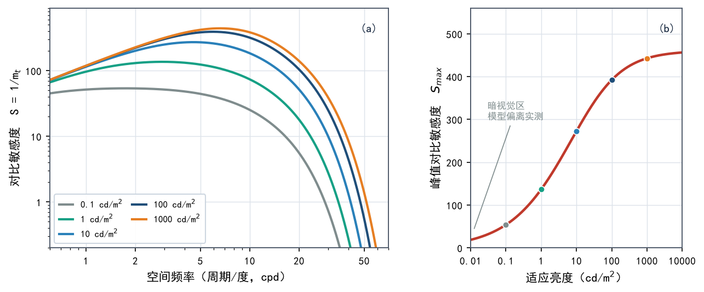

# 第 1 章 HDR 的物理与感知基础

> 高动态范围这件事，起点不在显示器，而在景物与人眼之间。真实景物的亮度跨度能到五六个数量级，人在单次注视里能同时分辨的却只有四个左右，剩下的靠适应、靠移动视线补上。这一章先把三个基础量讲清楚：绝对亮度、对比敏感度、眩光，再看它们怎样决定了哪些亮度值得被记录、被显示。后面几章的标准公式，全部建立在这一层人眼特性之上。

## 一、亮度：从物理量到“看得见”

讨论 HDR 最容易出问题的地方，是把“亮”当成一个可以随便标数字的属性。工程上说的亮度（luminance）有严格定义，它是单位面积、单位立体角内发出的光通量：

$$
L = \frac{\mathrm{d}^2\Phi}{\mathrm{d}A\,\cos\theta\,\mathrm{d}\Omega}\quad\left[\mathrm{cd/m^2}\right]
$$

其中 $\Phi$ 是光通量（流明），$A$ 是发光面面积，$\Omega$ 是立体角，$\theta$ 是观察方向与表面法线的夹角。$\mathrm{cd/m^2}$ 是标准单位，显示行业习惯写成 nit，两者完全等价。

这个定义里有两个要点。第一，亮度带方向性，同一块屏幕正着看和斜着看亮度不同，测 HDR 面板的可视角就得把这一点算进去。第二，亮度是面积密度，不是总量。广告里的“屏幕亮度 1000 nit”说的是某个区域（通常是 10% 窗口）能达到的峰值，和整屏全白的亮度差得远。

另有一个常被混淆的量是照度（illuminance，单位 lux），它描述“有多少光落在一个面上”。两者通过反射率联系起来。一块漫反射的白色表面（反射率 $\rho$），在照度 $E$ 下呈现的亮度为

$$
L = \frac{\rho E}{\pi}
$$

取 $\rho = 0.8$、$E = 100\ \mathrm{lux}$，得到 $L \approx 25\ \mathrm{cd/m^2}$。这个数字解释了为什么普通办公室的“白纸”只有二三十 nit，远低于显示器白场。人眼在室内看到的绝大多数“白”，其实是很低的绝对亮度。

把这个换算铺开到各类景物上，就得到图 1-1 的量级图。太阳表面在 $1.6\times10^9\ \mathrm{cd/m^2}$ 附近，阳光下的白云约 $10^4$ 至 $3\times10^4$，阴天室外景物一千上下，室内白纸只有几十。人眼能工作的下界在 $10^{-6}$ 量级（视杆细胞的绝对阈值），上界约 $10^8$，再高会出现明显不适与痛感，直视太阳表面（$1.6\times10^9$）几分钟就能造成视网膜损伤。

图中两条虚线是两个工程上的锚点：SDR 参考白 100 cd/m²，HDR 参考白 203 cd/m²。后者由 ITU-R BT.2408 给出，第 2 章会详细推导它的来历。可以看到，室内到阴天这段常见场景恰好横跨这两个锚点，而阳光直射的景物比 HDR 电视的峰值还高出三到四个数量级。这一段差距，正是高动态范围要处理的对象。

## 二、Weber 定律：人眼测的是比值

同一盏台灯，白天开着几乎察觉不到，深夜却刺眼。物理亮度没变，感知变了。十九世纪的 Weber 实验给出了这条规律的量化形式：在较大范围内，人眼能察觉的最小亮度变化 $\Delta L$ 与背景亮度 $L$ 成正比，

$$
\frac{\Delta L}{L} = k
$$

比例常数 $k$ 就是 Weber 分数，在中央凹、大目标、中等亮度条件下的典型值是 1%–2%。换成对比敏感度的语言，人眼在最佳条件下的分辨力约为 1/100 到 1/50。

Weber 定律只在中间一段成立。亮度太低时，光子到达的随机性主导，$\Delta L$ 随 $L$ 下降得比线性更慢（$\Delta L \propto L^{-1/2}$，即 Rose–de Vries 区）；亮度很高时，瞳孔收缩、光化学适应饱和，比值又开始上升。三段合起来是一条 U 形曲线，有效区间大致从 1 cd/m² 延伸到 $10^4$ cd/m²，这正好覆盖了图 1-1 里室内到晴天的范围。

工程上更常用的对比度定义有两种。电视与显示领域用 Weber 对比度，即白场比黑场：

$$
CR = \frac{L_{max}}{L_{min}}
$$

视觉科学更喜欢 Michelson 对比度，它把亮暗压进 0 到 1：

$$
C = \frac{L_{max}-L_{min}}{L_{max}+L_{min}} = \frac{CR-1}{CR+1}
$$

两种定义可以互相换算，后者更能说明一件事：对比度的感知收益是递减的。CR 从 100 提到 1000，C 只从 0.980 变到 0.998；再提到 10000，变成 0.9998。当 CR 超过几百之后，$C$ 已经贴近 1，继续堆数字对人眼几乎没有意义。

这组换算关系是判断 HDR 宣传语的第一道门槛。面板厂商说“对比度一百万比一”，指的是最亮与最暗的极限值之比，两个极端不可能同时出现在一帧画面里，也不可能同时落在视网膜的同一适应状态上。真正决定观感的，是同一画面里高光与阴影的亮度差，以及这个差值在眼内杂散光和环境光下还剩多少。第四节会给出这笔账的具体算法。

## 三、对比敏感度函数与 Barten 模型

Weber 定律说的是“多大的亮度差能被看出”，但人眼看的从来都是带空间结构的图像，均匀色块只在实验室里出现。条纹越细，同样幅度下越难分辨。把“刚好能分辨的对比度阈值” $m_t$ 随空间频率 $f$ 的变化画出来，就是对比敏感度函数（CSF），工程上习惯取其倒数：

$$
S(f) = \frac{1}{m_t(f)}
$$

空间频率的单位是周期每度（cpd），描述一度的视角里塞进多少条明暗条纹。人眼 CSF 的形状很有特点：低频端缓慢上升，在 3 至 6 cpd 附近达到峰值，之后快速下降，到 50 至 60 cpd 左右彻底断掉。峰值位置对应约 0.2 度的条纹周期，差不多是一个手指宽在手臂距离上的张角。这个“带通”形状是光学系统点扩散与视网膜神经侧抑制共同作用的结果。

CSF 还强烈依赖适应亮度。亮度升高，峰值上移、截止频率抬高；亮度降到 1 cd/m² 以下，整条曲线明显塌陷。要定量描述这种依赖，用得最广的是 Barten 模型。它把视觉系统拆成光学、量子噪声和神经噪声三段，写成一条闭式公式：

$$
S(u)=\frac{M_{opt}(u)}{k\sqrt{\dfrac{2}{T}\left(\dfrac{1}{X_0^2}+\dfrac{1}{X_{max}^2}+\dfrac{u^2}{N_{max}^2}\right)\left(\dfrac{1}{\eta p E}+\dfrac{\Phi_0}{1-e^{-(u/u_0)^2}}\right)}}
$$

其中 $M_{opt}(u)=\exp(-2\pi^2\sigma^2u^2)$ 是眼球光学传递函数，$\sigma$ 由光学点扩散 $\sigma_0$ 与色差 $C_{ab}d$ 合成；$E$ 是视网膜照度（troland），由适应亮度与瞳孔直径 $d$ 决定，$d$ 又随亮度按 $d=5-3\tanh(0.4\lg(L/40))$ 变化；$k$ 是检测信噪比，$T$ 是积分时间，$\eta$ 是量子效率，$p$ 是 troland 到光子数的换算因子，$\Phi_0$ 是神经噪声谱密度，$u_0$ 是侧抑制的峰值频率。Barten 给出的典型参数为 $X_0=2^{\circ}$、$X_{max}=12^{\circ}$、$N_{max}=15$、$k=3$、$T=0.1\,\mathrm{s}$、$\eta=0.03$、$\Phi_0=3\times10^{-8}$、$u_0=7\ \mathrm{cpd}$、$\sigma_0=0.5'$。

代入这些参数直接计算，得到图 1-2。

从计算结果能读出三件事。第一，100 cd/m² 下峰值约 390，出现在 5 至 6 cpd，对应刚可分辨的对比度约 0.26%；到了 1 cpd 附近敏感度降到 120 左右，阈值约 0.85%，与第二节的 Weber 分数 1%–2% 接上了。两者说的是同一件事的不同尺度，Weber 分数对应的是大面积缓变目标，CSF 峰值对应的是最适合人眼的条纹结构。第二，100 与 1000 cd/m² 两条曲线几乎重合，说明亮度超过 100 cd/m² 后，视觉系统的噪声底已不再是量子噪声，继续提亮换不来分辨力。第三，模型在 0.1 cd/m² 处峰值只剩 50 上下，这正是暗环境下画面“发闷、细节糊掉”的原因。

CSF 在工程上的用途比想象中直接。给定显示亮度与位深，每个码值对应的亮度台阶是确定的；把这个台阶换算成对比度，再和 CSF 阈值比较，就能判断量化误差会不会被看见。第 2 章讨论 10 bit 与 12 bit PQ 的取舍时，用的就是这个方法。同理，视频编码的量化步长、色调映射的局部算子强度，也都可以拿 CSF 作为可见性判据。

## 四、眩光：视野里的“漏光”

前面几节的模型都假设眼睛是一个干净的光学系统。实际上眼球内部有散射：角膜、晶状体、玻璃体都不是理想透明介质，强光进入后会在视网膜上铺开一层弥散的“雾”，这叫眼内杂散光，它造成的后果统称眩光。

眩光的量化从遮蔽光（veiling luminance）开始。一个位于视线外 $\theta$ 角、产生照度 $E_v$ 的光源，会在视网膜上叠加等效亮度

$$
L_v = \frac{10\,E_v}{\theta^2}
$$

$E_v$ 单位 lux，$\theta$ 单位度。这个关系叫 Stiles–Holladay 公式，形式简单但含义明确：遮蔽光按角度平方衰减。一个在 5 度处产生 10 lux 的光源，等效亮度是 0.4 cd/m²；同样的光源挪到 20 度处，只剩 0.025 cd/m²。这解释了为什么看电影时要关掉侧后方的灯，也解释了为什么 HDR 电视摆在窗边效果会打折。

用相对量描述更直观。设高光亮度为 $L_w$，眼内杂散光按比例 $s$ 铺满整个视野，黑位亮度为 $L_b$，那么能被分辨的有效对比度是

$$
CR_{eff}=\frac{L_w+sL_w}{L_b+sL_w}=\frac{1+s}{1/CR_{native}+s}
$$

$s$ 的典型量级：20 至 30 岁人群在 5 度视角处约 1%，60 岁以上可升到 2%–3%（CIE 用杂散光参数 $s$ 描述这一现象，单位 $\mathrm{deg^{-2}}$）。图 1-3 把这条式子画了出来，并给了一个具体算例。

结论有点残酷：器件原生对比度做到一百万比一，只要眼内杂散光占 1%，实际可用对比度就掉回 100:1 量级。右侧算例里，1000 cd/m² 的高光把黑位从 0.001 抬到 10 cd/m²，四个数量级的暗部细节被这层雾吃掉。这不是显示器的问题，是眼睛的物理限制。由此可以划出三条工程边界：一是盲追黑位没有意义，暗部细节的可见性由眩光与观看环境决定；二是高光面积要控制，大面积高光会让整幅画面的暗部一起失效；三是观看环境的照度必须纳入标准，BT.2100 规定参考观看环境的原因也在这里。

家庭环境里还有第二层眩光，来自屏幕表面的反射。设屏幕反射率 1%、环境照度 200 lux，反射亮度约

$$
L_{refl}=\frac{0.01\times200}{\pi}\approx0.64\ \mathrm{cd/m^2}
$$

这一数值比 HDR 面板宣称的 0.005 cd/m² 黑位高出两个数量级，于是整屏的有效对比度上限被压到 1000/0.64 ≈ 1560:1。想看清 HDR 的暗部，要么降低环境光，要么用低反射涂层，硬件参数本身并不足够。

## 五、人眼的动态范围

动态范围有两种读法，混淆这两者是最常见的错误。

一种是绝对范围，指人眼通过适应能覆盖的全部亮度区间。从暗适应后的绝对阈值 $10^{-6}\ \mathrm{cd/m^2}$ 到明亮环境下的 $10^8\ \mathrm{cd/m^2}$，跨越约 14 个数量级。这份能力来自三套机制：瞳孔在 2 至 8 mm 之间变化，面积比约 16:1（1.2 个数量级）；视杆与视锥两套感光系统分工，视杆负责 $10^{-6}$ 至 $10^{-1}$，视锥接管 1 以上；以及视网膜与视觉皮层的神经适应，靠调节增益来匹配当前的平均亮度。暗适应需要 20 至 30 分钟才能完成，明适应快得多，通常一分钟内就够。

另一种是同时范围，指一次注视之内能分辨的亮度跨度。这个数字小得多，多数研究给出 3 至 4 个数量级，即 $10^3$ 至 $10^4$，超出之后就要靠移动视线和重新适应。第四节算出的有效对比度 100:1 到 1000:1，正落在这个同时范围与眩光限制的交叠区。

两份数字对 HDR 的意义不同。绝对范围说明人眼不会因为 4000 nit 的高光而“过曝”，短暂注视是安全的；同时范围说明画面内的亮度跨度必须落在四个数量级以内，否则要么暗部看不见，要么高光刺眼。

按感光细胞的工作状态，还可以把亮度切成三段：明视觉（photopic）在 3 cd/m² 以上，视锥主导，有完整的色彩分辨；暗视觉（scotopic）在 0.001 cd/m² 以下，视杆主导，只有灰阶、没有色觉；中间夹着 0.001 至 3 cd/m² 的中间视觉（mesopic），两套细胞同时出力，CIE 191:2010 专门定义了这一段的等效亮度换算。HDR 电视在暗室里观看时，画面暗部恰好落进中间视觉区，色饱和度与响应都会改变，这是暗室调色与亮室观看观感不一致的生理原因之一。

## 六、HDR 在感知层面的含义

把前面几节串起来，可以回答一个具体问题：HDR 到底改善了观感的哪一部分。

最直接的一项是高光。真实场景里，光源与镜面反射的亮度比漫反射白面高出两到五个数量级：白纸约 $10^4$ cd/m²，阳光下的金属反光可以到 $10^6$，太阳表面 $10^9$。SDR 把 100 cd/m² 以上一律裁掉，结果是太阳变成一张白纸、灯泡失去光晕、金属失去质感。HDR 把这些高光还原出来，画面的“材质感”和“现场感”主要来自这里，而不是平均亮度的提升。

第二项是亮度分布带来的感知效应。亮度上升时，人眼感知到的对比度与饱和度都会增强，这就是 Hunt 效应与 Stevens 效应；在较暗的环境里看同一幅画面，感知对比反而更高，这是 Bartleson–Breneman 效应。它们共同说明：显示亮度与观看环境的匹配关系，比绝对亮度值更重要。BT.2100 定义了两个参考观看环境，BT.2408 给出参考白 203 cd/m²，都是为了把这层匹配固定下来，让制作端与观看端看到同一个“亮度感”。

第三项是暗部。更高的位深与更细的码值分配让暗部台阶变小，配合不刺眼的高光，画面能同时容纳窗口外的星空与室内的台灯。这件事的难度不在面板峰值亮度，而在黑位的稳定性与眩光控制，这也是 OLED 与高分区背光在 HDR 场景下差距明显的原因。

有些说法需要修正。全屏 1000 nit 并不舒适，人眼对大面积高光的耐受远低于小面积高光，所以 HDR 内容的峰值通常只出现在小面积区域，BT.2408 也因此建议图形白（字幕、UI）维持在 203 cd/m² 附近。把 HDR 理解成“整体更亮”，方向就偏了。

## 本章要点

- 亮度是单位面积、单位立体角的发光强度，单位 $\mathrm{cd/m^2}$（nit），与照度 lux 通过 $L=\rho E/\pi$ 换算，室内白纸只有二三十 nit。
- 常见场景跨越约八个数量级，SDR 参考白 100 cd/m²、HDR 参考白 203 cd/m² 都落在室内到阴天这一段的低端。
- Weber 定律 $\Delta L/L=k$ 在 1 至 $10^4$ cd/m² 成立，$k$ 约 1%–2%；过低进入光子噪声区，过高进入饱和区。
- Weber 对比度与 Michelson 对比度可互换，$C=(CR-1)/(CR+1)$；CR 超过几百后感知收益迅速消失。
- CSF 峰值在 3 至 6 cpd，100 cd/m² 下约 390，截止频率 45 至 60 cpd；亮度超过 100 cd/m² 后继续提亮收益极小。
- Barten 模型把光学、量子噪声与神经噪声写成闭式公式，可直接用于判断量化台阶是否可见。
- 眼内杂散光把有效对比度压到 100:1 至 1000:1 量级，屏幕表面反射在 200 lux 环境下又叠加 0.6 cd/m² 量级，两者共同决定了 HDR 黑位的实际可见性。
- 人眼绝对动态范围约 14 个数量级，同时范围只有 3 至 4 个数量级；HDR 的观感收益主要来自高光还原与亮度分布，而不是平均亮度更高。
