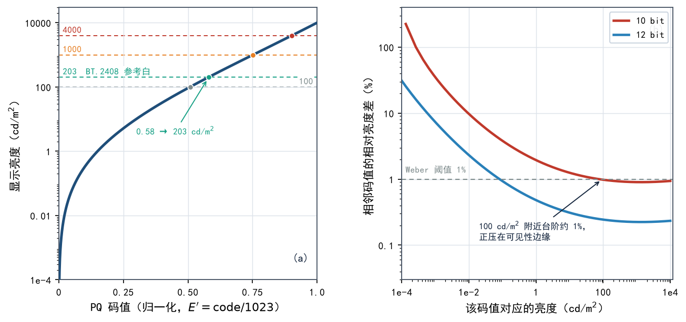
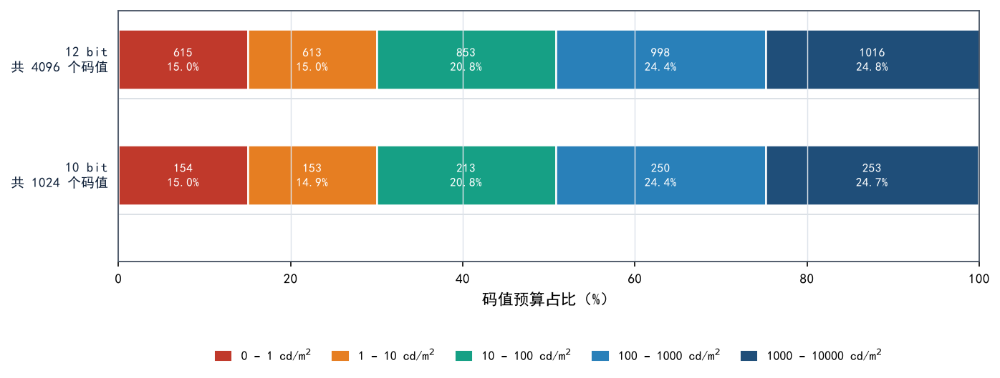
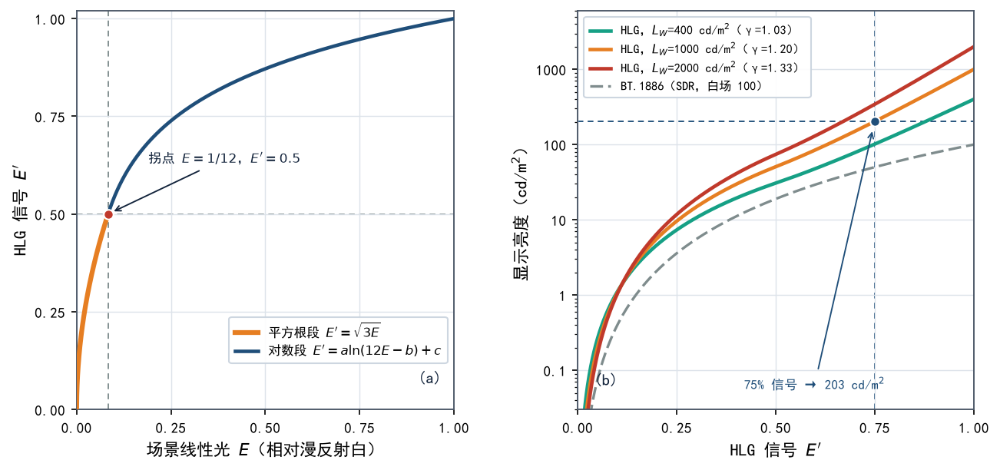

# 第 2 章 PQ 与 HLG 的数学与工程

> 把亮度从 100 nit 推到 1000 nit，技术难点并不在面板，而在“怎样把亮度写成码值”。光电转换曲线决定了码值怎么分配、需要几位、能不能兼容旧设备。国际上最后留下两条路线：SMPTE ST 2084 定义的 PQ，按绝对亮度编码；ITU-R BT.2100 里的 HLG，按场景相对亮度编码。这一章把两条曲线的公式、常数、码值分布和配套的制作约定逐个拆开。读完应该能算出一个具体码值对应多少 nit，也能看懂“203 cd/m² 参考白”是怎么来的。

## 一、两条路线：绝对亮度与相对亮度

SDR 的传递函数是相对量。BT.1886 规定显示端亮度 $L = a\max(V+b,0)^{2.4}$，其中只有白场 $L_W$ 是绝对数，其余全按比例。换一台更亮的显示器，整幅画面一起变亮，曲线形状不变。

HDR 遇到的问题是 SDR 的码值不够用了。8 bit、gamma 2.2 的曲线在暗部堆了很多码值，在亮部却很稀疏；把白场从 100 nit 拉到 1000 nit，亮部会出现明显色带。解决办法有两条思路。

一条是把亮度当成绝对量，直接按人眼的感知均匀性重新分配码值，让每个码值对应的感知差异大致相等。这就是 PQ（Perceptual Quantizer），由 SMPTE ST 2084 标准化。它的码值 0.5 永远对应 92 nit，不管显示器峰值是 1000 还是 4000。

另一条是保留场景参考的思路，让信号正比于摄像机拍到的场景光，显示端再根据自身峰值做一次映射。这就是 HLG（Hybrid Log-Gamma），被 ITU-R BT.2100 采纳。它的优点很实际：同一条信号可以直接送进 SDR 电视，画面偏暗但结构完整，广播链路不需要为 HDR 单独准备第二条通路。

两条路线对应两种产业。电影母版、流媒体点播走 PQ，因为需要精确的绝对亮度；现场直播、卫星与有线广播走 HLG，因为要求单层信号、向下兼容。

有一个常见的疑问可以在这里解答：既然 HDR 要的是大范围亮度，为什么不直接用 16 bit 线性编码，把亮度如实写进去？算一下就清楚了。线性编码下 0.01 cd/m² 只占 1000 nit 满量程的十万分之一，10 bit 的码值根本落不到这个位置；要让 0.01 cd/m² 附近的台阶低于 1%，位深得到 24 bit 左右，码率上无法接受。而人眼对亮度的响应近似对数，把码值按感知均匀分配，10 至 12 bit 就能覆盖六个数量级。PQ 与 HLG 都是这个思路的产物，区别只在以绝对亮度还是场景亮度作为刻度。

## 二、SMPTE ST 2084：PQ 的公式

ST 2084 由 Scott Miller、Mahdi Nezamabadi 与 Scott Daly 在 2014 年提出，核心是把 Barten 对比敏感度模型反过来用：先假设观看者能分辨的最小亮度比是固定的（约 1%），再要求相邻码值之间的感知差异处处等于这个阈值，积分后得到一条解析曲线。结果是 PQ 的形状与 CSF 的积分一致，在 0.0001 到 10000 cd/m² 之间做到感知均匀。

EOTF 的闭式表达为

$$
L=10000\left[\frac{\max\left(N^{1/m_2}-c_1,\ 0\right)}{c_2-c_3N^{1/m_2}}\right]^{1/m_1}
$$

$N$ 是归一化码值（0 到 1），$L$ 是绝对亮度（cd/m²）。逆函数即 OETF：

$$
N=\left[\frac{c_1+c_2Y^{m_1}}{1+c_3Y^{m_1}}\right]^{m_2},\qquad Y=\frac{L}{10000}
$$

五个常数都是有理数，精度足够用整数运算实现：

$$
\begin{aligned}
m_1 &= \frac{2610}{16384}=0.1593017578125, &\quad
m_2 &= \frac{2523}{4096}\times128=78.84375,\\
c_1 &= \frac{3424}{4096}=0.8359375, &\quad
c_2 &= \frac{2413}{128}=18.8515625, &\quad
c_3 &= \frac{2392}{128}=18.6875
\end{aligned}
$$

曲线形状在图 2-1 左侧。纵轴取对数后大致是一条直线带轻微弯曲，说明 PQ 近似对数分配：每提升一个数量级的亮度，占用的码值差不多。几个关键点值得记住：码值 0.5 对应 92 cd/m²，0.58 对应 203 cd/m²（BT.2408 的 HDR 参考白），0.75 对应 983 cd/m²，接近常见的 1000 nit 峰值，1.0 才到 10000 cd/m²。反过来，10 bit 下 1000 nit 落在码值 769，即 1024 个码值里的第 770 个，前四分之三全部给了 1000 nit 以下的亮度。

曲线两端还有两个细节。下限 0.0001 cd/m² 只落在 10 bit 的第 2 个码值附近，更暗的内容只剩码值 0 可用，因为显示器的黑位再低也无法表现；上限 10000 cd/m² 是整个曲线的归一化点，不是任何一块屏的实际能力。把这两端定下来，0.0001 至 10000 共八个数量级的码值预算就固定了。

右图是本节的工程落点。相邻码值的相对亮度差 $L(n+1)/L(n)-1$ 随亮度下降而急剧放大：100 cd/m² 处 10 bit 的台阶约 1.0%，正好压在第 1 章算出的 Weber 阈值上；1 cd/m² 处升到约 1.9%；到 0.01 cd/m² 已经是 21%。也就是说，10 bit PQ 在暗部远谈不上平滑，一条深阴影里的渐变很容易出现色带。12 bit 把台阶缩小到四分之一，同样位置降到 5% 左右，这解释了为什么母版与专业监视器普遍用 12 bit，而 10 bit 分发要靠抖动（dither）掩盖。

抖动不是权宜之计。10 bit PQ 加噪声抖动后，感知上的等效位深能接近 12 bit，代价是轻微噪声底抬升，在暗室观看时可能被察觉。杜比视界选择 12 bit 编码、HDR10 选择 10 bit，取舍就在这里。

## 三、码值分配：亮部与暗部的预算

图 2-1 的曲线可以用另一角度看：把码值预算按亮度区段切开，看每一段分到多少。

10 bit 的分配结果：0 至 1 cd/m² 占 154 个码值（15.0%），1 至 10 占 153 个（14.9%），10 至 100 占 213 个（20.8%），100 至 1000 占 250 个（24.4%），1000 至 10000 占 253 个（24.7%）。12 bit 的比例完全相同，只是每个区段的码值数翻四倍。

这张图说明两件事。第一，PQ 的分配接近“按数量级均分”，每个十倍区间大致 150 至 250 个码值。越往亮部码值越多，原因是码值对应的相对亮度变化在亮部更小：暗部一个码值要吃掉 3% 以上的跳变，亮部只要 1% 上下，同样一个数量级自然需要更多码值来填。第二，最顶上一个数量级吃掉了四分之一的码值预算。如果内容峰值只有 1000 nit，这 253 个码值全部浪费；把 PQ 曲线截断在 1000 nit 重新归一化，可以在同样位深下多出约三成的暗部精度，代价是失去与 10000 nit 内容互通的能力。实际标准没有这么做，宁可浪费码值也要保证同一码值在任何设备上都指向同一亮度。

暗部的账更值得算。10 bit 下 0.01 至 1 cd/m² 只有 132 个码值，跨越两个数量级，平均每个数量级 66 个，每个码值的亮度变化约 3.5%。往上走台阶自然收窄，1 cd/m² 处约 1.9%，10 cd/m² 处约 1.3%，100 cd/m² 处约 1.0%。整条曲线几乎贴着 1% 的阈值走，10 bit 只是刚好够用，而不是宽裕。HDR 编码器在暗部投入更多比特、母版采用 12 bit，原因都在这里。

## 四、ITU-R BT.2100：把两条曲线放进同一个框架

BT.2100 在 2016 年发布，2018 年修订，标题是“用于制作和国际节目交换的高动态范围电视的图像参数值”。它做的是接口层的统一：把 PQ 与 HLG 都定义为可选的传递特性，共用 BT.2020 原色、10 或 12 bit 位深、窄范围码值（10 bit 有效 64 至 940），并各自规定参考显示参数。

表 2-1　BT.2100 中的两条传递特性

| 项目 | PQ（传输特性 16） | HLG（传输特性 18） |
|---|---|---|
| 编码方式 | 绝对亮度 | 场景相对亮度 |
| 名义峰值 | 10000 cd/m²（参考显示 1000） | 由显示峰值决定（常见 1000） |
| 参考黑位 | 0.005 cd/m² | 由显示决定 |
| 位深 | 10 或 12 bit | 10 或 12 bit |
| 典型用途 | 电影、流媒体、蓝光 | 广播、直播 |

表里的“传输特性 16 与 18”不是随手编的编号，它们来自 ITU-T H.273 的 codepoint 表，后面第 3 章讲码流时会再遇到。同一张表里 16 号是 ST 2084，18 号是 HLG，这两个数字会出现在 SPS、容器与 HDMI 的字段里。

BT.2100 只规定了亮度通道的传递特性，色度那一半另行处理。两条路可选：按 BT.2020 的非恒定亮度 YCbCr 编码，或者用恒定亮度的 ICtCp。前者沿用 SDR 的矩阵，实现简单，代价是色度失真随亮度升高而放大；后者把亮度与色度真正分开，在高亮度下色度误差更均匀，代价是需要额外的矩阵运算与更宽的色度信号。杜比视界的内部管线用 ICtCp，HDR10 与 HDR10+ 的基流用 YCbCr。

BT.2100 为 PQ 规定的参考显示是峰值 1000 cd/m²、黑位 0.005 cd/m²、暗室环境。这个组合决定了“标准 HDR 观感”长什么样，也解释了为什么 1000 nit 会成为行业里的第一个里程碑，尽管 ST 2084 的曲线本身能到 10000 nit。

## 五、HLG：OETF、OOTF 与系统 gamma

HLG 的名字里带“混合”，指的就是它的 OETF 由两段拼接：暗部用平方根，亮部用对数。平方根段让暗部码值密集，对数段把高光压进剩余码值。

$$
E'=\begin{cases}
\sqrt{3E}, & 0\le E\le \dfrac{1}{12}\\[6pt]
a\ln(12E-b)+c, & \dfrac{1}{12}<E\le 1
\end{cases}
$$

三个常数由“在拐点处函数值与斜率都连续”解出：$a=0.17883277$，$b=1-4a=0.28466892$，$c=0.5-a\ln(4a)=0.55991073$。拐点落在 $E=1/12$、$E'=0.5$，位于 10 bit 窄范围码值的中段。

逆函数同样分段：

$$
E=\begin{cases}
\dfrac{E'^2}{3}, & E'\le 0.5\\[6pt]
\dfrac{e^{(E'-c)/a}+b}{12}, & E'>0.5
\end{cases}
$$

OETF 只决定信号，画面最终多亮由 OOTF 决定。BT.2100 给出的形式是

$$
F_D=\alpha\, Y_S^{\gamma-1}E,\qquad \gamma=1.2+0.42\lg\frac{L_W}{1000}
$$

$E$ 是某通道的场景线性值，$Y_S$ 是三通道加权亮度（BT.2020 系数 0.2627、0.6780、0.0593），$\alpha=L_W-L_B$ 通常等于显示峰值。对灰阶信号 $E=Y_S=V$ 代入，端到端关系化简成

$$
L_D=L_W\cdot E^{\gamma}
$$

$\gamma$ 就是系统 gamma，随显示峰值变化：$L_W=1000$ 时 $\gamma=1.2$，$L_W=400$ 时约 1.03，$L_W=2000$ 时约 1.33。这一项是 HLG 与 PQ 最大的不同：同一条 HLG 信号在不同亮度的屏上，不仅整体缩放，对比度也会跟着变，暗部被抬起或压深，观感尽量贴近导演意图。

右图还画了一条 BT.1886 曲线，代表“把 HLG 信号直接送进白场 100 nit 的 SDR 电视”会发生什么。两条线在 0.2 附近交叉，高光段 HLG 明显更亮，暗部反而更暗。落到具体数字：75% 信号在 1000 nit 屏上给 203 cd/m²，在 SDR 电视上只有 50 cd/m²；100% 信号则分别是 1000 与 100 cd/m²。画面能用，但对比被拉开、暗部被压死，这就是“向下兼容”的真实含义。它并不要求两种显示看起来一样，只要不经过转换也能看。

HLG 的另一个性质是峰值不固定。同一条信号送到 400 nit 的屏，75% 落到 101 cd/m²；送到 2000 nit 的屏，落到 343 cd/m²。显示端不需要元数据，只需要知道自己的峰值，就能算出该给多少亮度。这是 HLG 在广播链路里省事的关键。

10 bit HLG 的量化台阶比 10 bit PQ 温和。按端到端 $E^{1.2}$ 计算，中间调每码值的相对亮度差约 0.5% 至 0.8%，暗部（信号 5%）升到 4.9%。这个分布与 SDR 的 gamma 曲线接近，所以 HLG 用 10 bit 分发在多数场景下够用，广播系统也因此不必改造码率预算。

## 六、BT.2408：参考白与制作实践

公式只解决“码值对应多少亮度”，制作还需要一个共同的锚点：画面里那块“白”应该是多少 nit。ITU-R BT.2408《HDR 电视制作中的操作实践》给出了答案，现行版本把它写成 HDR Reference White = 203 cd/m²。

203 这个数字不是随手定的。它等于 HLG 75% 信号在 1000 nit 参考显示上经过 OOTF 之后的亮度。先把 0.75 送进逆 OETF 得到场景线性值，再乘上系统 gamma：

$$
E_{0.75}=\frac{e^{(0.75-c)/a}+b}{12}\approx0.2650,\qquad L=1000\times E_{0.75}^{1.2}\approx203\ \mathrm{cd/m^2}
$$

取整后成为标准值。PQ 侧对应码值 0.58，算出来 201.7 cd/m²，与 203 只差 0.6%，两条路线在这个点上对齐。

BT.2408 围绕这个锚点给出了一整套实践约定：

- 漫反射白（白卡、白纸、人脸高光）按 203 cd/m² 曝光，HLG 用 75% 信号，PQ 用 58% 信号。
- 图形白（字幕、台标、UI）同样放 203 cd/m²，避免字幕在暗场景里刺眼。
- 内容峰值按监视器能力设定，常见 1000 cd/m²；高光只允许出现在小面积区域，大面积高光会让整幅画面的暗部失效（第 1 章的眩光分析给过原因）。
- 监视器需要按 203 cd/m² 参考白校准，环境光照度与背景亮度也要按 BT.2035 的观看环境控制，否则制作端的判断在家庭端不成立。

家庭端的情况比演播室复杂。客厅照度常在 100 至 300 lux 之间，电视峰值从 400 nit 到 2000 nit 不等，HDR 片源又可能按 PQ 1000 nit 或 HLG 制作。同一条 HLG 信号进入不同峰值的电视，系统 gamma 会从 1.03 拉到 1.33，画面对比度自然跟着变，这也是 HLG 在消费端很少被吐槽“亮度不对”的原因——它本来就不承诺绝对的亮度值。PQ 内容则相反，显示端必须先知道自己的峰值，再决定是否色调映射、映射多少，不给元数据就只能按内置规则猜。

这套约定解决了一个具体矛盾。SDR 时代的白场是 100 cd/m²，HDR 白场若直接拉到 1000 cd/m²，人脸会显得像发光体；若维持 100 cd/m²，高光就没有余量。203 cd/m² 是折中：比 SDR 亮一倍，给高光留出约 5 倍（1000/203）的余量，暗部也能落在 0.005 到 1 cd/m² 这段人眼敏感的区间里。

混播场景还要处理转换。SDR 与 HDR 同播时，BT.2446 给出了三套 SDR↔HDR 转换方法，核心都是把 100 cd/m² 的 SDR 白映射到 203 cd/m² 的 HDR 参考白，同时对高光做肩部压缩。转换质量的好坏，取决于肩部曲线是否保住了高光层次，这一部分留到第 4 章的色调映射再展开。

## 七、两条路线的工程取舍

把前面的内容收拢成一张对照表，取舍就清楚了。

表 2-2　PQ 与 HLG 的工程对照

| 维度 | PQ | HLG |
|---|---|---|
| 亮度语义 | 绝对，码值即 nit | 相对，依赖显示峰值 |
| 元数据需求 | 需要（母版峰值、MaxCLL） | 基本不需要 |
| 位深要求 | 母版 12 bit，分发 10 bit 需抖动 | 10 bit 可用 |
| 向下兼容 | 无，SDR 设备无法直接显示 | 有，可直入 SDR 通路 |
| 制作复杂度 | 高，需要 HDR 监视器与元数据工具 | 低，可用现有广播链路 |
| 典型生态 | HDR10、HDR10+、杜比视界、HDR Vivid | 广电直播、ATSC 3.0、部分流媒体 |

PQ 的优势在于精确。母版里每个像素的绝对亮度都有确定值，调色师可以精确控制高光到多少 nit，显示端也能据元数据决定如何映射。代价是链路每一环都要认识 PQ，任何一处按 SDR 解释都会出错。

HLG 的优势在于鲁棒。信号自带场景信息，显示端按自己的峰值算 OOTF，中间不需要传元数据，也不怕元数据丢失。代价是画面最终亮度不确定，同一份内容在两台峰值不同的电视上亮度不同，这对广告、图形界面这类需要精确亮度的素材不友好。

两条路线在工程上并不互斥。BT.2100 把两者并列，HDR10 与杜比视界用 PQ，ATSC 3.0 与 DVB 用 HLG，国内广电的 HDR Vivid 用 PQ 加动态元数据。理解了这两条曲线的差别，后面读任何一种 HDR 格式的规范都不会迷路。

实际部署时还有一笔带宽账。10 bit 4:2:0 的 PQ 基流与 10 bit SDR 的码率基本相当，HEVC Main10 与 AV1 都已经把这个档位当作常规配置，所以 HDR10 能直接跑在现有分发链路上。HLG 更省事，同一份编码流可以同时服务 HDR 与 SDR 终端，广播商不需要为两种终端准备两套码流，代价是无法针对 HDR 终端做码率优化。两条曲线本身只占几行公式，真正拉开差距的是这些链路与设备层面的账。

## 本章要点

- PQ 由 SMPTE ST 2084 定义，按绝对亮度编码，常数 $m_1=2610/16384$、$m_2=78.84375$、$c_1=3424/4096$、$c_2=2413/128$、$c_3=2392/128$，码值 1.0 对应 10000 cd/m²。
- PQ 码值 0.5 对应 92 cd/m²，0.58 对应 203 cd/m²，0.75 对应 983 cd/m²；1000 nit 只用掉约四分之三的码值。
- 10 bit PQ 在 100 cd/m² 处的相对台阶约 1%，与 Weber 阈值重合；0.01 cd/m² 处达 21%，暗部必须靠 12 bit 或抖动。
- BT.2100 把 PQ（传输特性 16）与 HLG（传输特性 18）并列，共用 BT.2020 原色、10/12 bit 与窄范围码值。
- HLG 的 OETF 分两段，拐点在 $E=1/12$、$E'=0.5$，常数 $a=0.17883277$、$b=0.28466892$、$c=0.55991073$。
- HLG 端到端亮度为 $L_D=L_W E^{\gamma}$，$\gamma=1.2+0.42\lg(L_W/1000)$，同一条信号在不同峰值屏上对比度不同。
- BT.2408 的 HDR 参考白 203 cd/m² 等于 HLG 75% 信号在 1000 nit 屏上的 OOTF 结果，对应 PQ 码值 0.58。
- 图形白、字幕按 203 cd/m²，大面积高光要限制面积；SDR↔HDR 转换由 BT.2446 规定，核心是把 100 cd/m² 映射到 203 cd/m²。
