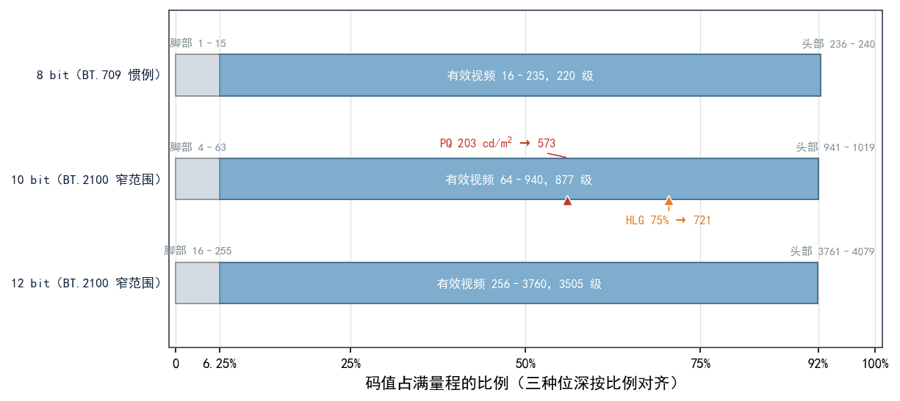
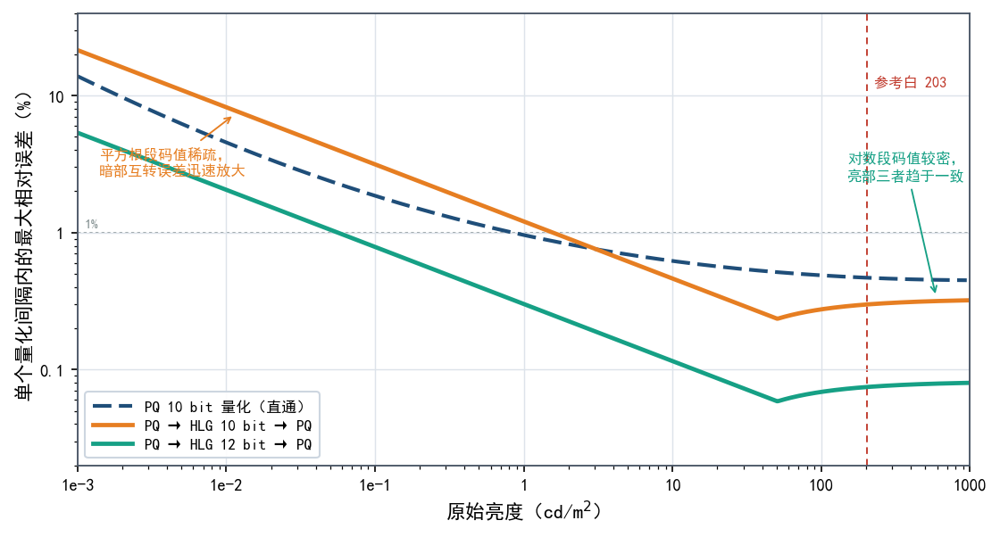
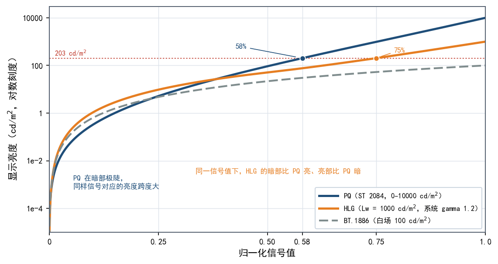
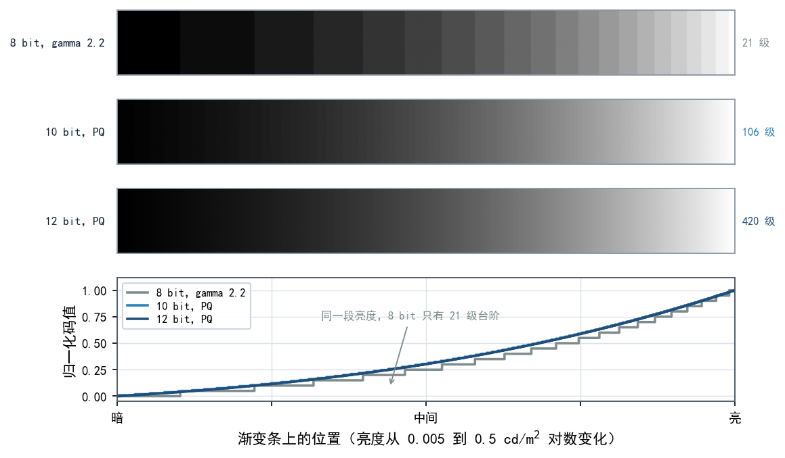

# 第 2 章 PQ 与 HLG 的数学与工程

> 把亮度从 100 nit 推到 1000 nit，技术难点并不在面板，而在“怎样把亮度写成码值”。光电转换曲线决定了码值怎么分配、需要几位、能不能兼容旧设备。国际上最后留下两条路线：SMPTE ST 2084 定义的 PQ，按绝对亮度编码；ITU-R BT.2100 里的 HLG，按场景相对亮度编码。这一章把两条曲线的公式、常数、码值分布和配套的制作约定逐个拆开。读完应该能算出一个具体码值对应多少 nit，也能看懂“203 cd/m² 参考白”是怎么来的。

## 一、两条路线：绝对亮度与相对亮度

SDR 的传递函数是相对量。BT.1886 规定显示端亮度 $L = a\max(V+b,0)^{2.4}$，其中只有白场 $L_W$ 是绝对数，其余全按比例。换一台更亮的显示器，整幅画面一起变亮，曲线形状不变。

HDR 遇到的问题是 SDR 的码值不够用了。8 bit、gamma 2.2 的曲线在暗部堆了很多码值，在亮部却很稀疏；把白场从 100 nit 拉到 1000 nit，亮部会出现明显色带。解决办法有两条思路。

一条是把亮度当成绝对量，直接按人眼的感知均匀性重新分配码值，让每个码值对应的感知差异大致相等。这就是 PQ（Perceptual Quantizer），由 SMPTE ST 2084 标准化。它的码值 0.5 永远对应 92 nit，不管显示器峰值是 1000 还是 4000。

另一条是保留场景参考的思路，让信号正比于摄像机拍到的场景光，显示端再根据自身峰值做一次映射。这就是 HLG（Hybrid Log-Gamma），被 ITU-R BT.2100 采纳。它的优点很实际：同一条信号可以直接送进 SDR 电视，画面偏暗但结构完整，广播链路不需要为 HDR 单独准备第二条通路。

两条路线对应两种产业。电影母版、流媒体点播走 PQ，因为需要精确的绝对亮度；现场直播、卫星与有线广播走 HLG，因为要求单层信号、向下兼容。

有一个常见的疑问可以在这里解答：既然 HDR 要的是大范围亮度，为什么不直接用 16 bit 线性编码，把亮度如实写进去？算一下就清楚了。线性编码下 0.01 cd/m² 只占 1000 nit 满量程的十万分之一，10 bit 的码值根本落不到这个位置；要让 0.01 cd/m² 附近的台阶低于 1%，位深得到 24 bit 左右，码率上无法接受。而人眼对亮度的响应近似对数，把码值按感知均匀分配，10 至 12 bit 就能覆盖六个数量级。PQ 与 HLG 都是这个思路的产物，区别只在以绝对亮度还是场景亮度作为刻度。

## 二、SMPTE ST 2084：PQ 的公式

ST 2084 由 Scott Miller、Mahdi Nezamabadi 与 Scott Daly 在 2014 年提出，核心是把 Barten 对比敏感度模型反过来用：先假设观看者能分辨的最小亮度比是固定的（约 1%），再要求相邻码值之间的感知差异处处等于这个阈值，积分后得到一条解析曲线。结果是 PQ 的形状与 CSF 的积分一致，在 0.0001 到 10000 cd/m² 之间做到感知均匀。

EOTF 的闭式表达为

$$
L=10000\left[\frac{\max\left(N^{1/m_2}-c_1,\ 0\right)}{c_2-c_3N^{1/m_2}}\right]^{1/m_1}
$$

$N$ 是归一化码值（0 到 1），$L$ 是绝对亮度（cd/m²）。逆函数即 OETF：

$$
N=\left[\frac{c_1+c_2Y^{m_1}}{1+c_3Y^{m_1}}\right]^{m_2},\qquad Y=\frac{L}{10000}
$$

五个常数都是有理数，精度足够用整数运算实现：

$$
\begin{aligned}
m_1 &= \frac{2610}{16384}=0.1593017578125, &\quad
m_2 &= \frac{2523}{4096}\times128=78.84375,\\
c_1 &= \frac{3424}{4096}=0.8359375, &\quad
c_2 &= \frac{2413}{128}=18.8515625, &\quad
c_3 &= \frac{2392}{128}=18.6875
\end{aligned}
$$

这些常数的来历可以从两个约束反推。一是曲线的两个端点：$N=0$ 时 $L=0$，$N=1$ 时 $L=10000$，于是 $c_1=c_2-c_3$，这正是 $3424/4096=2413/128-2392/128$ 所满足的关系。二是中段的斜率，由 1% 的感知台阶定出，对应 $m_1$ 与 $m_2$ 的比值。改动任何一个常数，端点或斜率就会跑偏，所以这五个数在实现里必须照抄，不能“约等于”。

曲线形状在图 2-1 左侧。纵轴取对数后大致是一条直线带轻微弯曲，说明 PQ 近似对数分配：每提升一个数量级的亮度，占用的码值差不多。几个关键点值得记住：码值 0.5 对应 92 cd/m²，0.58 对应 203 cd/m²（BT.2408 的 HDR 参考白），0.75 对应 983 cd/m²，接近常见的 1000 nit 峰值，1.0 才到 10000 cd/m²。反过来，10 bit 下 1000 nit 落在码值 769，即 1024 个码值里的第 770 个，前四分之三全部给了 1000 nit 以下的亮度。

曲线两端还有两个细节。下限 0.0001 cd/m² 只落在 10 bit 的第 2 个码值附近，更暗的内容只剩码值 0 可用，因为显示器的黑位再低也无法表现；上限 10000 cd/m² 是整个曲线的归一化点，不是任何一块屏的实际能力。把这两端定下来，0.0001 至 10000 共八个数量级的码值预算就固定了。


右图是本节的工程落点。相邻码值的相对亮度差 $L(n+1)/L(n)-1$ 随亮度下降而急剧放大：100 cd/m² 处 10 bit 的台阶约 1.0%，正好压在人眼的 Weber 阈值上；1 cd/m² 处升到约 1.9%；到 0.01 cd/m² 是 9.3%。也就是说，10 bit PQ 在暗部远谈不上平滑，一条深阴影里的渐变很容易出现色带。12 bit 把台阶缩小到四分之一，同样位置降到 2.3%，这解释了为什么母版与专业监视器普遍用 12 bit，而 10 bit 分发要靠抖动（dither）掩盖。

抖动不是权宜之计。10 bit PQ 加噪声抖动后，感知上的等效位深能接近 12 bit，代价是轻微噪声底抬升，在暗室观看时可能被察觉。杜比视界选择 12 bit 编码、HDR10 选择 10 bit，取舍就在这里。

表 2-1 给出几个常用亮度的码值位置，10 bit 与 12 bit 并列，可以看出 12 bit 的余量在哪里。

表 2-1　常见亮度在 PQ 上的码值（10 bit 与 12 bit）

| 亮度 | 归一化信号 | 10 bit（满量程） | 12 bit（满量程） |
|---|---|---|---|
| 0.0001 cd/m² | 0.00167 | 2 | 7 |
| 0.001 cd/m² | 0.00630 | 6 | 26 |
| 0.005 cd/m² | 0.01508 | 15 | 62 |
| 0.01 cd/m² | 0.02149 | 22 | 88 |
| 0.1 cd/m² | 0.06234 | 64 | 255 |
| 1 cd/m² | 0.14995 | 153 | 614 |
| 10 cd/m² | 0.29970 | 307 | 1227 |
| 100 cd/m² | 0.50808 | 520 | 2081 |
| 203 cd/m² | 0.58069 | 594 | 2378 |
| 1000 cd/m² | 0.75183 | 769 | 3079 |
| 4000 cd/m² | 0.90257 | 923 | 3696 |
| 10000 cd/m² | 1.0 | 1023 | 4095 |

这张表有两个用法。一是查表换算，看到码值就能估出亮度，调色时判断某个数值是不是合理。二是看余量，10 bit 在 0.01 cd/m² 以下只有 22 个码值可用，12 bit 有 88 个，暗部的可用精度差四倍。这也解释了为什么 HDR 内容的元数据里，母版黑位常常标 0.0005 或 0.005 cd/m²，而不标 0。

把 PQ 与 Barten 曲线放在一起比，可以看出 PQ 的取舍尺度。以 CSF 峰值处的 0.26% 作为“刚好看得出”的界，PQ 的 12 bit 在 0.01 cd/m² 以上都满足；10 bit 要到 1 cd/m² 才满足，1 cd/m² 以下的台阶都大于 1%。换句话说，ST 2084 是按“约 1% 的固定感知台阶”积出来的，而真实视觉阈值在亮部降到 0.26%、在暗部升到几个百分点，PQ 的分配在两个方向上都有偏差，只是偏差的方向恰好是保守的。

## 三、码值分配：亮部与暗部的预算

图 2-1 的曲线可以用另一角度看：把码值预算按亮度区段切开，看每一段分到多少。


10 bit 的分配结果：0 至 1 cd/m² 占 154 个码值（15.0%），1 至 10 占 153 个（14.9%），10 至 100 占 213 个（20.8%），100 至 1000 占 250 个（24.4%），1000 至 10000 占 253 个（24.7%）。12 bit 的比例完全相同，只是每个区段的码值数翻四倍。

这张图说明两件事。第一，PQ 的分配接近“按数量级均分”，每个十倍区间大致 150 至 250 个码值。越往亮部码值越多，原因是码值对应的相对亮度变化在亮部更小：暗部一个码值要吃掉 3% 以上的跳变，亮部只要 1% 上下，同样一个数量级自然需要更多码值来填。第二，最顶上一个数量级吃掉了四分之一的码值预算。如果内容峰值只有 1000 nit，这 253 个码值全部浪费；把 PQ 曲线截断在 1000 nit 重新归一化，可以在同样位深下多出约三成的暗部精度，代价是失去与 10000 nit 内容互通的能力。实际标准没有这么做，宁可浪费码值也要保证同一码值在任何设备上都指向同一亮度。

暗部的账更值得算。10 bit 下 0.01 至 1 cd/m² 只有 131 个码值，跨越两个数量级，平均每个数量级 65 个，每个码值的亮度变化约 3.5%。往上走台阶自然收窄，1 cd/m² 处约 1.9%，10 cd/m² 处约 1.2%，100 cd/m² 处约 1.0%。整条曲线几乎贴着 1% 的阈值走，10 bit 只是刚好够用，而不是宽裕。HDR 编码器在暗部投入更多比特、母版采用 12 bit，原因都在这里。

截断到 1000 nit 的收益可以具体算一下。把 PQ 的定义域从 10000 改到 1000，归一化点从 $10^4$ 降到 $10^3$，整条曲线在码值轴上被拉长，原本落在 0.75 的 1000 nit 移到 1.0，相当于把暗部的码值密度提高约三分之一。10 bit 下 0.01 cd/m² 的台阶从 9.3% 降到 6% 附近，明显宽裕。代价是两个世界不能互通：截断曲线的码值 0.5 不再是 92 nit，一旦与标准内容混流，画面亮度会整体错位。这正是行业选择统一的 10000 nit 定义域、再靠 12 bit 母版补回精度的原因。

还有一笔账容易漏掉，就是码值 0 的处理。PQ 的 0 对应 0 cd/m²，数学上没问题，物理上做不到，任何显示设备都有黑位。显示端通常把码值 0 到 3 统一映射到面板黑位，这段码值实际上是浪费的。10 bit 的 1024 个码值里，真正能区分亮度的不到 1020 个，加上窄范围的 64 至 940 只用了 877 个，实际可用的码值约 860 个。按 860 个算，每级台阶比按满量程算要粗 19%，这是很多估算容易忽略的折扣。

## 四、PQ 逆 EOTF 的定点实现

公式写出来只有几行，落到硬件上却有一串坑。PQ 的 EOTF 要在解码器、显示控制器、色彩管理模块里各算一遍，每次都涉及幂运算与除法，定点实现的细节直接决定画面上会不会出现暗部色块。

第一个坑是减法抵消。EOTF 里 $N^{1/m_2}-c_1$ 在暗部是两个接近的数相减，$N=0.01$ 时前一项约 0.94，$c_1=0.836$，差 0.1，有效位损失约三位；$N=0.002$ 时差只有 0.01，有效位损失接近六位。用 16 bit 定点算，暗部的相对误差会达到百分之几。解决办法是把 $c_1$ 预先减掉，或者用 32 bit 中间量，不要在这一步省寄存器。

第二个坑是幂运算的实现。$x^{1/m_1}$ 中 $1/m_1=6.277$，指数大于 1，底数很小时结果下溢。定点实现通常用分段查表加对数展开，段边界处如果斜率不连续，就会出现肉眼可见的台阶。工程上的做法是把整条曲线做成 4096 项或 8192 项的表，项与项之间线性插值，插值带来的误差在 12 bit 输出下小于半级。

第三个坑是 OETF 侧的 $Y^{m_1}$。$Y$ 从 1e-5 起算，$Y^{m_1}$ 只有 1e-5 量级，定点乘法容易丢精度。常见做法是先归一化到 16 bit，再做 32 bit 乘法，结果右移时保留 4 位小数。

第四个坑是边界条件。当 $N^{1/m_2}<c_1$，也就是 $N<7.3\times10^{-7}$（12 bit 下连一个码值都不到）时，EOTF 的结果按定义取 0，实现里必须显式截断，否则分子为负再开分数次方，在 GPU 上会返回 NaN，表现为整块黑斑。另一个隐形的边界在分母：$c_2-c_3N^{1/m_2}$ 在 $N=1$ 时等于 0.164，离 0 不远，如果先算 $N^{1/m_2}$ 再乘 $c_3$，中间量的舍入可能把分母推到 0 或负数，需要加保护。

```text
输入：n（12 bit 码值，0..4095）
1  x = n / 4095                     # 归一化，用 32 bit 定点
2  p = pow(x, 1/m2)                 # 查表 + 一次线性插值
3  num = p - c1
4  若 num <= 0：返回 0
5  den = c2 - c3 * p
6  y = pow(num / den, 1/m1)         # 查表 + 插值，或 log2/exp2
7  返回 10000 * y                   # cd/m²，12 bit 输出时再量化
```

这段伪代码有三处值得注意。第 2 步的幂运算与第 6 步的幂运算量级不同，前者指数 0.0127，后者 6.277，可以共用一套对数表但插值密度要分开定。第 6 步的比值 $num/den$ 在亮部接近 1，在暗部接近 0，取对数后动态范围很大，用定点表示时要选对定点位置。第 7 步乘 10000 之后如果还要量化回码值，等于把刚算出来的亮度又压回去，往返一次会丢一位有效位，能省则省。

还有一种做法是整条链路都用浮点。现代 GPU 的 fp32 幂运算只要几个周期，精度也够，问题在一致性：不同厂商的 pow 实现最后一个 bit 可能不同，同一段视频在两台设备上出现细微差异，做母版比对时会被放大。广播与电影链路因此更倾向用查表，至少保证可复现。

## 五、HLG：OETF、OOTF 与系统 gamma

HLG 的名字里带“混合”，指的就是它的 OETF 由两段拼接：暗部用平方根，亮部用对数。平方根段让暗部码值密集，对数段把高光压进剩余码值。

$$
E'=\begin{cases}
\sqrt{3E}, & 0\le E\le \dfrac{1}{12}\\[6pt]
a\ln(12E-b)+c, & \dfrac{1}{12}<E\le 1
\end{cases}
$$

三个常数由“在拐点处函数值与斜率都连续”解出：$a=0.17883277$，$b=1-4a=0.28466892$，$c=0.5-a\ln(4a)=0.55991073$。拐点落在 $E=1/12$、$E'=0.5$，位于 10 bit 窄范围码值的中段。

逆函数同样分段：

$$
E=\begin{cases}
\dfrac{E'^2}{3}, & E'\le 0.5\\[6pt]
\dfrac{e^{(E'-c)/a}+b}{12}, & E'>0.5
\end{cases}
$$

OETF 只决定信号，画面最终多亮由 OOTF 决定。BT.2100 给出的形式是

$$
F_D=\alpha\, Y_S^{\gamma-1}E,\qquad \gamma=1.2+0.42\lg\frac{L_W}{1000}
$$

$E$ 是某通道的场景线性值，$Y_S$ 是三通道加权亮度（BT.2020 系数 0.2627、0.6780、0.0593），$\alpha=L_W-L_B$ 通常等于显示峰值。对灰阶信号 $E=Y_S=V$ 代入，端到端关系化简成

$$
L_D=L_W\cdot E^{\gamma}
$$

$\gamma$ 就是系统 gamma，随显示峰值变化：$L_W=1000$ 时 $\gamma=1.2$，$L_W=400$ 时约 1.03，$L_W=2000$ 时约 1.33。这一项是 HLG 与 PQ 最大的不同：同一条 HLG 信号在不同亮度的屏上，不仅整体缩放，对比度也会跟着变，暗部被抬起或压深，观感尽量贴近导演意图。

关于观察条件，BT.2100 在讨论系统 gamma 时区分了三档观看环境。暗室对应 $\gamma=1.2$，也就是标称值；环境光升高、屏幕周围有明显亮度时，视觉系统的对比敏感度下降，需要把 $\gamma$ 提到 1.25 甚至 1.4 来补偿，否则画面看起来发灰。这三档不是三个可选档位，而是同一件事在不同环境下的取值，制作端必须知道自己按哪一档做母版，否则家庭端看到的对比度会偏离。


右图还画了一条 BT.1886 曲线，代表“把 HLG 信号直接送进白场 100 nit 的 SDR 电视”会发生什么。两条线在 0.2 附近交叉，高光段 HLG 明显更亮，暗部反而更暗。落到具体数字：75% 信号在 1000 nit 屏上给 203 cd/m²，在 SDR 电视上只有 50 cd/m²；100% 信号则分别是 1000 与 100 cd/m²。画面能用，但对比被拉开、暗部被压死，这就是“向下兼容”的真实含义。它并不要求两种显示看起来一样，只要不经过转换也能看。

HLG 的另一个性质是峰值不固定。同一条信号送到 400 nit 的屏，75% 落到 101 cd/m²；送到 2000 nit 的屏，落到 343 cd/m²。显示端不需要元数据，只需要知道自己的峰值，就能算出该给多少亮度。这是 HLG 在广播链路里省事的关键。

标称峰值 1000 cd/m² 的来历要说清楚。BT.2100 把 HLG 的参考显示定为峰值 1000、黑位 0、系统 gamma 1.2，三个数一起构成了“标准 HLG 观感”。超过 1000 之后，BT.2100 把 $\gamma$ 固定在 1.2，曲线不再随峰值变化，画面整体变亮但对比关系保持。往下降到 1000 以下才动用那条公式，让暗部被压深以维持对比。这个不对称的设计是有意的：向上扩展时优先保住亮度感，向下降级时优先保住对比感。

10 bit HLG 的量化台阶比 10 bit PQ 温和。按端到端 $E^{1.2}$ 计算，中间调每码值的相对亮度差约 0.5% 至 0.8%，暗部（信号 5%）升到 4.7%。这个分布与 SDR 的 gamma 曲线接近，所以 HLG 用 10 bit 分发在多数场景下够用，广播系统也因此不必改造码率预算。

向下兼容的“能看”到底有多能看，还得看链路怎么处理。直接送进按 BT.1886 校准的 SDR 电视，画面会像上一段说的那样整体偏暗；实际广播链路会在 SDR 通路上加一条固定的 gamma 调整，把 HLG 信号当成上限 1.0 的 gamma 1.2 曲线显示，画面对比被拉开但亮度回到可接受范围。两种处理都不完美，区别只在失真偏向哪一侧。

## 六、BT.2100 的容器：信号范围与合法码值

两条曲线只是“信号怎么解释”，还要规定“信号装在哪段码值里”。BT.2100 用的是窄范围，10 bit 的黑电平 64、白电平 940，中间 877 级承载从黑到白的全部信号；0 至 3 与 1020 至 1023 留作定时参考，4 至 63 是脚部，941 至 1019 是头部。12 bit 对应 256 至 3760，8 bit 沿用 BT.709 的 16 至 235。



图 2-4 把三种位深按满量程比例对齐后画在一起，可以看出三者的有效区间都落在 6.25% 到 92% 之间，也就是说窄范围的定义在位深之间是等比缩放的。这种设计让不同位深的码值可以互相换算：10 bit 的 64 对应 8 bit 的 16，也对应 12 bit 的 256，比例都是 0.0626。

脚部与头部的存在不是为了浪费码值。模拟时代留下来的余量，在数字链路里仍然有用：滤波与色度上采样会让信号过冲，头部的 79 级正好吸收这些过冲而不削顶；脚部则给黑电平漂移留出空间。广播链路上的设备如果按全范围处理，过冲会被直接裁掉，画面上的高光边缘出现硬切，这就是“窄范围信号被当成全范围解码”的典型症状。

窄范围与全范围的混淆是 HDR 落地时最常见的故障之一。全范围把 0 到 1023 全部用于信号，黑电平 0、白电平 1023。同一份码流如果在一端按窄范围解释、另一端按全范围解释，画面会整体发灰（黑位被抬到 6%）或者对比过强（亮度信号被压到负 7%）。判断方法很简单，看纯黑区域是不是“灰得均匀”，以及白点是不是过曝没有细节。

BT.2100 还规定了 4:2:0 的色度子采样与两种色度编码。按 BT.2020 的非恒定亮度 YCbCr 编码沿用 SDR 的矩阵，实现简单，代价是色度失真随亮度升高而放大；用恒定亮度的 ICtCp 能把亮度与色度真正分开，在高亮度下色度误差更均匀，代价是需要额外的矩阵运算与更宽的色度信号。杜比视界的内部管线用 ICtCp，HDR10 与 HDR10+ 的基流用 YCbCr。

合法码值的边界还有一条容易忽略的规定：BT.2100 不允许负的亮度信号，但允许色差信号超出窄范围。这意味着色度上采样时的过冲是合法存在的，解码器不能把 YCbCr 的越界值简单裁到 64 至 940，否则高饱和度的边缘会出现色阶断裂。

码流里标识这两条曲线靠的是 ITU-T H.273 的传输特性码位（transfer_characteristics）。16 号是 ST 2084，18 号是 HLG，14 号是 BT.2020 的 10 bit 曲线，1 号与 13 号分别是 BT.709 与 sRGB。这些数字会出现在 HEVC 的 VUI、AV1 的 sequence header 与 MP4 的 colr box 里，任何一个环节写错，显示端就会用错误的曲线去解释信号。把 PQ 内容标成 1 号（BT.709），画面会亮得发灰且高光削顶；把 HLG 标成 16 号，暗部会黑成一片。这类错误在转码工具与拼接工具里很常见。

## 七、BT.2408：参考白与制作实践

公式只解决“码值对应多少亮度”，制作还需要一个共同的锚点：画面里那块“白”应该是多少 nit。ITU-R BT.2408《HDR 电视制作中的操作实践》给出了答案，现行版本把它写成 HDR Reference White = 203 cd/m²。

203 这个数字不是随手定的。它等于 HLG 75% 信号在 1000 nit 参考显示上经过 OOTF 之后的亮度。先把 0.75 送进逆 OETF 得到场景线性值，再乘上系统 gamma：

$$
E_{0.75}=\frac{e^{(0.75-c)/a}+b}{12}\approx0.2650,\qquad L=1000\times E_{0.75}^{1.2}\approx203\ \mathrm{cd/m^2}
$$

取整后成为标准值。PQ 侧对应码值 0.58，算出来 201.7 cd/m²，与 203 只差 0.6%，两条路线在这个亮度上对齐，虽然它们用的信号值完全不同。

BT.2408 围绕这个锚点给出了一整套实践约定：

- 漫反射白（白卡、白纸、人脸高光）按 203 cd/m² 曝光，HLG 用 75% 信号，PQ 用 58% 信号。
- 图形白（字幕、台标、UI）同样放 203 cd/m²，避免字幕在暗场景里刺眼。
- 内容峰值按监视器能力设定，常见 1000 cd/m²；高光只允许出现在小面积区域，大面积高光会让整幅画面的暗部失效。
- 监视器需要按 203 cd/m² 参考白校准，环境光照度与背景亮度也要按 BT.2035 的观看环境控制，否则制作端的判断在家庭端不成立。

这套约定解决了一个具体矛盾。SDR 时代的白场是 100 cd/m²，HDR 白场若直接拉到 1000 cd/m²，人脸会显得像发光体；若维持 100 cd/m²，高光就没有余量。203 cd/m² 是折中：比 SDR 亮一倍，给高光留出约 5 倍（1000/203）的余量，暗部也能落在 0.005 到 1 cd/m² 这段人眼敏感的区间里。

这里要区分两个容易混淆的 EOTF。母版 EOTF 是调色台上用的那条曲线，它告诉调色师“码值 594 就是 203 nit”，是绝对参考。显示端 EOTF 是电视实际呈现的曲线，它要先看自己的峰值与黑位，再决定是直通还是映射，映射的目标由 BT.2390 给出。两者不是同一条曲线，把母版 EOTF 直接当显示 EOTF 用，结果是 4000 nit 的母版在 700 nit 的电视上大面积削顶。

混播场景还要处理转换。SDR 与 HDR 同播时，BT.2446 给出了三套 SDR↔HDR 转换方法，核心都是把 100 cd/m² 的 SDR 白映射到 203 cd/m² 的 HDR 参考白，同时对高光做肩部压缩。转换质量的好坏，取决于肩部曲线是否保住了高光层次。

## 八、PQ 与 HLG 的互转

两种格式在同一产业链里并存，互转就不可能避免。转换的桥梁是绝对亮度：先把源信号解成 nit，再按目标曲线重新编码。PQ 到 HLG 的链路是

$$
L \;\rightarrow\; E=\left(\frac{L}{L_W}\right)^{1/\gamma} \;\rightarrow\; E'=\mathrm{OETF}(E)
$$

反向则先把 HLG 信号解成场景线性值，乘上目标显示峰值的幂次得到亮度，再送进 PQ 的 OETF。中间那个 $L_W$ 是转换时假设的显示峰值，通常取 1000 cd/m²，与 BT.2408 的参考显示一致。



图 2-5 说明互转的代价在哪里。橙色线是 PQ 母版经 HLG 10 bit 编码再转回 PQ 的误差，纵轴取单个量化间隔内的最大相对偏差。参考白以上，误差在 0.2% 到 0.4% 之间，比 PQ 直通（深蓝虚线）还小一点；参考白以下误差迅速上升，0.01 cd/m² 处已经到 15% 上下。原因在 HLG 的平方根段：暗部的信号被压缩得很密，10 bit 只有几百级，每级对应的相对亮度变化很大。绿色线换成 12 bit，暗部误差降到 4% 左右，但仍比 PQ 直通差。

这条曲线的形状还有一个拐点，出现在 50 cd/m² 附近，正好对应 HLG 的平方根段与对数段的分界（$E=1/12$ 在 1000 nit 屏上给 51 cd/m²）。拐点左边误差陡升，右边平缓，说明互转的主要损失集中在暗部。



图 2-6 把三条曲线放在一起，能直观看清互转为什么不是简单的查表。PQ 在对数纵轴上接近直线，HLG 是幂律，两条曲线只在 30 cd/m² 附近相交（信号都在 0.40 左右），其余位置都有系统性偏离：同样 20% 的信号，HLG 给 5.6 cd/m²，PQ 只给 1.9；同样 90% 的信号，HLG 给 520 cd/m²，PQ 已经到 3900 cd/m² 上下。任何互转都必须逐点重算，不能靠线性缩放。

实践上有三条经验。一是尽量少往返。一条素材从 PQ 母版转 HLG 分发，再在显示端转回 PQ，中间经历两次量化，误差会累加；能在链路末端一次转到位，就不要在中间转两次。二是中间环节保留高位深。HLG 12 bit 的中间文件能把暗部误差压到 4%，10 bit 只能到 15%，母版交换格式因此普遍用 12 bit 或浮点。三是转换时显式声明 $L_W$。同一个 HLG 信号按 1000 与 2000 解释，暗部亮度差一倍，转换结果完全不同，元数据里不写清楚就只能靠猜。

一个具体算例可以把过程说清楚。设母版有一块 203 cd/m² 的漫反射白，它在 PQ 上的信号值是 0.5807，10 bit 窄范围码值 64+0.5807×876≈573。转 HLG 时先解出场景线性值 $E=(203/1000)^{1/1.2}=0.265$，它大于拐点 1/12，走对数段，得 $E'=0.17883\ln(12\times0.265-0.2847)+0.55991=0.750$，10 bit 窄范围码值 64+0.750×876=721。反向从 721 出发，$(721-64)/876=0.750$，$E=0.2651$，$L=203.2$ cd/m²，回到 PQ 仍是码值 573。一条 203 nit 的白往返之后变成 203.2 nit，误差 0.1%，基本无感；同样的过程作用在 0.01 nit 上，误差就到十几个百分点。

## 九、位深、量化台阶与抖动

10 bit 与 12 bit 的实际差异，最好用码值算，而不是用“多两位”这种说法。以 100 cd/m² 为例，10 bit 的相邻码值是 0.98% 的相对差，12 bit 是 0.24%；换算成绝对亮度，分别是 0.98 与 0.24 cd/m²。在 0.01 cd/m² 处，10 bit 的台阶是 9.3%，绝对值 0.0009 cd/m²；12 bit 是 2.3%，绝对值 0.0002 cd/m²。

后一组数字说明一个反直觉的事实：暗部的台阶相对值很大，绝对值却极小。9.3% 的台阶听起来刺眼，但它对应的绝对差只有 0.0009 cd/m²，落在绝大多数显示器的黑位噪声之下，实际看不见。这就是为什么 10 bit PQ 在实际观看中并没有想象中那么糟。真正暴露台阶的场合有三个：大面积的平滑渐变、被压缩后噪声被抹平的天空、以及显示器的黑位极低且环境光很暗的暗室。



图 2-7 用一条 0.005 至 0.5 cd/m² 的对数渐变做对照。8 bit gamma 2.2 在这段只有 21 级，横条上能数出明显的色带；10 bit PQ 有 106 级，色带变细但仍然存在；12 bit PQ 有 420 级，肉眼已经看不出分界。下方的剖面图把同样的数据画成阶梯，8 bit 的台阶高度接近 0.1 cd/m²，10 bit 降到 0.001 至 0.01 cd/m² 量级。

抖动的做法是在量化之前叠加一层小幅噪声，把确定性的台阶打散成随机颗粒。噪声幅度取半个码值最合适：太小不起作用，太大就让黑位发灰。空间抖动（每个像素不同）在静态画面上效果好，时间抖动（每帧不同）在动态画面上更自然，两者结合用得最多。工程上通常把抖动放在显示控制器里做，编码端不做，因为编码器会把噪声当细节保留，白白消耗码率。

抖动的代价有两个。一是噪声底抬升，暗室里能看出“沙沙”的颗粒感，尤其在大面积暗部。二是与压缩的相互作用，编码器在低码率下会把抖动噪声抹平，抹平之后台阶又回来了，甚至更明显，因为噪声变成了块状的斑。这也是流媒体的 HDR 暗部比蓝光更容易出色带的原因。

位深的代价也要算。未经压缩的 4:2:0 视频，从 10 bit 升到 12 bit 只增加两成数据量，因为亮度与色度各多两位，但采样数不变。经过压缩之后，增加量降到 5% 到 10%，原因是 12 bit 带来的额外细节大部分落在人眼不敏感的频段，编码器会把它们当作噪声。真正的代价在链路带宽与存储，不在码率。于是一条务实的分工就出现了：制作与交换用 12 bit，分发用 10 bit 加抖动，两者靠一条轻量级的位深转换连起来。

## 十、两条路线的工程取舍

把前面的内容收拢成一张对照表，取舍就清楚了。

表 2-2　PQ 与 HLG 的工程对照

| 维度 | PQ | HLG |
|---|---|---|
| 亮度语义 | 绝对，码值即 nit | 相对，依赖显示峰值 |
| 元数据需求 | 需要（母版峰值、MaxCLL） | 基本不需要 |
| 位深要求 | 母版 12 bit，分发 10 bit 需抖动 | 10 bit 可用 |
| 向下兼容 | 无，SDR 设备无法直接显示 | 有，可直入 SDR 通路 |
| 制作复杂度 | 高，需要 HDR 监视器与元数据工具 | 低，可用现有广播链路 |
| 典型生态 | HDR10、HDR10+、杜比视界、HDR Vivid | 广电直播、ATSC 3.0、部分流媒体 |

PQ 的优势在于精确。母版里每个像素的绝对亮度都有确定值，调色师可以精确控制高光到多少 nit，显示端也能据元数据决定如何映射。代价是链路每一环都要认识 PQ，任何一处按 SDR 解释都会出错。

HLG 的优势在于鲁棒。信号自带场景信息，显示端按自己的峰值算 OOTF，中间不需要传元数据，也不怕元数据丢失。代价是画面最终亮度不确定，同一份内容在两台峰值不同的电视上亮度不同，这对广告、图形界面这类需要精确亮度的素材不友好。

两条路线在工程上并不互斥。BT.2100 把两者并列，HDR10 与杜比视界用 PQ，ATSC 3.0 与 DVB 用 HLG，国内广电的 HDR Vivid 用 PQ 加动态元数据。理解了这两条曲线的差别，后面读任何一种 HDR 格式的规范都不会迷路。

实际部署时还有一笔带宽账。10 bit 4:2:0 的 PQ 基流与 10 bit SDR 的码率基本相当，HEVC Main10 与 AV1 都已经把这个档位当作常规配置，所以 HDR10 能直接跑在现有分发链路上。HLG 更省事，同一份编码流可以同时服务 HDR 与 SDR 终端，广播商不需要为两种终端准备两套码流，代价是无法针对 HDR 终端做码率优化。两条曲线本身只占几行公式，真正拉开差距的是这些链路与设备层面的账。

编解码的演进也在这场取舍里添了新变量。VVC（H.266）把 10 bit 当作默认档位，对 HDR 的帧内预测与环路滤波做了针对性优化，同画质下码率比 HEVC 低三到四成；国内主推的 AVS3 同样支持 10 bit 与 12 bit，HDR Vivid 就建在它上面。格式侧的竞争不影响本章的结论：无论用哪种编码器，PQ 与 HLG 的码值分布不变，暗部需要多少级台阶也不变。

## 本章要点

- PQ 由 SMPTE ST 2084 定义，按绝对亮度编码，常数 $m_1=2610/16384$、$m_2=78.84375$、$c_1=3424/4096$、$c_2=2413/128$、$c_3=2392/128$，并满足 $c_1=c_2-c_3$。
- PQ 码值 0.5 对应 92 cd/m²，0.58 对应 203 cd/m²，0.75 对应 983 cd/m²；10 bit 下 1000 nit 落在码值 769，10000 nit 才用满量程。
- 10 bit PQ 在 100 cd/m² 处的相对台阶约 1%，1 cd/m² 处 1.9%，0.01 cd/m² 处 9.3%；12 bit 把这三处压到 0.24%、0.48%、2.3%。
- HLG 的 OETF 分两段，拐点在 $E=1/12$、$E'=0.5$，常数 $a=0.17883277$、$b=0.28466892$、$c=0.55991073$；端到端亮度为 $L_D=L_W E^{\gamma}$，$\gamma=1.2+0.42\lg(L_W/1000)$。
- BT.2100 用窄范围承载两条曲线，10 bit 有效区间 64 至 940，12 bit 256 至 3760，脚部与头部吸收滤波过冲。
- BT.2408 的 HDR 参考白 203 cd/m² 等于 HLG 75% 信号在 1000 nit 屏上的 OOTF 结果，对应 PQ 码值 0.58，两条路线在此对齐。
- PQ 与 HLG 互转的损失集中在暗部，HLG 10 bit 中间文件的往返误差在 0.01 cd/m² 处可达 15%，12 bit 降到 4%。
- 10 bit 与 12 bit 的差别在暗部最明显，但绝对台阶只有 0.001 cd/m² 量级；抖动可以把台阶打散，代价是噪声底抬升与编码效率下降。
