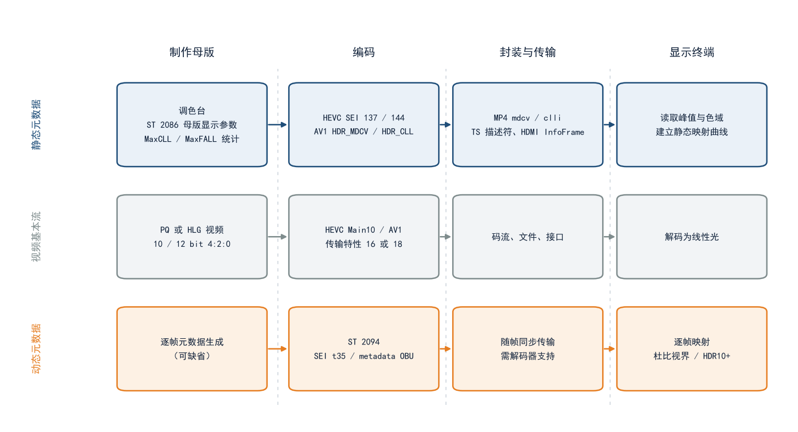
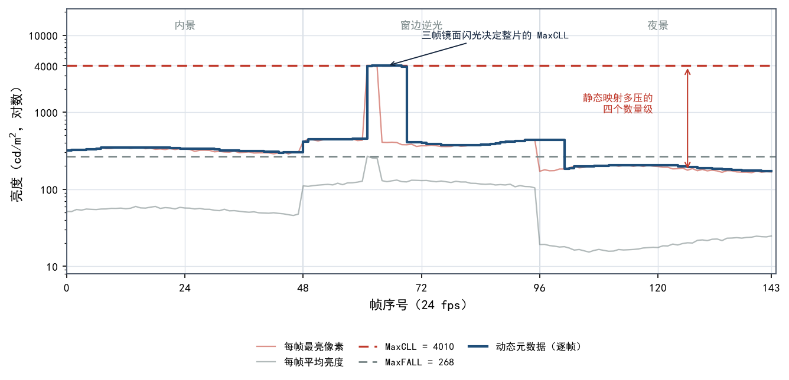

# 第 3 章 HDR 元数据与码流

> 曲线解决了“码值对应多少亮度”，却回答不了另一个问题：一份按 4000 nit 调色的母版，怎样在一块只有 700 nit 的电视上放到最好。答案藏在元数据里。这一章按“母版—编码—接口—显示”的顺序，把静态元数据、内容亮度统计、动态元数据三层结构拆开，再看它们分别以什么形式塞进 HEVC、AV1 与 HDMI 的码流与信令。最后把 HDR10、HDR10+、杜比视界、HDR Vivid 与 HLG 放进同一张降级表，看清每种格式在设备不匹配时会发生什么。

## 一、元数据要解决的问题

HDR 内容与显示设备之间存在三重不匹配：峰值亮度不同、色域不同、黑位不同。制作端的母版监视器可能是 4000 nit、P3 色域，客厅电视是 700 nit、BT.2020 覆盖率 70%，手机屏峰值 1200 nit 但黑位接近 0。同一份 PQ 码流送到这三种设备，必须各自决定如何把 0.005 至 4000 cd/m² 的内容压进自己的范围。这个决定过程就是色调映射，而元数据是决策的输入。

元数据分三层，作用各不相同。

第一层描述母版：调色是在什么设备上完成的，峰值多少、黑位多少、原色坐标是什么。这一层由 SMPTE ST 2086 定义。

第二层描述内容的亮度统计：整段内容最亮的像素有多亮，最亮的帧平均有多亮。这两个数字由 CTA-861.3 规定，叫 MaxCLL 与 MaxFALL。

第三层描述逐帧的创作意图：这一帧希望显示端把峰值放在哪里、用什么曲线映射。这一层由 SMPTE ST 2094 定义，具体内容随应用而异。

三层的信息量依次增加，兼容性依次降低。ST 2086 几乎被所有 HDR 格式支持，ST 2094 只有 HDR10+、杜比视界、HDR Vivid 这类带动态元数据的格式才用。

图中三条通路的耦合程度不同。静态元数据在编码时写进码流，随内容一起传输，显示端读到就能用。动态元数据必须与帧严格对齐，任何丢帧、拼接、转码都可能让它失去同步，所以它对链路的要求最高。视频基本流本身在传输层与它们无关，只要传递特性（PQ 或 HLG）标注正确即可。

## 二、SMPTE ST 2086：母版显示元数据

ST 2086 的正式名称是“母版监视器显示色域体积元数据”，2014 年发布，只做一件事：把调色所用监视器的显示能力记录成十个整数。

| 字段 | 含义 | 单位 |
|---|---|---|
| display_primaries_x/y | 三个基色的色度坐标 | 0.00002 |
| white_point_x/y | 白点色度坐标 | 0.00002 |
| max_display_mastering_luminance | 母版峰值亮度 | 0.0001 cd/m² |
| min_display_mastering_luminance | 母版黑位 | 0.0001 cd/m² |

单位很细，是为了用整数表示色度。以 BT.2020 原色加 D65 白点、峰值 1000 nit、黑位 0.005 nit 为例，红原色 $(0.708, 0.292)$ 存成 $(35400, 14600)$，绿原色 $(0.170, 0.797)$ 存成 $(8500, 39850)$，蓝原色 $(0.131, 0.046)$ 存成 $(6550, 2300)$，白点 $(0.3127, 0.3290)$ 存成 $(15635, 16450)$，峰值存成 10000000，黑位存成 50。十六位整数足够装下色度，三十二位装得下亮度，字段设计就此定案。

这十个数字的语义需要说清楚：它们描述的是“监看环境”，不是“内容”。母版峰值 4000 nit 不表示画面里真有 4000 nit 的像素，只表示调色师当时能看到 4000 nit。内容实际用了多少，要看 MaxCLL。把两者混为一谈，是解读 HDR 参数时最常见的错误。

ST 2086 在 HDR10 里是必须项。CTA-861.3 把它称为“静态元数据第 1 类”（Static Metadata Type 1），并规定了三个描述符：显示原色、显示亮度范围、内容亮度（MaxCLL/MaxFALL）。一份 HDR10 码流如果不带 ST 2086，严格说不符合规范，尽管播放器通常仍能靠默认值显示。

显示端拿到这十个数字后要做的判断很具体：如果自己的色域与峰值都不小于母版，直接直通就能还原调色师看到的画面；如果小于母版，则按比例压缩，目标是尽量保持母版的相对关系，而不是把自己能显示的亮度全部用满。后一种做法看似“物尽其用”，实际会把 1000 nit 的内容拉到 4000 nit 的屏上播，人脸与天空全部过亮。元数据在这里的作用是告诉显示端“别超过这个基准”。

## 三、MaxCLL 与 MaxFALL：内容亮度统计

ST 2086 说的是设备能力，MaxCLL 与 MaxFALL 说的是内容本身。

MaxCLL（Maximum Content Light Level）定义为整段视频中任意一帧、任意一个像素、三个通道中的最大码值所对应的亮度。MaxFALL（Maximum Frame Average Light Level）定义为所有帧中最大的一帧平均值，帧平均按像素亮度求平均，不做通道取最大。写成式子就是

$$
\mathrm{MaxCLL}=\max_{n}\ \max_{x,y}\ \max\{c_R,\ c_G,\ c_B\}(n,x,y),\qquad
\mathrm{MaxFALL}=\max_{n}\ \frac{1}{N_{px}}\sum_{x,y}Y(n,x,y)
$$

其中 $c$ 是三个通道的码值，$Y$ 是逐像素亮度，$N_{px}$ 是每帧像素数。

两个字段都是十六位无符号整数，单位 cd/m²，随码流以 SEI 传输。计算它们需要在编码前扫一遍全片，工作量不大，但容易出错，实践中缺失或数值失真的情况相当常见。

图 3-2 用一段合成的三场景序列说明问题。内景峰值在 320 nit 上下，窗边逆光镜头峰值 400 nit，其中第 61 至 63 帧有一次 4000 nit 的镜面闪光，夜景峰值 185 nit。MaxCLL 取全片极值，等于 4010；MaxFALL 取帧平均极值，等于 268。这两个数字一旦写进码流，就固定不变。

静态映射的麻烦由此而来。显示端拿到 MaxCLL = 4010，会认为整片内容需要 4000 nit 的动态范围，于是把映射曲线的肩部压在 4000 附近。结果内景与夜景这两个本该明亮的场景，被整体压暗到原来的一半以下，观众看到的是“整部片子偏灰”。实际只有三帧需要那 4000 nit 的余量。图中右侧的红色箭头标出的正是这部分被浪费的动态范围。

有经验的调色师会做取舍：把闪光压到 1000 nit 以内，让 MaxCLL 落在一个更合理的值上，换取全片更好的平均观感。这类“为元数据而调色”的做法在 HDR10 制作中很常见，也说明静态元数据的表达能力有限。

## 四、SMPTE ST 2094：动态元数据

动态元数据的思路是把“这一帧该怎么映射”写进码流。SMPTE ST 2094 是一组标准，核心文件 2094-1 规定通用结构与传输方式，后面挂若干应用文件：

- 2094-10：杜比提交，用于杜比视界，逐镜头给出映射曲线参数。
- 2094-20：飞利浦提交，即 sl-hdr1，基于逐场景的映射。
- 2094-30：特艺提交。
- 2094-40：三星提交，即 HDR10+ 使用的那一套。

以 2094-40 为例，每帧携带的字段包括窗口数量、目标显示峰值、各通道最大值（maxscl）、平均亮度（average_maxrgb）、亮度分布、亮像素比例，以及一条贝塞尔曲线的锚点与拐点坐标。显示端拿这些参数重建映射曲线，把当前帧压进自己的范围。

2094-20 的 sl-hdr1 走的是另一条路：码流里传的是 SDR 基流，HDR 重建所需的参数作为元数据附在后面。支持 sl-hdr1 的设备用基流加元数据重建 HDR，不支持的设备直接显示 SDR 基流，两边都拿到合理画面。这种单层向下兼容的思路对广播很有吸引力，代价是 HDR 版本的上限受制于 SDR 基流的码率与位深。

这种设计有个前提：元数据必须与帧对齐。转码、拼接、丢帧、倍速播放都会破坏对齐关系，于是标准规定了同步机制，播放器在检测到失步时要忽略动态元数据、退回静态模式。这也是为什么动态元数据格式都保留一条静态兼容路径。

动态元数据的收益可以量化。同一段内容，静态映射按 4000 nit 处理时，内景的 320 nit 被压到约 200 nit；逐帧映射认出这一帧只需要 320 nit，就能把整段曲线拉伸回来，暗部层次与中间调对比同时改善。收益的大小取决于内容本身，风光片与体育直播的收益明显，室内对话戏就不大。

## 五、码流与接口中的承载方式

元数据写进码流要落到具体的语法元素上。三条路径各有各的容器。

HEVC 用 SEI（补充增强信息）消息承载，常用的是这几个类型号：

| SEI 类型 | 名称 | 内容 |
|---|---|---|
| 137 | mastering_display_colour_volume | ST 2086 的十个字段 |
| 144 | content_light_level_info | MaxCLL 与 MaxFALL |
| 147 | alternative_transfer_characteristics | 传输特性替代值 |
| 148 | ambient_viewing_environment | 参考观看环境 |
| 4 | user_data_registered_itu_t_t35 | 厂商私有数据，动态元数据走这里 |

类型 147 值得单独提一句。它允许码流声明“这条流应当用某个传输特性解释”，取值来自 ITU-T H.273 的 codepoint 表，16 表示 PQ，18 表示 HLG。HDR10 的码流在这里写 16，HLG 广播写 18。SDR 兼容的播放器读到 147 却无法处理时，会退回默认的传输特性，画面就变成了灰蒙蒙的一片，这是 HDR 内容在旧设备上“发灰”的技术原因。

动态元数据走类型 4 的 user_data_registered_itu_t_t35，用 provider code 区分厂商，后面接 ST 2094 的应用标识与载荷。HDR10+ 用三星的 provider code，杜比视界用自己的。这种方式的好处是不改 HEVC 语法就能扩展，坏处是解码器必须认识具体厂商的格式。

AV1 的承载方式更规范。它在码流里定义了 metadata OBU，类型号区分内容：1 是 HDR_CLL（MaxCLL/MaxFALL），2 是 HDR_MDCV（母版显示色域体积），4 是 ITU-T T.35（动态元数据）。解析器按类型号分发，不需要猜厂商。

文件与接口层再包一层。MP4 容器用 mdcv 与 clli 两个 box 存放静态元数据，方便播放器在不解码的情况下读到峰值信息，用于起播前的显示能力协商。传输流（TS）依赖 SEI 本身，没有额外容器。HDMI 接口则分两头：EDID 里由显示端声明自己支持哪些 EOTF（SDR、传统 HDR gamma、PQ、HLG，对应 CTA-861.3 的 0 至 3 号编码），AVI InfoFrame 的厂商专用信息帧里由源端下发静态元数据。两端对不上，源端就该改用 SDR 输出。

## 六、主流格式与各自定位

把这些零件组装起来，就得到市面上流通的几种格式。

HDR10 是基线。它规定 PQ 传递特性、BT.2020 色域、10 bit 4:2:0、静态元数据（ST 2086 加 MaxCLL/MaxFALL），不需要授权费。几乎所有 HDR 电视都支持它，蓝光、流媒体、游戏机的 HDR 输出都以它为基础。

HDR10 之所以能当公共基线，原因在解码侧。它的码流结构与 SDR 的 HEVC Main10 几乎没有差别，解码器不需要额外算力，只要把 PQ 与 BT.2020 的标签读对。所有进阶格式都把它当退路：HDR10+ 丢弃动态元数据即可，杜比视界 Profile 8.1 直接内嵌一条 HDR10 基流。这也解释了为什么流媒体平台在码率紧张时优先保 HDR10，先砍增强层。

HDR10+ 在 HDR10 上加动态元数据，用的是 ST 2094-40。10 bit、BT.2020 不变，码流结构与 HDR10 兼容，不认识动态元数据的设备直接忽略那部分，退化成普通 HDR10。它需要向 HDR10+ 技术公司申请授权，费用比杜比视界低。

杜比视界走的是另一条路。它用 12 bit 的 ICtCp 在内部处理，编码可以是 10 bit 或 12 bit，动态元数据用 ST 2094-10。格式分多个 profile：Profile 5 用单一码流，没有 HDR10 兼容层，必须由支持杜比视界的设备解码；Profile 7 是双层结构，蓝光常用；Profile 8.1 带 HDR10 兼容基流，普通 HDR10 设备至少能看；Profile 8.4 的基流是 HLG。杜比视界需要授权与专用解码器，画质上限最高，代价是生态封闭。

HDR Vivid 由中国超高清视频产业联盟（CUVA）推动，2021 年发布。它同样基于 PQ 与动态元数据，配合 AVS3 编码在国内广电与流媒体平台落地。它的定位与 HDR10+ 接近，差异在产业生态与专利政策。

HLG 严格说不属于这一组，它不带元数据。显示端只要知道自己的峰值，就能按 OOTF 算出该给多少亮度。这让它在广播链路里最省事，也让它在需要精确亮度控制的场合最不精确。

## 七、降级路径

真实世界的设备能力参差不齐，任何格式都必须规定“设备不匹配时怎么办”。图 3-3 把五种格式与三类终端组合起来，标出每种组合的处理方式。

绿色格是直通，黄色格需要映射或转换，红色格需要专用解码器。规律很清楚：格式越复杂，绿色格越少。HDR10 与 HLG 各有一格直通，杜比视界一格都没有。

降级大体沿着三条路径发生。

第一条是元数据降级。动态元数据被丢弃，退回静态映射，再退回 SDR。每一次降级都损失一部分创作意图，但画面仍然可看。HDR10+ 内容在只有 HDR10 能力的电视上播放，走的就是这条路。

第二条是传递函数转换。PQ 内容送进 HLG 电视，或 HLG 内容送进 PQ 电视，都需要重算曲线。BT.2446 给出了 SDR 与 HDR 之间的转换方法，PQ 与 HLG 之间的转换则依赖 BT.2408 的参考白约定，把 203 cd/m² 对齐，再分别映射两端。转换做得不好会出现两种典型问题：高光被削平，或者中间调发灰。

第三条是能力协商失败。源端不知道显示端支持什么，只能按最保守的方式输出 SDR。这种情况在机顶盒、老功放、长 HDMI 线缆组成的链路里很常见，用户看到的“HDR 没生效”多数来自这里，而不是片源问题。

还有一种情况值得单独提醒：设备宣称支持 HDR，实际只做了“接受 PQ 信号”这一步，内部仍按 SDR 处理，画面亮度被整体压到 300 nit 以下，暗部细节全丢。这类“假 HDR”在低价电视与投影上并不少见，判断方法是看峰值亮度是否真的随内容变化，以及黑位是否压得住。

## 本章要点

- 元数据分三层：ST 2086 描述母版设备，MaxCLL/MaxFALL 描述内容亮度统计，ST 2094 描述逐帧映射意图。
- ST 2086 用十个整数记录母版的原色、白点、峰值与黑位，色度单位为 0.00002，亮度单位为 0.0001 cd/m²。
- MaxCLL 取全片单像素极值，MaxFALL 取帧平均极值；一次三帧的闪光就能把 MaxCLL 拉到 4000，导致静态映射把整片压暗。
- ST 2094 是标准族，2094-10、2094-20、2094-40 分别是杜比、飞利浦、三星的应用，HDR10+ 用 2094-40。
- HEVC 用 SEI 137（母版元数据）、144（MaxCLL/FALL）、147（传输特性）、4（厂商私有）承载；AV1 用 metadata OBU 的 1、2、4 号类型。
- MP4 用 mdcv 与 clli box 存放静态元数据；HDMI 由 EDID 声明 EOTF 支持，由 AVI InfoFrame 下发静态元数据。
- HDR10 是免费基线，HDR10+ 加动态元数据且向下兼容，杜比视界用 ICtCp 与专用解码，HDR Vivid 是国内生态下的 PQ 加动态元数据方案。
- 降级沿元数据降级、传递函数转换、能力协商失败三条路径发生；宣称支持 HDR 却按 SDR 内部处理的“假 HDR”需要单独甄别。
