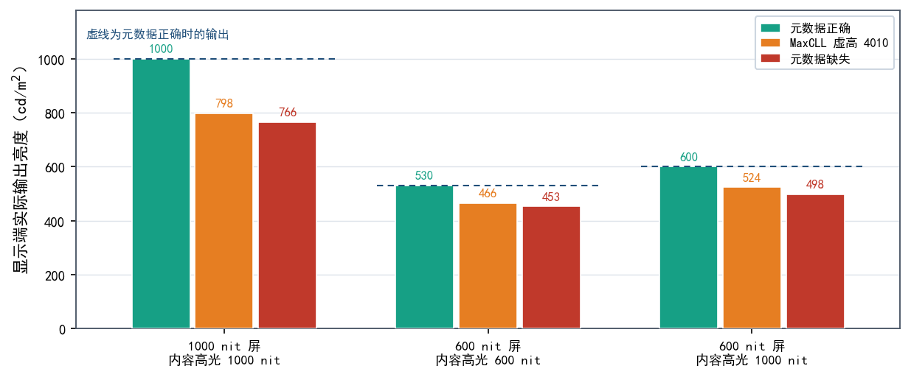
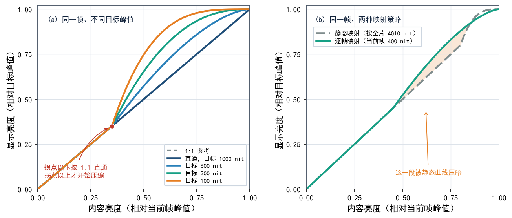
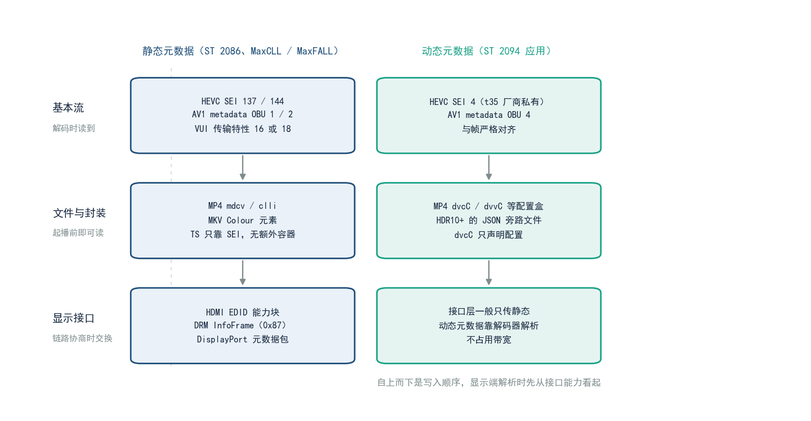
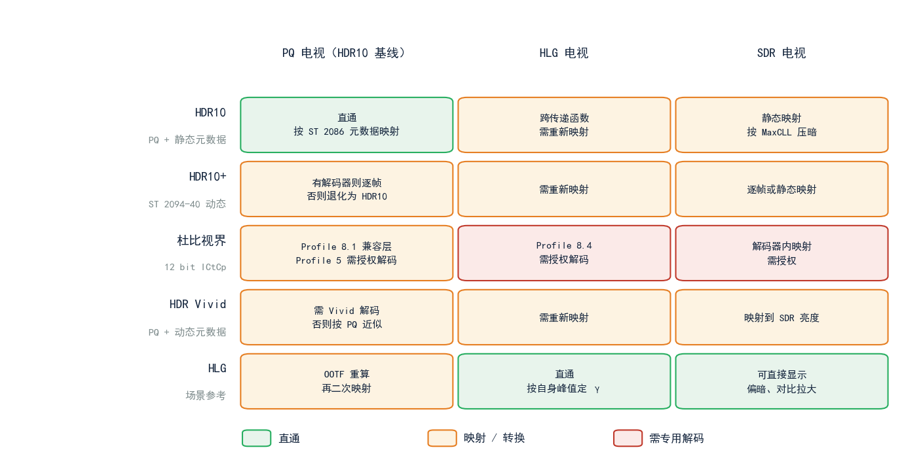

# 第 3 章 HDR 元数据与码流

> 曲线解决了「码值对应多少亮度」，却回答不了另一个问题：一份按 4000 nit 调色的母版，怎样在一块只有 700 nit 的电视上放到最好。答案藏在元数据里。它不是像素数据的一部分，不改变任何一个码值，却决定了显示端拿什么基准去做色调映射。这一章按母版、编码、接口、显示的顺序，把静态元数据、内容亮度统计、动态元数据三层结构拆开，再看它们分别以什么语法元素塞进 HEVC、AV1、MP4 与 HDMI，最后把几种主流格式放进同一张降级表，看清设备不匹配时会发生什么。

## 一、元数据要解决的问题

调色间的监视器通常是 1000 或 4000 nit 的参考级设备，覆盖 P3 甚至 BT.2020 的大部分色域，黑位在 0.0005 至 0.005 nit。客厅电视的峰值可能只有 700 nit，BT.2020 覆盖率 70% 上下，液晶的黑位在 0.02 nit 附近，OLED 能到 0.002 nit 但峰值更低。手机屏峰值 1200 nit、黑位接近 0，尺寸却只有六英寸，视角与观看距离又是另一套条件。同一份 PQ 码流送到这三种设备上，显示端各自要决定三件事：峰值放在哪里、色域怎么映射、黑位抬到多高。

前两个决定需要输入。内容最亮到多少、调色师当时能看到多亮、原色坐标是什么，这些信息不在像素里，只能另外标注，标注的形式就是元数据。

把决策链摊开看更清楚。显示端拿到一帧 PQ 图像，先要知道内容峰值 $S$ 才能定映射曲线的肩部位置，$S$ 来自 MaxCLL 或动态元数据；再要知道母版的原色与白点才能把内容色域换算到自己的色域，这部分来自 ST 2086；最后要知道母版的峰值与黑位，才能判断曲线该从哪里开始弯。三个输入缺一个，对应的一段处理就只能猜。

猜的代价可以估出来。假设内容是 4000 nit 母版、P3 色域、黑位 0.005 nit，显示端是 700 nit、BT.2020 覆盖率 70%、黑位 0.02 nit 的液晶。亮度上要压掉 2.5 个数量级，色度上要把超出自己三角的部分沿色度图边界收回来，黑位上要把 0.005 以下的细节整体抬到 0.02 以上。前两件事有接近唯一答案的一小片区域，第三件没有正确答案，只能按环境光做取舍。元数据能帮上的是前两件，第三件交给显示端的本地策略。

这里有个容易被忽略的性质：元数据不改变任何一个码值。PQ 码值 0.58 在 4000 nit 母版和 700 nit 电视上都解码成同一个绝对亮度，大约 100 nit（第 2 章算过）。元数据改变的是显示端在把内容塞进自己范围时依据什么基准。由此可以推出一个后果：元数据写错不会导致解码失败，不会黑屏，不会报错，播放器照样出图，只是画面对不上调色师看到的样子。这个特性解释了为什么元数据错误能在片库里存活很多年，直到有人拿同一段素材在参考级监视器上比对才发现。

元数据分三层，作用各不相同，兼容性依次降低。

第一层描述母版，也就是调色在什么设备上完成，峰值多少、黑位多少、原色坐标是什么。这一层由 SMPTE ST 2086 定义，字段固定，一共十个整数。

第二层描述内容的亮度统计，整段内容最亮的像素有多亮、最亮的帧平均有多亮。这两个数字由 CTA-861.3 规定，叫 MaxCLL 与 MaxFALL，随码流以 SEI 传输。

第三层描述逐帧的创作意图，这一帧希望显示端把峰值放在哪里、用什么曲线映射。这一层由 SMPTE ST 2094 定义，具体参数随应用而异，同一族标准下有四种互不兼容的实现。

信息量从第一层到第三层递增，兼容性反向递减。ST 2086 几乎被所有 HDR 格式支持，HDR10 把它列为必备项；ST 2094 只有 HDR10+、杜比视界、HDR Vivid 这类带动态元数据的格式才用，老设备读到了也只会丢掉。

带宽上，三层都可以忽略不计。一段 2094-40 的逐帧元数据在几十字节量级，24 帧每秒也不到 2 kB/s，相对 15 Mbps 的视频码流是千分之一。真正的成本不在带宽，而在链路上的每一环都必须认识它、正确转发它、并且与帧保持同步。这是动态元数据比静态元数据难做得多的根本原因。

没有元数据也能播。播放器与显示端有一组默认假设，通常是内容峰值按 1000 nit 处理、母版按 1000 nit 与 0.005 nit 黑位处理、原色按 BT.2020 处理。这套假设对多数流媒体内容不算离谱，所以缺元数据的片子看起来「还行」，代价是遇到真正的高动态内容就压不对。默认假设的存在让元数据缺失变成一种隐性故障，而不是显性错误。


图 3-1 把三条通路并排画出来，四列分别是制作母版、编码、封装与传输、显示终端。三条通路的耦合程度完全不同。静态元数据在编码时写进码流，随内容一起传输，显示端读到就能用，中途被转码器丢掉也只是退回默认值，后果可控。动态元数据必须与帧严格对齐，任何丢帧、拼接、变速、转码都可能让它失去同步，一旦失步，参数描述的就不是当前这一帧，硬套上去比不用更糟，所以标准要求播放器在检测到失步时直接忽略它。视频基本流本身与两条元数据通路无关，只要传递特性的标注正确，解码就正确。图中横向的虚线把四个环节分开，也可以读成三种故障的边界：虚线左边出错是制作问题，中间出错是封装与转码问题，右边出错是接口协商问题。

## 二、SMPTE ST 2086：母版显示元数据

ST 2086 的正式名称是「母版监视器显示色域体积元数据」（Mastering Display Color Volume，MDCV），2014 年发布，2018 年出过一次修订，只做一件事：把调色所用监视器的显示能力记录成十个整数。

「色域体积」这个词是准确的。显示能力不是平面上的一个三角形，而是三角形沿亮度轴拉出的一个立体。三角形由三基色与白点决定，高度由峰值与黑位决定。ST 2086 的十个字段正好对应这五个色度点与两个亮度端点。

| 字段 | 含义 | 位宽 | 单位 |
|---|---|---|---|
| display_primaries_x/y | 三个基色的色度坐标，各三个 | 16 位无符号 | 0.00002 |
| white_point_x/y | 白点色度坐标 | 16 位无符号 | 0.00002 |
| max_display_mastering_luminance | 母版峰值亮度 | 32 位无符号 | 0.0001 cd/m² |
| min_display_mastering_luminance | 母版黑位 | 32 位无符号 | 0.0001 cd/m² |

两个标度不是随手选的。色度用 0.00002 作步进，等于 1/50000，16 位整数的上限 65535 除以 50000 得到 1.31，正好把 0 到 1 的色度范围装进去还留出三成余量，不会因为未来出现更极端的原色而溢出。亮度用 0.0001 cd/m² 作步进，32 位能表达到 429 496 nit，远超 PQ 的 10000 nit 上限，留出的余量更大，代价是多占两个字节。

以 BT.2020 原色加 D65 白点、峰值 1000 nit、黑位 0.005 nit 为例，编码结果是：红原色 $(0.708, 0.292)$ 存成 $(35400, 14600)$，绿原色 $(0.170, 0.797)$ 存成 $(8500, 39850)$，蓝原色 $(0.131, 0.046)$ 存成 $(6550, 2300)$，白点 $(0.3127, 0.3290)$ 存成 $(15635, 16450)$，峰值存成 10000000，黑位存成 50。

精度够不够，拿两个常见色域比一下就知道。BT.709 的红原色在 $(0.640, 0.330)$，与 BT.2020 的 $(0.708, 0.292)$ 相差 0.068 与 0.038，换算成存储值是 3400 与 1900 个步进，区分得开。P3 的绿原色 $(0.265, 0.690)$ 与 BT.2020 的 $(0.170, 0.797)$ 相差 0.095 与 0.107，对应 4750 与 5350 个步进。真正的边界在蓝原色，BT.709 的 $(0.150, 0.060)$ 与 BT.2020 的 $(0.131, 0.046)$ 只差 0.019 与 0.014，也就是 950 与 700 个步进，仍然足够。步进再细一倍就到 16 位整数的一半，没有必要。

这十个数字的语义需要说清楚：它们描述监看环境，不描述内容。母版峰值 4000 nit 不表示画面里真有 4000 nit 的像素，只表示调色师当时能看到 4000 nit。内容实际用了多少，要看 MaxCLL。把两者混为一谈，是解读 HDR 参数时最常见的错误。一个佐证是，同一个母版可以调出全片峰值 300 nit 的文艺片，也可以调出满屏 3000 nit 的风光片，两者的 ST 2086 完全一样。

黑位字段的实际取值比峰值更能说明问题。演播室的参考级监视器通常填 0.0001 或 0.005，前者是面板能关到多黑，后者是调色时习惯用的黑位基准。两者相差一个数量级，对映射曲线的影响却不小。黑位是曲线的起点，起点抬高，整条曲线在暗端变陡，可见层次被挤到更窄的范围里。填 0.0001 而实际监看时黑位在 0.005，显示端会以为暗部还有细节可挖，把量化噪声一并提亮；反过来填 0.005 而实际能到 0.0001，显示端会把 0.0005 到 0.005 之间的信息全部当黑处理，暗部发闷。这个字段很少被人注意，但在暗场景多的片子上能看出差别。

显示端拿到这十个数字后要做的判断很具体。如果自己的色域与峰值都不小于母版，直接直通就能还原调色师看到的画面。如果小于母版，则要按比例压缩，目标是尽量保持母版的相对关系，而不是把自己能显示的亮度全部用满。后一种做法看似物尽其用，实际会把 1000 nit 的内容拉到 4000 nit 的屏上播，人脸与天空全部过亮。元数据在这里的作用是告诉显示端「别超过这个基准」。

写错字段的症状各不相同，值得逐条记下来，因为现场排查时往往只能靠画面反推。

| 错误 | 现象 |
|---|---|
| 峰值写小（实际 4000，写成 1000） | 显示端以为内容只需 1000 nit，超过部分被硬切，高光死白，云层与金属反光失去层次 |
| 峰值写大（实际 1000，写成 4000） | 显示端按四个数量级压缩，整片偏灰，黑位抬不起来 |
| 黑位写成 0 | 部分实现按零起算，映射曲线在暗端变陡，暗部细节被压掉 |
| 原色写成 BT.709 | 色域转换矩阵出错，饱和色被错误扩展，肤色偏红或偏黄 |
| 白点写成 D50 或 DCI | 白平衡基准偏移，整片色调偏冷或偏暖 |
| 三基色顺序颠倒 | 颜色完全错乱，红绿互换是最常见的表现 |
| 缺这个 SEI | 显示端按默认母版假设，通常偏暗，但画面结构正常 |

ST 2086 在 HDR10 里是必须项。CTA-861.3 把它称为「静态元数据第 1 类」（Static Metadata Type 1），并规定了三个描述符：显示原色、显示亮度范围、内容亮度。第三个描述符装的就是 MaxCLL 与 MaxFALL。一份 HDR10 码流如果不带 ST 2086，严格说不符合规范，尽管播放器通常仍能靠默认值显示。

HEVC 允许同一个码流里出现多次 MDCV，播放器应当使用最近一次收到的值。这个设计不是为了冗余，而是为了拼接。一段广告插进正片之后，两段的母版参数可能完全不同，各自带一份才不会互相污染。

## 三、MaxCLL 与 MaxFALL：内容亮度统计

ST 2086 说的是设备能力，MaxCLL 与 MaxFALL 说的是内容本身。这两个字段由 CTA-861.3 在 2015 年随 HDR10 一起定义，都是十六位无符号整数，单位 cd/m²。

MaxCLL（Maximum Content Light Level）是整段视频中任意一帧、任意一个像素、三个通道中最大码值所对应的亮度。MaxFALL（Maximum Frame Average Light Level）是所有帧中最大的一帧平均值。写成式子

$$
\mathrm{MaxCLL}=\max_{n}\ \max_{x,y}\ \max\{c_R,\ c_G,\ c_B\}(n,x,y),
\qquad
\mathrm{MaxFALL}=\max_{n}\ \frac{1}{N_{px}}\sum_{x,y}Y(n,x,y)
$$

其中 $c$ 是三个通道的码值换算出的亮度，$Y$ 是逐像素亮度，$N_{px}$ 是每帧像素数。

这两个量的性格完全不同。MaxCLL 是一个极值，只听最亮的那一个像素的，画面里出现一帧镜面反光、一个车灯、一次闪电，它就跳到几千 nit，与全片的平均观感没有关系。MaxFALL 是平均量的极值，反映的是「哪一帧整体最亮」，通常比 MaxCLL 低一个数量级以上。

计算它们需要在编码前扫一遍全片。工作量不大，一个 4K 两小时的片子用普通工作站几十分钟能算完，但容易出错，实践中缺失或数值失真的情况相当常见。原因有几条。一是工具链不统一，剪辑软件、调色软件、编码器各有各的统计口径，有的按 RGB 三通道最大值算，有的按亮度 $Y$ 算，两者能差 10% 以上。二是分段处理，长片按卷统计后没有合并，最后写进去的是某一卷的极值。三是转码，动态范围压缩或分辨率缩放会改变极值，但元数据没有重算。

统计本身就是一个两重循环，写出来没有几行。

```text
MaxCLL = 0;  MaxFALL = 0
for each frame n:
    frame_max = 0;  frame_sum = 0
    for each pixel (x, y):
        L = pq_eotf( max(R, G, B) )          # 先取三通道最大，再反变换到绝对亮度
        Y = 0.2627R' + 0.6780G' + 0.0593B'   # BT.2020 亮度系数，对线性光加权
        frame_max = max(frame_max, L)
        frame_sum += Y
    frame_avg = frame_sum / pixel_count
    MaxCLL  = max(MaxCLL, frame_max)
    MaxFALL = max(MaxFALL, frame_avg)
```

注意比较必须在绝对亮度域做。PQ 是对数式的分配，码值差 0.1 在亮部只对应几百 nit，在暗部可能对应好几个数量级，在码值域取最大与在亮度域取最大的结果完全不同，这是不同工具给出不一致数值的主要原因，手工核对时也要先确认这一点。


图 3-2 用一段合成的三场景序列说明问题。内景峰值在 320 nit 上下，窗边逆光镜头峰值 400 nit，其中第 61 至 63 帧有一次 4000 nit 的镜面闪光，夜景峰值 180 nit。MaxCLL 取全片极值，等于 4010；MaxFALL 取帧平均的极值，等于 268，出现在窗边逆光那一段。这两个数字一旦写进码流就固定不变，后续 140 帧里没有任何信息能让显示端知道「第 61 帧很亮，其余都不亮」。图中蓝线是理想情况下逐帧元数据给出的当前帧峰值，它在 4000 处只有一个尖峰，其余时间贴着 200 至 400。灰线是每帧平均亮度，与红线的帧峰值相差一个数量级，说明极值与平均量确实是两回事。

静态映射的麻烦由此而来。显示端拿到 MaxCLL = 4010，会认为整片内容需要 4000 nit 的动态范围，于是把映射曲线的肩部压在 4000 附近。对于带拐点的曲线，中间调还能保住，高光段则被提前压缩；对于不做拐点、整段按比例缩放的实现，内景与夜景这两个本该明亮的场景会被整体压暗到原来的一半以下，观众看到的是「整部片子偏灰」。实际只有三帧需要那 4000 nit 的余量。

MaxCLL 写错有两个方向，后果不对称。写虚高，损失的是高光层次，画面还能看；写虚低，损失的是高光本身。假设真实峰值 4010，而元数据里写的是 1000，显示端会认为内容完全落在自己范围内，直接直通，于是 4010 nit 的闪光被硬切在 1000 nit，闪光周围的一圈渐变全部变成同一个白色。这个方向的错误更常见，因为统计工具漏掉一两个闪光帧太容易了。

MaxFALL 的用途常被误解。它不参与逐像素映射，主要用在三处。一是背光与自动亮度限制策略，显示端知道这一帧整体很亮，会提前降低背光或限制电流，避免电源过载。二是 HDR 到 SDR 的下变换，整体亮度要按 MaxFALL 定基调，否则 SDR 版本会过暗或过亮。三是编码码率分配，编码器按帧平均亮度估计复杂度，MaxFALL 虚高会让它给整片预留过多码率。MaxFALL 虚高的典型现象是暗场景也提不起亮度，因为显示端一直按「整体很亮」在限制。

有经验的调色师会做取舍，把闪光压到 1000 nit 以内，让 MaxCLL 落在一个更合理的值上，换取全片更好的平均观感。这类「为元数据而调色」的做法在 HDR10 制作中很常见，也说明静态元数据的表达能力有限。



图 3-3 把虚高的代价算成具体数字。模型很简单：在 PQ 码值域做分段压缩，内容亮度的绝对码值 $c=\mathrm{PQ}(L)$，拐点取显示峰值的 0.7 倍，拐点以下逐点保留，以上按二次幂压到显示峰值，也就是带拐点的那一类实现。三根柱子分别是元数据正确（内容峰值按真实的 1000 nit）、MaxCLL 标成 4010、元数据缺失按 10000 nit 保守假设。左组是 1000 nit 屏上的 1000 nit 高光，三种情况给出 1000、798、766；中组是 600 nit 屏上的 600 nit 高光，给出 530、466、453；右组是 600 nit 屏上的 1000 nit 高光，给出 600、524、498。

数字说明三件事。第一，拐点以下完全不受影响，100 nit 的漫反射白与 300 nit 的中间调在三种假设下输出一致，带拐点的映射把损失全部集中在高光，这是它比整段比例压缩好的地方。第二，虚高的代价随显示峰值与内容峰值的关系变化。1000 nit 屏上播 1000 nit 高光，正确元数据给 1000，虚高只给 798，丢了五分之一；600 nit 屏上播 600 nit 高光，正确元数据本身就要压到 530，虚高再压到 466，又少了一成二。第三，元数据缺失比虚高更糟，三组分别只剩 766、453、498，因为它假设内容有 10000 nit，压缩的起点更高。这张图只覆盖 HDR 链路；到了 HDR 到 SDR 的下变换，压缩比直接由源峰值决定，虚高的影响会被放大成整片偏灰，这一点在第七节还会提到。

## 四、SMPTE ST 2094：动态元数据

动态元数据的思路是把「这一帧该怎么映射」写进码流。既然静态元数据只能用全片一个数字概括，动态元数据就逐帧或逐镜头给出参数，让显示端按当前画面的实际分布来定曲线。

SMPTE ST 2094 是一族标准。2094-1 规定通用结构、处理窗口与传输方式，后面挂若干应用文件，每个应用文件由不同厂商提交，算法互不兼容：2094-10 来自杜比，用于杜比视界；2094-20 来自飞利浦，就是 sl-hdr1；2094-30 来自特艺；2094-40 来自三星，HDR10+ 用的就是它。

2094-1 的框架里有组区分很重要：应用元数据与分发元数据。

应用元数据绑定具体算法，只有认识这个应用的设备才能解释。杜比视界的 RPU、HDR10+ 的贝塞尔参数都属于这一类。它们的表达能力强，能精确描述创作者的意图，代价是生态封闭，解码器必须专门实现。

分发元数据与算法无关，只给出一组客观统计：处理窗口内的最小亮度、最大亮度、平均亮度、三个通道的最大码值、亮度分布的若干百分位、目标显示峰值。任何一家厂商的映射算法都能拿这组数字工作，效果不如专用参数精细，但通用。这个二分的设计意图很明确，让同一份内容能同时喂给不同档次的终端。

处理窗口是 2094-1 的另一个结构。元数据不必覆盖整幅画面，可以只标记一个矩形区域，甚至是一个带旋转的椭圆，用于画中画、台标、字幕区这类需要单独处理的局部。绝大多数内容只用一个覆盖全屏的窗口，字段填满即可。

### 2094-10 与杜比视界

2094-10 的参数化程度最高。它逐帧给出内容的最小与最大 PQ 码值、平均亮度，再叠一层 trim 参数（level、gain、gamma、offset、saturation 各若干档），trim 可以按内容、按显示设备类型分别给。这种「基础映射 + 修正层」的结构让同一份元数据能描述从手机到影院的多种目标，制作端不需要为每种终端重新调色，这就是杜比所说的单母版分发。

代价是复杂度。生成这套元数据需要专门的 Content Mapping Unit，调色师要在其中指定每个镜头在不同目标亮度下的观感，工作量远超静态元数据。

### 2094-20 与 sl-hdr1

2094-20 走的是另一条路。码流里传的是 SDR 基流，HDR 重建所需的参数作为元数据附在后面，参数包括阴影增益、高光增益、中间调宽度、黑位偏移、饱和度校正因子。支持 sl-hdr1 的设备用基流加元数据重建 HDR，不支持的设备直接显示 SDR 基流，两边都拿到合理画面。

这种单层向下兼容的思路对广播很有吸引力。一路信号覆盖所有终端，不需要 simulcast 的两倍带宽，也不需要终端支持双层解码。代价是 HDR 版本的上限受制于 SDR 基流的码率与位深，重建出来的高光是从 8 位或 10 位 SDR 码值里插值放大的，遇到大面积平滑渐变容易出现色带。ETSI TS 103 433 把 sl-hdr1 的实现细节固定下来，机顶盒芯片只要支持这套重建流程就能播。

### 2094-30

2094-30 由特艺提交，用一组曲线控制点描述从内容到目标的映射，配合目标显示峰值。它的表达能力介于 2094-20 与 2094-10 之间，商用实现较少，主要出现在欧洲的一些制作工具里。

### 2094-40 与 HDR10+

2094-40 是这一族里装机量最大的，因为 HDR10+ 直接建在 HDR10 上。它每一帧携带的字段可以分成三组。

第一组是窗口与目标：窗口数量与坐标、目标显示系统的最大亮度。

第二组是内容统计：三个通道在窗口内的最大码值 maxscl、窗口内的平均最大 RGB 值 average_maxrgb、亮度分布的百分位序列（每项一个百分比与对应码值）、亮像素的比例 fraction_bright_pixels。这一组与 2094-1 的分发元数据同源，任何算法都能直接用。

百分位序列是这套格式里信息量最大的部分。它给出画面里 90%、95%、99% 像素所处的亮度位置，显示端据此判断这一帧有多大比例的内容超过自己的峰值。一个只有 0.1% 像素很亮的镜头，与一个 20% 像素很亮的镜头，峰值可能相同，处理方式却应当不同，前者压高光就够，后者必须整体调整，否则大面积区域会显得脏。fraction_bright_pixels 是同一件事的粗粒度版本，给出超过某个阈值的像素比例，算法可以据此调整肩部的陡缓。

第三组是曲线：一个标志位，然后是拐点坐标 knee_point_x 与 knee_point_y，接着是若干贝塞尔曲线锚点，最后一组是色彩饱和度映射的开关与权重。

曲线是这套元数据的核心。拐点把映射分成两段，以下按 1:1 直通，以上用一条经过锚点的贝塞尔曲线压到目标峰值。拐点由 knee_point_x 给出，纵坐标由 knee_point_y 给出，两者分开编码是为了允许拐点稍微离开对角线，以补偿不同显示器的黑位。锚点数量可变，九个锚点能描述相当复杂的肩部形状。



图 3-4 左侧画了四条曲线，横轴是内容亮度相对当前帧峰值的归一化值，纵轴是显示亮度相对目标峰值的归一化值。四条曲线的拐点都在 0.35，压缩强度依次加大，对应目标峰值 1000、600、300、100 nit。拐点以下四条曲线完全重合在对角线上，这正是「直通」的含义，中间调与暗部一点不动；拐点以上开始分层，目标越低离开对角线越早、斜率越小，曲线上端全部收敛到右上的同一点，也就是显示峰值。橙色的那条对应 100 nit 目标，曲线在拐点后迅速抬到接近 1，意味着大部分亮度差被挤在很窄的输出范围里，高光对比损失最重；深蓝那条对应 1000 nit 目标，压缩参数取 1，曲线退化成对角线，意味着内容峰值本来就在显示范围内，不需要压缩。

右侧是另一组对比。灰色虚线是按全片 MaxCLL 定的静态曲线，拐点被推到 0.80，肩部很陡；青色实线是逐帧曲线，认出当前帧峰值只有 400 nit，拐点落在 0.45，肩部平缓得多。两条曲线之间那片橙色区域，就是静态映射从这一帧里多扣掉的亮度。动画里常见的场景切换最能体现差别，比如从夜景切到白天，逐帧元数据在两帧内就能把曲线换过来，静态映射则一直按最亮的那一场在压。

这种设计有个前提：元数据必须与帧对齐。转码、拼接、丢帧、倍速播放都会破坏对齐关系，于是标准规定了同步机制，播放器在检测到失步时要忽略动态元数据、退回静态模式。这也是为什么动态元数据格式都保留一条静态兼容路径。

另一个前提是时域稳定。逐帧算出来的参数会随画面内容小幅抖动，这一帧 maxscl 是 0.71，下一帧 0.73，重建出的曲线跟着变，观众看到的是整幅画面在呼吸。解决办法在制作端，用场景检测把镜头切开，同一个镜头内的参数做时域滤波，或干脆取整段的代表值，只允许在镜头边界跳变。多数商用工具默认这样做，手工调参时很容易忘，忘记的后果在暗场景缓慢推镜时最明显。

动态元数据的收益可以量化。同一段内容，静态映射按 4000 nit 处理时，内景的 320 nit 会被压到 220 nit 上下；逐帧映射认出这一帧只需要 320 nit，就能把曲线拉伸回来，暗部层次与中间调对比同时改善。按经验，风光片与体育直播的收益最明显，因为镜头内亮度分布变化大；室内对话戏的收益有限，一场戏里亮度几乎不变，静态与逐帧给出同一条曲线。传输上的开销可以忽略，解码端则要多做一次曲线重建，现代 SoC 里这点算力不算什么，老芯片可能要专门加速。

## 五、码流与接口中的承载方式

元数据写进码流要落到具体的语法元素上。同一份 ST 2086 参数，在基本流里是 SEI，在 MP4 里是 box，在 HDMI 上是 InfoFrame，三种容器各有一套字段排列，语义相同而字节不同。



图 3-5 把三层并排画出来。最上面一层是基本流，静态元数据落在 HEVC 的 SEI 137 与 144、AV1 的 metadata OBU 1 与 2，另外还有 VUI 里的传输特性字段；动态元数据落在 SEI 4 的厂商私有段和 OBU 4，必须与帧严格对齐。中间一层是文件封装，MP4 用 mdcv 与 clli 两个 box 存静态参数，MKV 用 Colour 元素，TS 干脆没有额外容器，全指望 SEI。最下面一层是显示接口，HDMI 的 EDID 能力块与 DRM InfoFrame、DisplayPort 的元数据包。三层的信息有冗余，读的顺序是自上而下写入、自下而上协商：显示端先看接口能力，再读封装里的概要，最后在解码时拿到精确值。

### HEVC 的 SEI

SEI 是补充增强信息，挂在 NAL 单元里随码流走，分前缀与后缀两种。前缀 SEI 出现在图像数据之前，后缀在其后。母版元数据与内容亮度统计通常用前缀，因为它们要在解码这一帧之前就准备好。

一条 SEI 消息由 payloadType、payloadSize 与 payload 三部分组成，前两个字段用 0xFF 续接的方式编码变长整数，这是为了兼容早期实现，实际类型号都小于 256，一个字节就够。

| payloadType | 名称 | 内容 |
|---|---|---|
| 137 | mastering_display_colour_volume | ST 2086 的十个字段 |
| 144 | content_light_level_info | MaxCLL 与 MaxFALL |
| 147 | alternative_transfer_characteristics | 传输特性的替代值 |
| 4 | user_data_registered_itu_t_t35 | 厂商私有数据，动态元数据走这里 |

137 与 144 的语法很直接，字段顺序与 ST 2086 的定义一致。

```text
mastering_display_colour_volume( payloadSize ) {
    for( c = 0; c < 3; c++ ) {
        display_primaries_x[ c ]        16  uimsbf
        display_primaries_y[ c ]        16  uimsbf
    }
    white_point_x                       16  uimsbf
    white_point_y                       16  uimsbf
    max_display_mastering_luminance     32  uimsbf
    min_display_mastering_luminance     32  uimsbf
}

content_light_level_info( payloadSize ) {
    max_content_light_level             16  uimsbf
    max_pic_average_light_level         16  uimsbf
}
```

类型 147 值得单独提一句。它允许码流声明这条流应当用某个传输特性解释，取值来自 ITU-T H.273 的 codepoint 表，16 表示 PQ，18 表示 HLG。HDR10 的码流在这里写 16，HLG 广播写 18。SDR 兼容的播放器读到 147 却无法处理时，会退回默认的传输特性，画面就变成灰蒙蒙的一片，这是 HDR 内容在旧设备上发灰的技术原因。

与 SEI 并行的还有 SPS 里的 VUI。VUI 的 colour_primaries、transfer_characteristics、matrix_coeffs 三个字段长期有效，与 SEI 形成冗余。冗余是故意的，VUI 在 SPS 里跟着参数集走，参数集丢了整段都没法解，SEI 丢了只是元数据缺失。两处都写，显示端总有一处能读到。

动态元数据走类型 4 的 user_data_registered_itu_t_t35。payload 开头是国家码、厂商码、厂商自定义码，接着是应用标识，再后面才是 2094 应用的具体载荷。用厂商码区分的好处是不改 HEVC 语法就能扩展，坏处是解码器必须认识具体厂商的格式，也不认识就只能丢掉。转码器常常默认不转发 t35，这是动态元数据在链路里最容易被掐断的地方。

### AV1 的 metadata OBU

AV1 的承载方式更规范。它在码流里定义了 metadata OBU，用 metadata_type 区分内容：1 是 HDR_CLL（MaxCLL 与 MaxFALL），2 是 HDR_MDCV（母版显示色域体积），4 是 ITU-T T.35（动态元数据）。解析器按类型号分发，不需要猜厂商。

OBU 还带一个持久化标志。置位之后，这条元数据对后续所有帧有效，直到出现一条同类型的 OBU 把它取消。静态元数据适合这样用，一整个序列只发一次；动态元数据则每帧或每场景发一次，不用持久化。这个机制在 HEVC 里没有对应物，HEVC 只能靠「用最近一次收到的值」这条约定。

### 文件与传输封装

MP4 容器用 mdcv 与 clli 两个 box 存放静态元数据，字段与 SEI 一一对应，方便播放器在不解码的情况下读到峰值信息。起播前的显示能力协商要靠它，播放器读一遍 moov，就知道这段内容需要多高的峰值，再去问显示端能不能接。colr box 里的 nclx 参数给出传输特性、原色与矩阵系数，与 VUI 的作用相同。

动态元数据在 MP4 里没有通用 box，各家用自己的配置盒。杜比视界用 dvcC 与 dvvC 声明 profile、level、是否存在增强层，真正的逐帧参数仍在码流的 RPU 里，配置盒只负责让播放器在起播前判断「这台设备能不能解」。HDR10+ 的做法是把逐帧参数留在 SEI 里，另外在制作环节用一份 JSON 旁路文件传递同一组参数，方便 QC 工具与不走码流的处理链对齐。

MKV 的 Colour 元素覆盖得比较全，MatrixCoefficients、Primaries、TransferCharacteristics、Range 四个基本字段，加上 MasteringMetadata 子元素（三基色与白点的色度、峰值、黑位）和 MaxCLL、MaxFALL 两个整数字段。它的字段命名与 ST 2086 直接对应，读起来比 MP4 的二进制 box 直观。

传输流没有为 HDR 定义专门的描述符，信息全在 SEI 与 VUI 里。这带来一个实际麻烦，机顶盒要在不解码的情况下判断一路流是不是 HDR，就得深入 NAL 层解析 SEI，成本比读一个描述符高。广播链路上的做法是在 EPG 或服务信息里另外标注，属于带外信令。

流媒体又叠了一层。DASH 与 HLS 的清单文件里可以给每个码率档位挂补充属性，声明色彩空间、传递特性与 HDR 格式，播放器选档时就能避开设备不支持的组合，不必等到解码失败。HLS 用 VIDEO-RANGE 属性区分 SDR 与 PQ、HLG，DASH 用 EssentialProperty 描述补充特性，两家写法不同，语义一致。这层声明的价值在于切档不黑屏，代价是清单与实际码流可能不一致，尤其是转码农场批量生成的时候，而播放器通常以清单为准，于是错的那一边决定了用户看到什么。

### HDMI 与 DisplayPort

接口层的分工是两头。显示端在 EDID 里声明自己支持哪些 EOTF，源端在 InfoFrame 里下发内容参数。

EDID 的 HDR 静态元数据块是 CTA 扩展块的一种，核心是四位的 EOTF 支持位图：0 号位表示传统 SDR gamma，1 号位表示传统 HDR gamma，2 号位表示 PQ，3 号位表示 HLG。后面跟一个静态元数据描述符位，置位表示支持第 1 类静态元数据。再往后是可选的三个亮度字段，期望内容最大亮度、期望内容最大帧平均亮度、最小亮度，显示端用它们表达「我希望收到多亮的内容」。

源端下发的通道是 DRM InfoFrame，包类型 0x87，字段就是 ST 2086 的十个整数加上 MaxCLL 与 MaxFALL，与 SEI 的内容一致。协商的流程是，源端读 EDID 拿到 EOTF 位图，如果目标格式的 EOTF 不在位图里，就应当改用 SDR 输出；如果在，就发对应的 InfoFrame，再按对方的亮度上限做一次映射。两端对不上，源端就该退回 SDR，这个判断做错的后果是黑屏、花屏或者过曝。

DisplayPort 走的是另一条通路。DP 1.4 在副数据包里定义了 HDR 元数据包，通过 AUX 通道的边带服务传输，字段沿用 CTA-861.3 的静态元数据，动态元数据同样不在接口层传。MST 拓扑下每个流各有一份，需要单独管理。

带宽是所有接口层问题的底层约束。4K 60 帧 10 bit 4:2:0 的有效数据率约 6.0 Gbps，4K 60 帧 10 bit 4:4:4 要 14.9 Gbps，HDMI 2.0 的 18 Gbps 在 8b/10b 编码后只剩 14.4 Gbps，正好卡在两者之间，所以 HDR10 在 HDMI 2.0 上通常只能走 4:2:0。要跑 4K 120 帧 10 bit 4:4:4，需要 30 Gbps 上下，只有 HDMI 2.1 的 FRL 模式能承载，或者靠显示流压缩把码率压到二分之一以下。带宽不够时，源端按顺序牺牲，先降色度采样，再降位深，最后降刷新率，HDR 标签往往保留，因为它是接口上的一个标志位，不占带宽。于是出现一种看似矛盾的状态，接口声明 HDR，实际传输的位深已经撑不住 PQ 的暗部台阶。

接口层最常见的故障不是字段写错，而是带宽与协商。一条老旧的 HDMI 线跑 4K60 10 bit 4:2:0 就可能不稳，源端为了保画面会降到 8 bit，HDR 标签还在，码值却被量化得更粗，暗部出现色带。另一类故障是中间设备，功放或分配器只支持到 HDMI 1.4，整个链路的能力被它拉低，源端只能输出 SDR，用户看到的「HDR 没生效」多数来自这里。

## 六、主流格式与各自定位

把这些零件组装起来，就得到市面上流通的几种格式。它们的差别不在传递函数，PQ 与 HLG 是公共的；差别在元数据的层数、承载方式与生态。

| 格式 | 传递特性 | 位深 | 元数据 | 兼容层 | 授权 |
|---|---|---|---|---|---|
| HDR10 | PQ | 10 | 静态 | 本身即基线 | 免费 |
| HDR10+ | PQ | 10 | 动态 2094-40 | 丢弃动态即 HDR10 | 需授权 |
| 杜比视界 | PQ（内部 ICtCp） | 10 或 12 | 动态 2094-10 | 取决于 profile | 需授权与认证 |
| HDR Vivid | PQ | 10 | 动态 | 部分终端按 PQ 直通 | 联盟授权 |
| HLG | HLG | 10 | 无 | 天然兼容 SDR 显示 | 免费 |

HDR10 是基线。它规定 PQ 传递特性、BT.2020 色域、10 bit 4:2:0、静态元数据（ST 2086 加 MaxCLL 与 MaxFALL），不需要授权费。几乎所有 HDR 电视都支持它，蓝光、流媒体、游戏机的 HDR 输出都以它为基础。

HDR10 之所以能当公共基线，原因在解码侧。它的码流结构与 SDR 的 HEVC Main10 几乎没有差别，解码器不需要额外算力，只要把 PQ 与 BT.2020 的标签读对。所有进阶格式都把它当退路：HDR10+ 丢弃动态元数据即可，杜比视界 Profile 8.1 直接内嵌一条 HDR10 基流。这也解释了为什么流媒体平台在码率紧张时优先保 HDR10，先砍增强层。

HDR10+ 在 HDR10 上加动态元数据，用 2094-40。10 bit、BT.2020 不变，码流结构与 HDR10 兼容，不认识动态元数据的设备直接忽略那部分，退化成普通 HDR10。它是单层结构，没有增强层，所以码率开销只有元数据本身。需要向 HDR10+ 技术公司申请授权，费用比杜比视界低，这是它在流媒体与中端电视上铺开较快的原因。

杜比视界走的是另一条路。它用 12 bit 的 ICtCp 在内部处理，编码可以是 10 bit 或 12 bit，动态元数据是 RPU。ICtCp 是把亮度与色度更好分开的感知空间，同样位深下能表达的色度细节更多，杜比的论证是 10 bit ICtCp 大致相当于 11 至 12 bit 的 YCbCr。这条路线的好处是色度压缩的痕迹更少，坏处是整条链路上的设备都要专门支持。

杜比视界的 profile 决定兼容性。

| profile | 结构 | 基流 | 兼容性 |
|---|---|---|---|
| 5 | 单层 | 10 bit ICtCp | 无 HDR10 兼容层，必须专用解码 |
| 7 | 双层 | 10 bit HDR10 加增强层 | 蓝光常用，可退 HDR10 |
| 8.1 | 单层 | 10 bit HDR10 | 可退 HDR10 |
| 8.2 | 单层 | 10 bit SDR | 可退 SDR，适合老设备 |
| 8.4 | 单层 | 10 bit HLG | 可退 HLG，适合广播 |

另外还有两个较少见的 profile，一个面向早期 12 bit 母版流程，一个把同样的元数据体系搬到 AVC 编码上。它们在消费端几乎见不到，知道存在即可。

元数据在杜比视界里以 RPU 的形式随帧传输。RPU 由后期的 Content Mapping Unit 生成，内容是逐帧的映射参数与 trim。播放端的杜比解码器读 RPU，把基流重建为 12 bit 输出，再按显示能力做最后一层映射。这里的层次比分发元数据多一级，制作端定意图，播放端定实现，两端通过 RPU 里的参数协商，这也是杜比视界画质一致性好于其他格式的原因之一。

profile 之外还有 level，用两位数字描述码率与分辨率的组合，从 1080p 到 8K 分了几档。播放器要同时匹配 profile 与 level 才能正确解码，只对上 profile 而下错了 level，常见结果是起播后卡顿或降分辨率。认证环节会把这两个参数写进设备的能力表，用户侧的兼容问题往往出在中间设备把这两个字段改写了。

交付环节的参数选择比格式本身更容易出错。一条 HDR10 交付通常规定 10 bit 4:2:0、BT.2020 容器、PQ、静态元数据齐全，色度采样降到 4:2:0 意味着色度分辨率只有亮度的一半，对高饱和度的边缘影响最大。红色字幕描边、霓虹灯、饱和度接近上限的服装，在 4:2:0 下会出现色度溢出，边缘发暗或发亮，肉眼在 HDR 的高亮度下比 SDR 更容易察觉，因为色度误差随亮度一起被放大。这不是元数据的问题，但它与元数据一起构成「这条流能不能按 HDR 播」的完整条件。

HDR Vivid 由中国超高清视频产业联盟推动，2021 年发布。它同样基于 PQ，配合动态元数据与 AVS3 编码在国内广电与流媒体平台落地。元数据结构在 ST 2094 的框架上做过扩展，增加了色域与色调的适配参数，承载方式覆盖 AVS3、AVS2 与 HEVC 三种编码。它的定位与 HDR10+ 接近，差异在产业生态与专利政策，国内的总台与部分省级台在 8K 转播中用过。

HLG 严格说不属于这一组，它不带元数据。显示端只要知道自己的峰值，就能按 OOTF 算出该给多少亮度。这让它在广播链路里最省事，也让它在需要精确亮度控制的场合最不精确。HLG 的信号只有 VUI 里的传输特性标注，接口层也只需声明 HLG 支持位，整条链路上没有任何一处需要解析厂商私有数据。

选哪种格式，工程上通常由三件事决定。终端覆盖率决定底线，没有 HDR10 就没法覆盖绝大多数电视，所以任何方案都会带上它；制作能力决定上限，杜比视界要 CMU 与认证流程，HDR10+ 要专门的元数据生成工具，HDR Vivid 要国内的制作与审核链路；分发成本决定长期，逐帧元数据的码率开销可以忽略，但每一档都要单独做 QC，格式越多，QC 的矩阵越大。三者叠起来的常见结论是，主格式选一种带动态元数据的，兼容层统一落到 HDR10，SDR 版本单独出一版而不是靠终端下变换。

## 七、降级路径

真实世界的设备能力参差不齐，任何格式都必须规定设备不匹配时怎么办。图 3-6 把五种格式与三类终端组合起来，标出每种组合的处理方式。



绿色格是直通，黄色格需要映射或转换，红色格需要专用解码器。规律很清楚，格式越复杂，绿色格越少。HDR10 与 HLG 各有一格直通，杜比视界一格都没有，因为它的色彩空间与元数据体系都需要专门实现。HLG 那一行的最右格是唯一一个「格式不变也能直接看」的例子，HLG 内容送进 SDR 电视可以直接显示，只是整体偏暗、对比被拉开，这是相对亮度设计的直接结果，也是广播愿意用它的原因。

降级大体沿着三条路径发生。

第一条是元数据降级。动态元数据被丢弃，退回静态映射，再退回 SDR。每一次降级都损失一部分创作意图，但画面仍然可看。HDR10+ 内容在只有 HDR10 能力的电视上播放，走的就是这条路，逐帧曲线变成全片一条曲线，高光段被过度压缩，中间调还能保住。再往下退到 SDR，压缩比由源峰值决定，损失成倍放大。

第二条是传递函数转换。PQ 内容送进 HLG 电视，或 HLG 内容送进 PQ 电视，都需要重算曲线。BT.2446 给出了 SDR 与 HDR 之间的转换方法，PQ 与 HLG 之间的转换则依赖 BT.2408 的参考白约定，把 203 cd/m² 对齐，再分别映射两端。转换做得不好会出现两种典型问题，高光被削平，或者中间调发灰。转换的实现细节各家不同，同一段素材在不同电视上的观感差异，很大一部分来自这里而不是面板。

第三条是能力协商失败。源端不知道显示端支持什么，只能按最保守的方式输出 SDR。这种情况在机顶盒、老功放、长 HDMI 线缆组成的链路里很常见，用户看到的「HDR 没生效」多数来自这里，而不是片源问题。

一个典型链路能说明问题怎么逐层累积。机顶盒接功放再接电视，功放是五年前的产品，HDMI 版本停在 1.4，只支持 4K 30 帧 8 bit。机顶盒读完链路能力，把输出降到 4K 30 帧 8 bit SDR。电视其实是支持 HDR 的，但它在链路的末端，源端根本不知道它的存在。用户看到的是画面发灰、动态范围很窄，去换片源、换线、换设置都无效。拔掉功放直连之后一切正常，问题才定位到中间那一环。

在两条路径之间，显示端还有一个自由度，就是用不用动态元数据。有的电视完全信任元数据，按它给的曲线逐帧映射；有的只把元数据当参考，仍然按自己的画面分析结果做映射，理由是厂商对自己的面板更了解。两种策略各有道理，前者保创作意图，后者保观感一致。用户在卖场里比较两台电视时看到的差异，有一部分就来自这里：同一段 HDR10+ 素材，一台严格跟随逐帧曲线，另一台按自己的算法重新分析，画面性格完全不同，而两台都没有错。

把现场遇到的故障按成因归类，大致是这几种。

| 故障 | 成因 | 表现 |
|---|---|---|
| 高光死白 | MDCV 峰值写小，或 MaxCLL 写小 | 云层、灯光、金属反光变成纯白，边界生硬 |
| 整片偏灰 | MDCV 峰值写大，或元数据缺失 | 对比度低，黑位抬不起来，暗部发雾 |
| 亮度跳变 | 动态元数据与帧失步 | 镜头切换处亮度突然变化，或整段忽明忽暗 |
| 黑屏或绿屏 | profile 不匹配 | 杜比视界 Profile 5 送非杜比设备，色彩空间被误解释 |
| 动态元数据失效 | 转码丢弃厂商私有 SEI | 画面退化为静态映射，高光被过度压缩 |
| 色带明显 | 链路降位深但保留 HDR 标签 | 暗部与天空出现台阶 |

还有一种情况值得单独提醒。设备宣称支持 HDR，实际只做了「接受 PQ 信号」这一步，内部仍按 SDR 处理，画面亮度被整体压到 300 nit 以下，暗部细节全丢。这类假 HDR 在低价电视与投影上并不少见。判断方法有几个，看峰值亮度是否真的随内容变化，用一段全屏 1000 nit 的测试片段看能否达到标称值，看暗场景的黑位是否压得住，以及在 HDR 与 SDR 两种输入下画面结构是否有明显差别。真 HDR 的电视在播全屏白场时会明显更亮，假 HDR 则几乎没有变化。

排查这类问题有一套顺序可以照做。先确认片源，用媒体信息工具读 SEI 与容器 box，把 ST 2086 的十个字段、MaxCLL、MaxFALL 都打出来，与制作方的 QC 报告比对。再确认链路，把源端直接接到显示端，绕过功放与分配器，看现象是否消失。然后确认协商，读 EDID 的 EOTF 位图与源端实际下发的 InfoFrame，两边对不上就是协商问题。最后确认终端，用一段已知峰值与已知黑位的测试片段，量出显示端实际的输出，判断它有没有按元数据工作。四步下来，问题通常能定位到具体一环。

降级还有一个容易被忽略的层面，就是元数据与画面内容的一致性。同一段素材在剪辑里被剪短、被调色改动、被重新编码，元数据却可能还是上一版的。MaxCLL 与 ST 2086 很少被当成需要同步更新的资产去管理，它们更像是编码器的一个附带输出。工程上稳妥的做法是把它们纳入版本管理，每次交付都重新统计，与画面一起过 QC，把数值与实测的偏差控制在一个可以解释的范围内。

元数据是创作意图的载体，链路上的每一环都可能改写它或丢掉它。制作端的目标是把意图写准，分发端的目标是不改，终端的目标是按能力做最接近的映射。三者的责任划分清楚，降级才是可预测的；任何一环含糊，观众看到的就是一段无法解释的画面。

## 本章要点

- 元数据分三层：ST 2086 描述母版设备，MaxCLL 与 MaxFALL 描述内容亮度统计，ST 2094 描述逐帧映射意图；信息量递增，兼容性递减。
- 元数据不改变任何码值，只改变显示端的映射基准，所以写错不会报错，只会让画面偏，这类错误常在片库里长期存在。
- ST 2086 用十个整数记录母版的三基色、白点、峰值与黑位，色度步进 0.00002，亮度步进 0.0001 cd/m²，16 位装色度、32 位装亮度。
- 母版峰值描述监看环境，不描述内容；同一份 ST 2086 可以对应全片峰值 300 nit 的文艺片，也可以对应满屏 3000 nit 的风光片。
- MaxCLL 取全片单像素极值，MaxFALL 取帧平均极值；一次三帧的闪光就能把 MaxCLL 拉到 4000，让静态映射把整片的高光提前压缩。
- MaxCLL 虚高损失高光层次，虚低直接裁掉高光；后者更常见也更严重。拐点型映射能保住中间调，损失集中在拐点以上。
- ST 2094 是标准族，2094-1 定义处理窗口与应用/分发两类元数据，2094-10 是杜比，2094-20 是 sl-hdr1，2094-40 是 HDR10+ 用的贝塞尔曲线参数。
- 承载方式分层：HEVC 用 SEI 137、144、147、4，AV1 用 metadata OBU 的 1、2、4，MP4 用 mdcv、clli、dvcC，MKV 用 Colour 元素，HDMI 由 EDID 声明 EOTF、由 DRM InfoFrame 下发静态元数据。
- 杜比视界用 profile 划兼容性：Profile 5 单层无兼容层，Profile 7 双层面向蓝光，Profile 8.1 退 HDR10、8.2 退 SDR、8.4 退 HLG。
- 动态元数据最脆弱，转码器默认不转发厂商私有 SEI、拼接导致失步都会让它失效，失效后的处理是退回静态而不是硬套。
- 降级沿元数据降级、传递函数转换、能力协商失败三条路径发生；宣称支持 HDR 却按 SDR 内部处理的假 HDR 要用峰值与黑位实测来甄别。
