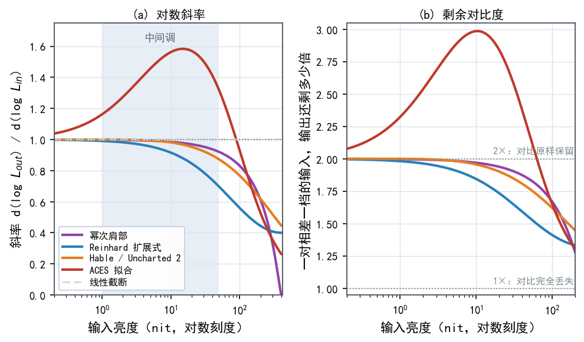
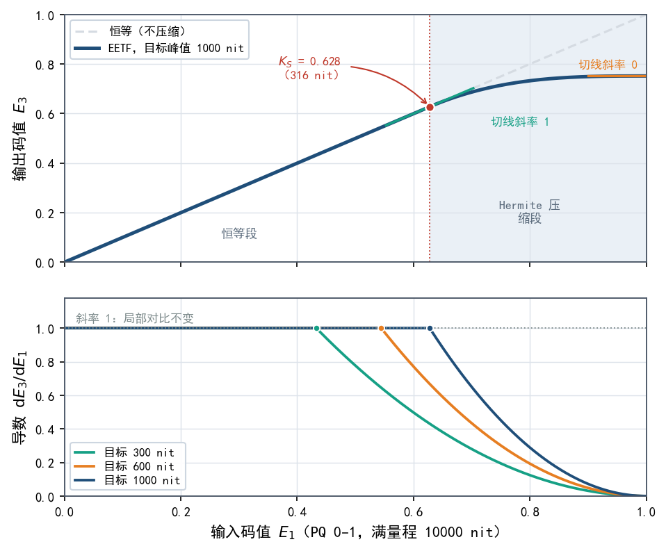
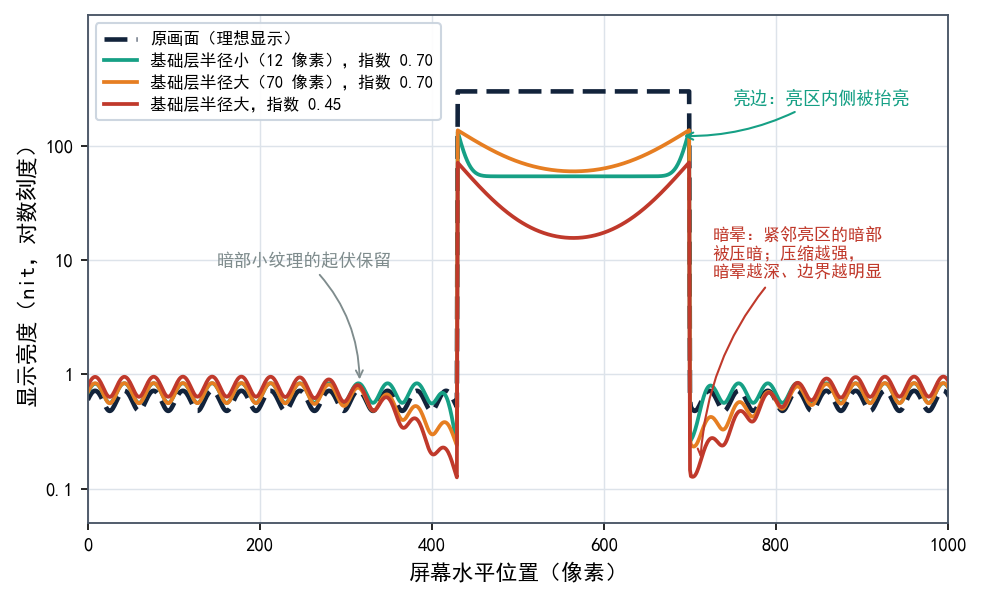
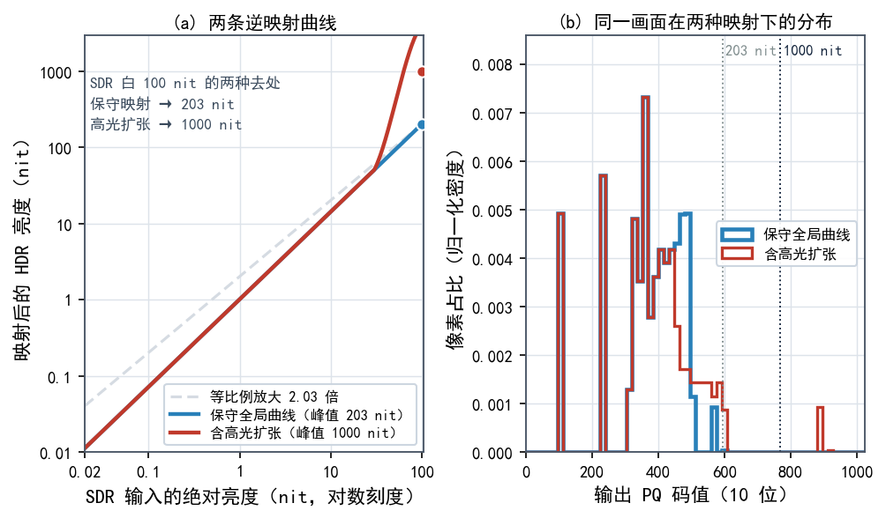
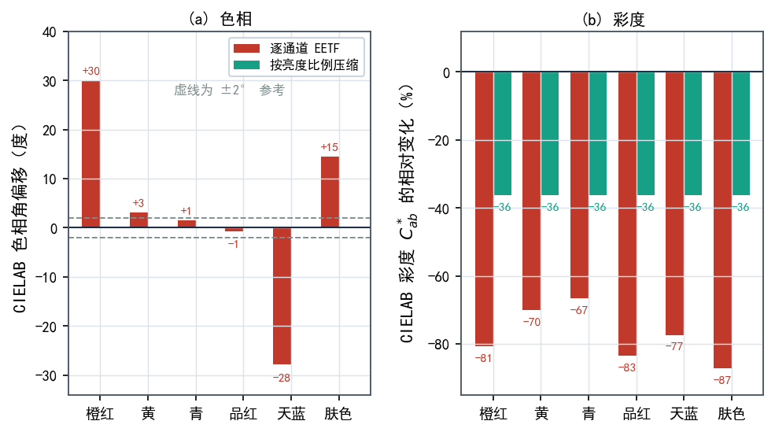

# 第 4 章 色调映射与逆映射

同一条素材，在 4000 nit 的调色监视器上通过，在 1000 nit 的电视上偏灰，在 100 nit 的 SDR 屏上高光糊成一片。把亮度重新分配到目标设备能显示的范围，就是色调映射。这一章讨论算子的形状、参数的实际含义、标准给出的压缩曲线，以及把 SDR 素材扩到 HDR 的取舍。

## 一、亮度范围对不上时只有三条路

先看两端的数字。HDR 母版通常覆盖 0.005 nit 到 4000 nit，跨度是 $\log_{10}(4000/0.005) = 5.9$ 个数量级。SDR 显示器的典型范围是 0.05 nit 到 100 nit，跨度 $\log_{10}(100/0.05) = 3.3$ 个数量级。前者比后者宽 200 倍以上，这个差距不可能靠"调一下亮度"消除。

工程师手上有三条路。

第一条是**裁剪**。超过 100 nit 的部分一律记成 100 nit。蓝天里的云、路灯下的路面、金属高光，全部变成同一个白块。画面里最亮的那 20% 信息直接消失，而人眼对高光区域的层次恰恰很敏感，因为瞳孔收缩之后，高光的相对差异仍然能被看到。

第二条是**线性缩放**，也就是整体降低曝光。4000 nit 除以 40 得到 100 nit，高光保住了，中间调跟着一起沉下去。18% 灰从 10 nit 掉到 0.25 nit，画面整体发暗，观众会觉得"没打灯"。更隐蔽的问题是，人眼判断"白"依赖画面内的相对关系，整幅画面一起变暗时视觉系统会重新适应，画面看起来并不暗，只是失去了高光和力度。

第三条是**曲线压缩**。暗部和中段基本不动，把可用的亮度差集中到高光段去消耗，让 4000 nit 的火焰落在 100 nit，同时让 18% 灰仍然停在 10 nit 附近。这就是色调映射（tone mapping）。它牺牲的是高光区域的局部对比，换来整幅画面的亮度结构。

曲线压缩并不是免费的午餐，它只是把代价换了一个位置。把 5.9 个数量级的输入塞进 3.3 个数量级的输出，平均斜率只有 $3.3/5.9 = 0.56$。也就是说，平均而言每一档输入的亮度差，到输出端只剩半档多一点。色调映射的设计问题因此变成"把这 0.56 的平均斜率如何分配到亮度轴上"，暗部给多一点、高光给少一点，还是反过来。

分配方式决定了画面的性格。斜率集中在暗部，阴影层次丰富但高光容易糊；集中在中间调，人脸好看但天空发灰。数学形式不同的算子，本质上是斜率预算的分配策略不同。

反向的过程叫逆映射（inverse tone mapping），把 SDR 素材扩展到 HDR 显示器上。两条路的数学形式相似，工程难度却不对称。压缩时信息是丢掉的，扩展时丢掉的信息不会自己回来，所以逆映射只能"看起来合理"，不能"还原"。

## 二、一条合格曲线要满足什么

把映射写成函数 $L_{out} = f(L_{in})$，工程上对它有五类要求。

**单调不减。** 亮的输入不能映射成暗的输出，否则画面里会出现假的明暗反转。单调性在数学上很容易保证，但在分段实现的曲线里经常被破坏，两段的斜率符号相反，或者插值系数的舍入误差让曲线在中段抖一下，都会在平滑渐变上留下可见的折痕。

**值域有界。** 输出不超过目标显示器的峰值 $L_{peak}$，也不低于黑位。这一条看似显然，实现时却常出错，尤其是在浮点与定点之间转换、或者在多个模块串联时，前一级的输出略微超过 1.0，后一级再放大，最终在峰值附近出现一段被硬切平的肩部。

**端点行为正确。** 低端斜率接近 1，即 $\mathrm{d}L_{out}/\mathrm{d}L_{in} \approx 1$，黑位和暗部层次原样保留；高端斜率趋近 0，最亮的输入挤在峰值附近，才不会撞上硬裁剪。这两条端点条件合起来，就是"两端固定、中间自由"的边界值问题，几乎所有实用曲线都是它的某种解。

**C1 连续。** 曲线本身连续只保证没有台阶，斜率连续才保证没有折角。分段曲线在拼接点上如果斜率突变，画面里对应亮度的那一层会出现一条"等高线"。人眼对这种二阶不连续非常敏感，尤其在天空、墙面这类大面积平滑渐变上。BT.2390 的曲线之所以要用 Hermite 插值而不是简单的线性过渡，就是为了在拐点处把斜率接上。

**色相与彩度保持。** 这一点最容易被忽略。亮度压缩不应该改变颜色，但如果在 R、G、B 三个通道上各自独立地压，通道之间的比例会变，颜色就跟着变。一个饱和的橙红色高光，红通道压得多、绿通道压得少，结果会向黄色偏移，同时饱和度下降。正确的做法是按亮度决定压缩比，三个通道乘同一个系数，或者在 ICtCp 这类把亮度与色差分开的空间里处理。

**时域稳定。** 视频是连续的。相邻两帧的映射参数如果跳变，画面会闪。全局算子只要参数固定就不闪；局部算子和基于统计的算子（比如按帧均值定曝光）就需要额外的时域滤波，否则镜头里有物体进出画面时，整幅画面的亮度会跟着呼吸。

评价"局部对比丢了多少"，用对数斜率最直观

$$ s(L) = \frac{\mathrm{d}\log L_{out}}{\mathrm{d}\log L_{in}} $$

$s = 1$ 表示这一段明暗比例被完整保留，$s = 0.5$ 表示亮度差被压掉一半，$s \to 0$ 表示这一段的细节被压成一片。这个量等价于"局部 gamma"，在第四节会用来比较几种算子。

## 三、全局算子

全局算子的共同点是每个像素只看自己的亮度，函数形式固定，参数不随位置变化。它便宜、稳定、可预测，缺点是压缩比例在全画面一致，无法针对"窗外亮、室内暗"这样的结构做局部调整。

### Reinhard 的摄影式曲线

Reinhard 等人在 2002 年的论文里给出的做法分两步。先算画面的对数平均亮度

$$ \bar{L}_w = \exp\left(\frac{1}{N}\sum_{i=1}^{N} \ln(L_w(x_i) + \varepsilon)\right) $$

对数平均而不是算术平均，是因为人眼对亮度按比例响应，一盏灯在暗房里能把算术平均拉高几十倍，对数平均只抬高一点点。$\varepsilon$ 是防止取零的小量。

再用一个键值（key）$a$ 把亮度拉到一个"看起来正确"的中间调

$$ L_s = \frac{a}{\bar{L}_w} L_w $$

典型取值 $a = 0.18$，对应 18% 灰。$a$ 大画面偏亮，$a$ 小画面偏暗，这一个参数就代替了相机的曝光补偿。真正做压缩的是最后一步

$$ L_d = \frac{L_s}{1 + L_s} $$

这条曲线在 $L_s \ll 1$ 时近似恒等，在 $L_s \to \infty$ 时趋近 1，形状简单、处处可导、导数单调递减。它的问题是永远到不了白色，任何有限亮度都映射到小于 1 的值，画面整体偏灰。修法是加一个白点 $L_{white}$

$$ L_d = \frac{L_s\left(1 + L_s / L_{white}^2\right)}{1 + L_s} $$

当 $L_s = L_{white}$ 时 $L_d = 1$，白点落到峰值上。$L_{white}$ 取多大，直接决定高光压缩的力度。取得小，压缩早、对比强；取得大，压缩晚、画面亮。实际使用时常把 $L_{white}$ 设成画面里最亮物体的亮度，而不是场景里的绝对最大值，否则一个镜面反光就会把整个白点顶上去。

这条公式的优点是只有一个可调参数，行为容易预测，改 $a$ 只影响整体曝光感，改 $L_{white}$ 只影响高光肩部。缺点是曲率变化平缓，中间调到高光之间没有明显的"肩部"，暗部也没有趾部（toe），压出来的画面对比偏软。它对数平均还带来一个副作用，画面里亮面积变化时 $\bar{L}_w$ 会跳，需要做时域平滑，否则镜头摇过一盏灯，全画面亮度会呼吸一下。

### Hable 的影调曲线

Hable 在 2010 年 GDC 演讲中给出的曲线，来自游戏《神秘海域 2》的渲染管线。它的形式是一段有理函数

$$ f(x) = \frac{x(Ax + CB) + DE}{x(Ax + B) + DF} - \frac{E}{F} $$

常用参数 $A = 0.15$、$B = 0.50$、$C = 0.10$、$D = 0.20$、$E = 0.02$、$F = 0.30$。常数项 $-E/F$ 的作用是把 $f(0)$ 归零，保证黑还是黑。使用时再除以 $f(W)$ 做归一化，$W$ 是"哪个输入值算白"，原演讲取 11.2。

这条曲线的形状比 Reinhard 陡。最暗处是一段线性趾部，斜率只有 0.278，暗部噪声被压住；往上斜率迅速升到 1 附近并维持到中间调，肩部从 100 nit 之前就开始弯折，形成清晰的滚降。整体效果是暗部干净、中间调扎实、高光柔和。

代价是参数多且互相耦合。$A$ 控制趾部到中段的过渡，$B$ 控制中段的曲率，$D$ 和 $F$ 一起决定肩部的位置，改一个常数会同时影响趾部、中段和肩部。实际调参只能靠试，把曲线画出来和目标形状比对，没有解析的对应关系。另一个细节是它没有真正的高光端点，$x \to \infty$ 时 $f(x)$ 趋近 $1 - E/F = 0.933$，过了白点之后斜率很小但不为零，实现上仍要在峰值处补一次裁剪。

### ACES 的参考变换与它的拟合

ACES 的范围比一条曲线大得多。它是一整套色彩管理框架，把场景线性值从 AP0 色域经过参考变换 RRT（Reference Rendering Transform），再经输出变换 ODT 送到具体显示设备。RRT 的作用是把场景的高动态范围压到显示能承受的范围，并做色调与饱和度的风格化处理，内部是一段在 log 空间分五段定义的分段样条，系数表有数百项。

完整的 RRT 实现很重，图形学里普遍使用解析拟合。流传最广的是 Narkowicz 在 2015 年给出的形式

$$ f(x) = \frac{x(2.51x + 0.03)}{x(2.43x + 0.59) + 0.14} $$

三行代码，单调、光滑、$f(1) \approx 0.80$。它抓住的是 RRT 的整体形状，包括暗部的对比扩张和亮部的快速收敛。

需要强调的是，拟合式不等于参考实现。ACES 官方对 RRT 有逐段的样条定义，饱和色、极暗部的行为都与这个拟合不同，尤其是高饱和蓝和深红，拟合式会明显偏灰。做交付级转换要用官方 CTL 或 OpenColorIO 的变换，拟合式只适合实时渲染里"看起来像 ACES"的场合。

### 幂次肩部

最省事的曲线只有一个参数

$$ f(x) = 1 - (1 - x)^{\gamma}, \qquad x = \frac{L_{in}}{L_{peak}} $$

$\gamma = 1$ 时是恒等映射，$\gamma > 1$ 时暗部被提亮（斜率在 $x=0$ 处等于 $\gamma$），高光被压平（斜率在 $x=1$ 处等于 0）。$\gamma = 2.2$ 时 18 nit 的输入落在 0.096，线性映射只有 0.045，暗部亮度翻了一倍。

它没有趾部，暗部的对比被放大而不是压缩，所以适合本身信噪比高的内容，用在噪声大的素材上会把暗部噪点一起提亮。它的优点是天然满足端点条件、天然 C1 连续（在 $x>1$ 处恒定），实现只需要一次 pow，GPU 上几乎免费。

图 4-1 把四条算子曲线和一条线性截断的参照线放在同一坐标系里，输入是绝对亮度（对数轴），输出是归一化显示值，峰值统一取 400 nit。横轴上的 100 nit 竖线是 SDR 的参考白，400 nit 竖线是这次映射的目标峰值。

按这张图的标定，18% 灰落在 100 nit 附近，四条曲线的输出分别是 Reinhard 0.53、幂次肩部 0.48、ACES 拟合 0.47、Hable 0.43。同样的中间调，Hable 压得最狠，Reinhard 最亮。灰线是"线性截断"的参照，它在 400 nit 之前始终贴着对角线，之后被硬切成水平线，可以拿它对照其他曲线的肩部有多圆。

四条曲线的分歧集中在两个区间。10 nit 以下，ACES 拟合和幂次肩部明显抬升，Reinhard 和 Hable 则贴近线性，这个差别就是"暗部要不要提亮"的取舍。100 nit 以上，Hable 和 ACES 的肩部提前弯折，Reinhard 一直拖到 300 nit 才开始明显滚降，幂次肩部则在 200 nit 之后急速压平。看曲线的时候，把这两段分开看，比整体形状更有信息量。

## 四、斜率告诉我们对比丢在哪

曲线本身只能看出"亮了多少"，看不出"细节保住了多少"。把图 4-1 的曲线取对数斜率，得到图 4-2。

四条曲线在暗部都从 1 附近出发，随后分道扬镳。ACES 拟合在 5 到 30 nit 之间斜率升到 1.58，这是它"暗部扎实"的来源，也是它在低照度素材上放大噪声的原因。Hable 的斜率始终不超过 1，暗部靠趾部把噪声压下去，代价是阴影看起来略闷。Reinhard 的斜率从 1 一路下降，到 50 nit 已经掉到 0.7，中高调的层次被持续削薄，这就是它"对比偏软"的定量解释。幂次肩部在极暗处斜率等于 2.2，比 ACES 还激进，到 100 nit 之后迅速掉到 0.5 以下。

四条曲线在 100 nit 之后都快速下滑，到峰值处归零。这是必然的：输出有上界，斜率就必然在接近上界时衰减。真正的设计差异在于"从哪个亮度开始衰减"和"衰减得多快"。衰减开始得太早，画面中段就没精神；开始得太晚，高光就会突然糊掉。

图 4-2 的右半边把斜率换成更容易读的量。取一对相差一档（2 倍）的输入，看它们在映射后还差多少倍。斜率等于 1 时输出也差 2 倍；斜率 0.7 时差 1.62 倍；斜率 0.5 时差 1.41 倍；斜率 0 时两处并成一样。人眼在中间调上能分辨约 1% 的亮度差，1.41 倍仍然够用，真正出问题的是斜率低于 0.2 的高光段，那里一档输入只剩 1.15 倍，看上去就是一片白。

还有一点值得单独说明。斜率大于 1 意味着对比被放大，而这部分放大是全局的，噪声、压缩伪影、传感器暗噪一起被放大。HDR 素材在暗部本来就容易出现码值台阶，经过一个斜率 1.5 的趾部，台阶会更明显。选择算子时要把素材的信噪比和算子的趾部斜率一起考虑，单看曲线好不好看并不够。

最后一层是显示器的对比度预算。内容从 0.5 nit 压到 100 nit 是 200 比 1，显示器只有 1000 比 1 时黑位被抬到 0.1 nit，原本 0.5 nit 的暗部与黑位只差 5 倍，层次全丢。斜率分配和面板对比度是配套的，给对比度不足的屏幕配一条把暗部压得很深的曲线，等于白压。

## 五、BT.2390 的 EETF

上面这些算子都带自由参数。广播链路不能这样，发射端和接收端必须用同一条曲线，否则画面在每一台电视上都长得不一样。飞利浦（Philips）提出的思路被 ITU-R BT.2390 采纳，成为这条公共曲线，名字叫 EETF（Electrical-Electrical Transfer Function，电电转换函数）。

它的输入输出都在 PQ 码值域，设目标峰值对应的码值为 $L_{max}$（0 到 1 之间），先算拐点

$$ K_S = 1.5\,L_{max} - 0.5 $$

拐点以下的码值原样通过，以上的部分用一段三次 Hermite 曲线压到 $L_{max}$

$$ t = \frac{E_1 - K_S}{1 - K_S}, \qquad E_3 = P_0 h_{00}(t) + T_0 h_{10}(t) + P_1 h_{01}(t) + T_1 h_{11}(t) $$

其中 $h_{00} = 2t^3 - 3t^2 + 1$、$h_{10} = t^3 - 2t^2 + t$、$h_{01} = -2t^3 + 3t^2$、$h_{11} = t^3 - t^2$ 是 Hermite 基函数。两端的位置与切线这样取

$$ P_0 = K_S, \quad T_0 = 1 - K_S, \quad P_1 = L_{max}, \quad T_1 = 0 $$

$T_0 = 1 - K_S$ 保证了曲线在拐点处与线性段的斜率衔接，$T_1 = 0$ 保证曲线在峰值处水平收敛。换算回亮度，斜率为 1 意味着拐点两侧的局部对比没有突变，斜率为 0 意味着最亮的输入全部挤在峰值附近。

$K_S$ 的系数 1.5 和 0.5 没有物理推导，取值来自推荐书在"压缩段要覆盖足够多的高光"与"拐点要尽量高、少动中间调"之间取的折中。$L_{max} = 1$ 时 $K_S = 1$，曲线退化为恒等，不做任何压缩。目标峰值越低，拐点越早，被压缩的亮度段越宽。

| 目标峰值 | $L_{max}$（PQ 码值） | $K_S$ | 拐点对应亮度 |
|---|---|---|---|
| 100 nit | 0.5081 | 0.2621 | 6.1 nit |
| 300 nit | 0.6219 | 0.4328 | 46 nit |
| 600 nit | 0.6963 | 0.5444 | 143 nit |
| 1000 nit | 0.7518 | 0.6277 | 317 nit |
| 4000 nit | 0.9026 | 0.8539 | 2550 nit |

这张表解释了为什么同一份母版在不同设备上观感差别那么大。目标 4000 nit 时，2550 nit 以下完全不动，压缩只影响最顶上那一段；目标 100 nit 时，6 nit 以上就被压缩，几乎整个中间调都被改写。所谓"SDR 版本平淡"，本质上就是拐点落在了中间调里。

图 4-3 给出四个目标峰值的曲线。横轴输入、纵轴输出都是绝对亮度，对数刻度。四条曲线在 10 nit 以下完全重合，与恒等线贴合；分岔出现在各自的拐点附近，目标越低分岔越早。目标 100 nit 的深蓝线在 10 nit 之后就开始偏离对角线，到 100 nit 时斜率已经很小，高光的层次几乎全被压平。

EETF 有两个使用要点。

一是**逐通道处理会偏色**。EETF 定义在 R、G、B 三个通道上，各自按自己的码值压缩。一个饱和的红色高光，红通道在 900 码值、绿蓝通道只有 200，压缩后红通道被拉到接近峰值，绿蓝几乎不动，色相和饱和度都会变。规避办法是先在亮度通道上算压缩比，再把同一个比例应用到三个通道；或者在 ICtCp 这类感知均匀的色差空间里处理，那里的 $I$ 分量与色度分离，压完再换回去。第十节会算这笔账。

二是**它只负责高光**。EETF 的拐点以下不做任何处理，暗部的映射交给别的环节（例如 BT.1886 之于 SDR）。完整的显示映射还要处理黑位提升、色域映射和色调风格，EETF 只是其中一段。把它当成"全流程色调映射"是常见误解，实际系统里它通常只是显示端最后那道压缩。

## 六、EETF 的分段构造与工程实现

把 EETF 拆开看，它就是一个标准的边界值问题。已知起点 $(0,0)$ 到 $(K_S, K_S)$ 是斜率 1 的直线，已知终点是 $(1, L_{max})$ 且斜率 0，中间用一段三次多项式连接。三次多项式有四个系数，正好由两个位置和两个切线确定，Hermite 形式就是这个解的直接写法。

图 4-4 的上半部分画出了目标 1000 nit 的曲线。拐点在 0.628，对应 316 nit，这一点上画了两条短切线，左边斜率为 1、右边斜率为 0，中间就是 Hermite 段。下半部分是导数，能更清楚地看到构造的质量：拐点之前导数恒等于 1，拐点处没有跳变，过了拐点平滑下降，在码值 1.0 处归零。整条曲线 C1 连续。

如果没有 $T_0 = 1 - K_S$ 这个切线条件，而是让 Hermite 段从水平切线出发（$T_0 = 0$），拐点处就会出现一个"台阶"，导数从 1 直接掉到 0，画面上对应亮度的一层会出现一条看得见的折线。这类问题在工程实现里很常见，原因往往是有人在切线计算时把码值域和亮度域搞混，或者把 $T_0$ 写成了 1。

**黑位归一化**是另一个容易被漏掉的步骤。EETF 的公式假定输入从 0 开始，但实际设备的黑位不是 0，目标设备的黑位也可能高于内容黑位。处理办法是先把黑位拉平

$$ E_1' = \frac{E_1 - E_{min}}{1 - E_{min}} $$

压完再映射回目标黑位。这样做的效果是让最暗的一小段一起被抬起来，避免压缩后黑位与内容黑位不匹配导致的"浮黑"。代价是最暗处的斜率被放大了 $1/(1-E_{min})$ 倍，$E_{min}$ 较大时需要限制放大倍数，否则暗部噪声会被拉出来。

**数值实现**有几个具体问题。

第一是查表。1024 项的表足够覆盖 10 位输入，但输出也是 10 位时会有量化误差，拐点附近曲率大处尤其明显。做法是表项存 16 位定点并在表里带上斜率与截距，用一次乘加完成插值，4096 项配线性插值能把误差压到半个码值以内。

第二是单调性校验。定点舍入可能让相邻表项相等甚至倒序，在 $T_1 = 0$ 附近的平坦段尤其明显，生成表之后要扫一遍，遇到倒序就把后一项置为前一项。

第三是边界情形。目标峰值低于 15 nit 时 $K_S$ 变成负数，公式失效，代码里必须把 $K_S$ 钳到 $[0, 1)$。

最后一点值得记住。EETF 压缩的是**码值**而不是**亮度**，PQ 是对数型曲线，码值域的均匀压缩在亮度域并不均匀，高码值段被压得更多。这正好符合人眼在高光区分辨力下降的特性，也是压缩选在 PQ 域做的原因。

## 七、局部算子与光晕

全局算子对每个像素用同一条曲线，画面里亮部和暗部的压缩比例相同。真实场景不是这样，窗外的天空可能比室内亮 1000 倍，观众希望窗内保留层次，同时窗外的云也要有形状。这就要求压缩力度随位置变化，也就是局部算子。

经典做法来自 Durand 和 Dorsey 在 2002 年提出的双边滤波分解。把亮度拆成基础层（base）和细节层（detail）

$$ L = L_{base} \cdot L_{detail} $$

基础层用保边滤波得到，它保留了大尺度的亮度结构，抹掉了纹理；细节层是两者的比值。之后只压缩基础层

$$ L_{out} = L_{base}^{\alpha} \cdot L_{detail} = L \cdot L_{base}^{\alpha - 1}, \qquad \alpha < 1 $$

细节层原样保留，最后乘回去。这样窗外的天空被压下来，室内的纹理一点没动。$\alpha$ 越接近 0，基础层压得越狠。

保边滤波器的选择决定光晕的形态。双边滤波在空间距离之外再加一个亮度差的高斯权重，亮度差大的像素不参与平均，所以边缘两侧的估计值不会被彼此污染。但在强边缘附近，滤波器窗口里的像素一半在亮区、一半在暗区，权重分配不可能完全偏向一侧，边缘外侧的 base 仍然会被亮区抬起来。

Farbman 等人在 2011 年用局部拉普拉斯金字塔改进了这一步，把细节按幅度分到不同层，可以单独控制"大边缘"和"小纹理"的压缩比例。He 等人在 2010 年提出的引导滤波用局部线性模型代替加权平均，计算复杂度与窗口半径无关，被大量移植到实时管线里。Fattal 等人则走梯度域路线，先算亮度场的梯度，对大幅度的梯度做衰减，再积分回图像。四种方法的目标相同，都是在保边的前提下压缩动态范围，差别在速度、光晕形态和时域稳定性。

图 4-5 用一维信号把机制画出来。原画面是 0.6 nit 的暗背景加一段 300 nit 的亮区，暗区带一点正弦纹理，三条曲线是同一个算子在三组参数下的输出。

青色曲线用小半径（12 像素），暗晕很窄，纹理完好，几乎看不出异常。橙色曲线把半径放大到 70 像素，暗晕宽度跟着放大，紧贴亮区的那一段暗部被压到 0.3 nit，比远处的 0.6 nit 暗了一半；同时亮区内侧被抬亮到 120 nit，比中心的 90 nit 更亮。红色曲线沿用大半径，把指数从 0.70 降到 0.45，暗晕深到 0.13 nit，边缘两侧的明暗顺序完全反过来，这就是梯度反转。

暗晕和亮边的方向可以这样理解。$L_{out} = L \cdot L_{base}^{\alpha-1}$，指数 $\alpha - 1$ 是负的，base 偏大就把输出压小。亮区附近的暗部，base 被亮区抬高，输出反而变暗；亮区内侧的边缘，base 被暗区拉低，输出反而变亮。两个方向同时发生，画面上就出现"黑边压暗、白边提亮"的浮雕效应。

光晕的量化有两个常用指标。一个是**幅度**，即暗晕最低点与远处背景的比值，图 4-5 里橙色曲线的幅度是 0.5，红色是 0.22。另一个是**宽度**，即暗晕从边缘到恢复背景所需的距离，大致等于滤波半径的两到三倍。两个指标此消彼长，减小半径能压窄宽度，但幅度不一定下降。

抑制光晕的手段有限。减小滤波半径管用，但保不住大尺度的亮度结构；加大半径，光晕跟着变大。工程上常用折中方案，把基础层在低分辨率上计算（比如 1/4 分辨率），用引导滤波或双边网格加速，同时限制基础层的局部梯度，即在求 base 之前先对亮度做一次小幅的梯度限幅，让边缘不至于无限陡。实时渲染里还常见一种简化，用屏幕分区的统计值代替逐像素滤波，这实际上就是显示器端分区背光的思路，第 5 章会看到它对光晕的影响。

局部算子还有一个全局算子没有的问题，时域不稳定。邻域统计逐帧变化，镜头轻微摇动或者有物体运动时，base 会跟着抖动，画面出现细微的"沸腾"。处理办法是对 base 做时域滤波，把当前帧的 base 与上一帧的 base 按一个系数混合，系数取 0.1 到 0.3。代价是快速运动时 base 跟不上，光晕会拖尾。这个取舍没有完美解，只能按内容类型调。

## 八、逆色调映射

SDR 转 HDR 是另一个方向。ITU-R BT.2446 给了三种方法。方法 A 用分段曲线把 SDR 的码值映射到 HDR，黑位抬升、中间调线性拉伸、高光滚降，全部由解析式决定，可复现、不需要人工干预，适合大批量的片库转换。方法 B 允许在映射时改变局部对比和饱和度，效果更好但需要调参，也更依赖内容类型。方法 C 面向有 HDR 参考的场合，用统计量对齐两版素材，本质上是一种自动化的 trim。

逆映射的困难在于信息缺失。SDR 画面里"100 nit 的白"可能是天空、可能是灯泡、也可能是雪地，从码值上分不出来。硬把它们都拉到 1000 nit，天空会亮得不像天空。图 4-6 把这个问题画成两条曲线。

蓝线是保守的全局映射，把 SDR 的 100 nit 白对到 HDR 的 203 nit 参考白，峰值就停在 203 nit。它保证图卡、字幕、UI 的亮度与 HDR 制作约定一致，代价是画面里没有任何真正的高光。红线在 30 nit 以上加了一段快速滚降，把 100 nit 推到 1000 nit，画面有了高光的"刺点"，但如果原素材的 100 nit 是一片雪地，这片雪就会亮得没有道理。

右半边是同一幅合成画面在两种映射下的码值分布。保守映射（蓝）整体平移，形状不变；高光扩张（红）把 30 nit 以上的像素拉开，右端出现一条长尾，最亮的那些像素跑到了 800 到 900 码值。两条曲线在暗部完全重合，说明逆映射只该动高光，不该动已经正确的暗部。

工程上的对策是保守加局部判断。只把明确的高光往上提，判据是面积小、码值接近局部最大值、边缘锐利三条同时成立。大面积的中高调保持不动，宁可少给也不要乱给。自然界的高光源（太阳、灯、金属反光）都是小面积的，而雪地、白墙、天空这类大面积区域在 HDR 里也不该超过几百 nit。

另一个坑是噪声。SDR 素材暗部的量化噪声和压缩块效应在扩展后被放大数倍，通常要在逆映射前做一次降噪，或者在暗部把扩展比例压到 1 以下，让暗部保持原样。这一条与"黑位下压"的直觉相反，很多人第一次做逆映射时会把黑位往下拉以"扩大动态范围"，结果拉出一片噪点。

机器学习方法在这条链路上的定位需要说清楚。基于 CNN 的逆映射能做到两件事，一是对画面做语义分割，区分天空、皮肤、灯源，从而给不同区域不同的扩展曲线；二是从大量 SDR/HDR 配对样本里学到"什么样的纹理该有多亮"的先验。它做不到的是恢复原本不存在的高光细节，一张过曝的 SDR 截图，无论什么网络都变不出云层的形状。所以这类方法在实际流程里通常作为"自动 trim"使用，输出一条逐镜头的映射建议，再由调色师确认，而不是直接生成最终母版。

## 九、HGiG 与设备分工

游戏画面有一条特殊的链路。渲染引擎知道自己在画什么，显示器知道自己能亮到多少，两边的信息都不缺，问题是**由谁来做色调映射**。

早期主机和 PC 游戏习惯自己压：引擎里跑一条 Hable 或 ACES 曲线，把场景压到 1000 nit 再输出 PQ 信号。显示器收到的是一个"已经压好"的画面，它只需要忠实显示。这套做法在显示器峰值恰好等于游戏假设的峰值时没问题，一旦显示器的实际能力是 700 nit 或 1600 nit，就会发生两次映射。游戏压一次，显示器再压一次，高光被压两遍，画面发灰。

HGiG（HDR Gaming Interest Group）的思路是把这件事拆开。游戏端只负责按 PQ 输出、把峰值标定到显示器的实际能力（通过 EDID 的 HDR 静态元数据块或用户设置读到的峰值），并遵守 203 nit 图卡白的约定；显示器端负责最后的滚降，把超出自身能力的高光压下去。这样无论显示器是 600 nit 还是 2000 nit，映射只发生一次，而且发生在最了解硬件极限的那一端。

元数据在这里起的是"告知能力"的作用，而不是"给曲线"。显示端从 EDID 或码流里读到内容峰值（MaxCLL）与母版峰值（ST 2086），结合自己的实际能力决定滚降强度，内容峰值不超过自身能力时直通，超过时按 EETF 或厂商曲线压缩。

这个分工对内容侧也有要求。游戏的 UI、字幕、图标属于"图卡白"，应当固定在 203 nit 附近，不能跟着场景亮度浮动，否则玩家调亮度时会看到 UI 一起变。实拍素材的 HDR 母版则保留绝对亮度语义，火焰就是 1000 nit，不做预先压缩。

现实里这套约定执行得不彻底。不少游戏仍然内置自己的曲线，部分显示器在 HGiG 模式下又做了额外的对比增强，两次映射的问题依旧存在。判断一台设备是否遵循这套分工，可以看它在收到 203 nit 全屏白时输出多少，按约定应该停在 203 nit 附近，不该被拉到峰值。

## 十、色彩处理顺序

色调映射不是孤立的一步，它嵌在一条色彩管线里，前后顺序会影响结果。

**在线性光下计算。** 压缩比的推导、base 与 detail 的分解、色域映射，都应该在线性亮度域里做。在 gamma 编码的码值上做除法或求幂，数学上对应的是完全不同的操作，结果会系统性地偏暗或者偏色。EETF 是例外，它明确设计在 PQ 码值域，因为 PQ 本身已经把感知均匀性编码进去了，这一点在第六节末尾讨论过。

**色域压缩与色调映射的先后。** 两种顺序都有人用，取舍在于"先压颜色还是先压亮度"。先做色调映射再做色域映射的好处是亮度结构先定下来，色域映射只需要在固定亮度上收饱和度，处理简单，缺点是压缩后的高光可能已经落在目标色域之外，色域映射要处理的越界像素更多。反过来先做色域映射，饱和色的亮度会先变一次，色调映射的输入就不是原始亮度，曲线参数需要重新标定。显示端管线多采用"先色调映射、后色域映射"，制作端的下变换常采用相反顺序，以保持母版的色彩关系。

**避免逐通道处理。** 这是最实际的一条。图 4-7 把两种做法的后果量化了。

六个色块都按亮度归一到 1000 nit，压到 300 nit 的峰值。逐通道 EETF 的结果是色相最多偏了 30 度（橙红）、28 度（天蓝），肤色偏 15 度，只有黄、青、品红这类接近两通道的组合偏移较小。按亮度比例压缩的那一组色相偏移全部为零，彩度统一下降 36%。

偏移的方向有规律。逐通道压缩时，码值高的通道被压得更多，码值低的通道几乎不动，通道之间的比例被拉平，颜色向"少压的那个通道"偏移。橙红的红通道最高，被压得最狠，颜色就往黄绿方向走；天蓝的蓝通道最高，被压后整体偏青。肤色是最敏感的，15 度的偏移足以让人脸看起来"发灰发绿"。

正确做法是先在亮度上算一个压缩比 $r = f(Y)/Y$，再让三个通道同乘 $r$，色相严格保持，彩度随亮度一起下降。这样做的代价是饱和色的亮度压不下去，一个 1000 nit 的纯红压到 300 nit 之后仍然是 300 nit，如果目标峰值只有 100 nit，就还得再裁一次。折中方案是在 ICtCp 或 IPT 这类亮度色度分离的空间里做，对 $I$ 分量压得狠一点、对色度分量压得轻一点，允许一定程度的色度越界，再交给色域映射收尾。

**白点适配放在最后。** 内容的白点是 D65，面板的白点可能偏冷或偏暖，这一步用 Bradford 或 CAT16 做色适应，作用在整个画面上。它必须在色调映射和色域映射之后，因为前两步都可能改变白点的实际位置，先做适配再压缩，白点会二次偏移。

**一条可用的顺序**是：线性化 → 白点归一 → 色调映射（按亮度比例，不逐通道）→ 色域映射（在恒定亮度上收饱和度）→ 目标 EOTF 编码 → 输出量化。每一步的输入输出都定义清楚，换实现不会影响其他步。

## 本章要点

- 亮度范围不匹配时只有裁剪、缩放、曲线压缩三条路，色调映射把压缩集中在高光段，保住暗部与中间调。
- 合格曲线要单调、有界，低端斜率接近 1，高端斜率趋近 0，拐点处斜率连续，并且按亮度而不是按通道压缩。
- Reinhard 曲线形式简单、只有一个白点参数，中间调偏亮、无趾部无肩部；Hable 趾部斜率约 0.28、肩部提前弯折；ACES 的 RRT 是数百项系数的分段样条，拟合式只还原整体形状。
- 对数斜率 $s = \mathrm{d}\log L_{out} / \mathrm{d}\log L_{in}$ 是衡量局部对比保留程度的直接指标，把 5.9 个数量级压进 3.3 个，平均斜率只有 0.56。
- BT.2390 EETF 用 $K_S = 1.5L_{max} - 0.5$ 定位拐点，拐点以上用两端切线确定的 Hermite 曲线压到峰值，目标越低拐点越早，100 nit 时 6 nit 以上全部被压。
- 局部算子用保边分解保住细节，代价是暗晕与亮边，幅度与宽度此消彼长，压缩过强会出现梯度反转。
- 逆映射无法还原丢失的信息，只能保守扩展；全局曲线把 100 nit 对到 203 nit，高光扩张要靠局部判断，机器学习负责给建议而不是造细节。
- HGiG 把滚降交给显示端以避免两次映射，元数据的作用是告知能力；处理顺序应在线性光下算、先色调映射后色域映射、绝不逐通道压缩。
