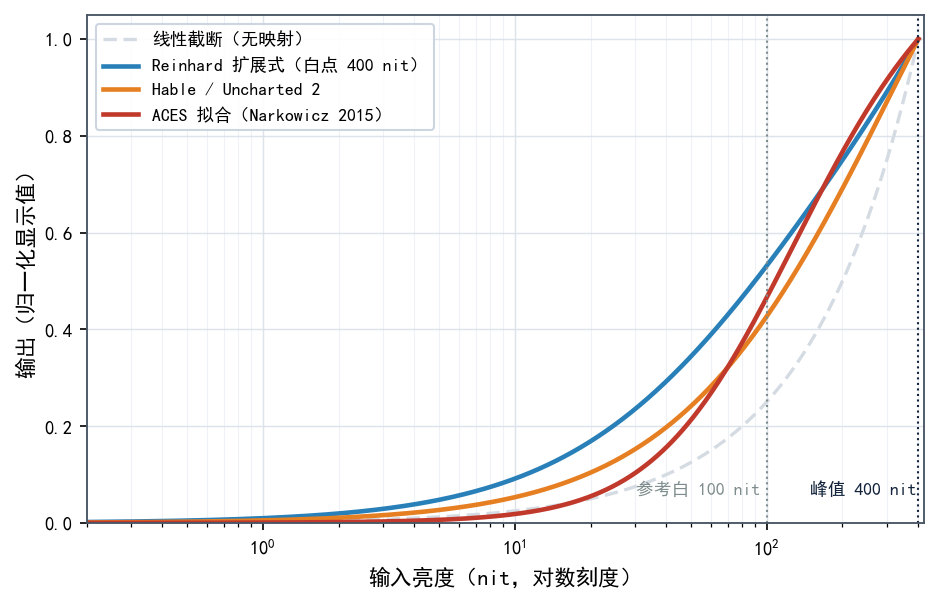
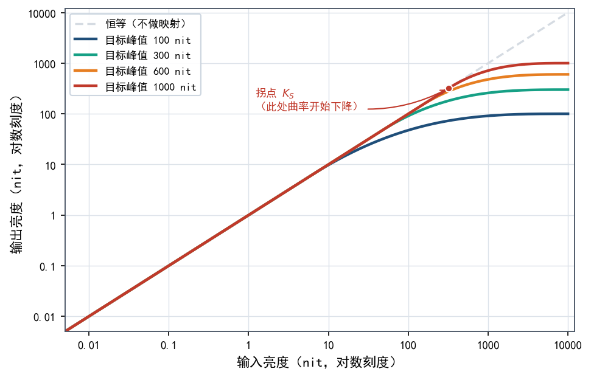

# 第 4 章 色调映射与逆映射

同一条素材，在 4000 nit 的调色监视器上通过，在 1000 nit 的电视上偏灰，在 100 nit 的 SDR 屏上高光糊成一片。把亮度重新分配到目标设备能显示的范围，就是色调映射。这一章讨论算子的形状、参数的实际含义，以及 BT.2390 给出的标准压缩曲线。读完以后，看到一条映射曲线，应该能判断它在哪个亮度段做了什么取舍。

## 4.1 亮度范围对不上时只有三条路

先看两端的数字。HDR 母版通常覆盖 0.005 nit 到 4000 nit，跨度约 5.9 个数量级（40 万比 1 以上）。SDR 显示器的典型范围是 0.05 nit 到 100 nit，跨度 3.3 个数量级。两者相差 200 倍以上，这个差距不可能靠"调一下亮度"消除。

工程师手上有三条路。

第一条是**裁剪**。超过 100 nit 的部分一律记成 100 nit。蓝天里的云、路灯下的路面、金属高光，全部变成同一个白块。画面里最亮的 20% 信息直接消失。

第二条是**线性缩放**，也就是整体降低曝光。4000 nit 除以 40 得到 100 nit，高光保住了，中间调跟着一起沉下去。18% 灰从 10 nit 掉到 0.25 nit，画面整体发暗，观众会觉得"没打灯"。

第三条是**曲线压缩**。暗部和中段基本不动，把亮度差异集中到高光段去压缩，让 4000 nit 的火焰落在 100 nit，同时让 18% 灰仍然停在 10 nit 附近。这就是色调映射（tone mapping）。它牺牲的是高光区域的局部对比，换来整幅画面的亮度结构。

反向的过程叫逆映射（inverse tone mapping），把 SDR 素材扩展到 HDR 显示器上。两条路的数学形式相似，工程难度却不对称，后面会看到原因。

## 4.2 一条合格曲线要满足什么

把映射写成函数 $L_{out} = f(L_{in})$，工程上对它有四条要求。

**单调不减。** 亮的输入不能映射成暗的输出，否则画面里会出现假的明暗反转。

**值域有界。** 输出不超过目标显示器的峰值 $L_{peak}$，也不低于黑位。

**低端斜率接近 1。** 在暗部，$\mathrm{d}L_{out}/\mathrm{d}L_{in} \approx 1$，这样黑位和暗部层次原样保留。若低端斜率小于 1，阴影会被压平；大于 1，噪声会被放大。

**高端斜率趋近 0。** 最亮的输入挤在峰值附近，斜率接近 0，才不会再撞上硬裁剪。

评价"局部对比丢了多少"，用对数斜率最直观

$$ s(L) = \frac{\mathrm{d}\log L_{out}}{\mathrm{d}\log L_{in}} $$

$s = 1$ 表示这一段明暗比例被完整保留，$s = 0.5$ 表示亮度差被压掉一半，$s \to 0$ 表示这一段的细节被压成一片。这个量在 4.4 节会用来比较几种算子。

还有一条隐含约束。全局算子只看单个像素的亮度，局部算子看邻域。前者便宜、稳定、不会产生光晕；后者能保住局部对比，代价是可能造出原画面没有的亮边。实际系统常常两者混用。

## 4.3 三种全局算子

### Reinhard 的摄影式曲线

Reinhard 等人在 2002 年的论文里给出的做法分两步。先算画面的对数平均亮度

$$ \bar{L}_w = \exp\left(\frac{1}{N}\sum_{i=1}^{N} \ln(L_w(x_i) + \varepsilon)\right) $$

再用一个键值（key）$a$ 把亮度拉到一个"看起来正确"的中间调

$$ L_s = \frac{a}{\bar{L}_w} L_w $$

典型取值 $a = 0.18$，对应 18% 灰。真正做压缩的是最后一步

$$ L_d = \frac{L_s}{1 + L_s} $$

这条曲线在 $L_s \ll 1$ 时近似恒等，在 $L_s \to \infty$ 时趋近 1，形状简单、处处可导。它的问题是永远到不了白色：任何有限亮度都映射到小于 1 的值，画面整体偏灰。修法是加一个白点 $L_{white}$

$$ L_d = \frac{L_s\left(1 + L_s / L_{white}^2\right)}{1 + L_s} $$

当 $L_s = L_{white}$ 时 $L_d = 1$，白点落到峰值上。$L_{white}$ 取多大，直接决定高光压缩的力度：取得小，压缩早、对比强；取得大，压缩晚、画面亮。

这条公式的优点是只有一个可调参数，行为容易预测。缺点是曲率变化平缓，中间调到高光之间没有明显的"肩部"，暗部也没有趾部（toe），压出来的画面对比偏软。

### Hable 的影调曲线

Hable 在 2010 年 GDC 演讲中给出的曲线，来自游戏《神秘海域 2》的渲染管线。它的形式是一段有理函数

$$ f(x) = \frac{x(Ax + CB) + DE}{x(Ax + B) + DF} - \frac{E}{F} $$

常用参数 $A = 0.15$、$B = 0.50$、$C = 0.10$、$D = 0.20$、$E = 0.02$、$F = 0.30$。常数项 $-E/F$ 的作用是把 $f(0)$ 归零，保证黑还是黑。使用时再除以 $f(W)$ 做归一化，$W$ 是"哪个输入值算白"，原演讲取 11.2。

这条曲线的形状比 Reinhard 陡。最暗处是一段线性趾部，斜率只有 0.28 左右，暗部噪声被压住；往上斜率迅速升到 1 附近并维持到中间调，肩部从 100 nit 之前就开始弯折，形成清晰的滚降。整体效果是暗部干净、中间调扎实、高光柔和，代价是参数多且互相耦合，改一个常数会同时影响趾部、中段和肩部，调参需要经验。

### ACES 的参考变换与它的拟合

ACES 的范围比一条曲线大得多。它是一整套色彩管理框架，把场景线性值从 AP0 色域经过参考变换 RRT（Reference Rendering Transform），再经输出变换 ODT 送到具体显示设备。RRT 的作用是把场景的高动态范围压到显示能承受的范围，并做色调与饱和度的风格化处理，内部是一段在 log 空间分五段定义的分段样条，系数表有数百项。

完整的 RRT 实现很重，图形学里普遍使用解析拟合。流传最广的是 Narkowicz 在 2015 年给出的形式

$$ f(x) = \frac{x(2.51x + 0.03)}{x(2.43x + 0.59) + 0.14} $$

三行代码，单调、光滑、$f(1) \approx 0.80$。它抓住的是 RRT 的整体形状，包括暗部的对比扩张和亮部的快速收敛。需要强调的是，拟合式不等于参考实现：ACES 官方对 RRT 有逐段的样条定义，饱和色、极暗部的行为都与这个拟合不同。做交付级转换要用官方 CTL 或 OpenColorIO 的变换，拟合式只适合实时渲染里"看起来像 ACES"的场合。

图 4-1 把三条算子曲线和一条线性截断的参照线放在同一坐标系里，输入是绝对亮度（对数轴），输出是归一化显示值，峰值统一取 400 nit。横轴上的 100 nit 竖线是 SDR 的参考白，400 nit 竖线是这次映射的目标峰值。

按这张图的标定，18% 灰落在 100 nit 附近，三条曲线的输出分别是 Reinhard 0.53、ACES 拟合 0.47、Hable 0.43。也就是说，同样的中间调，Hable 压得最狠，Reinhard 最亮。灰线是"线性截断"的参照，它在 400 nit 之前始终贴着对角线，之后被硬切成水平线，可以拿它对照其他曲线的肩部有多圆。

## 4.4 斜率告诉我们对比丢在哪

曲线本身只能看出"亮了多少"，看不出"细节保住了多少"。把图 4-1 的曲线取对数斜率，得到图 4-2。

三条曲线在暗部都从 1 出发，随后分道扬镳。ACES 拟合在 5 到 30 nit 之间斜率升到 1.58，这是它"暗部扎实"的来源，也是它在低照度素材上放大噪声的原因。Hable 的斜率始终不超过 1，暗部靠趾部把噪声压下去，代价是阴影看起来略闷。Reinhard 的斜率从 1 一路下降，到 50 nit 已经掉到 0.7，中高调的层次被持续削薄，这就是它"对比偏软"的定量解释。

三条曲线在 100 nit 之后都快速下滑，到峰值处归零。这是必然的：输出有上界，斜率就必然在接近上界时衰减。真正的设计差异在于"从哪个亮度开始衰减"和"衰减得多快"。衰减开始得太早，画面中段就没精神；开始得太晚，高光就会突然糊掉。

还有一点值得单独说明。斜率大于 1 意味着对比被放大，而这部分放大是全局的，噪声、压缩伪影、传感器暗噪一起被放大。HDR 素材在暗部本来就容易出现码值台阶，经过一个斜率 1.5 的趾部，台阶会更明显。选择算子时要把素材的信噪比和算子的趾部斜率一起考虑，单看曲线好不好看并不够。

## 4.5 局部算子与光晕

全局算子对每个像素用同一条曲线，画面里亮部和暗部的压缩比例相同。真实场景不是这样：窗外的天空可能比室内亮 1000 倍，观众希望窗内保留层次，同时窗外的云也要有形状。这就要求压缩力度随位置变化，也就是局部算子。

经典做法来自 Durand 和 Dorsey 在 2002 年提出的双边滤波分解。把亮度拆成基础层（base）和细节层（detail）

$$ L = L_{base} \cdot L_{detail} $$

基础层用保边滤波（双边滤波）得到，它保留了大的亮度跃变，抹掉了纹理；细节层是两者的比值。之后只压缩基础层，细节层原样保留，最后乘回去。这样窗外的天空被压下来，室内的纹理一点没动。

Farbman 等人在 2011 年用局部拉普拉斯金字塔改进了这一步，把细节按幅度分到不同层，可以单独控制"大边缘"和"小纹理"的压缩比例。Fattal 等人则走梯度域路线，先算亮度场的梯度，对大幅度的梯度做衰减，再积分回图像。三种方法的目标相同，都是在保边的前提下压缩动态范围。

局部算子的通病是光晕（halo）。滤波器在强边缘两侧"漏"了一点信息，亮区的低值被抬起来，暗区的高值被压下去，边缘外侧出现一圈亮晕或暗晕。更严重的情况叫梯度反转（gradient reversal），边缘内侧本来比外侧暗，处理后反而更亮，画面出现不存在的轮廓。

抑制光晕的手段有限。减小滤波半径管用，但保不住大尺度的亮度结构；加大半径，光晕跟着变大。工程上常用折中方案，把基础层在低分辨率上计算（比如 1/4 分辨率），用引导滤波或双边网格加速，同时限制基础层的局部梯度。实时渲染里还常见一种简化，用屏幕分区的统计值代替逐像素滤波，这实际上就是显示器端分区背光的思路，第 5 章会看到它对光晕的影响。

## 4.6 BT.2390 的 EETF

上面这些算子都带自由参数。广播链路不能这样，发射端和接收端必须用同一条曲线，否则画面在每一台电视上都长得不一样。ITU-R BT.2390 给出的 EETF（Electrical-Electrical Transfer Function，电电转换函数）就是这条公共曲线。

它的输入输出都在 PQ 码值域。设目标峰值对应的码值为 $L_{max}$（0 到 1 之间），先算拐点

$$ K_S = 1.5\,L_{max} - 0.5 $$

拐点以下的码值原样通过，以上的部分用一段三次 Hermite 曲线压到 $L_{max}$

$$ t = \frac{E_1 - K_S}{1 - K_S}, \qquad E_3 = P_0 h_{00}(t) + T_0 h_{10}(t) + P_1 h_{01}(t) + T_1 h_{11}(t) $$

其中 $h_{00} = 2t^3 - 3t^2 + 1$、$h_{10} = t^3 - 2t^2 + t$、$h_{01} = -2t^3 + 3t^2$、$h_{11} = t^3 - t^2$ 是 Hermite 基函数。两端的位置与切线这样取

$$ P_0 = K_S, \quad T_0 = 1 - K_S, \quad P_1 = L_{max}, \quad T_1 = 0 $$

$T_0 = 1 - K_S$ 保证了曲线在拐点处与线性段的斜率衔接，$T_1 = 0$ 保证曲线在峰值处水平收敛。换算回亮度，斜率为 1 意味着拐点两侧的局部对比没有突变，斜率为 0 意味着最亮的输入全部挤在峰值附近。

图 4-3 给出四个目标峰值的曲线。目标 1000 nit 时，$L_{max} = 0.7518$，$K_S = 0.6277$，对应亮度约 320 nit，也就是说 320 nit 以上才进入压缩段。目标 100 nit 时 $K_S = 0.2621$，拐点落到 6 nit 附近，几乎整个中间调都被压缩，这就是 SDR 版本的画面看起来"平淡"的原因。

$K_S$ 的系数 1.5 和 0.5 没有物理推导，取值来自推荐书在"压缩段要覆盖足够多的高光"与"拐点要尽量高、少动中间调"之间取的折中。$L_{max} = 1$ 时 $K_S = 1$，曲线退化为恒等，不做任何压缩。

EETF 有两个使用要点。

一是**逐通道处理会偏色**。EETF 定义在 R、G、B 三个通道上，各自按自己的码值压缩。一个饱和的红色高光，红通道在 900 码值、绿蓝通道只有 200，压缩后红通道被拉到接近峰值，绿蓝几乎不动，色相和饱和度都会变。规避办法是先在亮度通道上算压缩比，再把同一个比例应用到三个通道；或者在 ICtCp 这类感知均匀的色差空间里处理。

二是**它只负责高光**。EETF 的拐点以下不做任何处理，暗部的映射交给别的环节（例如 BT.1886 之于 SDR）。完整的显示映射还要处理黑位提升、色域映射和色调风格，EETF 只是其中一段。

## 4.7 从 HDR 到 SDR，再从 SDR 到 HDR

HDR 转 SDR 的工程实现围绕一个基准值展开：参考白。ITU-R BT.2408 把 HDR 制作中的漫反射白定在 203 nit，与 100 nit 的 SDR 参考白形成约 1 档（2 倍关系，按 PQ 码值差约 0.07）的落差。做下变换时，把 203 nit 映射到 100 nit，其余亮度按 EETF 之类的曲线压缩，画面的"整体曝光感"才不会变。

只做线性缩放会出问题。203 除以 2.03 得到 100，看起来对，但 1000 nit 的窗光会落到 492 nit，超出 SDR 的上限，还得再裁一次。所以实际流程是"先定参考白，再用曲线压高光"，两步不能省。

SDR 转 HDR 是另一个方向，ITU-R BT.2446 给了三种方法。方法 A 用分段曲线把 SDR 的码值映射到 HDR，黑位抬升、中间调线性拉伸、高光滚降，全部由解析式决定，可复现、不需要人工干预。方法 B 允许在映射时改变局部对比和饱和度，效果更好但需要调参。方法 C 面向有 HDR 参考的场合，用统计量对齐两版素材。

逆映射的困难在于信息缺失。SDR 画面里"100 nit 的白"可能是天空、可能是灯泡、也可能是雪地，从码值上分不出来。硬把它们都拉到 1000 nit，天空会亮得不像天空。工程上的对策是保守：只把明确的高光（小面积、高码值、边缘锐利）往上提，大面积的中高调保持不动，宁可少给也不要乱给。另一个坑是噪声，SDR 素材暗部的量化噪声在扩展后被放大数倍，通常要在逆映射前做一次降噪。

## 4.8 HGiG 与职责划分

游戏画面有一条特殊的链路。渲染引擎知道自己画的是什么，显示器知道自己能亮到多少，两边的信息都不缺，问题是**由谁来做色调映射**。

早期主机和 PC 游戏习惯自己压：引擎里跑一条 Hable 或 ACES 曲线，把场景压到 1000 nit 再输出 PQ 信号。显示器收到的是一个"已经压好"的画面，它只需要忠实显示。这套做法在显示器峰值恰好等于游戏假设的峰值时没问题，一旦显示器的实际能力是 700 nit 或 1600 nit，就会发生两次映射——游戏压一次，显示器再压一次，高光被压两遍，画面发灰。

HGiG（HDR Gaming Interest Group）的思路是把这件事拆开。游戏端只负责按 PQ 输出、把峰值标定到显示器的实际能力（通过 EDID 或用户设置读到的峰值），并遵守 203 nit 图卡白的约定；显示器端负责最后的滚降，把超出自身能力的高光压下去。这样无论显示器是 600 nit 还是 2000 nit，映射只发生一次，而且发生在最了解硬件极限的那一端。

这个分工对内容侧也有要求。游戏的 UI、字幕、图标属于"图卡白"，应当固定在 203 nit 附近，不能跟着场景亮度浮动，否则玩家调亮度时会看到 UI 一起变。实拍素材的 HDR 母版则保留绝对亮度语义，火焰就是 1000 nit，不做预先压缩。

现实里这套约定执行得不彻底。不少游戏仍然内置自己的曲线，部分显示器在 HGiG 模式下又做了额外的对比增强，两次映射的问题依旧存在。判断一台设备是否遵循这套分工，可以看它在收到 203 nit 全屏白时输出多少——按约定应该停在 203 nit 附近，不该被拉到峰值。

## 本章要点

- 亮度范围不匹配时只有裁剪、缩放、曲线压缩三条路，色调映射把压缩集中在高光段，保住暗部与中间调。
- 合格曲线要单调、有界，低端斜率接近 1，高端斜率趋近 0，中间调决定了画面是否有精神。
- Reinhard 曲线形式简单、只有一个白点参数，中间调偏亮、无趾部无肩部，压出来的画面对比偏软。
- Hable 曲线的趾部斜率约 0.28、肩部提前弯折，需要按白点归一化；ACES 的 RRT 是数百项系数的分段样条，Narkowicz 拟合只还原整体形状，交付级转换要用官方变换。
- 对数斜率 $s = \mathrm{d}\log L_{out} / \mathrm{d}\log L_{in}$ 是衡量局部对比保留程度的直接指标，斜率大于 1 的趾部会放大噪声。
- 局部算子用保边分解保住细节，代价是光晕与梯度反转，实时实现常用低分辨率基础层或分区统计近似。
- BT.2390 EETF 用 $K_S = 1.5L_{max} - 0.5$ 定位拐点，拐点以上用 Hermite 曲线压到峰值，逐通道处理会引起偏色。
- HDR 与 SDR 的互转以 203 nit 参考白为锚点，逆映射要保守；HGiG 把滚降交给显示端，避免高光被压两遍。
