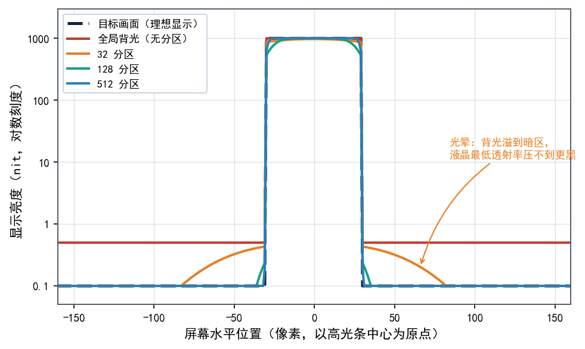
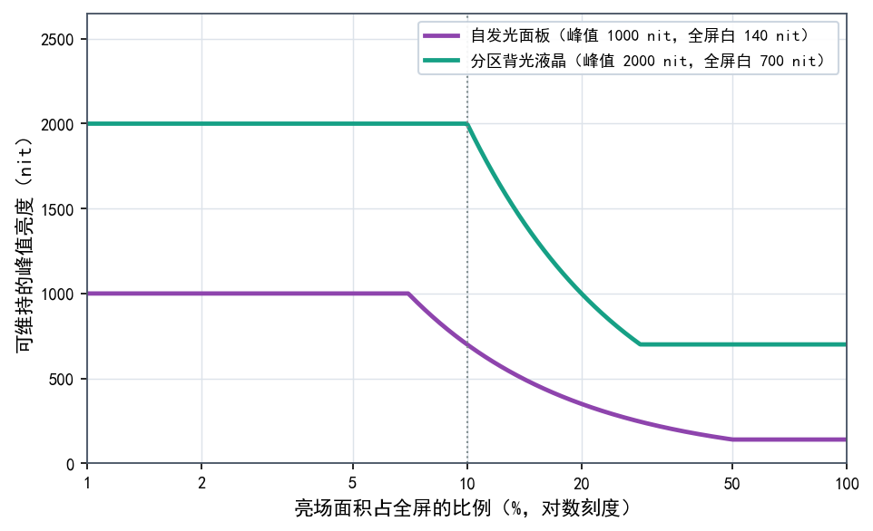
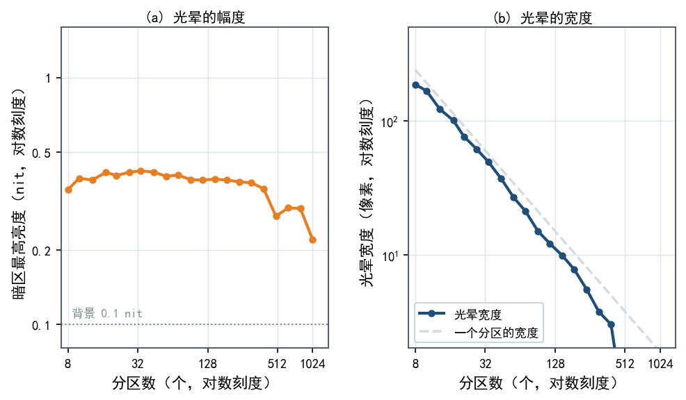
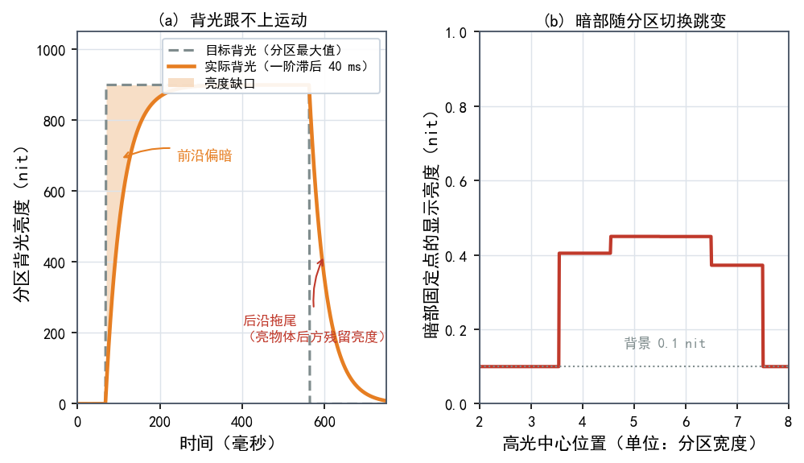
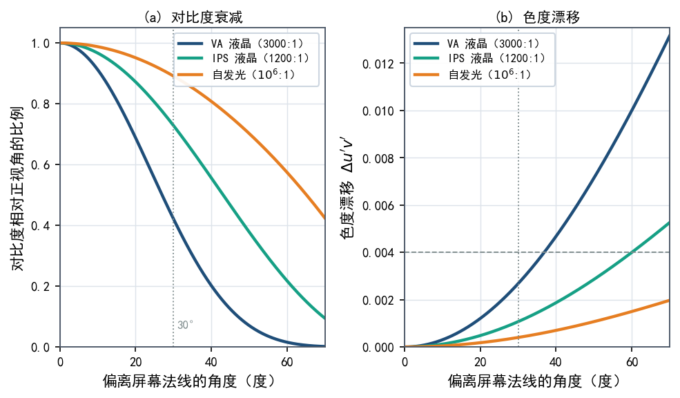
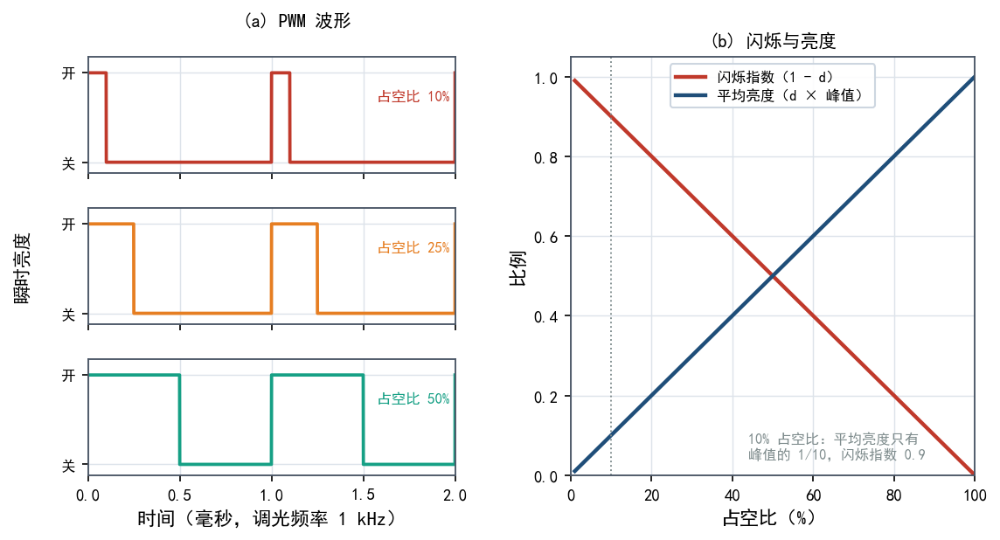

# 第 5 章 显示硬件与 HDR 性能

HDR 的最终效果由显示器决定。同一段 4000 nit 的母版，在分区背光液晶上会出现光晕，在自发光面板上会被自动限亮，在校准不良的屏幕上灰阶会塌陷。这一章把"峰值亮度""黑位""对比度"这些指标拆开，看它们各自受什么物理机制限制，以及这些限制如何在画面上留下痕迹。

## 一、三个数字与它们的前提

讨论显示能力，绕不开三个数：峰值亮度、黑位亮度、对比度。前两个是绝对量，单位 nit；后者是比值。

$$ CR = \frac{L_{peak}}{L_{black}} $$

这个式子看起来简单，测量条件却决定了它的含义。

**原生对比度**在暗室里测单点，峰值取屏幕中心的全白场，黑位取同一位置的全黑场，测出来的是面板本身的能力。**ANSI 对比度**用 4×4 的棋盘格图案，测 8 个白块和 8 个黑块的平均亮度再取比值，反映的是"同一画面里同时存在亮暗"时的能力。两个数字可以差好几倍，因为棋盘格里黑块旁边就是白块，漏光和背光溢出会把黑块抬亮。

对 HDR 来说还有第三个前提：**在什么亮场面积下测峰值**。液晶的背光是全局或分区的，亮场越大，能分给每个像素的功率越少；OLED 是自发光，但总电流和散热同样限制着大面积高亮。所以"1000 nit"这个数字，必须连同"10% 窗口"或"全屏"一起说才有意义。

第四个前提是**持续时间**。冷机状态下测得的峰值往往比热稳定之后高 10% 到 20%，因为面板温度和驱动电流都在变化。厂家标称的峰值通常是冷启动后几秒内的读数，全屏持续亮度（sustained）才是长时间观看的真实水平。评测里常见"峰值 1200 nit，持续 700 nit"这样的组合，两个数字都真实，只是回答的问题不同。

第五个前提是**环境光**。屏幕表面会反射房间里的灯光和窗户，这部分反射光叠加在画面亮度上，黑位被强行抬高。反射亮度可以用一个粗略的式子估算

$$ L_{refl} \approx \frac{E \cdot \rho}{\pi} $$

$E$ 是屏幕上的照度（lux），$\rho$ 是屏幕的漫反射率。一块 $\rho = 2\%$ 的屏幕在 50 lux 的环境里，反射亮度约 0.32 nit。暗室测得 0.005 nit 的面板，到了这样的客厅里实际黑位就是 0.3 nit 量级，对比度从几十万比 1 掉到几千比 1。抗反射镀膜（AR）能压低镜面反射，漫反射处理（AG）把反射光打散、降低局部亮度，两者都不能消除这一项。

三个数字之外还有一个常被忽略的量：**色域体积**。峰值亮度和色域覆盖率都只描述二维或一维的边界，真正决定观感的是"在每一个亮度上能做到多饱和"。同样是 90% DCI-P3 覆盖率，一台在高亮度下饱和度迅速塌陷的显示器，和一个能在 1000 nit 上维持饱和红色的显示器，看到的画面完全不同。

屏幕尺寸也算一个隐形前提。同样的 200 nit，55 英寸在 2 米看和 100 英寸在 4 米看，张角接近，但前者占的视野小，主观亮度低。亮度感知与视野内的高光面积有关，投影在暗室里 100 nit 就觉得够亮，一部分原因就是画面占满了视野、眼睛也已经适应了暗环境。比较两台不同尺寸的设备时只看 nit，结论容易被带偏。

## 二、液晶：光阀与分区背光

液晶本身不发光，它是一个光阀。背光提供亮度，液晶分子控制每个像素透过多少光，两片偏振片把透过率的变化变成灰度。这个结构决定了两件事。

第一，**黑位不为零**。液晶在"全黑"状态下仍然漏光，加上偏振片的交叉泄漏和面板内散射，黑位透过率通常在 1/1000 到 1/5000 之间。VA 面板的静态对比度约 3000 到 6000 比 1，IPS 约 1000 到 1500 比 1。

第二，**峰值由背光决定**。要提高峰值，最直接的办法是把背光调亮，但黑位会跟着一起变亮，对比度不变。想让黑更黑，只能让背光在暗区熄灭，这就是分区背光（local dimming）的动机。

直下式背光把 LED 排成二维阵列，每个 LED 或每组 LED 对应屏幕上的一块矩形区域，称为一个分区。侧入式背光只有边缘的灯条，靠导光板把光铺开，分区通常只能做成若干条横带，条带数量在十几到几十之间。Mini-LED 把 LED 尺寸缩到 0.2 mm 以下，同一块背板上能放下成百上千个分区，分区尺寸从几厘米缩到几毫米。

四种背光结构的差别可以用一张表概括。

| 结构 | 分区形态 | 典型分区数 | 峰值能力 | 光晕形态 |
|---|---|---|---|---|
| 侧入式 | 横条或竖条 | 8 到 32 | 中 | 条带，边界长 |
| 直下式 | 二维矩形 | 32 到 500 | 高 | 块状，边界随分区 |
| Mini-LED | 二维小矩形 | 500 到 5000 | 很高 | 窄边，幅度不变 |
| 双层面板 | 第二层液晶遮光 | 与像素同尺度 | 低 | 只压漏光，不压溢出 |

分区背光的工作方式是两级调制。背光按分区给出一个亮度 $B(x)$，液晶给出一个透过率 $T(x)$，屏幕亮度是两者相乘

$$ L_{disp}(x) = B(x) \cdot T(x), \qquad T_{min} \le T(x) \le 1 $$

$T_{min} = 1/CR$ 是液晶能压到的最低透过率。这个限制是光晕的根源：某个分区里有高光，背光必须开到足够亮才能让高光达到目标值；分区内其他位置的液晶即使压到 $T_{min}$，屏幕亮度仍然是 $B \cdot T_{min}$，压不回真正的黑。

图 5-1 用一个一维模型把这件事画出来。目标画面是 0.1 nit 的暗背景，中央有一条 60 像素宽、1000 nit 的高光。模型假设背光取分区内最大值、经扩散片高斯平滑，液晶黑位透过率为 1/2000。

无分区的曲线（红）把整屏背光开到 1000 nit，黑位被抬到 0.5 nit，全画面发灰。32 分区（橙）时，只有高光所在的分区被点亮，暗部恢复到 0.1 nit，但高光分区与相邻分区之间出现两段斜坡，这就是光晕，宽度约等于一个分区。128 分区和 512 分区把斜坡压窄，代价是光晕的边界更陡、更容易被眼睛抓住。

这也解释了为什么高分区数的显示器在星空、字幕、烛光这类"小亮物体 + 大暗背景"的画面上反而更容易被看出问题。柔和的光晕融在背景里，锐利的光晕边界却像一条轮廓线，视觉系统对边缘的敏感度远高于对缓变的敏感度。第五节会把光晕的幅度和宽度分开量化，那里会看到一个反直觉的结论：分区数几乎不影响光晕的幅度。

### 三种液晶取向

同样的背光与调光，液晶分子的排列方式不同，结果差得很远。TN 的分子拧转 90 度，工艺最成熟、响应最快，但视角最差，斜看时灰阶会反转，严肃的 HDR 监看基本不用。VA 的分子垂直排列，黑态时分子不倒，漏光少，原生对比度能到 3000 到 6000 比 1，代价是低灰阶响应慢，暗部切换容易拖尾。IPS 的分子在水平面内旋转，视角最平、色度最稳，但黑态完全靠偏振片硬挡，漏光多，对比度只有 1000 到 1500 比 1。

| 取向 | 原生对比度 | 灰阶响应 | 视角 | HDR 上的短板 |
|---|---|---|---|---|
| TN | 700 到 1000 比 1 | 最快，1 到 5 ms | 差，大角度灰阶反转 | 视角与色偏 |
| VA | 3000 到 6000 比 1 | 低灰阶慢，10 到 20 ms | 中等 | 暗部拖尾，黑场随视角泛白 |
| IPS | 1000 到 1500 比 1 | 较均匀，5 到 10 ms | 好 | 黑位高，光晕幅度压不下来 |

对比度和响应是一对矛盾。VA 的黑好，但液晶分子从垂直倒向水平的过程在低灰阶特别慢，因为驱动电压刚过阈值，转矩小。IPS 的分子一直在水平面内转，高低灰阶的响应差别小，但黑态漏光没法消除。HDR 把这个矛盾放大了，暗场戏里的微弱高光正好落在 VA 最慢、IPS 漏光最多的区间，两种面板在星空、夜景这类画面上都容易露怯，只是露的方式不同。

分区背光在 VA 上的收益最大。光晕幅度与液晶对比度成反比，同样的背光溢出，VA 能压到 IPS 的一半以下，所以高分区数的消费级电视绝大多数用 VA。IPS 的强项在视角和色度，会议室、多人观看、需要精确色度的监看更看重这一点，黑场则靠双层面板或者接受一定的泛白来补。Mini-LED 把这两条路线都往前推了一步，分区数上去了，光晕变窄，但幅度仍由液晶对比度决定，IPS 配 Mini-LED 的产品在暗场上依然不如 VA 配少量分区的产品。

## 三、自发光与 ABL

OLED 的每个像素自己发光，黑位可以做到 0.001 nit 以下，静态对比度在指标上接近无穷。它的限制换了一个位置：**总功率与散热**。

有机发光材料的效率随电流密度下降，高亮度下发热明显，长期高温会加速材料老化。厂商因此在固件里设置了一条保护曲线，当画面整体偏亮时自动降低峰值。这个机制叫自动亮度限制（Automatic Brightness Limiter，ABL），触发条件是画面的平均图像电平（Average Picture Level，APL），也就是全屏平均亮度。

图 5-2 给出这条曲线的形状。模型假设面板可分配的总光通量是一个常数，峰值随亮场面积按反比下降，并受全屏白亮度托底。自发光面板（紫）在 7% 面积以下维持 1000 nit，之后一路下滑到全屏 140 nit；分区背光液晶（绿）的小面积峰值更高，但同样在亮场变大后落到 700 nit。

曲线的转折点由两个因素决定。一是功率预算，总功率除以亮场面积得到可维持的亮度，面积越大数值越低；二是散热，热量在面板内积累的速度与面积成正比，温度到限之后固件进一步降额。后者有时间维度，所以同一块面板在播放全白画面 1 秒后和 30 秒后的读数可能不同，测量时要注明取样时刻。

真实曲线的形状取决于厂家的功率预算和散热设计，量级可以参考：量产 OLED 电视在 2% 到 10% 窗口下能到 700 到 1000 nit，全屏白通常只有 150 nit 上下。手机 OLED 的峰值更高（部分型号标称 1500 nit 以上），因为屏幕面积小、散热路径短。

ABL 造成的可见问题是**亮度跳变**。画面从暗场景切到全白（片尾字幕、雪景、爆炸），峰值突然掉到原来的几分之一，观众能明显感到"整块屏幕暗了一下"。它还会造成**色彩体积收缩**，高亮度下红绿蓝三色的可实现饱和度下降，鲜艳的高光会变白。

### 这条曲线怎么读

APL 是画面所有像素亮度的平均值，全黑为 0，全白为 100，一部典型电影的多数镜头只有 5 到 15。厂家给的 ABL 曲线横轴是 APL 或者亮场面积，纵轴是能达到的峰值亮度，读的时候看三个地方。

第一是**拐点位置**。拐点之前的平段是面板真正的峰值，拐点之后按面积的反比下降。两台都标 1000 nit 的机器，一台到 10% 面积才降，另一台 5% 就降，播同一个高光场景的结果差一倍。

第二是**下降的陡度**。陡降的曲线在画面亮度缓慢变化时会出现可见的台阶，缓降的曲线更平滑但整体更暗。有些固件在拐点附近加了滞回，避免亮度来回抖动，代价是同一画面在变亮和变暗时读数不同，测的时候要两个方向都走一遍。

第三是**曲线的终点**。全屏白亮度既是散热能力的直接体现，也是长时间观看的真实上限。自发光面板的终点通常只有小窗口峰值的 10% 到 20%，分区背光液晶能到 50% 以上，因为后者的背光可以整体降电流，热量摊在整块背板上，不像 OLED 那样集中在发光层。

一个具体的算例能说明标称值为什么差这么远。某台标称 1500 nit 的机器，10% 窗口维持 1500 nit，折算成总光通量是 150 个单位。如果功率严格守恒，全屏白只能到 150 nit。实际产品全屏白大约 300 nit，多出来的部分有两个来源，一是大面积时散热片和机壳参与导热，允许更高的总功率；二是全屏白时白点通常被压向暖侧，三色比例变了，发光效率也跟着变。从 1500 掉到 300 不是简单的五分之一，而是功率预算、散热与白点三者共同作用的结果。

所以对比两台机器的 ABL，必须在同一 APL 下比，并且注明取样时刻。常规做法是让画面停留 30 秒读稳定值，再记录第 1 秒的瞬时值，两组数放在一起，才能看出开机时多亮、看久了还剩多少。

自发光面板的内部结构也影响这些表现。WOLED 用白光 OLED 加彩色滤光片，白光由蓝、黄两个发光层叠加而成，蓝光材料的寿命最短，厂家会限制蓝像素的驱动电流，因此蓝色大面积高亮的衰减比红绿更早。QD-OLED 用蓝光 OLED 激发量子点色转换层，色纯度更好，窄带发射让红绿的原色更接近 Rec.2020 的边界，但蓝色通道同样由同一种发光材料承担。两种结构都意味着"峰值亮度"在不同色温、不同颜色组合下不是同一个数。

MicroLED 走的是另一条路。它用无机 LED 做子像素，没有有机材料的老化问题，单像素亮度可以做到很高，ABL 的介入更晚。真正的限制变成了驱动电路的电流输出能力和巨量转移的良率。目前商用产品的像素密度还上不去，主要出现在超大尺寸和商用显示上。

把几条路线放在一张表里，各自的瓶颈就清楚了。

| 路线 | 黑位量级 | 峰值与全屏白之比 | 光晕 | 主要短板 |
|---|---|---|---|---|
| FALD 液晶（VA） | 0.02 到 0.1 nit | 2 到 3 倍 | 有，幅度由对比度定 | 分区算法与时序配合 |
| Mini-LED | 同上，略低 | 2 到 4 倍 | 窄而可见 | 分区驱动数量与成本，功耗 |
| 双层面板 | 0.005 nit 量级 | 低，透过率损失大 | 幅度压得最低 | 峰值上不去，机身厚 |
| WOLED | 0.001 nit 以下 | 5 到 10 倍 | 无 | ABL 限制峰值，蓝色寿命，烧屏 |
| QD-OLED | 同上 | 5 到 10 倍 | 无 | 同上，亮室下环境光激发量子点会抬黑位 |
| MicroLED | 近零 | 高 | 无 | 像素密度与成本，巨量转移良率 |

表里的峰值与全屏白之比很能说明问题。它等于 ABL 曲线的首尾之比，比值越大，小高光越亮、大面积越暗，画面切换时的亮度跳变也越明显。液晶的这个比值小，因为背光是全局或者分区的，大面积高亮时只是把电流均匀降下来，峰值本来也没有多高。自发光面板的比值大，小窗口能把驱动推到极限，全屏就只能靠总功率匀着用。

烧屏（burn-in）是自发光面板特有的老化问题。长时间显示同一块高亮静止内容（台标、比分条、游戏 UI），对应像素的发光材料老化更快，之后播放其他内容时那块区域会显出暗影。补偿机制有三层。第一层是像素偏移（pixel shift），整幅画面每隔一段时间平移几个像素；第二层是亮度补偿，统计每个像素的累计发光量，用驱动电流反向补偿；第三层是全屏刷新，定期把整屏亮度均匀抬一下，把老化差异抹平。这些机制都在后台运行，用户看到的是"偶尔屏幕闪一下"，那通常就是补偿在刷新。

对内容制作来说，这意味着**调色监视器和家用电视不是一回事**。在 4000 nit 参考监视器上看着刚好的高光，到 ABL 介入的电视上会被压掉一大截，高光层次全丢。所以 HDR 母版通常把常用亮度控制在显示能力的中段，只有少量像素冲到峰值。图卡白定在 203 nit 这个约定，一半是感知上的理由，一半就是给 ABL 留出余量。

## 四、EOTF 校准

显示器收到的信号是码值，屏幕上发出的是亮度，两者之间的对应关系就是 EOTF。HDR 的目标曲线由 SMPTE ST 2084（PQ）定义，SDR 的目标曲线由 BT.1886 定义（Gamma 2.4 附近）。校准要做的，是让实测的码值—亮度关系尽量贴住目标曲线。

校准流程一般分三步。先测**黑位与峰值**，确定显示器的实际上下界；再测**灰阶跟踪**，用 0 到 100% 的阶梯信号逐级测亮度与色度；最后生成 1D LUT 修正灰阶、3D LUT 修正色域与色度偏差，写入显示器或视频通路。

最容易出问题的地方是"用错曲线"。把 PQ 信号按 Gamma 2.2 解码，暗部会被抬得极高，中间调塌陷。图 5-3 把这种偏差量化为 ΔE_ITP。

BT.2124 定义的 ΔE_ITP 是 HDR 专用的色差度量，系数 720 使得 1 个 ΔE_ITP 大致对应"刚好可察觉"。换成 10 位码值，1 个 ΔE_ITP 约等于 1.4 个码值，这个换算关系在评估灰阶平滑度时很好用。

图 5-3 里的红线是按 Gamma 2.2 解码的结果，码值 100 处误差已达 100 个 ΔE_ITP，200 附近冲到 114，相当于上百个码值的偏差，画面暗部整体发灰。橙线换成 Gamma 2.4，误差略小但形态相同。青线是经过 3D LUT 校正后的残差，控制在 ±3% 以内，误差落在 1 个 ΔE_ITP 附近，属于可接受范围。

校准里几个容易做错的地方值得单独说。

**黑位与峰值要分开测，也要一起对。** 很多校准流程先测全白峰值，再测全黑，然后把两点连成一条曲线。HDR 的 PQ 曲线不是直线，两点之间必须逐级采样。0 到 10% 这一段尤其重要，PQ 在这里的斜率极大，码值差 1 就可能对应几倍的亮度差。

**面板的固有 gamma 会干扰低灰阶。** 液晶在低灰阶的实际透过率与驱动电压不成线性，面板厂家通常内置一条"面板 gamma"，把输入码值先做一次非线性变换再驱动。校准时如果不知道这条曲线的存在，会在低灰阶反复过冲，最后把 LUT 做成一条锯齿。

**3D LUT 的网格密度要匹配色域的跨度。** 17×17×17 的网格对 Rec.709 够用，对 Rec.2020 这种跨度大的色域就偏稀，插值误差会在饱和色边缘显现为色带。33×33×33 更稳妥，代价是显存与查找开销。

**位深与输入格式。** 10 位输入是 HDR 的底线，12 位能进一步压低近黑的台阶。但位深只有在整条链路都保住时才有意义，播放器输出 8 位、线材带宽不足、显示器内部按 8 位处理，任何一环掉下来，12 位源也救不回色带。校准报告里要写清每一环的位深。

**校准的可重复性。** 同一台显示器在同一天内重复校准两次，结果不应差太多。若两次差异超过 1 个 ΔE_ITP，说明测量本身不稳定，可能的原因包括屏幕预热不足（液晶的透过率随温度变化）、探头未贴紧、环境光变化。工程上的做法是每次校准前让屏幕点亮 30 分钟，并记录环境照度。

### 3D LUT 放在链路的哪一环

LUT 可以放在三个位置，效果和适用范围不一样。

显示器内部 LUT 最省事，信号进来先查表再驱动面板，接在显示器上的所有设备都受益。缺点是格子通常只有 17 立方，厂家不一定开放写入，内部处理往往还是 8 位精度。

视频通路 LUT 放在播放器、显卡或者外接处理器上，格子能到 33 立方甚至更大，精度最高。缺点是只对经过这条通路的信号生效，显示器自带的流媒体应用、游戏机直连都绕不过去。

校准软件生成的 LUT 还要看作用域。1D LUT 三个通道各一条，只改灰阶与白点，能把 gamma 和白点拉回目标，改不了饱和度与色相。3D LUT 能同时处理色度，代价是所有颜色被一起搬动，如果面板的色域比目标小，LUT 只能压缩，压过头就在饱和色上出现断层，红色渐变更容易先崩。

工程上常见的组合是显示器内部做 1D 白点与灰阶修正，外部通路做 3D 色域映射。两层都要校，顺序是先内部后外部，否则外部的测量结果会把内部的误差一起算进去，最后两边都过校。

### 12 位进来，10 位出去

HDR 母版常是 12 位，链路末端的面板多数是 10 位，8 位加 FRC 抖动也算 10 位。中间的落差靠抖动补。抖动的做法是在时间或者空间上加小幅扰动，让相邻像素或相邻帧在两个字码之间交替，人眼积分之后看到中间值。10 位面板用 2 位抖动可以模拟 12 位的灰阶，代价是画面多一层很细的颗粒，纯色大面积上能看出来，近黑场尤其明显。

带宽是另一道坎。4K 60 Hz、4:4:4、12 位，每像素 36 位，总速率约 17.9 Gbit/s，已经贴着 HDMI 2.0 的 18 Gbit/s 上限，实际产品只能用 10 位或者降到 4:2:2 采样。要到 4K 120 Hz 12 位，需要 HDMI 2.1 的 48 Gbit/s。链路上任何一段带宽不够，播放器会静默降位，校准报告里写的 12 位和真正到达面板的位数可能不是一回事，这一点在验收时要单独确认。

校准之外还有两个常被忽略的因素。**面板均匀性**，同一块屏幕上不同位置的亮度可能相差 5% 到 10%，四角偏暗、边缘偏色很常见，只有分区测量才能发现，高端型号用多区补偿把它压到 2% 以内。**视角特性**，液晶的对比度和色度随视角变化明显，正对着测得的 4000 比 1，偏 30 度可能只剩 800 比 1，多人观看时的实际观感与中心测量值差距很大，这一点第八节会单独讲。

## 五、光晕：幅度与宽度是两件事

图 5-1 给出的印象是"分区越多越好"，但把光晕拆成幅度和宽度两个量之后，结论要改一半。

图 5-4 用的是同一个一维模型，把高光条在一个分区宽度内平移八个相位取平均，消除"高光正好压在分区中心或边界"带来的偶然性。

左图是幅度。从 8 分区到 512 分区，暗区紧邻高光一侧的最高亮度始终在 0.35 到 0.42 nit 之间，几乎没有变化，直到分区尺寸小于高光本身（约 1024 分区）才开始下降。右图是宽度，光晕宽度从 8 分区时的 187 像素一路降到 500 分区时的 4 像素，与分区宽度基本成正比，斜率略小于 1。

幅度不变的原因可以写成一句话

$$ L_{halo} \approx \frac{B_{adj}}{CR} \approx \frac{\alpha \, L_{peak}}{CR} $$

$B_{adj}$ 是相邻分区被扩散片照亮的背光亮度，$\alpha$ 是泄漏比例，大约 0.7 到 0.9。这个式子里没有分区数。分区变小，背光的绝对亮度不变，泄漏比例也不变（因为扩散片的模糊半径是按分区尺寸缩放的），所以幅度不变。

| 量 | 与分区数的关系 | 与液晶对比度的关系 |
|---|---|---|
| 光晕幅度 | 近似无关 | 与 $CR$ 成反比 |
| 光晕宽度 | 与分区宽度成正比 | 无关 |

由此得到两条实用的结论。想降低光晕的**幅度**，只能提高液晶的黑位对比度（VA 优于 IPS，双层面板再上一层），或者降低高光的局部峰值。想降低光晕的**宽度**，才需要增加分区数。

这也解释了为什么 Mini-LED 电视在宣传里强调分区数，而画质评测里更看重"黑场是否干净"。分区数解决的是"光晕看起来像一圈软晕还是一道硬边"，不解决"黑能不能黑下去"。一块 1000 分区的 IPS 面板，暗部仍然被抬到 0.5 nit 量级，只是这个 0.5 nit 集中在一圈很窄的边缘上。

宽度的感受还跟观看距离有关。人眼的角分辨率约 1 角分，在 3 倍屏高的距离上，一个分区如果没有超过 0.2 度视角，它的宽度就很难被单独辨别出来。65 英寸屏、3 米距离，0.2 度对应约 1 厘米，需要一万分区量级的面板才能把光晕压到"看不见宽度、只剩一点泛光"的程度。这是分区数继续往上走的实际意义。

把这个估算写成式子更清楚。设屏幕宽 $W$、观看距离 $D$、分区数 $N$，按 16:9 排布，每个分区的水平尺寸约为 $W/\sqrt{16N/9}$，对应张角

$$ \theta_z \approx \frac{W}{D}\cdot\frac{1}{\sqrt{16N/9}}\cdot\frac{180}{\pi} $$

代入 65 英寸（宽 1.44 米）、3 米、1000 分区，分区宽约 3.4 厘米，张角 0.65 度；4000 分区降到 0.33 度；要到 0.2 度需要一万分区上下。换成 2 米看 55 英寸（宽 1.22 米），1000 分区的张角变成 0.83 度，比 3 米看 65 英寸更容易看出边界，距离缩短的效应压过了尺寸缩小。

同一台电视在客厅和卧室的表现因此不同。观看距离减半，光晕的张角翻倍，原本融进背景的软晕会变成一道可见的边。评测里说光晕明显或者不明显，不写尺寸和距离，结论就没法比较。

局部调光算法是另一条影响链。最简单的做法是取分区内最大值，保证高光不被削顶，但暗区被过度点亮。取平均值会削掉高光细节。工程上常用带补偿的方案：先按最大值或加权最大值定背光，再用液晶的透过率去补，同时对背光图做空间低通，让相邻分区的亮度过渡平滑。低通越强，光晕越软但越宽；越弱，光晕越窄但边界越硬。

三种取值方式的取舍可以算出来。设分区内一块 10% 面积的高光目标 1000 nit，其余目标 0.1 nit，液晶对比度 2000 比 1。取最大值时背光 1000 nit，高光达标，暗部漏到 0.5 nit。取平均值时背光约 100 nit，暗部漏光降到 0.05 nit，但高光的液晶透过率需要 10，物理上做不到，只能削到 100 nit 附近，高光层次全丢。混合方案按最大值 0.6、均值 0.4 加权得到 640 nit 背光，高光仍差一截，暗部漏光 0.32 nit，处在两者之间。

实际算法还会加空间低通和时域平滑，前者把相邻分区的背光图抹平，后者限制背光的变化速率。两个滤波器都在牺牲锐度换稳定，参数调得越保守，光晕越软、拖影越少，但小高光的亮度也压得越低。这就是为什么同一块面板在不同固件版本下暗场表现会有明显差别，硬件没变，算法变了。

还有一层是功耗。背光总功率与所有分区的亮度之和成正比，算法在"保高光"和"省电"之间取舍。某些机型会在平均亮度高的画面上整体压低背光，这就是"看电影时突然暗一下"的另一个来源，与 ABL 同类，只是发生在液晶上。

不靠分区的路线是用第二层液晶做全局遮光，业内叫双层面板（dual cell）。两层液晶串联，第一层做像素灰度，第二层按区域遮光，等效对比度能抬到十万比一量级。它压的是 $T_{min}$，正好对应上面那个式子里的 $CR$，所以对光晕幅度有效，对宽度无效。代价是透过率下降、峰值变低、机身变厚，而且第二层液晶的分辨率通常很低，只能做粗略的分区遮光。

## 六、驱动、延迟与伪影

背光不是瞬时响应的。LED 的驱动电路有上升与下降时间，分区控制信号要经过帧缓冲和算法处理，液晶本身的取向也需要几毫秒。这些延迟叠加起来，形成一个"背光跟不上画面"的问题。

延迟可以按环节拆开算。信号进入显示器后要经过缩放、色调映射、局部调光分析，这几步通常吃掉半帧到一帧；面板扫描与液晶响应再加几毫秒；如果开了插帧或者降噪，可能又多出一到两帧。60 Hz 下一帧是 16.7 ms，四帧就是 67 ms，已经能被感知为音画不同步。游戏模式的做法是关掉除缩放之外的处理，代价是局部调光的分析被简化，光晕控制变差。延迟与画质在固件里往往是一起调的，两件事很难同时做到最好。

图 5-5 的左半边是一个分区的时间响应。高光以 160 像素每秒横移穿过这个分区，目标背光是一段 500 毫秒的方波。驱动器用一阶滞后跟随，时间常数 40 毫秒，结果是上升沿要 100 毫秒左右才追上目标值，下降沿又拖出 150 毫秒的尾巴。填充区就是"亮度缺口"，在画面上表现为亮物体前沿偏暗、后沿偏亮。物体移动越快，缺口越大，这就是运动高光拖影的来源。

右半边是另一个问题。背景上固定一点，让高光从左向右移过，该点的显示亮度并不是平滑变化，而是分成几个台阶：0.1 nit（背景）、0.41 nit、0.45 nit、0.38 nit，最后回到 0.1 nit。台阶的边界正好在高光跨越分区边界的位置。原因是那个点落到的分区，其背光亮度随分区取值跳变，而液晶已经压到最低透过率，没法再补偿。观众看到的现象是"缓慢移动的高光旁边，黑底在一档一档地闪"。

### 背光与液晶怎么对齐

背光的切换时刻要跟液晶的扫描对上。液晶逐行写入，一帧从上到下扫完要几毫秒，背光如果整帧常亮，液晶还没转到位的那部分像素已经在发光，画面上会出现上一帧的残影压在新帧上。工程上的做法是把背光脉冲放在液晶基本转完之后，代价是有效发光时间变短、亮度下降。

另一种做法是扫描背光，把背光分成与扫描同步的若干条，逐条点亮，模拟 CRT 的余晖。它能改善运动清晰度，但条带之间的相位差如果和调光频率对不上，画面上会留下横向滚动的条纹。运动清晰度与条纹风险经常绑在一起出现，原因就在这里。

过冲驱动（overdrive）是配合液晶响应的另一项技术。给液晶一个比目标更高的电压让它更快到位，再回落到目标值。过冲量调大了，亮暗交界处出现白边或者黑边，叫过冲镶边；调小了响应不够，运动物体拖尾。分区背光的高对比场景把这个问题放大，背光一亮一暗，液晶的过冲在暗背景上格外显眼。

把上面几种机制放在一起，可以得到一份实用的伪影清单。调试和验收时按这份清单逐项检查，比笼统地说"画质不好"有效率。

| 伪影 | 成因 | 观察方法 |
|---|---|---|
| 光晕 | 背光溢出 + 液晶黑位下限 | 暗背景上的小亮物体，移动时看亮边 |
| 分区闪烁 | 背光随画面快速切换 | 缓慢移动的高光物体，看边缘是否跳动 |
| 暗部剪切 | 背光过暗导致液晶补偿不足 | 近黑阶梯，看 0 到 8 码值是否并成一片 |
| 高光削顶 | 峰值不足或背光取均值 | 窗口图案，看白块内部是否有层次 |
| 亮度跳变 | ABL 触发 | 从暗场切到全白场，看整体亮度是否下坠 |
| 拖影 | 背光响应滞后 | 横向快速移动的亮块，看后方是否拖尾 |
| 色度漂移 | 白光 LED 的色温随电流变化 | 不同亮度的白场，测色度坐标 |
| 边缘漏光 | 侧入式导光板与边框 | 全黑场，看四边是否有光带 |
| 黑色提升 | 分区无法完全熄灭，叠上面板漏光 | 全黑场长曝光，分别测中心与四角 |
| 色带 | 8 位量化，或 LUT 在饱和色上压缩过度 | 大面积平滑渐变，看是否排成台阶 |
| 抖动颗粒 | FRC 或链路抖动留下的时域噪声 | 纯色近黑场，贴近屏幕看有无细噪 |
| 过冲镶边 | overdrive 过量 | 黑白棋盘格快速切换，看交界是否出白边 |

清单里最难量化的是"分区闪烁"。它在静态测试图上完全看不出来，只有画面内容运动时才出现。家用评测里常用的做法是播放缓慢横移的星空或字幕，用摄像机以高帧率记录，再逐帧看背光区域的变化。更严格的做法是把屏幕的一个小区域对准光电二极管，记录它随时间的波形，直接读出跳变的幅度和频率。

黑色提升容易被忽略，因为它不影响对比度测试的读数，只影响黑得干不干净。测试要用全黑场长曝光，分别测中心与四角，四角数值比中心高一倍很常见，侧入式尤其明显。有的机器在检测到全黑场时会整体关背光，读数漂亮，但画面里只要出现一个字幕，背光就回来，黑位立刻升高，这种全黑关灯不算真实的黑场能力。

色带和抖动颗粒来自位深与处理链路，静态图案上最容易复现。做法是用一条从 0 到 10% 的极缓渐变铺满屏幕，正常观片距离看是否出现竖条。抖动颗粒则要在近黑场看，8 位面板加 FRC 的颗粒在 1 到 5 码值区间最明显，距离一米以内能看出来。

色度漂移的测试要跨亮度做。分别测 10、50、100 nit 的白场色度坐标，画在白点图上，三个点应该重合在目标白点附近。液晶的白光 LED 在低电流下色温偏低，OLED 在高亮度下蓝色衰减更快，两种面板的漂移方向往往相反，一个偏黄一个偏品红。漂移量超过 0.004（$\Delta u'v'$）时，人眼在并排比较中就能察觉。

验证顺序也有讲究。先看静态图案确认基础能力（黑位、峰值、灰阶），再看运动画面确认调光算法的响应速度，最后看实际片源确认这些伪影在真实内容里是否被察觉。前两步能定位硬件极限，第三步才决定观感。有些显示器的静态指标很好，运动画面里背光跟不上，光晕在亮物体边缘拖出尾巴，反而比低分区数的产品更难看。

## 七、标称参数的读法

厂商标称的峰值亮度通常附带一组隐含条件。常见的有五条。

**测试窗口小。** 10% 窗口是最常见的标注条件，个别产品用 2% 甚至更小的窗口，因为窗口越小、ABL 越不介入，数字越漂亮。看到"峰值 2000 nit"，第一件事是问窗口多大。

**预设模式特殊。** 峰值往往出现在"鲜艳""动态"模式下，此时色温偏移、对比度增强、局部调光全开，与"电影"模式的观感差别很大。校准后的电影模式峰值通常低一截，有的产品差 30% 以上。

**瞬时与持续。** 有些标称值是冷启动后几秒内的瞬时峰值，持续几分钟后会因温度回落。全屏持续亮度才是长时间观看的真实水平。

**白点与色温。** 峰值常在偏冷的白点下测得，因为提高色温意味着加大蓝光比例，在不少面板上效率更高。按 D65 校准之后，峰值通常要掉 5% 到 15%。厂商标称值很少注明白点，这是一个隐形的宽松条件。

**白窗与单色窗。** 单色窗口的峰值往往低于白窗，红绿蓝三个子像素的效率不同，白窗可以三个一起开，单色只能开一个。如果只写"峰值亮度"而不说图案，多半取的是白窗。

把这几个条件串起来看一个假想的参数行。某机型标"峰值 1500 nit，对比度 1000000:1，95% DCI-P3"。1500 大概对应 10% 白窗、鲜艳模式、冷机、偏冷白点，换到电影模式、D65、热稳定之后，同一台机器可能只剩 1000 nit 上下。1000000:1 是动态对比度，全黑时关背光、全白时开满，两个时刻的读数相除，对同时有亮暗的画面没有意义，可用的原生对比度是 5000 比 1，ANSI 对比度还要更低。95% DCI-P3 是二维覆盖率，高亮度下的饱和度可能只剩七成，色域体积的实际比例要小得多。三个数字都没撒谎，只是各自回答了一个很窄的问题。

| 档位 | 峰值（10% 窗口） | 全屏持续 | 黑位 | 局部调光 |
|---|---|---|---|---|
| DisplayHDR 400 | 400 nit | 不要求 | 不要求 | 不要求 |
| DisplayHDR 500 | 500 nit | 350 nit | 0.1 nit | 要求 |
| DisplayHDR 600 | 600 nit | 350 nit | 0.1 nit | 要求 |
| DisplayHDR 1000 | 1000 nit | 600 nit | 0.05 nit | 要求 |
| DisplayHDR 1400 | 1400 nit | 900 nit | 0.02 nit | 要求 |
| True Black 400 | 400 nit | — | 0.0005 nit | 自发光 |
| True Black 500 | 500 nit | — | 0.0005 nit | 自发光 |

VESA 的 DisplayHDR 认证试图把这些条件标准化，它把峰值、全屏持续亮度、黑位、色域分别列出，并按档位给出下限。上表是各档的核心指标（数值取整），实际规范里还有色域覆盖率与灰阶跟踪的要求，具体以 VESA 公布的版本为准。True Black 系列针对自发光面板，把黑位要求压到 0.0005 nit 量级。看认证标签时，要看清括号里的档位数字对应的是哪一项指标。

对比度是最容易被数字游戏污染的一项。厂商标称的"1000000:1"通常是**动态对比度**，做法是让背光在全黑场时降到最低、全白场时升到最高，把两个不同时刻的读数相除。这个数字对同时存在亮暗的画面毫无意义，真正有用的是原生对比度与 ANSI 对比度，前者反映黑能黑到多深，后者反映同一画面里的实际反差。看到只写"百万比一"而不写测试方法的，可以直接当成营销数字。

色域标称也有类似的问题。厂商标称的"95% DCI-P3"通常是二维色度坐标的覆盖率，不代表每个亮度上都能达到这个饱和度。真正决定观感的是色域体积（color volume），也就是亮度与饱和度共同构成的三维空间里能实现的比例。高亮度下的饱和度衰减在两种面板上都存在，标称覆盖率对此一无所知。

读一组参数的正确顺序是：先看峰值带什么窗口、什么模式、冷机还是热机；再看全屏持续亮度；然后看黑位与原生对比度；最后看色域覆盖率与色域体积。四步下来，一台显示器的真实能力基本就清楚了。剩下的部分要靠实测，尤其是局部调光的表现，那部分参数表上完全看不出来。

## 八、视角、热与闪烁

**视角**决定了多人观看时的公平性。液晶的对比度随视角下降得很快，因为偏振片的交叉泄漏随入射角变化，斜着看时黑态漏光增加。VA 面板的下降最陡，30 度只剩四成，45 度之后黑位明显发灰；IPS 平缓一些；自发光面板几乎没有这个问题，因为它的黑就是像素不发光。

图 5-6 用两个单调模型说明趋势。左图是归一化对比度，按 $\cos^n\theta$ 衰减，$n$ 取 6（VA）、2.2（IPS）、0.8（自发光）。30 度时 VA 只剩 0.42，IPS 剩 0.73，自发光 0.90；60 度时 VA 掉到 0.016，IPS 0.22，自发光 0.57。右图是色度漂移 $\Delta u'v'$，按 $k(1-\cos\theta)$ 增长，30 度时 VA 约 0.0027、IPS 0.0011、自发光 0.0004，60 度时 VA 到 0.010。0.004 这个量级已经能被明显看出，也就是说 VA 面板在接近 40 度时，画面会带上可见的色偏。

这两个模型只刻画趋势和量级，真实数值取决于面板结构、光学膜和补偿算法，不同型号之间可以差一倍。但趋势是稳定的：液晶在大角度观看时，对比度与色度同时劣化，而且劣化方向随视角方位角变化，画面左右两侧的偏色方向往往相反。客厅里坐在沙发边缘的人，看到的就是这种"一边偏冷、一边偏暖"的画面。

**热**是长时间观看的隐形约束。面板温度升高会带来三个后果。LED 的光效下降，同样的驱动电流发出的光变少；液晶的响应变快但对比度略降；OLED 的发光效率下降更明显，固件因此进一步降额。表现出来的是一条"开机 20 分钟内亮度缓慢下降，之后趋于稳定"的曲线，下降幅度在 5% 到 20% 之间。夏天不开空调的房间，这个幅度会更大。

具体量级可以这样估。一台 65 英寸液晶整机功耗 200 W 上下，背光占大头，机壳与背板的自然对流散热能力有限，开机后 20 到 40 分钟达到热平衡，面板温度比环境高 10 到 15 摄氏度。LED 结温每升高 10 度，光效下降几个百分点，液晶的对比度也随温度轻微下滑。落到画面上就是亮度掉一成上下、黑位抬一点、白点往暖侧偏一点。OLED 更敏感，因为发光层就在面板里，热量没有背光板那么大的面积可以摊开，固件在温度传感器读数升高后会主动降额，这也是同一块屏在冬天和夏天峰值不同的原因。

对制作端来说，热的影响意味着**校准要在热稳定之后做**。开机就校，等屏幕热起来，之前设的 LUT 全部偏移。工程上的做法是让屏幕点亮 30 到 60 分钟，再开始测量，并在校准报告里注明预热时间。

**闪烁**来自调光方式。液晶的背光调光有两种，直流调光（DC dimming）改变 LED 电流，亮度连续变化，不产生闪烁；脉宽调制（PWM）让 LED 快速开关，靠占空比控制平均亮度。

图 5-7 的左半边是三种占空比的波形，周期 1 毫秒，对应 1 kHz 的调光频率。10% 占空比时亮的时间只有 0.1 毫秒，峰值不变，平均亮度降到峰值的十分之一。右半边给出两个指标。**闪烁指数**（flicker index）是国际照明委员会体系里的定义，等于一个周期内高出平均值的面积除以总面积，方波时等于 $1-d$；**平均亮度**等于 $d$。两条曲线在 50% 处交叉，可以读出一个直观结论：占空比越低，画面越暗、闪烁成分越强，两者同时恶化。

人眼对闪烁的敏感度取决于频率和调制度。频率低（几赫兹到几十赫兹）时，即使调制度很小也能被察觉；频率升高到 60 赫兹以上，多数人开始感觉不到，但快速眼动或者周边视觉仍然能捕捉到，表现为"看久了眼睛累"。IEEE 1789 给出了按频率限制调制度的建议曲线，思路是频率越高允许的调制度越大，但即使在高频段也建议把调制度压到很低。

实际产品里常见的折中是**混合调光**。高亮度时用 DC 调光，低亮度时切换到 PWM，因为 LED 在极小电流下的色温与效率都不稳定。这样做的结果是"亮度调到 30% 以下才开始闪"，而低亮度正是晚上关灯看片的场景，所以这一类产品在暗环境下的评价往往不好。判断方法很简单，用手机的慢动作摄像对准屏幕，能拍到条纹的就是 PWM，条纹越粗调制度越大。

### 老化与长期漂移

烧屏的严重程度可以用半衰期描述。有机发光材料的亮度随累计发光量单调衰减，蓝色子像素衰减最快，厂家标称的寿命通常是亮度降到初始一半的小时数。正常混合内容下，家用要几千小时才看得出差异，但台标、比分条这种每天固定位置高亮的内容，几百小时就能留下轮廓。亮度越高、面积越集中，老化越快，这条规律对所有自发光面板都成立。

第三节提到的三层补偿能抹平缓慢的差异，但能力有边界。像素偏移和全屏刷新处理的是同一块区域长期过亮的情况，遇到大面积长时间静态内容仍然会留下痕迹。新加的关机刷新会在待机时做一次全屏均匀化，代价是消耗额外寿命，所以固件限制它的频率，一般每累计若干小时才允许执行一次，频繁手动触发反而加速老化。

长期使用后的色偏比亮度衰减更容易被察觉，因为人眼对白点漂移极其敏感。用久了的 OLED 常见偏绿或者偏品，液晶常见偏黄，原因是背光 LED 的光衰速度不一致，蓝光芯片衰减快于荧光粉，白点整体往暖侧走。专业场合的做法是每 1000 到 2000 小时复校一次，把白点拉回目标；家用没有这个条件，只能靠出厂时留出的余量与补偿算法。

## 本章要点

- 峰值、黑位、对比度三个数必须连同测试条件一起说，窗口大小、持续时间、环境光任何一项变了，数字都会变；原生对比度与 ANSI 对比度可以差数倍。
- 液晶的黑位来自漏光，透过率下限约 1/1000 到 1/5000，这是光晕无法根除的物理原因；反射光按 $E\rho/\pi$ 估算，50 lux 的客厅就能把 0.005 nit 的黑位抬到 0.3 nit。
- 分区背光用背光与液晶两级调制，显示亮度等于两者乘积；光晕幅度约等于相邻分区背光除以液晶对比度，与分区数无关，分区数只决定宽度。
- OLED 的黑位接近零，但受总功率与散热限制，峰值随亮场面积下降，全屏白通常只有小窗口峰值的几分之一，ABL 会造成亮度跳变与色彩体积收缩，烧屏靠像素偏移与累计补偿缓解。
- EOTF 校准的核心是黑位、峰值与灰阶跟踪，按 Gamma 解码 PQ 会在暗部造成上百个 ΔE_ITP 的偏差；1 个 ΔE_ITP 约等于 10 位下 1.4 个码值。
- 局部调光的伪影分属三个族类，光晕属于空间，拖影与分区跳跃属于时间，色带与闪烁属于位深和调光，静态测试图只能查出空间那一路。
- 标称峰值通常对应 10% 窗口、特殊预设和冷机瞬时状态，全屏持续亮度才是长期观看的真实水平；动态对比度是不同时刻的读数相除，没有参考价值。
- 视角、温度与调光方式决定了"看久了会不会不舒服"：VA 在 30 度只剩四成对比度，热稳定会让亮度掉 5% 到 20%，PWM 占空比越低闪烁指数越高。
- 液晶三条路线各有短板，VA 黑好但暗部慢，IPS 视角好但黑位高，TN 只剩响应；自发光绕开了漏光，却把限制换成了功率、散热与老化。
- 分区尺寸要换算成张角才有意义，65 英寸 3 米观看时 1000 分区约 0.65 度，一万分区才压到 0.2 度；ABL 曲线要在同一 APL、同一取样时刻下比，标称峰值与全屏白可以差五倍。
