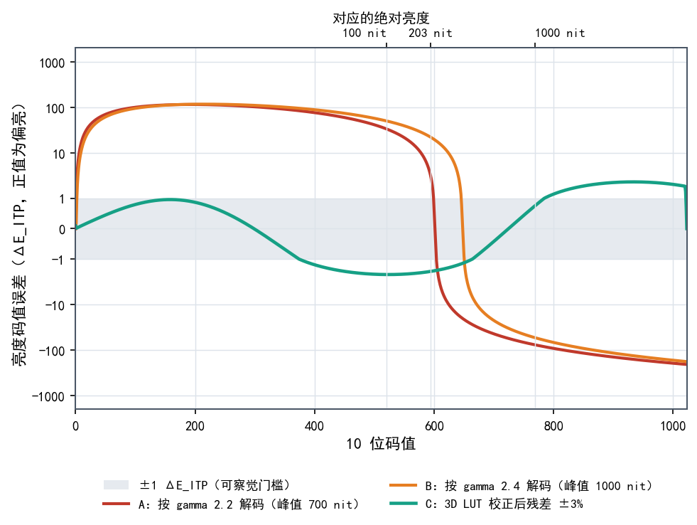

# 第 5 章 显示硬件与 HDR 性能

HDR 的最终效果由显示器决定。同一段 4000 nit 的母版，在分区背光液晶上会出现光晕，在自发光面板上会被自动限亮，在校准不良的屏幕上灰阶会塌陷。这一章把"峰值亮度""黑位""对比度"这些指标拆开，看它们各自受什么物理机制限制，以及这些限制如何在画面上留下痕迹。

## 5.1 三个数字与它们的前提

讨论显示能力，绕不开三个数：峰值亮度、黑位亮度、对比度。前两个是绝对量，单位 nit；后者是比值。

$$ CR = \frac{L_{peak}}{L_{black}} $$

这个式子看起来简单，测量条件却决定了它的含义。**原生对比度**在暗室里测单点，峰值取屏幕中心的全白场，黑位取同一位置的全黑场，测出来的是面板本身的能力。**ANSI 对比度**用 4×4 的棋盘格图案，测 8 个白块和 8 个黑块的平均亮度再取比值，反映的是"同一画面里同时存在亮暗"时的能力。两个数字可以差好几倍，因为棋盘格里黑块旁边就是白块，漏光和背光溢出会把黑块抬亮。

对 HDR 来说还有第三个前提：**在什么亮场面积下测峰值**。液晶的背光是全局或分区的，亮场越大，能分给每个像素的功率越少；OLED 是自发光，但总电流和散热同样限制着大面积高亮。所以"1000 nit"这个数字，必须连同"10% 窗口"或"全屏"一起说才有意义。

还有一层现实因素：**环境光**。屏幕表面会反射房间里的灯光和窗户，这部分反射光叠加在画面亮度上，黑位被强行抬高。暗室测得 0.005 nit 的面板，在有 50 lux 环境光的客厅里，实际黑位可能变成 0.2 nit 以上，对比度从几十万比 1 掉到几千比 1。抗反射镀膜（AR）和漫反射处理（AG）能减轻这个问题，但无法消除，HDR 的暗部效果因此在明亮客厅里总是打折。

## 5.2 液晶与分区背光

液晶本身不发光，它是一个光阀。背光提供亮度，液晶分子控制每个像素透过多少光，两片偏振片把透过率的变化变成灰度。这个结构决定了两件事。

第一，**黑位不为零**。液晶在"全黑"状态下仍然漏光，加上偏振片的交叉泄漏和面板内散射，黑位透过率通常在 1/1000 到 1/5000 之间。VA 面板的静态对比度约 3000 到 6000 比 1，IPS 约 1000 到 1500 比 1。

第二，**峰值由背光决定**。要提高峰值，最直接的办法是把背光调亮，但黑位会跟着一起变亮，对比度不变。想让黑更黑，只能让背光在暗区熄灭，这就是分区背光（local dimming）的动机。

直下式背光把 LED 排成二维阵列，每个 LED 或每组 LED 对应屏幕上的一块矩形区域，称为一个分区。侧入式背光只有边缘的灯条，靠导光板把光铺开，分区通常只能做成若干条横带。Mini-LED 把 LED 尺寸缩到 0.2 mm 以下，同一块背板上能放下成百上千个分区，分区尺寸从几厘米缩到几毫米。

分区背光的工作方式是两级调制。背光按分区给出一个亮度 $B(x)$，液晶给出一个透过率 $T(x)$，屏幕亮度是两者相乘

$$ L_{disp}(x) = B(x) \cdot T(x), \qquad T_{min} \le T(x) \le 1 $$

$T_{min} = 1/CR$ 是液晶能压到的最低透过率。这个限制是光晕的根源：某个分区里有高光，背光必须开到足够亮才能让高光达到目标值；分区内其他位置的液晶即使压到 $T_{min}$，屏幕亮度仍然是 $B \cdot T_{min}$，压不回真正的黑。

图 5-1 用一个一维模型把这件事画出来。目标画面是 0.1 nit 的暗背景，中央有一条 60 像素宽、1000 nit 的高光。模型假设背光取分区内最大值、经扩散片高斯平滑，液晶黑位透过率为 1/2000。

无分区的曲线（红）把整屏背光开到 1000 nit，黑位被抬到 0.5 nit，全画面发灰。32 分区（橙）时，只有高光所在的分区被点亮，暗部恢复到 0.1 nit，但高光分区与相邻分区之间出现两段斜坡，这就是光晕，宽度约等于一个分区。128 分区和 512 分区把斜坡压窄，代价是单个分区的背光更集中，光晕的峰值亮度更高、边缘更锐利。分区数增加并不会让光晕消失，只是把它从"大而软"变成"小而硬"。

这也解释了为什么高分区数的显示器在星空、字幕、烛光这类"小亮物体 + 大暗背景"的画面上反而更容易被看出问题。锐利的光晕边界比弥散的更容易被视觉系统捕捉到。

局部调光算法是另一条影响链。最简单的做法是取分区内最大值，保证高光不被削顶，但暗区被过度点亮。取平均值会削掉高光细节。工程上常用带补偿的方案：先按最大值或加权最大值定背光，再用液晶的透过率去补，同时对背光图做空间低通，让相邻分区的亮度过渡平滑。低通越强，光晕越软但越宽；越弱，光晕越窄但边界越硬。

还有一条不靠分区的路线，用第二层液晶做全局遮光，业内叫双层面板（dual cell）。两层液晶串联，第一层做像素灰度，第二层按区域遮光，等效对比度能抬到十万比一量级，代价是透过率下降、峰值变低、机身变厚。它解决的是大面积的漏光，对局部光晕无效。

## 5.3 自发光与 ABL

OLED 的每个像素自己发光，黑位可以做到 0.001 nit 以下，静态对比度在指标上接近无穷。它的限制换了一个位置：**总功率与散热**。

有机发光材料的效率随电流密度下降，高亮度下发热明显，长期高温会加速材料老化。厂商因此在固件里设置了一条保护曲线，当画面整体偏亮时自动降低峰值。这个机制叫自动亮度限制（Automatic Brightness Limiter，ABL），触发条件是画面的平均图像电平（Average Picture Level，APL），也就是全屏平均亮度。

图 5-2 给出这条曲线的形状。模型假设面板可分配的总光通量是一个常数，峰值随亮场面积按反比下降，并受全屏白亮度托底。自发光面板（紫）在 7% 面积以下维持 1000 nit，之后一路下滑到全屏 140 nit；分区背光液晶（绿）的小面积峰值更高，但同样在亮场变大后落到 700 nit。

真实曲线的形状取决于厂家的功率预算和散热设计，量级可以参考：量产 OLED 电视在 2% 到 10% 窗口下能到 700 到 1000 nit，全屏白通常只有 150 nit 上下。手机 OLED 的峰值更高（部分型号标称 1500 nit 以上），因为屏幕面积小、散热路径短。

ABL 造成的可见问题是**亮度跳变**。画面从暗场景切到全白（片尾字幕、雪景、爆炸），峰值突然掉到原来的几分之一，观众能明显感到"整块屏幕暗了一下"。它还会造成**色彩体积收缩**，高亮度下红绿蓝三色的可实现饱和度下降，鲜艳的高光会变白。

自发光面板的内部结构也影响这些表现。WOLED 用白光 OLED 加彩色滤光片，白光由蓝、黄两个发光层叠加而成，蓝光材料的寿命最短，厂家会限制蓝像素的驱动电流，因此蓝色大面积高亮的衰减比红绿更早。QD-OLED 用蓝光 OLED 激发量子点色转换层，色纯度更好，但蓝色通道同样由同一种发光材料承担。两种结构都意味着"峰值亮度"在不同色温、不同颜色组合下不是同一个数。

对内容制作来说，这意味着**调色监视器和家用电视不是一回事**。在 4000 nit 参考监视器上看着刚好的高光，到 ABL 介入的电视上会被压掉一大截，高光层次全丢。所以 HDR 母版通常把常用亮度控制在显示能力的中段，只有少量像素冲到峰值。

## 5.4 EOTF 校准

显示器收到的信号是码值，屏幕上发出的是亮度，两者之间的对应关系就是 EOTF。HDR 的目标曲线由 SMPTE ST 2084（PQ）定义，SDR 的目标曲线由 BT.1886 定义（Gamma 2.4 附近）。校准要做的，是让实测的码值—亮度关系尽量贴住目标曲线。

校准流程一般分三步。先测**黑位与峰值**，确定显示器的实际上下界；再测**灰阶跟踪**，用 0 到 100% 的阶梯信号逐级测亮度与色度；最后生成 1D LUT 修正灰阶、3D LUT 修正色域与色度偏差，写入显示器或视频通路。

最容易出问题的地方是"用错曲线"。把 PQ 信号按 Gamma 2.2 解码，暗部会被抬得极高，中间调塌陷。图 5-3 把这种偏差量化为 ΔE_ITP。

BT.2124 定义的 ΔE_ITP 是 HDR 专用的色差度量，系数 720 使得 1 个 ΔE_ITP 大致对应"刚好可察觉"。换成 10 位码值，1 个 ΔE_ITP 约等于 1.4 个码值，这个换算关系在评估灰阶平滑度时很好用。

图 5-3 里的红线是按 Gamma 2.2 解码的结果，码值 100 处误差已达 100 个 ΔE_ITP，200 附近冲到 114，相当于上百个码值的偏差，画面暗部整体发灰。橙线换成 Gamma 2.4，误差略小但形态相同。青线是经过 3D LUT 校正后的残差，控制在 ±3% 以内，误差落在 1 个 ΔE_ITP 附近，属于可接受范围。

校准之外还有两个常被忽略的因素。**面板均匀性**，同一块屏幕上不同位置的亮度可能相差 5% 到 10%，四角偏暗、边缘偏色很常见，只有分区测量才能发现。**视角特性**，液晶的对比度和色度随视角变化明显，正对着测得的 4000 比 1，偏 30 度可能只剩 800 比 1，多人观看时的实际观感与中心测量值差距很大。

## 5.5 局部调光伪影清单

把上面几种机制放在一起，可以得到一份实用的伪影清单。调试和验收时按这份清单逐项检查，比笼统地说"画质不好"有效率。

| 伪影 | 成因 | 观察方法 |
|---|---|---|
| 光晕 | 背光溢出 + 液晶黑位下限 | 暗背景上的小亮物体，移动时看亮边 |
| 分区闪烁 | 背光随画面快速切换 | 缓慢移动的高光物体，看边缘是否跳动 |
| 暗部剪切 | 背光过暗导致液晶补偿不足 | 近黑阶梯，看 0 到 8 码值是否并成一片 |
| 高光削顶 | 峰值不足或背光取均值 | 窗口图案，看白块内部是否有层次 |
| 亮度跳变 | ABL 触发 | 从暗场切到全白场，看整体亮度是否下坠 |
| 色度漂移 | 白光 LED 的色温随电流变化 | 不同亮度的白场，测色度坐标 |
| 边缘漏光 | 侧入式导光板与边框 | 全黑场，看四边是否有光带 |

这份清单里最难量化的是"分区闪烁"。它在静态测试图上完全看不出来，只有画面内容运动时才出现。家用评测里常用的做法是播放缓慢横移的星空或字幕，用摄像机以高帧率记录，再逐帧看背光区域的变化。

验证顺序也有讲究。先看静态图案确认基础能力（黑位、峰值、灰阶），再看运动画面确认调光算法的响应速度，最后看实际片源确认这些伪影在真实内容里是否被察觉。前两步能定位硬件极限，第三步才决定观感。有些显示器的静态指标很好，运动画面里背光跟不上，光晕在亮物体边缘拖出尾巴，反而比低分区数的产品更难看。

## 5.6 标称参数的读法

厂商标称的峰值亮度通常附带一组隐含条件。常见的有三条。

**测试窗口小。** 10% 窗口是最常见的标注条件，个别产品用 2% 甚至更小的窗口，因为窗口越小、ABL 越不介入，数字越漂亮。

**预设模式特殊。** 峰值往往出现在"鲜艳""动态"模式下，此时色温偏移、对比度增强、局部调光全开，与"电影"模式的观感差别很大。校准后的电影模式峰值通常低一截。

**瞬时与持续。** 有些标称值是冷启动后几秒内的瞬时峰值，持续几分钟后会因温度回落。全屏持续亮度（sustained）才是长时间观看的真实水平。

VESA 的 DisplayHDR 认证试图把这些条件标准化，它把峰值、全屏持续亮度、黑位、色域分别列出，并按档位给出下限。400 级允许无分区背光，600 级要求局部调光，1000 级要求 10% 窗口峰值 1000 nit、全屏持续 600 nit 左右、黑位 0.05 nit 以下。True Black 系列针对自发光面板，把黑位要求压到 0.0005 nit 量级。看认证标签时，要看清括号里的档位数字对应的是哪一项指标。

色域标称也有类似的问题。厂商标称的"95% DCI-P3"通常是二维色度坐标的覆盖率，不代表每个亮度上都能达到这个饱和度。真正决定观感的是色域体积（color volume），也就是亮度与饱和度共同构成的三维空间里能实现的比例。高亮度下的饱和度衰减在两种面板上都存在，标称覆盖率对此一无所知。

## 本章要点

- 峰值、黑位、对比度三个数必须连同测试条件一起说，原生对比度与 ANSI 对比度可以差数倍，环境光还能再砍掉一大截。
- 液晶的黑位来自漏光，透过率下限约 1/1000 到 1/5000，这是光晕无法根除的物理原因。
- 分区背光用背光与液晶两级调制，显示亮度等于两者乘积；光晕宽度约等于一个分区，分区越小光晕越窄但峰值越亮。
- OLED 的黑位接近零，但受总功率与散热限制，峰值随亮场面积下降，全屏白通常只有小窗口峰值的几分之一，ABL 会造成亮度跳变与色彩体积收缩。
- EOTF 校准的核心是黑位、峰值与灰阶跟踪，按 Gamma 解码 PQ 会在暗部造成上百个 ΔE_ITP 的偏差；1 个 ΔE_ITP 约等于 10 位下 1.4 个码值。
- 局部调光伪影要在运动画面里检查，静态测试图看不出分区闪烁，静态指标好的产品未必耐看。
- 标称峰值通常对应 10% 窗口、特殊预设和瞬时状态，全屏持续亮度才是长期观看的真实水平。
