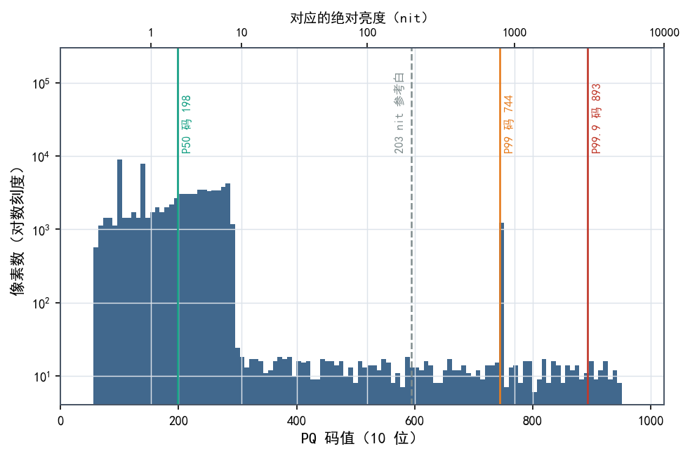

# 第 6 章 HDR 测量、评价与制作

HDR 的"好看"需要被验证。验证靠三样东西：能复现的测试图案、可信的测量设备、以及与人眼感受对得上的客观指标。这一章从测试图案的构造讲起，经过亮度色度测量、波形与矢量分析、感知指标，最后落到 ACES 分级流程和母版交付时的元数据要求。这些内容合起来，构成一条可执行的验收链。

## 6.1 测试图案

HDR 测试图案与 SDR 的最大差别在于**图案本身要定义在 PQ 域**。同样叫"18 级灰阶"，SDR 版本按 Gamma 编码等分码值，HDR 版本要按 PQ 码值等分，两者每一级对应的绝对亮度完全不同。

图 6-1 给出四类最常用的图案。

**灰阶阶梯**用 11 级覆盖 0 到 1023 全码值。它的用途是测灰阶跟踪：每一级的实测亮度与 PQ 目标值比较，得到跟踪误差曲线（第 5 章的图 5-3 就是这种曲线）。阶梯级数不必多，级与级之间的亮度比足够大才能看出偏色，11 级已经能覆盖主要拐点。

**近黑阶梯**取 0 到 64 码值，步进 8。这 9 级对应的绝对亮度都在 0.2 nit 以下，全部挤在 PQ 曲线最陡的一段。它专门用来查黑位裁切：如果显示器的黑位高于某个码值对应的亮度，那么前几级会并成一片，看起来一模一样。判断方法是把屏幕调到最暗环境，让眼睛适应两分钟再看。

**窗口图案**用不同面积的白色方块测峰值。面积取 1%、2%、10%，边长按面积开方；在 16:9 的屏幕上，这三个边长约为屏幕宽度的 7.5%、11%、24%。测的时候要让亮度计的测量光斑完全落在白块内部，光斑一旦压到边界，读数就被黑背景拉低。

**色块**用来查饱和度与色相。标准图案通常在 Rec.2020 色域、PQ 编码下生成 6 个饱和色与 2 个中性色，实测色度坐标与目标值比较。要注意许多显示器在最高亮度下无法维持饱和色的色度，红绿蓝三块在这个条件下会明显偏移。

除了这四类，还有几种专用图案。**PLUGE** 在纯黑上下各放一条略暗和略亮的窄条，用来调亮度与黑位。**棋盘格**（4×4 或 16×16）同时测 ANSI 对比度与 ABL 触发点。**灰阶渐变**（水平方向 0 到 1023 连续过渡）用来看 10 位量化是否产生色带，这是 HDR 显示链路上最常见的问题之一。**运动图案**（横向缓慢移动的小白块）专门用来暴露分区背光的响应延迟。

图案的生成方式也有讲究。中间文件要用 16 位半浮点或 16 位整数的 EXR/TIFF，避免在 8 位阶段就把 PQ 曲线压坏。量化到 10 位时，灰阶阶梯的每一级必须落在同一个码值上，否则测出来的是图案本身的抖动，显示器的误差反而被掩盖。图案还要限定在母版的峰值内，如果图案里出现 10000 nit 的白块，接收端只能靠裁剪处理，测出来的黑位与灰阶都会被连带影响。

## 6.2 亮度与色度测量

测量设备分两类。**分光辐射计**把入射光按波长分散，逐波长测能量，再按 CIE 标准观察者积分出 XYZ。它的绝对精度高，能测任意光谱，缺点是慢、贵、对低亮度信号的信噪比要求高。**色度计**用滤光片加光电二极管模拟三刺激值响应，读数是直接的 XYZ 或 xyY，速度快、便宜，但滤光片模型与 CIE 曲线只是近似。

HDR 把这个近似放大了。色度计的滤光片匹配误差在低亮度和大色域条件下会显著偏离，红原色的色度误差可能达到 0.01 以上。通用做法是先用分光辐射计对色度计做**四点或九点校正**（白、红、绿、蓝），把修正矩阵写进色度计，再拿它去测灰阶。校正点要覆盖实际使用的亮度范围，只在校正 100 nit 白点、然后去测 0.01 nit 的黑位，误差会很大。

测量几何同样影响结果。亮度计的视场角通常是 1° 或 2°，测量距离决定光斑在屏幕上的直径。65 英寸屏宽约 1.44 米，距离 1.5 米时 2° 视场对应的光斑直径约 5 厘米；1% 面积的白块边长约 11 厘米，光斑能完整落入。要测 0.1% 的小窗口（边长约 3.5 厘米），就得换更小的视场或更近的距离，否则光斑压到边界，读数被黑背景拉低。

几个实操要点：

- 黑位测量要在全暗环境，屏幕显示全黑至少 30 秒后读数，避开背光刚切换的过渡态。
- 峰值测量要在图案稳定后读数，ABL 介入的产品需要记录"第几秒的读数"。
- 屏幕表面不能有直射光，测量者穿深色衣服，避免反射进入视场。
- 环境光用照度计记录，同一批数据要在相同环境光下比较。
- 每个测点重复三次取中位数，HDR 显示器的读数抖动比 SDR 大。

## 6.3 直方图、波形与矢量

直方图与波形图回答两个不同的问题。直方图只统计画面里有多少像素落在各个亮度段，波形图还要保留这些像素在画面里的位置。

图 6-2 是一幅合成画面的统计。天空渐变占据了大片中等码值，太阳与窗灯在 740 到 900 码值形成两个尖峰，P50 落在 198 码值（约 2.2 nit），P99 落在 744（约 800 nit）。这类分布能快速判断曝光是否合理：P50 太低说明画面整体欠曝，P99.9 贴着 1023 说明高光已经被削顶。

波形图把画面的空间结构与亮度放在同一张图里。横轴是画面位置，纵轴是亮度，像素密度用亮度表示。传统 SDR 波形用 IRE 刻度，0 到 100 IRE 对应 0 到 700 mV；HDR 波形直接标 PQ 码值或绝对亮度，读数与母版的绝对亮度一一对应。

图 6-3 保留了空间信息，能看出高光在画面的哪个位置。太阳在画面中部形成一条竖直的亮带，左侧的亮窗是一条水平短线，地面的亮度稳定在 1 nit 附近。调色时看波形比看直方图更直接，因为它同时告诉你"多亮"和"在哪"。

矢量示波器只显示色度，横轴 Cb、纵轴 Cr，亮度信息被丢弃。它在 SDR 时代用来检查肤色与饱和度是否越界，刻度按 Rec.709 的色域画。HDR 的色域是 Rec.2020，面积比 709 大得多，同一套刻度不再适用，需要按 2020 的基色重新标定。实际使用中，矢量图更多用来发现"整体偏色"这类粗差，精确的色度评估还是要靠测量设备。

## 6.4 感知指标

客观指标要回答的问题是"人能不能看出来"。HDR 在这方面有几个专用工具。

**ΔE_ITP** 由 BT.2124 定义，在 ICtCp 空间里计算色差

$$ \Delta E_{ITP} = 720\sqrt{(\Delta I)^2 + \tfrac{1}{4}(\Delta C_t)^2 + (\Delta C_p)^2} $$

$I$ 是亮度分量，$C_t$、$C_p$ 是两个色差分量，系数 720 把"刚好可察觉"标定到 1。这个指标的好处是直接工作在 PQ 域，不需要先做色调映射，因此适合评估编码、压缩、显示链路的误差。它的局限是只描述局部色差，不涉及空间掩蔽。

**HDR-VDP-3** 走的是视觉模型路线。它把两张图像（参考与测试）经过光学调制传递、对比敏感度滤波、掩蔽模型，输出每个像素的检测概率图和一个总体 Q 分数。Q 分数越高表示差异越难察觉，工程上常把 Q 高于 75 视为"几乎不可见"。它对压缩伪影、光晕、噪声的预测与主观感受相关性较好，代价是计算量大，参数（观看距离、屏幕亮度、环境光）必须与实际一致，否则结果没有意义。

**PSNR 与 SSIM** 在 HDR 上会失真。两者都假设像素值与人眼感受近似线性，而在 PQ 域里码值与亮度的关系是对数的，同样的码值误差在暗部对应极小的亮度差、在亮部对应很大的亮度差。直接用线性亮度算 PSNR，暗部的误差被严重低估；在 PQ 域算，结果好一些，但仍缺少掩蔽模型。SSIM 的结构项在 HDR 高光区域也会失准，因为高光细节往往被压缩到很小的码值范围内。

**VMAF** 是机器学习指标，训练数据以 SDR 内容为主，直接用于 HDR 时相关性下降。业界的做法是先做色调映射到 SDR 再算，或者在 PQ 域重新训练模型。

不管用哪个指标，主观评价仍是基准。BT.500 规定了主观实验的方法，HDR 需要额外控制三项条件：显示器的实际峰值与黑位、环境光照度、观看距离。同一段素材在 1000 nit 与 4000 nit 监视器上的主观评分可以差一档以上。

实际工作中常用的组合是：编码与压缩阶段看 ΔE_ITP 与 HDR-VDP-3 的检测图，找出误差集中在哪些区域；显示端评估看光晕与 ABL 的主观影响；交付验收用自动脚本加人工看片。三类手段各管一段，指望单一指标盖住全链路，最后总会漏掉一类问题。

## 6.5 ACES 与 HDR 分级

ACES 是目前最完整的场景参考色彩框架。它的核心文件格式是 SMPTE ST 2065-1，色域 AP0，线性编码，用 16 位半浮点存储。AP0 的色域覆盖了所有真实光谱色，代价是数值范围大、精度要求高。

调色台上用的是 ACEScct，AP0 线性只作为管线内部的存储格式。它对数编码把暗部展开，18% 灰落在 0.41 附近，滚轮的手感接近传统的 log 素材。ACEScct 只是显示用的中间编码，回到管线时仍然转回线性 AP0。

从 ACES 到具体显示设备的转换由输出变换完成。RRT 把场景的高动态范围压到显示范围，ODT 再把结果映射到目标色域与亮度。HDR 的输出变换会带上目标峰值参数，同一个 ACES 素材可以生成 1000 nit、4000 nit 或 100 nit 的版本。ACES 2.0 重新设计了这套输出变换，改用基于感知模型的曲线，暗部与高光的过渡比 1.x 更平顺。

HDR 分级的工作方式有两种。一种是在 HDR 监视器上直接做 HDR pass，参考白定在 203 nit，峰值按交付目标设定，暗部靠示波器与肉眼共同判断。另一种是先做 SDR pass，再用 trim pass 工具生成 HDR 版本，Dolby Vision 的工作流属于这一类，trim 元数据记录了每个镜头在 HDR 下的亮度调整量。

分级监视器的选择直接影响判断。参考级 HDR 监视器通常做到 1000 nit 峰值、0.005 nit 黑位、出厂校准到 D65，4000 nit 的型号数量很少、价格高昂。用消费级电视做分级，必须接受 ABL 介入、局部调光伪影、面板均匀性偏差带来的误判，至少要关闭所有图像增强功能并做一次完整校准。

双版本流程还有一个绕不开的问题：以哪一版为准。若以 SDR 为主版本、HDR 用 trim 生成，HDR 版的高光往往靠算法推出来，缺乏真实细节；若以 HDR 为主版本，SDR 版需要在每个镜头上确认高光被压到 100 nit 后依然成立。两种做法都要求调色师同时看两个版本，不能只看一个。

## 6.6 交付与质量控制

HDR 母版的交付涉及容器、编码、元数据三层。

容器层面，院线母版常用 12 位 XYZ 的 DPX 或 16 位半浮点的 EXR，流媒体交付用 IMF。IMF 的 Application 2E 支持 Rec.2020 / PQ 的 HDR 内容，内部用 JPEG 2000 编码，码率与色深按平台规范设定。部分平台接受 ProRes 4444 XQ 作为中间格式。

元数据层面有三组关键信息。**母版显示信息**（SMPTE ST 2086）记录调色时用的显示器的基色、白点、最大与最小亮度，接收端据此判断内容的能力边界。**内容亮度信息**（CTA-861.3 的 MaxCLL 与 MaxFALL）记录整条节目里单像素的最大亮度和帧平均最大亮度，用于让显示器预估 ABL 与功耗。**动态元数据**（SMPTE ST 2094 系列）逐镜头甚至逐帧给出映射曲线，Dolby Vision 用 2094-10，Philips 的方案用 2094-20，三星的 HDR10+ 用 2094-30。

QC 分自动与人工两段。自动检查包括：像素是否超出母版色域、MaxCLL 是否与实际峰值一致、元数据里的峰值是否低于画面实际最大亮度、10 位量化是否产生色带、帧间亮度是否有异常跳变。人工检查在参考监视器上完整看一遍，重点看高光层次、暗部细节、字幕与图卡的亮度是否符合 203 nit 约定。

最常见的交付错误有三类。元数据标错，比如母版实际峰值 4000 nit，MaxCLL 却写成 1000，接收端会按 1000 做映射，高光被压掉一半。参考白错位，把图卡白做成 100 nit 或 400 nit，整片观感偏暗或偏亮。色域标记错误，把 Rec.2020 的内容标成 Rec.709，接收端做错误的色域映射，饱和度整体偏移。这三类错误都不会让画面"坏掉"，只会让它"不太对"，靠肉眼很难发现，只能靠数据核对。

## 本章要点

- HDR 测试图案必须定义在 PQ 域，同样的"18 级灰阶"在 SDR 与 HDR 下对应的绝对亮度完全不同，中间文件应保留 16 位精度。
- 灰阶阶梯测跟踪、近黑阶梯查黑位裁切、窗口图案测峰值与 ABL、色块查饱和度，四类图案各有明确用途。
- 分光辐射计精度高但慢，色度计快但需用分光计做多点校正；测量光斑必须完整落在白块内，黑位要在全暗环境测得。
- 直方图给出亮度分布，波形图保留空间位置，两者结合能快速判断曝光与削顶；矢量示波器的刻度基于 Rec.709，用于 HDR 需按 Rec.2020 重新标定。
- ΔE_ITP 工作在 PQ 域，1 个单位约等于刚好可察觉；HDR-VDP-3 用视觉模型预测检测概率，参数必须与实际观看条件一致。
- PSNR、SSIM、VMAF 都建立在 SDR 假设上，直接用于 HDR 会低估暗部误差、高估高光误差。
- ACES 用 AP0 线性存储、ACEScct 调色，输出变换按目标峰值生成不同版本；ACES 2.0 改用感知模型重新设计了输出变换。
- 交付要同时管住容器、元数据与 QC，MaxCLL、母版显示信息、参考白这三处最容易出错，且只能靠数据核对发现。
