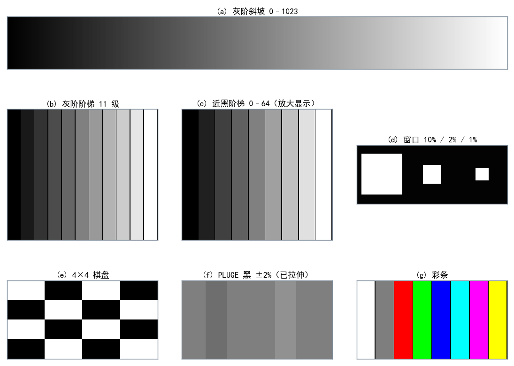
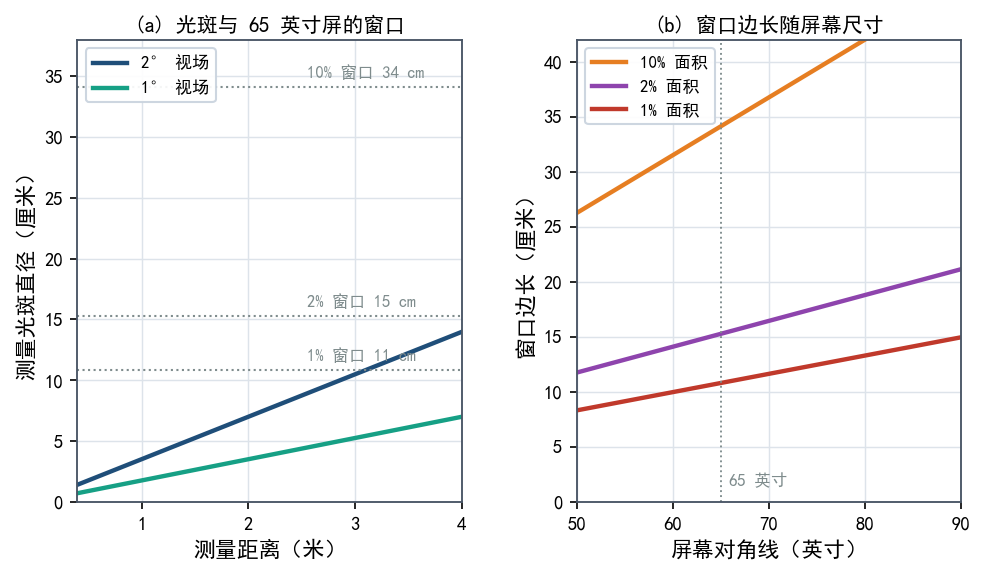
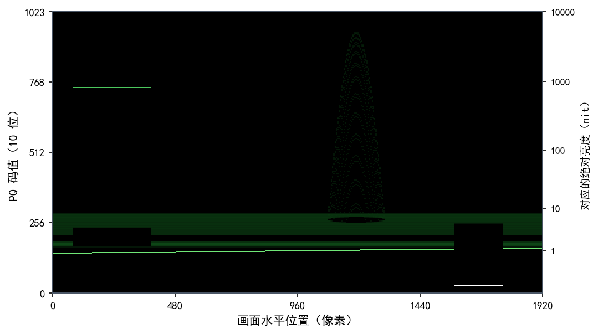
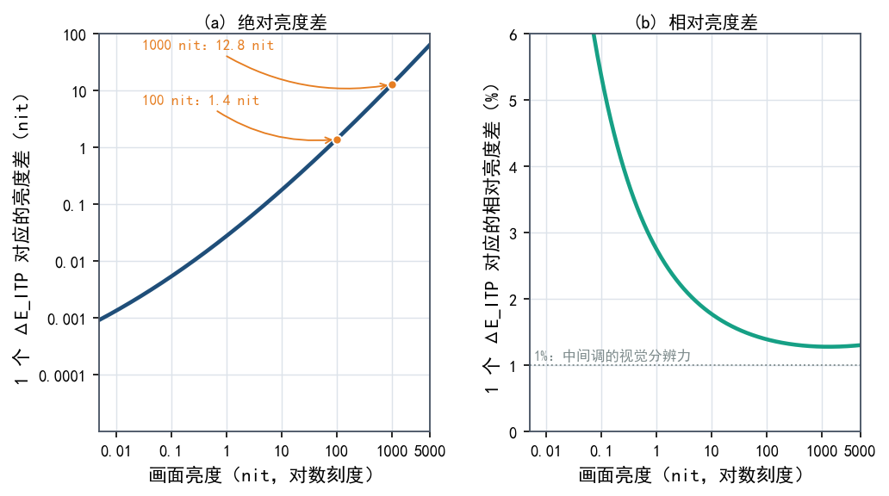
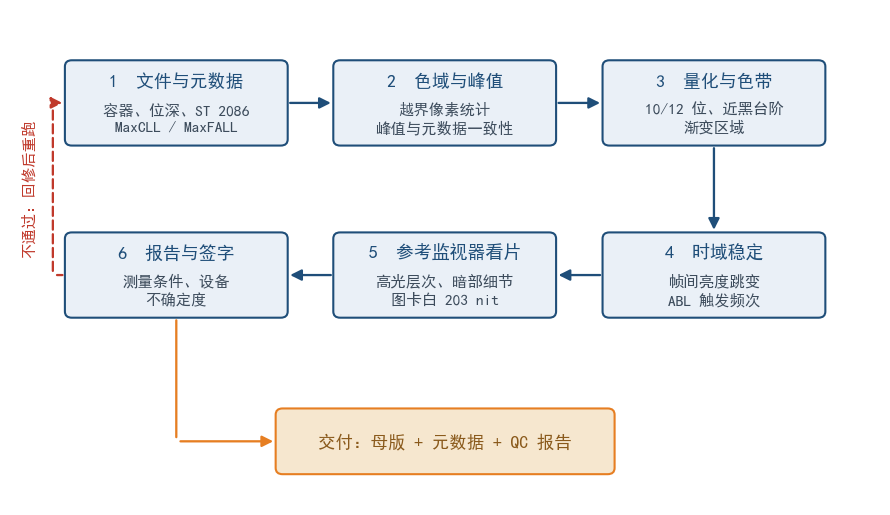

# 第 6 章 HDR 测量、评价与制作

HDR 的"好看"需要被验证。验证靠三样东西，能复现的测试图案、可信的测量设备、以及与人眼感受对得上的客观指标。三样缺一样，讨论就会退回到"我觉得这一段太亮"。

验证的顺序是从图案到数字、从数字到判断。先有一块能复现的图案，才有可比对的读数；读数整理成曲线与分布，才能和感知对上；感知上有依据，分级的每一个动作才有落点，交付时的每一项元数据才有来源。这条链断在任何一节，后面几节的结论都是悬空的。

## 6.1 测试图案

HDR 测试图案与 SDR 的最大差别在于图案本身要定义在 PQ 域。同样叫"18 级灰阶"，SDR 版本按 Gamma 编码等分码值，HDR 版本要按 PQ 码值等分，两者每一级对应的绝对亮度完全不同。如果用 SDR 图案去测 HDR 显示器，测出来的"灰阶跟踪误差"大部分来自图案与显示器采用了不同的传递函数，设备本身的问题反而看不见。

图 6-1 把最常用的七类图案画在同一张图上，全部按 PQ 码值生成，预览时才映射到 8 位灰度。暗部的两块，也就是近黑阶梯与 PLUGE，单独拉伸了显示范围，否则在普通屏幕上它们会并成一片黑，读者看不出里面还有台阶。真实图案仍按 ST 2084 的绝对亮度输出，拉伸只影响这张示意图。

**灰阶阶梯**用 11 级覆盖 0 到 1023 全码值。它的用途是测灰阶跟踪，每一级的实测亮度与 PQ 目标值比较，得到跟踪误差曲线。11 级等分码值之后，对应的绝对亮度是 0、0.33、2.4、10、32、92、244、621、1555、3906、10000 nit。这串数字很能说明问题。最暗的几级之间亮度比极大，0.33 nit 到 2.4 nit 是七倍多，2.4 nit 到 10 nit 还有四倍；越往高处比值越小，621 nit 以上每一跳都稳定在 2.5 倍左右。每一级在码值上只差 102，落到感知上却是差不多的一步，这正是 PQ 曲线的用途，等距的码值对应大致等距的感知差。反过来说，拿 SDR 的 Gamma 图案去测 HDR 屏，每一级的码值差相同、感知差却差得远，测出来的跟踪误差曲线根本没法解释。阶梯级数不必多，级与级之间的差异要大到一眼能分开，11 级已经能覆盖主要拐点。测量时逐级读数，把实测亮度画回 PQ 曲线，偏离 2% 以上的区段就要怀疑显示器的色调曲线被改动过。

**近黑阶梯**取 0 到 64 码值，步进 8，共 9 级。这 9 级对应的绝对亮度分别是 0、0.0015、0.0054、0.012、0.022、0.035、0.052、0.074、0.101 nit，全部挤在 0.1 nit 以下。它专门用来查黑位裁切。如果显示器的黑位是 0.05 nit，那么前六级会并成一片，看起来一模一样，第七级才勉强浮出来。判断方法很朴素，把房间的灯全关掉，让眼睛适应两分钟，再盯住这块图案看。有环境光的时候，屏幕表面的反射亮度远高于这些台阶本身的亮度，看多久都没用。

近黑阶梯还有一个常被忽略的前提，它必须在 10 位以上、最好是浮点的图案上才有意义。10 位 PQ 的一个码值对应 0.7 个 $\Delta E_{ITP}$，相邻两级相差 8 个码值，色差约 5.6，够用；但如果把步进改成 2 个码值，两级之间只差 1.4，图案本身就在可察觉的边缘上，测出来的抖动分不清是图案的量化还是显示器的噪声。

**窗口图案**用不同面积的白色方块测峰值。面积取 10%、2%、1%，边长按面积开方。在 16:9 的屏幕上，65 英寸的 10% 窗口边长约 34 厘米，2% 约 15 厘米，1% 约 11 厘米。三个尺寸摆在一起不只是为了省事，它们对应三种不同的物理量。10% 窗口接近"一整块亮区"，测出来的峰值包含了 ABL 的削减；2% 窗口更接近画面里孤立的镜面高光；1% 窗口则逼近面板的极限，局部调光的机器在小窗口下能把峰值推到标称值，一旦窗口变大就掉下来。

窗口面积的定义在不同规范里并不统一，这是验收时最容易扯皮的地方。VESA 的显示器一致性测试用画面中央的 10% 窗口作为峰值亮度的基准，这个选择偏保守，能反映整块亮区下的实际能力。BT.2408 处理的是制作端的参考白与监视器行为，它把参考白定在 203 nit 的信号白上；谈到峰值时，行业里既有按 10% 窗口取的，也有按 2% 窗口取的。广播机构与厂商各按自己的规范报数，同一台机器标 1000 nit，用 2% 窗口可能测到 1050，用 10% 窗口可能只有 800。同一次比较里，2% 窗口的读数不会低于 10% 窗口，差距多大完全取决于 ABL 曲线。所以任何一份测量报告都必须写明窗口面积，只写"峰值 1200 nit"是没有意义的。

**棋盘格**用 4×4 或 16×16 的黑白交替方块。它同时测两件事。黑白块的亮度比给出 ANSI 对比度，这个值比全白/全黑对比度低得多，因为亮块与暗块同时存在，局部调光的分区会互相泄漏。棋盘尺寸还能扫出 ABL 的触发点，从 4×4 换到 16×16，白块总面积不变而分布变碎，如果峰值读数明显上升，说明机器的调光算法在按区域统计亮度。做这个对比时要在同一帧率、同一预热时间下进行，否则读数变化里混进了热的因素。

**PLUGE** 在纯黑上下各放一条略暗和略亮的窄条，用来调亮度与黑位。SDR 的 PLUGE 用数字码值定义，±2% 是对 0 到 100 IRE 说的。HDR 里这个做法行不通，因为 PQ 的近黑段太陡。0.0049 nit 与 0.0051 nit 听起来相差 4%，换算成 10 位 PQ 码值分别是 15.26 与 15.58，四舍五入之后是小到分不开的两个数，在 10 位图案里根本画不出区别。实用的替代有两种，一是把图案做成 16 位浮点，直接送进显示器的处理链路；二是把 ±2% 改成围绕显示实际黑位的相对台阶，比如黑位 0.02 nit 时取 0.018 与 0.022，宁可让步进落在半个到一个码值的量级上，用肉眼判断"哪一条刚刚可见"，而不是指望读出一个精确的黑位值。

**灰阶斜坡**是水平方向从 0 到 1023 连续过渡的图案，用来检查 10 位量化是否产生色带。HDR 的斜坡在近黑段最容易出问题，因为人眼在那里的分辨力最强，而 10 位 PQ 的分辨力刚好够用。如果显示器的内部处理是 8 位，或者链路中间有一次 8 位截断，斜坡会在 5% 到 20% 灰的位置出现明显的竖条。看到色带先别急着判定面板不行，把图案换成带抖动的版本再测一次，色带消失说明问题在量化，色带照旧说明在面板或驱动。

**彩条**用来查饱和度与色相。标准图案通常在 Rec.2020 色域、PQ 编码下生成 6 个饱和色与 2 个中性色，实测色度坐标与目标值比较。要注意许多显示器在最高亮度下无法维持饱和色的色度，红绿蓝三块在这个条件下会明显偏移，这不是色域不够，而是亮度与饱和度在物理上互相牵制。测饱和色时应该把白点亮度降到中等，比如 100 nit 到 200 nit，再去看色度误差。

**运动图案**（图 6-1 里没有画）是横向缓慢移动的小白块，专门用来暴露分区背光的响应延迟。HDR 显示器的调光算法要统计一帧的亮度分布才能决定各分区的驱动电流，统计与响应都需要时间，快速移动的高光会在身后拖出一条亮度错误的尾巴。用相机以固定曝光拍下运动过程，逐帧看尾巴的长度，比用亮度计更直观。

把上面几种图案的用途、判据与失效条件放在一起，验收时按这张表过一遍，不容易漏测。

| 图案 | 测什么 | 读数怎么判 | 容易失效的地方 |
|---|---|---|---|
| 灰阶斜坡 | 量化色带、位数截断 | 近黑与中间调有无竖条 | 图案自带抖动会掩盖色带 |
| 11 级阶梯 | 灰阶跟踪 | 各级偏离目标 2% 以内 | 图案与显示器传递函数不一致 |
| 近黑阶梯 | 黑位裁切 | 每一级都能分开 | 有环境光时并成一片 |
| 三档窗口 | 峰值与 ABL | 记录面积与稳态时间 | 光斑压到窗口边界 |
| 4×4 棋盘 | ANSI 对比度、ABL | 与全白对比度对照 | 预热不足导致读数漂移 |
| PLUGE | 亮度与黑位 | 最暗一级刚刚消失 | HDR 近黑台阶小于一个码值 |
| 彩条 | 饱和色色度 | 与 2020 目标比色差 | 高亮度下无法维持饱和度 |

图案的生成方式也有讲究。中间文件要用 16 位半浮点或 16 位整数的 EXR/TIFF，避免在 8 位阶段就把 PQ 曲线压坏。量化到 10 位时，灰阶阶梯的每一级必须落在同一个码值上，否则测出来的是图案本身的抖动，显示器的误差反而被掩盖。图案还要限定在母版的峰值内，如果图案里出现 10000 nit 的白块，接收端只能靠裁剪处理，测出来的黑位与灰阶都会被连带影响。生成图案的脚本应当把每一级的码值与目标亮度同时打印出来，存档时和测量数据放在一起，半年后回头看才不会对不上。

## 6.2 亮度与色度测量

测量设备分两类。**分光辐射计**把入射光按波长分散，逐波长测能量，再按 CIE 标准观察者积分出 XYZ。它的绝对精度高，能测任意光谱，缺点是慢、贵、对低亮度信号的信噪比要求高。**色度计**用滤光片加光电二极管模拟三刺激值响应，读数是直接的 XYZ 或 xyY，速度快、便宜，但滤光片模型与 CIE 曲线只是近似。

这个近似在 HDR 下被放大了。色度计的滤光片匹配误差在低亮度和大色域条件下会显著偏离，红原色的色度误差可能达到 0.01 以上，换成 $\Delta E_{ITP}$ 就是好几个单位。通用做法是先用分光辐射计对色度计做**四点或九点校正**，白、红、绿、蓝四点是最低要求，九点则加上青、品、黄与两个中间灰。修正矩阵写进色度计之后，它读出的 XYZ 才是可信的。校正点要覆盖实际使用的亮度范围，只在校正 100 nit 白点、然后去测 0.01 nit 的黑位，误差会大得离谱，因为光电二极管在那两个量级上的线性度、暗电流占比、放大器的偏置都不一样。严肃的做法是在 1、10、100、1000 nit 各做一组校正，或者至少在中低亮度补一组。

**测量几何**决定了光斑落在屏幕上的哪一块。亮度计的视场角通常是 1° 或 2°，光斑直径等于两倍距离乘以半视场角的正切。65 英寸 16:9 屏幕的屏高约 81 厘米，按 3H 的观看距离算，测量距离约 2.43 米。在这个距离上，1° 视场的光斑直径约 4.2 厘米，2° 视场约 8.4 厘米。对照 1% 窗口的边长 11 厘米，2° 视场的光斑已经占了窗口的绝大部分，稍微偏一点就会压到黑背景。要测 1% 甚至更小的窗口，必须换 1° 视场或者把距离拉近，拉近的代价是景深与对准变难。

图 6-2 把这两个量放在一起看。(a) 的横轴是测量距离，两条实线分别是 1° 与 2° 视场的光斑直径，三条水平虚线是 65 英寸屏上 10%、2%、1% 窗口的边长。光斑曲线要落在虚线的下方才算安全。2° 视场在 2.4 米处的光斑约 8.4 厘米，已经吃掉了 1% 窗口边长的大半，1° 视场在同样的距离上是 4.2 厘米，还留有余量。(b) 换了一个角度，把窗口边长画成屏幕对角线的函数，屏幕越大窗口越大，光斑相对越小。这解释了为什么大屏反而更好测，同样 3H 的距离，55 英寸屏的 1% 窗口只有 9 厘米出头，而 85 英寸屏能到 14 厘米以上。

光斑压到边界时读数会偏低，偏多少取决于黑背景的亮度与窗口的亮度之比。以 1000 nit 的窗口、0.05 nit 的黑底为例，如果光斑有一成面积落在黑底上，读数大约被拉低 10%，看上去像显示器不够亮。这类误差有一个特征，重复测量时数值稳定、方向一致，很容易被当成真实结果写进报告。避免的办法是先用低亮度、大窗口对齐，再切到高亮度小窗口，并且每次换图案后微调云台。

**低亮度的信噪比**是 HDR 测量真正的难点。0.005 nit 的黑位落在光电二极管量程的最底端，光电流小到与暗电流同一个量级，读数的随机抖动可能到 20% 以上，而且随温度漂移。几种缓解手段各有代价。延长积分时间最直接，代价是测量一块屏幕的黑位要等几十秒，做全屏均匀性时时间成本很高。多次采样取平均能压掉随机噪声，压不掉暗电流的偏置，必须在测完黑位后立刻用遮光盖读一次暗电流，从结果里扣掉。用制冷型分光辐射计可以显著改善，设备价格与体积也跟着上去。工程上还有一个折中，不去直接测黑位，而是测对比度再反推，但对比度本身也要在高亮度端测得准，误差会传递过来。

**暗室与屏幕反射**经常被低估。屏幕不是发射体就是反射体，环境光打在屏幕上会以漫反射的形式叠加到画面亮度上，叠加量等于反射率乘以照度再除以 π。一块反射率 1% 的屏幕，在 5 lx 的微弱照明下，反射亮度约 0.016 nit，已经是 0.005 nit 目标黑位的三倍；照度升到 50 lx，反射亮度 0.16 nit，黑位彻底没救。家用客厅的夜间照度动辄几十勒克斯，这就是为什么消费电视的"黑"看起来远不如暗室里的监视器。

$$
L_{refl} = \frac{\rho E}{\pi}
$$

这个式子还说明，反射对测量的影响不是按比例叠加，而是设了一个下限。显示器的本征黑位再低，读数也不会低于 $\rho E/\pi$。所以黑位测量必须在全暗条件下进行，或者至少在照度计读数低于 1 lx 的环境里，并且把照度值写进报告。测量者穿深色衣服、关掉设备指示灯、把手机屏幕朝下放，这些细节加起来的贡献可能比换一台更贵的亮度计更明显。屏幕表面的镜面反射更难处理，正对屏幕的强光源会在视场里形成亮斑，测角度的均匀性时尤其要避开。

**四色与激光显示**给测量带来另一类麻烦。四色面板用红绿蓝加一个黄或白通道，白色的形成依赖四个通道的配比，单测 R、G、B 三个通道无法确定白点，必须把第四通道也纳入校正。激光光源的光谱是几条极窄的线，色度计的滤光片在这种窄带光下的匹配误差比在宽带光下大得多，红光的读数可能偏几个百分点。这类设备只能用分光辐射计，而且要注意光谱分辨率，分辨率不够时会把邻近的谱线并成一条。激光投影还有散斑，散斑会让同一块白屏上的读数随测量点的位置跳动，必须取多点平均。

几种实操要点写在下面，都是从现场踩坑总结出来的。

- 设备预热至少 30 分钟，HDR 显示器在高亮度下的热漂移比 SDR 明显。
- 黑位测量要在全黑画面稳定 30 秒后读数，避开背光刚切换的过渡态。
- 峰值测量要在图案稳定后读数，ABL 介入的产品需要记录"第几秒的读数"，并注明是初始峰值还是稳态峰值。
- 屏幕表面不能有直射光，测量者穿深色衣服，避免反射进入视场。
- 环境光用照度计记录，同一批数据要在相同环境光下比较。
- 每个测点重复三次取中位数，离散度超过 5% 时查对齐和积分时间，不要直接取平均。
- 记录设备型号、序列号、最近校准日期与校正矩阵的版本，缺了这几项的测量数据在三个月后基本没法复用。

**均匀性**是另一类必须测、又常被简化处理的项目。九点或十三点法把屏幕分成网格，每格测一次亮度与色度，算出与中心点的偏差。HDR 的均匀性问题在近黑处最明显，因为面板的漏光与背光分区的边界都藏在那里；同一块屏幕在全白下测得 1000 nit、偏差 5%，在黑场下可能偏差 50% 以上。做这个测量要关掉屏幕的一切补偿功能，有些产品会针对测试图案做局部增强，开着测等于测了一个不存在的屏幕。除了空间均匀性，还有视角均匀性，HDR 电视在 30° 偏角下的亮度可能掉三成，色度也会偏移，坐在沙发边上的观众看到的就是那个状态。

**峰值随时间的变化**也值得记录。开机后每隔十分钟测一次峰值，画出一条时间曲线，前 30 分钟通常能看到下降，热稳定之后才趋于平缓。有些产品的峰值在稳定后比初始值低 20%，报告里只写初始值的做法等于虚报。同一块屏幕在 HDR 与 SDR 模式下的峰值不同，很多产品在 SDR 模式下把亮度限制在 400 nit 以内，测之前要确认模式。

色度测量还要注意观察者的问题。CIE 1931 的 2° 标准观察者是为小视场设计的，而看屏幕时的视场要大得多，严格的色度评价应该用 CIE 1964 的 10° 观察者。两者在蓝紫区的差异不小，用错观察者算出来的色差可以达到 1 到 2 个 $\Delta E$。多数测量设备允许切换，切换之后目标值的色度坐标也要跟着换，不能拿 2° 的目标去比 10° 的实测。

## 6.3 波形、直方图与矢量示波器

示波器类的工具解决的是同一个问题的不同侧面，一定数量的像素分别落在哪个亮度上。直方图只给统计量，波形图保留空间位置，矢量示波器丢掉亮度只看色度。三者在 HDR 下都要换刻度，这个换刻度不是把纵轴标签改一下那么简单。

**SDR 的示波器以 IRE 为单位**，0 到 100 IRE 对应模拟时代的 0 到 700 mV，数字时代沿用下来，和 8 位码值线性对应。码值 235 是白，16 是黑，中间是线性分布。这套刻度之所以好用，是因为 Gamma 编码之后码值与感知亮度近似均匀，波形图上一段均匀的竖条确实看起来均匀。

**HDR 的波形要换成 PQ 刻度**。PQ 是非线性的，码值与绝对亮度之间隔着一个幂次很高的传递函数。如果用线性亮度做纵轴，画面里 90% 的内容会挤在刻度最底下的一条细线里，高光才是几条孤零零的尖峰，什么也看不出来。所以 HDR 示波器的纵轴要么直接标 10 位或 12 位 PQ 码值，要么在旁边加一列对应的绝对亮度刻度，两者一一对应。用码值做纵轴的好处是它与编码文件逐位对齐，算出的是真正写进文件的数；用绝对亮度做纵轴的好处是它直接告诉你画面有多亮。工程上一般两个都开，读数时以码值为准、以亮度为辅，因为母版的判定标准是码值，而人眼的判断标准是亮度。

图 6-3 是逐列统计生成的真波形图，不是示意曲线。合成的画面里有一片从 0.05 nit 渐变到 8 nit 的天空、一颗约 5000 nit 的太阳、左上角一扇约 800 nit 的亮窗、一条约 0.8 nit 的地面，右下角还有一块 0.012 nit 的暗剪影。波形图上这些东西一眼就能分开。画面左侧靠近边缘的一段范围内有一条水平的亮线，停在 744 码值附近，那是亮窗，它是一条短横线而不是贯穿整幅的直线，说明它只占据画面的一个局部；画面中部偏右有一条几十像素宽的竖向亮带，从 300 码值一直窜到接近 1000 码值，那是太阳，竖向拉得很长是因为太阳边缘有渐变，同一列里从中心到边缘的亮度跨了几个数量级；贴近底部有一条几乎贯穿全宽的细线，停在地面亮度对应的一百四十几个码值上；画面右侧靠边的地方有一条贴着零的极暗线，那是剪影。

这三类形态各有诊断价值。横线说明存在一个亮度恒定的物体，竖线说明存在一个亮度跨度的结构，贴顶的横线则说明高光被削平了。如果太阳的位置出现一条平顶的横线而不是尖顶，就说明画面里存在超出母版峰值的像素，接收端会在那里做裁剪，原本的层次会变成一片死白。反过来，如果暗部本该有层次的区域出现一条贴底的横线，说明黑位被压死，阴影里的细节全被推到零。

读波形还有一个容易犯的错，把波形的密集程度当成亮度。波形图上颜色的明暗表示的是像素密度，不是亮度，亮度在图上的位置由纵轴给出。一片很暗的区域如果有大量像素落在同一个码值上，波形会画成一条亮线，看上去比实际画面亮得多。刚开始用 HDR 示波器的人常常在这里误判，以为某个区域过曝，实际上只是那块区域太平。

**波形的时域用法**常被忽略。把同一段画面逐帧的波形排成一列，能看出亮度随时间的走法。镜头的曝光是稳定的，波形上各条横线的位置就不该来回跳；如果某几条横线在帧与帧之间上下摆动，说明素材本身在闪，问题可能出在拍摄时的光源频率，也可能出在后期某个环节的动态处理。HDR 对这种抖动更敏感，因为暗部的相对差大，0.01 nit 附近的一点波动在观感上是明显的。用示波器的亮度随时间曲线功能，把画面的平均亮度画成一条时间序列，比逐帧看波形省力得多，闪烁的周期与幅度都能读出来。

时域上还有一条经验线。同一场景里相连的两个镜头，如果一个的平均亮度在 1 nit、另一个在 8 nit，切换时人眼会感到一次跳变。这不一定是错的，剪辑本来就可以靠亮度反差做效果；但如果这种跳变在整片里反复出现又没有叙事理由，看起来就像曝光没统一。把整片的逐镜头平均亮度列成一张表，把离群的挑出来复核，是交付前很实用的一步，6.6 节的 QC 清单里有对应的自动检查项。

**直方图**把空间信息丢掉，只留统计。丢掉位置之后，图变小了，趋势反而更清楚。直方图的横轴是 PQ 码值，纵轴是像素数，通常用对数刻度，因为一幅画面里绝大部分像素集中在少数几个码值上，线性刻度只会画出几根针。

图 6-4 是另一幅合成画面的统计结果。天空的竖直渐变占据了大片中等码值，从 40 到 300 码值形成一片厚实的分布，越往亮处像素越多；墙面与地面各自聚在一两个分箱里，在 96 到 104 码值与 136 到 144 码值形成两根最高的柱子，接近 9000 与 7800 个像素；窗灯落在 744 码值，因为面积小，只堆出约 1200 个像素的一根细针；再往上是零星的十几、二十几个像素，来自太阳边缘的过渡与地面的细微起伏，P99.9 就落在这段里。P50 在 198 码值，对应 2.2 nit，P99 在 744 码值，对应 798 nit，P99.9 在 893 码值，对应 3040 nit。灰色的虚线是 203 nit 参考白对应的 594 码值。

这几个分位数各自回答一个问题。P50 告诉你画面的平均曝光水平，HDR 剧情片的 P50 常在 1 到 5 nit 之间，因为大部分画面是室内与夜景；如果 P50 跑到 20 nit 以上，整部片子看起来会发灰、发白，像被人为抬了黑位。P99 反映高光的量级，这个值要和母版的峰值设定对照，母版按 1000 nit 制作，P99 落在 700 到 800 nit 是健康的；如果 P99 已经顶到 1023，说明相当一部分像素达到了 10000 nit，肯定有地方不对。P99.9 更能反映极端值，它几乎等于画面里最亮的千分之一像素的水平，与 MaxCLL 的统计口径接近。参考白那条虚线给出一个锚点，画面里应该有少量像素停在它附近，图卡、字幕、界面元素的白色都按这个约定做；如果整幅图的分布离这条线很远，多半是分级时用错了参考白。

直方图的一个陷阱是它和显示无关。同一份母版，在 1000 nit 与 4000 nit 的监视器上看到的直方图完全一样，因为直方图统计的是文件里的码值。这一点对判断很有用，它把"内容本身多亮"和"显示器能显示多亮"分开了。判断内容是否合理，看直方图；判断显示器是否合格，看实测亮度。

**矢量示波器**只显示色度，横轴 Cb、纵轴 Cr，亮度信息被丢弃。它在 SDR 时代用来检查肤色与饱和度是否越界，刻度按 Rec.709 的色域画，六个角对应六个原色与补色，中间一圈是饱和度参考。这套刻度在 HDR 下直接失效，因为 Rec.2020 的色域面积比 709 大得多，同样的 (Cb, Cr) 在 2020 下对应的饱和度完全不同。

改成 HDR 模式之后，矢量示波器的刻度按 Rec.2020 的基色重新画，同时纵轴的含义从编码值变成了归一化的色差。BT.2100 给 HDR 定义了两种编码，一种是 PQ 的 10 位非恒定亮度，YCbCr 的色差范围与 SDR 的 10 位一致；另一种是 HLG。两种编码的矢量图刻度不同，切换时一定要确认示波器也跟着切。BT.2020 的非恒定亮度编码把色度与亮度绑在一起，在很暗的区域，色度分量的量化会变得粗糙，矢量图上表现为一个色相正确但半径忽大忽小的抖动区域。这不是内容的问题，是编码本身的特性。

实际使用中，矢量图更多用来发现"整体偏色"这类粗差。一段素材如果整段都偏在矢量图的第一象限，说明蓝青方向过强，可能是白点设错或者色域标错。精确的色度评估还是要靠测量设备，矢量图给的是方向感，不是数值。

**色度超界**在 HDR 里比 SDR 常见得多。原因不复杂，母版按 Rec.2020 做，接收端的显示器往往只有 P3 甚至 709 的色域，饱和色一旦超出接收端的范围，就只能被裁到边界上，或者被整块压暗以保住色相。判断有没有超界，单看矢量图不够，要把矢量图与波形图叠起来看。波形图告诉你这个像素有多亮，矢量图告诉你它的色度落在哪，两者合起来才能判断它是否超出目标色域的边界。示波器上常见的做法是开一个目标色域的轮廓线，落在轮廓外的像素会被高亮，统计高亮像素的比例，就能知道这段素材在窄色域显示器上会损失多少。

还有一种更隐蔽的超界，亮度在范围内、色度也在范围内，但两者组合起来超出显示能力。举例来说，一个 900 nit 的饱和红，色度坐标落在 Rec.2020 之内，可多数显示器的红原色在 900 nit 下维持不住，物理上做不到。这类像素不会被记为超界，却会在接收端引出一系列裁剪与压缩，最终看起来发灰。检查的办法是在不同亮度下重复看矢量图，饱和色的半径随亮度升高而收缩，收缩得太快的段落就是问题所在。

示波器类工具还有一个共同的前提，它们显示的都是编码值。如果监视器的处理链路把信号做了色调映射或者动态范围扩展，示波器的读数仍然是文件里的原始码值，与屏幕上的观感不一致。这不是缺陷，恰恰是它的价值，示波器看的是"内容是什么"，监视器看的是"看起来怎么样"。两者对不上时，问题往往在显示端，而不是在内容里。

## 6.4 感知指标

客观指标要回答的问题是"人能不能看出来"。HDR 在这方面有几个专用工具，也有几个被误用的老工具。

**PSNR** 是最古老也最容易被滥用的指标。它把两幅图的差值平方求和，取对数，单位是分贝。问题在于它假设误差的可察觉程度与幅度成正比，这个假设在 PQ 域里完全不成立。同样是差一个码值，在 100 码值附近对应 0.008 nit，相对差 2.6%，在 900 码值附近对应 29 nit，相对差 0.9%。绝对差相差三千多倍，相对差却只差三倍，任何一种按绝对幅度加权的算法都无法同时照顾两头。在线性亮度上算 PSNR，暗部的误差被严重低估；在 PQ 码值上算，好一些，但仍缺少掩蔽模型，画面纹理丰富处的误差被人眼掩盖，而平坦渐变处的同样误差肉眼可见，PSNR 给出同样的分数。一个实用建议是至少把 PSNR 算在 PQ 域，并且分区统计，把近黑段单独拿出来看，整幅图的平均 PSNR 在 HDR 上参考价值很低。

**SSIM** 引入了亮度、对比度、结构三个项的乘积，比 PSNR 更接近人眼。它在 HDR 上的问题有两个。一是它默认的动态范围与 SDR 相当，高光区域的细节在 PQ 编码里被压缩到很小的码值范围内，SSIM 的结构项在那里会失准，把可见的层次丢失判成"结构相似"。二是它的多尺度版本 MS-SSIM 依赖固定的下采样与视距假设，而 HDR 的观看距离、屏幕尺寸、峰值亮度变化范围都大得多。在 3H 距离看 65 英寸屏与在 1.5H 距离看手机，同一个 SSIM 分数对应的主观感受完全不同。

**VMAF** 是目前工业界最常用的视频质量指标，用机器学习把多个基础特征融合成一个 0 到 100 的分数。它的训练数据以 SDR 内容为主，直接用于 HDR 时相关性下降。业界的做法有三种，先做色调映射到 SDR 再算，精度损失在映射这一步；在 PQ 域重新训练模型，需要大量主观标注的 HDR 素材；或者用 Netflix 后来发布的 HDR 版本模型，它把亮度信息作为额外输入。三种做法的分数不可直接比较，报告里必须注明用的是哪一种。

**ΔE_ITP** 由 BT.2124 定义，在 ICtCp 空间里计算色差

$$
\Delta E_{ITP} = 720\sqrt{(\Delta I)^2 + 	frac{1}{4}(\Delta C_t)^2 + (\Delta C_p)^2}
$$

$I$ 是亮度分量，$C_t$、$C_p$ 是两个色差分量，系数 720 把"刚好可察觉"标定到 1。这个指标的好处是直接工作在 PQ 域，不需要先做色调映射，因此适合评估编码、压缩、显示链路的误差。它的局限是只描述局部色差，不涉及空间掩蔽，也不考虑时域。按 BT.2124 的标定，1 大致对应刚好可察觉的差别。工程上把 1 当门槛、把 2 当告警线，超过 4 的区段基本一定被人看出来。

把 $\Delta E_{ITP}$ 换算成亮度差，会看到一个很有意思的形状。只考虑亮度分量时，$\Delta E_{ITP} = 720 \Delta I$，所以 1 个单位对应 PQ 码值上的 $\Delta I = 1/720$，与亮度无关，换算到 10 位是 1.42 个码值。但同样的码值差对应的绝对亮度差随亮度急剧变化。

图 6-5(a) 画的是绝对亮度差，双对数坐标下大致是一条斜率 0.8 的直线，亮度差随亮度增长得比比例稍慢。在 0.01 nit 处，一个 $\Delta E_{ITP}$ 只对应 0.0013 nit 的差别，在 100 nit 处对应 1.4 nit，在 1000 nit 处对应 12.8 nit。(b) 画的是相对亮度差，曲线从近黑端的高位迅速下降，到中间调之后稳定在 1.3% 上下。这条曲线解释了两件事。第一，人眼在高光处的相对分辨力与中间调接近，绝对亮度差却大得多，所以"高光里差几个 nit 无所谓"这个直觉是错的，1000 nit 处的 12.8 nit 与 1 nit 处的 0.027 nit 在感知上是同一件事。第二，近黑端的相对差很大，0.01 nit 处的一个 $\Delta E_{ITP}$ 相当于 13% 的相对变化，这意味着同样数量的码值误差在暗部看起来比在亮部严重得多，编码器在暗部分配更多比特是有道理的。

这个换算还有一个直接用途，评估量化误差。10 位 PQ 的一个码值对应 $\Delta I = 1/1023$，换成 $\Delta E_{ITP}$ 是 $720/1023 \approx 0.70$。也就是说 10 位 PQ 的量化本身就在可察觉的门槛之下，只留了不到 1.5 倍的余量。8 位 PQ 的一个码值对应 2.82 个 $\Delta E_{ITP}$，明显可察觉，这就是 8 位 HDR 不可接受的原因。12 位是 0.18，余量充足。这组数字比任何"8 位会出色带"的说法都有说服力。

**HDR-VDP-3** 走的是视觉模型路线。它把参考图与测试图经过光学调制传递、对比敏感度滤波、掩蔽模型，输出每个像素的检测概率图和一个总体 Q 分数。Q 分数越高表示差异越难察觉，工程上常把 Q 在 75 以上视为"几乎不可见"。它对压缩伪影、光晕、噪声的预测与主观感受相关性较好，代价是计算量大，参数必须与实际一致。观看距离、屏幕的峰值亮度与黑位、环境光照度这三项填错，结果就没有意义。常见的误用是拿默认参数跑一遍，默认值是按 SDR 显示器设的，直接用于 HDR 会把高光误差的严重性估低。HDR-VDP-3 的另一个用途是生成检测概率图，把"哪里错了"和"错得有多明显"同时呈现出来，比一个标量分数有用得多。

**主观评价仍是基准**。BT.500 规定了主观实验的方法，双刺激连续质量标度、单刺激、成对比较各有适用场景。HDR 需要额外控制三项条件，显示器的实际峰值与黑位、环境光照度、观看距离。同一段素材在 1000 nit 与 4000 nit 监视器上的主观评分可以差一档以上，在暗室与有环境光的房间里差距更大。做主观实验时必须报告这三项，否则分数无法复现。ITU-R BT.500 之外，还有 BT.710 针对高画质电视系统的评估方法，以及一些针对 HDR 的专项建议，核心都是同一件事，把观看条件写清楚。

实际工作中常用的组合是，编码与压缩阶段看 $\Delta E_{ITP}$ 的分布与 HDR-VDP-3 的检测图，找出误差集中在哪些区域；显示端评估看光晕与 ABL 的主观影响；交付验收用自动脚本加人工看片。三类手段各管一段，指望单一指标盖住全链路，最后总会漏掉一类问题。指标的价值在于把"看起来不对"变成"哪一段、哪个亮度、差多少"，而不是代替人做判断。

## 6.5 ACES 与 HDR 分级

ACES 是目前最完整的场景参考色彩框架。所谓场景参考，是指这套体系里的数值描述的是拍摄现场的光，而不是显示设备的输出。这样一来，同一份母版可以送到影院、电视、手机，各自按自己的能力做输出变换，不需要为每种设备重新分级。它的核心文件格式是 SMPTE ST 2065-1，色域 AP0，线性编码，用 16 位半浮点存储。AP0 的色域覆盖了所有真实光谱色，代价是数值范围大、精度要求高。16 位半浮点的相对精度在 0.1% 量级，对 AP0 这样宽的色域刚好够用，再少就会在暗部看到台阶。

**AP0 与 AP1** 经常被混为一谈。AP0 是存储与交换用的色域，三个基色落在光谱轨迹之外，纯粹是为了包住所有可见色。AP1 是工作用的色域，基色接近但略大于 Rec.2020 与 P3 的并集，落在光谱轨迹之内。调色时的饱和度操作在 AP1 里做，结果再转回 AP0 存储。用 AP0 直接调色会在饱和色上出现异常，因为它的基色本身不是真实颜色，某些组合在数学上成立、在物理上没有对应。AP1 存在的意义就是给这些操作一个物理上说得通的容器。

**ACEScct** 是调色台上用的编码。AP0 线性只作为管线内部的存储格式，人对线性数值没有直觉，18% 灰在线性里是 0.18，在显示器上是中灰，两者对不上。ACEScct 的对数编码把暗部展开，18% 灰落在 0.41 附近，与传统的 Cineon 对数曲线接近，滚轮的手感与处理 log 素材时一致。它还有一个特别的设计，在很暗的地方有一段线性延伸，避免对数曲线在零点附近发散，处理纯黑与负值时不会出现数值爆炸。ACEScct 只是显示用的中间编码，回到管线时仍然转回线性 AP0，它不进文件、不参与交付。

**分级的数据流**值得单独说一句，因为它决定了元数据从哪里来。ACES 管线里，素材先转成 ACES2065-1，调色在 ACEScct 里做，输出变换生成送到监视器的信号，同时生成一份"这个镜头在目标显示器上应该长什么样"的参考。这份参考是后续 trim 与元数据计算的输入。Dolby Vision 的分析工具就是拿这份参考和 HDR 母版比对，逐镜头算出映射参数，写进 2094-10 的元数据。手工调的做法是调色师自己在 HDR 与 SDR 之间来回切，凭眼睛调，得到的参数虽然也写进元数据，可复现性差，换个人接手就接不下去。

**输出变换**分两段。RRT 是参考渲染变换，把场景的高动态范围压到显示能表现的范围，它做的是色调映射与视觉适应，与具体显示设备无关。ODT 是输出显示变换，把 RRT 的结果映射到目标色域与亮度。HDR 的 ODT 会带上目标峰值参数，同一个 ACES 素材可以生成 1000 nit、4000 nit 或 100 nit 的版本，色域也可以选 Rec.2020 或 P3。ACES 1.x 的 RRT 是一段固定的曲线，业界抱怨它在高光处的滚降太急，亮部层次容易被压平。ACES 2.0 重新设计了这套输出变换，改用基于感知模型的曲线，把色调映射与色域映射分开处理，暗部与高光的过渡比 1.x 平顺，饱和色在映射过程中的色相偏移也小了。切换版本会改变成片的观感，制作中途换版本等于换了一套胶片，需要整片重看。

**HDR 分级的工作方式有两种**。一种是在 HDR 监视器上直接做 HDR pass，参考白定在 203 nit，峰值按交付目标设定，暗部靠示波器与肉眼共同判断。这种做法的好处是所见即所得，调色师看到的层次就是观众能看到的层次。另一种是先做 SDR pass，再用 trim pass 工具生成 HDR 版本。Dolby Vision 的工作流属于后一类，母版以 SDR 为主，trim 元数据记录每个镜头在 HDR 下的亮度调整量，接收端按元数据重建 HDR 画面。这种做法在存量片库的改造上用得多，因为原始分级是按 SDR 做的，重做一遍成本太高。

trim 的调整通常只涉及几个参数，每个镜头的全局增益、高光滚降曲线的形状、暗部的抬升量，有些实现还允许局部的形状调整。参数量少是优点也是缺点，优点是不会破坏原分级的美学意图，缺点是遇到 SDR 与 HDR 观感差异很大的镜头，几个全局参数压不住。典型的例子是逆光镜头，SDR 里天空是一片白，HDR 里天空应该有层次，而 trim 只能整体调整，调整之后地面的暗部会跟着变。遇到这类镜头，trim 之后仍要人工修，修完再回到 SDR 检查一遍有没有被改坏。

**分级监视器的选择**直接影响判断。参考级 HDR 监视器通常做到 1000 nit 峰值、0.005 nit 黑位、出厂校准到 D65，4000 nit 的型号数量很少、价格高昂。这类监视器在暗室里看，屏幕的均匀性、视角特性、ABL 行为都经过设计，分级的判断才靠得住。用消费级电视做分级，必须接受 ABL 介入、局部调光伪影、面板均匀性偏差带来的误判，至少要关闭所有图像增强功能，包括运动补偿、锐化、降噪与动态对比度，再做一次完整校准。即便如此，消费电视的峰值亮度会随画面内容变化，调色师在一个镜头上做的判断，下一个镜头可能就不成立。

监视器之外，观看环境同样参与判断。分级室的墙面应该中性、无光泽，屏幕周围墙面的亮度控制在 5 nit 上下，大约是参考白的百分之二点五，环境照度相应压得很低。HDR 分级对这个条件更敏感，因为暗部的层次很浅，墙上的一点反光就会把暗部细节吃掉。有些分级室把墙面做成深灰、把顶灯换成可调的间接照明，就是为了压住反射，代价是空间显得压抑，长时间工作容易疲劳。

**双版本流程还有一个绕不开的问题，以哪一版为准**。若以 SDR 为主版本、HDR 用 trim 生成，HDR 版的高光往往靠算法推出来，缺乏真实细节，天空的云层可能被推成一团，亮部的高频信息只能靠锐化补，看起来很假。若以 HDR 为主版本，SDR 版需要在每个镜头上确认高光被压到 100 nit 后依然成立，压的时候要保住主体，不能把人的脸压成一片平白。两种做法都要求调色师同时看两个版本，不能只看一个。有条件的话，把两个版本并排放在两台校准过的监视器上，逐镜头切换比对，这是最费时间也最可靠的办法。

**母版峰值怎么定**是 HDR 分级开头就要回答的问题。4000 nit 的母版能装下太阳与金属反光，代价是绝大多数消费电视只能显示其中一部分，剩下的靠接收端映射，映射质量参差不齐。1000 nit 的母版更贴近显示端的能力，传到客厅时压缩得少，但极端高光的余量不够，遇到亮度超出 1000 nit 的素材只能裁掉。BT.2408 的立场是把 1000 nit 当作主流交付目标，同时允许 4000 nit 的高端版本存在。选择之后，整个分级过程要围着这个峰值做，示波器的顶部就是天花板，所有超过它的像素都要被处理，而不是让它悄悄顶在那里。

峰值之外还有两个锚点要定。参考白 203 nit 对应信号白，也就是图卡、字幕、界面元素的白，它等于漫反射白的亮度，在 PQ 上是 594 码值。峰值与参考白之间的比例决定了画面"有多少余量可以玩"，1000 nit 的母版是五倍，4000 nit 是二十倍。这个比例越大，高光越能做出层次，也越容易过度使用，让每个镜头都想放一个高光。第三个锚点是黑位，母版的黑位根据显示能力设，常见的是 0.005 到 0.05 nit，设得比实际显示能力低没有意义，接收端做不到，设得高又会把暗部层次提前丢掉。

HDR 分级还有几个与 SDR 不同的操作习惯。高光滚降要慎用，SDR 里把高光压下来是常规操作，HDR 里压掉的高光就是观众本可以看见的细节。暗部的处理反过来，HDR 的黑位低，暗部可以留更多层次，但如果暗部细节只存在于 0.01 nit 的量级，观众在明亮环境里看消费电视时根本看不见，所以暗部的关键信息仍然要落在 0.1 nit 以上。肤色是另一个锚点，SDR 里肤色常落在 40 到 70 IRE，HDR 里对应的绝对亮度大约在 20 到 60 nit，具体数值随场景的曝光意图变化，不能机械照搬。

## 6.6 交付与质量控制

HDR 母版的交付涉及容器、编码、元数据三层，每一层都有自己的规范和容易出问题的地方。

**容器层面**，院线母版常用 12 位 XYZ 的 DPX 或 16 位半浮点的 EXR，流媒体交付用 IMF。IMF 的 Application 2E 支持 Rec.2020 与 PQ 的 HDR 内容，内部用 JPEG 2000 编码，码率与色深按平台规范设定。部分平台接受 ProRes 4444 XQ 作为中间格式，它方便、兼容性好，代价是色深只有 12 位且色度采样受限，不适合作为最终的存档母版。交付前要确认容器里的色彩标记，MXF 的 Essence Descriptor 与 IMF 的 CPL 都要写明色域、传递函数、编码范围，缺一项接收端就只能猜。

**编码层面**，HEVC Main 10 是目前 HDR 分发的主力，AV1 在新平台上越来越多。编码时的关键参数是位深、色度采样、量化参数与色调映射信息的开关。10 位是最低要求，接近黑位的渐变在 10 位下已经能看出色带，所以高质量交付常用 12 位中间编码、10 位分发。色度采样 4:2:0 会在饱和色边缘产生色度溢出，红蓝对比强的镜头（霓虹灯、舞台灯光）最容易看到，遇到这类素材要局部提高码率。

**元数据层面**有三组关键信息，前两组是静态的，第三组是动态的。

**母版显示信息**（SMPTE ST 2086）记录调色时用的显示器的基色、白点、最大与最小亮度。这三项合起来描述"这块母版是在什么条件下做出来的"，接收端据此判断内容的能力边界。如果母版显示的峰值是 1000 nit，接收端的显示器只有 400 nit，它就知道需要做色调映射；如果母版显示的黑位是 0.005 nit，接收端的黑位是 0.05 nit，它就知道暗部会损失。这一组数据写错的后果是连锁的，峰值写高了，接收端会认为内容需要大幅压缩，整片会被压暗。

**内容亮度信息**（CTA-861.3 的 MaxCLL 与 MaxFALL）记录整条节目里单像素的最大亮度和帧平均最大亮度，用于让显示器预估 ABL 与功耗。MaxCLL 是 Content Light Level，统计口径是任何一个颜色通道的最大值，不是亮度；MaxFALL 是 Frame Average Light Level，按帧统计所有像素的平均亮度再取最大。两者都是整条节目一个数，所以它们描述的是最坏情况，不代表每个镜头。

**动态元数据**（SMPTE ST 2094 系列）逐镜头甚至逐帧给出映射曲线。Dolby Vision 用 2094-10，元数据里带每个镜头的分析结果与目标显示器的映射参数；Philips 的方案用 2094-20，把内容映射到显示器的能力；三星的 HDR10+ 用 2094-40，Technicolor 的方案用 2094-30。这些格式互不通用，同一份母版要做多个平台的分发，就要生成多套元数据。传送方式也不一样，Dolby Vision 与 HDR10+ 的元数据多以 SEI 消息随码流传输，也有走 sidecar 文件的封装方式，具体看平台规范。HDR10 是静态元数据的基础层，任何 HDR 接收端都能解，HDR10+ 与 Dolby Vision 是在它之上的增强。

**QC 分自动与人工两段**。自动检查跑在脚本上，覆盖可以量化的项目；人工检查在参考监视器上完整看一遍，覆盖只能靠眼睛判断的项目。

图 6-6 把这条流程画成六步闭环，左侧那条红色虚线是回修路径。第一步查文件与元数据，容器、位深、ST 2086 的三项参数、MaxCLL 与 MaxFALL 是否齐全且自洽。第二步查色域与峰值，统计越界像素的比例，核对实测峰值与元数据声明是否一致。第三步查量化与色带，重点看 10 位或 12 位编码下近黑台阶与大面积渐变有没有断裂。第四步查时域稳定，逐帧统计亮度，找异常的跳变与 ABL 的触发频次。第五步在参考监视器上看片，看高光层次、暗部细节、图卡白的亮度是否符合 203 nit 的约定。第六步出报告并签字，报告里要写清测量条件、设备型号与测量不确定度。任何一步不通过，回到第一步重跑，因为修改往往会牵动元数据。

自动检查的具体项可以列成一张清单。

- 像素是否超出母版色域，Rec.2020 之外的像素比例超过 0.1% 就要看是哪一段。
- MaxCLL 是否与实际峰值一致，偏差超过 5% 就要重算。
- 元数据里的峰值是否低于画面实际最大亮度，这一项错了接收端会裁掉高光。
- 10 位量化是否产生色带，检查方法是把渐变区域拉出来做直方图，看有没有梳状缺口。
- 帧间亮度是否有异常跳变，逐帧平均亮度的差分序列里，孤立的大尖峰通常是剪接或调色失误。
- 黑位是否被压死，统计有多少像素落在 0 到 2 码值之间，比例过高说明暗部被削。
- 时间码与 reel 标记是否与交付清单一致，这一项最琐碎，也最容易在最后关头卡住交付。

**平台侧的校验**是上线之前的最后一道关，多数时候不在制作方手里，但制作方必须知道平台查什么，否则第一次上传被打回，排期就乱了。主流平台在入库阶段做三件事。一是解码后抽查，把收到的文件解出来，抽几十帧与提交的参考图比对，确认转码环节没有改动传递函数，片头片尾也没有被误裁。二是元数据一致性检查，把 ST 2086、MaxCLL 与解码出的实际亮度统计对齐，偏差超过阈值就报警，很多平台还会自己重算一遍 MaxCLL 覆盖提交值。三是播放器档位检查，用接近真实用户的播放器与显示能力跑一遍，看色调映射之后暗部会不会糊成一片，字幕压在亮背景上是否还看得清。

这三项检查的逻辑基于同一个前提，接收端只能看到码流与元数据，看不到制作时用的监视器。制作方在暗室里用 1000 nit 监视器做的判断，到了客厅的 300 nit 电视上要重新成立一次。所以交付前不妨自己模拟一遍接收端，用一台消费电视、按 BT.2390 的映射曲线跑一遍全片，比在参考监视器上多看两遍更有用。这一步常被跳过，理由是本机看着没问题，可接收端从来不是本机。

人工检查的项不多，但每一项都要在正确的条件下做。看高光层次要用峰值足够的监视器，1000 nit 的母版在 400 nit 的监视器上看不出高光里的细节。看暗部要在暗室里，开灯看等于放弃这一项。看图卡与字幕的亮度要用示波器配合，肉眼对 203 nit 的判断只能到"差不多"。整片看一遍还要注意镜头的衔接，两个镜头之间的亮度跳变在自动统计里可能被平均掉，人眼却能立刻察觉。

**最常见的交付错误有三类**，它们都不会让画面"坏掉"，只会让它"不太对"，靠肉眼很难发现，只能靠数据核对。

第一类是 **MaxCLL 标错**。母版实际峰值 4000 nit，MaxCLL 却写成 1000，接收端会按 1000 做映射，高光被压掉一半；反过来把 MaxCLL 写高，接收端会认为内容需要大幅压缩，整片被压暗，白白浪费了显示器的能力。这类错误的根源通常是分段制作，不同段落的峰值不同，最后合成时忘了重算，或者直接把某一版的值抄了过来。

第二类是 **母版显示信息错**。ST 2086 里的峰值写成标称值而不是实测值，比如显示器标称 1000 nit、实测 870 nit，写 1000 会让接收端高估内容的能力，映射曲线算错。黑位写 0 也是常见错误，数学上 0 会让对比度无穷大，映射公式里出现除零，有些接收端会直接放弃映射，退回固定曲线。

第三类是 **参考白错位**。把图卡白做成 100 nit 或 400 nit，整片观感偏暗或偏亮。203 nit 是 BT.2408 给的约定，对应 PQ 码值 594，Diffuse White 的亮度。这个值不是随便定的，它让 HDR 的日常亮度与 SDR 的 100 nit 在观感上接近，同时给高光留出足够的余量。制作时不遵守这个约定，或者在某个环节把参考白当成了峰值的一部分，成片的亮度基准就整体偏移了。

还有一类错误不如前三种显眼，但同样麻烦，色域标记错误。把 Rec.2020 的内容标成 Rec.709，接收端做错误的色域映射，饱和度整体偏移；反过来把 709 的内容标成 2020，颜色会显得寡淡。这类错误在元数据层面看不出来，因为每个字段都合法，只有把画面与已知色卡对照才能发现。

**测量不确定度**是报告里最容易被省略、也最影响可信度的一项。亮度测量的不确定度来自几个方面，设备的校准不确定度通常在 2% 到 3%，重复性在 1% 到 2%，低亮度下的非线性可以到 5% 以上，测量几何的偏差在光斑接近窗口边界时能贡献 10%。正常情况下，前三项按平方和合成约 6%，一个 1000 nit 的读数实际落在 940 到 1060 之间；如果光斑已经压到窗口边界，第四项进来，合成值可以到 12%，1000 nit 的读数就只敢说 880 到 1120。色度测量的不确定度更大，色度计的滤光片误差在饱和色上能到 0.005 的坐标误差。

报告要写清四件事，测了什么、用什么测的、在什么条件下测的、结果的不确定度是多少。缺了最后一项，数据看起来精确，实际上无法判断两个结果的差异是真实的还是噪声。举一个具体的例子，两台显示器测得峰值 1010 nit 与 985 nit，若不确定度是 5%，这个差异没有意义；若不确定度是 1%，差异是真实的。报告里写"峰值 1010 nit"和写"峰值 1010 nit，扩展不确定度 50 nit（k=2）"，可信度完全不同。

不确定度的写法有规范可循，ISO/IEC Guide 98-3 给出的方法把所有分量按平方和开方合成，再乘以包含因子 k，通常取 2 对应约 95% 的置信水平。工程报告不必写到那么细，把主要分量列出来、给出合成值就够了。真正要避免的是把测量值当成真值，用四位有效数字报一个精度只有两位的结果。

交付的最后一环是归档。母版、元数据、QC 报告、测量原始数据、图案文件、脚本版本这几样要放在一起，并且记录环境信息，包括测量时的照度、温度、设备序列号与校准日期。半年后有人问"这个母版当时是在什么条件下验的"，能翻出这一套东西，问题就能查清；翻不出来，只能重测一遍，而重测的环境已经变了。

## 本章要点

- HDR 测试图案必须定义在 PQ 域。11 级等分码值对应的绝对亮度是 0、0.33、2.4、10、32、92、244、621、1555、3906、10000 nit，同样的"18 级灰阶"在 SDR 与 HDR 下完全不同；中间文件保留 16 位精度，10 位量化时每一级必须落在同一个码值上。
- 七类图案各有用途也各有失效条件。灰阶斜坡查色带、11 级阶梯测跟踪、近黑阶梯查黑位裁切、窗口测峰值与 ABL、棋盘测 ANSI 对比度、PLUGE 调黑位、彩条查饱和度；近黑阶梯必须在暗室看，有环境光时台阶会被反射亮度吃掉。
- 峰值亮度必须连窗口面积一起报，10% 与 2% 窗口的读数可能差两成，只写一个数字无法比较。VESA 以 10% 窗口为基准，BT.2408 的参考白是 203 nit 的信号白，对应 PQ 码 594。
- 分光辐射计精度高但慢，色度计快但需用分光计做多点校正，校正点要覆盖实际亮度范围。测量光斑直径等于两倍距离乘半视场角的正切，65 英寸屏 3H 距离下 2° 视场的光斑已接近 2% 窗口边长。
- 屏幕反射给黑位设了下限，约等于反射率乘照度除以 π，1% 反射率在 50 lx 下就有 0.16 nit。黑位测量必须在暗室做并记录照度，低亮度下的信噪比要靠长积分、多次采样与暗电流扣除一起解决。
- HDR 示波器以 PQ 码值为纵轴并旁标绝对亮度。贴顶的横线是高光削平，贴底的横线是黑位压死，竖向亮带是亮度跨度大的结构；直方图的 P50 看曝光水平，P99 与 P99.9 看高光量级，矢量示波器要按 Rec.2020 重新标定才能判断色度超界。
- ΔE_ITP 工作在 PQ 域，1 个单位约等于刚好可察觉。10 位 PQ 的一个码值对应 0.70 个 ΔE_ITP，8 位对应 2.82；1 个 ΔE_ITP 在 1000 nit 处对应 12.8 nit 的绝对差，在 1 nit 处只有 0.027 nit。PSNR、SSIM、VMAF 都建立在 SDR 假设上，HDR-VDP-3 的观看条件参数必须与实际一致。
- 交付要同时管住容器、编码、元数据与 QC。ACES 用 AP0 存储、AP1 工作、ACEScct 调色，RRT 与 ODT 按目标峰值生成不同版本；MaxCLL、母版显示信息、参考白这三处最容易出错且只能靠数据核对发现，报告里必须写清测量条件、设备与不确定度。
