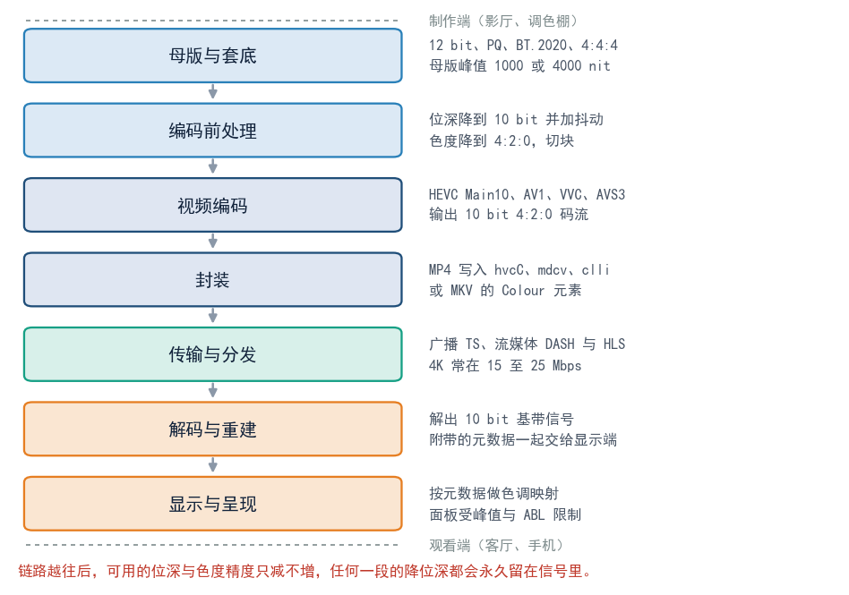
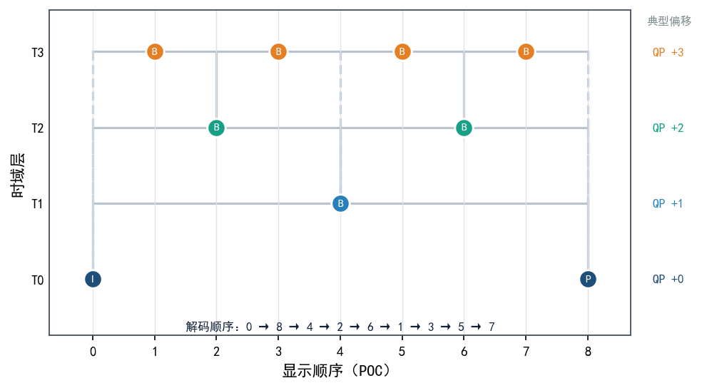
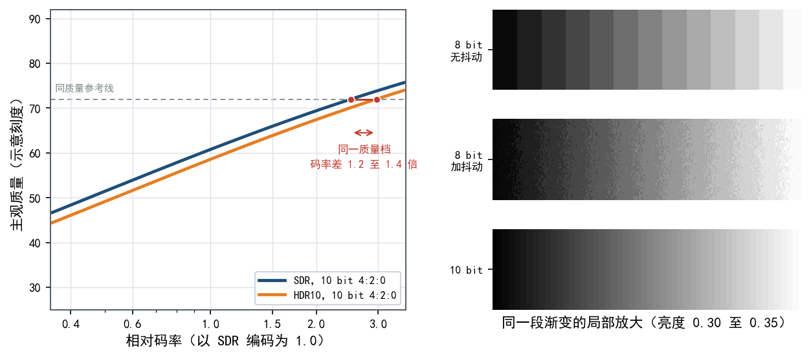
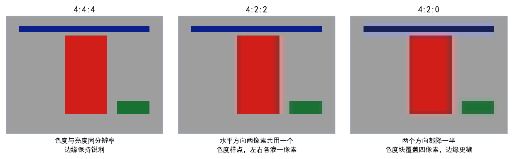
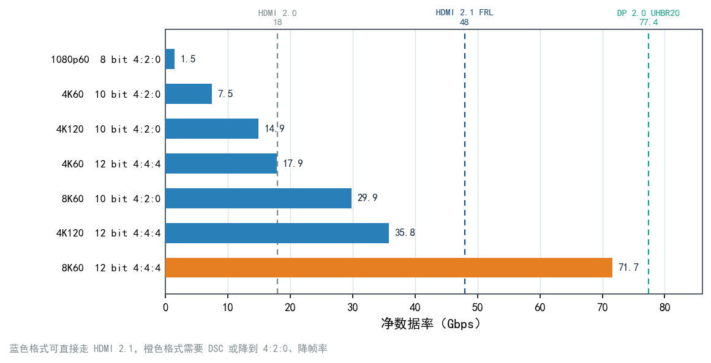
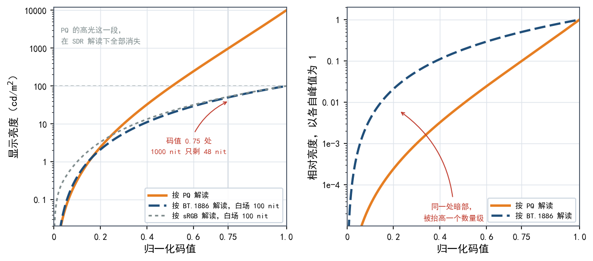
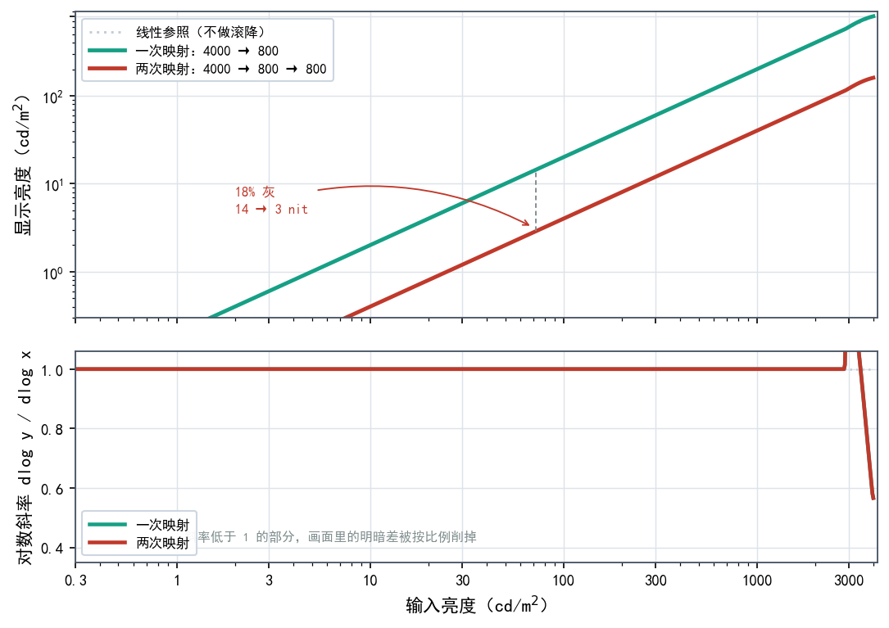

# 第 7 章 编码与传输：10 bit 链路上的 HDR

> 一段 HDR 节目从调色棚走到客厅，中间要过编码、封装、分发、解码、接口几道手，每一道都会拿走一点东西，而拿走的东西不会自己长回来。调色师在 12 bit 的监视器上做的判断，到观众眼前只剩 10 bit 甚至更少，色度从 4:4:4 变成 4:2:0，峰值亮度被面板削掉一截。沿着链路走一遍，就能看清每次取舍发生在哪一步、代价是什么、哪些是不可避免的、哪些只是历史包袱。

## 一、一条链路上有七道关口

图 7-1 把链路画成七个节点。左边是工序，右边是这一步真正发生的事，包括位深、色度、容器和带宽。



最上面是母版与套底，12 bit、PQ、BT.2020、4:4:4，峰值 1000 或 4000 nit。往下走一步，编码前处理把位深降到 10 bit 并加抖动，色度降到 4:2:0，画面切成编码块。再往下是视频编码，HEVC Main10、AV1、VVC、AVS3 都在这一步把像素变成码流，输出 10 bit 4:2:0。封装把码流装进 MP4 或 MKV，顺手写上静态元数据。传输与分发把它送到广播塔、CDN 或光猫。解码与重建还原出 10 bit 基带信号，连同元数据一起交给显示端。最后一步是面板，按元数据做色调映射，受自身峰值和 ABL 的限制。

这条链路上有两类信息。一类是像素本身，位深、色度采样、量化精度都属于这一类，它决定画面能保留多少细节。另一类是元数据，它不占像素，只告诉显示端“这段信号该怎么理解”。前一类只会减少，后一类可以一路补充，但不能凭空造出来。

损失的量级可以先算一下。4K 24 帧、12 bit 4:4:4 的未压缩数据率是

$$
3840\times2160\times36\times24 \approx 7.17\ \text{Gbit/s}
$$

一个像素 36 bit 来自三个分量各 12 bit。同样的片子按 10 bit 4:2:0 交付，每像素 15 bit，压缩后码率取 20 Mbit/s，压缩比接近 360 比 1。这个比例说明两件事：第一，编码器承担了绝大部分数据缩减，位深和色度的调整在数量上只是零头；第二，正因为编码器压得这么狠，它前面那点位深余量才格外重要，10 bit 的信号进编码器，出来还能剩 10 bit 的码值精度，而 8 bit 信号进去，编码器再聪明也变不出暗部的层次。

把各环节的典型参数并排放在一张表里，链路的形状会更清楚。

| 环节 | 位深 | 色度 | 数据率量级 |
|---|---|---|---|
| 母版 | 12 bit | 4:4:4 | 7.2 Gbit/s（4K 24 帧未压缩） |
| 编码前处理 | 10 bit | 4:2:0 | 3.0 Gbit/s（4K 24 帧未压缩） |
| 编码输出 | 10 bit | 4:2:0 | 15 至 100 Mbit/s |
| 解码输出 | 10 bit | 4:2:0 | 15 Gbit/s（4K 60 帧未压缩） |
| 面板驱动 | 10 至 12 bit | 4:4:4 | 由时序控制器与面板决定 |

表里最该看的是编码前后那两行。数据率从 3.0 Gbit/s 掉到 20 Mbit/s，压缩比一百五十倍，位深与色度却一点没变。这说明编码器的工作是去掉冗余，不是降低精度，前者可逆，后者不可逆。工程上的判断也因此有了依据，位深与色度要在进编码器之前就定好，编码器只负责在给定的精度下把冗余压干净。

母版为什么用 4:4:4 而不是 4:2:0，理由不在观感而在后期。调色要在色域之间来回转换，要抠像、要做局部选择、要把不同来源的素材叠在一起，这些操作都在色度平面上进行，色度一旦被抽掉一半，抠像的边缘就毛，色域转换的误差也会放大。等到所有决定都做完，画面定型了，才轮到为了分发而降低色度采样。这也是为什么 4:2:0 只出现在交付环节，不出现在制作环节。

元数据的路径也不是只会做加法。中间设备改写元数据的情况并不罕见，功放或分配器读到母版峰值超出自己能力，会把 mdcv 改写成它认为安全的值，或者干脆把传递特性改成 SDR，让下游能显示。这类改写没有任何提示，现象是画面亮度与预期不符，而源端怎么看都正常。定位的办法只有一个，把中间设备逐个从链路里拿掉，看画面什么时候恢复正常。

链路上有个容易被忽略的顺序问题。位深转换必须只做一次，并且尽量靠近信源。有些工作流里，母版先转成 10 bit 存一版中间片，剪辑软件内部再转一次，导出时编码器又做一次 8 bit 到 10 bit 的上变换，每一次转换都引入一次舍入，累积起来暗场就糊了。正确做法是在编码前处理这一步一次性完成位深与色度的降级，之后整条链路都按 10 bit 4:2:0 处理，中间不再来回折腾。

沿着这条链路走一遍，会发现有三个判断决定了画质的天花板，而且它们出现在很早的位置。第一个是母版的位深与峰值，12 bit 4000 nit 与 10 bit 1000 nit 做出的调色决定完全不同，后者在暗部根本给不出细腻的层次。第二个是编码前的降级策略，降多少、在哪里降、配不配抖动，做完就不能改。第三个是元数据写得准不准，它不改变像素，却决定了显示端怎么理解这些像素。后面所有的环节，编码器、封装、接口、面板，都只是在这三个判断划定的范围里做事。

## 二、位深的那一刀

12 bit 到 10 bit，码值从 4096 级降到 1024 级，整整少四分之三。这件事不是把低两位砍掉那么简单。

先看台阶有多大。第 2 章算过，PQ 曲线下 10 bit 的相邻码值在 1 cd/m² 附近的相对亮度差接近 2%，到 0.01 cd/m² 附近接近 9%。这两个数字都超过人眼在暗适应状态下的分辨阈值，所以一条从黑到深的平滑渐变，在 10 bit 下一定能看到台阶。12 bit 把台阶缩小到四分之一，1 cd/m² 处降到 0.5% 以下，肉眼基本看不出。从 12 bit 降到 10 bit，等于把原本安全的余量重新用光，抖动就是补这个缺口的手段。

抖动的原理是把量化误差打散成噪声。最常用的是 TPDF（三角概率密度）抖动，幅度取正负一个量化台阶，加在舍入之前。原本集中在台阶边缘的一条硬边，被拆成邻域内随机分布的两三个码值，视觉上表现为极细的颗粒而不是条纹。人眼对随机噪声的容忍度远高于对规则条纹的容忍度，这就是抖动有效的感知基础。

代价有两笔。一笔是噪声底抬升，在暗室看暗场时可能察觉到一层薄薄的颗粒，参数调得重了还会显得“脏”。另一笔是码率。抖动把平坦区变成了噪声，编码器的预测在这些区域失效，必须真金白银地传残差。同一段素材，加抖动后码率涨几个百分点到十几个百分点都正常，取决于量化参数和画面内容，平坦渐变多的素材涨得最多。这个代价换来的是暗场没有色带，通常值得。

顺序上有两个坑。第一个坑是把抖动做在色度降采样之前。色度下采样本质是低通滤波，会把高频的抖动噪声一起滤掉，等于白加。亮度通道是全分辨率的，不受影响，所以正确顺序是先对色度做 4:2:0 下采样，再在 4:2:0 的色度平面上加抖动，亮度抖动在 4:4:4 阶段做也可以。第二个坑是拿 8 bit 素材上变换成 10 bit 冒充 HDR 交付。8 bit 到 10 bit 的上变换只是把 256 个码值插值成 1024 个，原本的台阶位置一个不少，只是台阶边缘变得稍微软一点。色带还在，抖动也没做，这种素材进编码器，出来的画面该有色带的地方依然有色带。

抖动的图案本身也有讲究。白噪声抖动最直接，每个像素独立取随机值，频谱平坦，缺点是低频能量不小，在平坦区会留下隐约的云雾状起伏。有序抖动用一个固定的小矩阵循环取值，实现极省，但图案是规则的，在平坦渐变上会形成可见的网纹，HDR 的暗场尤其明显。误差扩散把舍入误差推给邻居，静态图上效果最好，可是在视频里误差会随帧变化，平坦区出现蠕动的颗粒，除非固定随机种子，那样又会在运动时显得僵硬。实践中最常用的是蓝噪声，它的能量集中在高频，人眼与显示端的轻微模糊会把它滤掉，低频干净，暗场既没有色带也没有可见纹理。

定点实现上还有一层。12 bit 到 10 bit 的转换要保留中间精度，通常用 16 bit 定点做，抖动噪声加在低位，最后再右移截断。如果中间精度不够，抖动噪声会被舍入吞掉一部分，幅度不足，色带又回来了。PQ 曲线的转换一般用查找表加速，表的分辨率要够高，10 bit 输入配 12 bit 以上的表项，否则曲线本身又引入一次量化。这些细节听起来琐碎，但暗场色带往往就是在这里漏出来的。

抖动幅度还有一个可以调的地方。等幅抖动是给每个码值加同样的噪声，可 PQ 的感知台阶在暗部大、在亮部小，等幅噪声在暗部相对不足，在亮部又过剩。按亮度加权的实现会在暗部多给一点、亮部少给一点，让掩蔽效果跟台阶大小匹配。这不是标准里的规定，属于编码前处理的经验参数，调得好暗场更干净，调过头就是暗部噪点明显。

抖动与胶片颗粒是两件事，别混。抖动是编码前处理为了让降位深不产生色带而加的噪声，颗粒是画面内容本身，是摄影与后期决定的质感。AV1 的颗粒合成能省掉为颗粒付的码率，但它替代不了抖动，因为抖动必须发生在量化那一步，与位深转换绑在一起。两者可以叠加，代价是噪声底抬升两次，暗场的颗粒会显得比影院版本更粗。调参时要把两笔噪声分开算，别让一个参数背两个目的。

还有一个约束来自下游。10 bit 是分发环节事实上的下限，原因不在画质而在生态：解码器、GPU、接口、面板时序控制器这些年都是按 10 bit 设计的，12 bit 分发的通路几乎不存在。所以母版上的 12 bit 注定要在某一步降到 10 bit，能做的只是把这一步做得体面些。

## 三、编码器里的三个旋钮

进了编码器，HDR 与 SDR 的差别主要体现在参数约束上，而不是算法本身。HEVC Main10 的编码工具集与 Main profile 几乎一样，区别只在位深。

profile 规定工具集和位深。HEVC 的 Main 10 profile 允许 4:2:0 的 8 bit 与 10 bit，编码工具与 Main profile 一致；4:2:2 的 10 bit 属于 Main 4:2:2 10 profile，工具集不同，硬件支持面窄得多，专业链路里常见，消费设备里基本没有。选 profile 就是选设备兼容范围，HDR10 的规范把 Main 10 写死，正是为了让所有解码器都能解。

tier 与 level 规定吞吐和码率上限。tier 分 Main 与 High 两档，High tier 的码率上限是 Main 的四倍，广播与蓝光多用 High tier。level 按亮度样本率划档，两个常用档位的数字值得记住。

| level | 最大亮度样本率（样本/秒） | Main tier 码率上限 | High tier 码率上限 |
|---|---|---|---|
| 5.1 | 534 773 760 | 40 Mbit/s | 160 Mbit/s |
| 6.1 | 2 139 095 040 | 120 Mbit/s | 240 Mbit/s |

4K 60 帧的亮度样本率是 $3840\times2160\times60=497\,664\,000$，落在 5.1 以内。8K 60 帧是 $7680\times4320\times60=1\,990\,656\,000$，必须上到 6.1。这个表解释了一个常见现象：同样标 4K，60 帧的流标 5.1 就够用，120 帧就必须标 5.2，机顶盒的 level 支持不够时只能降帧率。HDR 本身不改变这些数字，但 4K 120 的 HDR 信号正好压着 5.2 的边界。4K 120 帧的亮度样本率是 $3840\times2160\times120=995\,328\,000$，5.1 的 534 773 760 只够 60 帧，120 帧必须标 5.2，其上限 1 069 547 520 只剩百分之七的余量。老芯片在这个位置最容易出问题，因为解码器的吞吐是按 level 的峰值设计的，余量小意味着任何一点调度抖动都会掉帧。

参考结构对 HDR 的影响比 SDR 大。图 7-2 是一个 8 帧的时域分级结构，四个时域层。



横轴是显示顺序，纵轴是时域层。T0 层的 I 帧和 P 帧是整段的锚点，T1 层的 B 帧只参考 T0，T2 层参考 T0 与 T1，T3 层在两条参考链之间，被参考次数最少。解码顺序写在图的下方，0、8、4、2、6、1、3、5、7，与显示顺序不同。编码器给不同层分配不同的量化参数，示意里 T1 到 T3 分别是 +1、+2、+3。层号越高，离参考帧越远，误差传播链越长，所以允许压得更狠。

HDR 在这个结构里有个软肋。暗场细节本来就靠少量码值撑着，T3 层再加三个 QP，阴影里的渐变最先崩，表现为暗部出现块状或条带。工程上常见的做法是给暗场场景单独降 QP，或者对时域高层的帧限制 QP 偏移的幅度。有些编码器提供按亮度加权的量化矩阵，让暗部的量化步长更细，这在 HDR 上是必要的补偿，在 SDR 上属于优化。

编码器的内部精度是另一处容易踩空的地方。HEVC 的预测与变换在内部用高于输入的精度运算，10 bit 输入通常配 12 bit 或 16 bit 的中间精度。有些编码器的内部位深是可配的，配成 8 bit 时会先把 10 bit 输入右移两位再干活，等于在编码器里做了一次降位深，还没加抖动。这种配置下，输入明明是 10 bit，码流也标着 Main 10，暗场色带却跟 8 bit 一样明显。查这个问题要看的不是 profile，而是编码器的内部位深参数。

环路滤波在暗场上的行为值得单独说一句。HEVC 的样点自适应补偿与 VVC 的自适应环路滤波，本质都是按局部统计决定平滑强度，平坦区平滑得更狠。SDR 里这样做没问题，平坦区的码值台阶本来就细；HDR 的暗场不同，那里的码值台阶本身就粗，再被滤波抹一遍，手里仅有的微弱梯度就没了，画面变成一片没有层次的深灰。所以 HDR 编码时通常要把环路滤波的强度调低，或者按亮度分区控制。去块滤波的阈值也有同样的问题，按 8 bit 的阈值表直接搬到 10 bit 上，效果等于强度翻倍，边角会被磨圆。这些参数没有标准答案，只能按素材试。

随机访问是另一个约束。封闭 GOP 的每个关键帧都能独立起播，开放 GOP 的 B 帧会参考下一个 GOP 的 I 帧，从关键帧起播时解码器必须先解后面的帧才能显示前面的帧。这对点播拖动进度条影响不大，对直播切台和短视频起播就有影响，起播延迟会多出几帧。HDR 在这里多一层麻烦，逐帧元数据的时间轴要跟解码顺序、显示顺序都对得上，seek 之后拼接的片段如果元数据从中间截断，前几帧的亮度会跟后面不一致。

场景切换也会影响元数据。动态元数据在镜头切换处本来就会跳变，如果编码器的 GOP 边界没跟镜头对齐，切换点落在 GOP 中间，这一帧又要参考前面的帧，量化参数被前后两段拉扯，元数据的跳变就会跟画质的跳变叠在一起，观众看到的是一次闪烁。工程上常见的做法是在镜头边界强制插入关键帧，让元数据跳变、参考结构重置、量化参数重置三件事同时发生。

逐帧元数据和这个结构还有一个配合问题。动态元数据是按显示顺序逐帧给的，编码后帧的顺序被打乱，元数据必须跟着访问单元走，解码器重建出显示顺序之后再按图像顺序号对齐。图 7-2 里如果第 4 帧的元数据错位到了第 2 帧，观众看到的就是一次突兀的亮度跳变。杜比视界把这类信息放在独立的 RPU 里，每个访问单元带一份，正是为了避免对齐出错。HDR10+ 的元数据挂在 SEI 上，同样跟着访问单元，但 SEI 可以被中间环节丢弃，丢弃之后对齐关系就断了。

## 四、AV1、VVC 与 AVS3 各自的靶子

HEVC 之后出现了三个有分量的编码标准，它们的定位不一样，混在一起谈压缩率容易得出错误结论。

AV1 由开放媒体联盟在 2018 年发布，目标是免专利费的互联网分发。它在 HDR 上有三处设计值得说。一是原生支持 10 bit 与 12 bit，也支持 4:2:2 和 4:4:4，不像 HEVC 那样把高位深锁在特定 profile 里。二是码流里定义了 metadata OBU，用类型号区分内容，1 是内容亮度（MaxCLL 与 MaxFALL），2 是母版显示色域体积，4 是 ITU-T T.35 的厂商私有数据。解析器按类型号分发，比 HEVC 靠 SEI 类型号猜要清爽。三是胶片颗粒合成（film grain synthesis），编码前把颗粒从画面里去掉，只传一组颗粒参数，解码端按参数重新合成。

第三点对 HDR 特别有用。颗粒本身是高频随机噪声，编码器为它付的码率极高，而颗粒在感知上的作用恰恰是掩蔽暗场色带。去掉再合成，码率省下来了，掩蔽效果还在。副作用是合成的颗粒不参与亮度统计，如果显示端按元数据做色调映射，颗粒的幅度不会跟着变，极亮或极暗的场景里颗粒可能显得不自然。另外，颗粒参数是全局的，画面里局部颗粒强弱变化大的镜头合成效果会失真。

VVC（H.266）在 2020 年完成，工具集里增加了多类型树划分、仿射运动、自适应环路滤波、预测残差联合编码等。公开的主观测试报告给出的同质量码率节省在四成上下，比 HEVC 到 AV1 的幅度更明显。代价是解码复杂度，软件解码的运算量大约是 HEVC 的两倍，硬件解码器的面积也更大。部署上它先落在广播与地面电视（巴西的 TV 3.0 系统是典型例子），流媒体侧推进得慢，原因不在技术而在专利与设备存量。

AVS3 由中国 AVS 工作组制定，定位与 VVC 同期，主要落地场景是国内的 8K 广播与超高清频道。它在 8K 上的工具配置比较激进，帧内预测和变换的块划分更灵活。对 HDR 的支持同样走 SEI 路线，配合国内推动的 HDR Vivid 格式使用。

12 bit 编码的处境也值得说一句。HEVC 有允许 12 bit 的 profile，但消费设备几乎都不支持硬解，编解码的运算量也上去了。所以 12 bit 基本停在母版与中间片，一旦要分发就得降到 10 bit。少数专业格式在内部用 12 bit 传输，比如杜比视界的某些 profile，那是靠专用解码器撑着的。工程上把 12 bit 当成制作精度，把 10 bit 当成交付精度，这个分工短期内不会变。

落地的现实也要看。AV1 的 10 bit 解码已经在主流浏览器和移动芯片上普及，YouTube 的 8K HDR 用它分发，几家流媒体平台在部分电视上启用了 AV1。HEVC 的覆盖仍然最广，原因不在效率而在存量设备，几乎每台 4K 电视的硬解单元都支持 Main 10。VVC 的落地集中在广播，地面电视与卫星系统的换机周期长，标准一定就是十几年。AVS3 的落地跟着国内的 8K 频道走。选编码格式从来不是选压缩效率最高的那个，而是选覆盖最广的那个，多出来的压缩率换不来播不出去的观众。

把这三个标准放在一起比“省多少码率”意义不大。所有公开数字都依赖测试序列、量化参数、质量指标和观看条件，换个序列集结论就能翻转。真正该看的是三件事：你的设备池里有多少能硬解，你的封装与分发链路是否已经支持，以及它在暗场平坦区表现如何。第三件事在 HDR 上最要紧，而恰恰是标准测试里覆盖最少的。

## 五、码率：HDR 到底贵多少

谈码率先要有个统一的尺子，最方便的是每像素比特数（bits per pixel，bpp），算法是码率除以每秒像素数。

$$
\text{bpp}=\frac{R}{W\times H\times f}
$$

4K 60 帧、20 Mbit/s 的流，分母是 $3840\times2160\times60=4.98\times10^{8}$ 像素每秒，bpp 约 0.040。1080p 60 帧、8 Mbit/s 的流，bpp 约 0.064。同一段画质水准，分辨率越高 bpp 可以越低，因为大画幅的像素之间有更多冗余可以利用，这也是 4K 用 20 Mbit/s 看起来不差、1080p 用 20 Mbit/s 却近乎无损的原因。

HDR 相对 SDR 的码率需求，公开测试报告给出的常见区间是 1.2 到 1.4 倍，同编码器、同主观质量档。这个倍数的来源有三个。

第一个是暗场的量化台阶。PQ 曲线把大量码值分配给了中高亮度，暗部的台阶本来就大，编码器要保住阴影里的渐变，必须把量化参数压得很低，残差码字随之变多。SDR 的暗部没有这个问题，gamma 2.4 在暗部堆了足够的码值。

第二个是色域。BT.2020 的三角形比 BT.709 大得多，同样的色度量化误差，在大色域里对应的色差更大。编码器要在高饱和区保住颜色，同样要多花码率。

第三个是平坦区。HDR 的风光、夜景、室内暗调镜头里有大量近平坦的渐变，这些区域在 SDR 里是均匀的色块，编码器一个码字就能描述；在 HDR 里它们是缓变的斜坡，每一点差异都要传。前面说的抖动又会把斜坡变成噪声，进一步推高码率。

图 7-3 把这两件事画在一起。



左图的横轴是相对码率，以 SDR 编码的码率归一化为 1.0，纵轴是主观质量分。两条曲线形状相同，橙色的 HDR 曲线整体向右平移。图上画了一条同质量参考线，两条曲线与它的交点横坐标相差 1.2 到 1.4 倍，这就是前面那个区间的图示。曲线只表示形状关系，标出的倍数取自公开报告的常见区间，不是某条具体序列的实测值。右图更有说服力。同一段亮度从 0.30 到 0.35 的渐变，局部放大后，8 bit 无抖动只剩六七个台阶，边界清清楚楚；8 bit 加抖动后台阶被打散，但噪声很明显，暗部像蒙了一层沙；10 bit 几乎没有台阶，过渡连续。三者的码率代价也不同，中间那条要传噪声，码率最高。

这个图还说明一件事，抖动不是万能的。它把条纹换成了颗粒，在观看距离合适、显示端有轻微模糊的情况下，颗粒会被滤掉而条纹不会，所以抖动有效。但如果颗粒幅度太大，或者面板太锐利，颗粒本身就成了新的瑕疵。实际参数的取法通常是让噪声幅度刚好能掩盖台阶，多一点都不要。

码率控制策略在 HDR 上要调整。常见的做法有几种。恒定质量（CRF）适合点播，让编码器按画面复杂度分配码率，缺点是峰值码率不可控，暗场复杂镜头可能冲得很高。两遍编码可以在第一遍统计复杂度，第二遍按镜头分配码率，把预算更多给暗场和渐变多的段落。恒定码率（CBR）是广播的硬要求，必须靠 VBV 缓冲区约束，代价是复杂镜头会被压得很惨，HDR 的暗场在这种模式下最容易崩。按镜头分段编码（shot-based encoding）在流媒体上越来越常见，每个镜头单独定码率，镜头边界不共享参考帧，避免上一镜的量化误差传下来。

缓冲区的设置值得单独说。恒定码率下编码器受虚拟缓冲区约束，缓冲区小、码率上限低，遇到暗场复杂镜头就只能把量化参数推高，画面立刻出块。缓冲区大一点能削峰，代价是起播延迟和内存。直播场景这两样都紧张，所以直播的 HDR 暗场质量普遍不如点播，根子在缓冲区预算，不在编码器好坏。

具体数字可以给几个参照。流媒体的 4K HDR 点播，15 到 25 Mbit/s 是主流区间，头部平台的高码率档会到 30 Mbit/s 以上。蓝光超高清碟的上限是 100 Mbit/s，实际编码常用 60 到 80 Mbit/s，这个码率下 10 bit HEVC 的暗场基本看不出问题。8K 广播一个转发器的容量在 100 Mbit/s 量级，要装下一路 8K 节目，编码器必须用上 VVC 或 AVS3 这类新标准。

编码器的参数里能直接看到这套逻辑。x265 有两个选项专门承载静态元数据，master-display 按 ST 2086 的十个字段写，格式是红绿蓝三原色的坐标加白点加最大最小亮度，max-cll 写内容亮度统计的两个数。还有一组 HDR 专用开关，打开 hdr10 之后码率控制会照顾暗场，hdr10-opt 则在暗场优先抑制块效应而不是削细节。这些参数不影响能不能解码，只影响显示端拿到什么信息、编码器把力气花在哪。缺了它们，码流照样能播，画面就是差一口气。

自适应码率还有一条约束容易被忽视。同一部片子通常要出五六个码率档，从 4K 高码率到 1080p 低码率，客户端按带宽切换。所有档位的元数据必须一致，切换时才不会跳。有些平台为了省成本，把低码率档做成 SDR，客户端一切换，画面从 HDR 掉到 SDR，亮度整体跳一次，观众会觉得画面忽然“亮了一下又暗下去”。技术上这是两套内容，不是同一内容的两个档位，混在一条 ABR 阶梯里就是错的。

最后提一句质量评估。PSNR 和 SSIM 都是在 gamma 域里算的，直接搬到 PQ 码值上会得出荒唐结论，因为 PQ 码值的一格在暗部和高光对应的亮度差了几百倍。比较靠谱的做法有三种：把信号转回线性亮度再算 PSNR；用 BT.2408 附录里的方法算 $\Delta E_{ITP}$；或者直接用 HDR-VDP-3 这类考虑人眼模型的指标。工程上还有一个土办法很有效，把两版画面的暗场局部放大并排看，色带和块的差别一眼就能看出来，比任何数字都直观。

## 六、色度采样与色度量化

4:2:0 的存在理由是人眼对色度的分辨率低于亮度。这个结论在 SDR 时代靠大量主观测试确立，在 HDR 时代依然成立，但代价变大了。

代价变大的原因有两个。第一是色域。BT.2020 的色度平面比 BT.709 大了将近一倍，同样是几个码值的色度误差，换算成 CIELAB 里的色差要大得多。第二是亮度对比。HDR 画面里亮暗并置的情况远多于 SDR，高饱和色块紧挨着深色背景时，色度误差会在边界上形成明显的彩色镶边，而 SDR 里这种镶边会被较低的对比度掩盖。

图 7-4 用一幅合成图案说明色度下采样对边缘做了什么。



图案里有三个元素，一条两像素高的细蓝线，一个高饱和红块，一个绿色小块。4:4:4 下三个元素边缘都很干净，细蓝线的上下边界锐利。4:2:2 下水平方向的色度分辨率减半，红块左右两侧各渗出一像素宽的浅红，细蓝线的两端出现淡蓝的拖尾。4:2:0 下两个方向都减半，色度块覆盖四像素，红块四周的渗色更宽，细蓝线的颜色明显变淡，因为它的色度被邻域的灰背景平均掉了。

这三个元素的差别说明一件事，4:2:0 对自然画面友好，对图形元素不友好。自然画面的色度变化本来就平缓，下采样损失的只是肉眼难辨的高频；文字、图标、字幕、纯色块这些人工元素有硬边，色度一低通就糊。游戏主机和 PC 在 HDR 下输出 4:2:0 时，界面文字出现彩色毛边就是这个原因。解决办法不是提高色度采样，而是在链路上给图形单独一层，让字幕和 UI 以 4:4:4 的独立平面叠加，或者干脆走 4:2:2 的专业链路。

色度的量化参数需要单独调。Y'CbCr 的三个分量在编码时共用一套量化参数推导规则，但色度的视觉重要性和亮度不同，所以标准允许给色度加偏移。HEVC 的语法里，图像级和条带级各有一组 Cb、Cr 偏移，取值范围正负 12。偏移为正表示色度压得更狠，为负表示保得更细。

HEVC 还有一张色度 QP 映射表，规定当亮度 QP 超过 29 之后，色度 QP 的增长速度减半。原因是色度变换的量化步长随 QP 增长得比亮度快，不压一下，高 QP 段色度会先崩。这张表是标准强制的，编码器不用自己管，但工程上要理解它的含义：当你把亮度 QP 推到 40 以上时，色度实际用的 QP 只有 36 左右，色度并没有跟着亮度一起变差。

HDR 上的经验是给暗场负的色度偏移。暗部的色度台阶比亮度台阶更容易被看见，因为人眼在暗适应状态下对色彩的敏感度反而相对提高，而暗部的色度码值又少。给 Cb、Cr 各负两到四，能明显改善阴影里的彩色噪点，代价是码率小幅上升。

ICtCp 是另一条路。BT.2100 把它列为与 Y'CbCr 并列的表示方式，杜比视界内部就用它。做法是先把 RGB 转到 LMS 锥体响应空间，再做一轮矩阵变换得到 I、Ct、Cp 三个分量，整个变换在 PQ 编码之后进行。I 近似感知亮度，Ct 和 Cp 是两个对立色轴，蓝黄轴和红绿轴。

它的好处在色度子采样上。Y'CbCr 的色度分量里混有亮度信息，高饱和区域的色度误差会反过来影响感知亮度，产生所谓的串扰。ICtCp 的设计让 I 与两个色度轴更正交，4:2:0 下色度误差主要停留在色相上，不会把亮度也带偏。杜比视界敢在 10 bit 甚至更低的有效位深下保持画质，一部分原因就在这里。

边界也要说清楚。ICtCp 不是向后兼容的表示，解码端必须专门支持，转回 RGB 要多做一次矩阵乘法和一次 PQ 反变换，运算量比 Y'CbCr 高。它依赖 BT.2020 的原色定义，色域之外的负值处理要小心。大多数通用编码器与播放器默认还是 Y'CbCr，ICtCp 主要集中在杜比视界这类封闭生态里。所以它是一个好工具，但不是默认选项。

下采样与上采样的滤波器也不能随便。把 4:4:4 降到 4:2:0 时，如果只做简单的两点平均，高频色度信息会折叠回来形成摩尔纹，彩色细密纹理上会出现不该有的花纹。正规实现用一个覆盖更多抽头的低通核，先把可能折叠的频率压掉再抽取。显示端把 4:2:0 升回 4:4:4 时，插值核的宽度决定了边缘过渡的宽度，双线性插值只有两抽头，边缘会糊出两像素，好一点的实现用四抽头甚至带边缘检测的插值，能保住一部分锐度。插值无法创造信息，只能把已有的样本排得好看些。

4:2:2 在专业链路里仍然是主流，原因不是画质而是历史与带宽的平衡。专业监视器、录机、SDI 接口的 12G 版本正好能装下 4K 60 帧 10 bit 4:2:2，色度水平方向全保留，垂直方向减半，代码、字幕、图形都不会糊。消费链路走 4:2:0，是因为接口带宽和存储成本都要再省一半，而客厅观看距离下人眼分辨不出这点差别。两条链路的交界处就是发灰之外另一个常见故障点，4:2:2 素材转 4:2:0 时如果没有重新滤波，直接丢掉一半色度样本，画面会出现锯齿状的彩色边缘。

色度与色调映射之间还有一个交互。色调映射是在亮度通道上做的非线性压缩，压缩之后色度与亮度的关系变了，如果映射只改亮度不改色度，高饱和区域会显得发白或者过饱和。正规实现在线性光或者 ICtCp 这类亮度色度分离得比较干净的域里做映射，映射完再转回显示用的信号。在 Y'CbCr 上直接压亮度的做法很常见，效果是色相漂移，红色容易变成橙，蓝色容易变紫。这也是 4:2:0 与 tone mapping 一起用时需要留心的第二层损失，第一层是采样，第二层是映射顺序。

色度样本的位置约定也会出问题。MPEG-2 时代的 4:2:0 把色度样本放在四个亮度像素的正中间，H.264 与 HEVC 的 4:2:0 把色度在水平方向与左侧亮度像素对齐，垂直方向落在两行之间。两套约定互相转换时如果按错位置插值，色度会整体偏移半个像素，红蓝边缘出现方向一致的单边镶边，看静态图不明显，画面横向运动时镶边会跟着动。这种错误在把老素材重新打包成新格式时偶有发生，靠肉眼很难判断，只能用彩条测试图逐像素比对。

## 七、封装：元数据住在哪里

编码器输出的是裸码流，要送进播放器还得装进容器。容器管两件事，一是把视频、音频、字幕排成时间轴，二是存那些不属于像素的附加信息。HDR 的元数据就住在第二类里。

MP4（ISO/IEC 14496-12）用 box 结构组织一切。视频轨的样本描述里有一个采样入口，标识编码类型，HEVC 用 hvc1 或 hev1，两者的区别是参数集放在 hvcC 里还是随码流内嵌。紧接着有几个专门的 box 放色彩信息。

colr 是最基础的一个，里面用 nclx 结构写四个数，原色、传递特性、矩阵系数、是否全范围。BT.2020 加 PQ 加非恒定亮度矩阵的组合写成 9、16、9。这三个数字错了，播放器会把 PQ 当 SDR 解，画面立刻发灰，而后面的元数据都白写了。

mdcv 装母版显示色域体积，即 SMPTE ST 2086 的那十个字段，红绿蓝三原色的 xy 坐标、白点坐标、最大亮度、最小亮度。播放器不解码画面就能知道这段内容是按什么监视器做的。clli 装内容亮度统计，两个数，最大内容亮度和最大帧平均亮度。这两个 box 都是可选的，缺了播放器只能猜，猜的方式通常是按 1000 nit 处理。

杜比视界在采样入口里加一个 dvcC 或 dvvC 盒子，记录 profile、level、是否有 RPU、兼容基流的类型。RPU 本身是码流里的独立 NAL 单元，每个访问单元带一份，所以它在 MP4 里就藏在 mdat 里，容器层面只需要说明“这里有 RPU”。HDR10+ 没有自己的 box，它的动态元数据完全靠 SEI 承载，容器层看不到，这也是为什么有些转封装工具会把 HDR10+ 弄丢而自己毫无察觉。

双层杜比视界的结构更复杂。蓝光版本把基础层与增强层放在两条视频轨里，基础层本身就是一条可解的 HDR10 码流，增强层带残差与 RPU，两条轨在时间上严格对齐。流媒体版本把两层合成一条，RPU 内嵌在码流里。前一种结构下，容器要保证两条轨的样本时间戳完全一致，任何一帧错位都会让画面出现一片噪点。后一种结构简单，但要求解码器认识 RPU 的语法，不认识的解码器只能按基础层解，画质降级到 HDR10。

MKV 的做法不同。它用 EBML 的元素树，色彩信息挂在视频轨的 Colour 元素下，字段名与含义跟 MP4 那套一一对应，MatrixCoefficients、Primaries、TransferCharacteristics、Range、MasteringMetadata、MaxCLL、MaxFALL。杜比视界通过 BlockAdditionMapping 声明附加数据的类型。MKV 的好处是字段全在明处，用 mkvinfo 一眼能看到；坏处是不同工具写入的字段命名不完全一致，转封装时容易漏。

传输流（ISO/IEC 13818-1）最寒酸。它设计于 1990 年代，没有为色彩信息留位置，HDR 元数据只能靠 HEVC 的 SEI 带，容器层能做的只有在 PMT 里挂一个编码类型描述符。HLG 广播稍微好一点，因为 HLG 不带元数据，传输特性写进 SPS 的 VUI 就够了，一个字段解决全部问题。

| 容器 | 静态元数据 | 动态元数据 | 常见丢失点 |
|---|---|---|---|
| MP4 | colr、mdcv、clli | SEI 或 RPU | 转封装时漏写 mdcv 与 clli |
| MKV | Colour 元素 | SEI 或 RPU | 字段命名不一致，工具只搬部分 |
| TS | 仅 SEI | 仅 SEI | 重新复用码流时 SEI 被丢弃 |

元数据丢了会怎样，可以分三种情况看。第一种是三个色彩字段丢了或写错，播放器按 BT.709 与 SDR 处理，画面对比度塌下来，高光一片惨白，这就是最常见的“HDR 没生效”。第二种是 mdcv 与 clli 丢了，播放器不知道内容峰值，只能按经验值猜，猜高了画面偏暗，猜低了高光被压平，观众感觉“有点闷”却说不出哪里不对。第三种是动态元数据丢了，HDR10+ 退化成 HDR10，画质损失相对最小，因为静态元数据还在。

链路上最脆弱的位置是转封装。原始素材从电影母版转成 mezzanine，再转成平台的打包格式，中间可能经过 FFmpeg、商业转码器、CDN 的切片工具，每一道都可能把不认识的 box 丢掉。稳妥的做法是在交付规范里明确要求保留这些 box，并在每一道工序后用工具核对一遍。用 ffprobe 看 side_data 能看到 mdcv 与 clli，用 mp4box 或 mp4dump 能直接看到 box 树，两个工具交叉验证最可靠。

```text
ffprobe -v error -select_streams v:0 -show_streams input.mp4
mp4box -info input.mp4
mkvinfo input.mkv
```

三条命令各有侧重。ffprobe 看的是解码器视角，重点看 color_primaries、color_transfer、color_matrix 三个字段，以及 side_data_list 里有没有 Mastering display metadata 与 Content light level。mp4box 看的是容器视角，box 树里 colr、mdcv、clli 在不在、值对不对，一眼就能确认。mkvinfo 看 MKV 的 Colour 元素有没有被完整写入。三个工具都说没问题，元数据才真的在。

分片封装还有一处细节。CMAF 与分片 MP4 把文件切成初始化段加若干媒体分片，moov 与里面的 colr、mdcv、clli 只写在初始化段，媒体分片里只有 mdat。转码平台重新生成初始化段时如果漏写这几个 box，整个片库的元数据就集体消失了，而每一段单独看都正常。HLS 的清单里还有一个 VIDEO-RANGE 属性，取值 SDR、PQ、HLG，标错了客户端会按错误的机型选流，把 HDR 变体发给只支持 SDR 的终端。这类问题查起来要靠对比清单与实际码流，光看播放效果容易被误导。

## 八、接口：带宽怎么算

显示接口是链路的最后一段，也是最容易出物理问题的一段。先把带宽算清楚。

一路视频的净数据率等于像素数乘每像素比特数乘帧率。

$$
R = W\times H\times b_{\text{px}}\times f
$$

$b_{\text{px}}$ 是每像素的总比特数，10 bit 4:2:0 是 15，12 bit 4:4:4 是 36，10 bit 4:4:4 是 30。真实链路还要加上消隐区，4K 60 帧的消隐开销约百分之七，粗略估算时常常忽略，要做精确比较就得算进去。

接口标称的速率是原始线路速率，扣掉编码开销才是能装数据的净荷。HDMI 2.0 用三条 TMDS 通道，每条 6 Gbit/s，8b/10b 编码，净荷 14.4 Gbit/s。HDMI 2.1 换成 FRL，四条通道，每条速率可配 3、6、8、10、12 Gbit/s，最高 48 Gbit/s 原始速率，16b/18b 编码，净荷 42.67 Gbit/s。DisplayPort 1.4 是四条通道各 8.1 Gbit/s，8b/10b，净荷 25.92 Gbit/s；DisplayPort 2.0 的 UHBR20 是四条通道各 20 Gbit/s，128b/132b，净荷 77.37 Gbit/s。

图 7-5 把常见格式的需求与这三条上限画在一起。



左边几行是需求，竖虚线是接口上限。1080p 60 帧 8 bit 4:2:0 只要 1.5 Gbit/s，任何接口都够。4K 60 帧 10 bit 4:2:0 是 7.5 Gbit/s，HDMI 2.0 也能过。4K 120 帧 10 bit 4:2:0 涨到 14.9 Gbit/s，正好卡在 HDMI 2.0 的 18 Gbit/s 原始速率附近，考虑编码开销之后余量很小，实际产品几乎都办不到，必须上 2.1 或者开压缩。4K 60 帧 12 bit 4:4:4 是 17.9 Gbit/s，同样过不了 2.0。8K 60 帧 10 bit 4:2:0 要 29.9 Gbit/s，超过 2.1 的净荷只有一点点余量，实际要靠压缩。最后一行的 8K 60 帧 12 bit 4:4:4 要 71.7 Gbit/s，只有 UHBR20 勉强能过，橙色标注的正是这种必须上压缩或降格式的情况。

这张图解释了一个常见困惑，为什么同样一根 HDMI 线，接 4K 60 的 HDR 好好的，换成 4K 120 就黑屏。线还是那根线，带宽需求从 7.5 涨到 14.9，翻了一倍。HDMI 2.0 的线材认证只保证 18 Gbit/s 原始速率下的信号完整性，到 2.1 的 48 Gbit/s，线材必须重新认证，超过三米基本要用有源光纤。

带宽不够时的第一条出路是显示流压缩（DSC）。它是 VESA 的固定码率编码，按 8 比特一组做预测、量化和熵编码，压缩比通常在 3 比 1 上下，最高可以到 4 比 1，延迟固定在一个像素块以内，实现上放在接口的发送端，接收端解压，对上层完全透明。判断它是否“无损”的依据是 ISO/IEC 29170-2 的二选一强制选择测试，通过一定比例就算视觉无损。这个测试衡量的是“看不出差别”，不是“数学上无差别”，在极端图案上仍可能看出。

DSC 与 HDR 一起用有几个坑。第一是版本，早期 DSC 只支持 8 bit，10 bit 与 12 bit 的原生支持在 1.2a 版本才补齐，老设备标称支持 DSC 但不支持高位深，开了 HDR 就会退回 8 bit 或者直接黑屏。第二是链路中的中间设备。功放、分配器、光纤延长器如果不支持 DSC 直通，信号会在它那里被截断，源端看到 EDID 说支持，实际传到电视就失败，排查时很难定位。第三是压缩比与时序的配合，3 比 1 是常见配置，但如果源端为了留余量要 2.5 比 1，而接收端只认 3 比 1，两边谈不拢就退回未压缩，带宽立刻不够。

第二条出路是降格式。把 4:4:4 降到 4:2:0，带宽省一半；把 12 bit 降到 10 bit，再省六分之一；把 120 帧降到 60 帧，再省一半。这三种降级对画质的影响依次是色度、精度、运动，实际产品通常先降色度，因为桌面文字之外的内容大多看不出。游戏主机在 4K 120 的 HDR 模式下默认输出 4:2:0，就是这个道理。

USB-C 上的 DisplayPort 替代模式是另一条通路。四条通道全给显示时，UHBR20 能给到 77.37 Gbit/s；只给两条时减半，还要跟 USB 3.2 的数据通道分带宽。笔记本接 HDR 显示器时，如果同时插着移动硬盘，显示链路可能从四通道掉到两通道，4K 120 就上不去了。这类问题在扩展坞上尤其常见，因为扩展坞内部还要做一次通道分配。

FRL 的速率是分级的，一共六种模式，三条通道各 3 Gbit/s、三条各 6、四条各 6、四条各 8、四条各 10、四条各 12，对应原始速率 9 到 48 Gbit/s。源端上电后从高档往低档试，线材或接收端撑不住就降一档，降到 32 Gbit/s 时 4K 120 帧 10 bit 4:4:4 就不成立了。所以“支持 HDMI 2.1”这句话没有信息量，要看它跑在哪个 FRL 模式上，很多标称 2.1 的设备实际只做到 FRL3 或 FRL4。

前面算净数据率时忽略了消隐区，实际比较时不能忽略。CTA-861 给 4K 60 帧定的时序是每帧 4000 乘 2222 个像素周期，有效像素只有 3840 乘 2160，开销约百分之七。这个比例看着小，但在 4K 120 这种贴着上限的场合，百分之七的余量就是能不能过的分界线。所以选线、选设备时要按总像素率去对接口规格，而不是按有效像素率，后者算出来的数字总是偏乐观。

EDID 里那块和 HDR 有关的字段值得单独看一眼。CTA-861.3 定义了一个 HDR 静态元数据数据块，里面列出显示端支持哪些电光转换曲线，可以带一组 ST 2086 参数说明面板自身的色域与亮度，还可以声明期望的内容最大亮度。源端读这些字段决定送什么，读错了就出问题。最常见的是源端只看“支持 HDR”这个标志位，不看具体支持哪条曲线，把 PQ 的信号送给只支持 HLG 的显示端。另一种是面板声明了很高的期望亮度，实际受 ABL 限制根本维持不住，源端按声明值做映射，画面在亮场景里整体变暗。

接口规格表里还有一项容易忽略，色深的协商是逐级的。源端会按 EDID 里声明的顺序尝试，先试 12 bit，不行退 10 bit，再不行退 8 bit。有些显示器的 EDID 里同时声明了 12 bit 与 10 bit，实际只在 10 bit 下稳定，源端却先谈成 12 bit，链路工作在临界状态，表现为偶发的闪烁或闪黑。把源端的色深手动锁到 10 bit 往往就解决了，这类问题在长线材上出现得更频繁。

动态元数据在接口上还有一段路要走。HDMI 2.1 允许源端用信息帧把逐帧或逐场景的元数据送给显示端，HDR10+ 就靠这条路把 ST 2094-40 的参数传过去。DisplayPort 1.4 起也在副数据包里预留了传递 HDR 元数据的位置。麻烦在于这一段是易失的，接口上丢了就没了，不像文件里那样可以事后补。所以用 HDR10+ 的片源在中间接了分配器、延长器或者老功放时，动态元数据经常到不了电视，画面退回静态映射，效果介于 HDR10 与 HDR10+ 之间，用户只会觉得“好像没那么亮”。

游戏场景里还有一层叠加。可变刷新率让帧间隔随渲染速度变化，接口的时序不再是固定的一组参数，带宽要按最高帧率预留，不然一旦帧率上冲就溢出。HDR 与可变刷新率同时开启时，面板的亮度控制、背光分区、刷新节奏三套逻辑互相牵制，暗场容易出现亮度随帧率波动的闪烁。这类问题在纸面参数上看不出来，只能在实机上试，试的时候要把 HDR、可变刷新率、低延迟模式三种组合都走一遍。

## 九、几个反复出现的故障

链路上真正让人头疼的不是参数怎么设，而是出问题时现象相似、原因不同。下面这几个故障在工程支持里出现频率最高。

### 8 bit 链路上的 HDR

现象是画面整体发灰，黑位浮起来，高光没有力度，像蒙了一层雾。很多人第一反应是片源有问题，其实多数情况下信号本身没错，错在解读方式。

图 7-6 把这件事算清楚了。



左图的横轴是归一化码值，纵轴是绝对亮度，对数刻度。橙色是 PQ 解读，码值 0.75 对应 983 cd/m²，接近常见的 1000 nit 峰值。蓝色是 BT.1886 在 100 nit 白场下的解读，同一个码值只有 48 cd/m²，相差二十倍。灰色是 sRGB 的解读，比 BT.1886 略高一点，量级相同。高光段那一大片从 100 到 10000 nit 的区间，在 SDR 解读下整个消失了，压缩进 48 到 100 nit 这一小段。

右图把两条曲线按各自峰值归一化，看的是相对关系。橙色曲线在整个中高段都低于蓝色，意思是同一个码值，PQ 解读给出的相对亮度比 SDR 解读低得多。反过来看就是发灰的成因，一段 HDR 信号被当 SDR 解，暗部的相对亮度被抬高了一个数量级，本该接近黑的区域变成了深灰，亮部又挤在顶部无法展开，整幅画的对比度被压扁。

为什么会走到这一步，路径有几条。

第一条是传递特性没传到。码流里没有写传递特性为 PQ，或者写了但被中间设备剥掉，播放器只能按默认的 BT.709 与 gamma 2.4 处理。第 3 章讲过 SEI 147 的作用，就是防这种情况，但它不是强制项。

第二条是能力协商失败。显示端的 EDID 里没有声明支持 PQ，源端按规矩应该输出 SDR，但如果源端没做色调映射，只是把 HDR 信号原样送出，显示端就会用自己的默认曲线解，结果还是发灰。这类问题在机顶盒加老电视的组合里最常见。

第三条是真的只有 8 bit 通路。带宽不够或者设备太老，链路把 10 bit 截成 8 bit，高两位的信息直接扔掉，画面变成 256 级的 PQ。这时候即使传递特性写对了，暗部也会出现明显的色带，因为 8 bit 的 PQ 在暗部的台阶达到百分之十几。

第四条是软件层的开关。桌面系统在 SDR 模式下播放 HDR 内容，会把 PQ 信号塞进 SDR 的合成管线，系统输出的还是 SDR 信号，播放器做的色调映射质量参差不齐，发灰是常态。判断方法是看系统的 HDR 开关状态，而不是看播放器的设置。

第五条成因是范围搞错了。BT.2100 的 10 bit 信号用窄范围，亮度占 64 到 940，色度占 64 到 960，两头留出余量给滤波过冲。如果解码端按全范围解释，黑色的 64 被当成 64/1023 的亮度，画面整体发灰；反过来，全范围信号被当窄范围解，黑位被压死，暗部细节全丢。这个错误在跨平台转码时很常见，因为有的工具默认全范围，有的默认窄范围，接口上还有一个“是否全范围”的标志位容易被忽略。

还有一类发灰跟片源无关，出在操作系统的合成器上。桌面同时开着 SDR 窗口和 HDR 视频时，系统要把两者混进同一条 HDR 信号，SDR 内容按参考白映射进去，系数设错就一边过亮一边过暗。反过来，HDR 视频放进 SDR 桌面，系统自己做一次色调映射再输出，映射质量取决于系统而不是片源。同一个视频在播放器窗口模式和全屏模式下亮度不同，多数就是这个原因，跟链路带宽、元数据都没有关系。

排查顺序建议从后往前。先确认显示端是否真的进入了 HDR 模式（多数电视会在信号信息里显示 HDR 标识），再确认源端输出的信号格式（分辨率、位深、色度、传递特性），最后才怀疑片源。中间有功放或分配器时，把它从链路里拿掉试一次，能省很多时间。

### 接口层丢掉了动态元数据

接口上送动态元数据的那条路断了，现象比发灰更难察觉。画面结构完全正常，静态元数据也在，只是每一帧该有的亮度调整没有了。夜景里该提亮的路灯不提亮，逆光镜头该压的高光不压，整片看起来“能用但不出彩”。

判断的办法是看显示端的信息显示。支持 HDR10+ 的电视在收到动态元数据时会显示对应的标识，只显示 HDR 就说明元数据没到。也可以拿同一段素材直连电视对比一次，中间设备全部去掉，差别明显就说明问题出在链路上而不是片源。这类故障没有软件开关可以修，只能换设备或者接受静态映射。

### 解码器把 10 bit 截成 8 bit

还有一种色带，跟传递特性无关，也跟码率无关，问题出在解码后的渲染链路上。解码器老老实实解出 10 bit 的平面，交给渲染器，渲染器的纹理格式或输出交换链是 8 bit，中间悄悄截了一次。现象是暗场出现规则色带，亮部正常，换播放器就好了。

判断的依据是看解码输出的像素格式。10 bit 通常封装成 16 bit 容器里的高 10 位，平面格式记作 P010 或 P016；8 bit 是 NV12 或 P008。很多播放器的信息面板会显示这个格式，看到 NV12 就说明链路里有一次降位深。显卡驱动、操作系统版本、播放器的渲染后端都可能成为瓶颈，浏览器里的视频管线尤其容易在最末端掉到 8 bit。

修复方式因平台而异，通用原则是让整条渲染链都走 10 bit，包括纹理、交换链和接口输出。做不到的时候，宁可在解码后主动做一次带抖动的降位深，也不要让某一级悄悄截断，前者至少把台阶打散了，后者留下的是硬边。

### 压缩与 HDR 同开的兼容问题

DSC 在原理上对 HDR 透明，实践里却经常出问题。典型现象是打开 4K 120 后画面闪烁、出现彩块，或者干脆黑屏几秒再恢复。

原因多数在版本与协商。源端看到 EDID 说支持 DSC，就按 3 比 1 发；接收端的 DSC 解码器只支持 8 bit，遇到 10 bit 输入要么拒绝要么按 8 bit 解，画面就花了。另一种情况是链路中间有一个不支持 DSC 直通的设备，它把信号转成自己的输出，压缩流在它那里被当成普通像素解，出来的是一片噪声。

规避办法很朴素。先确认链路上每个设备都标称支持 DSC 与高位深，任何一个环节不确定就把 DSC 关掉，用降格式的办法换带宽。用一根短的高质量线直连做对比测试，能快速判断问题在线材还是在设备。

### 图形元素与色度采样

4:2:0 的色度分辨率是画面的一半，这个损失在自然画面上几乎看不出，在图形上很显眼。典型现象是白色文字在彩色背景上出现红蓝毛边，细线条的图标边缘发虚，纯色块的边界渗色。

这不是编码器的错，也不是显示端的错，是采样格式的固有限制。可行的处理有三种。一是把字幕与 UI 放在独立平面上，用 4:4:4 叠加，很多播放器与游戏引擎支持这种做法。二是让 UI 尽量避免纯饱和色与一像素细线，设计阶段就把这个约束考虑进去。三是整条链路走 4:2:2 或 4:4:4，代价是带宽翻倍，只有在专业链路里才划算。

### 两次色调映射

这是 HDR 里最隐蔽的一类故障。画面不算错，没有发灰也没有色带，只是看起来“平”，高光没有冲击力，中间调发闷。观众说不清哪里不对，工程师拿测试图一量才发现亮度全线偏低。

图 7-7 把两次映射的效果画出来。源峰值 4000 nit，面板 800 nit，映射在 PQ 码值域里做，滚降起点取源码值的 60%。



上图是输入输出关系，虚线是一比一参照，绿色是正确做法，只把 4000 压到 800，滚降只发生在顶部。红色是错误做法，压完之后元数据还写着 4000，显示端又按同一条曲线压了一遍。18% 灰从 14 nit 掉到 3 nit，只剩五分之一。高光段更惨，两级压缩叠起来，4000 nit 的输入最后只剩 200 nit 上下。

下图是对数斜率，也就是局部的对比度增益。绿线在滚降区之前一直是 1，说明中间调的相对关系原样保留，只有顶部被压缩。红线整段都在 1 附近但对数位置整体左移，意味着滚降的起点提前了，本该完整保留的中间调被提前压进压缩区，明暗差按比例被削掉。这条曲线是“平”的数学解释，斜率小于 1 的那一段，画面里的层次就是被削掉的那部分。

成因有几种。播放器自己做了 HDR 到 HDR 的映射（比如按显示端能力做了一次），但没有更新元数据，显示端读到旧的峰值又映射一次。或者信号经过一个只做 HDR 转换不修改元数据的中间设备。或者格式叠加，HDR10+ 的动态元数据被丢弃后退回 HDR10，播放器按 HDR10 映射，电视又按自己的算法映射。游戏场景里还有一层，操作系统的 HDR 校准与游戏内的亮度设置各做一次。

判断方法很直接。找一个已知亮度的测试图案，比如 18% 灰的色块，用亮度计测实际输出，跟理论值对比。没有亮度计时可以用一个更粗的办法，把播放器的动态范围设置改成“直通”或“HDR 直通”，看画面是否变亮变透，如果变化明显就说明之前有多余的一层映射。修复的原则只有一条，整条链路上只允许一层色调映射，其余环节一律直通。游戏场景里对应的是把电视切到 HDR 直通模式，让映射在游戏端完成。

## 十、把一笔账算完

把前面各节的数字串起来，走一遍完整的取舍。假设一部 90 分钟的电影，母版 4K 24 帧、12 bit 4:4:4、PQ、BT.2020，峰值 4000 nit，交付目标是 4K HDR10 的流媒体版本。

母版未压缩的数据率是 7.17 Gbit/s，90 分钟合 4.8 TB。这个体量决定了母版只能留在机房，分发必须压缩。

第一步是编码前处理。位深从 12 降到 10，加蓝噪声抖动，色度从 4:4:4 降到 4:2:0。每像素从 36 bit 降到 15 bit，未压缩数据率降到 2.99 Gbit/s，是原来的 2.4 分之一。这一步决定了后面所有环节的上限，做完就回不去了。

第二步是编码。用 10 bit 输入的 HEVC Main 10，内部精度 12 bit，两遍编码，第一遍统计复杂度，第二遍按镜头分配码率。目标平均 20 Mbit/s，峰值不超过 25 Mbit/s，90 分钟约 13.5 GB。按 4K 24 帧算，bpp 是 0.084，比 4K 60 帧的同等码率宽松一倍，这就是电影帧率在码率上的天然优势。

第三步是元数据。母版显示色域体积按监视器实际参数填，PQ 下 4000 nit 的最大亮度对应的码值要换算准确，最小亮度 0.005 nit 也不能随手写成 0。内容亮度统计必须从母版实测，不能拿母版峰值顶替。母版峰值 4000 nit 不代表每个镜头都有 4000 nit 的像素，如果全片最亮的像素只有 1200 nit，MaxCLL 就该写 1200。这个数写高了，显示端会按 4000 做准备，把中间调整体压暗；写低了，真正的高光会被提前削平。

第四步是封装。MP4 里写 colr 的 9、16、9，写 mdcv 的十个字段，写 clli 的两个数。采样入口用 hvc1，参数集放在 hvcC 里，播放器不用解析码流就能拿到这些信息。

第五步是分发与解码。分段打包、CDN 分发、客户端解码，这一段不改变画质，只考验元数据能不能完整活下来。

第六步是接口与显示。4K 24 帧 10 bit 4:2:0 的净数据率是 2.99 Gbit/s，HDMI 2.0 的 14.4 Gbit/s 净荷绰绰有余。面板 800 nit，按元数据做一次色调映射，4000 压到 800，中间调基本原样保留，只有高光滚降。

这笔账的损失可以列成一张表。

| 项目 | 母版 | 交付 | 缩减倍数 |
|---|---|---|---|
| 位深 | 12 | 10 | 4 |
| 色度样本 | 4:4:4 | 4:2:0 | 2 |
| 峰值亮度 | 4000 nit | 800 nit | 5 |
| 数据率 | 7.17 Gbit/s | 20 Mbit/s | 360 |

四项损失里，观众真正能看见的只有最后一项。位深损失配了抖动，暗场色带被噪声掩蔽，正常观看距离下几乎不可辨；色度损失落在自然画面上，人眼的色度分辨率本来就低；峰值从 4000 降到 800 是观看条件的必然，创作者在调色时就知道家庭版本会被压缩，高光的滚降是预期之内的。只有码率压缩是可能真的伤画质的，压缩算法在暗场平坦区失效，色带、块效应、细节涂抹都从这里来。

交付之后还要反过来核一遍账。把成品解码出来，与母版逐镜头对比三样东西，峰值亮度、暗场的层次、高饱和区的色相。峰值对不上说明元数据写错或者映射多做了一次；暗场糊说明码率分配不够或者抖动参数太重；色相漂移说明色度处理或者映射顺序有问题。这三项都过了，再看封装里的 box 是否齐全，接口是否按预期格式输出。这套流程走一遍要花时间，但比上线后被投诉再回头查省事得多。

如果只能保住三件事，顺序大概是这样的。第一是元数据正确，它决定了显示端会不会按正确的方式理解信号，错了整幅画都不对。第二是位深与抖动，它决定暗场有没有层次，这是 HDR 相对 SDR 最直观的差别所在。第三是码率分配，它决定压缩痕迹明不明显。色度采样排在最后，因为自然画面里它的损失最难被察觉。这个排序不是绝对的，动画片、游戏画面、带大量图形的界面会推翻它，但对真人拍摄的电影和剧集基本成立。

所以码率预算该往哪里花，答案很清楚。不是均匀分配，也不是按运动量分配，而是往暗场、往平坦渐变、往高饱和色块上倾斜。这就是为什么 HDR 编码器的码率控制里，基于亮度的自适应量化不是可选项，而是必需品。

## 本章要点

- 链路上位深与色度只会减少不会增加，位深转换要在编码前一次完成，中途反复转换会累积舍入误差，暗场最先糊；12 bit 降到 10 bit 必须配抖动，TPDF 幅度取正负一个台阶，代价是噪声底抬升和几个百分点的码率。
- HEVC Main 10 是 HDR10 的公共基线，level 5.1 覆盖 4K 60，8K 60 要 6.1；profile 决定设备兼容面，tier 与 level 决定码率上限。
- 时域分级结构里高层 B 帧的 QP 偏移最大，HDR 的暗场细节在这种帧上最先崩，逐帧元数据必须按显示顺序与帧对齐，错一帧就是一次亮度跳变。
- HDR 相对 SDR 的码率需求约为 1.2 到 1.4 倍，来源是暗部量化台阶、更大的色域和大量近平坦渐变；4K 60 帧 20 Mbit/s 相当于 0.040 bpp。
- 4:2:0 对自然画面友好、对图形元素不友好，HDR 下色度误差因为大色域与高对比而更显眼；色度 QP 偏移可取正负 12，暗场建议取负值。
- MP4 用 colr、mdcv、clli 三个 box 承载色彩与静态元数据，MKV 用 Colour 元素，TS 只能靠 SEI；转封装是元数据丢失的高发环节。
- 接口带宽要按净荷算，HDMI 2.1 FRL 的 48 Gbit/s 原始速率经 16b/18b 编码后净荷 42.67 Gbit/s，DP 2.0 UHBR20 净荷 77.37 Gbit/s；4K 120 帧 10 bit 4:2:0 要 14.9 Gbit/s，已经超过 HDMI 2.0 的实用范围。
- 发灰的根因是解读方式错了，同一个码值在 PQ 与 BT.1886 下相差二十倍；画面发平则多半是两层色调映射叠加，整条链路只该保留一层。
