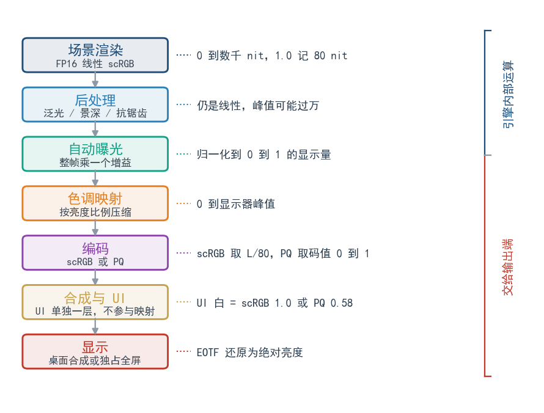
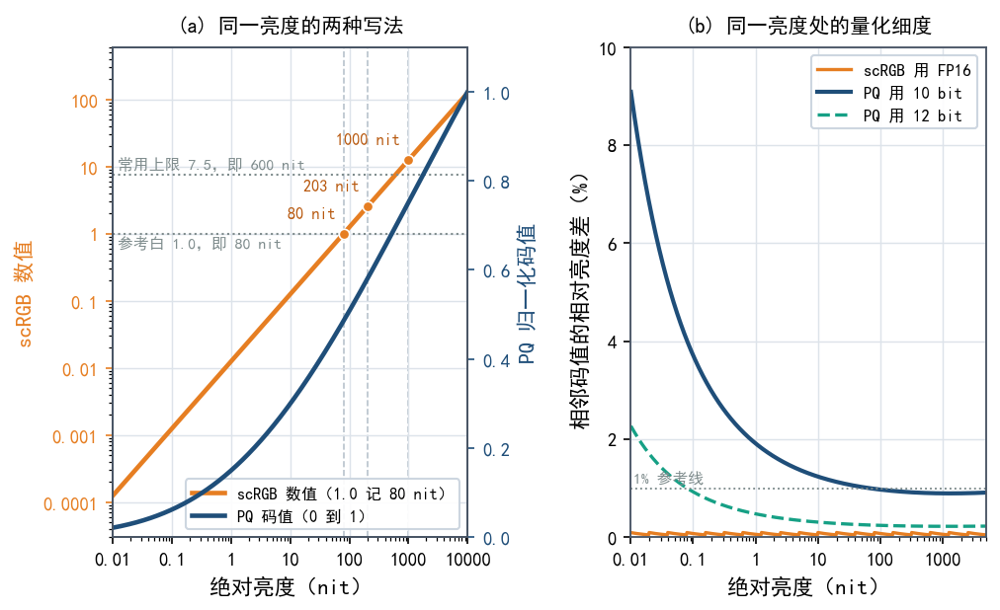
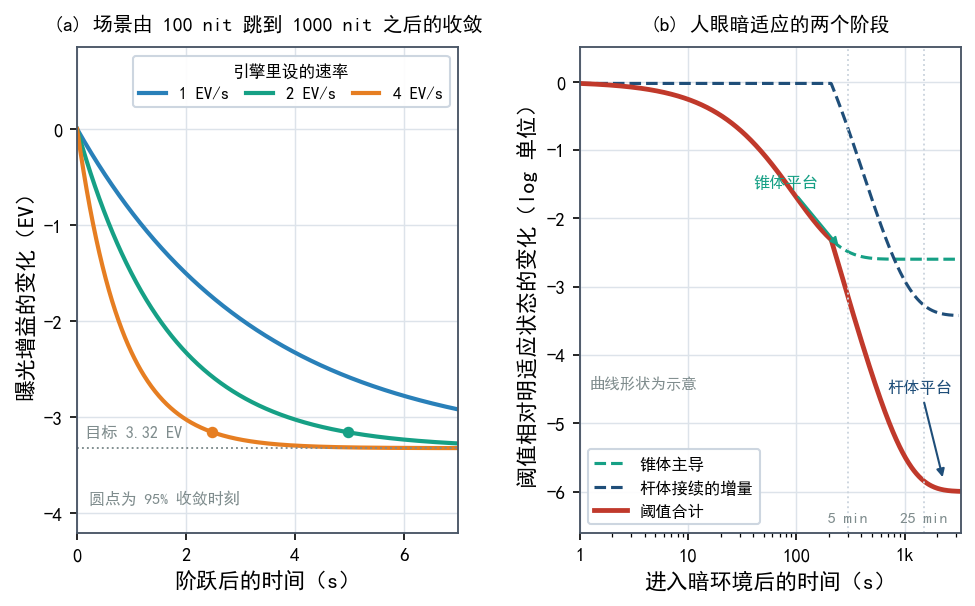
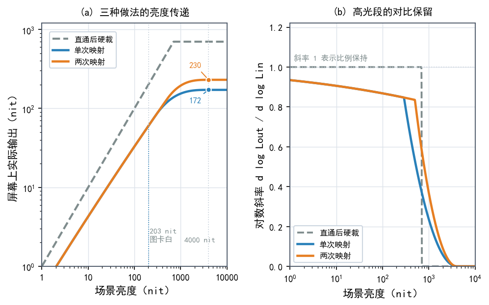
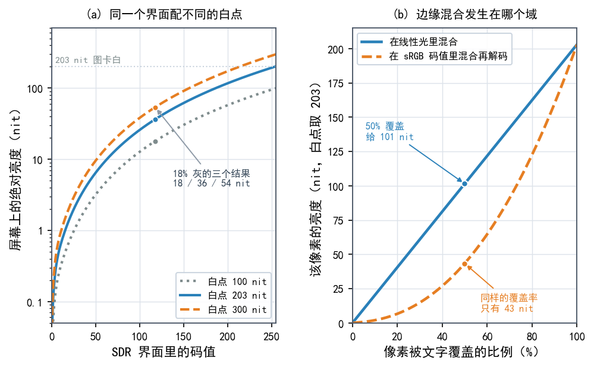
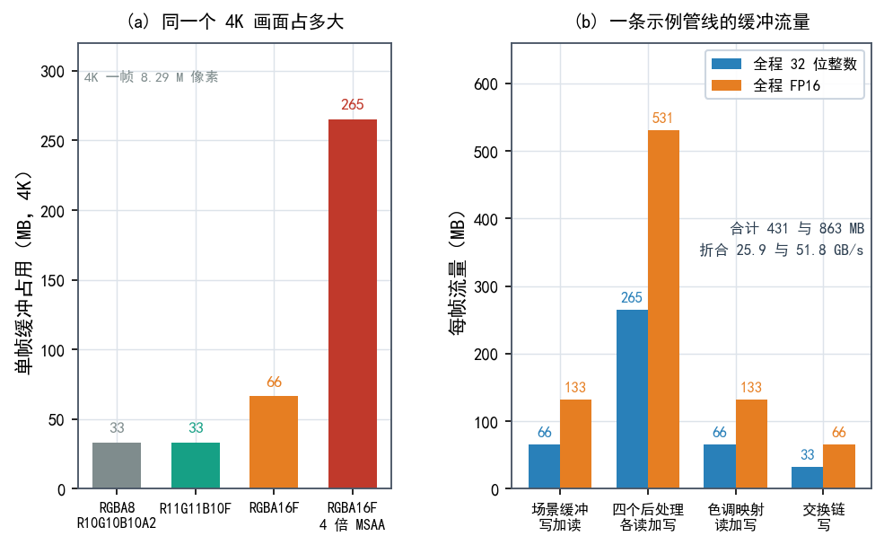

# 第 8 章 实时渲染与游戏 HDR

> 电影在调色棚里定稿，游戏在玩家的机器上现做。这条差别看起来只是工序不同，实际上把整条链路的责任分配都改了。母版不存在，峰值要现场估，显示器的型号在游戏编译时还不知道，而每一帧只有十几毫秒的预算。亮度从哪里来、由谁压、压在哪一步、界面为什么不能跟着压，这些问题的答案都由“实时”两个字决定。

## 一、游戏这一端缺了什么

影视内容的生产可以概括成一句话，先定稿，再分发。调色师坐在一台已知峰值、已知黑位、已经校准过的监视器前面，把每个镜头的高光放到他认为合适的位置，然后这套决定被写成元数据随码流一起走。ST 2086 记下母版显示器的原色与亮度，MaxCLL 记下整段内容最亮的那个像素，显示端读到这些数字，就知道该怎么把内容搬到自己屏幕上。整条链路里，唯一需要“猜”的环节是最后一步，而这一步的依据是前面写下来的测量值。

游戏没有这个前提。画面是运行时算出来的，光源位置、粒子数量、玩家视角每帧都在变，同一段关卡在不同显卡上渲染出的像素值也可能有细微差别。峰值亮度不是测出来的，是美术和渲染程序员一起定的一个数。更麻烦的是显示器。一款游戏要跑在峰值 400 nit 的笔记本屏、峰值 600 nit 的入门电视、峰值 1500 nit 的旗舰电视，以及只支持 SDR 的老显示器上。编译的时候，它一个都看不到。

由此产生两个后果，后面整章都在处理它们。

第一，游戏输出的不是“测量结果”，而是“意图”。元数据里“内容峰值 1000 nit”在影视里意味着这段素材最亮处确实是 1000 nit，在游戏里意味着“我希望你把最亮的地方显示成 1000 nit”。语义变了，显示端就不能再照搬影视那套做法。影视显示端读到 MaxCLL 超过自己能力，会做一次滚降；游戏显示端如果也这么做，就会和游戏内部已经做过的滚降叠在一起，第 4 章讨论过的两次映射问题就是这样来的。

第二，责任必须在运行时协商。协商的媒介是两样东西，一样是显示器通过 EDID 报出的能力，另一样是玩家在设置菜单里选的峰值。前者由硬件决定，后者由人决定，两者经常不一致，而游戏必须挑一个来用。

时间预算的压力同样真实。60 帧每秒意味着每帧 16.7 ms，120 帧是 8.3 ms，144 帧只有 6.9 ms。这个数字要装下几何、光照、阴影、后处理、界面和提交。任何一步超过预算，帧率就掉，而帧率掉下去比画质差一点更让人难受。所以实时渲染里的每一个选择都带着成本标签，HDR 也不例外。一张 4K 的 FP16 缓冲是 66 MB，一次全屏读写就是 133 MB 的显存流量，这些账最后都要在 16.7 ms 里结清。

还有一点容易被忽略。影视的帧率是固定的，24 帧就是 24 帧，曝光在拍摄时就定死了。游戏的帧率在 30 到 240 之间浮动，同一个场景在两种帧率下的观感必须一致。这约束了自动曝光的写法，也约束了任何带时间常数的处理。凡是“每帧推进一点”的算法，在帧率变化时都会失效，必须按秒而不是按帧来算。

## 二、渲染缓冲：FP16 与 scRGB 的数值约定

渲染管线内部用什么格式存颜色，是这一章所有讨论的地基。

最直接的选择是 FP16，也就是每通道 16 位的半精度浮点。它由 1 位符号、5 位阶码、10 位尾数组成。10 位尾数意味着相对精度是 $2^{-11}$，约 0.05%，换成十进制有效数字大约三位半。这个精度在整个动态范围里是恒定的，无论存的是 0.001 还是 1000，相对误差都是万分之五。规格化数的表示范围从 $6.1\times10^{-5}$ 到 65504，跨度九个数量级。

恒定的相对精度正是 HDR 需要的。第 1 章讲过，人眼的辨别阈值在很宽的范围内近似服从韦伯定律，也就是相对量而不是绝对量。浮点数的误差分布和这条规律天然吻合，暗部不会因为绝对步长固定而糊掉。第 2 章算过 10 bit 定点在 0.01 nit 附近的台阶接近 9%，而 FP16 在同一亮度处的相对步长仍然是 0.05%，两者差两个数量级。

代价是带宽。FP16 每像素 64 位，是 32 位格式的两倍。这个代价在第八节会算清楚。

另一条路是定点，但精度不够。8 bit 的问题第 2 章已经算过，这里不重复，只记结论，8 bit 线性缓冲在暗部只有几个码值可用，做任何乘法都会出现色带。16 bit 定点能缓解，但它是线性刻度，亮部浪费、暗部不够，还是不如浮点。

还有一类折中格式值得一提。R11G11B10F 把 32 位拆成三个通道的浮点，红绿各 11 位、蓝 10 位，共享一个 5 位阶码。它每像素只占 32 位，精度比 FP16 差一档，但比定点好得多，常见于泛光链这类对精度要求略低的中间步骤。它的硬伤有两个，一是没有 alpha，二是共享阶码导致它无法表示负值。

负值这件事在 HDR 管线里不是小事。线性空间里做任何带负瓣的滤波都会产生负的过冲，比如双三次上采样、锐化、色度重建。色域转换矩阵也一样，sRGB 到 BT.2020 的转换矩阵含有负系数，转换后本来就在色域外的颜色会落到负值上。如果缓冲格式不支持负数，这些过冲只能被钳到零，钳零的后果不是“少一点细节”，而是能量损失和色相偏移，在饱和色的边缘表现为一圈发暗或发绿的镶边。

scRGB 就是在这个背景下被定义出来的。它的原色和 sRGB 一样，白点 D65，传递函数是线性的，也就是没有传递函数，像素值直接正比于亮度。它和 sRGB 的区别在于取值范围被有意放开到了 $[0,1]$ 之外。微软在 Windows 的高级颜色（Advanced Color）体系里给了它一个明确的锚点，数值 1.0 对应 80 nit，于是任何亮度都能用一个纯数字表示，不需要额外的元数据。

这个 80 nit 的锚点值得停一下。它不是随便挑的。SDR 时代，显示器在典型办公环境下的白屏亮度就在 80 到 100 nit 之间，取 80 是延续这个习惯。有了锚点，scRGB 的数值就有了物理含义，7.5 是 600 nit，12.5 是 1000 nit，50 是 4000 nit。微软文档给出的常用区间是 $-0.5$ 到 $7.5$，负的下界留给前面说的滤波过冲，上的 7.5 大致覆盖到 600 nit。超过 7.5 的取值 FP16 完全表示得出来，只是超出了文档给出的常用范围，很多按这个范围设计的管线不会去处理。

负值还有第二个来历，色域。scRGB 用的原色就是 sRGB 那三个，坐标落在 BT.709 的三角形上，而 HDR 内容的容器色域是 BT.2020，它的三角形明显更大。要把一个 BT.2020 的高饱和红写进 scRGB，红通道要超过 1，绿蓝两个通道要变成负数。这不是错误，是坐标系延伸出来的必然结果。系统在合成时用一个带负系数的矩阵把 scRGB 转换成显示器的色域，负值在这里被裁掉，饱和色会轻微偏色，但幅度可控。如果缓冲格式不允许负值，这个裁切就发生在更早的地方，而且发生在一个错误的环节上。

图 8-1 把这条链路画成七步，右侧标出每步的数值范围。前三步在引擎内部，全部是线性光，如果按 scRGB 的约定，1.0 等于 80 nit。场景渲染写出的值可以到几千 nit，太阳、灯泡、爆炸这类光源在物理上本来就该这么亮，不需要为了“存得下”而提前压。后处理在这一层做泛光、景深、运动模糊和抗锯齿，因为它们都需要线性光才有物理意义。自动曝光在最后给整帧乘一个增益，把场景的相对亮度变成显示量。色调映射是分界线，从这一步开始，数值变成“要送到屏幕上的绝对亮度”。编码把绝对亮度换成码值，scRGB 除以 80，PQ 走 ST 2084 的逆函数。界面在编码之后叠加，不参与前面任何一步。显示端最后按 EOTF 还原。

图里标的数值范围有一个前提要说清楚。场景渲染那一步的“数千 nit”指的是物理量级，不是缓冲里真的存了 4000 这个数。很多引擎内部用相对单位，1.0 代表什么由美术的灯光设置决定，绝对亮度的锚点到色调映射那一步才接上，因为那里才有显示器的峰值可依。这不影响前面的精度论证，FP16 的相对精度对相对值同样成立，但它解释了一件事，为什么同一个引擎在不同项目里，同样的灯光参数出来的亮度能差好几倍，中间差的是一个曝光基准的选择。

这张图里有两处容易做错。第一处是顺序，界面必须在色调映射和编码之后，理由在第六节展开。第二处是“自动曝光在色调映射之前”，这两步经常被合在一起写成一个 pass，概念上却是两件事，前者的输入是场景亮度，输出是归一化后的显示量，后者的输入是这个显示量，输出是受显示器峰值约束的绝对亮度。合成一个 pass 没问题，但参数必须分开调，否则改峰值会连带改曝光。

为什么不用 PQ 当渲染缓冲，这个问题常被问到。答案很简单，PQ 是非线性的，而且它的非线性不是幂函数，是分段的有理函数。在这种编码上做加法，等于在亮度上做一件说不清是什么的事。两张亮度各 100 nit 的半透明面片叠在一起，结果应该是 200 nit 左右，但在 PQ 码值域里相加会得到完全错误的结果。更根本的是光照计算，漫反射的累积、高光的叠加、阴影的相乘，全部建立在“像素值正比于辐射亮度”这个前提上，一旦破坏，物理就不成立了。所以 PQ 只能出现在编码这一步之后，不能出现在之前。

时间抗锯齿在 HDR 上有一个专属的坑，值得单独说。这类算法为了防止拖影，会对当前帧的邻域颜色做一个范围约束，把历史采样钳制在这个范围里。邻域约束默认在码值上做，在 SDR 下没有问题，因为码值大致均匀。换到 FP16 线性缓冲上，一个 2000 nit 的亮点和它旁边 2 nit 的暗面，比值是一千比一，邻域范围被拉得极大，钳制失效，拖影出现；反向的修正做法是把范围收窄，结果又把亮点当成异常值抹掉，运动时高光会一闪一闪或干脆消失。正确的做法是在对数域里做钳制，把亮度先取对数再算范围，这样亮暗两侧的容差才是公平的。很多引擎在开 HDR 之后发现高光不跟手、车灯会滑，原因就在这一步。

多重采样抗锯齿对缓冲又加了一层要求。4 倍 MSAA 意味着每个像素存四个样本，缓冲大小变成四倍，FP16 下 4K 一帧就是 265 MB。这还不算解析（resolve）时的额外读写。实践中常见的做法是场景缓冲用 FP16 加 MSAA，后处理链降到 R11G11B10F 甚至更窄的格式，因为泛光这类操作对精度要求低，而它恰恰是 pass 数最多、最吃带宽的地方。

还有一条约定容易被忽略，缓冲里的 alpha 通道在 HDR 管线里几乎总是预乘的。预乘 alpha 让双线性插值的数学在透明边缘上成立，而 sRGB 时代的 UI 系统大量使用非预乘 alpha。两种数据混在一条管线里，边缘就会出现一圈暗边。这个问题在 SDR 下也存在，只是 HDR 把亮度范围拉开之后，暗边变得更明显。

同一个亮度在两套编码里的取值差得很远。图 8-2 的左半边把两条曲线叠在一张图上，横轴是绝对亮度，左边的纵轴是 scRGB 的数值，右边的纵轴是 PQ 的归一化码值。

scRGB 这条线在对数坐标里是一条斜率为 1 的直线，因为它就是亮度除以 80。PQ 这条线在暗部压得极低，0.01 nit 处的码值是 0.022，到 10 nit 才爬到 0.30，之后才开始快步上升。两条线的形状差异说明它们的用途不同，scRGB 的数值和亮度成正比，适合做算术；PQ 的数值和感知亮度大致成正比，适合做量化。80 nit 处一个记 1.0 一个记 0.486，203 nit 处是 2.54 和 0.581，1000 nit 处是 12.5 和 0.752。这三个点也是实际工作里最常引用的三个锚点。

右半边回答另一个问题，两种格式在同一个亮度处谁更细。FP16 的相对步长在整个量程里被限制在 $2^{-11}$ 到 $2^{-10}$ 之间，也就是 0.049% 到 0.098%，曲线呈锯齿状，每一个锯齿对应一次阶码跳变。PQ 用 10 bit 时，0.01 nit 处的相对步长接近 9%，1 nit 降到 2%，再往上就稳定在 0.9% 上下，整条曲线单调下降。PQ 用 12 bit 时这三处分别是 2.3%、0.5% 和 0.22%。

这张图给出的结论不是“谁更好”，而是“谁适合干什么”。渲染缓冲要承载乘法和加法，需要恒定相对精度，选 FP16。传输码流要抗量化，需要在感知上均匀，选 PQ 配 10 或 12 bit。把两者混用的后果在第五节还会碰到，一条把 PQ 码值当线性值来缩放的处理链，会让暗部整体偏移。

## 三、四条输出路径与它们各自的元数据

渲染完的画面要送到屏幕上，中间还要经过一层“谁把它变成信号”的决定。这一层在不同平台上的做法差别很大，而且直接决定了元数据由谁写。

**桌面合成这条路。** Windows 在 HDR 下的做法叫高级颜色。游戏建一条 FP16 的交换链，格式是 R16G16B16A16_FLOAT，颜色空间声明为线性 scRGB，DWM 负责把它和桌面上的其他内容合成，再转换成显示器要的格式送出去。这条路上游戏只提供 scRGB 数值，剩下的全交给系统。好处是窗口化也能 HDR，游戏不需要管独占全屏和模式切换，切换窗口不会黑屏。代价有两个，一是合成要多一次读写，二是系统会插手亮度，第四节会讲到这带来什么问题。

**HDR10 这条路。** 交换链换成 R10G10B10A2_UNORM，颜色空间声明为 PQ 加 BT.2020，游戏自己做色调映射和编码，然后通过接口把静态元数据交给系统或直接写进 HDMI 的信息帧。元数据包括 ST 2086 的三原色坐标、白点、母版峰值与黑位，以及 MaxCLL 和 MaxFALL 两个内容亮度统计。这条路通常配独占全屏，绕过合成器直接送到显示控制器，延迟最低。代价是丢掉了系统叠加层，音量条、通知、输入法提示都不会出现，切出去要重新建交换链，很多玩家对那个黑屏很敏感。Windows 后来的“全屏优化”会把独占全屏偷偷转成无边框的翻转模型，既保留叠加层又接近独占的延迟，代价仍然是多一次合成。

**杜比视界这条路。** 主机上有杜比视界的游戏模式，由主机侧按显示器的能力生成逐场景甚至逐帧的元数据，动态范围的处理交给显示端。公开的技术细节不多，能确定的只有它依赖 ST 2094-10 那一套动态元数据，以及它要求整条链路都支持杜比视界，包括电视、功放和线材。在 PC 上这条路基本走不通，可用的接口没有开放。

**SDR 回退。** 显示器不支持 HDR 时，游戏把同一条色调映射曲线的目标峰值改成 100 nit，输出 sRGB 或 BT.1886。回退路径最容易被草率对待，很多游戏在 SDR 下直接裁掉高光，霓虹灯和天空变成一片死白。正确做法是把目标峰值降低、肩部拉长，让高光信息以更小的对比度保留下来，这正是第 4 章讲的曲线压缩。

四条路的关键差异可以并排看。

| 路径 | 交换链与色空间 | 元数据 | 谁做最后的滚降 |
|---|---|---|---|
| 桌面合成 | R16G16B16A16_FLOAT，线性 scRGB | 无，系统按 EDID 与用户设置处理 | 系统与显示器 |
| HDR10 | R10G10B10A2_UNORM，PQ 加 BT.2020 | ST 2086 加 MaxCLL 与 MaxFALL | 游戏自己 |
| 杜比视界 | 平台专有 | ST 2094-10 动态元数据 | 主机生成，显示器执行 |
| SDR 回退 | R8G8B8A8_UNORM，sRGB | 无 | 游戏自己，目标 100 nit |

表里第三列和第四列是联动的。写了元数据，就意味着把滚降的责任交出去一部分；不写元数据，就得自己在引擎里压到显示器的能力。两者都做，就会压两次。

HDR10 这条路上还有一个在游戏里才成立的技巧，逐帧更新元数据。影视内容的 MaxCLL 是整段素材统计出来的一个常数，游戏可以在每帧统计当前画面的亮度分布，把这一帧的峰值写进去，效果上接近动态元数据。代价是每帧都要更新 HDMI 的信息帧，部分显示器和功放在收到频繁更新时会重新同步，表现为每秒几次的短暂黑屏或者是亮度闪烁。稳定一点的做法是按场景更新，切镜头或者进出门时改一次，避开显示器的敏感频率。这也能解释为什么同一个游戏的 HDR 在一些电视上很稳、在另一些上会闪，差别在于接收端愿不愿意容忍元数据的频繁变化。

桌面合成这条路有个具体的副作用值得记一笔。系统在合成时要把桌面上的 SDR 窗口抬到“SDR 内容亮度”那个水平，于是玩家在 HDR 游戏里切出去看浏览器，会发现整个桌面比平时亮得多，回到游戏又暗下来。这不是 bug，是两套白点在同一块屏幕上并存的结果。有些玩家因此干脆不开 HDR，因为桌面观感的变化比游戏画质的提升更干扰人。这个问题在系统层面有解，但需要用户在设置里把 SDR 亮度调到接近游戏内图卡白的水平。

还有一条实践中的约束。HDR 与可变刷新率同时开启会占用更多链路带宽，HDMI 2.1 的 48 Gbit/s 能装下 4K 120 Hz 10 bit 4:4:4 加可变刷新率，老一点的接口就得降色度或降位深。降色度对游戏界面的伤害比对影视内容大，因为界面里有大量细笔画的彩色文字，4:2:2 一压，红字边缘立刻发糊。

## 四、曝光、白点与色调映射的位置

场景渲染出来的亮度是相对的。一个室内场景的平均亮度可能是 5 nit，一个雪地场景可能到 500 nit，引擎并不知道“这个场景应该看起来多亮”，这个判断要由曝光来做。

自动曝光的本质是给整帧乘一个增益，让画面的某个统计量落到一个固定的目标上。工程上的写法分三步。先把画面降采样到很低的分辨率，1/64 甚至 1/256，因为统计不需要细节；再对降采样后的像素算一个代表值，常用的是对数平均 $\bar{L} = \exp(\frac{1}{N}\sum \ln(L_i + \epsilon))$；最后用目标值除以这个代表值，得到增益。

用对数平均而不是算术平均，理由是算术平均会被小面积的高光拉偏。一个 1000 nit 的灯泡在一帧里只占万分之一的面积，算术平均几乎感觉不到它，但把每个像素取对数之后，这个灯泡的贡献就从 1000 变成 6.9，而一片 5 nit 的墙面贡献是 1.6，两者在同一量级里参与平均，更接近人眼看到的“整体亮度”。加上 $\epsilon$ 是为了避免纯黑像素把对数拉到负无穷。

直方图法是另一种常见实现。把亮度分成若干档，统计每档的像素数，然后取某个百分位作为代表值，比如 80% 分位。这样做的优点是能明确地忽略高光，缺点是分位数的选择很敏感，选得高会让画面偏暗，选得低会让高光过曝。两种方法都不完美，实际引擎里常见的是对数平均加一个加权遮罩，屏幕中心的权重大一些，边缘小一些，模拟人眼注视的位置。

增益不能瞬间跳到位，得有过渡，这就是适应。图 8-3 的左半边画了三种适应速度。

场景从 100 nit 跳到 1000 nit，需要的增益变化是 $\log_2(1000/100) = 3.32$ EV。用一阶惯性近似，初速分别取 1、2、4 EV/s，三条曲线在 7 秒内的收敛程度差别很大。1 EV/s 的那条到 7 秒还没收敛，2 EV/s 在 5.0 秒到 95%，4 EV/s 在 2.5 秒就到 95%，但代价是过渡过程太急，看起来像曝光在抽搐。

实际引擎的默认值大多落在 1 到 3 EV/s 之间，而且上行和下行不对称，从暗到明比从明到暗快。这个不对称来自人眼，图 8-3 的右半边画的是暗适应的两个阶段。

曲线是示意，但两个时间节点有据可查。从明亮环境进入黑暗，锥体细胞的敏感度在五分钟左右基本到位，这是第一个平台；杆体细胞接管之后，敏感度还会继续上升，到二十五分钟前后才到最终平台。整个过程跨越大约六个对数单位，也就是二十个 EV。这是生理上的真实尺度，而游戏只给它两三秒。

这个差距说明游戏里的曝光不是一个生理模拟，是一个艺术选择。既然只给两三秒，那么 Faster 还是 Slower、上行下行怎么配，就变成了手感问题而不是物理问题。写实向的游戏把速度放慢，让玩家在钻山洞时体验那种短暂的失明；竞技向的游戏把速度调快，甚至直接关掉自动曝光改成固定曝光，因为亮度突变会影响判断。

帧率变化是这里最常见的坑。如果适应写成“每帧推进 2%”，那么 30 帧下每秒推进 45%，144 帧下每秒推进 95%，同一个参数在两种帧率下的观感完全不同。正确写法是把速度定义成 EV/s，每帧推进 $\Delta t \cdot v$，$\Delta t$ 取自实际的帧间隔。这一步几乎所有的商业引擎都做对了，自制引擎经常忘。

曝光还有两个钳制要设。一个是 EV 的上下限，防止极端场景把画面推到全白或全黑；另一个是每帧的增益变化上限，防止单帧的异常像素导致亮度跳变。场景切换时还要重置，过场动画、传送、加载画面都该用固定曝光，否则玩家会看到一段毫无意义的亮度爬升。

曝光定完之后，画面是一个归一化的相对量，接下来要把它变成绝对亮度，这就是色调映射。它的参数有三个来源。

峰值来自显示器的能力。Windows 上可以查 DXGI_OUTPUT_DESC1，里面有 MaxLuminance 这个字段，单位是 nit，含义是显示器在小面积上能达到的峰值，也就是面板的峰值亮度而不是全屏亮度。同一结构里还有 MinLuminance 和 MaxFullFrameLuminance，后者是后续版本补上的，用来描述大面积白屏时由于背光限制能维持的亮度。这三个数分别对应色调映射的肩部起点、趾部终点和大面积白的处理。

第二个来源是用户的覆盖。玩家在游戏里选的“峰值亮度”滑块优先级高于 EDID，因为 EDID 报的数经常偏乐观，或者玩家手工调过显示器的亮度。几个主流主机都提供了系统的 HDR 校准，游戏的滑块默认值通常取自那里。

第三个是图卡白，也就是界面和字幕该落在多少 nit。这个数在 BT.2408 里给了 203 nit，第五节展开。

三个参数里最容易误用的是峰值。玩家手里的滑块往往标着一个数字，但屏幕上实际能亮到多少只有测了才知道，而在游戏里又没法摆一台亮度计。可行的替代是提供一张测试图，一个小面积的白块，让玩家调到“刚好还能分辨白块与背景”的位置，这就是主机系统校准在做的事。直接给数字的做法依赖玩家诚实的输入，而大部分玩家会按“看起来最亮”来选，结果峰值被高估，色调映射在错误的区间里工作。

在自动曝光之外，工程上还留了两个手动旋钮。一个是曝光补偿，菜单里写作亮度或者伽马，本质上是一个 EV 偏移，加在自动算出的增益上。很多游戏把这个滑块与显示器的峰值绑定，玩家调高亮度时，引擎同时抬高增益和压低峰值假设，两个动作叠起来才能在刺眼的屏幕上真的变亮。另一个是固定曝光，关掉自动曝光，锁在一个 EV 上。这常用于竞技类游戏和关卡编辑器，前者要的是亮度稳定，后者要的是可重复。

色调映射在管线里的位置有四条约束。

必须在泛光之后。泛光是在线性 HDR 上做阈值的，先压后泛，阈值就失效了，泛出来的光是按压缩后的亮度算的，颜色和强度都不对。

必须在景深和运动模糊之后。这两种效果会把一个极亮的像素摊到一片区域上，摊开之后的亮度分布和压缩后的完全不同。先压再模糊，等于把已经丢掉的高光信息抹匀；先模糊再压，才能得到正确的光斑形状。

必须在界面之前。这条下一节细说。

必须在编码之前。编码是非线性的，压缩比的计算在编码域里做会得到错误的斜率。

四条合起来，色调映射就固定在这样一个位置，后处理的末端、界面的前端、编码的前端。它通常是一个全屏 pass，读取 FP16 缓冲，写出目标格式，代价很小，第六节的图会给出具体数字。

还有一条软性的建议。调色（color grading）放在色调映射之前还是之后，是个有争议的选择。放在之前，调色作用在场景光上，物理上说得通，但美术看到的最终效果会随显示器峰值变化，同一套 LUT 在不同电视上不一样。放在之后，调色作用在显示量上，观感稳定，但会破坏 HDR 的绝对性，也容易把高光调爆。商业引擎大多提供两种插槽，由项目自己决定。倾向的做法是把“基础调色”放在之前，把“显示补偿”放在之后。

## 五、HGiG 的分工与系统级的越界

第 4 章讲过 HGiG 的思路，把色调映射拆成两半，游戏负责把画面组织到显示器的能力以内，显示端负责把超出面板能力的部分压下去。这一节讲执行层面，也就是这条约定在真实硬件上怎么落地、在哪里失效。

先说能力从哪里读。显示器的 EDID 里有一段专门用来报 HDR 能力的描述块，里面写了它支持哪种 EOTF、有没有静态元数据、以及自己的亮度范围。操作系统在枚举显示器时把这些信息解析出来，填充进对应的查询结构，Windows 上就是前面提过的 DXGI_OUTPUT_DESC1。游戏拿到 MaxLuminance 这个数，就有了一句可用的“你能亮到多少”。

这个数有三个不确定性。第一，它描述的是小面积峰值，不是全屏峰值，一块标称 1000 nit 的电视在全屏白时可能只给 400 nit，因为背光或面板有功率限制。第二，它由驱动或显示器厂商填写，不同厂商的填法不一致，有的填实测值，有的填标称值，有的干脆填一个上限。第三，玩家可能改过显示器的亮度设置，EDID 不会跟着变。所以工程上通常的做法是拿它当起点，再让玩家用一个滑块覆盖，滑块的默认值取 EDID 的值。

约定本身很简单。游戏把图卡白放在 203 nit，高光按美术意图放到显示器峰值以内，不做自己的滚降；显示端在 HGiG 模式下关掉动态色调映射和“HDR 增强”之类的后处理，只保留对超出面板能力的硬滚降。这样映射只发生一次，而且发生在掌握硬件极限的那一端。

图 8-4 用一条 4000 nit 的内容配一块 700 nit 的显示器，把三种做法的差别算了出来。

左边那张图里，灰虚线是直通到 700 nit 再硬裁，蓝线是单次 EETF，橙线是两次 EETF，先压到 1000 再压到 700。蓝线和橙线在 203 nit 以下完全重合，因为两边都是等比缩放。真正的分歧出现在 4000 nit，单次映射给出 172 nit，两次映射给出 230 nit，肩部被压了两遍。右半边用对数斜率看同一件事，斜率在拐点之后迅速掉到 0.2 以下，两次映射的那条掉得更早、更缓。

这里有一个和直觉相反的结论值得说清楚。两次映射并不像很多人以为的那样“中间调整体变暗”。BT.2390 的 EETF 在拐点以下是按 PQ 码值等比缩放的，两次等比缩放串起来，恰好等于一次的总比例，203 nit 在两种做法下都落到 61 nit。所以画面变灰的原因不在映射次数，而在游戏端用了什么曲线。如果游戏端用的是 Reinhard 或 Hable 这类 S 形曲线，它在中间调就已经压过一次，而且是不可逆的压，再接一次显示端的映射，中间调才会塌下去。第 4 章讲过这三条曲线的形状差异，这里的结论是它的一个直接推论。

这条推论有实用价值。判断一款游戏有没有正确执行 HGiG，不用看它菜单里写了什么，只要在显示器上放一张 203 nit 的灰卡，进游戏看界面白是不是落在 203 nit 附近。如果明显偏低，说明游戏端压过一遍；如果明显偏高，说明它假设的峰值比实际显示器高。

失效的方式有三种，都很常见。

第一种是游戏端的假设和显示器不符。游戏内部按 1000 nit 设计曲线，玩家的电视只有 600 nit，那么 600 以上的部分要么被硬裁，要么被电视用自己的曲线压，无论哪种都和美术看到的不是同一个画面。

第二种是显示端的额外处理。很多电视在 HGiG 模式下仍然开着局部对比增强、色彩增强或者“HDR 效果”，这些处理会在映射之后再加一层非线性。玩家看到的高光发白、暗部发灰，往往就是这个原因，而不是游戏的问题。

第三种最隐蔽，是管线中间某一环把 PQ 码值当线性值缩放。比如某个后处理插件读进来一个 0 到 1 的浮点图，乘以 1.2 再写回去。PQ 码值乘 1.2 在亮度上是完全不均匀的放大，暗部被放大得多，亮部被裁掉，整幅画的对比结构被改掉。这种错误在 SDR 时代不明显，因为 gamma 域乘一个系数至少还单调，在 PQ 域里就会把暗部抬成灰雾。

系统的越界主要来自 Auto HDR。这个功能随主机首发，后来进了 Windows，做的事情是给没有 HDR 版本的 SDR 游戏自动生成 HDR 输出。

原理可以拆成三步。第一步是分析，把当前帧的亮度分布统计出来，主机上用的是训练过的机器学习模型，PC 上是一条基于直方图和逐通道统计的启发式路径。第二步是重分布，把 SDR 的 0 到 100 nit 映射到显示器的 0 到峰值，但不是线性拉伸，中间调大体保持在原位，接近白的那部分被推上去。第三步是色相保护，逐通道拉伸会把饱和色推得发白，所以还要在色度上做一次约束。

效果在小面积高光上确实明显，霓虹灯、火光、金属反光都会亮起来。局限也很清楚。

它无法恢复不存在的信息。SDR 画面里过曝成 255 的天空，在源数据里就是一片平的，Auto HDR 只能把这片平的白推得更白，推不出云层的形状。所以它擅长的是“提亮”，不是“扩展”。

它会把 2D 素材误判。过场动画、预渲染的贴图、界面元素、字幕，这些在 SDR 里本来就不该有 HDR 的层次，Auto HDR 的分析器看到大片亮区就往高光处理，结果是字幕发光、菜单按钮泛白。逐帧独立分析还会导致闪烁，必须加时域平滑，平滑又带来延迟，快速运动的画面上能看到亮度跟不上。

它还会放大量化噪声。8 bit 的暗部本来就有台阶，扩展之后台阶的绝对落差从 1 nit 变成 5 nit，加上编码块效应一起显形。很多玩家觉得 Auto HDR 下暗部“脏”，原因在这里。

玩家侧其实有三层开关，每一层都能把分工弄乱。最外层是系统的 HDR 总开关，中间层是显示器或电视的 HDR 模式，最内层是游戏内的 HDR 选项。三层全开的时候不一定最好，因为电视的 HDR 模式可能包含自己的动态映射，游戏的 HDR 选项也可能包含自己的曲线，两者叠起来就是两次映射。排查时从外层往里收，先确认系统开、电视处于 HDR 游戏模式且关闭动态增强，再看游戏内的峰值设置是不是与实测峰值接近。这三层里任何一层没设对，前面几节算的曲线都白算。

工程上对这个功能的定位应该清楚。它是一个让老游戏“看起来更 HDR”的便利功能，不是一条制作链路。有 HDR 版本的游戏应当关掉它，因为它会和游戏自己的色调映射打架；视频播放器也应当关掉它，因为视频有自己的元数据。系统里这两者是互斥的，但玩家不一定知道要手动切。

## 六、界面、字幕与 HUD

界面在 HDR 游戏里是个特殊物种。它是 2D 的、静态的、按 SDR 时代的美术规范做出来的，却要显示在一块亮度可以到 1000 nit 的屏幕上，而且旁边就是一片可能只有 2 nit 的暗场。

先把数值关系写清楚。界面资源大多是 sRGB 编码的 8 bit 图，解码成相对亮度之后，要乘一个白点系数才能变成绝对亮度。在 scRGB 里这个系数是 $L_{w}/80$，$L_w$ 是系统设置的 SDR 内容亮度。如果 $L_w$ 取 203 nit 的图卡白，系数就是 2.54，界面的纯白在缓冲里存的是 2.54 而不是 1.0。

图 8-5 的左半边画了三条曲线，同一个界面配三个不同的白点。

白点 100 nit 的那条曲线整体压在 100 nit 以下，暗部紧贴面板黑位，界面的深灰部分会被黑位吞掉，看起来发糊。白点 300 nit 的那条把整个界面推到 300 nit，纯白刺眼，暗场里读文字会累。203 nit 是一个折中，也是 BT.2408 给图卡白的建议值，它把界面放在“比场景中间调亮一档、但远低于高光”的位置上。18% 灰在这三种白点下分别是 18、36 和 54 nit，差距不到三倍，说明界面里真正被白点影响的是接近白的部分，这跟直觉一致。

曲线本身是 sRGB 的 EOTF，形状在暗部很陡，这是 SDR 时代为了在 8 bit 里挤出暗部层次留下的设计。它和 PQ 的形状不一样，这也是为什么界面不能简单地“按 PQ 重新编码”，那样会让界面里所有的中间灰整体变亮，观感全变。

界面亮度还有一个不能违反的原则，它不能随场景变化。原因很直接，界面的白色是玩家用来判断亮度设置是否正确的参照，如果它在暗场景里变亮在亮场景里变暗，这个参照就失效了，玩家调亮度时会把界面调到刺眼的程度，然后进暗场景被闪到。自动曝光只能作用在 3D 画面上，界面要走一条独立的、固定增益的路径。

色调映射也是同理。如果把界面合进 3D 画面再做色调映射，那么当场景里有爆炸、有阳光的时候，色调映射的曲线会整体下移，界面跟着一起暗下去，玩家的血条会在最需要看清的时候变得最暗。这就是色调映射必须放在界面之前的原因，也是所有引擎都把 UI 放在单独一层、在色调映射之后叠加的原因。

字幕比界面更敏感。影视的字幕由播放器渲染，位置和亮度都统一；游戏的字幕由引擎渲染，很多游戏把字幕和 3D 画面放在同一层，结果是暗场字幕白得刺眼，亮场字幕灰得看不清。有经验的团队会给字幕单独一个亮度控制，默认值取图卡白，允许玩家调整，因为在不同环境光下最优的字幕亮度确实不一样。

还有一种界面不是用引擎画的，是预渲染的过场动画和视频贴图。这些素材有自己的 HDR 元数据，也有自己的图卡白，与游戏内界面不一定一致。从实时画面切到一段预渲染过场，如果两者的白点差得多，观众会看到亮度跳一下，敏感的人会觉得屏幕在闪。修法是在过场开始前把游戏内画面往视频的白点靠，用一段短过渡拉过去，不要硬切。

图 8-5 的右半边讲的是另一件事，文字边缘。白字压在黑底上，一个像素被字形覆盖了 50%，它应该显示多少亮度。

如果在线性光里混合，答案是白与黑的中点，也就是 203 nit 的一半，101 nit。如果在 sRGB 码值域里混合，得到的是码值 0.5，再解码成亮度是 43 nit，只有正确值的三分之一多一点。两者的差别在视觉上表现为笔画粗细，线性混合的字看起来接近设计稿，码值域混合的字看起来细了一圈，小字号会显得发虚。

这不是一个新问题，SDR 时代也存在，只是幅度小一些。到了 HDR，因为白点被抬高，绝对差值从几十 nit 变成上百 nit，边缘的视觉权重变大，问题就显出来了。解决的路径有两条，一是在线性光里做混合，也就是把 UI 纹理在线性空间里预乘 alpha；二是保持 sRGB 空间的混合但把结果当成“已经编码好的值”直接写进缓冲，不去解码。第二条在 SDR 下是标准做法，在 HDR 下会导致界面比 3D 画面看起来偏细，因为 3D 部分是真的在线性光里算的。

字体渲染还有一层麻烦。Windows 的 ClearType 用子像素抗锯齿，它假设了显示器的子像素排列是 RGB 条状，也假设了合成是在 gamma 编码域里做的。到了 HDR，两个假设都可能不成立，面板可能是 RGBW 或 BGR 排列，管线可能是线性的。结果是彩色边缘出现色边，尤其在白字黑底上。做法通常是关掉子像素抗锯齿，改用灰度抗锯齿，代价是横向清晰度略降。

色度采样也会影响界面。PC 上一般走 4:4:4，没有问题；主机在某些模式下为了带宽会降到 4:2:2，色度分辨率减半，红色或蓝色的细笔画文字边缘会糊成一团。界面里的彩色图标、伤害数字、状态标签都受影响。这也是为什么主机游戏的字幕喜欢用白色，白色在 4:2:0 下受的损失最小。

最后是亮度突变带来的疲劳。HUD 元素经常闪烁，血条见底、准星命中、技能冷却，这些闪烁如果在 500 nit 以上，在暗场里会让人不舒服。显示器侧的自动亮度限制会让大面积的白界面把整屏压暗，退出菜单时亮度又跳回来，这个来回被称作 ABL 呼吸，在 OLED 上尤其明显。规避的办法是把界面的白点控制在 200 到 300 nit，避免大面积纯白，菜单背景用深色，以及给玩家一个“界面亮度”滑块。这些不是技术限制，是设计约束，但违反了就会被人骂。

## 七、校准那三个数到底改了什么

前面反复出现“显示器能亮到多少”和“SDR 内容该多亮”，这两个数在理想情况下由硬件自己报，在现实里要靠人测一遍。系统提供的校准工具就是在做这件事。

Windows 的 HDR 校准工具要求用户调三样东西，每一项都是一张测试图配一个滑块或者方向键。

第一项是最小亮度，图上是一块黑底上的深色图案，调节到图案刚刚能看见、再往低调就消失的位置。这个数告诉系统面板的黑位在哪里。

第二项是最大亮度，图上一块小面积的白色方块，调节到方块刚刚与背景分不清的临界点。这个数告诉系统面板在小面积上能亮到多少，也就是通常说的峰值。

第三项是最大全屏亮度，图上是一整屏的白，调节到同样的临界点。这一项描述的是大面积白时面板还能维持的亮度，比第二项低，在液晶上低得多，在 OLED 上受功率限制也会低一截。它决定了系统在做大面积高光时该从哪里开始收。

三个数测完之后，系统把它们写进一个与显示器绑定的配置文件，之后的合成和映射都按这个配置来。游戏如果能读到，就会有比较准的峰值和黑位；读不到的游戏只能按 EDID 的标称值，或者让玩家自己拖滑块。

系统设置里还有第四个数，SDR 内容亮度，它是一个 0 到 100 的滑块，界面上不显示 nit。这个数决定桌面上所有 SDR 内容的白点落在哪里，第六节算过，它也是界面白点的来源。滑块的默认值随显示器的峰值变化，峰值越高默认越低，因为人在高亮度屏幕上对白点的容忍度更低。这个设计有一个副作用，同一个游戏在两台不同显示器上，界面的绝对亮度可能差出一截，玩家如果按界面亮度来调游戏内滑块，就会调偏。

四个数的分工可以用一张表说清楚。

| 测得的量 | 进入管线的位置 | 影响什么 |
|---|---|---|
| 最小亮度 | 色调映射的趾部 | 暗部是否被裁到纯黑 |
| 最大亮度 | 色调映射的肩部起点 | 高光何时开始压缩 |
| 最大全屏亮度 | 大面积高光的限制 | 全屏白、爆炸、雪景的亮度 |
| SDR 内容亮度 | 界面与桌面内容的白点 | 界面、字幕、桌面观感 |

主机上的对应设置更简单，也更强制。两家的系统里都有 HDR 校准界面，流程同样是最暗、最亮、大面积白三张图，只不过主机把这些数存在系统里，游戏通过平台接口直接读，不需要自己再问玩家。两家主机的校准界面都要玩家把图案调到刚好不可辨的位置，这个表述有讲究，因为“刚好看见”和“刚好消失”差一档，前者会把亮度调高，后者才是正确的临界点。

校准这件事最容易出问题的地方不在工具，而在环境。在明亮的房间里做校准，环境光会把屏幕的黑位抬起来，用户看到的最暗图案其实是环境光反射的产物，测出来的最小亮度会偏高，结果暗部被裁。正确做法是在实际观看的光照条件下校准，或者至少把房间调暗。另一个常见错误是校准完再去动显示器的亮度设置，比如觉得太亮就把背光调低，这样之前测的峰值全部失效，系统还在按旧的峰值计算。显示器的模式切换也会让校准失效，游戏模式和电影模式的峰值、黑位、伽马都不一样。

还有一个认知上的错位值得点出来。校准的目的是让系统知道硬件的能力，不是让画面“更好看”。很多人把 HDR 校准当成调色工具，反复调到自己满意为止，结果测出的峰值是假的，色调映射按错误的峰值工作，高光被过早压缩或者过晚裁掉。判断校准是否正确，办法是放一张 203 nit 的灰卡，看它在屏幕上测出来是不是 203 nit 附近，这个数对了，剩下的交给内容。

## 八、性能代价

HDR 在实时渲染里不是免费的，但也不像很多人担心的那样贵。贵的部分和便宜的部分要分开算。

图 8-6 的左半边是同一个 4K 画面在不同格式下的单帧占用。

4K 一帧是 829 万像素。RGBA8 和 R10G10B10A2 都是每像素 32 位，33 MB。R11G11B10F 也是 32 位，同样是 33 MB。RGBA16F 翻倍到 66 MB。RGBA16F 加 4 倍 MSAA 是 265 MB，加 8 倍就过 500 MB。

这张图里最该注意的是第一根和第二根柱子一样高。10 bit 输出不增加任何带宽，因为 R10G10B10A2 和 R8G8B8A8 都是 32 位打包，一个像素占的字节数完全相同。换句话说，从 8 bit 换到 10 bit 输出，只在色彩精度上花钱，不在带宽上花钱。这是 HDR 输出里性价比最高的一步。

真正贵的是 FP16 缓冲。它不是多花一点，是翻倍，而且叠加 MSAA 之后倍数还会放大。右半边把一条示例链路的流量拆开，场景缓冲写加读两个来回，四个后处理 pass 各读加写八个来回，色调映射两个来回，交换链一个写。全程 32 位是 431 MB 每帧，全程 FP16 是 863 MB，乘 60 帧是 25.9 和 51.8 GB/s。

这两个数字要和显存带宽比。一块中端显卡的显存带宽在 400 到 500 GB/s 量级，4K 60 帧下每帧能用的流量是 6.7 到 8.3 GB，示例链路的 863 MB 占一成左右。看起来不多，但渲染不只是缓冲读写，纹理采样、几何、阴影都要吃带宽，实际项目里后处理链往往是带宽瓶颈之一。所以精度分配是有意义的，不是过度设计。

像素数量和带宽是平方关系，这一点在选分辨率时很实用。从 1440p 换到 4K，像素多了 2.25 倍，缓冲占用和每帧流量也跟着多 2.25 倍，如果帧率同时从 60 提到 120，总流量就是四倍半。很多显卡在 4K 120 下不得不把后处理链换成更窄的格式，不是为了省显存，是为了省带宽。反过来说，想验证 HDR 管线是不是带宽受限，不用看显卡型号，把分辨率降到 1080p 看帧率是否成比例上升就能判断，不上升就是算力受限，上升得多就是带宽受限。

一个实用的分配方案是，场景缓冲用 FP16 加 MSAA，因为几何边缘和光照都需要精度，而且这一步的 pass 数少；后处理链里的泛光、景深、环境光遮蔽可以用 R11G11B10F，它们是模糊和加权求和，对精度不敏感，而 pass 数最多；色调映射的输出直接写目标格式，不需要中间缓冲，如果能把色调映射合并进最后一个后处理 pass，就省掉一次读加一次写，在示例里省下 133 MB 每帧。

色调映射本身的算术代价可以忽略。一个 4K 全屏 pass 读 66 MB 写 33 MB，共 99 MB，按 500 GB/s 的显存带宽算不到 0.2 ms，而且它几乎完全受带宽限制，算力上只是几条曲线求值和一次矩阵乘。真正的问题从来不是“色调映射太慢”，而是“FP16 缓冲太多”和“pass 切得太碎”。

还有一个不完全公开的因素会影响实际的带宽账。现代显卡对渲染目标有一套无损压缩，平坦区域和低对比度的块可以被大幅压缩，读写流量远低于按位宽算出来的值。这套压缩在 8 位整数缓冲上的效果最好，换成浮点缓冲以后，因为尾数分布宽，可压缩性下降，实际带宽可能比“位宽的两倍”更接近三倍。这个系数厂商不写在手册里，只能自己测。

合成器的开销是另一笔。桌面合成这条路要在 DWM 里多一次读写，4K 下 66 MB 的读加 66 MB 的写（合成目标是 FP16），按同样带宽算 0.26 ms 左右，还会增加一点显示延迟。独占全屏绕过这一层，省下这笔开销，代价是丢掉系统叠加层。这就是为什么竞技游戏偏爱独占全屏或者无边框的翻转模型，而玩家又希望无边框，两者在延迟上的差别通常在个位数毫秒，对普通玩家感知不明显，对高刷新率的竞技场景有影响。

精度分配还有一个容易忽略的地方，CPU 侧。x86 处理器没有原生的 FP16 运算指令，半精度在 CPU 上要么被提升成单精度，要么用软件模拟。所以曝光计算、相机参数、动画曲线这些在 CPU 上跑的部分必须用 float32，不能因为“全管线都是 FP16”就顺手把 CPU 侧也改成半精度，那样只会变慢。GPU 侧则相反，现代显卡的 FP16 吞吐通常是 FP32 的两倍，把色调映射这类逐像素运算写成半精度，在支持双速率的硬件上能省一半算力。

最后一条实践建议，把 HDR 相关的状态切换集中管理。切换 HDR 开关、切换独占与窗口、切换分辨率与刷新率，这些操作都会重建交换链，重建期间画面会黑一下。频繁切换是最影响体验的实现问题，比任何画质参数的差别都明显。玩家在设置里改动一个选项，最理想的结果是下次进游戏才生效，而不是当场黑屏三秒。

## 九、主机与 PC 的分岔

算完性能账，还有一个结构性的差异要交代，它决定了同一款游戏在两个平台上的实现方式完全不同。

主机上，HDR 输出的所有权在系统。玩家在系统设置里声明电视支持 HDR，系统负责三件事，按电视的能力组织输出信号、写入相应的元数据、把可用的亮度范围告诉游戏。游戏拿到的是一个已经划定好的量程，它只需要把画面画到这个量程里，不需要知道电视的型号，也不需要自己写元数据。

这个安排带来一个直接后果，主机上的第一方游戏普遍不做自己的色调映射。画面里的高光该多亮就是多亮，超出的部分交给系统与电视处理。第三方游戏的情况杂一些，跨平台引擎往往把 PC 那一套带过来，于是主机上也能见到游戏内压一遍、电视再压一遍的情况。

PC 上没有这个所有权。系统只提供一个建议，也就是前面讲的 DXGI 查询和校准结果，游戏可以选择听或者不听。多显示器让事情更复杂，HDR 状态是逐显示器的，主屏开着 HDR、副屏是 SDR，把一个 HDR 游戏窗口拖到副屏，画面会突然变成一片惨白或者一片死黑；全屏独占只能落在主显示器上；有些显卡驱动在多屏 HDR 下会降刷新率。玩家遇到的“HDR 一开就闪”“切屏之后颜色不对”，多数源于这里。

输出模式的自由度也不一样。主机的分辨率与刷新率是有限的几个组合，游戏为每个组合调好参数就行。PC 上是排列组合，1080p 到 4K、60 到 240 Hz、窗口、无边框、独占、可变刷新率开关、HDR 开关，每一种组合都可能踩到不同的驱动路径。这也是为什么 PC 游戏的 HDR 问题总比主机多，不是技术难，是组合多。

跨平台引擎的应对办法是抽象出一层输出模块，接口只有几个参数，目标峰值、目标黑位、图卡白、输出编码，具体取值由平台后端填。游戏逻辑只跟这几个参数打交道，不关心它们从哪来。这一层的价值在移植时体现得最明显，同一套色调映射代码，主机后端把峰值填成系统给的数，PC 后端把峰值填成玩家滑块的值，两边都不用改。

还有一条容易忘的路径，串流。远程游玩和云游戏会把画面重新编码，HDR 能不能透传取决于协议和客户端。不能透传的时候，服务端要先做一次到 SDR 的色调映射，这次映射的质量直接决定了串流画面的观感，而它用的峰值往往不是玩家屏幕上那块面板的峰值，是服务端假设的一个通用值。玩家在串流时觉得画面发灰，多半是这一层的问题，不是本地显示器的问题。

把这些放在一起看，HDR 在实时渲染里的难点其实不是数学。PQ 的公式是现成的，色调映射的曲线是现成的，缓冲格式是现成的。难的是信息不对称，渲染的那一端不知道显示的那一端能做什么，而画面又必须在这一帧之内决定。第 4 章讲的 HGiG 分工，第 5 章讲的 ABL 与面板限制，第 7 章讲的链路带宽，落到游戏这一端就变成了一个具体的工程问题，怎么在信息不全的情况下做一个不会太错的假设，以及怎么让玩家在假设错了的时候能手动纠正。

## 本章要点

- 游戏没有可以先定下来的母版，输出的不是测量值而是意图，元数据里“峰值 1000 nit”是希望显示成 1000 nit，不是测出来 1000 nit。这条差异决定了责任必须在运行时协商。
- 渲染缓冲用 FP16 线性格式，因为它提供恒定的相对精度，$2^{-11}$ 约合 0.05%，与韦伯定律的感知规律吻合。scRGB 把 1.0 锚在 80 nit，于是 12.5 是 1000 nit，常用的负值区间留给滤波过冲和色域外颜色。
- PQ 不能当渲染缓冲，因为它的非线性会让加法失去物理意义，而光照计算的前提是像素值正比于辐射亮度。PQ 只出现在编码之后。
- 输出有四条路径，桌面合成的 scRGB、全屏独占的 HDR10、主机的杜比视界、以及 SDR 回退。10 bit 输出不增加带宽，R10G10B10A2 与 R8G8B8A8 都是每像素 32 位。
- 自动曝光给整帧乘一个增益，速度按 EV/s 定义而不是按帧，默认落在 1 到 3 EV/s，上行快下行慢。人眼暗适应跨越二十分钟，游戏只给两三秒，所以这是一个艺术选择。
- 色调映射固定在泛光、景深之后，界面之前，编码之前。界面必须走独立路径，否则场景一亮血条就暗，图卡白的参照也失效。
- HGiG 的分工是游戏按显示器能力输出、显示端只做超出部分的滚降。BT.2390 的 EETF 在拐点以下等比缩放，两次串联等价于一次，所以画面变灰的真正原因是游戏端用了非等比的 S 曲线，不是映射次数。
- Auto HDR 靠统计扩展 SDR 画面，能提亮不能扩展，被裁剪的高光找不回来，还会放大量化噪声，并对 2D 素材与界面误判。
- 校准要测三个数，最小亮度定趾部，最大亮度定肩部，最大全屏亮度管大面积高光，系统设置里的 SDR 内容亮度定界面白点。校准要在实际观看的光照下做，做完不要再动显示器设置。
- FP16 缓冲是 SDR 管线的两倍带宽，叠加 4 倍 MSAA 是八倍，而色调映射本身不到 0.2 ms。省带宽要靠精度分配和合并 pass，不是省掉色调映射。
