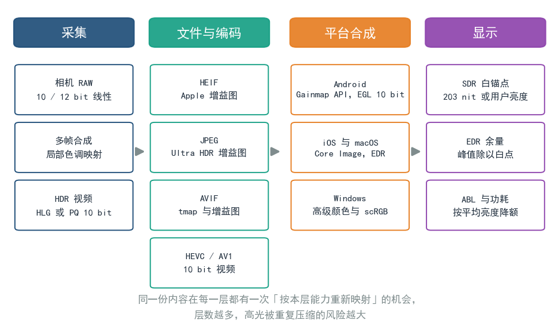
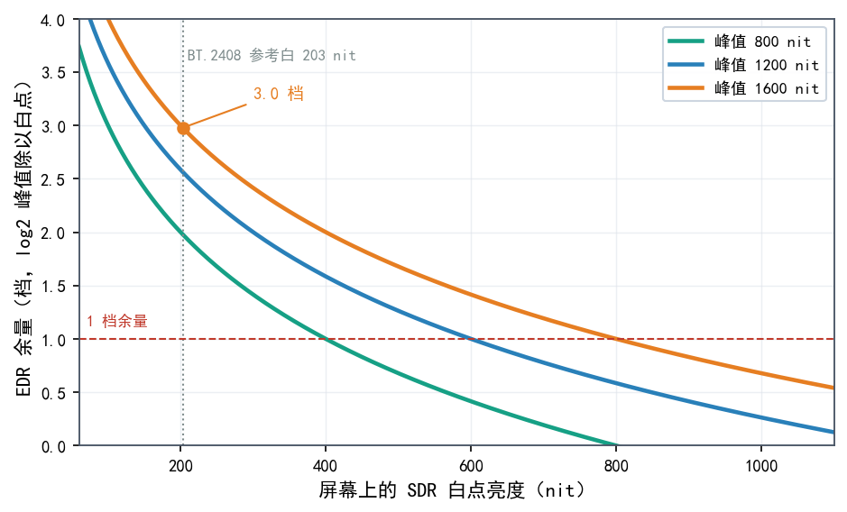
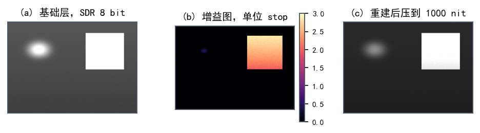
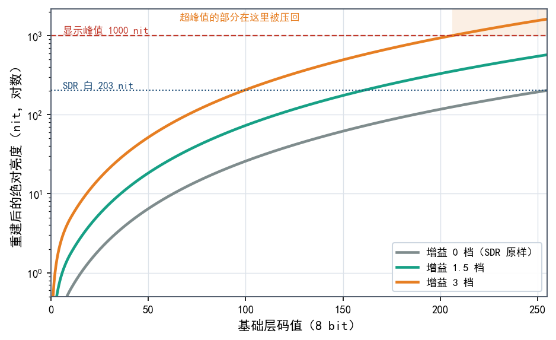
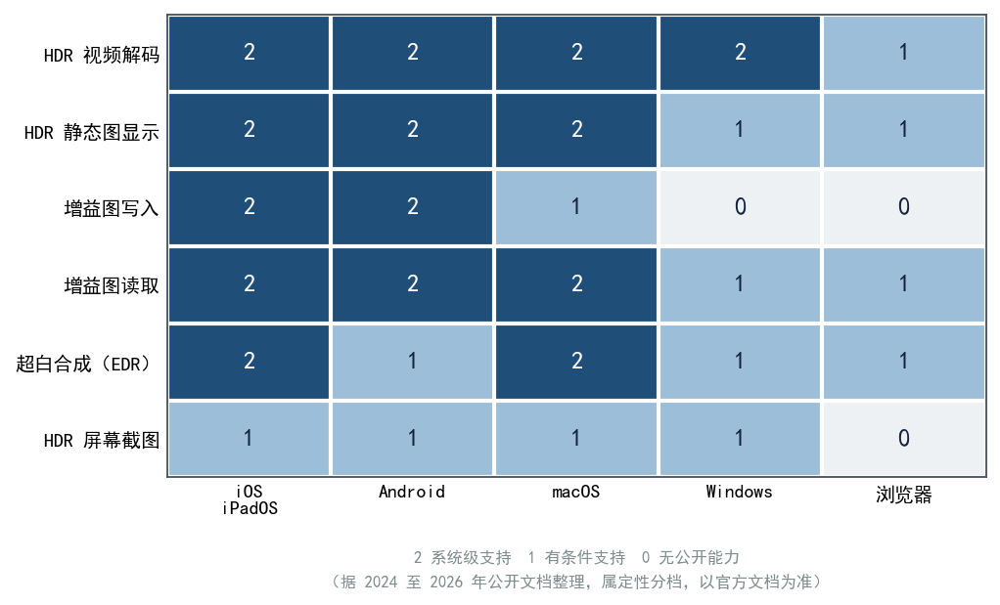
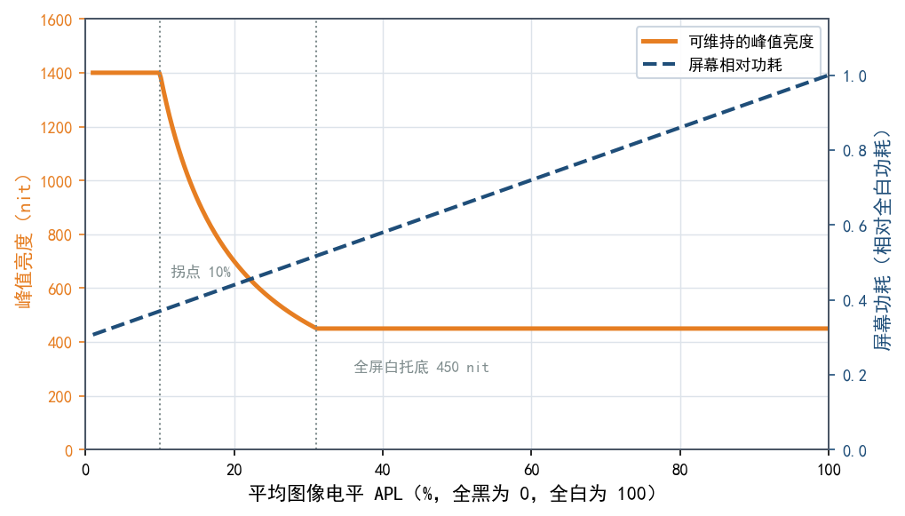

# 第 9 章 移动端与 Web HDR

大多数人第一次看见 HDR 是在手机相册里，而不是在电视卖场。同一张在海边拍的照片，手机上高光通透、天空有层次，发到电脑上却是一片死白。这种落差不是错觉，它来自一套和客厅电视完全不同的显示条件与软件栈。手机屏幕小，亮度受环境光和温度支配，操作系统要在合成阶段就把 HDR 与界面混在一起，内容又大多以照片和竖屏视频的形式存在。到了浏览器，这套能力还要再被媒体查询、解码器和画布接口过滤一遍。这一章沿着采集、文件、平台、显示四层，把移动端和 Web 上 HDR 真正能走到哪一步讲清楚。

## 一、一块握在手里的屏幕

6.1 英寸、2532×1170 的面板，像素密度约 460 ppi。把手机举在 30 cm 处，一个像素的张角不到 0.5 角分，而人眼的极限分辨力大约是 1 角分，对应 291 ppi。分辨率早已过剩这件事对 HDR 有直接影响，手机不靠提高空间频率来改善观感，它把预算花在亮度、色域和对比度上。同一块屏，SDR 模式下峰值五六百 nit，播放 HDR 照片时局部能冲到一千多 nit，差别不在像素多少。

小尺寸反而让峰值更容易做高。像素面积小，同样的驱动电流密度下总电流有限，散热路径短，热量能较快摊到金属中框上。于是手机的小窗口峰值可以做到 1000 到 2000 nit，全屏白通常只有 400 到 600 nit。这个比例和电视上的自动亮度限制是同一套物理，只是尺度小了一个数量级，时间常数也短得多。电视的 ABL 在几十秒尺度上缓慢变化，手机的固件几秒内就能把亮度压下来，用户有时能看见画面「呼吸」一下。

使用环境一直在变。办公室照度 300 到 500 lux，户外阴影约 1 万 lux，正午阳光直射可以到 10 万 lux。屏幕表面反射率按 4% 到 6% 算，10 万 lux 的环境光会在屏上反射出四五千 nit，这个数比屏幕自己的峰值还高。黑位被反射抬起来，对比度掉到几十比一。为了在反射之下仍能看清，系统把 SDR 白整体抬高，户外模式下 SDR 白可以到 800 甚至 1000 nit。白点一高，HDR 的余量就没了。1600 nit 的峰值除以 800 nit 的白点只剩一档，原本三档的高光被压成一档，观感和 SDR 差别很小。

这是手机 HDR 和电视最根本的区别。电视的观看条件由房间决定，SDR 白基本固定在 100 到 200 nit，余量是个常数。手机的白点是环境光的函数，同一段视频在地铁里和阳光下是两种表现。内容端没法为这种变化做补偿，只能把决定权交给系统。系统也不总是做得好，很多机型在强光下干脆放弃 HDR，把整幅画面按 SDR 渲染，用户看到的是「屏幕很亮但没有层次」。

功耗是另一条硬约束。6.1 英寸 OLED 在 200 nit 全屏白时屏幕功耗大约 0.6 到 1 W，800 nit 时升到 2 W 以上，具体数值随机型与发光材料差别很大。视频播放时屏幕通常占整机功耗的三到五成，游戏和拍照时比例低一些，因为 SoC 和基带吃掉了更多。机身温度到 40 度出头，固件开始降亮度，先降全局白，再降局部峰值。一场两小时的 HDR 电影，后半段的峰值往往只有开场的一半。所以手机上标称的峰值亮度是一个带条件的瞬时值，和电视标称的稳定值不是一回事。

内容形态也在塑造体验。手机上消费的绝大多数是照片、竖屏短视频和社交信息流，长片电影的比例很低。照片的 HDR 以增益图格式存在，视频的 HDR 以 HLG 或 PQ 的 10 bit 码流存在，两者的处理路径不同。拍摄端的多帧合成和局部色调映射已经把场景动态范围压缩过一轮，显示端拿到的并不是传感器原始的线性光。这一点常被忽略，手机 HDR 照片的「真实感」其实是计算摄影的结果，不是光学动态范围的直接呈现。

还有一个电视上没有的环节，系统合成。手机的 HDR 内容不会独占屏幕，状态栏、通知、字幕、悬浮窗都要叠在上面。合成器必须在线性光空间里做混合，否则白字压在高光上会出现暗边，半透明面板会让背后的高光透出来。Android 的 SurfaceFlinger 和 iOS 的 Core Animation 都在这层做色调映射与混合，再把结果送进显示控制器。合成层数是手机 HDR 链路比电视长的主要原因，每一层都可能对高光做一次压缩。



图 9-1 把这条链路按层摊开。左边是采集，相机输出 10 或 12 bit 的线性数据，经过多帧合成和局部色调映射压成一张能看的图，视频则直接以 HLG 或 PQ 的 10 bit 码流输出。第二层是文件与编码，照片有 HEIF、Ultra HDR JPEG、AVIF 三种带增益图的容器，视频是 HEVC 或 AV1 的 10 bit 码流。第三层是平台合成，Android 通过 Gainmap API 与 EGL 的 10 bit 表面处理，iOS 与 macOS 走 Core Image 和 EDR 输出，Windows 走高级颜色与 scRGB 浮点合成。最右边是显示，SDR 白锚点、EDR 余量、ABL 与功耗三件事共同决定最终亮度。

这张图值得注意的地方在箭头。每一层之间的箭头都意味着一次按本层能力重新映射的机会。相机把 14 档压到 10 档，编码器把 10 档写进增益图，平台合成按当前余量取一部分增益，显示端再按 ABL 压一次。四层各压一次，高光就被压了四次。这也解释了为什么手机上的 HDR 照片看起来「亮但不刺眼」，而同一张图在专业监视器上会显得平淡。层数越多，越需要一个统一的锚点，否则每层都按自己的理解去映射，结果不可预测。

## 二、Android 的 HDR 通路

Android 的 HDR 能力查询从显示开始。Display.getHdrCapabilities() 返回一个 HdrCapabilities 对象，getSupportedHdrTypes() 列出屏幕能接受的 HDR 类型，包括 HDR10、HLG、Dolby Vision，Android 10 起还有 HDR10+。同一对象还给出 getDesiredMaxLuminance()、getDesiredMaxAverageLuminance()、getDesiredMinLuminance()，单位是 nit。这三个数描述屏幕希望的亮度范围，供应用做色调映射时参考，不是实测值，厂家怎么写就怎么报。

查询到能力不等于能用。应用还要把窗口切到对应的颜色模式。Window.setColorMode(ActivityInfo.COLOR_MODE_HDR) 让系统按 HDR 处理这个窗口，Display.getSupportedColorModes() 列出屏幕支持的模式，包括 COLOR_MODE_SRGB、COLOR_MODE_DISPLAY_P3、COLOR_MODE_BT2020、COLOR_MODE_BT2100_PQ、COLOR_MODE_BT2100_HLG 等。BT2100 的两个模式对应 PQ 与 HLG，只有在屏幕支持、系统版本足够、应用正确设置三者同时满足时才会生效。设置失败通常不报错，只是画面被当成 SDR 处理，看起来发灰。

视频播放是 Android 上最成熟的 HDR 路径。MediaCodec 解码出 10 bit 的 YUV，通过 Surface 直接送进 SurfaceView，SurfaceFlinger 在合成时保留 10 bit 精度和 BT.2020 色域，最后送显示控制器。MediaFormat 里要标清楚三件事，KEY_COLOR_STANDARD 设为 COLOR_STANDARD_BT2020，KEY_COLOR_TRANSFER 设为 COLOR_TRANSFER_ST2084 或 COLOR_TRANSFER_HLG，KEY_HDR_STATIC_INFO 填入静态 HDR 元数据，里面包含 ST 2086 的母版信息与内容亮度统计。少写一个，解码器可能输出 8 bit，或者合成器按 sRGB 解释，画面不是发灰就是过饱和。

SurfaceView 与 TextureView 的差别在 HDR 上很致命。SurfaceView 走硬件叠加层，YUV 数据可以不经过 GPU 直接由显示控制器合成，10 bit 和 BT.2020 都能保住；TextureView 把内容当纹理交给 GPU，合成走 GPU 管线，中间任何一个环节按 8 bit 处理，精度就掉了。很多播放器为了做动画、圆角或者缩放选了 TextureView，HDR 效果因此打折，用户看到的是「这台手机 HDR 不明显」，其实是渲染路径选错了。

这里有一个容易混淆的概念。手机宣传里的「HDR 屏」通常指屏幕通过了某项 HDR 认证，能显示 HDR10 内容；而 Display.getHdrCapabilities() 报告的只是屏幕能接受什么信号，不保证应用拿到的 Surface 是 10 bit，也不保证合成链路不截断。真正的端到端 HDR 要满足四个条件，内容是 HDR 编码，解码器输出 10 bit，合成器保留 10 bit 与广色域，屏幕按 PQ 或 HLG 驱动。四个环节任何一个退回 8 bit，观感都会明显下降，而且这种下降是渐进的，用户往往说不出哪里不对，只觉得「不够亮」。

Android 长期缺一个和 iOS EDR 对应的概念。系统的亮度调节只管背光或全局亮度，应用拿不到「SDR 白现在是多少 nit」。Android 14 起 Display 提供了 HDR 与 SDR 的亮度比查询 getHdrSdrRatio()，可以用来估算当前余量，可用性与取值语义要以官方文档为准。多数应用的做法偏保守，把 SDR 内容按 203 nit 渲染，HDR 内容按屏幕声明的峰值做映射，中间不做自适应。结果是夜间模式和户外模式下，同一张 HDR 照片的观感差别没有 iOS 那么细腻。

Ultra HDR 是 Android 14 引入的静态图方案，也是这一代 Android 在 HDR 上最有辨识度的动作。它的做法是把一张普通的 8 bit JPEG 当基础层，在后面追加一张低分辨率的增益图，再用 XMP 写入增益元数据。普通解码器只读基础层，看到的是一张正常的 SDR 照片；支持 Ultra HDR 的解码器读出增益图，重建出高光。文件扩展名还是 .jpg，任何图床、聊天软件、邮件附件都能传，不会因为格式不认识而报错。这是它相对 10 bit HEIF 的最大优势。

系统层提供的接口围绕 android.graphics.Gainmap 展开。Bitmap 可以带一个增益图对象，ImageDecoder 在解码时把基础图与增益图一起读出来，应用也可以自己构造 Gainmap 再写回。具体哪些压缩路径能保留增益图，各版本行为不完全一致，写回前最好实测一遍，以官方文档为准。相机侧的 HDR 拍摄在 Android 13 起通过 Camera2 的 DynamicRangeProfiles 暴露，常见的有 HLG10 与 HDR10 两档，前者适合视频，后者适合照片。不同厂商的实现差异很大，同一款传感器在不同品牌手机上给出的 HDR 效果可以完全不同。

视频应用的 HDR 还有一道不写在显示 API 里的门槛，版权保护。Netflix、Disney+ 这类应用要求 Widevine L1 才能播放 HDR 与高分辨率流，L3 只能拿到低清 SDR。原因是 HDR 码流被视为高价值内容，解密与解码要在可信执行环境里完成，帧数据不能经过应用层内存。这条规则与屏幕能力无关，一台显示参数很好的手机，如果只通过了 L3，看到的依然是低清 SDR。用户在设置里看到的「HDR 播放支持」，往往是这项检查的结果，而不是 Display.getHdrCapabilities() 的返回值。

碎片化是 Android HDR 最现实的问题。Dolby Vision 需要授权与专门的解码器，HDR10+ 的支持集中在少数机型，HLG 的普及度高但内容少。应用如果想把 HDR 做稳，通常要按能力分级，HDR10 走一条路，HLG 走一条路，剩下的按 SDR 处理并做一次质量不错的色调映射。这个分级逻辑本身不难，难的是测试矩阵。同一份 APK 要在几十款屏幕、几代系统上验证，任何一款的合成链路出问题都会表现为「只有这台手机发灰」，而且这类问题在模拟器上永远复现不了。

## 三、iOS 与 macOS 的 EDR

Apple 用的词是 EDR，Extended Dynamic Range。它的核心约定很简单，颜色值用浮点表示，1.0 对应屏幕上的 SDR 白，大于 1.0 的部分是超出 SDR 白的高光，合成器按当前可用的余量把它们映射到面板峰值。这个约定把绝对亮度换成了相对白点的倍数，好处是同一份内容在任何亮度的屏幕上都能保持相同的相对关系，代价是没人知道 1.0 到底是多少 nit。

余量是 EDR 的核心变量。定义是峰值除以 SDR 白，用档表示就是 log2 的比值。iPhone 的 SDR 白由亮度滑块和环境光共同决定，室内大约 200 到 300 nit，户外可以到 800 nit 以上；峰值在 1000 到 2000 nit 之间，随温度和电量变化。两者一除，室内有三档余量，户外只剩不到一档。应用通过 UIScreen 的 currentEDRHeadroom 与 potentialEDRHeadroom 读这两个值，前者是当前可用，后者是理论上限，iOS 16 起提供。macOS 对应的是 NSScreen 的 maximumExtendedDynamicRangeColorComponentValue 与 maximumPotentialExtendedDynamicRangeColorComponentValue。



图 9-2 把这条关系画成曲线。横轴是 SDR 白的亮度，纵轴是余量档数，三条线对应 800、1200、1600 nit 三种峰值。SDR 白 203 nit 时，1600 nit 的屏有三档余量，1200 nit 的屏有 2.6 档，800 nit 的屏只有 2 档。白点抬到 500 nit，三条线分别掉到 1.7、1.3、0.7 档。白点到 800 nit，800 nit 的屏已经没有余量，HDR 和 SDR 在这块屏上没有区别。曲线的形状来自 log2 的比值关系，白点越低余量越大，斜率也越陡，这就是为什么夜间看 HDR 内容会觉得高光特别亮。

这条曲线的实用价值在于解释观感。用户在夜里把亮度调到最低，SDR 白可能只有 80 nit，此时三档余量意味着高光能到 640 nit，对比强烈；白天在户外，白点被抬到 800 nit，同样的内容高光只比白点亮一倍，看上去平淡。内容没有变，屏幕峰值也没有变，变的是白点。iOS 的自适应策略就是在这条曲线上滑动，系统根据环境光选择白点，再决定用多少余量。用户在控制中心拖动亮度条，实际上是在移动整条曲线，而不是在调一个背光电流。

参考模式是另一套逻辑。Pro Display XDR 和 Studio Display 提供的参考预设，比如 HDR Video (P3-ST 2084)，把 SDR 白固定在 100 nit，峰值固定，关闭环境光自适应与系统亮度调节。这样调色师看到的绝对亮度和母版一致，203 nit 的参考白在屏幕上就是 203 nit。手机上的 EDR 是自适应，参考模式是固定，两者不能混用。在参考模式下看手机拍的 HDR 照片，往往觉得高光过曝，因为照片是按手机的白点习惯渲染的，它的「1.0」本来就不是 100 nit。

广色域是 EDR 的前置条件。iOS 的颜色对象可以用 Display P3 初始化，图层默认按 sRGB 解释，只有在颜色空间显式声明为 P3 或扩展 sRGB 时，超出 sRGB 的红色与绿色才不会被裁掉。很多界面在 P3 屏上看起来更艳，原因就是系统按 P3 解释那些颜色值；同一份值在不声明色彩空间的渲染路径里会被当成 sRGB，饱和度立刻低一截。EDR 在广色域之上再加一层亮度余量，两者常被混为一谈，其实一个是色度范围，一个是亮度范围。

解码与传输路径由 AVFoundation 和 CoreVideo 承担。AVPlayerItem 读到 HEVC 的 10 bit 码流，VideoToolbox 解出 CVPixelBuffer，像素格式通常是 x420 或 xf20，前者是全范围 10 bit 4:2:0。色彩信息挂在 buffer 的附件上，kCVImageBufferColorPrimariesKey 设为 ITU_R_2020，kCVImageBufferTransferFunctionKey 设为 SMPTE_ST_2084_PQ 或 ITU_R_2100_HLG，母版信息放在 kCVImageBufferMasteringDisplayColorVolumeKey，内容亮度统计放在 kCVImageBufferContentLightLevelInfoKey。这些键名和 MP4 里的 colr、mdcv、clli 一一对应，封装层丢掉的元数据，解码层还可以从码流里补回来。

送显示有两条路。AVPlayerLayer 自己处理 HDR，把解码后的 buffer 交给 Core Animation，由合成器按当前余量映射；AVSampleBufferDisplayLayer 适合自己控制帧节奏的场景，比如自定义播放器或者视频编辑预览。两条路都要求 layer 所在的视图在支持 EDR 的屏幕上，且没有中间层把浮点值截断。常见的错误是在中间加了一个不透明背景，或者把 layer 放进一个被离屏渲染的容器，浮点值在那一层被压回 0 到 1，高光直接削平。

自己渲染时用 Metal。CAMetalLayer 的 pixelFormat 设成 rgba16Float，colorspace 设成扩展线性 sRGB 或者 ITU-R 2100 的 PQ 空间，片元着色器输出大于 1.0 的值，合成器会把 1.0 映射到 SDR 白，把超出的部分映射到余量里。老接口 wantsExtendedDynamicRangeContent 也能打开这个行为，新代码更推荐直接用扩展色彩空间加浮点格式。超过当前余量的值会被裁掉或者压回，具体行为取决于系统和图层配置，所以渲染端最好自己按 currentEDRHeadroom 做一次软肩，而不是把八档的高光直接丢给合成器。

PQ 与 EDR 的差别值得单独说。PQ 是绝对亮度编码，码值 0.58 就是 203 nit，不管屏幕多亮。EDR 是相对白点的浮点扩展，1.0 是白点，2.0 是白点的两倍。两者可以互相转换，转换的桥梁就是白点。把 PQ 信号送进 EDR 管线，系统要先按白点把绝对亮度归一化，再按余量截断。这也是为什么同一段 HDR 视频在 iPhone 和参考监视器上看起来不一样，前者按当前白点归一化，后者按 100 nit 固定白点显示，高光的相对关系完全不同。

Core Image 和 Core Graphics 把这件事接到了图像处理上。CIContext 的工作色彩空间用扩展线性 sRGB，CIImage 里的值可以大于 1，滤镜在浮点空间里运算，不会在中途被裁。读取带增益图的 HEIF 时，Core Graphics 提供 kCGImageAuxiliaryDataTypeHDRGainMap 取增益图，iOS 18 与 macOS 15 起还提供 ISO 21496-1 定义的 kCGImageAuxiliaryDataTypeISOGainMap，两种类型可能同时存在于一个文件里。写文件时选哪种类型，决定了这份图在 Android 与 Windows 上的兼容性。

到这儿可以把平台差异收成一句话。Android 把 HDR 当作一种显示模式，应用申请、系统切换、内容按模式解释；Apple 把 HDR 当作浮点管线的一个自然延伸，1.0 以上自动是 HDR。前者的边界清晰但碎片化，后者的体验连贯但把复杂度藏进了系统。对做内容的人，这意味着同一份母版要准备两套心理预期，不能用同一套亮度假设去推断两边的观感。
## 四、增益图：一个文件两个版本

HDR 照片最现实的难题是兼容。用 10 bit HEIF 存，旧手机、旧电脑、多数网页都打不开；用 PQ 编码的 JPEG 存，SDR 屏上要么发灰要么过曝，因为解码器把它当 sRGB 解释。两条路都要求接收端懂 HDR，而世界上大多数接收端不懂。增益图走的是第三条路，让文件本身同时是 SDR 和 HDR，由解码端决定看到哪一层。

结构上分三块。基础层是一张最普通的 SDR 图，8 bit，sRGB 或 Display P3，任何解码器都能显示，观感也经过了调色，单看并不难看。增益图是一张低分辨率的单通道图，每个像素记录「这一处比基础层亮多少倍」，单位是 log2 的档。元数据描述增益的取值范围、编码用的 gamma、黑位偏移，以及这份增益对应多大的显示余量。三者合起来，接收端只要愿意，就能把 SDR 图逐像素提亮，重建出高光。



图 9-3 用一个程序生成的室内场景说明这三块。左图是基础层，按 SDR 白 203 nit 裁切，窗外的天空和窗框已经并成一片白，灯的中心也过曝，这正是普通照片在强光下的样子。中图是增益图，黑色区域表示不需要提亮，窗口那块从 1.5 档渐变到 3 档，因为窗外的天空比 203 nit 亮三档左右，越靠上越亮。右图是重建结果，按增益把基础层提亮后再压到 1000 nit 的显示峰值，窗内的渐变回来了，能看到天空从上到下的层次，而左图那里只是一块白。

这张图也说明了增益图为什么可以低分辨率。增益描述的是高光的变化趋势，不是细节。窗外的天空、灯罩的衰减、金属反光，这些区域在空间上都很平缓，四分之一分辨率甚至八分之一分辨率足够，放大时双线性插值不会露馅。真正需要高分辨率的是基础层，因为它承载了纹理和边缘。工程上常见的配置是基础层全分辨率，增益图取二分之一或四分之一，单通道 8 bit，压缩后对文件体积的贡献在 3% 到 10% 之间。

重建的数学不复杂。设增益图的归一化像素值为 $p$，元数据给出最小增益 $g_{\min}$、最大增益 $g_{\max}$、gamma $\gamma$，则该像素的增益为

$$
g = g_{\min} + \left(g_{\max}-g_{\min}\right)p^{1/\gamma}
$$

显示端还要决定用多少增益。设当前显示余量为 $H$（峰值除以白点），元数据给出增益生效的余量区间 $[c_{\min}, c_{\max}]$，权重为

$$
w=\mathrm{clip}\!\left(\frac{\log_2 H-c_{\min}}{c_{\max}-c_{\min}},\ 0,\ 1\right)
$$

最终亮度是

$$
L_{\mathrm{HDR}}=\left(L_{\mathrm{SDR}}+o_{\mathrm{SDR}}\right)2^{\,g\,w}-o_{\mathrm{HDR}}
$$

$o_{\mathrm{SDR}}$ 与 $o_{\mathrm{HDR}}$ 是两个偏移量，用来对齐基础层与重建层的黑位，避免暗部被增益抬起。这组式子来自 ISO 21496-1 与更早的 Adobe 增益图规范，字段名在文件里写作 GainMapMin、GainMapMax、Gamma、OffsetSDR、OffsetHDR、HDRCapacityMin、HDRCapacityMax。看懂这几个字段，就能判断一份文件的 HDR 强度有多大。

权重 $w$ 是整个方案的关键。它让同一份文件在不同屏幕上取不同的增益比例。SDR 屏的余量是 0，$w=0$，重建结果等于基础层；三档余量的手机，$w$ 接近 1，增益全用上；一档余量的笔记本，$w$ 取三分之一，只提亮一部分。没有任何一步需要裁切，也没有任何一步需要重新调色，高光的相对关系在每一档上都保持连续。



图 9-4 把增益的效果画成曲线。横轴是基础层码值，纵轴是重建后的绝对亮度，对数刻度。灰色是零增益，也就是 SDR 原样，码值 255 对应 203 nit。青色是 1.5 档增益，白色码值对应 574 nit；橙色是 3 档，对应 1624 nit。三条曲线形状相同，只是在纵轴上平移，因为增益在线性光里是一个固定倍率。图右上角的阴影区是超过 1000 nit 峰值后被显示端压回的部分，橙线在码值 210 以上进入这个区域，也就是说增益图里最高的那一段，在 1000 nit 的屏上只能部分实现。

这张图有两个不太直观的结论。第一，增益对暗部几乎没有影响。码值 32 处，基础层约 3 nit，加三档也只有 23 nit，绝对增量 20 nit；到了码值 255，同样的三档带来的是 1400 nit 的增量。增益真正起作用的地方是高光。第二，增益的档数不能无限加。3 档意味着 8 倍，5 档是 32 倍，再往上，基础层的 8 bit 量化误差也被放大同样的倍数，高光会出现色块和噪点。所以主流实现把最大增益限制在 3 到 4 档，对应峰值 1600 到 3200 nit，刚好覆盖手机的屏幕能力。

四种格式的方言差别在容器与元数据，语义大同小异。

Apple 的增益图放在 HEIF 的辅助图里，辅助图类型是 urn:com:apple:photo:2020:aux:hdrgainmap，Core Graphics 用 kCGImageAuxiliaryDataTypeHDRGainMap 读取，iOS 13 与 macOS 10.15 起就有。它的元数据是 Apple 自己的一套，增益同样以 log2 存，重建公式与上面接近但不完全等价，具体细节没有完整公开。iPhone 拍的 HDR 照片默认走这条路，所以在非 Apple 设备上，文件通常只能显示出基础层。

Ultra HDR 放在 JPEG 里。基础层是标准的 JPEG 图像，增益图作为第二张图追加在文件末尾，用 MPF 索引，元数据写在 XMP 的 hdrgm 命名空间里，字段就是 ISO 21496-1 那一套。Android 14 起系统相机与相册支持读写，Chrome 在 Android 上也能解码。它的兼容性最好，因为任何不认识 MPF 与 XMP 的解码器都会安静地只读第一张图，得到一张正常的 SDR 照片。

AVIF 用派生图像项把基础图与增益图关联起来，规范里叫 tmap，元数据同样遵循 ISO 21496-1。AVIF 的压缩效率比 JPEG 高，同样画质下体积小一半，适合带宽敏感的场景。代价是支持面窄，浏览器与系统的解码器版本参差不齐，同一份 AVIF 在 Chrome、Safari 和 Windows 照片应用里的表现可能完全不同。实际部署时通常要准备 JPEG 与 AVIF 两份，按 UA 或 Accept 头分流。

ISO 21496-1 在 2024 年发布，把这套做法统一成了国际标准。它规定了增益图元数据的语法与语义，包括基础层与替代层的关系、增益范围、gamma、偏移、容量区间，也规定了重建的计算方式。标准本身不规定容器，JPEG、HEIF、AVIF 都可以装。它源自 Adobe 与 Google 合作的增益图方案，所以字段名与早期实现保持一致。Apple 在 iOS 18 与 macOS 15 起增加了对 ISO 增益图的支持，辅助图类型是 kCGImageAuxiliaryDataTypeISOGainMap，一份文件里可以同时有 Apple 自家与 ISO 两种增益图，各平台各取所需。

| 方案 | 容器 | 元数据 | 兼容性 | 常见峰值 |
|---|---|---|---|---|
| Apple 增益图 | HEIF 辅助图 | Apple 私有 | Apple 生态内最好 | 3 到 4 档 |
| Ultra HDR | JPEG 加 MPF | ISO 21496-1（XMP） | 最广，旧设备退 SDR | 3 档左右 |
| AVIF 增益图 | AVIF 派生项 | ISO 21496-1 | 取决于解码器版本 | 3 到 4 档 |
| ISO 21496-1 | 不限 | 标准字段 | 新，正在铺开 | 由文件声明 |

旧设备为什么能正常显示，答案在容器的宽容度。JPEG 的规范允许在图像数据之后追加任意内容，解码器读到 EOI 标记就停，后面的字节被忽略；MPF 是追加内容里的一段索引，认识的解码器按索引找第二张图，不认识的当作垃圾数据跳过。HEIF 的辅助图是独立的图像项，主图不引用它就不会被解码。XMP 是嵌在文件里的 XML 包，不认识 hdrgm 命名空间的软件直接忽略。三层机制各自独立，任何一层失效，退路都是那张完整的 SDR 基础图。

增益图与 PQ 静态图代表两种世界观。PQ 把绝对亮度写进每个像素，解码端知道 1000 nit 就是 1000 nit，代价是老设备看不懂，也没法降级。增益图把绝对亮度换成了相对基础层的倍率，解码端只知道「这里亮三档」，具体多少 nit 交给显示端去算。前者适合母版与专业交付，后者适合分发。理解了这一点，就不会追问「为什么 HDR 照片不把峰值写死」，写死就等于放弃兼容。

代价有几个。第一是体积，增益图加上元数据让文件大 3% 到 10%，对相册无所谓，对网页图片是要算的。第二是绝对亮度不可信，增益图只保证相对关系，同一张照片在 600 nit 和 1600 nit 的屏上峰值不同，做印刷或投影时不能拿它当亮度参考。第三是工具链的坑，社交平台、图片压缩工具、截图工具在转码时经常把 MPF、XMP 或辅助图整段丢掉，文件看起来正常，HDR 却没了，而且没有任何提示。第四是几何变换，裁剪、旋转、缩放必须同时作用于基础层与增益图，还要同步修改元数据里的尺寸，做错一步就会出现高光错位。

工程上比较稳妥的做法是把增益图当成「可选的增强层」来设计。基础层按 SDR 认真调色，确保它在任何设备上都成立；增益图只负责高光，不承担主要观感；元数据里的容量区间按目标设备的实际能力填，不要为了显得亮而虚报。分享时优先用 Ultra HDR 的 JPEG，兼容性最好；追求体积用 AVIF，但要接受支持面窄；在 Apple 生态内用 HEIF，体验最完整。跨平台交付时最好同时给一份 SDR 版本，让接收方有确定的退路。

## 五、Web 端

浏览器是 HDR 最难落地的地方。原因不在某一项技术缺失，而在链路上要连续通过四道门，内容标记、解码能力、合成路径、显示条件，任何一道关上，HDR 就退回 SDR，而且退得悄无声息。网页没有安装包，不能假设用户的系统版本，也不能要求用户去设置里打开某个开关，所有能力都得在运行时探测。

探测的第一步是媒体能力查询。navigator.mediaCapabilities.decodingInfo() 接受一段描述，返回支持性、流畅度与能效三个判断。

```js
const info = await navigator.mediaCapabilities.decodingInfo({
  type: "file",
  video: {
    contentType: 'video/mp4; codecs="hvc1.2.4.L120.B0"',
    width: 3840, height: 2160,
    bitrate: 20000000, framerate: 24,
    colorGamut: "rec2020",
    transferFunction: "pq",
    hdrMetadataType: "smpteSt2086"
  }
});
```

三个 HDR 相关字段各有取值。colorGamut 取 srgb、p3 或 rec2020，transferFunction 取 srgb、pq 或 hlg，hdrMetadataType 取 smpteSt2086、smpteSt2094-10 或 smpteSt2094-40。三个字段必须和内容的实际参数一致，否则查询结果没有意义。返回的 supported 只说明这条配置能播，不说明画面上真的有 HDR，因为浏览器可能解码成 10 bit 再合成到 8 bit 的 SDR 表面，中间悄悄降了一级。

第二步是 CSS 与媒体查询。window.matchMedia("(dynamic-range: high)") 判断显示是否能呈现 HDR，(video-dynamic-range: high) 判断视频通路是否支持，(color-gamut: p3) 与 (color-gamut: rec2020) 判断色域。这几个查询反映的是浏览器对当前显示条件的判断，不是硬件的绝对能力。用户在系统里关掉 HDR，或者把窗口拖到另一块屏上，查询结果会跟着变，所以监听 change 事件比查一次更可靠。

第三步是播放。video 元素的 HDR 播放依赖三件事同时成立，内容用浏览器支持的编码，解码器能输出 10 bit，合成器能把 10 bit 送到支持 HDR 的显示表面。Safari 在 macOS 与 iOS 上走 AVFoundation，HEVC 的 HDR10、HLG 与 Dolby Vision 都能播，这也是 Apple 设备上网页 HDR 体验最完整的原因。Chrome 在 Windows 上依赖平台解码器与系统 HDR 开关，在 Android 上依赖设备能力，在 macOS 上走 Metal 合成。Firefox 的支持更保守，很多配置下只输出 SDR。同一段 HDR 视频在不同浏览器里的表现差异，主要来自这条通路，而不是解码质量。

实际播放器还有两道工程门槛。一是 MSE，MediaSource.isTypeSupported() 只回答封装与编码能不能喂给 SourceBuffer，不回答 HDR 能不能显示，两个判断要一起做。二是 DRM，EME 的 Widevine 等级决定能不能拿到 HDR 码流，很多桌面浏览器只有软件解密，流媒体服务因此只给它 SDR。直播是另一个缺口，HDR 直播要 HLG 或 PQ 的实时编码，还要端到端保持 10 bit，目前只有少数体育与演出转播做到，普通网页直播仍是 8 bit。

第四步是绘制。canvas 2D 的 colorSpace 选项只接受 srgb 与 display-p3，也就是说 2D 画布最多做到广色域 SDR，做不到超过白点的高光。想在网页上画真正的 HDR，得用 WebGL 或 WebGPU。WebGL 通过 drawingBufferColorSpace 声明输出色彩空间，配合浮点纹理与 EXT_color_buffer_half_float 扩展，可以在帧缓冲里保留大于 1 的值，但最终能不能显示出来，取决于浏览器是否把这块画布合成到 HDR 表面。WebGPU 的路径更明确，配置画布时把 format 设为 rgba16float，toneMapping 设为 extended，颜色值就可以超过 1，由合成器按显示余量映射。toneMapping 这个选项还比较新，各浏览器的支持程度要以官方文档为准。



图 9-5 把五个平台的能力按六个维度排成矩阵，2 表示系统级支持，1 表示有条件支持，0 表示没有公开能力。视频解码一行全是 2 或 1，说明 HDR 视频已经是成熟能力，差别只在浏览器这一列要打折扣。静态图显示也类似，iOS、Android、macOS 都能原生显示 10 bit 图，Windows 需要正确的编解码器与显示设置，浏览器则取决于版本。增益图写入这一行差距最大，iOS 与 Android 是系统级，macOS 只有部分工具支持，Windows 与浏览器基本没有公开的写入路径。超白合成一行，iOS 与 macOS 是 2，Android 是 1，因为它的 EDR 等价能力分散在厂商实现里，Windows 是 1，需要开启 HDR 并使用支持的合成器，浏览器也是 1，只有 WebGPU 的 extended 模式能写出超过 1 的值，支持面还很窄。

这张矩阵最值得看的是最后两行。截图与超白合成是 HDR 体验的最后一公里，也是最容易被忽略的地方。一个平台能把 HDR 视频解码得很漂亮，却在截图时把高光压平，用户对这套 HDR 的信任就会打折。浏览器在最后两行全是 0 或 1，这解释了为什么网页上的 HDR 内容总感觉「差一口气」，它缺的不是解码，而是从画布到屏幕的那一段。

网页上的渐进增强有一套现成的写法。用 picture 元素按类型分流，浏览器选择第一个能解的源，解不了就退到下一层。

```html
<picture>
  <source type="image/avif" srcset="photo.avif">
  <source type="image/jpeg" srcset="photo-ultra-hdr.jpg">
  
</picture>
```

type 只判断 MIME 类型，不判断增益图能力，所以支持 AVIF 但不懂增益图的浏览器会拿到 AVIF 的 SDR 基础层，这也是可接受的退路。想进一步区分，可以在脚本里查 matchMedia 的结果，再决定给 img 换哪个 src。这条路径的缺点是浏览器预加载会先抓 img 的默认源，换源时多一次请求，图片多的页面要权衡。

色彩管理链是另一处容易出错的地方。浏览器拿到一张图，先按文件里的 ICC 配置或色彩标记解释，转换到合成用的工作空间，再按显示器的 profile 输出。没有标记的图按 sRGB 处理，这是规范里的默认值。HDR 内容必须显式标记，PQ 或 HLG 的传输函数、BT.2020 的色域、ST 2086 的母版信息，缺一样就可能被当成 SDR。CSS 里的 color() 函数可以写 color(display-p3 1 0 0)，但写不出超过 1 的分量，所以纯 CSS 做不了 HDR 高光。

网页 HDR 至今不普及，原因可以列成五条。内容侧，网页上的图片绝大多数是 8 bit sRGB，PNG、WebP、传统 JPEG 都没有增益图的标准位置，编辑器和 CMS 也不产出这类文件。转码侧，用户生成内容的平台为了统一和节省带宽，上传后一律转成 8 bit，HDR 在第一步就被洗掉。显示侧，大量笔记本与显示器的峰值只有 300 到 400 nit，Windows 开启 HDR 后 SDR 内容还会因为白点映射显得发灰，用户干脆关掉。浏览器侧，解码与合成路径各家不同，HDR 画布的标准刚落地，前端框架与广告 SDK 还没有跟上。带宽与功耗侧，HDR 视频比 SDR 多 20% 到 40% 的码率，移动网络下这笔账很现实。

所以网页上的 HDR 目前集中在几个场景。流媒体的 HDR 影片，平台自己控制编码、播放器与 CDN，能保证链路完整；商品与艺术类网站的高质量图片，用 AVIF 或带增益图的 JPEG，配合能力探测做渐进增强；数据可视化里少数的超白高光，用 WebGL 或 WebGPU 自己画。剩下的大多数网页，SDR 依然是正确选择，硬上 HDR 只会让不支持的环境看到发灰的画面。

## 六、截图、分享与降级

截图是把屏幕当前的帧缓冲采样下来，存成一张图。这个动作看似中立，实际上决定了 HDR 内容能不能离开这块屏。帧缓冲里的值是浮点，SDR 白是 1.0，HDR 高光可以到 3 或 4，存成文件时必须选一个值域。选浮点加增益图，HDR 就保住了；选 8 bit，就得先做一次色调映射，把 4 压回 1，高光在这一步被永久削平。

各平台的做法不一样。iOS 与 macOS 的截图在支持的机型上会保留 EDR 值，存成 HEIF 并附上增益图，用普通看图软件打开看到的是 SDR 版本，用支持 HDR 的设备打开才显出高光。存成 JPEG 时没有地方放增益图，系统按当前 SDR 白做一次映射，高光变成一片白。Windows 的截图工具在较新版本里支持 HDR 截屏，但输出格式与显示设置有关，SDR 显示器上截 HDR 内容仍然只能得到映射后的结果。浏览器没有统一的截屏接口，扩展抓取的是合成后的画布，HDR 画布在多数实现里会被压回 8 bit。

格式的选择也有讲究。HEIF 能装 10 bit 与增益图，文件还比同画质的 JPEG 小，是保留 HDR 的首选；PNG 没有增益图的位置，截图存 PNG 等于主动放弃高光；屏幕录制比截图更麻烦，编码器通常直接按 SDR 录，录制前要单独确认系统的 HDR 录制开关。

社交平台是降级最彻底的一环。用户上传一张带增益图的 HDR 照片，平台为了统一存储与分发，通常转成 8 bit sRGB 的 JPEG，同时丢掉 XMP、MPF 与辅助图。高光被压到 255，暗部被抬一点，整体饱和度按 sRGB 色域裁一次。这个过程不可逆，下载回来的文件已经不含任何 HDR 信息。同一张图再被转发一次，还要再压一次，块效应和色带在暗部累积，最后变成一张「看着还行但经不起细看」的图。

可以算一笔具体的账。一张 1200 万像素的照片，天空和灯的高光占 2% 的像素，原始峰值 1200 nit，SDR 白 203 nit，也就是高出 2.6 档。转成 8 bit 后，这 2% 的像素全部落在 250 到 255 这六个码值上，原本两档多的层次被压成六个台阶，渐变变成硬边。如果平台的压缩再狠一点，直接用 240 以上全部截断，天空就成了一块纯色。用户看到的「天空糊成一片」，根因在这里，不在拍摄。

视频通话与直播的降级发生得更早。摄像头采集、编码、传输、解码、显示，每一环默认 8 bit，HDR 在采集端就被丢掉。部分机型支持 HDR 视频通话，但要求双方设备与网络都支持，实际使用率很低。屏幕共享与录屏也类似，系统把合成后的画面交给编码器时按 SDR 处理，HDR 内容在共享窗口里会变成发灰的一块。

往返一次损失更多。A 把 HDR 原图发给 B，平台转成 SDR；B 保存后再发给 C，平台对已经压过的 JPEG 再压一次。第二次压缩时，原本就接近饱和的高光区域会出现振铃，暗部的色带被量化成块。C 收到的图在手机上看还算正常，因为手机屏幕小、亮度高，掩盖了瑕疵；在显示器上放大看，问题全出来了。这就是为什么同一张图在群里传了三轮之后，大家都觉得「画质变差了」，却说不清是哪一步坏的。

同一张照片在不同设备上观感差很多，原因有五层。白点不同，iPhone 的 SDR 白可能 500 nit，笔记本只有 200 nit，同一张 SDR 图在两者上的绝对亮度差 2.5 倍。色域不同，Display P3 的红色在 sRGB 屏上被裁成同一个红，饱和度掉一截。峰值不同，HDR 版本在 1600 nit 的屏上有三档余量，在 400 nit 的屏上几乎没有。环境光不同，户外反射把黑位抬高，对比度塌下去。平台的压缩不同，同一份文件在微信、微博、邮件里的结果各不相同。五层叠加，观感差异可以大到让人怀疑是不是同一张图。

可行的做法不多，但有效。分享 HDR 时走文件传输或原图选项，别走会转码的通道；社交场景直接准备一份认真调过的 SDR 版本，比让平台自动压要好；截图前想清楚用途，要留 HDR 就存 HEIF，要通用就接受 SDR；跨设备交付时在文件里保留 ICC 配置与增益图，让接收端有选择的余地。这些做法不能改变平台的策略，但能减少在自己这一环丢掉的信息。

## 七、功耗与热

HDR 在手机上是要付电费的。屏幕发出的光通量正比于平均亮度，功耗也大致正比，这是 OLED 的物理特性决定的。一段 HDR 视频的平均图像电平通常比 SDR 版本高，因为高光部分真的更亮，暗部却没有更暗，整体能量上去了。多出来的这部分功耗，最终变成热量和更短的续航。



图 9-6 用两条曲线说明这件事。橙线是可维持的峰值亮度，模型假设面板能分配的总光通量是一个常数，峰值随 APL 反比下降，并在全屏白处托底。APL 低于 10% 时峰值维持在 1400 nit，10% 之后开始下滑，30% 左右落到 450 nit 的托底值。蓝虚线是屏幕的相对功耗，与 APL 近似线性，全黑时还有三成的静态功耗，全白时到 1.0。两条线的形状完全不同，一条是双曲线，一条是直线，这意味着画面越亮，能用的峰值越低，而付出的功耗越高。

两条线的走势在这里分道扬镳。APL 到 20% 时，峰值还有 700 nit，功耗已经到全白的 0.44。再往上，峰值掉得比功耗涨得快，画面整体变亮但高光反而不亮，观感是「一片灰亮」。这就是为什么 HDR 电影的平均图像电平大多控制在 10% 到 20%，导演和调色师知道超过这个范围，显示端会把高光压回去，不如把亮度留给小面积的重点。

热是第二个约束。手机没有风扇，热量靠中框和屏幕散出去，连续高亮度运行十几分钟，机身温度就会到 40 度以上。固件的策略通常是先降全局亮度，再降局部峰值，最后限制充电功率。用户感知到的是「看着看着变暗了」，而且降下去之后不会很快恢复，要等温度回落。冬天在户外反而不容易触发，因为环境温度低，散热条件好，同一段视频在冬天的峰值可能比夏天高两成。

电池的账可以粗算。一块 5000 mAh、3.87 V 的电池约 19.4 Wh。SDR 视频播放时整机功耗按 2.5 W 算，能播 7.8 小时；HDR 版本屏幕多 1 W，整机 3.5 W，只能播 5.5 小时，少了近三成。这个比例和屏幕尺寸、亮度设置、内容平均亮度都有关，不同机型差别很大，但量级是这样。厂商在宣传里很少提这件事，因为 HDR 的卖点是画质，不是续航。

户外是另一个极端。阳光下的屏幕要把全局亮度推到 800 到 1000 nit 才能看清，SDR 白被抬到接近峰值，HDR 余量被压到一档以内。此时 HDR 的相对优势最小，用户看到的是「很亮但很平」。厂商的应对是提高反射控制、加抗反射镀膜、在强光下切换到更高的全局亮度并接受更高的功耗与发热。这些手段改善的是可读性，不是 HDR 的层次。真正在户外能看出差别的，是照片里的小面积高光，比如阳光下的水面、金属反光、灯牌，这些区域只占几个百分点的像素，不触发 ABL，能短暂冲到峰值。

功耗与热的约束最终会传到内容端。给移动端做的 HDR 版本，画面平均亮度不宜太高，大面积的白、雪景、天空要压一压，把峰值留给小高光；连续的高亮镜头要控制时长，避免触发降亮度；字幕和 UI 元素的白色不要用峰值，用 SDR 白就够。这些做法在电视上也有道理，但在手机上更严格，因为手机的散热余量小，电池也小。

内容端的取舍可以借第 4 章的思路。给移动端交付的 HDR 版本，本质上是为一块峰值 1000 nit、白点可变的屏做一次预先的色调映射。用 EETF 把 4000 nit 母版压到 1000 nit，中间调保持，高光滚降；再把大面积亮度压到 300 nit 以下，给 ABL 留余量；小高光可以放到 1000 nit，占屏面积控制在几个百分点。这样在手机上播放时，显示端只需要做很小的二次映射，高光不会被压两次。

把这一章的内容合起来看，移动端与 Web 的 HDR 是一条被反复裁剪的链路。采集端压一次，编码端按增益图存一次，平台按余量取一次，显示端按 ABL 再压一次，分享时还要被平台转成 SDR。每一层都在自己的能力范围内做最优，合起来却不一定最优。做内容的人能控制的只有前两层，能做的也只是把基础层做扎实，把增益图做准确，把元数据写对，剩下的交给设备和平台。

## 本章要点

- 手机与电视的 HDR 差别不在面板，而在观看条件。手机的白点随环境光变化，余量是白点的函数，同一内容在地铁里和阳光下是两种表现。
- 峰值亮度是带条件的瞬时值。小面积可以到 1000 至 2000 nit，全屏白只有 400 至 600 nit，机身到 40 度后固件开始降亮度，长片的后半段往往只有开场的一半。
- Android 的 HDR 是显示模式，靠 Display.getHdrCapabilities() 查询、Window.setColorMode() 切换、MediaCodec 输出 10 bit。SurfaceView 走硬件叠加能保住精度，TextureView 走 GPU 合成容易掉到 8 bit。
- Android 14 引入 Ultra HDR，用 JPEG 加 MPF 加 XMP 的增益图实现向后兼容。Apple 用 HEIF 辅助图加自家元数据，iOS 18 与 macOS 15 起同时支持 ISO 21496-1 的增益图类型。
- EDR 的语义是相对白点的浮点扩展，1.0 等于 SDR 白，余量等于峰值除以白点。UIScreen.currentEDRHeadroom 与 NSScreen 的对应属性给出这个比值，它随亮度滑块与环境光实时变化。
- 增益图由 SDR 基础层、低分辨率增益图、元数据三块组成，重建时按 log2 增益乘权重，权重由显示余量决定。同一份文件在 SDR 屏上取零增益，在 HDR 屏上取全部增益，中间连续可调。
- Web 侧的 HDR 要连续通过四道门，媒体能力查询、解码器、合成路径、显示条件。canvas 2D 只能到 display-p3，真正的超白输出要靠 WebGL 的浮点帧缓冲或 WebGPU 的 rgba16float 加 extended tone mapping。
- 截图与分享是信息损失最集中的环节。社交平台把 HDR 转成 8 bit sRGB，高光被压成几个码值，往返一次再压一次，损失不可逆。分享 HDR 走文件传输，公开场景准备 SDR 版本。
- 功耗与热把 HDR 的可用范围压得更窄。屏幕功耗随平均亮度近似线性，峰值在平均图像电平超过 10% 后开始下降，到 20% 附近峰值的降幅已经快过功耗的涨幅，画面会显得灰亮而没有高光。
