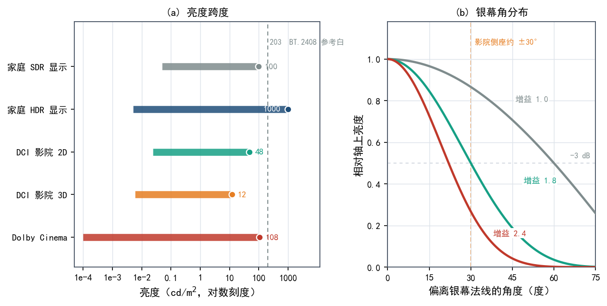
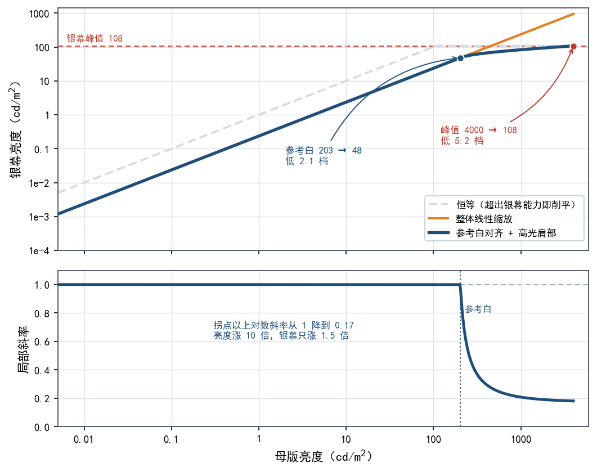
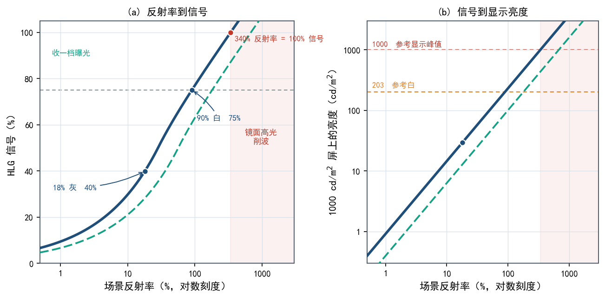
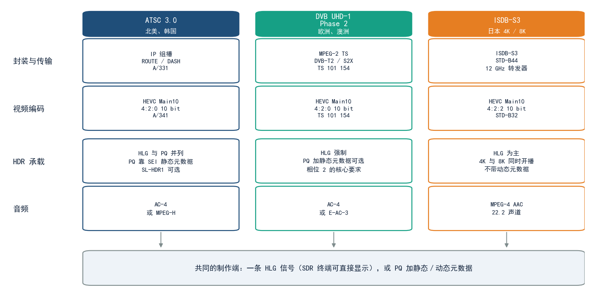
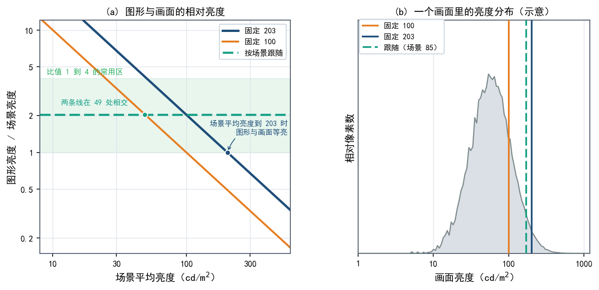
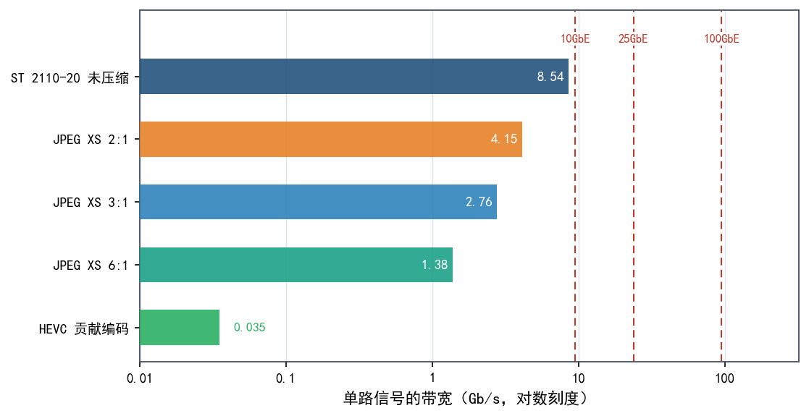
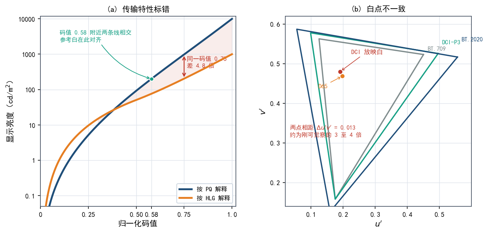

# 第 10 章 影院、直播与广播中的 HDR

流媒体把 HDR 做成了一件点播的事，观众按下播放，片子从机房出发，中间只有编码器和电视两个变量。影院和广播电视不是这样。影院的亮度被一块幕布和一台放映机锁死，广播的每一帧都要在几毫秒内穿过摄像机、切换台、编码器和发射机，中间没有人能回头看画面。这两种场景里，HDR 不是把峰值调高就行，它要在一套几十年没大改的工艺里找到一个不破坏原有流程的位置。银幕的亮度账、直播的曝光锚点、广播标准的路线选择、单母版的派生，再加上 IP 化之后的带宽与故障，这几件事连起来才构成影院和广播里的 HDR。

## 一、银幕与客厅的亮度账

先看几个数字。DCI 规范规定的 2D 放映亮度是 48 cd/m²，立体放映按 12 cd/m² 算，杜比影院把白场做到 108 cd/m²，一台中端家用电视的 HDR 峰值大约 1000 cd/m²，投影搭白幕的家庭影院可能只有 50 到 100 cd/m²。把 48 cd/m² 换算成英制单位是 14 foot-lambert，这个数在放映行业用了几十年，因为它是胶片时代定下来的白场。108 cd/m² 是 31.5 fL，IMAX 的激光厅把白场标到 22 fL，约 75 cd/m²。

亮度只是账本的一栏，黑位是另一栏。银幕不是自发光的，它只反射放映机投上去的光，所以黑位取决于两件事，放映机的漏光和厅里别的光打到幕上又被反射回来的部分。后一项常被忽略。假设幕布反射率 0.8，厅内落到幕上的杂散光照度是 0.1 lux，反射出来的亮度就是 $0.1\times0.8/\pi\approx0.025$ cd/m²。这个数几乎正好等于 DCI 对 2D 放映的对比度门槛，48 除以 2000 得 0.024。规范里那条 2000 比 1 不是凭空写的，它是把影厅的杂散光水平折算进去之后能得到的结果。

图 10-1 左边把五种观看条件的亮度跨度按对数画成横条，右端是峰值，左端是黑位。家庭 SDR 显示从 0.05 到 100 cd/m²，比值 2000 比 1；家庭 HDR 显示从 0.005 到 1000，比值 20 万比 1；DCI 影院 2D 从 0.024 到 48，比值也是 2000 比 1；立体放映因为偏振或分色损失，峰值掉到 12，黑位同步下移，比值不变；杜比影院从 1e-4 到 108，比值接近 108 万比 1。家庭 SDR 和 DCI 2D 这两条横条一样长，说明两者的动态范围都是 2000 比 1，差别只在绝对亮度，一个白场 100，一个白场 48。虚线标的是 BT.2408 的参考白 203 cd/m²，可以看到它比所有影院的白场都高，只有家庭 HDR 显示的峰值能越过它。这张图想说明一件事，影院 HDR 的优势不在峰值，108 比起电视的 1000 差了一个数量级，它的优势在黑位和对比度。

黑位那一端要打个折扣。杜比影院宣传的对比度是 100 万比 1，108 除以 100 万得 1.08e-4，也就是说黑位必须压到万分之一尼特。这个条件只有在厅内杂散光极低、幕布本身不反光、放映机的暗场漏光也被压住时才成立。真实的厅里，观众的手机、安全出口的绿灯、放映窗口的漏光都会抬高黑位，实测对比度通常只有标称值的几分之一。影院的 HDR 体验很大程度上是建筑和放映机房决定的，不是后期调色决定的。

图 10-1 右边画的是银幕增益带来的角度问题。增益 1.0 的漫反射幕在偏离法线 60 度时亮度掉一半，增益 1.8 的幕在 30 度就掉一半，增益 2.4 的幕 22 度就掉一半。影院侧座的视线偏离法线大约 30 度，坐在那里的观众看到的亮度只有轴上的一半甚至更少。所以普通影厅用增益 1.0 到 1.4 的幕，牺牲峰值换均匀性；立体放映因为偏振片吃掉一半以上的光，只能用 2.4 的金属幕把光聚回观众区，代价是视角更窄、热点更明显。高增益幕配 HDR 是个矛盾组合，峰值上去了，均匀性下来了，靠边的座位看到的可能还是 SDR 的观感。

视角的另一面是视野占比。一块 20 米宽的幕，观众坐在 15 米处，水平张角约 67 度；家里 65 英寸电视在 2.5 米处只有 30 度出头。视野占比大意味着周边视觉也被画面填满，视觉系统对整体亮度的适应水平被画面本身拉高，暗部细节的可见性反而下降。这是影院调色师会把整体亮度压低一点的原因之一，画面填满视野时，同样的绝对亮度看起来更刺眼。

家庭投影是介于两者之间的一种情况。投影的峰值受幕布和环境光限制，白幕在暗室里通常只有 50 到 100 cd/m²，比电视低一个数量级；但投影的黑位也低，因为幕布不发光，暗场只反射环境光。一间做了遮光的影音室，环境光可以压到 1 lux，幕布反射率 0.8，黑位是 $1\times0.8/\pi\approx0.25$ cd/m²，对比度 200 到 400 比 1，比同价位的液晶电视还差。投影 HDR 的观感取决于房间，装了遮光帘和深色墙面的房间能用，白墙客厅里基本看不出 HDR 的效果。

环境光是第三条线。影院的环境光照度在 0.1 lux 量级，家庭客厅晚上开灯是 50 到 200 lux，白天拉上窗帘也有 20 lux。屏幕表面反射率按 2% 算，200 lux 的环境光会在屏上反射出 $200\times0.02/\pi\approx1.3$ cd/m²，这个数比很多液晶的黑位还高。换句话说，客厅里 HDR 的对比度天花板是环境光定的，不是面板定的。一台标称 100 万比 1 的电视，在 200 lux 的客厅里实际对比度只有 1000 除以 1.3，不到 800 比 1。

还有一笔账要算，光通量。银幕不是自发光，亮度由放映机的光通量和幕面积决定。按朗伯幕的公式 $L=E\rho/\pi$，要在一块 16 米宽、6.7 米高的幕上得到 48 cd/m²，幕面照度需要 $\pi\times48/0.8\approx188$ lux，乘以 107 平方米的幕面积，放映机的有效光通量要 2 万流明。同样的幕要做到 108 cd/m²，需要 4.5 万流明。这就是为什么杜比影院要用双机激光叠加，单机灯泡的 2 万流明做不到 108 nit 的大银幕。反过来，家庭 65 英寸电视的面积只有 1.2 平方米，1000 cd/m² 只需要 3800 流明的等效光通量，物理上容易得多。

把三条线放在一起，影院和家庭的差别就清楚了。影院用大画面、低环境光、低峰值换来极高的对比度，家庭用小画面、高环境光、高峰值换来方便。前者接近暗室观看，后者接近明室观看，两套观看条件下同一条 PQ 曲线给出的观感完全不同。这也是为什么影院版调色和家庭版调色要分开做，不能拿一个母版直接套。

## 二、从 4000 nit 母版到 108 nit 银幕

HDR 电影的制作母版通常在 4000 cd/m² 的监视器上看，黑位接近 0.005 cd/m²。要把这份母版送到 108 cd/m² 的银幕上，亮度要压 37 倍，也就是 5.2 档。这个压缩不是简单乘一个系数，因为母版里的参考白是 203 cd/m²，银幕上的参考白只有 48 cd/m²，两者差 4.2 倍，2.1 档。峰值要压 5.2 档，参考白只压 2.1 档，剩下的 3.1 档必须在参考白以上挤出去。这就是所有影院 HDR 映射的共同结构，中间调按比例缩，高光额外压。

图 10-2 上半部画了三条曲线，横轴是母版亮度，纵轴是落到银幕上的亮度，都是对数刻度。灰色虚线是恒等映射，母版多少就投多少，超过 108 的部分被削平，实际上就是把 108 以上的高光全部压成一块白。橙色是整体线性缩放，所有亮度乘 108/4000 等于 0.027，峰值对了，参考白掉到 5.5 cd/m²，整幅画面暗得像欠曝。深蓝色是参考白对齐加高光肩部，203 落到 48，4000 落到 108，中间保持比例，拐点以上用一条幂函数肩部收住。

肩部的形式可以写成

$$
f(L)=48\left(1+\frac{L-203}{K}\right)^{q},\qquad L>203
$$

三个条件定三个参数。曲线要过 $(203,48)$，这一条自动满足。曲线要过 $(4000,108)$，给出一组 $K$ 与 $q$ 的关系。拐点处斜率要和中段连续，中段斜率是 $48/203=0.2365$，肩部在 $L=203$ 处的导数是 $48q/K$，两者相等就得到 $q=K/203$。于是只剩一个自由度，把 $(4000,108)$ 代进去解出 $K\approx35.1$ cd/m²，$q\approx0.173$。这个数很干净，肩部的宽度是 35 nit，指数是 0.173。

下半部画的是这条曲线的局部对数斜率，$\mathrm{d}\ln f/\mathrm{d}\ln L$。203 以下恒等于 1，说明中段是按比例缩的，画面结构不变。203 以上迅速掉下来，到 4000 附近只剩 0.17。0.17 这个数有直接的观感含义，母版亮度涨 10 倍，银幕上只涨 $10^{0.17}\approx1.48$ 倍。也就是说母版里 200 到 2000 cd/m² 这一整段高光，在银幕上被压进 47 到 95 cd/m² 的窄带里，细节还在，但对比很弱。影院 HDR 的高光看起来"有层次但不刺眼"，原因就在这里。

三条曲线里只有第三条同时满足两个约束。第一条保住了暗部和中段的比例，但 108 以上的高光被整片削平，峰值信息全丢。第二条保住了相对关系，但整幅画面被压暗，参考白只有 5.5 cd/m²，观众看到的是"放映机灯泡坏了"。第三条是工程上唯一可用的选择，代价是高光段对比度损失，这部分损失由观众在暗室里的视觉适应来补偿一部分。

这些做法和 DCI 规范的关系要理清。DCI 在 2005 年定下的数字影院规范规定了几件事，12 bit XYZ 色彩编码、gamma 2.6 的编码曲线、P3 色域加 DCI 白点、48 cd/m² 的亮度和 250 Mb/s 的码率上限。它没有定义 HDR，也没有元数据的概念，因为定规范的时候还没有 HDR 这个词。XYZ 编码的好处是与显示设备无关，任何一台符合规范的放映机都能放；坏处是它把一个固定的白场写进了标准，48 cd/m² 就是天花板。

所以严格说，DCI 不是 HDR 标准，它是 SDR 影院标准。影院里的 HDR 是厂商在 DCI 之上打的补丁。杜比影院的做法是另建一条链路，母版在 4000 nit 的杜比视界流程里做，发行时打成专有的 DCP，放映端用双机激光投影，白场 108 cd/m²，黑位靠激光的暗场能力和厅内吸光处理压到 1e-4 量级，色域仍是 P3，音频用杜比全景声。这套系统能放普通 DCP，也能放 HDR 版本，两套素材分开发行。IMAX 的路线类似，用激光光源提高峰值和黑位表现，但它的白场定在 22 fL，比杜比的 31.5 fL 低，走的是大画面加高对比的路子。

影院版是一个独立的调色工序。调色师先在 4000 nit 的监视器上完成家庭版，再换到按 108 nit 银幕条件搭的放映环境里重看一遍，逐镜头决定高光保留多少。有些镜头的高光在银幕上必须放弃，比如逆光的窗、雪地的反光，因为 108 nit 的银幕装不下 5 档以上的余量，硬塞进去只会让整幅画面发灰。这种取舍在家庭版里不需要做，所以两版的差别不能靠一条自动曲线生成，必须人工判断。发行人拿到的两个版本各自独立，影院版不会在电视上放，家庭版也不会在影院放。

为什么影院 HDR 的峰值只有 108 却敢叫 HDR。答案在对比度和观看条件。108 cd/m² 的银幕配 1e-4 的黑位，对比度是 100 万比 1；家庭 HDR 电视 1000 cd/m² 配 0.005 的黑位，对比度 20 万比 1；SDR 影院 48 配 0.024，只有 2000 比 1。人眼在暗室里的瞳孔放大，绝对亮度低但相对对比高时，暗部细节的可见性反而更好。影院的 HDR 是把动态范围花在黑位上，家庭是把动态范围花在峰值上，两条路都成立，观感不一样。

银幕的均匀性是另一个约束。DCI 规定银幕中心的亮度是 48 cd/m²，边缘允许降到 41，也就是 85%。放映机的镜头有渐晕，氙灯的光弧有方向性，宽银幕的两侧通常比中心暗 10% 到 15%。HDR 把这个差异放大了，因为高光段的感知对比更强，观众能看出画面左边比右边亮。杜比影院用双机叠加，两台机的光斑互补，均匀性比单机好，这也是双机方案除了提高亮度之外的另一个理由。

放映机的光源技术决定了 HDR 影院能不能做。氙灯的光谱连续、显色好，但亮度上限低，2 万流明的机器已经是极限，而且灯泡的寿命只有几百小时，亮度会随使用衰减。激光的光谱窄、亮度高、寿命长，单机可以做到 3 万流明以上，三色激光还能省掉荧光轮，色域更宽。代价是散斑，激光的相干性会在幕布上形成颗粒状的干涉图样，观众看到的是画面上一层细密的噪点。消散斑靠幕布的微结构和光源的波长展宽，成本不低。这些硬件层面的东西决定了影院 HDR 的上限，后期做得再好，放映机不够亮也放不出来。

这套映射还有一个副产品，母版必须为影院单独调。同一部片子，影院版要在 108 nit 的银幕上看过一遍，家庭版要在 1000 nit 的电视上看过一遍，两版的暗部、高光、饱和度都会有差别。行业里的做法是保留一个 4000 nit 的 archival master 作为源头，再派生出影院版、家庭 HDR 版、SDR 版，派生过程用同一套映射逻辑但参数不同。这条派生链在广播里更复杂，后面几节会讲。

## 三、直播为什么落在 HLG 上

广播选 HLG 不是审美问题，是流程问题。直播的信号从摄像机出来就要立刻能用，中间没有调色台，也没有第二次机会。HLG 的 OETF 做在摄像机里，出机的信号已经是一条显示编码曲线，送进监视器就能看，送进编码器就能播，送进 SDR 电视机也能出一个能看的画面。PQ 做不到这一点，PQ 信号必须知道显示峰值才能正确呈现，没有元数据的 PQ 流在 SDR 电视上是一片灰。

场景参考是 HLG 的第二个好处。HLG 的信号值对应场景反射率，90% 反射的白卡给 75% 信号，18% 中灰给 40% 左右的信号，这两个比例和 SDR 拍摄时的习惯基本一致，只是对应的码值位置变了。摄像师不需要重新学曝光，测光表、斑马纹、示波器的读法都不变，只是判断标准从"100% 不削顶"变成"75% 是白"。

图 10-3 左边横轴是场景反射率，纵轴是 HLG 信号。实线是按 BT.2408 的锚点算出来的，90% 反射率给 75% 信号，由 75% 反解 HLG 的逆 OETF 得到场景线性值 0.265，任何反射率 $r$ 的信号就是 $\mathrm{OETF}(0.265r/0.9)$。曲线上标了两个点，18% 灰落在 40% 信号，90% 白落在 75% 信号。100% 信号（也就是码值 940）出现在 340% 反射率处，再往上就是镜面高光，全部压成白色。右边红色阴影区就是这一段，反射率 340% 以上没有信号可用。

右边那张图画的是同一批反射率在 1000 cd/m² 显示上的亮度。HLG 的 OOTF 是 $L_D=L_W E^{1.2}$，把信号反解回场景线性值再乘 1000。18% 灰落在 29.5 cd/m²，90% 白落在 203 cd/m²，橙色虚线是参考白，红色虚线是显示峰值 1000 cd/m²。可以看到 340% 反射率正好对应 1000 cd/m²，与左边的削波点一致。这两张图放在一起是想说，HLG 的信号范围、参考白、显示峰值三者是绑定的，改一个另外两个就跟着动。

图里还画了一条收一档的虚线。整条曲线往左移，90% 白从 75% 掉到 61%，落到显示上只有 88 cd/m²；18% 灰从 40% 掉到 28%。曝光差一档，参考白就偏离 BT.2408 的锚点一半以上，在家庭端看起来整幅画面偏暗。直播里这种偏差很常见，因为摄像师习惯用 SDR 的示波器看 100%，看到 75% 就以为欠曝，手动推一档，结果全片偏亮。正确的做法是换一台按 HLG 校准的监视器，或者在示波器上把 75% 画成刻度线。

摄像机的设置要跟着改。机内的 HLG 曲线通常配一个拐点，把 100% 以上的场景亮度压进剩下的码值，拐点的位置和斜率由厂家定，松下的做法叫"高亮细节保护"，索尼用"拐点"菜单。这个拐点不能关掉，关掉以后镜面高光会直接撞到 100% 削平，画面上的水面、金属、灯光边缘出现硬白块。也不能开得太狠，拐点以下的中段会被压缩，人脸的高光失去层次。常见的设置是把拐点放在 90% 到 100% 之间，斜率 0.3 到 0.5。

HLG 与摄像机里的 Log 曲线是两回事。Log 把场景光压成一条平的对数曲线，出机时画面发灰，必须套 LUT 才能看，好处是保留了最大的信息量，留给后期调色。HLG 是显示编码，出机就能看，代价是高光被拐点提前压过，可恢复的余地小。直播没有后期，所以选 HLG；广告和电视剧有后期，所以选 Log。两者在同一条制作链上混用会出问题，Log 的素材拿去做 HDR 直播，必须先转成 HLG，转换时的曝光基准要和机位对齐，否则切回来亮度不一致。

SDI 的带宽也要算。1080p50 的 4:2:2 10 bit 是 $1920\times1080\times50\times20=2.07$ Gb/s，3G-SDI 的 2.97 Gb/s 装得下，还留了 30% 的余量给辅助数据和封装。升级到 4K 就要换 12G-SDI，净荷 11.88 Gb/s，接口和线材全部要换，这是广播机构从 HD 升 4K 时最大的一笔硬件支出。HDR 本身不增加接口带宽，因为 10 bit 已经在用了，它要改的是监视器、切换台的内部处理位深和曲线查找表。

黑位那一端也要管。HLG 的 0 到 5% 信号对应很暗的场景，配合 1000 cd/m² 显示只有 0 到 3 cd/m²。演播室的黑背景通常不是纯黑，布料和布景的反射率在 2% 到 5%，落在 10% 到 18% 信号，看起来是深灰而不是黑。想把背景压黑，只能靠布光和美术，不能靠调黑电平，因为黑电平一抬，暗部整体发灰，HDR 的对比度就没了。

切换台这一环最省事，也最容易出错。HLG 的信号在切换台里不需要任何转换，10 bit 4:2:2 的 3G-SDI 直接过，切换、叠化、画中画都按原码值处理。麻烦的是特技和图形，抠像、字幕、台标这些元素如果按 SDR 的 100 cd/m² 生成，叠到 HLG 画面上会显得暗；如果按 203 cd/m² 生成，暗场景里又显得刺眼。这个问题在第六节展开，先记住一个原则，图形元素的亮度要相对于所在场景判断，不能只看绝对码值。

多机位的一致性靠 shading 保证。同一场比赛有十几台摄像机，镜头、光圈、ND 滤镜、机内曲线各不相同，如果不统一，切机位时画面会跳。做法是在开播前用一块 90% 白卡和一块 18% 灰卡，逐台对准 75% 与 40% 信号，再用一台按 BT.2408 校准的监视器做参照。现场光照变化时，比如云层遮住太阳，要同步推光圈，不能只推一台，否则切机位时亮度跳变。

SDR 与 HDR 同播是 HLG 存在的最大理由。一条 HLG 信号送进 SDR 电视机，机内按 gamma 大约 1.2 到 1.4 显示，画面对比被拉开，高光偏亮，暗部偏暗，但整体可用。广播机构不用为 SDR 观众单独准备一路信号，省下的是一个完整编码器和一半的传输带宽。代价是 SDR 观众看到的画面和 HDR 观众不一样，前者更像"对比度调高的 SDR"，后者才是真正的 HDR。这个折中在体育直播里可以接受，在电影和剧集里不行，所以流媒体的片子仍然用 PQ。

HLG 的高光余量有限，这一点和 PQ 差别很大。1000 cd/m² 的屏上，参考白 203，峰值 1000，余量只有 4.9 倍，约 2.3 档。PQ 母版从 203 到 4000 是 19.7 倍，4.3 档；到 10000 是 49 倍，5.6 档。直播的现场光比又特别大，晴天户外的天空可以到 1 万 cd/m²，水面反光更高，这些高光在 HLG 里全部撞在 340% 反射率的天花板上。所以现场 HDR 的高光保护主要靠拍摄时的构图和曝光，不能指望后期压回来。

帧率和时基是另一条隐性约束。50 Hz 地区的 HDR 直播用 50p 或 50i，与 SDR 同播时两者必须锁相，否则切换台做混合时会撕裂。HDR 与 SDR 的信号在同一台切换台上跑，两路的延迟必须对齐到一行以内，这要求两条链路用同一个 PTP 时钟，或者在同一台设备内部完成转换。跨设备的转换通常引入几帧延迟，混切时会看到画面"顿"一下。

现场监视器的选型常被低估。转播车里的监视器墙如果还是 100 cd/m² 的 SDR 屏，导演看到的画面和观众看到的完全不是一回事，高光在他的屏上是白的，在观众家里是 800 cd/m² 的亮块。现在的主流做法是监视器墙全部换成 1000 cd/m² 的 HDR 屏，按 BT.2408 校准参考白，环境光控制在 10 lux 以下。改造成本不低，但这是 HDR 直播能不能做对的前提。

## 四、广播标准的三条路线

世界上的地面和卫星广播分成了三个互不兼容的技术体系，各自的 HDR 选择不完全一样。北美的 ATSC 3.0 是 IP 化的新一代标准，欧洲的 DVB 在 UHD-1 Phase 2 里把 HLG 定成必选，日本的 ISDB-S3 走 12 GHz 卫星，4K 与 8K 同播用 HLG。三条路线的差别不在 HDR 曲线本身，而在封装、编码和承载方式上。

图 10-4 把三条路线按四层并排。最上面一层是封装与传输，ATSC 3.0 用 IP 组播加 ROUTE/DASH，规范号 A/331，物理层有自己的 bootstrap 信号 A/321，和旧的 8VSB 完全不兼容；DVB 用 MPEG-2 TS 装在 DVB-T2 或 DVB-S2X 里，规范是 TS 101 154；ISDB-S3 用 12 GHz 转发器，规范是 ARIB STD-B44，调制用 16APSK 或 32APSK，一个转发器能装两路 4K 或者一路 8K。

第二层是视频编码，三家都用 HEVC Main10，4:2:0 10 bit。ATSC 3.0 的规范是 A/341，DVB 的规范同样是 TS 101 154，ISDB-S3 用 ARIB STD-B32。都用 HEVC 是因为 2015 年前后没有更好的选择，VVC 的芯片到 2020 年代才量产，广播的机顶盒生命周期又长，换编码等于换一整代终端。国内的超高清频道在 HEVC 之外还用了 AVS3，8K 频道用 AVS3 编码，这是另一条并行的路线。

第三层是 HDR 承载，三家的分歧最大。ATSC 3.0 允许 HLG 与 PQ 并列，PQ 靠 SEI 里的静态元数据，SL-HDR1 作为可选项；DVB 把 HLG 定成强制，PQ 可选，而且要带静态元数据，相位 2 的核心要求就是 HLG 加 10 bit 加 BT.2020 容器；ISDB-S3 以 HLG 为主，不带动态元数据，4K 与 8K 同时开播。

第四层是音频。ATSC 3.0 用 AC-4，也允许 MPEG-H；DVB 用 AC-4 或 E-AC-3；ISDB-S3 用 MPEG-4 AAC，8K 用 22.2 声道。音频这一层看起来和 HDR 无关，实际上绑得很紧，因为 AC-4 的码率预算和视频的码率预算在同一个复用器里分配，HDR 视频多要的那部分码率要从别处挪。

底部是三家共同的制作端。一条 HLG 信号，SDR 终端能直接显示，HDR 终端按 OOTF 显示，如果需要 PQ 版本就在编码前用 BT.2446 的方法转一次。这个"一条信号两种呈现"的结构是广播选 HLG 的根本原因，它把同播的成本压到了最低。

ATSC 3.0 的架构值得单独说几句。它是第一个把广播做成 IP 的标准，物理层之上全是 IP 包，业务用 ROUTE 或 MMTP 承载，信令用 XML 描述，接收端可以同时收广播和宽带，做混合业务。这个架构给 HDR 带来的好处是元数据可以走独立的信令通道，不必挤在视频的 SEI 里，动态元数据的更新更灵活。坏处是复杂度高，机顶盒变成了一个小型 IP 终端，调试工具和监测手段都要重做。

码率预算决定了 HDR 能开到什么程度。一个 6 MHz 的地面频道在典型配置下净荷 20 到 25 Mb/s，一路 4K HDR 的 HEVC 编码要 15 到 18 Mb/s，剩下的分给音频、信令和第二个业务。如果要做 SDR 与 HDR 同播，最省的做法是用分层编码，基础层给 SDR 终端，增强层给 HDR 终端，两者共享运动信息，总码率比双路独立编码低 20% 到 30%。ATSC 3.0 的规范里给分层编码留了位置，但实际开播的频道大多还是单路 HLG，因为终端都能解 HLG，不需要分层。

DVB 对 HDR 的元数据要求写得很具体。TS 101 154 规定 PQ 的码流必须带 ST 2086 的母版显示信息，必须带 MaxCLL 与 MaxFALL，必须用 10 bit 的 HEVC Main10，色域容器必须是 BT.2020。HLG 的要求宽松一些，因为它不需要母版信息就能显示，但规范仍然建议带一个标称的峰值标识，让接收端知道内容是按 1000 nit 做的。这些要求在转码和复用环节容易丢，尤其是 MaxFALL 这类统计量，很多复用器不认识就直接扔掉。

DVB 的路线保守得多。TS 101 154 是在原有的 TS 语法上打补丁，HDR 的信息放在 HEVC 的 VUI 和 SEI 里，码流结构和 SDR 完全一样。好处是复用器、加扰器、调制器都不用换，一条 2010 年建的播出链路改几个参数就能送 HDR。坏处是能承载的动态信息有限，逐帧元数据没有合适的位置，所以 DVB 只能把 HLG 定成必选，升级的成本落在终端而不是播出端。

ISDB-S3 的选择最彻底。日本的 4K 与 8K 卫星广播 2018 年 12 月开播，从一开始就是 HLG，没有 SDR 同播的负担，因为 8K 频道是新开的，不存在存量终端。22.2 声道的音频和 8K 的画面一起构成了一个完整的"超高清"体验，HDR 只是其中一项。这条路线的问题是没有回退空间，8K 接收机的成本高，普及速度慢。

三条路线的共同点是都用 10 bit 4:2:0。10 bit 是 HDR 的底线，8 bit 在 PQ 上会在暗部产生明显色带，在 HLG 上稍好但也不够。4:2:0 是为了省带宽，代价是高饱和边缘的色度分辨率减半，在 BT.2020 的宽色域上这个代价比 BT.709 更明显。广播机构普遍接受这个代价，因为天线传输的带宽是硬约束，而流媒体可以用 4:2:2 甚至 4:4:4。

中国的情况介于几条路线之间。有线电视和 IPTV 的超高清频道普遍采用 HLG，编码用 AVS3 或 HEVC，8K 试验频道用 AVS3；互联网电视和流媒体则跟国际接轨，用 PQ 加 HDR10 或杜比视界。同一部片子在有线网和流媒体上是两种格式，制作端要做两条派生链。这种并存状态短期内不会改变，因为广播的终端更新周期是十年，流媒体的更新周期是三年。

三条路线的落地进度差得很远。韩国在 2017 年 5 月开播 ATSC 3.0，2018 年平昌冬奥做了 4K HDR 转播，美国在 2020 年由主要电视台集团推动商用，覆盖面和机顶盒的普及速度都受制于终端补贴。欧洲的 DVB 在标准上早就准备好了，UHD-1 Phase 2 的规范 2018 年就定稿，实际开播的 HDR 频道很少，原因是有线电视和卫星的带宽贵，运营商更愿意先推 4K SDR。日本的 8K 卫星广播是国家项目，NHK 靠财政支持推进，商业模式一直没有跑通。标准不是瓶颈，钱和终端才是。

标准的选择还会影响监测。HLG 的监测相对简单，波形图上 75% 就是白，40% 就是中灰，削波在 100%，一套示波器就能看完。PQ 的监测要复杂得多，码值和亮度是非线性关系，同样的波形高度在不同亮度上含义不同，需要专门的 HDR 波形图或者把码值换算成 nit 再显示。广播机构偏爱 HLG 有一部分原因是监测习惯不用改。

## 五、单母版与它的派生

一部片子的下游有四个出口，影院 DCP、家庭 HDR、广播 HLG、SDR 发行。四个出口的亮度、色域、曲线都不一样，如果每个出口单独调一遍，成本高且容易走样。行业里的做法是保留一个高规格母版作为唯一真相，其余全部从它派生。这个思路叫单母版工作流，它不意味着一个文件发给所有人，而是一条调色决策派生出多条技术路径。

母版本身的规格在变。十年前是 1000 cd/m² 的 P3 母版，现在是 4000 cd/m² 的 BT.2020 母版，高端项目会做 4000 甚至 10000 的 archival master。母版容器用 IMF，视频 essence 可以是 PQ 编码的 XYZ 或者 YCbCr，音频是 5.1 或沉浸声，字幕单独一份。IMF 的好处是素材与元数据分离，同一个视频 essence 可以配不同的音频、字幕、语言版本，打包成不同的发行包。

影院 DCP 是另一套容器，和 IMF 不通用。DCP 用 MXF 封装，视频编码是 JPEG 2000，码率上限 250 Mb/s，色彩是 12 bit XYZ，帧率 24 或 48。250 Mb/s 听起来不高，但它用的是帧内小波，每一帧独立编码，画质在整部片子上恒定，不会出现流媒体那种码率忽高忽低。一部两小时的片子，DCP 的体积在 200 到 300 GB，靠硬盘分发，不走网络。HDR 影院的 DCP 在同样的容器里装扩展范围的 XYZ，峰值信息通过专有的元数据传递，只有支持 HDR 的放映机能读出来。

从母版到 SDR 的那条派生最考验功夫。SDR 只有 100 cd/m² 的白场，按 0.1 cd/m² 的黑位算，动态范围约 10 档；母版 4000 nit 配 0.005 的黑位，接近 20 档，压下来要丢掉将近一半的信息。简单做法是用一条固定的色调映射曲线，质量好一点的做法是逐镜头调，最好的做法是保留一个"创意意图"的元数据层，让自动映射知道哪些高光必须保住。这三种做法在成片上的差别很明显，尤其是夜景和逆光。

BT.2446 给的是标准化的转换方法。这份建议书的名字叫《从高动态范围电视到标准动态范围电视的转换方法》，实际上两个方向都管。方法 A 走场景光，先把 SDR 信号按 BT.709 的显示曲线解回场景线性值，按 203 cd/m² 的参考白重新定标，再用肩部曲线压高光，同时做 BT.709 到 BT.2020 的色域扩展。方法 B 不走场景光，直接在 PQ 域用逐帧拟合的多项式做映射，好处是不需要知道拍摄时的曝光，坏处是高光的纹理容易糊。方法 C 是混合，把 A 的结果当成基础层，再用元数据补偿高光和饱和度的细节。

三种方法的选择取决于素材。有原始素材和拍摄信息的新片走 A，能保住场景光的关系；只有成片的旧片走 B，因为没有别的信息可用；要求高质量又要自动化的批量转换走 C，代价是元数据要单独生成和校验。三条路都不是无损的，SDR 的信息量天生比 HDR 少，转换只能决定丢哪部分。

SL-HDR 系列走的是另一条路，它不追求"转换得好"，而是追求"一条码流服务多种终端"。ETSI TS 103 433 的三个部分定义了三个变体，基础层的格式不同，重建的方向也不同。

SL-HDR1 的基础层是 SDR，附带动态元数据，解码端用元数据把 SDR 重建成 HDR10。这个方向的优点是存量终端不用改，SDR 电视机直接放基础层，HDR 电视机读出元数据重建。缺点是基础层是 SDR，重建出来的 HDR 高光是"造"出来的，不是拍到的，亮度和饱和度都受限。

SL-HDR2 反过来，基础层是 HDR10，附带元数据，解码端重建成 SDR。这个方向适合已经有 HDR 母版、要给 SDR 终端的场景，重建的 SDR 比简单色调映射更贴近创意意图。缺点是 SDR 终端要能忽略 HDR 基础层，实际上做不到，所以需要单独的 SDR 基础层，变成两层结构，省不下带宽。

SL-HDR3 用 HLG 做基础层，元数据同时支持重建成 SDR 和 PQ。这个变体在广播里最有吸引力，因为 HLG 基础层本身就能被 SDR 电视机显示，元数据只是让 HDR 电视机拿到更准确的 PQ 呈现，两方面都不吃亏。日本的 8K 广播和欧洲的一些试验用这个结构。

元数据的开销很小，每帧几十字节，相对于几 Mbps 的视频码流可以忽略。真正的成本在实现上。重建算法在解码端跑，不同厂家的芯片实现有差异，同一份元数据在两台电视上重建出的画面可能不一样。为了保证一致性，行业里有一套一致性测试素材，母版方要用这些素材验证过才敢发。

单母版工作流的风险集中在元数据上。元数据丢失、写错、被转码工具丢弃，任何一个环节出问题，派生链就断了。断链的表现不一定是黑屏，更常见的是"画面能看但不对"，比如高光被削平、暗部被抬起、颜色偏了。这类问题在自动化的流水线里很难被发现，因为每一级都认为自己做对了。

一个实际的例子是动态元数据的逐帧更新。HDR10+ 和杜比视界的元数据每帧都要更新，一秒钟 24 次或 50 次，任何一次写入失败都会导致该帧按上一帧的元数据渲染，画面上表现为一闪而过的亮度跳变。这种跳变在监视器上不一定看得见，在家庭电视上因为 ABL 的响应会放大成明显的闪烁。

派生链的 QC 要分层做。第一层看技术参数，分辨率、位深、色域、传输特性、元数据是否存在。第二层看画面，用标准测试图案和几段典型素材，检查高光、暗部、肤色、饱和度。第三层看设备，同一份文件在几台不同品牌的电视上放一遍，看差异是否在可接受范围。三层都过才算合格，只做第一层的流水线大量存在，问题也大多出在这里。

母版和派生的关系还可以反过来用。有些项目先做 HLG 版本，因为广播要先播，再从 HLG 派生 PQ 版本给流媒体。这个方向的转换精度差一些，因为 HLG 的高光余量只有 4.9 倍，派生出的 PQ 版本在 1000 nit 以上没有信息。反过来从 PQ 派生 HLG 就容易得多，只要把 1000 nit 以上的部分压进 340% 反射率以内。所以母版的规格应该按最高需求定，不能按最先交付的版本定。

版本管理是单母版工作流里最枯燥也最要命的部分。一个项目会有母版、影院版、家庭 HDR 版、HLG 版、SDR 版，每版又可能因为修改字幕、替换镜头、调整分级而出第二个、第三个迭代。文件名里必须带版本号、日期、目标亮度、色域、曲线，缺一项就会在交付时搞混。行业里用 IMF 的 Composition Playlist 记录每一版的素材组合，用 Output Profile List 记录每一版的转换参数，这两份文件加起来就是派生链的地图。地图丢了，后面的人只能从成片反推，反推出来的参数和原始参数往往差得很远。

## 六、体育与现场制作

体育直播是 HDR 最难啃的场景之一。一场比赛有十几台摄像机、几十个图形元素、几万观众、不断变化的光照，任何一个环节没对齐，画面就会出问题。这些问题在录播里可以修，在直播里只能靠预案。

光照是第一道关。白天的露天场馆有直射阳光、阴影、场地照明三种光源混在一起，色温从 5600 K 到 4000 K 不等。摄像机在白平衡上稍有偏差，草地就会从翠绿变成黄绿，肤色从自然变成蜡黄。HDR 把这个问题放大了，因为高光段被拉开，色温偏差在高光上更明显。做法是用灰卡在场地中央做一次白平衡，所有机位统一，再用 shading 微调。

光照的动态范围也超出预期。阳光直射的白色看台可以到 2 万 cd/m²，阴影里的观众席只有几十 cd/m²，两者差 10 档以上。HLG 的 340% 反射率上限装不下这个范围，摄像机必须做选择，要么保住看台的高光让阴影死黑，要么保住阴影让看台削平。体育转播的惯例是保住比赛区域，看台的高光可以牺牲，因为观众的注意力在场上。

场地照明本身也在升级。为了满足 4K 转播的照度要求，很多场馆把金卤灯换成了 LED，LED 的频闪和摄像机的快门不同步时会出现滚动条带，HDR 的高帧率模式更敏感。解决方法是把摄像机快门锁到照明的频率，或者用无频闪的驱动电源。这个问题在 SDR 时代就有，HDR 只是让它更明显。

HDR 也让灯光的显色性暴露出来。SDR 的 100 cd/m² 白场下，显色指数 90 的灯具和 95 的灯具差别不大；HDR 的高光拉到 800 cd/m²，两者的肤色差别一眼可见。体育场馆的照明改造通常和 4K 转播一起做，原因就在这里，老的金属卤化物灯显色性够但频闪严重。

综艺和演唱会的难度在另一个方向。体育的难点是光照不可控，综艺的难点是颜色不可控。舞台美术大量使用饱和的 LED 灯具和投影，红、绿、蓝三色的纯度很高，很多颜色超出了 P3 色域，落在 BT.2020 的边缘。HDR 把这些饱和色推到 200 到 500 cd/m²，人眼在高亮度下对色相差异的敏感度下降，红色看起来偏橙，蓝色看起来偏紫。灯光师在 SDR 监视器上调好的颜色，到 HDR 监视器上全变了，这是综艺转 HDR 最常被抱怨的问题。

解决方法是把调光台和监视器都切到 HDR 模式，按实际的输出亮度调色。LED 灯具的驱动是 16 bit 的，本身有能力做精细的亮度控制，问题在于控制台和灯具之间的协议（DMX 或 Art-Net）只有 8 bit，调光精度不够，低亮度段会出现跳变。HDR 的暗部比 SDR 深得多，8 bit 的调光在 1% 到 5% 的亮度区间只有几级可用，画面上的渐变换出现台阶。这类问题的根源不在 HDR 标准，在舞台灯光行业的存量设备。

图形包装是体育直播里最容易翻车的地方。比分牌、计时器、队徽、赞助商标志、慢动作回放的字幕，这些元素在 SDR 里都是按 100 cd/m² 的白生成，叠到 HDR 画面上如果不管，会出现两种极端。按绝对码值直接叠，图形的白是 100 cd/m²，在一场平均亮度 300 cd/m² 的画面里显得灰暗；按满码值叠，图形变成 1000 cd/m² 的白块，在暗场景里刺眼到无法直视。

图 10-5 左边画的是图形亮度与场景平均亮度的比值，横轴是场景平均亮度，纵轴是比值。深蓝线是固定 203 cd/m²，橙色线是固定 100 cd/m²，青色虚线是按场景跟随，比值恒为 2.03。浅绿色带是比值 1 到 4 的常用可接受区。两条实线在场景亮度 49 cd/m² 处相交，在那一点上两种策略给出同样的结果。场景亮度到 203 时，固定 203 的策略让图形和画面一样亮，比值掉到 1，图形几乎看不见。

这张图想说明的是，固定亮度在什么场景下都不完美。固定 203 在暗场景里比值高达 10 以上，字幕像发光管；在亮场景里比值掉到 0.5 以下，字幕被画面淹没。固定 100 的问题反过来，暗场景里比值合适，亮场景里太暗。按场景跟随的比值恒定，理论上最稳，实际上也有问题，因为场景亮度是逐帧变的，图形的亮度跟着变会闪。

实际操作里用的是折中。字幕和台标固定在 203 cd/m²，因为字幕的观看距离远、字号小，需要足够的亮度才能读清；比分牌和图形包装按场景跟随，比值限制在 2 到 4 之间，避免过亮或过暗；慢动作回放的字幕固定在 100 cd/m²，因为回放画面通常偏暗，203 会刺眼。这套规则没有写进标准，是各家转播机构在实践中总结的。

图 10-5 右边是一个体育画面的亮度分布，纵轴是相对像素数，横轴是亮度，对数刻度。分布是用对数正态合成的示意，中心在 85 cd/m² 附近，长尾拖到 1000 以上。三条竖线是三种策略给出的图形亮度，橙色 100 落在分布的中心偏左，深蓝 203 落在分布的右侧，青色 172 是按场景 85 乘 2.03 算出来的。可以看出固定 203 的策略把图形放在了画面最亮的 10% 里，这就是暗场景字幕刺眼的原因。

图形元素的技术实现还有一层坑。转播车里的图形工作站通常输出 8 bit 的 SDR 信号，叠到 10 bit 的 HDR 画面上要做位深扩展和曲线转换。如果转换做在合成之后，图形会被当成画面的一部分做色调映射，白字被压成灰字；如果做在合成之前，图形要先转到线性光再编码，边界的抗锯齿会出问题。正确的做法是在线性光空间里做抠像和混合，再统一编码，但这对硬件的要求高，很多转播车做不到。

字幕这一块有自己的标准。广播字幕用 EBU-TT 或者 IMSC1 的 XML 描述，渲染在接收端完成，样式里只有颜色和透明度，没有亮度。HDR 的接收端拿到一份 SDR 时代的字幕文件，按 100% 白渲染，落到 PQ 上就是几千尼特。所以 HDR 字幕要在样式里加一个亮度约束，或者由接收端统一按参考白渲染。字幕的可读性还依赖描边和阴影，HDR 的高光背景下，没有描边的白字会被淹没，描边的颜色和宽度要按 HDR 重新调。

抠像在 HDR 里也更难。SDR 的抠像靠亮度和色度的差异，HDR 的高光段被拉开，绿色背景布的反光可能到 300 cd/m²，人物的高光也在同一量级，两者的差异变小。解决办法是用更均匀的背景布光，或者改用与人物亮度差更大的颜色。这类问题在现场很难临时解决，要在搭建时就想好。

慢动作回放是另一个特殊场景。高速摄像机为了获得足够的曝光，快门时间短，进光量少，画面偏暗；回放时又要和直播画面切换，两者的亮度必须匹配。HDR 的慢动作通常会把曝光补偿做在机内，回放时按 HLG 的信号直接送切换台，不再做二次调整。如果补偿做过头，回放画面的高光会削平，观众看到的是"慢动作比实时更亮更平"。

AR 图形和虚拟广告牌是新兴的麻烦。场边的 LED 广告牌亮度可以到 5000 cd/m²，摄像机的动态范围装不下，画面上的广告牌是一片白，HDR 把这个白推到了 1000 cd/m² 以上，看起来像一块发光板。AR 叠加的图形如果按 SDR 生成，会在 HDR 画面里显得突兀。这些元素在版权和商业上很重要，技术上却最难统一，目前的做法是逐个镜头调，没有通用方案。

时延和同步是直播的底线。图形元素要和画面同步，差一帧就会被观众看出来。HDR 的处理链路比 SDR 长，解码、色调映射、合成每一步都增加延迟，如果图形走的是另一条链路，两条链路的延迟差会累积。转播车的做法是把图形和视频放在同一台设备里合成，或者用同一个时基做同步标记。

现场制作的这些约束指向一个结论，HDR 直播的质量上限不在曲线和标准，而在工艺流程的严谨程度。同一套设备，流程做对了画面就稳，流程做错了到处是坑。这也是广播机构推进 HDR 慢的原因，改造设备只要钱，改造流程要时间和人。

## 七、IP 化传输与带宽

转播车和演播室的信号过去走 SDI，一根同轴电缆一路信号，4K 用 12G-SDI，8K 用四根 12G 或者一根 24G。这套方式的优点是简单，插上就有信号，缺点是布线量大、距离受限、调度不灵活。IP 化把这些限制去掉，代价是所有原本由硬件保证的东西都要用协议重新实现，包括同步、对齐、冗余和元数据承载。

SMPTE ST 2110 是这套协议的核心。它把一路信号拆成三条独立的流，视频走 2110-20 未压缩，音频走 2110-30，辅助数据走 2110-40，另外 2110-10 规定系统时序，2110-21 和 2110-22 分别管可变码率和恒定码率的压缩视频。拆开的好处是音频和视频可以分别路由，字幕和元数据可以单独送给需要的设备；坏处是三者要对齐，靠 RTP 时间戳和 PTP 时钟。

PTP 是这套体系的命门。ST 2059-2 规定的广播剖面要求主从时钟的偏差在 1 微秒以内，实际部署通常在几十纳秒。PTP 走丢一个报文，从时钟就会漂，漂到一定程度所有流的对齐都乱，画面出现撕裂或者音画不同步。所以 IP 化的演播室都有一套独立的 PTP 网络，和业务网络物理隔离，主时钟用双机热备加 GPS 参考。

组播的管理是另一件麻烦事。未压缩视频用组播传输，一个接收端加入一个组，交换机会把流复制给每个成员。成员多了以后，交换机的复制负担和网络的总体流量都会上去，配置错了还会出现组播泛洪，把整个网络打满。所以 IP 化的演播室要有专门的组播地址规划，用 IGMP 或者 SDN 控制器管理成员的加入和退出，这套东西在 SDI 时代完全不存在。

带宽是设计时最先要算的账。一路 4K 50p 4:2:2 10 bit 的信号，每像素 20 bit，总码率是 $3840\times2160\times50\times20=8.29$ Gb/s。加 3% 的封装开销，实际占 8.54 Gb/s。10GbE 端口的可用带宽按 95% 算是 9.5 Gb/s，只够跑一路，剩 1 Gb/s 的余量。这意味着一个八机位的 4K 转播车，光视频就要 68 Gb/s，主干网必须是 100GbE。

8K 把这笔账再放大四倍。7680×4320 50p 4:2:2 10 bit 的净荷是 $7680\times4320\times50\times20=33.2$ Gb/s，一路就超过 25GbE 的容量，必须上 100GbE 或者用 JPEG XS 压到 3:1。NHK 的 8K 卫星广播用的是 100 Mb/s 量级的 HEVC 编码，和制作端的 33 Gb/s 差两个数量级，中间靠硬件编码器一次压到位。制作端之所以不用压缩，是因为信号要经过多次切换和合成，每压一次都会累积损伤。

图 10-6 把几种承载方式的带宽按对数画成横条。最上面是 ST 2110-20 未压缩，8.54 Gb/s；往下是 JPEG XS 2:1 的 4.15 Gb/s、3:1 的 2.76 Gb/s、6:1 的 1.38 Gb/s；最下面是 HEVC 贡献编码的 0.035 Gb/s，也就是 35 Mb/s。三条红色虚线是 10GbE、25GbE、100GbE 端口的可用带宽，按 95% 折算。

这张图的读法要分两种场景。在演播室内部，信号要经过多次切换、合成、键控，每次编解码都会累积损伤，所以宁可走未压缩，用 25GbE 或 100GbE 把带宽堆上去。在长距离传输或者远程制作里，带宽是租来的，用 JPEG XS 压到 3:1 到 6:1 能把成本降一个数量级，画质损失在肉眼看来接近无损。

JPEG XS 是专门为这个场景设计的。它的标准号是 ISO/IEC 21122，特点是轻量、低延迟、帧内编码。延迟可以做到几十行，4K 50p 下大约 0.2 毫秒，相对于一帧 20 毫秒可以忽略。压缩比 2:1 到 6:1 可选，10 bit 和 12 bit 都支持，4:2:2 和 4:4:4 都能压。它不做运动补偿，所以不会出现 HEVC 那种码率突增和块效应，画面质量在整段素材上是恒定的。

JPEG XS 在 ST 2110 里的位置是 2110-22，也就是恒定码率的压缩视频。选恒定码率是因为网络的带宽要预留，可变码率会让交换机缓冲区溢出。这一点和流媒体的 ABR 逻辑相反，流媒体追求平均码率最低，广播追求峰值可控。

带宽算完还要算冗余。ST 2022-7 的做法是把同一路流复制两份，走两条完全不同的物理路径，接收端做无缝合并，任何一份丢失都用另一份补上。代价是带宽翻倍，八机位的 4K 系统从 68 Gb/s 变成 136 Gb/s，主干网要上 400GbE 或者拆成多个 100GbE。这个代价在直播里是必须付的，因为一次丢包就是几帧花屏或者黑屏。

音频的带宽相对小。一路 48 kHz 24 bit 的单声道是 1.15 Mb/s，5.1 是 6.9 Mb/s，加上封装和冗余也不到 20 Mb/s。ST 2110-30 支持一次传几十路，所以音频在 IP 化里从来不是瓶颈。辅助数据更小，一个字幕流或者元数据流只有几百 kb/s。

HDR 对带宽的影响容易被高估。从 8 bit 升到 10 bit，带宽增加 25%；从 4:2:0 升到 4:2:2，再增加 33%。一路 4K 50p 的 SDR 4:2:2 8 bit 是 6.64 Gb/s，HDR 的 10 bit 版本是 8.29 Gb/s，两者都在 10GbE 的容量内。真正超预算的是 12 bit 4:4:4，每像素 36 bit，码率 14.9 Gb/s，10GbE 装不下，必须上 25GbE。

HDR 的元数据在 IP 链路里怎么走，规范给了两条路。一条是 ST 2110-40 的辅助数据流，把 ST 2086 的母版信息、MaxCLL/MaxFALL 打包成 ancillary 报文，和视频流分开传；另一条是 ST 2108-1，把同样的信息装在 SDI 的 ancillary 数据里，用于基带和 IP 混合的链路。两条路的语义一致，转换时要保证不丢字段，尤其是 MaxCLL 这类容易被忽略的统计量。

实际部署里最容易出问题的是设备之间的能力协商。NMOS IS-04 负责发现，IS-05 负责连接管理，两个协议描述的是"这个设备有什么能力、怎么连"，不包括 HDR 的具体参数。也就是说，一台支持 HDR 的摄像机和一台只支持 SDR 的切换台可以正常建立连接，画面出来才发现不对。行业里正在补这块，把 HDR 的能力描述加进 IS-04 的 caps 里，但各厂家的实现还不统一。

网络设备的选型也有讲究。未压缩视频的流是恒定码率的大包，交换机要能处理突发和组播，普通的办公交换机不行。PTP 报文要求低抖动，交换机的缓冲区要足够小，否则时间戳的精度会掉。这些要求让广播级的交换机比同带宽的数据中心交换机贵好几倍，成本是 IP 化推进慢的原因之一。

12G-SDI 和 ST 2110 会长期并存。小型的转播车、现场制作、临时搭建的系统，用 12G-SDI 更划算，一根线一个信号，不需要交换机、不需要 PTP、不需要网络工程师。大型演播室和远程制作适合 IP，因为要频繁调度、要跨机房、要冗余。两套体系之间用网关转换，网关的时钟和缓冲会引入几毫秒延迟，混用时要留出余量。HDR 对这两套体系的要求是一样的，10 bit、BT.2020 容器、元数据不能丢，区别只在承载方式。

远程制作是 IP 化带来的最大变化。摄像机在场馆，制作在几百公里外的机房，中间走 JPEG XS 压缩的专线或者公网。这个模式让一个制作团队可以同时服务多个赛事，成本降下来，代价是延迟和画质。延迟要控制在人力可操作的范围内，通常要求往返小于 100 毫秒，压缩比不能太高，否则慢动作和细节会糊。

IP 化的终点是全流程的软件化。信号是流，设备是软件，调度是配置，这套架构让 HDR 的升级变成改配置而不是换硬件。但软件化的前提是标准足够细，每个参数都有定义，每个故障都有监测点。目前这块还在完善，HDR 相关的监测指标尤其缺，很多系统只能看"有没有信号"，看不出"信号对不对"。

## 八、几种反复出现的失败

HDR 落地这些年，故障的种类基本稳定下来，反复出现的就那么几种。它们的共同点是不会导致黑屏，画面能看，但不对。观众说不清哪里不对，工程师要靠工具才能定位。

图 10-7 左边是传输特性标错。同一个归一化码值，按 PQ 解释和按 HLG 解释，落到显示上的亮度完全不同。两条曲线在码值 0.58 附近交叉，那里正好是参考白 203 cd/m²，所以标错以后参考白看起来是对的，中间调也差不多。问题出在高光，码值 0.75 在 PQ 下是 983 cd/m²，在 HLG 下只有 203 cd/m²，差 4.8 倍。一条 PQ 的流如果被当成 HLG 解码，高光会塌下来，画面显得平淡；反过来一条 HLG 的流被当成 PQ 解码，高光会炸开，天空和水面变成一片白。

这个故障的隐蔽性在于交叉点。很多人在监视器上看一眼参考白，觉得没问题就放过了，等到客户投诉"高光没有层次"才回头查。正确的检查方法是看一个已知亮度的高光，比如 1000 cd/m² 的测试图案，在两个解释下差了多少。工具上可以直接读传输特性码位，H.273 里 16 是 PQ，18 是 HLG，读出来对不对一比就知道。

传输特性标错还有几个变种。8 bit 链路上的 HDR 是另一种，信号被截断成 256 级，PQ 的暗部只剩十几级，画面上出现明显色带。全范围与窄范围混用是第三种，黑位被抬到 6% 或者被压到负值，画面发灰或者对比过强。这三种在转码工具和拼接工具里都可能出现，因为工具的默认值往往是 SDR。

图 10-7 右边是白点不一致。DCI 的放映白点是 x=0.314、y=0.351，D65 是 x=0.3127、y=0.3290。两个点在 CIE 1976 u'v' 上的距离是 0.0135，大约是人眼刚可觉察差异的 3 到 4 倍。DCI 的白偏绿偏黄，这是胶片时代的习惯，洗印配光在白点偏绿的银幕上看，转成 D65 会觉得偏品红。

HDR 的所有标准都假设白点是 D65。BT.2100 的 PQ 和 HLG 都按 D65 定义，BT.2020 的原色也按 D65 算。如果把影院版的内容直接搬到家庭，白点会偏绿，人脸发黄。反过来把家庭版拿到影院，白点偏品红，肤色发红。这个偏差不是色域的问题，是白点的问题，调饱和度调不回来。

白点不一致的第二个来源是显示设备的出厂设置。很多电视的"鲜艳"模式把白点推到 9000 K 以上，蓝色被抬高，画面看起来更"透"，实际上偏离 D65 很远。HDR 的内容在这种模式下看，高光的颜色完全变了。校准的意义就是把白点拉回 D65，同时把 gamma 或者 PQ 曲线调准，这两件事缺一不可。

第三类故障是图形元素过曝。前面讲过图形亮度的三种策略，出问题的情况通常是图形按 SDR 的满码值插入 HDR 流。8 bit 的 235 换算成归一化是 0.92，按 PQ 解释接近 4700 cd/m²，字幕变成一块发光板。这类问题在有台标和字幕的直播里特别常见，因为图形工作站和视频链路是两套系统，中间没人负责转换。

第四类是假 HDR。做法是把 SDR 素材整体提亮，高光拉满，MaxCLL 报一个很大的数，看起来"动态范围很大"。实际画面里没有真正的高光信息，只是把原来的白推得更白，暗部还是死的。识别方法是看直方图，真 HDR 的分布是连续的，假 HDR 在高端有一个尖峰，那是被削平的白。

第五类是二次色调映射。电视收到 HDR 信号后做一次映射，如果信号本身已经被上游映射过，两次映射叠加，高光被压两遍，画面发灰。这种情况在机顶盒和电视之间很常见，机顶盒输出 HDR10，电视又按自己的峰值映射一次，两边都不知道对方做了什么。解决方法是让一端做映射，另一端直通，通常由电视承担映射，机顶盒直通。

第六类是色度问题。4:2:0 的色度分辨率是亮度的一半，在 BT.2020 的宽色域上，高饱和边缘会出现色度溢出。红色的 LED 屏幕、绿色的草地、蓝色的天空，边缘会出现一圈异色。HDR 的高亮度让这个问题更明显，因为高亮度下的色度误差在感知上被放大。BT.2100 允许色差信号超出窄范围，就是为了不在上采样时裁掉这些过冲，解码器如果强行裁剪，边缘会出现硬切。

第七类是混切时的亮度跳变。HDR 与 SDR 信号在同一台切换台上切换，两者的参考白不同，切过去画面会突然变亮或变暗。解决方法是做一次实时的亮度匹配，把 SDR 的 100 cd/m² 映射到 HDR 的 203 cd/m²，切换时看不出跳变。这个映射要在切换台上做，不能靠后期，因为直播没有后期。

第八类是 ABL 引起的闪烁。HDR 画面里大面积高光会让电视的自动亮度限制启动，整幅画面被压暗，高光过去后又恢复。这个过程的响应时间在几百毫秒到几秒，观众看到的是画面"呼吸"。内容端能做的是避免大面积高光，把高光限制在小区域；显示端能做的是优化 ABL 曲线，让压缩更平滑。

这些故障有一个共同的结构，都是链路上的某一级对信号做了错误的假设。HDR 的链路比 SDR 长，参与的设备多，每一级都有自己的默认值和兼容逻辑，任何一级的假设错了，最终画面就偏了。排查的方法是从后往前，先在显示端确认信号对不对，再往前找是哪一级改的。工具上要能读元数据、看波形、测亮度，三样缺一不可。

具体的排查顺序可以固定下来。第一步在显示端读信号，看传输特性码位、位深、色域、元数据是否存在，这一层能抓出大部分标错和丢失。第二步看波形，把码值换算成亮度，检查参考白是不是落在 203，峰值是不是超出显示能力，黑位有没有被抬起。第三步测屏幕，用色度计读白点的色坐标和几个关键灰阶的亮度，确认显示端按声明的曲线在跑。三步做完，问题基本能定位到某一级。

监测指标要选得对。MaxCLL 是内容里最亮的那一帧的最亮像素，MaxFALL 是全片帧平均亮度的最大值，两个数经常被写成一个，或者干脆不写。检查时不能只看声明值，要用分析工具实测一遍，实测和声明差得太多说明元数据是拍脑袋填的。参考白的实测更关键，一条 HLG 流如果 90% 白卡测出来是 180 而不是 203，说明曝光或曲线有一处偏了 0.2 档。

降级策略要提前定好。元数据丢了怎么办，显示端不支持 PQ 怎么办，HDMI 链路只协商到 8 bit 怎么办。合理的做法是每一级都有明确的降级路径，元数据丢了按标称峰值直通，显示端不支持 PQ 就转到 HLG，链路只到 8 bit 就先做抖动再降位深。最怕的是每一级都自己猜，猜出来的结果互相冲突，画面就变成谁都不认识的样子。

举一个典型的排查过程。一场 HDR 直播，观众反馈高光发灰，暗部正常。现场监视器看画面正常，因为监视器接的是切换台输出，绕过了编码器。编码器输出接到家用电视，高光塌下来。第一步读码流，传输特性码位是 1，也就是 BT.709，而信号实际上是 HLG。原因找到，编码器的配置文件是从 SDR 模板复制来的，模板里写死了 1。改回 18，高光恢复。整个过程从接到反馈到定位不到二十分钟，前提是有人手边有读码流的工具，并且知道该看哪个字段。

如果没有工具，这个故障会被误判成"HLG 本来就不如 PQ 亮"，然后有人去调摄像机的拐点，把高光推得更亮，结果暗部一起被抬起来，问题从高光塌陷变成全片发灰。这类误判在 HDR 项目里非常常见，因为 HDR 的观感问题很容易被归因到"内容做得不好"，而不是"链路某一级错了"。养成先查链路的习惯，比调曲线有用得多。

## 本章要点

- 影院的 HDR 把动态范围花在黑位上，杜比影院 108 cd/m² 的峰值配 1e-4 的黑位，对比度 100 万比 1；家庭把动态范围花在峰值上，1000 cd/m² 配 0.005，对比度 20 万比 1。DCI 规范本身不是 HDR 标准，它固定了 48 cd/m² 的白场、gamma 2.6、12 bit XYZ 和 P3 色域，没有元数据的概念，影院 HDR 是厂商在它之上加的补丁，靠双 DCP 发行。
- 4000 nit 母版压到 108 nit 银幕，峰值降 5.2 档，参考白降 2.1 档，中间调按 0.236 等比缩，高光用肩部收住。肩部参数只有一个自由度，$q=K/203$，解出 $K\approx35$、$q\approx0.173$，局部斜率从 1 掉到 0.17。
- 直播选 HLG 是因为场景参考、无元数据、与 SDR 同播兼容。BT.2408 的锚点是 90% 反射白给 75% 信号、18% 灰给 40%、340% 反射率削波。1000 cd/m² 屏上参考白 203，高光余量只有 4.9 倍。
- 广播标准三条路线，ATSC 3.0 用 IP 组播加 ROUTE/DASH，HLG 与 PQ 并列；DVB UHD-1 Phase 2 把 HLG 定成强制；ISDB-S3 用 12 GHz 卫星，HLG 为主，4K 与 8K 同播。
- 单母版不是一份文件发所有端，而是一条调色决策派生多条路径。SL-HDR1 用 SDR 基础层重建 HDR，SL-HDR2 用 HDR10 基础层重建 SDR，SL-HDR3 用 HLG 基础层同时重建两者。BT.2446 的 A、B、C 三种方法分别走场景光、PQ 域拟合和混合补偿。
- 图形与字幕的亮度要相对场景判断。固定 203 在暗场景刺眼、亮场景被淹没；固定 100 反过来；按场景跟随比值恒定但会闪。实践中字幕固定 203，包装按场景跟随并把比值限制在 2 到 4。
- IP 化传输的带宽账很硬。4K 50p 4:2:2 10 bit 未压缩是 8.29 Gb/s，加封装 8.54，10GbE 只够一路。JPEG XS 3:1 到 6:1 把带宽降到 2.76 到 1.38 Gb/s，延迟几十行，适合远程制作。ST 2022-7 的无缝冗余让带宽翻倍。
- 反复出现的故障都不会黑屏，只会让画面"不对"。传输特性标错在高光上差 4.8 倍，白点不一致差 0.0135 的 u'v'，图形按满码值插入会到 4700 cd/m²，假 HDR 在直方图高端留一个尖峰。
