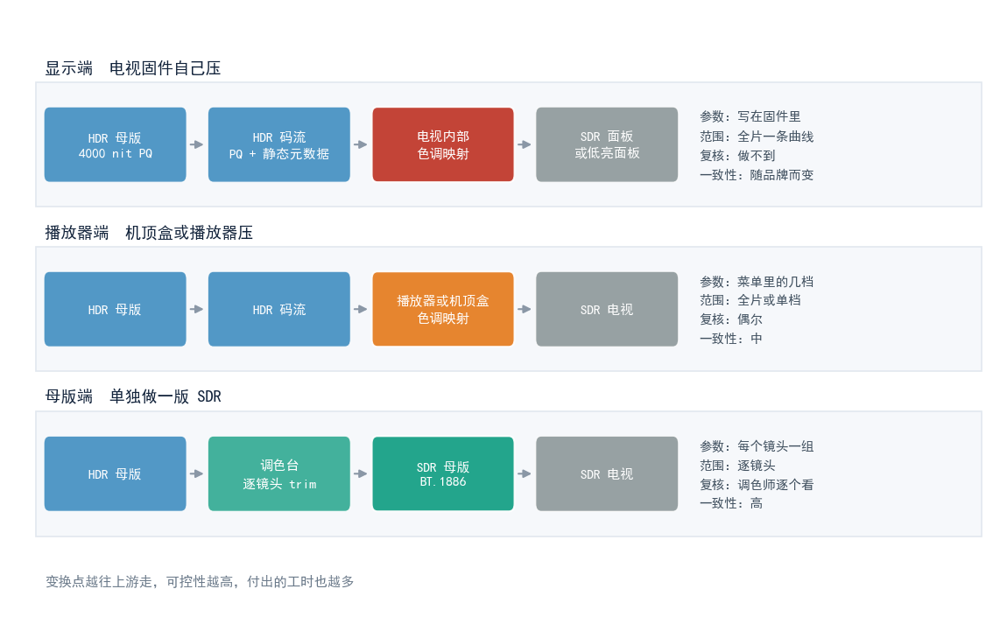
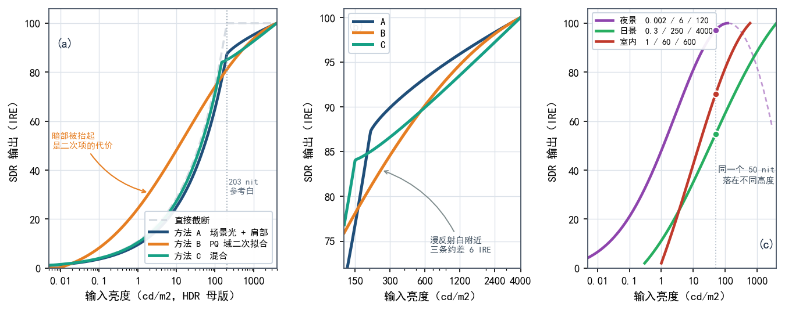
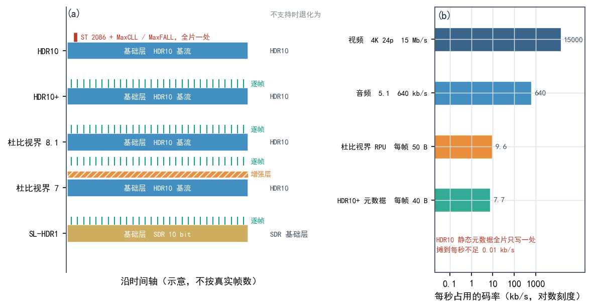
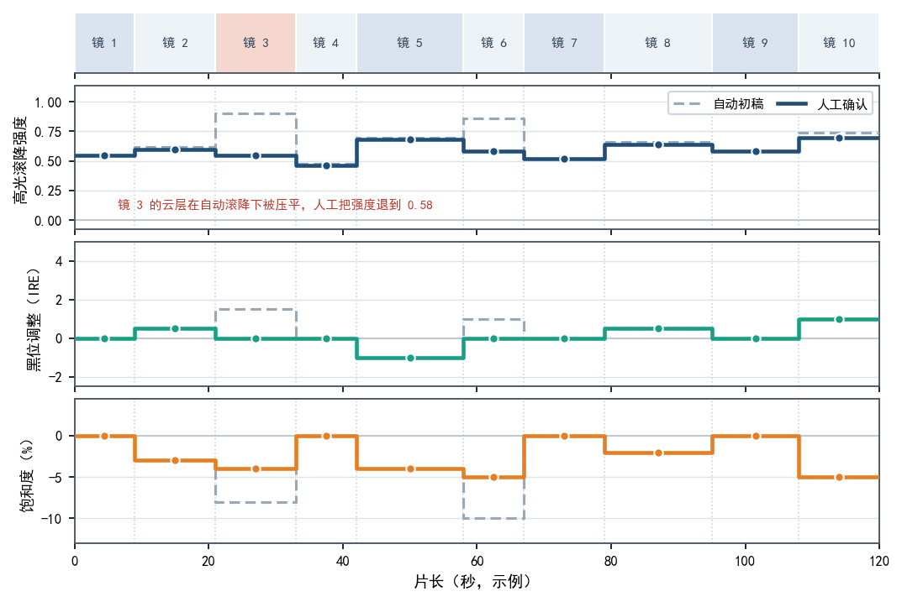
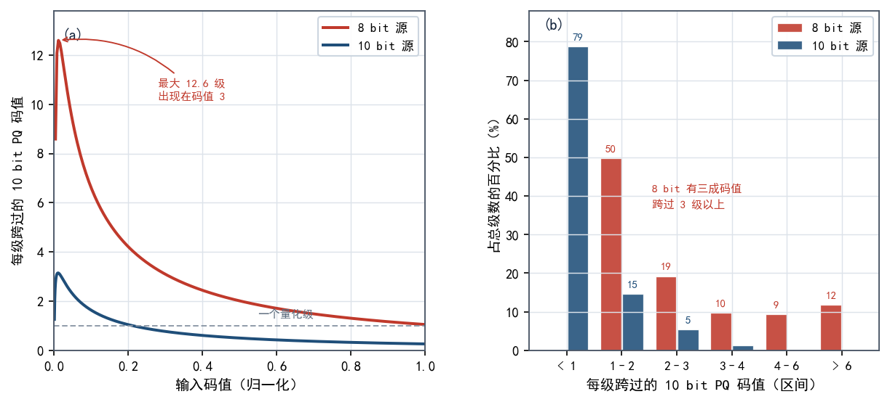
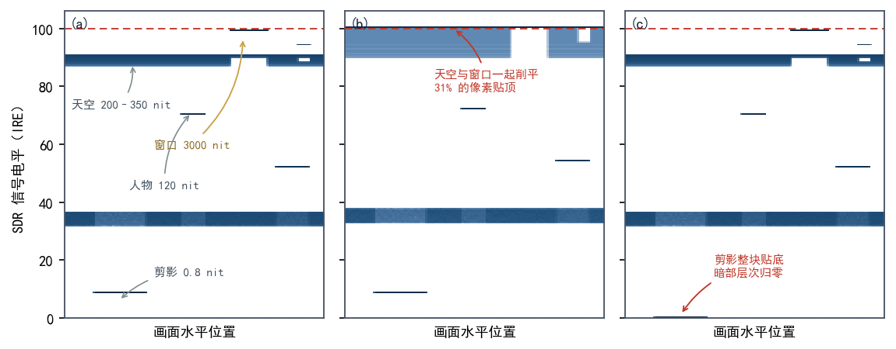

# 第 11 章 SDR 与 HDR 共存：上下变换与双版本交付

一部片子上线，同一时刻有四种人在看它。买了新电视的，家里还是十年前那台的，在地铁里用手机的，还有那台老功放后面接的电视。HDR 版本只服务其中一部分。剩下的观众不会因为自己看的是 SDR 就原谅画面发灰或者高光死白，他们只会觉得这部片子做得不好。共存不是过渡期的临时妥协，而是 HDR 落地之后长期存在的工作条件，也是交付环节里最费功夫的一段。

## 一、两个版本是常态

先把账算清楚。全球电视机的存量以十亿计，每年新出货里支持 HDR 的比例在上升，但存量替换要十年左右。一部片子的商业寿命只有几年，发行方不可能等到存量换完再上 HDR。广播更直接，一路信号要同时喂给两类接收机，没有第二条路可走。流媒体平台的做法是同一部片子准备多档，按设备能力下发，用户看不到这个选择过程，只觉得「我这台电视放出来就是这样」。

两个版本的技术落差有多大，可以用三个数字概括。SDR 的白场是 100 cd/m²，BT.1886 的伽马曲线，BT.709 的三基色；HDR 的峰值是 1000 到 4000 cd/m²，PQ 传递特性，BT.2020 的三基色。亮度差 10 到 40 倍，色域面积按 u′v′ 坐标算大约是 1.7 倍，暗部下限从 0.05 cd/m² 推到 0.005 cd/m²。这些数字在第 1 章和第 2 章都出现过，这里要强调的是它们带来的后果，不是范围本身。把 4000 nit 的云层压到 100 nit 的白场以内，中间要做的取舍不是一条曲线能表达完的。

有一点容易被误解。双版本不等于两次创作。调色师在 HDR 版上定下的亮暗关系、色彩倾向、视觉重心，SDR 版必须跟着走，否则两部片子会像两个导演拍的。所以更准确的说法是一个创作意图的两种技术实现。这句话听上去像口号，但它决定了后面所有工程选择的方向。凡是让 SDR 版偏离 HDR 版创作意图的做法，无论技术上多省事，都要打问号。

决定观众看到哪一版的，是链路上的能力协商，不是观众的偏好。播放器读显示端的 EDID，看它支持哪些传递特性；平台按 DRM 等级与设备型号选流；机顶盒按 HDMI 版本决定输出格式。这条链路里任何一环信息缺失，结果就退到更保守的那一档。第 3 章讲过降级路径，那里讨论的是格式层面的退化，这里要讨论的是画质层面的转换，两者经常同时发生，也经常被混为一谈。

平台侧的档位表比想象中复杂。同一个片名在片库里通常有六到八个版本，分辨率两档、曲线两档、码率两三档，交叉组合。DRM 等级也参与决定，广色域与 HDR 往往要求更高的安全等级，低等级的客户端只能拿到 SDR 流。带宽不足时先降哪一档，各平台策略不同，有的先降分辨率保 HDR，有的先砍 HDR 保分辨率。这套规则对观众不可见，但它意味着「我看的是不是 HDR」这件事，取决于当晚的网络状况和设备的认证状态，而不只取决于买没买会员。

终端的多样性让问题更复杂。投影的峰值亮度往往只有一百多 nit，笔记本屏幕四五百 nit，手机屏幕标称一千多 nit 但只在很小面积上做得到，全屏白场会被自动亮度限制压到三四百。同一份 HDR 码流投到这些屏上，观感差别比两台电视之间还大。这正是终端映射这条路的天花板，它只能在设备能力的范围内做最优，而设备能力本身就是一个移动的目标。

观看环境也在变。家庭客厅白天有环境光，屏幕反射光把黑位抬高，暗部细节被环境光洗掉；晚上关灯看，同样的片子又偏刺眼。HDR 的设计假设是暗环境，峰值亮度与黑位都有意义；SDR 的 100 nit 白场在亮环境里勉强够用，在暗环境里又偏暗。双版本交付时，这两个假设都在变，没有一个版本能同时适配白天与晚上。可行的做法是在终端侧做环境光自适应，但那又回到了终端映射，回到了不可控。

## 二、变换发生在哪一端

HDR 到 SDR 的转换可以发生在三个位置，位置不同，可控性和质量差得很远。图 11-1 把三条路径并排画出来，每一行是一条链路，四个方框从左到右是母版、码流、变换环节、终端，右侧一列写参数放在哪、覆盖多大范围、能不能复核。

第一行是显示端。电视收到 PQ 信号，内部按自己的算法压到面板能显示的范围内。参数写在固件里，用户能调的通常只有「HDR 亮度」一档，实际影响的是整体增益，不是曲线形状。这种做法不占额外带宽，制作端也不用花钱，代价是同一部片子在不同品牌、不同型号的电视上呈现不一样。更要紧的是，电视不知道创作意图。它拿到的只有像素值和几个静态元数据字段，没有办法判断这个镜头里的高光是一盏该保住形状的灯，还是一片可以压平的天空。

第二行是播放器端。机顶盒、蓝光机、游戏机、部分电视盒子会在输出前做一次映射，把 HDR 信号转成 SDR 再送出去。它比电视多一点信息，能读元数据，有的还能按内容类型选不同曲线。但它仍然是一条曲线管全片，而且多了一个风险，就是与显示端的处理叠加。播放器压过一遍，电视又按 HDR 处理一遍，高光被压两次，中间调被抬两次，画面发灰、层次变平。这类故障在「机顶盒接功放接电视」的链路里非常常见，排查的第一步永远是直连，绕开中间设备看现象是否消失。

判断变换到底发生在哪一环，有一个简单的方法，看显示端的状态提示。大多数电视在收到 HDR 信号时会弹出「HDR」标识，弹出说明它收到的是 HDR 信号，变换发生在它内部；不弹而画面已经变灰，说明信号在到达它之前就被转成了 SDR，问题在上游。这个方法不总是可靠，因为有的电视不弹提示，有的弹了但内部仍在做二次处理，但它能快速区分「上游转过了」与「这台电视在转」两种情形，省掉很多无效排查。

第三行是母版端。调色台上单独做一版 SDR 母版，逐镜头比对，用两台监视器并排看，一台显示 HDR 版，一台显示 SDR 版，来回切换。这一版是完整的、可以送审的、可以进版本管理的成品，不是运行时算出来的近似。它的成本最高，一个调色师几天到几周不等，但它把「这个镜头该怎么压」这个问题在有人看着的情况下解决掉了。

三条路径的差别，本质上是信息量的差别。母版级处理时，操作者手上同时有 HDR 画面、SDR 画面、波形、矢量示波器、镜头上下文，还有导演的意见。终端映射时，手上只有一张当前帧的亮度统计和一条写死的曲线。用信息论的说法，前者是在有监督的条件下做决策，后者是在无监督的条件下做猜测。猜测的平均水平可以做得不错，但尾部一定会出错，而出错的那几个镜头恰好是最需要仔细处理的镜头，比如逆光、夜景、火焰、雪地。

| 变换位置 | 参数来源 | 覆盖粒度 | 跨设备一致性 | 制作成本 | 能否复核 |
|---|---|---|---|---|---|
| 显示端 | 固件内置 | 全片一条曲线 | 低，随品牌型号变 | 无 | 不能 |
| 播放器端 | 菜单或出厂设置 | 全片或单档 | 中 | 无 | 偶尔 |
| 母版端 | 调色师逐镜头 | 每个镜头 | 高，文件即结果 | 数天到数周 | 能，可回看 |

这张表最后一行是重点。母版级处理的产物是一个文件，文件可以被检查、被比较、被退回重做。终端映射的产物是一次性的显示结果，出了问题只能靠换设备或者改固件。工程上把这种差别叫做可归因性，一个错误能不能定位到具体环节，决定了整条流水线能不能收敛。

三条路径的成本落在不同的人头上。母版级处理是制作方付钱，付的是调色师的工时；播放器映射是设备商付钱，付的是研发与固件维护；显示端映射摊到每个用户头上，付的是买电视的钱，而且这笔钱在买的时候就已经付完了，用户感觉不到。成本转移决定了各方的积极性，制作方愿意为一部重点片花钱，不愿意为一条短视频花钱；设备商愿意把映射做进固件，因为这是卖点，但不愿意为每一部片子单独优化。

算带宽账的时候还要区分两种「双版本」。一种是两条独立码流，SDR 那条按 SDR 的复杂度编码，码率可以低不少；另一种是一条码流加兼容层，只多几十 kb/s 的元数据。前者的存储与分发成本翻倍，后者的成本几乎为零。平台选前者是因为编码效率与终端兼容性，广播选后者是因为只有一条管道。这个选择与画质无关，与商业模型有关，但用户感知到的画质差别，往往就藏在这个选择里。

另有一条路不在上面三条里，就是影院。影院的 DCP 不是从家庭 HDR 母版转换出来的，它从同一个调色工程另出一版，峰值 48 或 108 cd/m²，色域 P3，伽马 2.6。第 10 章讲过这条链路，放在这里是为了说明「版本」不一定是转换的产物，有时候是并行的两条生产线。判定用哪种方式，看的是这个出口的规格是不是稳定、量是不是够大。影院的规格十年不变，值得单独调；家庭终端的规格每年在变，只能靠转换加兼容层。

把三条路径排个序，质量从高到低是母版级、播放器端、显示端。这个排序有个前提，就是播放器端能读到完整的元数据。如果元数据在转码时丢了，播放器端的质量会掉到显示端以下，因为它连静态的峰值信息都没有，只能靠画面统计猜。这也解释了为什么同一部片子在同一个品牌的播放器上表现稳定，换个片源就出问题，问题往往不在播放器，在那条流的元数据。

那为什么不是所有内容都做母版级处理。因为成本和内容量不成比例。一部两小时的电影值得花两周，一条三十秒的广告不值得，一场持续六小时的直播根本没有时间。于是行业里出现了第三条路，把母版级的决策提前算好、压缩成参数、塞进码流，让终端在做映射时能读到一部分创作意图。这样的结构就是兼容层。

## 三、BT.2446 的三种方法

ITU-R BT.2446 是目前最完整地规定「HDR 与 SDR 之间怎么换」的建议书。它 2019 年出第一版，后续修订补充了实现细节，题目覆盖两个方向，既管 HDR 到 SDR，也管 SDR 到 HDR。这份建议书没有指定唯一的最优曲线，它做的是另一件事，把可用的信息条件分成三类，每一类给一套方法，让不同条件下的转换至少有一个共同的出发点。三类条件对应三个方法，编号是 A、B、C。

方法 A 走场景光这条路。它假设转换方知道素材的拍摄条件，能把显示光还原成场景光，在场景光域里做亮度与色域的压缩，最后再编码成 SDR。步骤可以拆成六步。先把 PQ 码值解码成绝对亮度，得到每个像素在 0 到 10000 cd/m² 上的位置。再除以 203，这个数是 BT.2408 规定的 HDR 参考白，也就是画面里那张白纸、那面白墙应该有的亮度，除掉之后亮度变成一个以漫反射白为 1 的相对值。第三步是反 OOTF，把显示光的相对值还原成场景光，让中间调的相对关系回到拍摄时的样子。第四步做色域压缩，把 BT.2020 的三基色投到 BT.709 里，保持亮度不变，让饱和度按比例下降。第五步是肩部压缩，把参考白以上那部分余量压进 100 IRE 以内。第六步按 BT.1886 编码，输出 10 bit 的 SDR 信号。

这六步里最有争议的是第三步。PQ 本身没有 OOTF，它是一条绝对的显示光曲线，从码值直接到亮度，中间不经过场景光。BT.2100 里给 PQ 配了一个系统伽马，用来描述「拍摄时的相对亮度」与「显示时的绝对亮度」之间的整体关系，方法 A 就是借这个关系反推场景光。如果素材在后期已经被反复调过色，亮暗关系不再对应拍摄现场，这一步的前提就破了。表现出来是中间调被压得偏暗或者偏亮，肤色发闷。所以方法 A 适合有原始素材、有拍摄信息、调色链路干净的新片，不适合拿来做片库批量转制。

方法 A 的好处是关系保得住，它在场景光域里工作，一个镜头里亮部和暗部的比例、肤色与环境的相对关系，都能比较自然地延续下来。图 11-2 的深蓝线是它的形状，203 nit 的漫反射白落在 87 IRE 附近，1000 nit 落在 95 IRE，4000 nit 落到 100 IRE。这条曲线在 203 nit 处有一个明显的膝点，膝点以下几乎是直线，膝点以上转入对数肩部。

方法 B 换了一个完全不同的思路。它不看场景光，直接在 PQ 码值域里拟合一条多项式，通常是二次的，系数由当帧的亮度统计量解出来，最常见的是最小值、最大值和平均值三个约束。因为它不需要任何外部信息，输入只有码流本身，所以它能用在任何素材上，包括那些来历不明、没有任何拍摄记录的片子。它的算力开销也小，一次拟合加一次多项式求值，放进解码芯片里毫无压力。

代价有三个。第一个是黑位。二次多项式在 PQ 域里拟合，很难同时满足「暗部压到 0」和「中间调不塌」，图 11-2(a) 的橙线在 1 nit 处还有 24.8 IRE，而方法 A 在同一个位置只有 10.9 IRE。这个差别在画面上就是「黑不下去」，夜景会发灰。工程上的补救是加一段黑位补偿，先减掉一个偏移再做拟合，但补偿量又要靠人工定，等于把问题挪了个位置。

第二个代价是逐帧稳定性。系数跟着统计量走，统计量跟着画面走，一个镜头内部如果有一盏灯忽明忽暗，系数就跟着跳，画面会出现缓慢的呼吸感。剪接点上更明显，前后两个镜头的平均亮度差三倍，同一个中间调在切点两侧就会落在不同高度。图 11-2(c) 画的就是这件事，同一个 50 nit 在夜景里落在 97 IRE，在日景里落在 55 IRE。自适应本身是好事，但它必须被平滑，否则观众看到的是「亮度一跳」。

第三个代价是高光纹理。多项式是光滑单调的，它把 1000 到 4000 nit 这段压成几个 IRE 的区间，云层的起伏、金属反光的方向感都在这一步被抹平。这不是实现得不好，是模型本身的表达力不够。要保住纹理，就得引入局部信息或者额外的元数据，那就走到方法 C 去了。

方法 C 是混合。它把 A 与 B 组合起来，常见的形式是用 A 保证整体的影调与色彩关系，再用 B 或者一组动态元数据修正 A 在个别场景上的过冲。也有实现把画面分成基础层与细节层，基础层用场景光方法处理，细节层单独压缩后再叠回去。它的效果介于两者之间，复杂度和校验成本最高，因为两组参数都要生成、都要对齐、都要在终端验证。

| 方法 | 需要的输入 | 计算复杂度 | 适合的素材 | 主要风险 |
|---|---|---|---|---|
| A 场景光 | HDR 码流加拍摄与调色信息 | 中，可逆 | 新片、有原始素材 | 前提不成立时中间调失真 |
| B 多项式 | 只有 HDR 码流 | 低，可放进芯片 | 来历不明的素材、批量转制 | 黑位抬升、帧间跳动、高光平 |
| C 混合 | 码流加参数集 | 高，要单独校验 | 片库、要求稳定的批量 | 参数不一致、验证工作量大 |

方法的选择在项目里很少是纯技术决定，更多是资源决定。新片有原始素材、有调色工程，走 A；片库批量转制没有这些，走 C，用元数据把自动结果稳住；临时补位、明天就要交，走 B，先保证有东西可播。同一个项目里混用三种方法也很常见，正片走 A，档案镜头走 B，特效镜头走 C，只要切点处的关系能接上，观众看不出分段。

分段处最容易出问题。两种方法对同一个中间调的落点不一样，切过去就是一次亮度跳变，尤其是从 A 段切到 B 段这种组合，B 的黑位天生偏高，切点两侧的暗部差一个层次。补救的方法是在切点附近做一段过渡，把两侧的参数在几秒内插值，或者在剪辑上避开，把切点放在黑场或者镜头切换处。这类细节在标准里没有，在片子上却很致命。

图 11-2(a) 把三条曲线画在同一张图上，横轴是对数刻度的输入亮度，纵轴是 SDR 输出电平。灰虚线是「直接截断」，也就是把 203 nit 以上一律切到 100 IRE，它说明为什么必须有肩部。三条彩色曲线在 203 nit 以下几乎重合，差别全部集中在上半段。203 nit 处 A 是 87.2 IRE，B 是 81.1，C 是 85.0，相差 6 IRE 左右。这 6 IRE 决定的是整幅画面的明暗手感，观众说不清哪里不一样，但并排看一定觉得其中一版「更亮」。(b) 把肩部放大，A 最亮，C 其次，B 最暗，三条线在 4000 nit 处收在一起。(c) 是方法 B 的三组系数，三场戏的最小值、平均值、最大值各不相同，解出的曲线形状也不同，夜色那一条在 120 nit 就贴顶，说明它在自己那场的亮度范围之外已经没有余量，虚线画出的外推段还会反折，实现里必须截断。

方法 A 的好坏，很大程度取决于 203 这个数字用得对不对。203 cd/m² 是 BT.2408 定的 HDR 参考白，它在 PQ 上落在 58% 的信号电平，在 1000 nit 的 HLG 参考显示上对应 75% 的信号。这两个百分比经常被搞混，因为习惯上说 SDR 的白是 100%。真正的意思是，HDR 画面里一块白纸的亮度是 203 nit，它上面还有 1000、4000 的空间放高光。所以往 SDR 转的时候，203 对应的是 100 IRE 以下的一点，而不是 100 IRE 本身。把 203 直接当 100 IRE 用，就会把天空与窗口一起削平，波形顶部出现一条平直的高带，图 11-6(b) 是这种错误的样子。

这个定位还引出一个工程上的习惯，就是所谓「留白」为高光。SDR 版里，漫反射白不应该顶到 100 IRE，而应该留在 85 到 90 之间，剩下的 10 到 15 IRE 给高光。图 11-2 里三条曲线在 203 nit 处分别落在 87.2、81.1、85.0 IRE，就是这个道理。有些片子为了显得「亮」，把漫反射白推到 98 IRE，高光就没地方放了，云层变成一片白，看起来反而平。这是新手最容易犯的错误之一，也是老调色师一看波形就能指出的问题。

标准给的是框架，不是唯一答案。同一个方法 B，两家厂商取不同的统计量、不同的平滑策略，跑出来的曲线可以差好几个 IRE。这不是标准写得不好，是这类问题本来就没有唯一解。但它带来一个直接后果，转换的结果依赖实现，而实现分散在成千上万台设备里。要想让结果可控，唯一的办法是把决策提前做好、把参数写进文件，这就是兼容层要解决的事。

色域那一步比亮度更容易被开快。BT.2020 的三角形比 BT.709 大出一圈，一个饱和的青在 2020 里能表示，放到 709 里就落到了三角形外面，必须找一个三角形内的点来顶替它。可选的做法有三种，直接截断到边界，边界上的颜色会成片地粘在一起；按亮度比例去饱和，把颜色往白点方向拉，色相保住，鲜艳度下降；带膝点的色域映射，在边界附近逐步收，内部保持不变。三种做法的观感差别在宽色域的素材上很明显，尤其是荧光色、LED 灯、舞台光。

BT.2446 在执行步骤之外还给了两组可选的预处理与后处理。预处理包括黑位补偿与限幅，目的是避免输入信号里的非法值与噪声被曲线放大；后处理包括色彩校正与局部调整，用来修补转换之后仍然不对的区域。这些步骤标准里写得比较宽，参数怎么定留给实现。所以真正决定成片质量的，往往不是那六个主步骤，而是这些没被规定死的细节。这也是为什么同一份建议书，两家后期公司做出来的东西不一样，而两家都能声称自己按标准做的。

验证转换的一致性，行业里的做法是准备一套测试素材，涵盖灰阶渐变、饱和色块、肤色、高光、暗部、图形元素，用同一段素材跑不同的实现，把输出放在一起比对。比对的指标可以用 PSNR 或者 CIEDE2000，但指标只能筛出差异大的，不能判定哪个对。判定要看曲线形状与关键区域的表现，这又回到了人的判断。

容易与 BT.2446 搞混的是 BT.2390。后者给的 EETF 是显示端的映射工具，输入是 PQ 码值，输出也是 PQ 码值，目标是把高动态范围的内容压到峰值更低的显示器上，两端都在 HDR 体系里。BT.2446 处理的是跨体系的事，一端是 PQ 一端是 BT.1886，除了亮度还要动色域。第 4 章讨论过 EETF，两者不要当成同一件事。在实际流程里，EETF 常常是转换的一个内部环节，先把 4000 nit 压到 1000，再跨到 SDR，分两步做比一步到位容易控制。

## 四、兼容层：一条码流两种读法

「兼容层」这个词经常被用错。它不是降级路径的另一个说法，而是一种码流结构，让同一份文件在不同能力的设备上读出不同结果。支持 HDR 的设备读出完整信息，不支持的设备读出一个能看的近似，两者共用同一份视频数据，不额外占用一路带宽。理解了这一点，才能理解为什么 HDR10+ 内容在只支持 HDR10 的电视上还能播出，以及为什么杜比视界的 SDR 版本可以藏在同一条码流里。

先看 HDR10。它是单层结构，一个 HEVC 主 10 码流，加上 ST 2086 的母版显示信息与 MaxCLL、MaxFALL 两个内容统计量。严格说 HDR10 没有 SDR 兼容层，它的「基线」地位是生态意义上的，所有 HDR 电视都支持它，所有编码器都能产出它。一台只支持 SDR 的电视收到 HDR10 码流，能做的是拒播、黑屏，或者用厂商自己的一套映射把它压下来。这三种结果在不同设备上都出现过，用户看到的是「有的片子放不了」或者「放出来发灰」。所以 HDR10 的兼容性是被动的，它依赖终端愿意做映射。

HDR10+ 在 HDR10 上加了一层逐帧元数据，用 ST 2094-40 承载。它的结构仍然是单层，没有增强层，码率开销就是元数据本身。不支持动态元数据的设备在解析 SEI 时直接跳过，剩下的部分就是一个完全合法的 HDR10 码流，画面照常出来，只是退回到静态映射。这条路的好处是兼容成本几乎为零，坏处是退化之后的画质取决于终端的静态映射做得怎么样，落差可能很大。

杜比视界把兼容层做得更彻底。它的 RPU 是 ST 2094-10 的应用，里面除了逐帧的映射参数，还有一组 trim，描述的是「在某种目标显示能力下，应该怎样调整」。这些 trim 是后期在 Content Mapping Unit 里生成的，生成的时候调色师能看着 SDR 监视器调，调完的结果被写进 RPU。播放端的杜比解码器读到 RPU，按当前显示设备的能力挑出对应的参数，重建出该有的画面。换句话说，杜比视界把母版级的 trim 决策压缩成参数、随帧传输，这就是它的 SDR 版本画质明显好于通用色调映射的原因。

杜比视界的 profile 决定基础层是什么。Profile 8.1 的基础层是 HDR10，SDR 设备拿到的是一条 PQ 码流，需要终端自己映射；Profile 8.2 的基础层是 SDR，老设备直接读基础层就能播，HDR 设备靠 RPU 重建；Profile 8.4 的基础层是 HLG，适合广播。这三种结构说明一件事，兼容层的质量与基础层选什么直接相关。基础层是 SDR 的时候，HDR 侧的高光只能是「造」出来的；基础层是 HDR 的时候，SDR 侧要靠映射，除非 RPU 里带了足够细的 trim。

图 11-3(a) 把五种承载结构排在一起。HDR10 只有一条基础层，元数据是开头处的一处静态记录；HDR10+ 与杜比视界 8.1 都是单层加逐帧元数据，区别在元数据的语义与授权；杜比视界 7 多一条增强层，用来承载基础层装不下的细节；SL-HDR1 的基础层是 SDR，元数据负责把 SDR 重建回 HDR。右侧一列写的是「不支持时退化成什么」，前四种结构都退到 HDR10，SL-HDR1 退到 SDR 基础层。这说明兼容层的方向是单向的，只能往能力更低的一侧退化，不能反向增强。

(b) 是开销的量级。视频按 4K 24 帧、15 Mb/s 估算，音频按 5.1 的 640 kb/s 估算，逐帧元数据按每帧 40 到 50 字节估算，换算下来是 7.7 到 9.6 kb/s。相对于 15000 kb/s 的视频，元数据占不到千分之一。这就是为什么格式之争从来不是带宽之争，多一层元数据的代价可以忽略，真正的代价在实现与验证上。每一档元数据都要有对应的生成工具、对应的解码实现、对应的一致性测试，这些是人力成本，不是码率成本。

兼容层还有一个容易被忽略的副作用，它把「两个文件」变成了「一个文件两种读法」，省下的是分发与存储，制作端的活一点没少。trim 参数还是要人调，只是调的产物从一版 SDR 母版变成了一组数字。而且这组数字比母版更脆弱，母版是一个独立文件，丢了可以重新输出，参数丢了往往只能从头再调一遍。

脆弱性来自依赖关系。元数据描述的是「这一帧应该怎么映射」，它必须与画面严格对齐。剪辑改动一个镜头长度，后面所有帧的元数据都要跟着错位；重新编码时转码器不认识厂商私有 SEI，元数据会被整段丢弃；调色改动之后没有重新生成元数据，画面与参数就对不上。这三种情况在流水线里都很常见，表现出来不是黑屏，而是「能看但不对」，高光被削平、暗部被抬起、颜色偏了，而每一级环节都认为自己没错。

第四种更隐蔽，元数据没丢也没错位，但基础层被重新编码时改了统计量。基础层是 HDR10 的时候，峰值与平均亮度写在静态元数据里，重新编码的编码器如果不重新统计，写进去的仍是上一版的数值。终端读到偏小的峰值，会把本来不需要压的高光压下去，画面变暗、层次发平。这种错误最难查，因为所有字段都在、格式都合法，只有数字与画面不匹配。

HLG 在共存这件事上占一个特殊位置。它用相对亮度，显示端按自己的峰值乘一个系数就能出图，SDR 电视收到 HLG 信号可以直接显示，画面偏暗、对比被拉开，但不会崩。这个特性让 HLG 天然具备兼容层的作用，不需要元数据，也不需要两条基础层。广播选它正是因为这一点，欧洲与日本的超高清广播都落在 HLG 上。杜比视界的 Profile 8.4 与 ETSI TS 103 433 里的 SL-HDR3 都把 HLG 当作基础层，也是同一个道理，基础层本身就能看，元数据只是让 HDR 端拿到更准的呈现。

国内的 HDR Vivid 走的是另一条生态路线，单层结构加动态元数据，编码可以是 AVS3，也可以是 HEVC。它的兼容策略与前两者一致，不认识元数据的设备退到基础层的 PQ 或者 SDR，具体退到哪一层取决于码流怎么封装。格式的名字不同，工程问题同构，都要面对元数据与画面的一致性、转码器的支持程度、终端的实现差异这三件事。

有一个现实需要说清楚，流媒体平台上很少真的用兼容层。它们大多是两条独立的码流，一条 HDR、一条 SDR，各自编码、各自分发，按设备能力选其中一条。这么做的原因很实际，编码效率。一条 HDR 码流要同时兼顾两种观看，编码器必须在码率分配上妥协，而分开编可以让每一条都按自己的目标优化。兼容层真正的用武之地在广播与蓝光，那里只有一条管道、一份母版，必须让一份数据服务两类设备。理解了这个区别，就能理解为什么同一个片子在不同平台上的 SDR 观感不一样，有的平台是母版级 trim 出来的，有的平台就是一条独立转码的 SDR 流。

所以兼容层的工程重点不在格式，在流程。参数要与画面同生共死，谁改了画面谁负责重算参数，重算之后要过一遍一致性检查。这套要求听起来是管理问题，实际上是技术问题的外化，因为元数据是一条隐式的依赖链，链上任何一环断了，终端拿到的东西就是错的，而终端没有办法判断对错。

元数据的时间精度也是一个参数。逐帧元数据不必真的每帧都变，很多实现按场景切换点更新，中间保持或者线性插值。这样做的好处是码率低、帧间稳定，坏处是快速变化的光源跟不上，比如闪光灯、频闪的霓虹、爆炸的火光，这些场景里参数的变化比场景切换快得多，按切换点更新就等于没更新。聪明的做法是按变化幅度自适应，变化小的时候保持，变化大的时候立即更新，并限制单帧的最大跳变量，兼顾稳定与跟得上。

授权与认证也是成本的一部分，而且它不是技术成本，很难用工程师的直觉估算。杜比视界的每一台终端都要过认证，认证要跑一致性测试，测试要付费，周期以月计；HDR10+ 的授权便宜些，但同样要工具链与流程；HLG 不收费，所以广播愿意用。这些差异不直接影响画质，但它们决定了哪些格式能铺开、铺得多快，而铺开的速度又反过来决定了制作方愿意为哪个格式多花力气。

## 五、双版本母版与 trim pass 的工作流

母版级处理的实际形态是 trim pass。这个词来自杜比视界的工具链，原意是「修剪」，指在已有的映射结果上做局部修正。现在它被用来泛指所有逐镜头的 HDR 到 SDR 调整，不管用什么工具、什么格式。做法是把 HDR 母版当作输入，跑一遍自动映射得到基准，再按镜头逐个修正这个基准，最后把修正结果固化成一版 SDR 母版，或者固化成一串参数。

分段单位选镜头，不选帧，也不选全片。不选帧是因为逐帧参数会让画面呼吸，人眼对缓慢的亮度变化极其敏感，一个镜头内部亮度上下浮动 3 IRE 就能被看出来。不选全片是因为一部电影内部的亮度结构差异太大，夜景和雪景用同一条曲线必然有一个是错的。镜头是这两者之间的自然单位，一个镜头内部的曝光、光源、构图基本一致，同一条曲线够用，切点两侧各用各的，观众也不会察觉。

一部两小时的电影有一千到两千个镜头。这个数字决定了工具必须能自动化大部分工作，否则人力成本无法承受。实际流程是三层。第一层是自动映射，用方法 A 或者方法 C 跑全片，得到一个基准版本，这一层的产物通常是「能看，但重点镜头不对」。第二层是按统计量给建议，工具会算出每个镜头的峰值亮度、平均亮度、暗部面积占比、肤色面积占比，用这些量把镜头分成几类，给出初始参数。第三层是人工逐镜头确认，调色师只看那些被标记为「高风险」的镜头，其余的接受建议。

高风险镜头有四类，几乎每个项目都是这四类。逆光与窗光，画面里同时有很暗的室内和很亮的窗外，压高光会把窗外压成一片灰，不压则窗内死黑，取舍取决于剧情要不要让观众看见窗外。夜景与火光，动态范围集中在低亮度段，稍微一压暗部就糊成一片，火光的颜色又特别容易偏。霓虹与饱和色，SDR 的色域比 HDR 小，高饱和的青、品红、荧光绿在转换时会溢出，表现为边缘发白或者色相跑掉。雪地、白墙、高调场景，整幅画面都在高亮度区，肩部曲线稍有不同，观感差别就是「亮得舒服」与「亮得刺眼」。

参数怎么表达，各家工具不完全一样，但基本模型是共通的。一条亮度映射可以用三个参数描述，斜率、偏移、幂次，业内叫 SOP 模型，输出等于输入的幂次乘斜率再加偏移。斜率控制整体对比，偏移控制黑位，幂次控制中间调的弯曲程度。在这个基础上再加饱和度增益与色相偏移，前者是一个全局的乘数，后者针对特定色相带做旋转，比如只调整肤色所在的橙红区间。更细的工具还允许画局部窗口，只对画面某一块区域生效，用来处理「人脸在暗处、背景在窗外」这类情况。

参数怎么变成画面，可以看一个具体的例子。一个室内镜头，人物背对窗户，窗外是阴天的天空。自动映射给出的滚降强度是 0.90，结果是窗外一片均匀的白，天空的云层结构没了。调色师把滚降强度退到 0.55，同时把膝点往上抬了一点，窗外恢复出灰蓝的层次，室内人物的脸略微变暗，再用一个椭圆窗口把脸单独提亮 2 IRE。三个动作，两组参数，改完之后这个镜头在两个版本之间的视觉重心是一致的，观众看 HDR 版注意到的还是那张脸，看 SDR 版也是。

图 11-4 画的是这个过程的一个片段，十个镜头，三条参数轨。最上面一行是镜头切分，浅红色的那一格是出问题的镜头。第一条轨是高光滚降强度，虚线是自动初稿，实线是人工确认，可以看到大部分镜头两者一致，只有第三、第六两个镜头被改过，第三镜从 0.90 退到 0.55，第六镜从 0.86 退到 0.58。第二条轨是黑位调整，单位是 IRE，第三镜自动建议抬 1.5 IRE，人工改回 0，因为那一镜的暗部本来就要压住。第三条轨是饱和度，负值表示降饱和，两个问题镜头都从 -8、-10 收到 -4、-5，理由是过度的降饱和让人物的衣服失去了本来该有的颜色。三条轨放在一起看，人工的工作量集中在少数镜头，而每一个改动都能追到具体原因。

参数定下来之后要复核，复核分三层。第一层看数值，每个镜头的峰值、平均、暗部占比与 HDR 版的对应值做比较，偏差超过阈值的挑出来重看。第二层看画面，用关键帧截图并排比对，重点看肤色、天空、灯光、字幕。第三层看设备，把 SDR 版放到两三台不同品牌的电视上放一遍，看差异是否在接受范围内。三层都过才算完成，只做第一层的项目很多，问题也大多出在这里。

版本管理是这件事里最枯燥的部分。镜头 ID 与参数要绑定，剪辑一动，绑定关系就断。实际的做法是每次拿到新版本的 EDL 之后重新对齐，按时间码匹配，匹配不上的镜头标记为待确认。改动幅度小的时候可以沿用旧参数，改动超过一定比例就要重跑自动映射。这条规则听起来简单，执行起来经常被跳过，因为赶工期的时候没人愿意为一个「只改了三秒」的版本重做一遍 trim，而恰恰是这三秒里的新镜头没有参数，播出去就是一个明显的问题镜头。

人工与自动的分工可以总结成一张表。自动负责覆盖率，人工负责边界。自动能处理 80% 的常规镜头，剩下 20% 是决定成片质量的，必须有人看。把这两件事混在一起，要么成本失控，要么质量失控。

| 环节 | 自动 | 人工 |
|---|---|---|
| 基准映射 | 全片跑一遍，出初稿 | 抽查，确认整体倾向 |
| 镜头分级 | 按统计量标记高风险 | 复核标记规则是否合理 |
| 参数调整 | 给出建议值 | 逐镜头确认与修正 |
| 一致性检查 | 数值比对，超阈值报警 | 看画面，判断是否可接受 |
| 字幕与图形 | 按规则统一处理 | 确认可读性与亮度 |

字幕、台标、角标、界面元素这类对象容易被漏掉。这些东西在 HDR 版里通常按固定亮度渲染，比如 100 或者 203 cd/m²，到了 SDR 版如果跟着画面一起被压，就会变得发灰；如果单独保持高亮度，又会在暗场景里刺眼。第 10 章讨论过广播里图形元素的三种亮度策略，电影的字幕问题类似但更简单，因为字幕是叠加层，可以在转换之后单独合成，不必参与色调映射。工程上的做法是把字幕与画面分开处理，画面走 trim，字幕按目标亮度重新渲染，最后合成。

trim pass 的成本与片子的类型强相关。对白为主、内景为主的剧情片，镜头数少、亮度结构简单，几天能做完。特效多、外景多、光线变化剧烈的片子，两三周也做不完。这个成本在预算里常常被低估，因为它的工作量不像特效那样看得见，它藏在「同一部片子的另一个版本」这句话后面。

参数与查找表是两种可交付的形式，各有各的适用面。做 trim 的人需要两套监视器，一套 HDR 参考监视器，一套 SDR 参考监视器，两套都要校准，而且都要在同一间房里、同一种环境光下。这不是洁癖，是因为判断「关系是否对应」需要反复切换，切换的间隔越短越准。如果只有一个屏幕，靠切换 LUT 模拟另一种状态，看到的永远是同一个面板的特性，会系统性偏差。

技能要求也不一样。做 HDR 版需要判断高光与暗部的细节，做 SDR 版需要判断压缩后的层次还在不在，两者的经验不能直接平移。有的调色师擅长 HDR，做 SDR 时习惯把画面拉得很亮，结果高光全白；有的反过来，担心丢细节而把画面压得很暗。这类偏差靠标准解决不了，只能靠经验与复核。

查找表把映射关系预先算好，存成一个 33×33×33 或者 65×65×65 的立方体，播放端只做三线性插值，不需要理解元数据语义。它的好处是通用，任何能加载 LUT 的播放器都能用，不依赖厂商解码器；坏处是它只能表达一个全局映射，无法逐帧变化，也无法表达局部窗口。当一个片子需要「一片一版」且终端环境统一时，LUT 是最省事的交付方式；当一个片子要上多平台、要照顾不同峰值与不同 SDR 目标时，参数集更合适。

实际项目里两者经常同时存在。杜比视界的流程交 RPU，非杜比的 SDR 交付交一版独立的 SDR 母版，广播交一版 HLG 加 LUT。同一套调色决策被导出成三种形式，三者之间的一致性靠 QC 保证。这套多重交付听起来冗余，但它是目前唯一能兼容不同平台的现实方案，因为没有任何一种格式能同时满足电影、流媒体、广播、蓝光四类出口的要求。

## 六、反方向：把 SDR 抬成 HDR

前面几节都在讲把 HDR 压成 SDR。实际工作里还有一半的活是反过来的。片库里躺着几十年的 SDR 素材，新拍的片子希望用上这些素材，体育频道收到的信号还是 SDR 的，很多游戏和录屏只有 SDR 版本。把它们放进 HDR 的播出环境里，就需要一次方向相反的变换。BT.2446 的题目里写了「and vice versa」，反方向也在它的范围内，但这一侧的自由度更大，风险也更多。

第一种做法是曲线扩展。把 SDR 的 100 IRE 白场重新定位到 HDR 的某个峰值，中间调按一条更陡的曲线拉开，暗部往下延伸。本质上是把 0 到 100 nit 这个区间拉伸到 0 到 1000 nit，同时保证 203 nit 的参考白附近不出问题。这种做法实现简单，可以用一条 1D LUT 完成，也可以写成解析式。它的局限很明显，原来信号里没有的信息不会因为拉伸而出现，拉伸只是把现有的码值分配得更稀疏，稀疏到一定程度就成了色带。

第二种做法是场景重建。先用逆 OOTF 把显示光还原成场景光，再按局部统计推断「这里原本应该有多亮」。比如一片被裁成纯白的天空，算法会根据周围的梯度、云的形状、光照方向估计出原本的亮度分布，然后把它填回去。这种做法在 BT.2446 的方法 A 里有对应的反向步骤，工程实现通常还要加局部算子。它的效果比单纯拉伸好，因为高光有了结构，但结构是猜出来的，猜错的时候会出现「云里有块莫名其妙的光斑」这种痕迹。

第三种做法是机器学习。用成对的 SDR 与 HDR 素材训练一个网络，输入 SDR 帧，输出 HDR 帧。近十年这类工作不少，从早期的单帧卷积网络到后来结合时序的版本，共同点是能生成相当自然的高光与色彩，尤其在天空、窗户、灯光这些有强先验的场景上。它们的问题也一样明显，训练数据决定了输出的风格，遇到训练集里没有的内容就编，编出来的东西看着合理但与原始素材无关。用在修复上，这意味着每一帧都要人看，否则会出现「这一段的高光每帧都不一样」的闪烁。

图 11-5 把量化的问题量化了。横轴是归一化的输入码值，纵轴是「输入每跨一级，输出跨过多少个 10 bit PQ 码值」。8 bit 源（红线）在暗部最陡，码值 3 附近一级就跨过 12.6 个 PQ 码值，全程有 31% 的码值区间跨过 3 级以上。10 bit 源（蓝线）在同一个位置只跨 3.2 级，跨过 3 级以上的比例只有 1.3%。右图是同一件事的分布，8 bit 的直方图往右拖了一条长尾，说明它在暗部确实缺码值。这条尾巴就是色带的来源，画面在暗部渐变时会出现一圈一圈的台阶，而 HDR 显示的高对比让这些台阶比 SDR 时代更容易被看见。

理解了量化，就能理解 SDR 到 HDR 的工程约束。位深不够的时候，任何激进的扩展都会放大台阶。解决顺序应该是先修源，再扩展。修源包括降噪、去块、重扫。降噪要小心，不能把颗粒全部抹掉，因为颗粒是天然的抖动，能掩盖色带；重扫到 10 bit 甚至 16 bit 是性价比最高的一步，它把后面的所有处理都放在一个更宽的容器里做。老片修复的实际流程里，扫描与修复往往占了整个工期的七成，扩展只占三成。

扩展的幅度也要克制。很多修复片的 HDR 峰值定在 200 到 400 nit，而不是 1000 nit，原因是原素材的高光已经被裁掉了，硬拉到 1000 只会把噪声和压缩痕迹一起放大。观众对 HDR 的感知主要来自暗部的层次、中间调的对比、饱和色的表现力，峰值数字反而是最不敏感的一项。一部峰值 300 nit 但暗部干净的修复片，观感远好于峰值 1000 nit 但暗部全是噪点的版本。

老片修复的流程可以拆成五步，每一步都有它的理由。第一步是检查与清洁，确认拷贝的物理状态，选择最完整的那一版。第二步是扫描，尽量扫到 10 bit 或者更高，选择对数或者线性容器，为后面的处理留空间。第三步是数字修复，去划痕、去脏点、稳定画面、补帧，这一步耗时最长，也最不可省略。第四步是扩展，把 SDR 的刻度换成 HDR 的，按前面说的保守策略做。第五步是调色与交付，按新的亮度结构重新看一遍，修局部，导出。

这五步里最容易出问题的是第三步与第四步的交叉。修复阶段会把噪声与颗粒抹掉一部分，扩展阶段又会把剩下的抹痕放大，结果是局部的「干净」与周围的「有颗粒」并存，在 HDR 的高对比下很明显。做法是先做扩展再补颗粒，或者把颗粒作为独立图层保留，最后叠加。这类细节在标准里没有，都是经验。

| 做法 | 需要的输入 | 可控性 | 典型用途 | 主要风险 |
|---|---|---|---|---|
| 曲线扩展 | 只有 SDR 码流 | 高，一条曲线定全片 | 临时补位、混合素材 | 色带、噪点放大、高光假 |
| 场景重建 | 码流加局部统计 | 中，参数要按场景调 | 老片修复、片库 | 猜错结构的痕迹 |
| 机器学习 | 成对训练数据 | 低，网络是黑箱 | 大规模批量、预览 | 逐帧不一致、编造内容 |

混合素材是另一类需要单独处理的情况。一部 HDR 片子里插入几秒档案镜头或者手机拍摄的画面，这些素材是 SDR 的，直接放进 HDR 时间线会在切换时「亮度掉一截」。做法是先把它抬到与项目基准匹配的水平，注意是匹配而不是拉满，档案镜头的峰值抬到 400 nit 就够，抬到 1000 反而假。同时在元数据里标注这一段的实际峰值，让终端的映射知道这里没有高光可压，否则终端会按整片的峰值去压它，把它压得更暗。

反方向的转换有一个哲学问题，值得在这里提一句。把 HDR 压成 SDR，丢的是信息，取舍的是「哪些信息更重要」；把 SDR 抬成 HDR，加的是信息，取舍的是「哪些信息可以编」。前者是压缩，后者是生成。工程上这两件事的验收标准应该不一样，前者看「有没有丢掉关键的东西」，后者看「编出来的东西有没有破绽」。混用同一套验收标准，就会出现「峰值达标但画面很假」的交付。

直播是另一个使用场景，约束完全不同。体育与新闻的 SDR 信号要上 HDR 频道，没有时间逐镜头调，也没有重跑的机会。做法只能是固定参数的实时上变换，用 BT.2446 方法 C 的一个简化版本，参数在开播前根据这场比赛的场地、灯光、摄像机型号调好，直播中不再改动。延迟预算也很紧，50 帧的系统里一帧是 20 毫秒，处理要在一到两帧内完成，算力只能用硬件。

这类场景下真正难处理的是画面里的异常亮度。记分牌的 LED 屏、观众席的闪光灯、场边的广告牌，这些元素在 SDR 里已经是满白，上变换之后要么依旧满白，要么被算法当成光源拉高，在 HDR 里刺眼。稳妥的做法是不对这些区域做扩展，保持满白，同时把周围的亮度关系拉开，让画面有 HDR 的观感而高光不跳。这个策略说起来简单，实现上需要区域检测，而直播里没有时间做精确分割，只能靠亮度阈值与连通区域，效果有上限。

## 七、质量评价与常见错误

评价两个版本，看的不是数值是否相等，而是关系是否对应。HDR 版里天空比地面亮六倍，SDR 版里也应该大致是六倍，而不是三倍或者十倍。这条原则听起来抽象，落到操作上就是一句话，拿两个版本的波形叠在一起看形状，而不是看高度。形状一致说明亮暗关系保住了，高度不同是必然的，因为两个版本的动态范围本来就不一样。

具体要看的维度有六个。亮度结构，也就是画面里最亮、最暗、中间调三段的相对关系。暗部，有没有糊成一片，有没有细节被压没。肤色，是不是还像人脸，有没有偏黄偏红偏灰。饱和色，霓虹、服装、花朵这些高饱和区域有没有溢出或者色相跑偏。图形元素，字幕、台标、界面有没有过亮或者发灰。帧间稳定，同一镜头内部有没有呼吸，剪接点上有没有跳变。这六项里，前三项决定「像不像」，后三项决定「专不专业」。

图 11-6 用一张合成画面说明了三种典型错误。画面里有天空、地面、暗处剪影、中间调人物、招牌和高光窗口，亮度从 0.8 nit 到 3000 nit。(a) 是按 203 nit 参考白定标的正确结果，各元素在波形上分成了几条清晰的带，天空在 87 到 91 之间，人物在 70，地面在 32 到 36，剪影在 9，窗口在 99，每条带都有自己的厚度，说明每一块区域内部还有层次。(b) 把白点设成 260 nit，天空从 200 到 350 nit 这一段整体贴到 100 IRE，波形顶部出现一条被削平的黑带，31% 的像素贴顶，天空的渐变没了，云也就没了。(c) 把 2 nit 以下直接归零，剪影整块沉到 0，波形底部堆成一条浓线，暗部层次归零，画面上是一团纯黑。

波形能读出很多东西，前提是知道该看哪里。顶部出现平直的高密度带，说明有区域被削平，找出来看是云、是灯、还是白墙。底部出现平直的高密度带，说明有区域被截断，通常是黑位设得太高或者曲线在暗部过陡。中间调出现一条很窄的带，说明对比被压平，整块区域挤到了同一个亮度上。波形上相邻两条带之间的距离比 HDR 版小很多，说明这一段的关系被改变了，而那往往正是观众觉得「说不清哪里不对」的地方。

| 现象 | 成因 | 波形特征 | 修法 |
|---|---|---|---|
| 高光死白 | 白点或峰值设错，肩部过强 | 顶部平直高密度带 | 抬高白点，减小滚降强度 |
| 暗部死黑 | 黑位抬升过度或曲线暗部过陡 | 底部平直高密度带 | 降低黑位偏移，放缓暗部斜率 |
| 整片发灰 | 双重映射、峰值元数据偏大 | 全画面挤在中间，对比小 | 检查链路，确认只映射一次 |
| 色相偏移 | 逐通道压缩、色域矩阵不当 | 矢量示波器上肤色线偏转 | 改按亮度比例压缩，加色相校正 |
| 肤色偏黄或偏红 | 色域压缩时未保护肤色带 | 肤色区域 ΔE 明显大于其他区域 | 单独校正肤色色相带 |
| 字幕过亮 | 图形与画面一起处理 | 字幕区域出现孤立高电平 | 字幕分离，按目标亮度重渲染 |
| 亮度闪烁 | 逐帧元数据抖动、逐帧独立推断 | 时间轴上电平反复上下 | 参数做时间平滑，限制变化率 |
| 色带 | 位深不足，扩展过度 | 渐变区域出现台阶 | 提高位深，加抖动或颗粒 |

表里最容易被忽略的是「整片发灰」，因为它的成因不在转换算法里。播放器压一遍，电视再压一遍，两次压缩叠加，对比度被吃掉两次，画面就灰了。诊断方法很土但有效，把源设备直连显示设备，绕开中间的功放、分配器、采集卡，看现象是否消失。如果消失，问题在中间环节的设置，不在片源。

色相偏移的机制值得展开一点。第 4 章讨论过逐通道压缩与按亮度比例压缩的差别，前者对 R、G、B 三个通道各自套一条曲线，饱和色的三个通道落在曲线不同位置，比例关系被改变，色相就偏了；后者先把亮度提出来压缩，再按比例缩放三个通道，色相保住，代价是饱和度会随亮度一起下降。HDR 到 SDR 的转换里，这两种做法的选择直接决定了霓虹灯是变成白色还是变成暗红。稳妥的做法是按亮度比例压缩，再对高饱和区域单独做色域映射，把超出 BT.709 的部分往白点方向拉，而不是简单地截断。

肤色是另一条独立的检查线。人眼对肤色的容错极低，ΔE 超过三到四就能被非专业观众看出来，而同样的偏差放在蓝天或者草地上几乎无人察觉。转换时肤色出问题通常有两个原因，一是色域压缩没有保护肤色所在的橙红区间，二是亮度压缩改变了肤色与环境的对比。检查方法是把两个版本的肤色区域裁出来做 CIEDE2000 比对，第 6 章介绍过这套指标，阈值按用途定，广告可以严一些，剧情片可以松一些。

字幕与图形的问题在 HDR 到 SDR 的转换里特别突出。HDR 版里字幕通常按 100 到 203 cd/m² 渲染，落在参考白附近；如果它跟着画面一起被压，白字会变成浅灰，在黑背景上勉强能看，在亮背景上就糊了。反过来，如果字幕按固定电平叠加而没有参与映射，它在 SDR 版里会显得特别扎眼。正确做法是把字幕当作独立的图层，画面走映射，字幕按目标版本的白电平重新渲染，两者在最后一步合成。台标、角标、播放器界面元素同理。

帧间稳定是最后一道关，也是最难用静态截图发现的一关。它要求反复播放，看同一镜头内部有没有缓慢的亮度起伏，看剪接点两侧有没有跳变。动态元数据抖动、逐帧机器学习推断、按帧统计的自动映射，都会引入这类问题。检查时把播放速度放慢，或者用示波器的时间轴模式看某一块区域的电平随时间的变化，比肉眼可靠。

两版一致性检查有一套可操作的顺序。先把两个版本并排放在两台校准过的监视器上，同步播放，看整体印象是否一致。再交替切换，A/B 切，专门看肤色和天空。然后抽关键帧，每十分钟抽五帧，做并排截图存档，供后期比对。最后过一遍高风险镜头清单，逆光、夜景、霓虹、雪地，逐个确认。这套流程走完大约需要半天到一天，相对于 trim 本身的工期不算多，但它能拦住大部分会在上线后被投诉的问题。

设备抽检是另一道关，而且经常被跳过。抽检的方法是把同一份 SDR 文件放到三台不同年代的电视上放，一台新的中端机，一台五年前的，一台投影或者低亮显示器。如果三台的观感差到需要重新调，说明 trim 参数里存在依赖特定面板的假设，比如假定黑位能到 0.05 cd/m²，而在投影上根本做不到。这类假设很难在参考监视器上发现，因为参考监视器总是比消费设备好。

有一条经验值得写下来。判断一个 SDR 版本好不好，最有效的方法不是盯着它看，而是看它和 HDR 版本之间的切换。切换时如果观众感觉「换了个片子」，说明关系没保住；如果只是感觉「这个版本暗一点、那个版本亮一点」，说明转换是成功的。这个判断不需要仪器，但需要两版都在手边，这也是为什么双版本母版一定要在同一个项目里做，而不是隔了半年找另一家公司补。

客观指标在这个环节里只能当筛子用。SSIM 与 PSNR 要求两张图逐像素对应，而两个版本的动态范围本来就不同，直接算出来的数字没有意义；CIEDE2000 能描述颜色差，但它不知道哪个颜色重要。可行的用法是把指标用在局部，比如只统计肤色区域的 ΔE、只统计渐变区域的台阶数、只统计高光区域的截断像素比例，用这些局部的量做报警，再由人确认。把全局指标当验收依据，结果通常是一个数字很好看、画面不行的版本。

上线之后的反馈也要纳入这条链。观众投诉「某一段太黑」时，能按时间码定位到具体镜头，调出该镜头的 trim 参数，看它是自动结果还是人工结果，改动过什么，就能快速判断问题是参数错了、元数据丢了，还是终端映射的锅。这套回溯能力依赖前面说的可归因性，也就是参数与镜头绑定、版本可查。没有这套基础，投诉只能靠重新看一遍全片，成本高且容易漏。

卖场效应与画面质量无关，但影响很大。两台电视并排，观众本能地会觉得更亮的那台更好看，厂商知道这一点，默认设置往往把映射调得偏亮、把饱和度调得偏高。结果是同一个 SDR 版在卖场里吸引眼球，在家里看却偏亮刺眼。这说明「正确」与「讨喜」经常不一致，也说明 QC 必须在校准过的参考监视器上做，不能用消费电视当标准。

最后是一份可以照着做的检查单。技术参数层面确认元数据字段齐全且与画面统计一致，确认传递特性与色域标记正确，确认位深与色度采样符合交付规格。画面上确认六个维度逐项过，高风险镜头清单逐个看，字幕与图形单独确认。一致性上确认两版关系对应，交替切换不跳。版本上确认参数与当前剪辑一致，交付文件名包含版本与规格。这四项都做到了，双版本交付才算完成，剩下的就是运气。

## 本章要点

- SDR 与 HDR 会在很长时间里同时存在，原因是存量设备规模、同播需求与制作成本，双版本交付是常态而不是过渡方案。两个版本服务同一个创作意图，这一点决定了所有工程取舍的方向。
- 上下变换可以发生在显示端、播放器端和母版端。变换点越靠上游，可控性越高、跨设备一致性越好、成本也越高。最高质量一定来自母版级处理，因为只有那里有监视器、有上下文、有复核。
- BT.2446 把转换条件分成三类。方法 A 走场景光，保住相对关系但依赖拍摄信息；方法 B 在 PQ 域逐帧拟合多项式，什么素材都能跑，代价是黑位抬升、帧间跳动与高光平；方法 C 混合两者，效果居中，校验成本最高。
- 兼容层的本质是把母版级的 trim 决策压缩成参数写进码流，让不支持 HDR 的设备也能读出一个像样的画面。它省的是分发与存储，不是制作成本，代价是参数与画面必须严格同生共死。
- trim pass 以镜头为单位，自动初稿加人工修正。高风险镜头集中在逆光、夜景、霓虹、雪地四类，参数用斜率、偏移、幂次加饱和度表达，逐镜头绑定，随剪辑变化重新对齐。
- 反方向把 SDR 抬成 HDR 时，位深是第一约束。8 bit 源在暗部一级就跨过十几个 10 bit PQ 码值，任何激进扩展都会放大成色带，所以先修源再扩展，峰值宁低勿高。
- 评价两个版本看的是亮暗关系是否对应，不是数值是否相等。波形上出现平直的顶或底、色相偏移、字幕孤立高电平、帧间跳动，都对应着具体的成因与修法。
