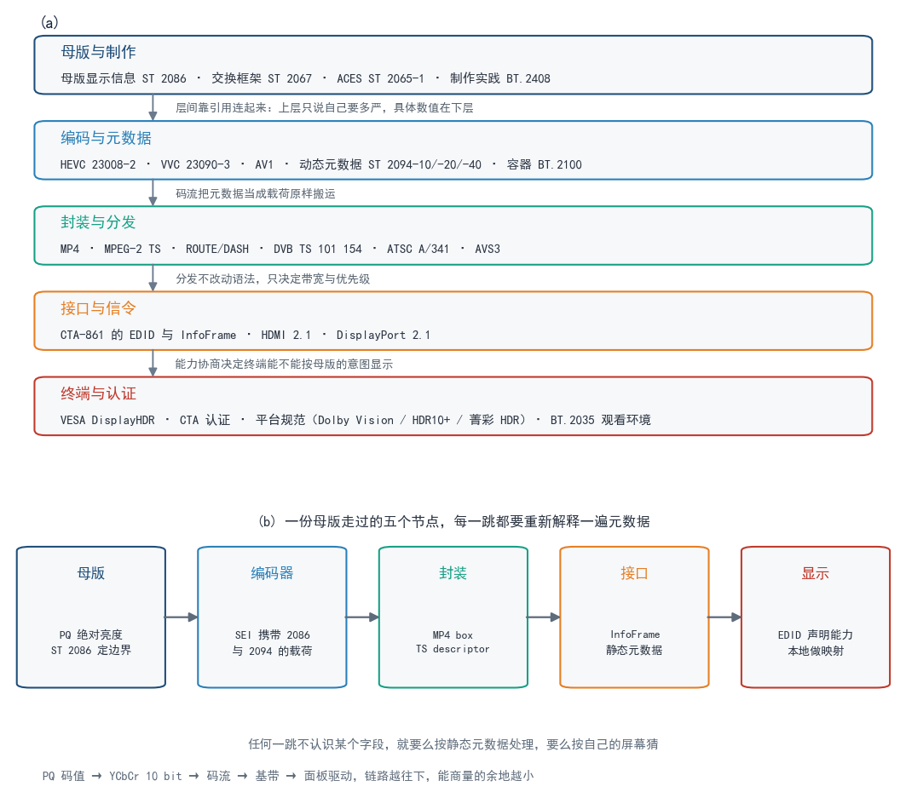
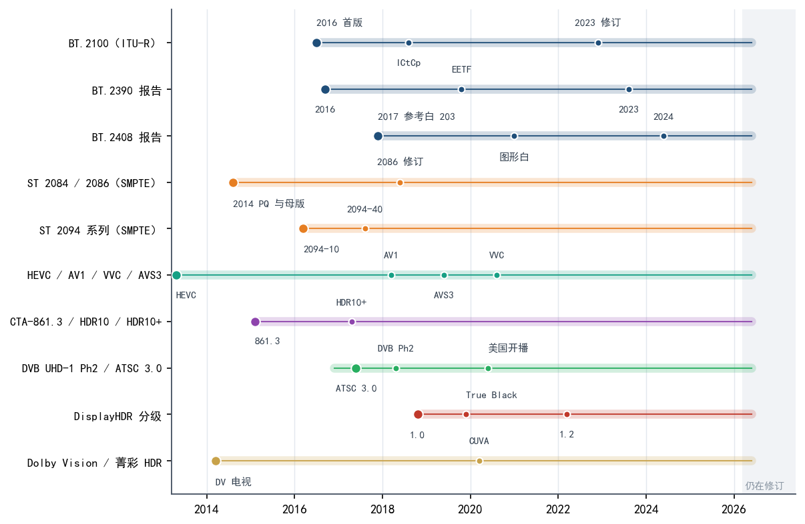
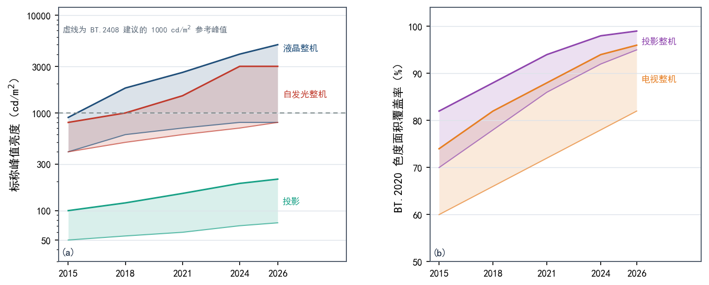
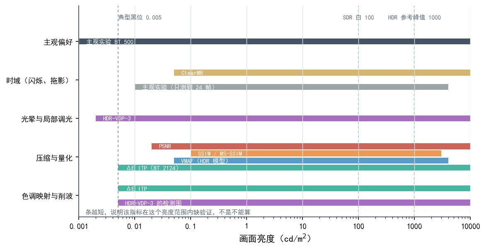

# 第 12 章 标准化现状与前沿问题

一段 HDR 节目要能被别人看见，得同时满足五六个组织写下的几百页文件。这些文件互相引用，版本各自滚动，同一个词在不同文件里指的不是同一件事。公式早就写完了，真正决定成败的是标准之间的缝隙，谁定什么、谁引用谁、哪些条款是真的约束、哪些只是建议。把这些规范编号放回它们各自的机构与层级，看清这张地图，才能判断显示端与内容端这几年实际走到了哪一步，评价与人因上还缺什么，以及几条至今没有答案的问题卡在哪里。

## 一、一张标准地图

先摆一个容易忽略的事实，HDR 这件事没有一个统管全局的标准。它由五类文件拼起来，每类文件解决一类问题，彼此之间靠引用连接，而不是靠一个母标准派生。

第一类是**系统参数**。ITU-R 的 BT.2100 定的是"一段 HDR 电视信号应该长什么样"，包括两条传递函数（PQ 与 HLG）、色域容器（BT.2020）、位深（10 位与 12 位）、信号范围（窄范围与全范围）、以及支持的帧率与分辨率组合。它回答的是参数问题，不回答码流问题。BT.2100 是建议书（Recommendation），对成员国没有强制力，它的效力来自被写进国家法规、频谱协调文件或者运营商的采购合同。这也是为什么同一份 BT.2100，在欧洲和中国被引用的条款重点不一样。

第二类是**语法与解码一致性**。ISO/IEC 的 MPEG 系列管码流怎么组织，HEVC 是 ISO/IEC 23008-2，VVC 是 23090-3。这一类文件的特点是有比特精确的参考软件和一套一致性码流（conformance bitstream），解码器只要跑通这些码流，就能和别人的编码器互通。互操作真正落地靠的是这套东西，不是靠建议书里的文字描述。

第三类是**制作端与电影**。SMPTE 的文件最贴近现场，ST 2084 定义一个像素码值对应多少绝对亮度，ST 2086 定义一整幅画面的亮度与色域边界，ST 2094 定义逐帧的映射指令，ST 2065-1 与 ST 2067 定义交换格式与母版打包。这一类文件被电影工业的合同直接引用，所以修订一次要走很长的流程，改得少而慢。

第四类是**接口与终端能力声明**。CTA 的 CTA-861 系列把"这台设备能显示什么"压缩成 EDID 里的几十个字节，把"这一帧该按什么解释"压缩成 InfoFrame 里的若干字段。VESA 管显示器性能分级，用可测量的门槛把"HDR 显示器"分成几档。这一类文件不定义信号本身，只定义协商。

第五类是**广播系统**。DVB 的 TS 101 154、ATSC 的 A/300 与 A/341、日本的 ARIB STD-B32 与 B44，各自把上面几层装进一套完整的播出系统，包括信令、业务信息、终端要求。中国的 AVS3 属于同一层，编码与系统一起定义，8K 广播频道已经在用。

### 同一件事为什么写在三份文件里

以"峰值亮度"为例。ST 2086 里的 `max_display_mastering_luminance` 是母版容器的上限，意思是"这份母版在调色时最亮到过多少"，它描述的是内容，不是设备。CTA-861 的 EDID 里有一组字段描述终端希望的峰值与帧平均亮度，描述的是设备能力，而且这个数是厂商填的，不是实测的。VESA 的 DisplayHDR 认证里，峰值是中央 10% 窗口在稳定状态下测出来的读数，描述的是抽检样机的表现。三个数都叫峰值，一个是内容的上限，一个是设备的声明，一个是实验室的读数。采购合同里写"峰值不低于 1000 nit"，如果不指明按哪一份文件测，甲乙双方永远谈不拢。

再以"色域"为例。BT.2020 规定三个基色的色度坐标，精确到小数点后三位。ST 2086 把这组坐标用 16 位整数重新写了一遍，带一个隐含的小数位，填错了就是千分之一的偏差。CTA-861 的 Colorimetry Data Block 用几位枚举值指代"BT.2020 的三基色"，不写坐标。到了 HDMI 的 InfoFrame，又变成另外几个比特。任何一处把枚举值填错，下游就按 BT.709 解释，画面不是过饱和就是发灰，而链路上没有任何一处会报错。

这就是"同一件事出现在三份文件里"的原因，不是重复劳动，而是每一层只回答自己那一层的问题。内容层要说清母版的边界，接口层要说清能力，认证层要给一个能复现的读数。麻烦在于三层的用词一样、量纲一样，读文件的人很容易把其中一个当成另一个。

图 12-1(a) 按信号经过的顺序把五层摞在一起，每层只写这一层真正定下来的内容。最上面的母版层定的是"内容能有多亮、多广"，ST 2086 与 IMF 都在这一层。第二层编码与元数据层定的是"这些信息怎么塞进码流"，HEVC 的 SEI、VVC 的 prefix SEI、AV1 的 metadata OBU 都是容器，装的是上面那层的字段。第三层封装与分发层不改语法，只决定带宽、优先级和寻址，DVB 与 ATSC 的差别主要落在这一层。第四层接口层决定"接上的那一刻双方怎么报能力"，EDID 与 InfoFrame 都在这里。第五层终端与认证层把前面所有约束落到一台具体的机器上，用可测的门槛验收。层与层之间的箭头不是数据流，而是引用关系，上层说"要多严"，具体数值在下层。

图 12-1(b) 换了一个角度看同一条链。母版上的 PQ 码值带着 ST 2086 的边界进入编码器，编码器把静态元数据写成 SEI，动态元数据写成 ST 2094 的载荷，封装器把它们放进 MP4 的 box 或者 TS 的描述符，接口把静态部分抄进 InfoFrame，显示器读 EDID 声明自己的能力，再按本地策略做映射。五个节点里有四个要重新解释一遍元数据，任何一跳不认识某个字段，就退回静态元数据，或者干脆按自己屏幕的参数猜。后面第七节讲互操作性时，问题几乎都出在这四个"重新解释"上。

| 组织 | 管什么 | 关键文件 | 被谁引用 |
|---|---|---|---|
| ITU-R | 系统参数、观看环境、主观方法 | BT.2100、BT.2020、BT.2124、BT.2035、BT.500 | 各国法规、DVB、ATSC、终端认证 |
| ISO/IEC | 码流语法、解码一致性、文件格式 | 23008-2（HEVC）、23090-3（VVC）、23008-12（HEIF） | 广播系统、流媒体平台、芯片 |
| SMPTE | 母版、元数据、交换格式、IP 传输 | ST 2084、ST 2086、ST 2094、ST 2065-1、ST 2067、ST 2110 | 制作工具、影院、流媒体母版 |
| CTA | 接口能力声明、HDR 静态元数据块 | CTA-861 系列（861.3 为 HDR 扩展） | 电视、播放器、功放、采集卡 |
| VESA | 显示器性能分级与测试方法 | DisplayHDR CTS、ClearMR | 显示器厂商、评测机构 |
| DVB / ATSC / ARIB | 广播系统整体 | TS 101 154、A/300 与 A/341、STD-B32 与 B44 | 电视台、机顶盒、发射机 |
| AVS | 编码与系统（中国） | AVS3 基准档与 8K 档 | 超高清频道、IPTV、部分终端 |

这张表最该看的不是文件编号，而是"被谁引用"那一列。ITU-R 的建议书被法规引用之后才有强制力，SMPTE 的标准被合同引用之后才有约束，CTA 的字段被芯片实现之后才真正生效。一份文件写了什么，和它在产业链上能约束谁，是两件事。

### 地图上没画的两条线

上面五层之外，还有两条线在实际起作用，但很少被画进标准地图。

一条是**产业联盟的认证**。UHD 联盟在 2016 年推出的 ULTRA HD PREMIUM 标识，把内容、终端、分发三个环节放在同一张合格清单上，要求同时满足分辨率、色域、传递函数、峰值与黑位、编码几方面的门槛。它的作用不是制定信号，而是给消费者一个可以看懂的符号。问题在于这种一揽子认证的门槛一定取交集，它必然比单项标准更保守，而且更新慢，一份 2016 年定的峰值门槛，到 2026 年已经低于中端机型的能力。

另一条是**平台的交付规范**。流媒体平台对自制内容的要求，往往比公开标准更细更严，比如参考白必须按 203 调、字幕亮度不得超出某个范围、动态元数据必须逐镜头复核、交付时同时给 HDR 与 SDR 两条链。这些文件不公开，只在乙方之间流传，实际效果却比标准强，因为不按它做就收不到钱。制作端感受到的"标准"，很多时候是这些平台文档，而不是 ITU 的建议书。两条线的存在说明一件事，标准解决的是能不能互通，认证与合同解决的是做得好不好，前者靠共识，后者靠钱。

## 二、版本演进：谁在改，改了什么

标准不是一次写完的，是一层层打补丁。补丁的位置很能说明问题，哪里补得多，哪里当初就没想清楚。

BT.2100 的第一版在 2016 年 7 月，把 PQ 与 HLG 并列写进同一份建议书，这是 HDR 电视第一次有了国际统一的参数表。2018 年的修订把 ICtCp 写进规范，这个色差编码把亮度与两个色差分得更开，在 HDR 的高饱和区做色度子采样时失真更小，代价是整套色度处理要重写。2017 年的那一版主要是把信号范围与位深的表述理顺。此后的修订主要是把 4K 与 8K、最高 120 帧的组合、10 位与 12 位、窄范围与全范围的对应关系整理成完整的表，并把测量与观看环境的引用补齐。这些修订没有改变 PQ 或 HLG 的公式，改变的是"在什么条件下用哪一档参数"。

BT.2390 与 BT.2408 经常被混为一谈，两者都是报告（Report），都不是标准，也都没有强制力。区别在内容。BT.2390 讲的是**怎么实现**，色调映射的参考曲线（EETF）怎么构造、PQ 与 HLG 之间怎么转、元数据在链路里怎么用，它是给工程师看的说明书。BT.2408 讲的是**用什么值**，参考白定在 203 cd/m²、图形白与字幕的亮度、常见峰值档位、不同亮度下的制作建议，它是给制作现场看的工作手册。一份回答"曲线长什么样"，一份回答"这个白该给多少"。两份文件都被大量招标文件与平台交付规范直接抄成条款，抄的时候往往不写"参考"两个字，于是建议变成了要求。

SMPTE 的三份文件是一条依赖链。ST 2084 定义单个像素的码值与绝对亮度的关系，没有它，"1000 nit"这个数在文件里没有意义。ST 2086 定义一整幅画面的边界，包括三基色坐标、白点、最大与最小亮度，它把"这份母版是按什么条件调的"写进文件头。ST 2094 是 ST 2086 的动态版本，逐帧给出映射曲线或者拐点，让显示端不必靠自己猜。三者的顺序不能颠倒，2094 的载荷里引用了 2086 的字段，2086 的数值只有配合 2084 的曲线才有物理含义。

ST 2094 有一个结构上的问题，它是分部分（part）发布的，2094-10 属于一家公司，2094-20、2094-30、2094-40 各属于另一家，每个部分定义自己的载荷语法，彼此不通用。这意味着"支持 ST 2094"这句话没有意义，必须说清支持哪一部分。生态上真正被用起来的只有两支，一支是杜比视界用的 2094-10，一支是 HDR10+ 用的 2094-40。同一份动态元数据的思路，被拆成两个互不兼容的实现，这是后面互操作问题的根源之一。

VESA 的 DisplayHDR 走的是另一条路，它不定义信号，只定义分级。2018 年的第一版把显示器分成 400、600、1000 三档，每一档对峰值、持续亮度、黑位、色域、局部调光都有门槛，测试用中央 10% 窗口，要记录稳定后的读数。此后补了 500 与 1400，又为自发光面板单独开了 True Black 系列，因为 OLED 的黑位极低、全屏亮度上不去，用同一套门槛会把它们判成不合格。1.1 版补了局部调光的测试细节，1.2 版提高了色域与对比度的要求。分级的好处是让"HDR 显示器"有了可比较的含义，坏处是把峰值变成一个营销数字，而分区数、光晕、ABL 曲线这些更影响观感的量，一直没进分级。

图 12-2 把十组文件放在同一条时间轴上，能看出三种不同的节奏。ITU-R 的三份文件修订最频繁，BT.2100 从 2016 年到 2023 年至少有四个版本，BT.2408 几乎每两年加一章，因为它们是报告性质，改起来不需要产业共识。SMPTE 的标准修订最慢，ST 2084 从 2014 年至今没有实质变化，ST 2086 只在 2018 年动过一次，因为改一次要牵动所有母版与工具。编码标准的节奏介于两者之间，HEVC 2013 年定稿，AV1 2018 年，AVS3 2019 年，VVC 2020 年，大致五年一代。应用层的节奏最不整齐，DVB 的 UHD-1 第二阶段 2018 年才定稿，美国的 ATSC 3.0 到 2020 年前后才规模商用，DisplayHDR 从 1.0 到 1.2 用了四年。这张图上没有任何一条线在 2026 年终止，说明这些文件都还在改，读标准时要看清手里是哪一版。

| 文件 | 首版 | 主要修订 | 修订重点 |
|---|---|---|---|
| BT.2100 | 2016 | 2017、2018、2023 | ICtCp、8K 与 120 帧、信号范围表述 |
| BT.2390 | 2016 | 多次 | EETF、PQ 与 HLG 互转、元数据用法 |
| BT.2408 | 2017 | 多次 | 参考白、图形白、峰值档位、监视器行为 |
| ST 2084 | 2014 | 基本未变 | PQ 的 EOTF 与逆 EOTF |
| ST 2086 | 2014 | 2018 | 母版显示元数据的字段与取值范围 |
| ST 2094 | 2016 | 分部分陆续发布 | -10、-20、-30、-40 四套载荷 |
| CTA-861.3 | 2015 | 随 861 系列滚动 | HDR 静态元数据块 |
| DisplayHDR CTS | 2018 | 1.1、1.2 | 局部调光测试、色域与对比度门槛 |

表里最容易被忽略的是 BT.2390 与 BT.2408 的"多次"。这两份报告没有版本号文化，同一编号下内容逐年变化，引用时必须写清出版年月，只写"BT.2408"等于什么都没写。工程上遇到过这样的事，两台监视器按两份不同年份的 BT.2408 校准，参考白差了十几尼特，谁都不认为自己错。

### 怎么读一个标准编号

编号本身携带着版本信息，读错了会引用到不存在的条款。ITU-R 的编号横线后是版次，从 0 开始，BT.2100-0 是首版，BT.2100-2 是第三次发布，引用时应该写成"BT.2100-2（2018）"，只写 BT.2100 等于没写版本。SMPTE 用冒号加年份，ST 2086:2014 与 ST 2086:2018 是两个不同的文本，后者可能增删了字段。ISO/IEC 也用冒号年份，但另有修正案与补篇，写成 23008-2:2020/Amd.1 才精确。CTA 用字母后缀，CTA-861-H 是第八代。DVB 用三段式，TS 101 154 V2.4.1，主版本与次版本分开。VESA 把版本号写在文档名里，DisplayHDR CTS 1.2。

这些细节看起来是文书工作，实际影响很大。一份 2021 年写的验收规范如果只写"符合 BT.2408"，到 2025 年执行时，乙方拿最新版对照，甲方拿签合同时的版本对照，条款已经变了两轮。工程上稳妥的做法是在合同附件里把每份文件的完整编号、年份、版次列一遍，并在变更时走变更流程，而不是笼统地写"按最新版执行"——后者听起来省事，实际是把风险留给验收环节。

### 一致性测试是怎么运作的

标准文本写完之后，还有一步决定它能不能落地，就是一致性测试。以 HEVC 为例，MPEG 维护一套参考软件和一组一致性码流，每组码流对应规范里的一个角落，解码器逐组跑通，输出与参考解码器逐比特比对，全部通过才算合格。芯片厂商拿这套东西做内部验收，认证实验室用它出报告，采购方看报告决定要不要。这一整套机制比标准文本重要，因为文本可以有歧义，码流不会。

HDR 在这一步上出现了断层。视频语法的一致性测试很成熟，元数据的一致性测试几乎没有。一段带 ST 2086 静态元数据的 HEVC 码流，解码器把它解出来交给显示端，这一步没有官方的比对基准；一段带 ST 2094-40 动态元数据的码流，各家的解析实现更是各行其是。结果是"支持 HDR10+"这句话只能靠厂商互测来验证，而互测的组合数随设备数量平方增长，实际覆盖的永远是少数。第七节讲互操作性时，根子就在这里。

## 三、显示端：三条曲线各自的瓶颈

显示端的进展可以拆成三条独立的曲线，峰值亮度、色域覆盖、亮度控制能力。三条曲线这三年的斜率不一样，瓶颈也不在同一个地方。把三条混在一起谈，就会出现"这台机器亮度高所以 HDR 好"这类判断，而实测往往不支持。

图 12-3(a) 的纵轴是对数，从 50 到 10000 只隔几个刻度，这样才看得出量级差。2015 年前后，液晶整机的标称峰值集中在 400 到 900 nit，自发光在 400 到 800，两者几乎没有区别。到 2026 年，液晶的上沿推到 5000 nit 附近，自发光到 3000 nit 上下，投影仍然停在 200 nit 上下，因为投影的亮度被光源功率、光路效率与幕布增益三重限制，激光光源把上沿从 100 nit 抬到 200 nit 已经是很大的进步。虚线是 BT.2408 建议的 1000 cd/m² 参考峰值，它在 2018 年前后落到了区间的中部，现在落在区间的下部，这说明 1000 nit 这个锚点已经从"高端指标"变成了"中端配置"。

图 12-3(b) 换了一个维度，画的是 BT.2020 色度面积的覆盖率。电视整机从 60% 出头走到 90% 附近，投影从 70% 走到 95% 以上。投影反而更高，原因是三色激光的谱线窄，能直接把三个基色打到 BT.2020 的坐标附近；液晶要靠量子点或者荧光粉转色，红绿两点的纯度受材料限制，蓝色又常常直接用 LED，谱线偏宽。这张图有一个陷阱，覆盖率的口径并不统一。按 CIE 1931 xy 的三角形面积算，BT.2020 是 BT.709 的 1.89 倍；按 CIE 1976 u'v' 算，只有 1.72 倍；DCI-P3 相对 BT.709 则是 1.36 倍（xy）。同一台机器在不同口径下报出的覆盖率可以差好几个百分点，"覆盖 90% BT.2020"这句话，不写口径等于没说。

### 峰值与它的代价

峰值亮度上去了，代价落在别处。液晶的峰值靠分区背光加量子点膜，小窗口能推得很高，全屏白就掉下来，因为背光的总功率和散热是硬约束，一台 65 英寸整机 200 W 上下的功耗，全屏 1000 nit 就要把大部分功率给背光。自发光面板的小窗口峰值靠微透镜或者串联结构，全屏白同样掉得厉害，而且总功率一高，面板温度上升，固件主动降额。投影没有这个问题，它的峰值是全屏恒定的，代价是绝对亮度低一个数量级。

所以"峰值 4000 nit"这类标称，读的时候要问三件事，多大的窗口、持续多久、全屏白是多少。三件事都不写，这个数只能用来比较同一家厂商的两台机器，不能跨厂商比较。这也是后面讲测量标准时绕不开的老问题。

### 控制能力没有指标

三条曲线里最容易被忽略的是第三条，亮度控制能力，也就是分区背光的分区数、算法响应、光晕宽度这一组东西。它决定的不只是黑位，还有高光旁边的暗部能不能干净、运动时高光会不会拖尾、场景切换时亮度会不会跳。

这一组量至今没有进入任何分级。VESA 的测试里有局部调光的项目，但它测的是"有没有"与"基本行为对不对"，不给出质量评分。分区数可以写在规格表里，可是分区数多不等于光晕小，光晕的幅度由相邻分区的背光亮度除以液晶对比度决定，与分区数无关，分区数只决定光晕的宽度。同样是一千个分区，算法保守的机器光晕淡而宽，算法激进的机器光晕亮而窄，观感完全不同，规格表上都是"1000 分区"。

这让选购变成一件凭经验的事。看演示片时，暗场里的字幕、星空、烛光是最能暴露问题的三样东西，字幕周围有没有一圈灰雾，星星是不是被一圈光晕糊掉，烛光的火苗边缘干不干净。这三样都过关，说明分区算法做得细；只看得懂峰值数字的人，往往会买到一台峰值很高但暗场发灰的机器。

### 8K 与 HDR 的关系

8K 与 HDR 是两件正交的事，一个提高空间分辨率，一个提高亮度与色域的动态范围。工程上它们又互相牵制。像素数翻四倍，同样的背光功率摊到四倍的面积上，开口率还因为像素变小、走线变密而下降，8K 液晶的全屏亮度通常低于同尺寸的 4K 机型。码率预算也是竞争关系，一路 8K HDR 的 HEVC 编码要 80 到 100 Mbit/s，广播的一个转发器装不下几路，流媒体则要为 8K 单独准备一档码率阶梯。

传输接口是最硬的一道门。8K 60 帧 10 位 4:2:0 需要约 30 Gbit/s，8K 120 帧的码率已经超过 HDMI 2.1 的 48 Gbit/s 上限，必须靠显示流压缩（DSC）才过得去，这时色度只能留在 4:2:0，动态元数据也只能走静态。广播侧的 8K 用的是 HLG，因为 HLG 不需要母版信息就能显示，机顶盒的实现简单；流媒体的 8K 多是 PQ 加静态元数据，动态元数据在 8K 档位上常常被关掉，省下的带宽给分辨率。这个取舍说明一件事，带宽不够时，行业优先保分辨率，亮度排在第二，逐帧的映射精度排在最末。

### 三条新路线的门槛

液晶的对比度天花板来自漏光，自发光的天花板来自寿命与功率，两条路线都摸到了自己的墙。过去几年被反复提到的三条新路线，各自的卡点非常具体。

**双层液晶**在背光与主液晶之间再加一层黑白液晶，做像素级的光阀。两层串联之后，对比度不再由单层的漏光决定，而是两层漏光的乘积，实测可以做到几十万比一，光晕几乎消失，因为它不再依赖分区的尺寸。卡点有三个。透过率，两层偏振片加两层液晶，可见光透过率从单层的 6% 量级掉到 3% 量级，同样的背光功率只能得到一半亮度，要维持峰值就得把背光功率翻倍，散热与功耗跟着上去。厚度与重量，多一层玻璃加一层液晶，整机厚度增加，大尺寸下的形变与装配公差变难控制。视角，两层的视角特性叠加，斜看时的对比度下降比单层更快。

**MicroLED** 把 LED 做到像素尺寸，每个像素自己发光，理论上同时具备自发光的黑位与液晶的峰值。卡点在上游。巨量转移的良率决定了成本，一块 4K 面板要转移两千多万颗芯片，任何一颗失效都要修补，修补的代价随尺寸上升。红光效率是另一个硬约束，铝镓铟磷材料在芯片尺寸缩到十几微米时，侧壁复合占比急剧上升，效率掉到薄膜形态的几分之一，业界转向磷化铝镓铟或者量子点转色，两条路都还在爬坡。驱动一致性也不好做，几千万个像素的电流特性要匹配到肉眼看不出差异，测试与补偿的成本高于面板本身。

**印刷式 OLED** 用喷墨打印的方式把发光材料铺到基板上，材料利用率高，大尺寸的成本优势明显。卡点有三个。蓝色材料的寿命最短，打印工艺对材料的纯度与配方更敏感，寿命进一步打折。喷墨的均匀性直接决定 mura，一滴墨的体积偏差在低灰阶就会显成斑块，补偿算法要做逐像素的增益表，产线校准时间变长。像素定义层的堤坝（bank）限制了像素能小到什么程度，高 PPI 的小尺寸面板反而不适合印刷，这条路线的主战场是大尺寸电视。

| 路线 | 对比度机制 | 峰值上限的约束 | 最实际的卡点 |
|---|---|---|---|
| 分区背光液晶 | 背光分区乘液晶透过率 | 背光功率与散热 | 光晕宽度、分区响应延迟 |
| 双层液晶 | 两层漏光相乘 | 两层偏振与液晶的透过率 | 厚度、功耗、视角 |
| 自发光 OLED | 像素不发光即黑 | 材料效率与降额策略 | 寿命、烧屏、全屏亮度 |
| MicroLED | 同上 | 芯片效率与驱动电流 | 巨量转移良率、红光效率 |
| 印刷 OLED | 同上 | 材料效率 | 蓝材料寿命、喷墨均匀性 |

这张表里没有"最好"的路线，只有"卡在不同地方"的路线。选购时真正该问的是这台机器打算用几年、看什么内容、房间多亮，而不是路线本身。

## 四、内容端：标准齐了，工序没齐

内容端的问题和显示端相反。显示端的瓶颈在物理，内容端的瓶颈在工序与商业。标准该有的都有了，动态元数据的语法、单母版的打包、SDR 与 HDR 的互转方法，一份不缺，真正难的是每一部片子都要多花一笔钱、多走一道流程。

### 动态元数据为什么不普及

动态元数据的制作成本分三块。第一块是分析，逐镜头甚至逐帧算出映射曲线，一段 90 分钟的片子在普通工作站上要跑几个小时到十几个小时，跑完还要人工复核镜头切换点，因为自动检测在叠化、闪白、快速摇镜时会误判。第二块是工具链，调色软件能生成，质检工具却未必能读，读不出来就没法在交付前确认元数据是否跟着画面走。第三块是双轨维护，同一部片子要出带动态元数据的版本和不带的版本，改一个镜头两边都要重出，版本管理稍微松一点就会对不上。

授权是另一层。杜比视界的动态元数据需要授权与认证，从制作工具到播放器到电视，每一环都要过；HDR10+ 免版税，但生态小，制作工具的支持深度与前者不在一个量级。平台的选择又反过来决定制作端做什么，一家平台只收一种格式，制作端就得为它单独出一条派生链。于是出现一种奇怪的状态，技术上门槛不高，商业上每条路都要交一次过路费。

单层码流（SL-HDR1 这一类）本来是为了解决这个问题，它把 HDR 重建所需的信息放在元数据里，码流本身是 SDR 兼容的，老终端看到的是可用的 SDR 画面，新终端重建出 HDR。技术上这是一个漂亮的折中，实际推广却很有限，原因是它要求整个链路都认识这套元数据，而链路上的转码器、复用器、播放器分属不同厂商，谁也没有动力为一个尚未普及的格式先做适配。

### 制作端多出来的那几道工

标准与工具都已具备，HDR 内容占比仍然不高，最直接的原因在工时。一部片子的 HDR 版本很少能从 SDR 母版自动转出来，多数情况下要重新调一遍。SDR 里被压成一片白的窗户，在 HDR 里要看出窗框与天空的层次；SDR 里看得见的暗部细节，在 HDR 的高对比下可能反而不需要提亮。这两个方向的判断靠的是眼睛与监视器，不能靠曲线。

分级完成之后还有两道。一道是降级模拟，把 HDR 母版分别映射到 1000 nit、600 nit、100 nit 三种能力上，看有没有哪一档把关键信息丢掉，这一步要在同一台监视器上切换，而不是靠想象。另一道是交付前的质检，元数据是否随镜头更新、MaxCLL 与 MaxFALL 是否与画面一致、字幕与图形白是否超过约定值、暗场有没有被编码器抹平，每一项都要单独跑一遍。

| 环节 | SDR 的常规做法 | HDR 多出来的部分 |
|---|---|---|
| 调色 | 一遍 grade | 多数情况重做，高光重新判断 |
| 监看 | 一台参考监视器 | 加一台低亮度模拟，逐档检查 |
| 质检 | 抽帧看画质 | 加元数据校验与亮度统计 |
| 交付 | 一条母版 | 多条派生链，版本要对齐 |

这张表解释了一个现象，同一家公司做 HDR 项目的报价总比 SDR 高，高出来的部分主要不是设备，是工时。工时又直接换算成排期，排期紧的项目就退回 SDR，或者只做重点段落。这是市场选择，不是技术障碍。

### 存量内容怎么办

新拍的片子可以按 HDR 的流程走，片库里几十年的存量内容不能。把它们变成 HDR 有两条路，一条是重新扫底、重新调色，一条是算法逆映射。

重新扫底的前提是原始素材还在，胶片要能找到、状态要好、扫描设备要够。35 毫米负片的密度范围大约能覆盖 10 档左右，换算成亮度跨度是 1000 比 1 量级，做成 HDR 母版时高光能挖出来的层次有限，很多片子做到 1000 nit 的容器里，实际用到的峰值只有几百尼特。老数字母版的问题更多，早期的 2K DI 是 10 位对数或者 8 位视频，动态范围本来就窄，重新调色只是在窄范围里重新分配，挖不出不存在的信息。

算法逆映射便宜得多，一次可以处理整部片库，代价是不可控。它按统计特征猜哪里该亮，遇到雾、烟、逆光、白色字幕就会出错，而且每换一版算法，整批片子的观感都会变。平台的做法通常是折中，重点片重新调，长尾片用算法过一遍再人工抽查，抽查的比例决定了质量的下限。这也是为什么同一部老片在不同平台上观感不一样，它们用的不是同一版重制。

### 云游戏与实时 HDR

云游戏把渲染搬到机房，把"显示端未知"这件事推到了极端。玩家用什么屏幕、什么峰值、什么色域，服务端在开流之前只知道客户端上报的几个数，而那几个数在很多客户端上是默认值。渲染出来的 HDR 帧要经过编码、传输、解码，才能到屏幕上，编码器为了压码率会把 10 位降到 8 位，色度降到 4:2:0，动态元数据要么不发，要么发一个固定的容器参数。

延迟预算进一步压缩了选择空间。一帧的端到端预算在几十毫秒，编码器只能用短 GOP、低延迟配置，码率控制的余量很小，暗场与快速运动的场景最容易出块。HDR 在这种条件下退化成"固定容器"，整条流按一个峰值与一个曲线编码，显示端自己做映射。这不是标准缺失，是预算不够。

### AI 增强的定位

超分辨率、逆色调映射、生成式补帧这三类技术这两年进展很快，在显示端与内容端都能见到。它们的定位必须分清，否则会把不可逆的改动写进母版。

超分把低分辨率素材拉到高分辨率，逆映射把 SDR 素材扩到 HDR，补帧在时间轴上插入生成的帧。三者的共同点是"生成原本不存在的信息"。放在显示端的最后一级，作用是让旧内容在新屏幕上好看一点，用户能接受，因为原片还在。放进制作链，问题就来了，生成的信息无法验证，调色师没法判断某一帧的高光是真的还是算出来的，质量控制的基准被破坏。

更麻烦的是评价。现有指标奖励锐利、奖励对比，超分算法很容易在这些指标上得分很高，同时把胶片颗粒抹平、把暗部噪声清成塑料感。观众说不上哪里不对，只觉得"不像电影"。这一类改动需要一个新的约束，把创作意图表达成机器能读的东西，比如"这一段必须保住高光里的层次，允许压暗中间调"。目前没有这样的标准字段，ST 2094 表达的是映射曲线，不是意图。

一个可操作的界线是把 AI 增强限制在三件事上，只在显示端、只作用于最终输出、必须能一键关闭。三条都满足，它是画质功能；缺一条，它就在改内容。

## 五、评价体系：指标很多，共识很少

评价 HDR 的困难不在工具少，而在每个工具只对一类失真负责，而实际画面里几类失真同时存在。用错指标不会报错，只会给出一个看起来精确、实际上误导的数。

图 12-4 把七种手段放在同一张图上。横轴是对数亮度，两条虚线标出 SDR 白 100 nit 与 HDR 参考峰值 1000 nit，左侧还有一条 0.005 nit 的典型黑位。纵轴按失真类型分成五类。PSNR 与 SSIM 的条都在压缩与量化这一行，PSNR 一直画到 10000 nit，SSIM 收在 3000 nit 附近，因为它的多尺度结构在高光被压进很窄一段码值时就开始失准。VMAF 的 HDR 模型覆盖到 4000 nit，但左端从 0.05 nit 才开始，暗部的近黑层次基本没被验证过。ΔE_ITP 的条最长，从 0.005 到 10000，因为它是逐像素的色差公式，亮度范围不构成限制，代价是它没有空间掩蔽模型，平坦区与纹理区的同样误差得分相同。HDR-VDP-3 同时出现在压缩与光晕两行，它是唯一把光晕当作一等失真的指标，也是唯一需要填显示参数才能用的指标。ClearMR 在时域一行，它测的是运动清晰度，与 HDR 没有直接关系，但因为拖影在 HDR 的高对比下更明显，评测里常被一起引用。最上面一行是主观实验，它是所有客观指标的标定源。

这张图想说明的是"适用域"这个概念。一条横条的端点不是算法的能力边界，而是它被验证过的范围。超出范围仍然能算出数，但那个数与人的感受之间没有证据支持。工程上最常见的错误，是拿 SDR 时代训练出来的模型去评 HDR，然后在报告里写一个保留两位小数的分数。

### 同一种误差，四种读数

指标之间的分歧可以用一个极简的例子说明。假设一条码流在某个亮度附近产生了 10% 的相对亮度误差，也就是 $\Delta L/L = 0.1$，这在编码里很常见。用四种方式去评它，会得到四个互相矛盾的结论。

线性亮度上算 PSNR，误差是 10%，结果是 20 dB，与亮度无关。Weber 分数也是常数，10%，按中间调的阈值 1% 算，处处都"明显可见"。这两把尺子都说"处处一样糟"。

换算到 PQ 域，10% 的相对误差对应的码值差随亮度变化。在 0.01 nit 处，码值差约 0.001，换算成 10 位是 1.07 个码值，PSNR 是 59.6 dB；在 1 nit 处码值差 0.0049，约 5 个码值，PSNR 46.2 dB；在 100 nit 处码值差 0.0096，约 9.8 个码值，PSNR 40.4 dB；到 1000 nit 附近码值差 0.0104，约 10.6 个码值，PSNR 39.7 dB。同一份误差，PQ 域的 PSNR 从 59.6 dB 掉到 39.7 dB，跨了 20 dB，读报告的人会以为暗部几乎无损、亮部严重失真。

再看 $\Delta E_{ITP}$，它的定义是 720 乘以三个分量加权平方和的开方，只考虑亮度分量时简化为 720 乘 $\Delta I$。上面四处的读数分别是 0.75、3.5、6.9、7.5。按 BT.2124 的标定，1 是刚好可察觉，于是结论变成"0.01 nit 处看不出来，1 nit 处明显可见，100 nit 以上非常严重"。

四个结论里，只有"处处一样"这一类与 Weber 定律相符，因为人眼在中间调判断亮度差靠的就是相对量。$\Delta E_{ITP}$ 的标定其实是对码值台阶做的，1 个单位对应一个刚好可察觉的码值差，它衡量的不是"相对亮度差有多明显"，而是"这个差在 PQ 的刻度上占几格"。这两件事在暗部差得很远，因为 PQ 曲线在近黑段的斜率极大，同样的相对误差只占很小的码值跨度。

这个例子不是要否定 $\Delta E_{ITP}$，它在评估编码与链路的色差时非常有用，比 PSNR 贴近感知得多。它要说的是，任何单一指标都有它隐含的假设，报告里不写清楚假设，数字就会被误读。

### 为什么至今没有一个被普遍接受的指标

原因有五个，每一个都很具体。

**参考不存在。** 全参考指标需要一个"正确"的版本做比较。在编码环节，参考是母版，这个没问题。到了显示端，正确输出本身取决于设备的峰值、黑位、环境光，同一份母版在 1000 nit 与 4000 nit 的屏幕上都"正确"，但两幅画面差得很远。没有参考，全参考指标就用不了，只能退到无参考指标，而无参考指标在 HDR 上几乎没有可靠的标定。

**主观实验太贵且不统一。** 一次像样的 HDR 主观实验要几十位观察者、一台可校准的参考监视器、可控的环境光，成本在几万到几十万。不同实验室的设备、观察者群体、评分尺度都不一样，跨实验室的数据很难合并。BT.500 规定了方法，但没规定"必须报告哪些条件"，于是同一段素材在两篇论文里的分数可以差一档。

**指标一旦成为 KPI 就会被优化。** VMAF 在流媒体里被当作码率决策的目标函数，编码器厂商专门调参去提高 VMAF，代价常常是细节被抹平。这在 SDR 时代已经发生过，HDR 只是把问题放大，因为 HDR 的暗部与高光各有一套失真模式，指标在这两端的权重决定了编码器往哪边偏。

**绝对亮度与相对指标之间的矛盾。** HDR 的核心是绝对亮度，同一段画面在 100 nit 与 1000 nit 上观看，感知不同，但大多数指标对整体亮度缩放不敏感（SSIM 的亮度项会归一化，PSNR 在相对误差下也是常数）。要评价"这个亮度对不对"，需要的是偏好实验，不是保真度指标。

**创作意图进不了指标。** 一段夜景本该很暗，算法把它提亮，PSNR 与 SSIM 都会判为失真，但观众可能更喜欢提亮后的版本。反过来，算法把高光压平，指标可能毫无反应，观众却觉得"没有 HDR 的感觉"。指标体系里没有位置放"意图"，这是它与创作之间始终存在的缝。

### 指标在交付流程里只能当筛子

实际交付时，指标的作用不是"判好坏"，而是"找出该看哪几帧"。一部九十分钟的片子有十三万帧，人不可能逐帧看，先用指标跑一遍，把分数最差的几百帧挑出来，人工重点看这几百帧，剩下的抽检。这个用法里，指标的绝对值不重要，排序能力才重要。

排序也有前提。不同内容的分数不能直接比，纹理密集的森林与平坦的天空，同样的编码参数下分数差很多，前者天然占便宜。所以实际做法是按镜头分段，在段内排序，而不是全片一个排行榜。$\Delta E_{ITP}$ 的热图比标量分数好用，它能直接指出"哪一块、哪个亮度、差多少"，配上波形图就能定位到具体环节。

阈值的设定没有通用值。平台给的参考线通常是"95 分位不超过某个数"，而不是"每一帧都不超过"，因为后者在现有码率下做不到，强求只能把码率抬到不经济的位置。这也是指标与创作之间的另一道缝，标准能规定"不许超过"，但规定不了"超过多少观众会看出来"。

## 六、人因：建议值从哪里来

HDR 的技术指标都能测，观看舒适度却只能靠实验。几个被广泛引用的建议值值得逐个追问，依据是什么，以及这些依据在 HDR 条件下还成不成立。

**峰值亮度的建议值。** 行业把 1000 cd/m² 当作第一个参考峰值，依据有三条。制作端在 1000 nit 的监视器上能稳定地判断高光层次，超过这个亮度，监视器的成本与环境控制都变得难以承受；主观实验里，偏好分数从 100 nit 提到 1000 nit 上升明显，从 1000 提到 4000 的增益小得多；长时间观看的舒适上限低于短时演示的峰值，卖场里能接受的亮度放到客厅里偏高。三条合起来，1000 成了一个折中而不是极限。这个数在 BT.2408 里被反复引用，久而久之被当成"标准要求"，其实它是经验值。

**环境光的建议值。** 参考观看环境把环境照度压到几个勒克斯的量级，背景亮度不超过 5 cd/m²，屏幕周边不能有强光源。这样做的目的是让屏幕的黑位不被反射光淹没，让调色师看到的高光层次与暗部细节都是画面本身的。家庭环境与这个条件差一到两个数量级，客厅晚上开灯就有 50 lux 以上，白天靠窗可以到 300 lux。环境光自适应功能（各家叫法不同，原理都是读传感器调白点与伽马）是在这个落差上做的折中，它让画面在亮室里不发灰，代价是 HDR 的一部分信息被牺牲掉。

**观看距离。** 分辨率决定观看距离的下限，4K 建议在 3 倍屏高处，8K 压到 1.5 倍，这是按人眼的分辨极限算出来的。HDR 让这个换算多了一个变量，因为视距决定了画面在视网膜上占多大面积，而亮度感受与面积有关。同样 1000 nit 的高光，在 65 英寸屏的 3H 距离上是一个小点，在手机屏上占满视野，后者更刺眼。这也是为什么手机厂商把峰值推到 2000 nit 以上却不觉得过分，它的高光面积小、持续时间短；同样的策略搬到电视上，一屋子人都会觉得晃眼。现行的观看距离建议是按分辨率写的，没有把峰值与面积放进去，这在实际调校时经常要临时修正。

**内容类型与时段。** 上面几条建议值都是对"一般内容"说的，实际偏好随内容变。体育与风光愿意更亮，因为观众要看草地、雪地、水面的细节；剧情片与恐怖片更愿意暗，亮起来反而破坏气氛。同一个观众，白天看新闻与深夜看片，能接受的亮度也不一样。现有的建议值没有分层，制作端只能按最保守的那一档做，结果是一部分内容在暗室里看偏灰。要做出分层，需要按内容类型、观看时段、观众年龄各做一组实验，工作量是现有数据的几十倍。

**闪烁的限制。** 发光时间的调制带来闪烁，闪烁的可见度取决于频率与调制度。IEEE 1789 给出了一条按频率限制调制度的建议曲线，低频段要求调制度极低，高频段可以放宽。HDR 让这件事变难，因为峰值亮度越高，维持直流调光所需的电流与散热越难做，很多机型在中低亮度切换到脉宽调制，而中低亮度正是关灯看片的场景。现行建议曲线是按 SDR 显示屏的亮度范围定的，HDR 的高峰值是否改变可见阈值，目前缺少系统研究。

**光敏性风险的限值。** 针对光敏性发作的闪烁限制写在广播规范里，ITU-R BT.1702 与各国的播出指南都给出每秒闪烁次数与闪烁面积的组合上限，核心是限制"红色饱和闪"这类最危险的模式。HDR 提高了亮度对比，同样的闪烁模式在 HDR 下的调制深度更大，而现行限值是按 SDR 的亮度范围写的，没有区分 HDR 与 SDR。这是一个明确的缺口，不是理论问题，综艺与演唱会的灯光段落最容易触及。

**蓝光与夜间观看。** 现有的证据大多来自 SDR 显示屏，结论是夜间高亮度、高色温的屏幕会抑制褪黑素、推迟入睡。HDR 的白点仍然是 D65，色温没有变，变的是绝对亮度，视网膜照度随画面峰值上升。按现有的剂量反应关系推，HDR 的高光段落对褪黑素的影响应该更大，但这个推断没有直接的实验支持。厂商提供的"护眼模式"通常是整体降蓝、降亮度，与 HDR 的意图直接冲突，两者目前没有好的共存方案。

**建议值的共同弱点。** 上面几条建议值，来源都是"在某个特定条件下的一组实验"，条件包括屏幕尺寸、观看距离、环境光、内容类型、观看时长。HDR 把这些条件全部打散了，同一段内容在手机、电视、投影上的最佳亮度差好几倍。现行的建议值是一维的，只给一个数，而实际需要的是三维的曲面，峰值、环境光、时长。这张曲面至今没有人测出来，因为实验量太大。

## 七、尚未解决的问题

这里只讲没有解决的问题，每一条都写清缺什么、卡在哪。

### 观察者差异

所有模型都建立在平均观察者上，Barten 的 CSF、CIE 的标准观察者、$\Delta E_{ITP}$ 的阈值，描述的都是一个统计意义上的人。真实的个体差异很大，年龄、瞳孔大小、晶状体黄化、视网膜的密度，让同一个人群里的对比敏感度可以差两到三倍。六十岁的观察者对高频细节的敏感度只有二十岁的一半左右，对蓝色的透过率也低得多。

缺的是一份按年龄、按亮度、按色域分层的敏感度分布数据，以及把个体差异纳入指标的机制。现有做法是在制作端多留余量，代价是所有人都看同一份保守的画面。卡在两件事上，一是实验规模，要得到可信的分布，样本量要上千人，每人要在多种亮度条件下测，成本极高；二是设备，能在 0.001 到 4000 nit 范围内稳定呈现刺激的显示设备本身就不多。

### 端到端一致性

同一份母版在两台都号称支持 HDR10 的电视上，观感可以差很多。原因不是标准不齐，而是标准只规定了"怎么解释信号"，没有规定"必须显示成什么样"。显示器有自由裁量权，色调映射曲线、ABL 策略、色彩增强、锐化，都是厂商的调校空间。

缺的是一台"可获得的参考显示"。调色棚里有参考监视器，家庭里没有，消费电视的"电影模式"或"导演模式"是想填补这个空位，但实测偏差仍然可观，而且不同品牌之间不一致。卡在商业逻辑上，画质调校是卖点，厂商不愿意把一台机器做成"和别人的机器一样"。也卡在成本上，要把参考模式的偏差压到 1 个 $\Delta E_{ITP}$ 以内，需要逐台校准，产线时间与成本都要增加。

### 色彩体积

亮度与色度不是独立的，同一个像素不可能同时是最亮和最饱和。红色在低亮度下能到 BT.2020 的边界，亮度推到一千尼特，饱和度就必须往回收，因为面板的红色子像素在高峰值下会往橙偏。这个"能同时达到的亮度与色度范围"叫色彩体积，它比单独的峰值或色域更能描述一台机器的 HDR 能力。

问题是它没有标准。有人用几个亮度切片上的色域面积之和，有人用三维体积的积分，有人只报"在 1000 nit 下能覆盖多少 BT.2020"，三种算法的结果差得很远，而且互相不可换算。测量也麻烦，要在亮度与饱和度两个维度上扫描，每个组合都要等稳定，一台机器的完整测量要几个小时。目前 CTA 与 VESA 的认证都不测这一项，厂商在宣传里用"色彩体积"这个词时，指的是自己那套算法。

缺的是一个公认的定义、一套可复现的测量规程，以及它与主观感受的对应关系。卡在测量成本与商业动机上，成本高意味着只有高端机型愿意做，而定义一旦统一，中低端机型的数字会很难看。

### 测量标准的统一

同一个参数，不同的测法给出不同的数。峰值亮度取决于窗口面积、稳态时间、预热时间；黑位取决于环境光与测量距离；色域覆盖率取决于用 xy 还是 u'v'、按面积还是按覆盖；对比度取决于全白全黑还是棋盘格。这些差异在 SDR 时代就存在，HDR 把差距放大了，因为 HDR 的峰值对窗口面积极其敏感，ABL 曲线让"稳态"这个词变得含糊。

缺的是一份跨组织的统一测量规程，把测试图案、窗口、时间、环境、报告格式固定下来。卡在各家已经投入的既有规范上，VESA 有自己的一套，广播机构有自己的一套，厂商的内部标准又是另一套，谁都不愿意放弃自己那套的既有数据。这一条短期内看不到收敛的迹象。

### 互操作性测试

元数据在链路上被丢弃、被改写、被误解释，是实际部署中最常见的问题。转码器不认 ST 2094 的某个 part，就把动态元数据整段删掉；功放读到母版峰值超出自己的能力，就把它改成一个保守值；显示器的 EDID 报了一个峰值，固件却按另一个值做映射。这些都不报错，表现只是画面不对。

缺的是一套公开的、覆盖常见设备组合的一致性测试素材与流程，让人能在实验室里复现"这段内容经过这台功放、这台电视之后会变成什么样"。卡在两处，一是素材的版权，测试素材要覆盖各种极端场景，制作成本高，没人愿意免费开放；二是组织成本，做这件事需要一个中立机构持续维护设备矩阵，靠厂商自发做不起来。

### 长期存档

一部 HDR 电影的母版要保存几十年。归档格式有两个选择，一是 IMF，容器开放、元数据用 ST 2094 的载荷，二是各家自己的打包格式，元数据是私有的 XML。前者的风险是 ST 2094 的载荷由各公司定义，几十年后要找到能解析它的软件；后者的风险更大，格式的规范不公开，只有一家公司能读。

缺的是一份"最小可读集"的定义，规定归档时必须保留哪些字段、用什么开放语法表达、以及一份与设备无关的描述文档。卡在商业利益上，私有元数据是差异化的来源，厂商不愿意把它变成公开文本。这一条的时间尺度最长，问题会在十到二十年后才真正暴露，因此现在没有人急着做。

### 创作意图的表达

调色师知道哪一段的高光必须保住、哪一段允许压暗，但这个判断只存在于他的脑子里和监看时的对话里，没有进入文件。现有的元数据表达的是"这条曲线怎么走"，不是"为什么这么走"。显示端拿到曲线，只能照做或者自己改，改的时候不知道哪里可以让步。

缺的是一个表达意图的字段，粒度可以是镜头级，内容是几个约束，比如"高光允许压缩的比例上限"、"参考白不得偏移"、"这一段必须保持暗调"。技术上不难，难在共识，谁都不愿意先定义一套可能被误用的语法，也没有平台愿意为它做工具链。这一条与第四节讲的 AI 增强直接相关，没有意图的表达，算法就没有边界。

上面七条有个共同点，缺的都不是公式，而是数据、规程与共识。公式在十年前就写完了，剩下的是把公式变成可复现、可比较、可长期保存的东西，这部分工作枯燥、昂贵、不产生卖点，所以推得很慢。

## 本章要点

- HDR 的标准分成五层，系统参数在 ITU-R，码流语法在 ISO/IEC，母版与元数据在 SMPTE，能力协商在 CTA，性能分级在 VESA，广播系统在 DVB、ATSC、ARIB，编码与系统在中国是 AVS。层与层靠引用连接，不是派生关系。
- 同一个词在不同层指的不是同一件事。峰值亮度在 ST 2086 里是母版上限，在 CTA-861 的 EDID 里是设备声明，在 VESA 认证里是 10% 窗口的实测值，三者不能互换。
- BT.2390 讲怎么实现，BT.2408 讲用什么值，两者都是报告，没有强制力，却常被招标文件抄成条款。引用时必须写清出版年月，因为它们在同一编号下逐年变化。
- ST 2084、2086、2094 是一条依赖链，前者定义像素语义，中者定义整幅边界，后者定义逐帧指令。ST 2094 分部分发布，载荷互不通用，"支持 ST 2094"这句话本身没有意义。
- 显示端的峰值从 400 nit 量级走到 5000 nit 量级，色域覆盖从 60% 走到 90% 以上，但全屏亮度、光晕、ABL 这些更影响观感的量没有进入分级。覆盖率的口径不统一，BT.2020 相对 BT.709 的面积比在 xy 下是 1.89，在 u'v' 下是 1.72。
- 内容端的瓶颈不是标准而是工序，动态元数据要多花分析、复核、双轨维护三笔成本，还要为平台做多条派生链。AI 增强只应放在显示端的最后一级，且必须可关闭，进入母版就会破坏质量控制的基准。
- 评价指标各有适用域，PSNR 与 SSIM 在 HDR 上会给出误导性的高分，VMAF 的 HDR 模型在暗部缺验证，$\Delta E_{ITP}$ 标定的是码值台阶而不是相对亮度差。同一份 10% 的相对误差，PQ 域 PSNR 从 59.6 dB 掉到 39.7 dB，而线性 PSNR 恒为 20 dB。
- 至今没有统一指标，原因是参考不存在、主观实验太贵、指标会被当作 KPI 优化、绝对亮度与相对指标矛盾、创作意图进不了指标，这五条都不是技术难题，而是组织与商业问题；指标在交付流程里只能当筛子用，不能当判据。
- 尚未解决的问题集中在七处，观察者差异缺分布数据，端到端一致性缺可获得的参考显示，测量缺统一规程，色彩体积缺定义与测量规程，互操作缺公开测试素材，存档缺最小可读集，创作意图缺表达字段。缺的都是数据、规程与共识，不是公式。
