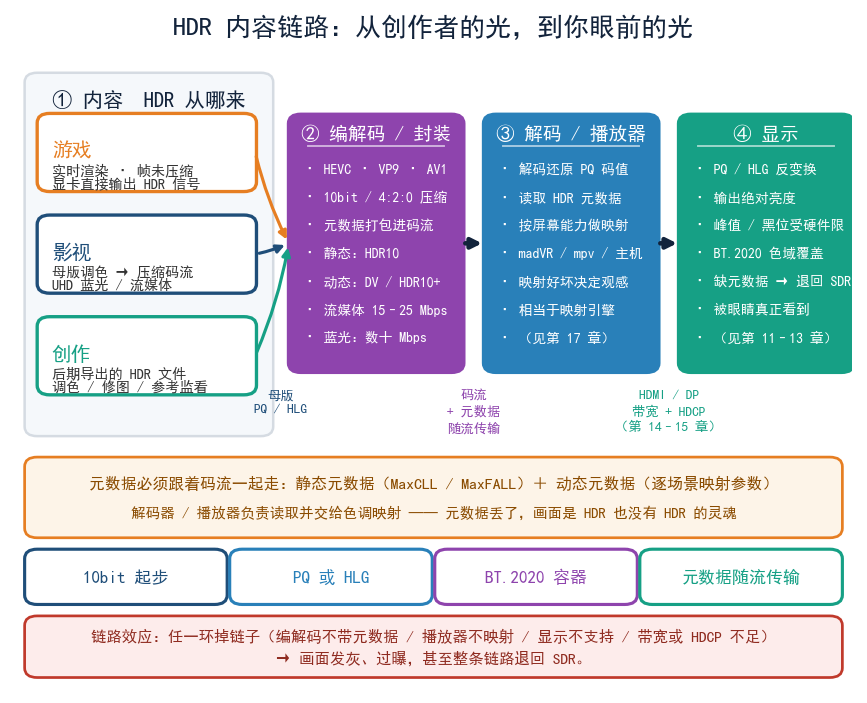
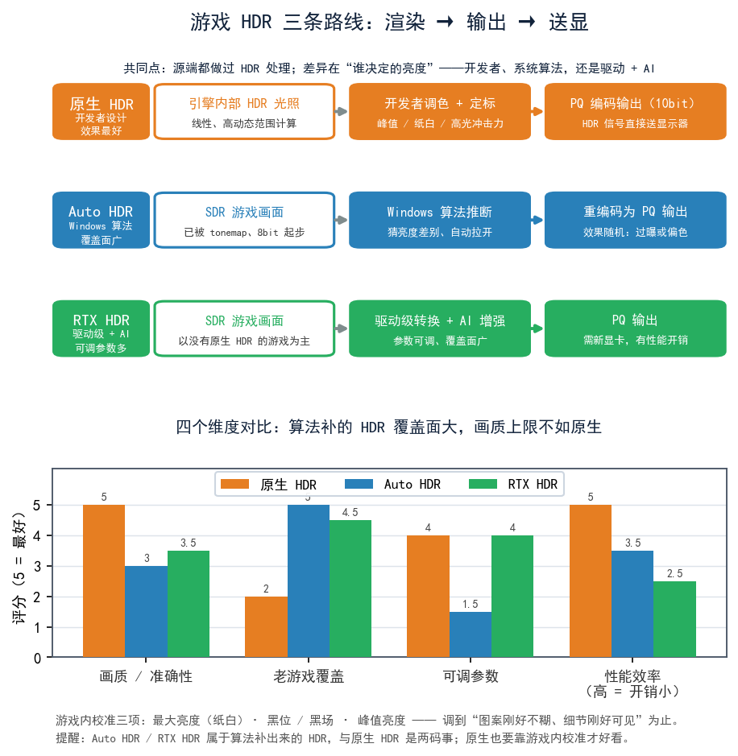
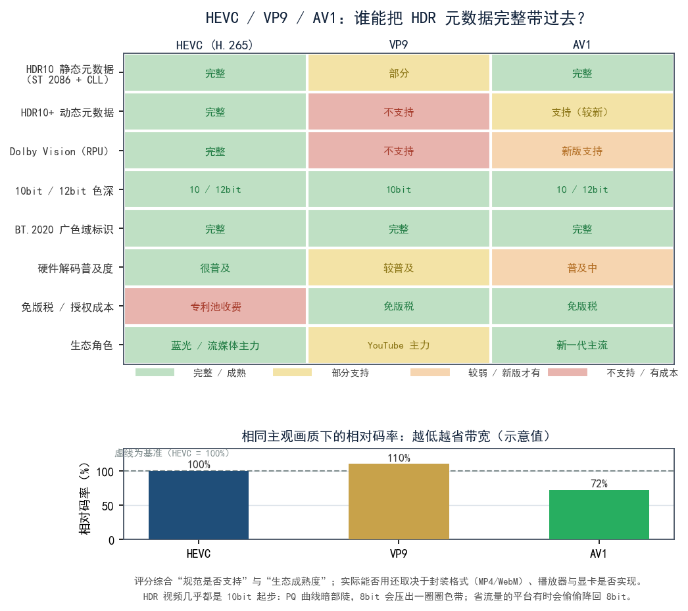
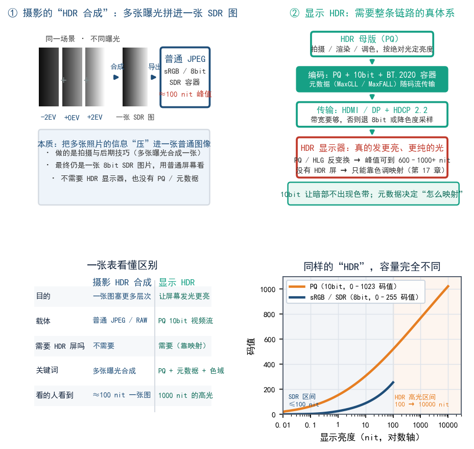

# 第 18 章 内容世界：游戏、影视与创作软件

前几章花了大量篇幅讲标准、硬件、系统设置，可还有一件事没落地：**设备全对，没有 HDR 内容，屏幕也演不出 HDR**。这一章把镜头转向“供给侧”：HDR 的内容到底从哪来、长什么样、要用什么软件播放和制作。主线有三条——游戏、影视、创作工具，顺带把编解码和播放器的角色讲清楚。最后还要澄清一个最容易被搞混的概念：**摄影里说的“HDR 合成”，和我们本文讲的“显示 HDR”，几乎不是一回事。**

## 18.1 HDR 内容从哪来：三条供给线

可以把 HDR 内容的来源分成三条线：

```text
            ┌─ 游戏：实时渲染 → 显卡直接输出 HDR
HDR 内容 ───┼─ 影视：母版调色 → 压缩成 HEVC/AV1 码流
            └─ 创作：照片/视频后期 → 导出 HDR 文件供人看
```

三条线的共同点：都要“源端做过 HDR 处理”；区别在于**实时性、压缩方式和播放链路**完全不同。分清了这三条线，遇到 HDR 问题就知道该往哪个方向查。



## 18.2 游戏：PC 上最容易尝到 HDR 的入口

游戏是 PC 上最容易尝到 HDR 的地方，原因很直接：**显卡实时渲染，天生就知道每个像素该有多亮**，不需要压缩，也不用元数据绕圈，直接把 HDR 信号送给显示器就行。很多人“第一次真正被 HDR 震撼”，就发生在游戏里。

### 原生 HDR

游戏引擎（如 Unreal、Unity 等）内部本来就用高动态范围的光照计算，只要开发者愿意，就能直接输出 PQ 编码的 HDR 信号。**这叫原生 HDR（native HDR）**。

- 优点：效果最好，高光、暗部、色彩都按开发者设计走。
- 前提：游戏设置里要有 HDR 开关，且系统、显卡、显示器链路都支持。
- 注意：不少游戏的 HDR 默认调校一般，需要你在**游戏内校准**里手动调（下面讲）。

### Auto HDR

**Auto HDR** 是 Windows 提供的一项功能（主要在较新的 Windows 版本上）：它用一套算法，**把原本只有 SDR 的老游戏“猜”成 HDR**，自动把画面亮度拉开。

- 好处：让大量没有原生 HDR 的老游戏也能有 HDR 味道，几乎零成本。
- 局限：算法“猜”的，不是开发者设计的，**效果不稳定**——有的游戏惊艳，有的则过曝或偏色。
- 适用：想快速体验、又懒得折腾时的省事选项。

### RTX HDR 类方案

英伟达（NVIDIA）等厂商也提供了类似的“驱动级 HDR 转换”方案（常被称为 RTX HDR 之类），同样是把 SDR 游戏实时转成 HDR 输出，还会带上 AI 增强。可以把它理解为 Auto HDR 的“强化版备选”。

- 好处：覆盖面广、可调参数多。
- 局限：需要新显卡、有性能开销，效果依然取决于算法。

> Auto HDR 和 RTX HDR 属于“AI/算法补出来的 HDR”，跟原生 HDR 是两码事，别指望它们能干过开发者精心调的原生实现。

### 游戏内校准

很多游戏（尤其是原生 HDR 的）会在设置里给一套校准界面，通常包含几个滑块：

| 校准项 | 调的是什么 | 调错会怎样 |
|---|---|---|
| 最大亮度（纸白亮度） | 屏幕能到多亮 | 过高高光爆白，过低整体偏暗 |
| 黑位 / 黑场 | 最暗处基准 | 调错暗部发灰或糊成黑块 |
| 峰值亮度 | 高光上限 | 影响高光的“冲击力” |

**做法**：按屏幕实际能力调到“图案刚好不糊、细节刚好可见”为止。这一步做对，画质提升比换一根贵线明显得多。至于第三方工具 HGiG 的思路（把映射权交给游戏），见第 17 章。



## 18.3 影视：蓝光与流媒体

影视内容和游戏最大的区别：**它是“预先做好、压缩过”的**，播放时只需要解码。

### UHD 蓝光

**UHD 蓝光（Ultra HD Blu-ray）** 是目前画质天花板级别的家用载体：

- 大多以 **HDR10** 为基础，不少片还带 **Dolby Vision** 或 **HDR10+** 动态元数据（见第 8、9 章）。
- 码率很高（通常几十 Mbps 量级），画质损失极小。
- 需要配套的 4K 蓝光机或光驱 + 支持 HDCP 2.2 以上的完整链路（见第 15 章）。

### 流媒体

Netflix、Disney+、YouTube、Bilibili 等平台提供的 HDR：

- 片源以 **HDR10** 为主力，部分带 **Dolby Vision**（视平台与会员等级）。
- YouTube 大量使用 **VP9 / AV1**，B 站、国内平台多用 **HEVC**。
- 画质受**码率**限制：同样的 HDR 内容，码率低就会出现暗部色带、块状噪点。很多平台到 4K HDR 需要的带宽通常在 **15～25 Mbps** 甚至更高，比 SDR 1080p 高一大截。

### 码率与带宽

| 内容形态 | 典型码率量级 | 说明 |
|---|---|---|
| 流媒体 1080p SDR | 约 5～8 Mbps | 基础清晰度 |
| 流媒体 4K HDR | 约 15～25 Mbps 起 | HDR + 高分辨率，需求翻倍 |
| UHD 蓝光 HDR | 数十 Mbps | 几乎无压缩损失 |

**常识**：HDR 不等于“更清晰”，可它对带宽的要求**实打实更高**。10bit、更高分辨率、更大的色域范围都要更多数据，压缩器还得额外保护暗部不出现色带。

## 18.4 编解码：HEVC、VP9、AV1

**编解码（codec）** 就是“把巨大的原始画面数据压缩成能传输、能存储的码流”的技术。HDR 常用的三种：

- **HEVC（H.265）**：目前最普及的 HDR 编解码，蓝光、多数流媒体都用它。压缩效率比老的 H.264 高不少。
- **VP9**：Google 主导，YouTube 大量使用，免版税，但对 HDR 元数据的支持不如 HEVC 成熟。
- **AV1**：新一代免版税编解码，压缩效率更高，被认为会逐渐接替 HEVC/VP9；目前支持它的硬件和软件还在普及中。

**HDR 的元数据（静态或动态）必须“跟着码流一起走”**。编解码器除了压画面，还得把“这片子多亮、什么色域、逐场景映射参数”一并打包。选错了编解码器，可能出现“画面是 HDR，但元数据丢了”的尴尬。

还有一点容易漏掉：**HDR 视频几乎都是 10bit 起步**。原因跟“好看”无关，是 PQ 曲线在暗部特别陡（见第 7、10 章），8bit 走这条曲线会压出一圈圈“色带”。判断一个平台是不是“真 HDR”，可以顺带看看它给的是不是真 10bit 码流：省流量的平台有时会偷偷降回 8bit。



## 18.5 播放器：madVR / mpv 的角色

在 PC 上看 HDR 影视，观感的大头往往落在**播放器**上，显示器反而次要。

- **PotPlayer / MPC-HC 等主流播放器**：普通播放够用，但 HDR 映射能力一般，直连时可能出现发灰或过曝。
- **madVR**：一套强大的视频渲染器，以“优秀的色调映射”闻名，能根据屏幕能力做高质量映射，是很多影音爱好者折腾的重点（配置门槛也高）。
- **mpv**：开源播放器，脚本化能力强、映射可控，配合各种配置能玩出很多花样，适合愿意钻研的人。

播放器在这里扮演的是“**色调映射引擎**”（见第 17 章）。同一部 HDR 片，换一个映射做得好的播放器，观感能差出好几条街。

## 18.6 创作软件：调色与图片

如果你想自己“做”HDR 内容，得先认识这些工具：

- **视频调色**：DaVinci Resolve（免费版就很强）、Adobe Premiere、Apple Final Cut。它们能读取 HDR 素材、做 HDR 分级，并导出带 HDR 元数据的成片。**做 HDR 调色通常需要一台能做 HDR 参考监看的显示器**，否则你调的是“猜的”。
- **图片处理**：Photoshop、Lightroom 等已逐步支持 10bit HDR 图片格式与宽色域工作流。
- **参考显示器（参考监看）**：专业 HDR 创作依赖能显示目标亮度/色域的屏，家用设备基本做不到严格意义上的“参考级”。

创作端对自己的显示设备和色彩知识的要求，比消费端高得多。

如果你只是普通爱好者，也不必被这些专业工具吓住。想给自己拍的视频加一点 HDR 味道，用手机或相机录一段支持 HLG 的素材，再在一个支持 HLG 的 HDR 屏上回放，就已经是完整的“采集 → 播放”小闭环了。入门可以从这里开始，之后再决定要不要深入专业调色。

## 18.7 特别澄清：摄影的“HDR 合成” ≠ 显示 HDR

这一节专门把一个误会说清楚。

**摄影里的“HDR”**（HDR 合成 / HDR merge）是一种**拍摄与后期技巧**：对同一场景用不同曝光拍好几张（-2EV、0、+2EV……），再合成一张“暗部也亮、亮部也有细节”的普通图片。它做的是**把多张照片的信息压进一张普通图像**，最终这张图依然是**用普通 SDR 屏幕看的**。

**我们本文讲的“显示 HDR”**，是**从内容编码、传输、到显示器发光**的一整套体系：10bit、PQ、BT.2020、HDR10……

两者只是恰好共用了“HDR”这三个字。可以这样记：

| 对比项 | 摄影的 HDR 合成 | 显示 HDR |
|---|---|---|
| 目的 | 一张图里塞下更多亮度层次 | 让屏幕真的发出更亮/更纯的光 |
| 载体 | 普通 JPEG/RAW（SDR） | PQ 编码的 10bit 视频流 |
| 需要 HDR 屏吗 | 不需要 | 需要（否则要靠映射） |
| 关键词 | 多张曝光合成 | 传递函数 + 元数据 + 广色域 |

**所以**：一张“HDR 合成”的照片，绝大多数情况只是一张普通 SDR 图片；而一部“HDR10 电影”，也跟摄影的曝光合成毫无关系。



## 本章小结与常见误区

- HDR 内容有三条供给线：**游戏（实时渲染）**、**影视（预压缩码流）**、**创作（后期导出）**。
- 游戏是 PC 上最容易体验 HDR 的入口：**原生 HDR** 最好，**Auto HDR / RTX HDR** 是算法补出的近似款。
- 影视主力是 **UHD 蓝光**（画质天花板）与 **流媒体**（方便但吃带宽）。
- 常见 HDR 编解码：**HEVC、VP9、AV1**，元数据随码流传输。
- **播放器（尤其 madVR/mpv）相当于色调映射引擎**，直接决定观感。
- 创作端需要 HDR 参考监看，门槛远高于消费端。
- **摄影的“HDR 合成”和“显示 HDR”是两回事**，只共用了同一个词。

**几个容易混淆的点：**

1. **“把一张 JPEG 照片全屏播放，就是看 HDR 了。”** 错。JPEG 绝大多数是 8bit SDR 内容，打开 HDR 模式只会让它被映射得发灰或过曝，不会凭空变成 HDR。
2. **“流媒体标了 HDR 就画质无敌。”** 错。码率不足时 HDR 反而更容易暴露暗部色带和压缩噪点，带宽是硬门槛。

## 下一章预告

内容会看、也会播了，接下来是所有人最关心的问题：**到底怎么挑一台好 HDR 显示器，买回来又该怎么校准？** 下一章给你完整的选购清单与色彩管理流程。
