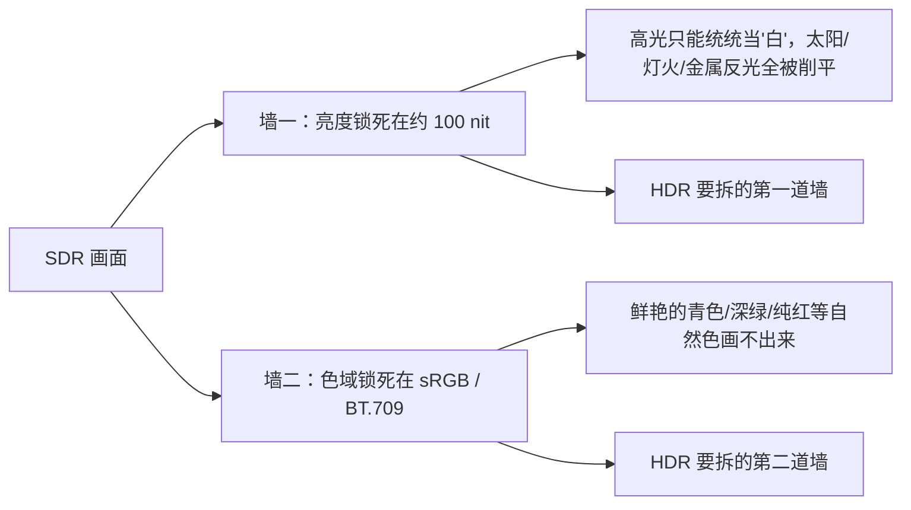

# 第 01 章 从 SDR 说起：8 位、sRGB 与它的时代

> 这一章我们要先搞清楚一件"反直觉"的事：我们今天用的屏幕，并不是被设计成"尽可能真实"，而是被设计成"够用、便宜、能互相兼容"。所以它从一开始就带着两道墙——亮度锁在约 100 nit，色域锁在 sRGB / BT.709。理解了这两道墙，你才会明白 HDR 到底想拆什么。本章还会解释 8bit 的 1677 万色是怎么算出来的、sRGB 为什么成了默认、Gamma≈2.2 又是从哪冒出来的（细节留到第 6 章）。读完你会有一种"原来我天天在看的是一个几十年前的妥协方案"的感觉。

## 一、先看今天：你面前的屏幕是怎么来的

要理解 SDR（标准动态范围，Standard Dynamic Range），得先回头看看屏幕是怎么一步步长成今天这样的。

**第一阶段：黑白时代。** 最早的电视和显示器只有一个通道——亮或不亮，从黑到白。它们连"颜色"这个概念都没有，更谈不上色域问题。这个时期的技术遗产很重要：为了让有限的信号能表现从黑到白的巨大跨度，工程师们很早就发现"不能把亮度当线性数值直接传"，这个思路一直影响到今天。

**第二阶段：彩色 CRT 时代。** 上世纪五六十年代，彩色显像管（CRT，阴极射线管）普及。它用电子束打在红、绿、蓝三种荧光粉上，靠三束光的强弱混出颜色。为此，所有国家都得回答一个问题：**红、绿、蓝这三个"原色"到底各自是什么颜色？亮度到电压的关系是什么？** 回答这个问题的文件，就是后来所有色域标准的祖宗。

**第三阶段：平板时代（LCD / LED）。** 液晶（LCD）和后来的发光二极管（LED）背光取代了 CRT。屏幕变薄、变大、变省电，但一个关键的"历史包袱"被原封不动地继承了下来：**用的还是当年那套颜色定义和亮度约定。** 这就是为什么你的 4K 显示器，内核里其实住着一个 1996 年的标准。

```text
显示技术时间线（简化）

黑白电视 ──► 彩色 CRT ──► 彩色标准诞生 ──► LCD/LED 平板 ──► 4K/8K 屏
 (只有亮度)   (RGB荧光粉)   NTSC/PAL/BT.601    (继承旧标准)   (还在继承)
                              BT.709 (HD)
```

请注意最后一步：分辨率翻了近百倍，但"亮到多少算白""红绿蓝是什么颜色"这两件事，几十年几乎没变。这不是偷懒，而是因为**标准一旦被千万台设备用上，改动成本就高到吓人**——这也解释了为什么 HDR 的推广这么艰难。

## 二、NTSC、PAL、BT.601、BT.709：一路"继承"下来的色域

上世纪五十年代，美国先推出了 **NTSC** 彩色电视标准，欧洲后来搞出 **PAL** 和 SECAM，中国用的是 PAL。这些标准规定了色度（颜色）和亮度怎么编码、怎么传输。

后来进入数字时代，国际电信联盟（ITU）把这些老标准数字化，形成了编号文件：

- **BT.601**：标清数字电视的标准，定义了标清时代的亮度/色度公式和颜色范围。
- **BT.709**：高清（HD）时代的标准，定义了今天几乎所有高清内容、蓝光、以及绝大多数网络视频用的颜色范围。

这两个编号看起来很枯燥，但它们做的事很实在：**它们圈定了一个"红绿蓝基色能到达的范围"**，也就是色域（color gamut）。BT.709 圈出的这个三角形，就是 SDR 世界里的颜色边界。

你可以把色域想象成**一套颜料盒**：盒子里有什么颜料、能调出什么颜色，是提前定死的。BT.709 这盒颜料，"够画出好看的电视画面"，但绝对画不出自然界所有的颜色——后面章节你会看到，它只覆盖了人眼能看到的颜色的大约三分之一（见第 5 章）。


## 三、sRGB：一个 1996 年的"最小公约数"

时间来到 1996 年。个人电脑开始普及，打印机、扫描仪、显示器、数码相机都需要"颜色能对上"。惠普（HP）和微软（Microsoft）联合提出了一套标准，叫 **sRGB**（standard RGB，标准红绿蓝）。

sRGB 的思路非常务实：**"别追求最好，追求最不容易出错。"**

- 它的色域基本就是照抄 BT.709 的那盒颜料——所以你常听到"约 100% sRGB ≈ 100% BT.709"，它俩几乎是同一套颜色。
- 它规定了白点（white point）——也就是"什么颜色算纯白"，用的是 **D65**，一种偏冷的日光白。
- 它规定了从像素值到光的转换关系（传递函数），近似 Gamma≈2.2，与当年的 CRT 显示特性兼容。

结果就是：**只要所有人都按 sRGB 来，颜色就能在设备之间"对得上"。** 于是 sRGB 成了事实上（de facto）的默认标准——网页、相机、操作系统、普通软件，默认都是它。

RGB 之所以成为显示标准，是人类视觉、加色混色规律和早期显示技术共同“逼出来”的结果。人眼视网膜有三种视锥细胞，分别对短波、中波、长波敏感，大致对应蓝、绿、红区域。颜色感知虽然复杂，但在很大程度上可以用三个刺激值来描述。一束光不管光谱多复杂，人眼最终只把它压缩成三个信号。颜色匹配实验也发现，用三个线性独立的原色光，按不同强度混合，可以匹配出绝大多数颜色。两个不够，四个通常冗余。这就是 RGB 三原色的生理和色度学基础。

理论上来说，只要用三种合适的光去混合，就能让很多人看起来和另一种光“颜色一样”。但需要注意的是，“看起来一样”不等于“光谱一样”，两个光谱完全不同，可能给人相同的颜色感觉，这叫同色异谱。

理论上，任何三个线性独立的颜色都能当原色，但色域不同。原色越靠近光谱轨迹，能覆盖的颜色越多，但往往效率低、亮度差、成本高。早期彩色 CRT 用红、绿、蓝荧光粉，能实现、能发光、能混出白，于是成了事实标准。sRGB 把当时 CRT 显示器/电视的颜色行为标准化，之后硬件厂为了让设备兼容 sRGB 内容，才去设计和校准显示器的颜色复现。

后来标准逐步固定：

- NTSC 彩色电视规定了 CRT 荧光粉的色度；
- Rec.709 为高清电视采用了一组 RGB 原色和白点；
- sRGB 在 1996 年基本继承了 Rec.709 的 RGB 原色和 D65 白点（需要单独定义）。

说到sRGB就不得不提到色度坐标系。色度坐标来自 CIE 1931 色度系统，过程是：

- 做颜色匹配实验，让观察者用红、绿、蓝三原色光去匹配各种单色光。
- 得到一组“颜色匹配函数”，再线性变换成 CIE XYZ 三刺激值。
- 任何一个颜色，只要测出它的光谱，就能算出它的 X、Y、Z。

CIE 1931 色彩空间采用的原色波长为：红色 700 nm、绿色 546.1 nm、蓝色 435.8 nm。观察者看一个视场，通常分成左右两半。左半边是一束待测单色光，比如 500 nm 的青绿光；右半边是三束红、绿、蓝原色光叠加。观察者可以调节右边红、绿、蓝三盏灯的强度，目标是让左右两边看起来完全一样，然后记录为了匹配这个 500 nm 的光，红、绿、蓝分别需要多少强度。整个实验需要对 380 nm 到 780 nm 的每一个波长都做一遍。

有些颜色，尤其是很饱和的青绿色，用实际的红、绿、蓝三盏灯怎么调都配不出来。比如你要配 500 nm 的青绿光，右边绿+蓝可能已经很像了，但还不够“青”；如果你再加红，反而会变浑。实验里会把红原色加到待测光那一侧，去抵消待测光里让你觉得“不够青”的成分，这样两边又能匹配。数学上，这就相当于右边的红原色强度是负的，所以颜色匹配函数里会出现负值。负值不是说光有负能量，而是说在这套红绿蓝原色系统里，这个单色光的坐标需要负的红原色来数学描述。


### 补充：CIE 1931 RGB 颜色匹配函数长什么样

把上面实验的结果画成曲线，就得到三条“颜色匹配函数”，通常记作 $\bar r(\lambda)$、$\bar g(\lambda)$、$\bar b(\lambda)$：

- 横轴是单色光的波长（380–780 nm）；
- 纵轴是“为了匹配这个波长，需要多少红 / 绿 / 蓝原色强度”；
- 三条曲线分别在红（约 605 nm）、绿（约 545 nm）、蓝（约 445 nm）附近各自出现峰值。

最关键的一点：**红色那条曲线在约 490–560 nm 之间是负的。** 这不是画错了，也不是“负的光”。它对应前面说的那类实验：像 500 nm 的青绿光，用实际红绿蓝灯怎么配都“不够青”，只能把红原色加到待测光那一侧去抵消，于是数学上红原色的强度就记成了负数。也就是说，**这套 RGB 原色系统，无法只用正数表示所有颜色。**


### 补充：为什么 CIE 要另造一套“全为正”的 XYZ

三条 RGB 匹配函数里那条负值红曲线，给实际计算带来了麻烦：光谱功率都是正的，可算出来的“红原色强度”却可能是负的，很多场合下很别扭。于是 CIE 在 1931 年做了一件很聪明的事——**不改变实验事实，只换一套坐标。**

具体做法是一次**线性变换**：用同一个 3×3 矩阵，把原来看起来别扭的 (R, G, B) 三条曲线，重新组合成三条新曲线 (X, Y, Z)：

$$ \begin{bmatrix} X \\ Y \\ Z \end{bmatrix} = \begin{bmatrix} 2.7689 & 1.7517 & 1.1302 \\ 1.0000 & 4.5907 & 0.0601 \\ 0.0000 & 0.0565 & 5.5943 \end{bmatrix} \begin{bmatrix} R \\ G \\ B \end{bmatrix} $$

这一步之所以值得，是因为可以主动设计新曲线的形状，让它们具备三个好性质：

1. **三条曲线全部非负。** 只要光谱功率非负，算出的 X、Y、Z 就都是正数，再不会出现“负的强度”。
2. **Y 恰好等于亮度。** 中间那条曲线 $\bar y(\lambda)$ 被特意构造成与眼睛的明视觉灵敏度曲线 V(λ) 完全一致——于是“亮度”直接就是 Y，不用另算。
3. **三条曲线各自错开。** X 偏红、Y 偏绿并负责亮度、Z 偏蓝，物理意义更直观。

换句话说：**RGB 是“实验怎么做出来的”，XYZ 是“换一套更好算的坐标”。** 两者描述的是同一个颜色世界，可以互相换算——它们不是两种颜色，而是同一件事的两种记法。

单看上面的矩阵可能还是很抽象，图 01-7 把它画了出来：上半部分是原来的 RGB 匹配函数（红色有负值），经过中间那次线性变换，下半部分就得到全为正、且 $\bar y$ 即亮度的 XYZ 匹配函数。负值消失、亮度“白送”，这就是 CIE 另造 XYZ 的全部动机。更细的推导（矩阵从哪来、负值怎么被消掉、Y 为什么是亮度）在第 4 章会完整展开；这里先建立直觉——**HDR 里所有关于色域、白点、色度的计算，几乎都建立在这套 XYZ 坐标之上。**


色度坐标定义为：

$$ x=\frac{X}{X+Y+Z}​, \ y=\frac{Y}{X+Y+Z}​,\ z=1−x−y $$

白点需要单独定义，因为原色坐标只决定了色域三角形的三个顶点，不决定三角形内部哪个点对应“R=G=B”。举例说，假设红、绿、蓝三个原色的色度坐标已经固定。现在让 R、G、B 都取最大值。它们叠加确实会产生一个白，但这个白偏蓝还是偏黄，取决于三个通道的 **最大发光强度比例**。

- 如果蓝通道最大亮度高一点，全开白就偏蓝；
- 如果绿通道最大亮度高一点，全开白就偏绿；
- 如果红通道高一点，就偏暖。

数字上都是 255、255、255，但数字相等不代表三通道发出的物理光通量相等。不同硬件、不同背光、不同滤色片，全开白可以完全不同。所以标准必须规定：R=G=B 时，应该得到哪个白点。sRGB 规定的是 D65，色度大约是：x≈0.3127, y≈0.3290, 这对应约 6500K 的日光白。

这里有个特别容易被误解的点，请一定记住：

> **sRGB 不是"高级货"，恰恰相反，它是"最小公约数"。**
>
> 它之所以统治世界，不是因为它好，而是因为它**低**——低到几乎所有设备都能做到。

顺便说一句：**Adobe RGB** 在 1998 年出现，色域比 sRGB 大一些，主要用于印刷和专业摄影。它存在感很强，但从未取代 sRGB 的默认地位——因为"够用 + 兼容"永远比"更大"更有市场。


## 四、8 位、1677 万色，以及"楼梯"的比喻

数字图像里，每个像素的红、绿、蓝三个通道各用一个数值表示亮度。用 8 位（8bit）表示一个通道，就是从 0 到 255 共 256 个等级。

三个通道各有 256 个等级，组合起来就是：

```text
256 × 256 × 256 = 16,777,216 种颜色  ≈ "1677 万色"
```

这就是商家广告里那句"1677 万色"的来历。听起来极其多，对吧？但关键问题不在"总数多少"，而在**"相邻两级之间差多大"**。

把位深（bit depth）想象成**一段楼梯的级数**：

- 8bit 的楼梯只有 256 级。从全黑走到全白，每一级之间必须"跳"一段不小的距离。
- 如果画面的某一段（尤其是暗部）变化很细腻，比如夜空中渐变的云层，你就会看到台阶——也就是**色带（banding）**，一圈一圈的色块。

```text
8bit 的"楼梯"（示意，256 级中的一小段）

最黑  0 ── 1 ── 2 ── 3 ── … ── 254 ── 255  最白
         ↑每级跳得大，暗部平滑过渡时容易看到"台阶"
```

更要命的是：**人眼对暗部的变化比亮部敏感得多**（第 3 章会讲清楚为什么）。而 8bit 在暗部分到的"级数"和亮部一样多，所以暗部最容易出问题。这个矛盾，正是后来 HDR 坚持"10bit 起步"的直接原因（见第 10 章）。


## 五、"参考显示器 100 nit"：一道看不见的枷锁

现在说 SDR 最核心、也最容易被忽略的一条约定：**白点在约 100 nit**。

nit 是亮度的单位，1 nit 等于 1 cd/m²（坎德拉每平方米），简单说就是"每平方米发出多少光"。约 100 nit，大致相当于一张办公桌上被照得比较亮的纸张的亮度。

SDR 的世界里有一条潜规则：**"最亮的白"就是约 100 nit，"最暗的黑"就按这个白点的某个固定比例来。** 内容制作时，调色师都在一个亮度约 100 nit 的"参考显示器"（mastering display，母版显示器）上看效果。

这就带来一个尴尬的现实：

| 场景 | 现实中大概多亮 | SDR 能表现多少 |
|---|---|---|
| 烛光、夜晚暗部 | 远低于 1 nit | 被压在"离黑不远"的少数几级 |
| 室内灯光下的纸面 | 约 100 nit 上下 | 正好是"白" |
| 阳光下的白墙 | 数千 nit | 只能当作"白"，强行压到约 100 nit |
| 直视太阳 | 远超十万 nit 量级 | 完全无能为力 |

换句话说：**一面阳光下的白墙和一张室内白纸，在 SDR 里被压成同一个"白"。** 现实中它们亮度差几十倍，画面里却告诉你"一样亮"。这就是 SDR 的第一道墙——**亮度被锁死**。


## 六、Gamma≈2.2：一个要留到第 6 章的伏笔

上面提到 sRGB 规定"像素值和实际光之间不是线性关系，而是近似 Gamma≈2.2 的关系"。这是什么意思？

打个比方：**Gamma 编码像给画面打了个"压缩包"。** 如果把光强（物理量）按 1:2:3:4… 均匀编码，亮部会分到太多没用的等级、暗部又不够细。而人眼对暗部更敏感，如果按线性光强直接编码，暗部相邻码值的光强相对变化太大，容易看到色带、台阶。工程师反过来：**给暗部多分些码值、亮部少分些**，这样 8bit 的有限 256 级才够用。这个"重新分配"的曲线，就近似一个指数为 2.2 的幂函数。

注意，实际在显示亮度时，肯定需要按照正常的光的线性关系来显示。这里 sRGB 编码要求只是为了在人更敏感的区域（暗部）安排更多的 bit 位来存储，以提高精度。暗部如果占的 bit 位数太少，在转换为实际亮度时，就很容易看到明显的色带。

> **关于 Gamma 映射的小知识**
>
> SDR 内容通常按 sRGB 编码，sRGB 的传输函数近似 Gamma 2.2，暗部还有一小段线性。也就是说，图像里的数字码值不是线性亮度，而是经过 Gamma 编码的。显示器收到信号后，理论上要按对应的 EOTF 把它还原成亮度。
>
> 由于我们显示的素材默认都是经过 sRGB 编码后的，所以我们在一些场景使用时，需要先映射回标准数值，再进行处理。例如，在图形渲染技术中，反照率贴图（albedo texture）往往被认为需要进行 逆 Gamma / sRGB 解码，即需要先映射回原始反照率，再用于渲染着色计算。整个过程就是：纹理 sRGB 编码 → 采样时/手动 sRGB_to_linear → 线性渲染 → 输出 linear_to_sRGB → 显示器。例如，OpenGL 里的光照/混合等渲染通常在线性空间计算，最终输出到显示器前，需要做一次线性 → sRGB 的正向 Gamma 编码，然后才送去显示。

它为什么约等于 2.2？直接原因有点"历史偶然"：CRT 显示器的电压-亮度关系本身就接近这个指数，早期 CRT 显示器不是液晶，它靠电子束打荧光粉发光。给它的信号电压越高，电子束越强，屏幕越亮。亮度 ≈ 电压^2.2，假设你有一张图片，里面某个像素的真实线性亮度是 0.5。如果你直接把 0.5 当电压发给 CRT，屏幕只显示 0.22，太暗。为了让 CRT 最终显示 0.5 的光，要满足 电压^2.2 = 0.5。所以电压 = 0.5^(1/2.2) ≈ 0.73，也就是说，发 0.73 的电压，CRT 才会发出 0.5 的光。

为了让新标准能兼容老设备，大家干脆把它固化进标准里。LCD/OLED 的物理电压-亮度关系跟 CRT 不一样，但它们内部有驱动 IC、LUT、Gamma 校正电路，会故意把输入信号映射成类似 亮度 ≈ 信号^2.2 的效果。显示器信号设置的 2.2 和 sRGB 的 2.2 是相互相应的，但指数为 2.2 本身并不严格（2.0~2.4一般都是可以的），事实上这只是一个默认的标准，而不是严格的事实。

**这里只需要建立一个直觉**：SDR 的像素值不是光，而是"打了一包的光"，解码时需要按约定解开（见第 6 章）。

## 七、两道墙：SDR 的天花板

把本章的内容收束一下，SDR 的局限可以精确地概括为**两道墙**：



- **第一道墙：亮度锁死。** 最亮约 100 nit，比现实中看到的大多数明亮事物都暗得多，所以高光细节被"一刀切"。
- **第二道墙：色域锁死。** 只能画 sRGB / BT.709 那个三角形里的颜色，三角形外的鲜艳颜色一律画不出来。

HDR（高动态范围，High Dynamic Range）要做的事，就是把这两道墙同时往外推：**让画面既能有几百甚至上千 nit 的高光，也能有真正的深黑，同时颜色范围扩到 BT.2020 这个大得多的容器里**（见第 5、7 章）。

现在你应该能理解为什么本文开头要说"SDR 是一个妥协的产物"了——它不是失败的，它是**在当年的技术条件下极其成功的妥协**。我们只是到了有能力做得更好的时代。


## 本章小结与常见误区

- SDR 的根源可以追到上世纪的黑白与彩色 CRT 时代，NTSC / PAL → BT.601 → BT.709 一路继承下来，**颜色定义几十年基本没变**。
- **sRGB 是 1996 年惠普与微软联合制定的"最小公约数"标准**，色域约等于 BT.709，白点是 D65，传递函数近似 Gamma≈2.2；它统治世界靠的是兼容性，不是先进性。
- **8bit × 3 通道 = 256³ = 16,777,216 色（约 1677 万色）**。问题不在总数，而在暗部"台阶"太粗，容易出色带。
- SDR 把**参考白点定在约 100 nit**，因此现实里亮度差异巨大的事物在画面上被压成同一个"白"。
- **Gamma≈2.2 是一种"压缩"，目的是在有限位深下把人眼最敏感的暗部分配得细一点**（第 6 章详解）。
- SDR 的两道墙：**亮度锁死在约 100 nit、色域锁死在 sRGB / BT.709**。HDR 的目标就是同时拆掉这两道墙。
- 单位记得：1 nit = 1 cd/m²；色域百分比一定要看参照，比如"约 100% sRGB"和"90% DCI-P3"完全不是一回事。

**几个容易混淆的点：**

1. **误区：分辨率高 = 画质好。** 4K 只解决"像素够不够多"，不解决"能亮到多少、能黑到多深、能画多艳"。一台 4K 的普通 SDR 屏，画质可能明显不如一台 1080p 的高端 HDR 屏。
2. **误区：sRGB 是一种"更高级"的专业标准。** 恰恰相反，sRGB 是"最小公约数"——它成为默认，是因为几乎所有设备都能达到它，而不是因为它强。

## 下一章预告

既然 SDR 的墙是"亮度和色域"，那下一章我们就把"亮度、对比度、动态范围"这三个天天被厂商拿来做营销的词，一个一个掰开讲清楚——尤其是"对比度 1000000:1"这种数字背后的猫腻。
