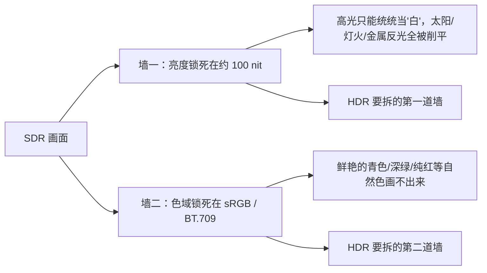

# 第 01 章 从 SDR 说起：8 位、sRGB 与它的时代

> 这一章先讲一件反直觉的事：今天用的屏幕，设计目标从来就没放在"尽可能真实"上，它要的是"够用、便宜、能互相兼容"。它生来就带着两道墙——亮度锁在约 100 nit，色域锁在 sRGB / BT.709，HDR 想拆的正是这两道墙。顺带把几笔旧账算清楚：8bit 的 1677 万色是怎么数出来的、sRGB 凭什么成了默认、Gamma≈2.2 又是从哪冒出来的（细节留到第 6 章）。回头看，我们天天盯着的那块屏，里面装的其实是一个几十年前的妥协方案。

## 一、先看今天：你面前的屏幕是怎么来的

要理解 SDR（标准动态范围，Standard Dynamic Range），得先回头看看屏幕是怎么一步步长成今天这样的。

**第一阶段：黑白时代。** 最早的电视和显示器只有一个通道，从黑到白，连"颜色"这回事都没有，自然也谈不上色域。这段时期留下的技术遗产相当关键：信号通道有限，却要覆盖从黑到白的巨大跨度，工程师很早就发现不能把亮度当成线性数值直接传。这个思路一直用到今天。

**第二阶段：彩色 CRT 时代。** 上世纪五六十年代，彩色显像管（CRT，阴极射线管）普及。它用电子束打在红、绿、蓝三种荧光粉上，靠三束光的强弱混出颜色。为此各国都得回答同一组问题：**红、绿、蓝这三个"原色"各自是什么颜色？亮度到电压的关系又是什么？** 当年为回答这些问题写下的文件，就是后来所有色域标准的祖宗。

**第三阶段：平板时代（LCD / LED）。** 液晶（LCD）和后来的发光二极管（LED）背光取代了 CRT。屏幕变薄、变大、变省电，但一个关键的"历史包袱"被原封不动地继承了下来：**用的还是当年那套颜色定义和亮度约定。** 这就是为什么你的 4K 显示器，内核里其实住着一个 1996 年的标准。

```text
显示技术时间线（简化）

黑白电视 ──► 彩色 CRT ──► 彩色标准诞生 ──► LCD/LED 平板 ──► 4K/8K 屏
 (只有亮度)   (RGB荧光粉)   NTSC/PAL/BT.601    (继承旧标准)   (还在继承)
                              BT.709 (HD)
```

留意最后一步：分辨率翻了近百倍，"亮到多少算白""红绿蓝是什么颜色"这两件事，几十年几乎没动过。原因谈不上偷懒：**标准一旦被千万台设备用上，改动成本就高到吓人**，HDR 推广得这么艰难，根子也在这里。

## 二、NTSC、PAL、BT.601、BT.709：一路"继承"下来的色域

上世纪五十年代，美国先推出了 **NTSC** 彩色电视标准，欧洲后来搞出 **PAL** 和 SECAM，中国用的是 PAL。这些标准规定了色度（颜色）和亮度怎么编码、怎么传输。

后来进入数字时代，国际电信联盟（ITU）把这些老标准数字化，形成了编号文件：

- **BT.601**：标清数字电视的标准，定义了标清时代的亮度/色度公式和颜色范围。
- **BT.709**：高清（HD）时代的标准，定义了今天几乎所有高清内容、蓝光、以及绝大多数网络视频用的颜色范围。

两个编号看着枯燥，做的事却很实在：**它们圈定了一个"红绿蓝基色能到达的范围"**，也就是色域（color gamut）。BT.709 圈出的这个三角形，就是 SDR 世界里的颜色边界。

色域可以理解成**一套颜料盒**：盒子里有哪些颜料、能调出什么颜色，事先就定死了。BT.709 这盒颜料够画出好看的电视画面，自然界的颜色它却画不全，只覆盖人眼可见颜色的大约三分之一（见第 5 章）。


## 三、sRGB：一个 1996 年的"最小公约数"

时间来到 1996 年。个人电脑开始普及，打印机、扫描仪、显示器、数码相机都需要"颜色能对上"。惠普（HP）和微软（Microsoft）联合提出了一套标准，叫 **sRGB**（standard RGB，标准红绿蓝）。

sRGB 的思路非常务实：**"别追求最好，追求最不容易出错。"**

- 它的色域基本就是照抄 BT.709 的那盒颜料——所以常听到"约 100% sRGB ≈ 100% BT.709"，它俩几乎是同一套颜色。
- 它规定了白点（white point）——也就是"什么颜色算纯白"，用的是 **D65**，一种偏冷的日光白。
- 它规定了从像素值到光的转换关系（传递函数），近似 Gamma≈2.2，与当年的 CRT 显示特性兼容。

结果很直接：**只要所有人都按 sRGB 来，颜色就能在设备之间"对得上"。** 网页、相机、操作系统、普通软件默认全用它，sRGB 就这样成了事实上（de facto）的默认标准。

RGB 能成为显示标准，是视觉生理、加色混色规律和早期显示技术一起"逼"出来的。人眼视网膜上有三种视锥细胞，分别对短波、中波、长波敏感，大致落在蓝、绿、红三个区域。颜色感知本身很复杂，但落到度量上，三个刺激值通常就够描述。光谱再复杂的一束光，人眼最终也只把它压成三个信号。颜色匹配实验给出的结论类似：三个线性独立的原色光，按不同强度混合，能匹配出绝大多数颜色；两个不够，四个则往往冗余。RGB 三原色的生理与色度学基础就在这里。

理论上，只要三种光选得合适，混出来的效果在多数人眼里就和另一种光"颜色一样"。但"看起来一样"不代表"光谱一样"：两个光谱可以完全不同，给人的颜色感觉却一致，这叫同色异谱。

任何三个线性独立的颜色都能当原色，只是画出的色域大小不同。原色越靠近光谱轨迹，能覆盖的颜色越多，代价是效率低、亮度差、成本高。早期彩色 CRT 选了红、绿、蓝三种荧光粉：能做出来、能发光、能混出白，于是成了事实标准。sRGB 把当时 CRT 显示器与电视的颜色行为写进了标准，硬件厂后来为了让设备兼容 sRGB 内容，才去设计和校准显示器的颜色复现。

后来标准逐步固定：

- NTSC 彩色电视规定了 CRT 荧光粉的色度；
- Rec.709 为高清电视采用了一组 RGB 原色和白点；
- sRGB 在 1996 年基本继承了 Rec.709 的 RGB 原色和 D65 白点（需要单独定义）。

说到 sRGB，就绕不开色度坐标。色度坐标来自 CIE 1931 色度系统，做法是：

- 做颜色匹配实验，让观察者用红、绿、蓝三原色光去匹配各种单色光。
- 得到一组"颜色匹配函数"，再线性变换成 CIE XYZ 三刺激值。
- 任何一个颜色，只要测出它的光谱，就能算出它的 X、Y、Z。

CIE 1931 色彩空间选用的原色波长为：红 700 nm、绿 546.1 nm、蓝 435.8 nm。实验时，观察者看到的视场通常分左右两半。左半边是一束待测单色光，比如 500 nm 的青绿光；右半边是三束红、绿、蓝原色光叠加。观察者调节右边三盏灯的强度，目标是让左右两边看起来完全一样，然后记下为了匹配这束 500 nm 的光，红、绿、蓝各需多少强度。380 nm 到 780 nm 的每一个波长，都要这样走一遍。

有些颜色，尤其是很饱和的青绿色，用现实里的红、绿、蓝三盏灯怎么调都配不出来。比如要配 500 nm 的青绿光，右边的绿加蓝可能已经很接近，却还不够"青"；再往上加红，反而会变浑。实验的做法是把红原色加到待测光那一侧，抵消掉让你觉得"不够青"的成分，两边又能匹配上。数学上，这相当于右侧的红原色强度取负值，颜色匹配函数里因此出现负数。负值不是光有负能量，它只说明在这套红绿蓝原色系统里，这个单色光的坐标需要用负的红原色来描述。


### 补充：CIE 1931 RGB 颜色匹配函数长什么样

把上面实验的结果画成曲线，就得到三条"颜色匹配函数"，通常记作 $\bar r(\lambda)$、$\bar g(\lambda)$、$\bar b(\lambda)$：

- 横轴是单色光的波长（380–780 nm）；
- 纵轴是"为了匹配这个波长，需要多少红 / 绿 / 蓝原色强度"；
- 三条曲线分别在红（约 605 nm）、绿（约 545 nm）、蓝（约 445 nm）附近各自出现峰值。

最关键的一点是，**红色那条曲线在约 490–560 nm 之间是负的。** 它既不是画错了，也不代表"负的光"。前面那类实验说的就是这件事：像 500 nm 的青绿光，用现实的灯怎么配都"不够青"，只能把红原色加到待测光那一侧去抵消，红原色的强度在数学上就记成了负数。由此可见，**这套 RGB 原色系统无法只用正数表示所有颜色。**


### 补充：为什么 CIE 要另造一套“全为正”的 XYZ

三条 RGB 匹配函数里那条负值红曲线，给实际计算添了不少麻烦：光谱功率都是正的，算出来的"红原色强度"却可能是负的，很多场合下很别扭。CIE 在 1931 年做的处理相当漂亮——**实验事实不动，只换一套坐标。**

具体做法是一次**线性变换**：用同一个 3×3 矩阵，把原来看起来别扭的 (R, G, B) 三条曲线，重新组合成三条新曲线 (X, Y, Z)：

$$ \begin{bmatrix} X \\ Y \\ Z \end{bmatrix} = \begin{bmatrix} 2.7689 & 1.7517 & 1.1302 \\ 1.0000 & 4.5907 & 0.0601 \\ 0.0000 & 0.0565 & 5.5943 \end{bmatrix} \begin{bmatrix} R \\ G \\ B \end{bmatrix} $$

换坐标值得做，是因为新曲线的形状可以主动设计，让它具备三个好性质：

1. **三条曲线全部非负。** 只要光谱功率非负，算出的 X、Y、Z 就都是正数，再不会出现"负的强度"。
2. **Y 恰好等于亮度。** 中间那条曲线 $\bar y(\lambda)$ 被特意构造成与眼睛的明视觉灵敏度曲线 V(λ) 完全一致——于是"亮度"直接就是 Y，不用另算。
3. **三条曲线各自错开。** X 偏红、Y 偏绿并负责亮度、Z 偏蓝，物理意义更直观。

**RGB 记录的是实验怎么做的，XYZ 换了一套更好算的坐标。** 两者描述同一个颜色世界，可以互相换算；颜色还是那些颜色，只是记法不同。

单看矩阵仍然抽象，图 01-7 把它画了出来：上半部分是原来的 RGB 匹配函数（红色有负值），中间做一次线性变换，下半部分就得到全为正、且 $\bar y$ 即亮度的 XYZ 匹配函数。负值消失、亮度"白送"，CIE 另造 XYZ 的动机就这么简单。更细的推导（矩阵从哪来、负值怎么被消掉、Y 为什么是亮度）在第 4 章完整展开；这里先建立直觉——**HDR 里所有关于色域、白点、色度的计算，几乎都建立在这套 XYZ 坐标之上。**


色度坐标定义为：

$$ x=\frac{X}{X+Y+Z}​, \ y=\frac{Y}{X+Y+Z}​,\ z=1−x−y $$

白点得单独定义。原色坐标只定下色域三角形的三个顶点，三角形内部哪个点对应"R=G=B"，它管不着。假设红、绿、蓝三个原色的色度坐标已经固定，让 R、G、B 都取最大值：叠加确实会得到一个白，但这个白偏蓝还是偏黄，取决于三个通道的 **最大发光强度比例**。

- 如果蓝通道最大亮度高一点，全开白就偏蓝；
- 如果绿通道最大亮度高一点，全开白就偏绿；
- 如果红通道高一点，就偏暖。

数字上都是 255、255、255，可数字相等并不代表三通道发出的物理光通量相等。硬件不同、背光不同、滤色片不同，全开白可以完全不一样。标准因此必须规定：R=G=B 时应该得到哪个白点。sRGB 规定的是 D65，色度大约是 x≈0.3127、y≈0.3290，对应约 6500K 的日光白。

这一点特别容易被误解：

> **sRGB 算不上"高级货"，它是"最小公约数"。**
>
> 能统治世界，靠的是它**低**：低到几乎所有设备都能做到，而不是它有多好。

**Adobe RGB** 在 1998 年出现，色域比 sRGB 大一些，主要用于印刷和专业摄影。它存在感不弱，却始终没能取代 sRGB 的默认地位："够用 + 兼容"在市场上永远赢过"更大"。


## 四、8 位、1677 万色，以及"楼梯"的比喻

数字图像里，每个像素的红、绿、蓝三个通道各用一个数值表示亮度。用 8 位（8bit）表示一个通道，就是从 0 到 255 共 256 个等级。

三个通道各有 256 个等级，组合起来就是：

```text
256 × 256 × 256 = 16,777,216 种颜色  ≈ "1677 万色"
```

这就是商家广告里那句"1677 万色"的来历。数字看着吓人，真正的关键却在**"相邻两级之间差多大"**，不在总数。

位深（bit depth）好比**一段楼梯的级数**：

- 8bit 的楼梯只有 256 级。从全黑走到全白，每一级之间必须"跳"一段不小的距离。
- 如果画面的某一段（尤其是暗部）变化很细腻，比如夜空中渐变的云层，台阶就出来了，也就是**色带（banding）**，一圈一圈的色块。

```text
8bit 的"楼梯"（示意，256 级中的一小段）

最黑  0 ── 1 ── 2 ── 3 ── … ── 254 ── 255  最白
         ↑每级跳得大，暗部平滑过渡时容易看到"台阶"
```

更麻烦的是，**人眼对暗部的变化比亮部敏感得多**（第 3 章会讲清原因）。8bit 给暗部和亮部分到的"级数"一样多，出问题的自然总是暗部。HDR 后来坚持"10bit 起步"，直接原因就在这里（见第 10 章）。


## 五、"参考显示器 100 nit"：一道看不见的枷锁

现在说 SDR 最核心、也最容易被忽略的一条约定：**白点在约 100 nit**。

nit 是亮度的单位，1 nit 等于 1 cd/m²（坎德拉每平方米），简单说就是"每平方米发出多少光"。约 100 nit，大致相当于一张办公桌上被照得比较亮的纸张的亮度。

SDR 的世界里有一条潜规则：**"最亮的白"就是约 100 nit，"最暗的黑"就按这个白点的某个固定比例来。** 内容制作时，调色师都在一个亮度约 100 nit 的"参考显示器"（mastering display，母版显示器）上看效果。

于是出现一个尴尬的局面：

| 场景 | 现实中大概多亮 | SDR 能表现多少 |
|---|---|---|
| 烛光、夜晚暗部 | 远低于 1 nit | 被压在"离黑不远"的少数几级 |
| 室内灯光下的纸面 | 约 100 nit 上下 | 正好是"白" |
| 阳光下的白墙 | 数千 nit | 只能当作"白"，强行压到约 100 nit |
| 直视太阳 | 远超十万 nit 量级 | 完全无能为力 |

阳光下的白墙和室内白纸，在 SDR 里被压成了同一个"白"。现实中两者亮度差几十倍，画面里却告诉你一样亮。SDR 的第一道墙就在这里——**亮度被锁死**。


## 六、Gamma≈2.2：一个要留到第 6 章的伏笔

上面提到，sRGB 规定像素值与实际光之间是一条近似 Gamma≈2.2 的曲线，并非线性关系。这话什么意思？

**Gamma 编码相当于给画面打了个"压缩包"。** 光强（物理量）按 1:2:3:4… 均匀编码，亮部会分到太多用不上的等级，暗部又不够细。人眼偏偏对暗部更敏感，若按线性光强直接编码，暗部相邻码值之间的光强相对变化太大，色带、台阶很容易看出来。工程师的做法反过来：**暗部多给码值，亮部少给**，8bit 那 256 级才勉强够用。这条重新分配的曲线，接近指数为 2.2 的幂函数。

显示亮度时当然还得回到线性的光。sRGB 这样编码，图的只是把人更敏感的暗部多分配些 bit 位、把精度提上去。暗部占的 bit 太少，换算成实际亮度时就容易看到明显的色带。

> **关于 Gamma 映射的小知识**
>
> SDR 内容通常按 sRGB 编码，sRGB 的传输函数近似 Gamma 2.2，暗部还有一小段线性。图像里的数字码值并不等于线性亮度，它经过了 Gamma 编码。显示器收到信号后，理论上要按对应的 EOTF 把它还原成亮度。
>
> 既然素材默认都经过 sRGB 编码，有些场景就得先映射回标准数值再处理。比如图形渲染里的反照率贴图（albedo texture），通常被认为需要做逆 Gamma / sRGB 解码，即先映射回原始反照率，再用于渲染着色计算。整个过程就是：纹理 sRGB 编码 → 采样时/手动 sRGB_to_linear → 线性渲染 → 输出 linear_to_sRGB → 显示器。OpenGL 里的光照/混合等渲染通常在线性空间计算，最终输出到显示器前，需要做一次线性 → sRGB 的正向 Gamma 编码，然后才送去显示。

为什么约等于 2.2？直接原因有点历史偶然：CRT 的电压-亮度关系本身就接近这个指数。早期 CRT 靠电子束打荧光粉发光，信号电压越高，电子束越强，屏幕越亮，大致满足 亮度 ≈ 电压^2.2。举个具体数：某个像素的真实线性亮度是 0.5，直接把 0.5 当电压发给 CRT，屏幕只显示 0.22，明显偏暗。要让 CRT 最终发出 0.5 的光，得满足 电压^2.2 = 0.5，于是 电压 = 0.5^(1/2.2) ≈ 0.73。发 0.73 的电压，才换来 0.5 的光。

为了让新标准兼容老设备，这条曲线被直接固化进了标准。LCD、OLED 的物理电压-亮度关系和 CRT 并不相像，但它们内部有驱动 IC、LUT、Gamma 校正电路，会刻意把输入信号映射成类似 亮度 ≈ 信号^2.2 的效果。显示器设置里的 2.2 和 sRGB 的 2.2 相互对应，只是 2.2 这个数本身并不严格（2.0~2.4 一般都算可用）。它只是一个默认约定，谈不上严格的事实。

**这里先建立一个直觉就够了**：SDR 的像素值并不直接等于光，它是"打了一包的光"，解码时按约定解开（见第 6 章）。

## 七、两道墙：SDR 的天花板

收束一下：SDR 的局限可以概括为**两道墙**：



- **第一道墙：亮度锁死。** 最亮约 100 nit，比现实中看到的大多数明亮事物都暗得多，所以高光细节被"一刀切"。
- **第二道墙：色域锁死。** 只能画 sRGB / BT.709 那个三角形里的颜色，三角形外的鲜艳颜色一律画不出来。

HDR（高动态范围，High Dynamic Range）要做的事，就是把这两道墙同时往外推：**让画面既能有几百甚至上千 nit 的高光，也能有真正的深黑，同时颜色范围扩到 BT.2020 这个大得多的容器里**（见第 5、7 章）。

回到开头那句话：SDR 是妥协的产物，却谈不上失败，它**在当年的技术条件下极其成功**。只是我们如今有能力做得更好而已。


## 本章小结与常见误区

- SDR 的根源可以追到上世纪的黑白与彩色 CRT 时代，NTSC / PAL → BT.601 → BT.709 一路继承下来，**颜色定义几十年基本没变**。
- **sRGB 是 1996 年惠普与微软联合制定的"最小公约数"标准**，色域约等于 BT.709，白点是 D65，传递函数近似 Gamma≈2.2；它统治世界靠的是兼容性，不是先进性。
- **8bit × 3 通道 = 256³ = 16,777,216 色（约 1677 万色）**。麻烦出在暗部"台阶"太粗，容易出色带，总数反而次要。
- SDR 把**参考白点定在约 100 nit**，因此现实里亮度差异巨大的事物在画面上被压成同一个"白"。
- **Gamma≈2.2 是一种"压缩"，目的是在有限位深下把人眼最敏感的暗部分配得细一点**（第 6 章详解）。
- SDR 的两道墙：**亮度锁死在约 100 nit、色域锁死在 sRGB / BT.709**。HDR 的目标就是同时拆掉这两道墙。
- 单位别搞混：1 nit = 1 cd/m²；色域百分比一定要看参照，比如"约 100% sRGB"和"90% DCI-P3"完全不是一回事。

**几个容易混淆的点：**

1. **误区：分辨率高 = 画质好。** 4K 只解决"像素够不够多"，不解决"能亮到多少、能黑到多深、能画多艳"。一台 4K 的普通 SDR 屏，画质可能明显不如一台 1080p 的高端 HDR 屏。
2. **误区：sRGB 是一种"更高级"的专业标准。** 它其实就是"最小公约数"：成为默认靠的是几乎所有设备都能达到它，跟"强"无关。

## 下一章预告

既然 SDR 的墙是"亮度和色域"，那下一章我们就把"亮度、对比度、动态范围"这三个天天被厂商拿来做营销的词，一个一个掰开讲清楚——尤其是"对比度 1000000:1"这种数字背后的猫腻。
