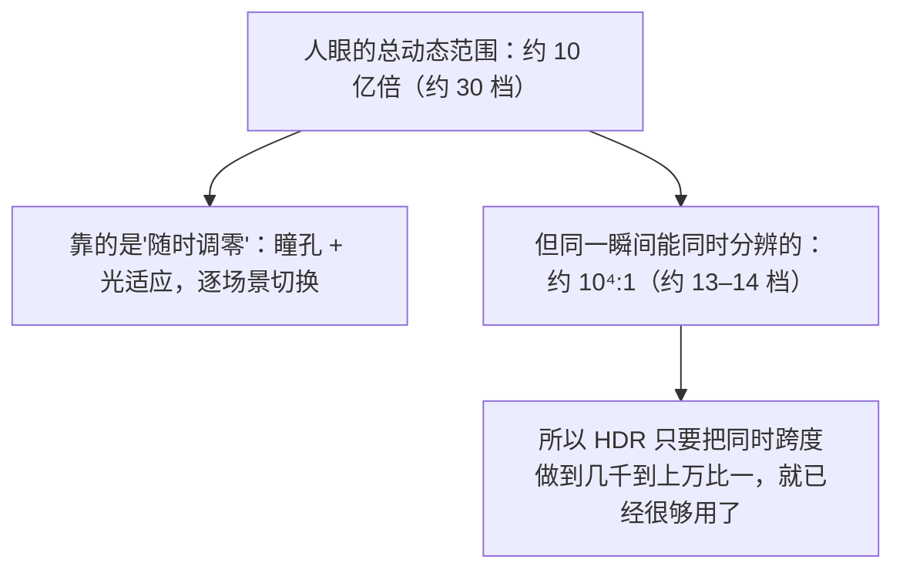

# 第 02 章 亮度、对比度与动态范围：把话说白

> 这一章把三个最基础、也最容易被厂商玩文字游戏的量讲透：亮度、对比度、动态范围。三者的定义都朴素得过分，可"口径"能差出几十倍。我们还会引入两个工具：单位 nit（= cd/m²），以及用"档（stop）"描述亮度跨度。之后再看"亮度 1000 nit""对比度 1000000:1"这类宣传语，第一反应大概会变成"按什么口径算的"。这三个量，是后面理解 HDR 面板、认证、色调映射的公共语言。

## 一、亮度到底是什么：先分清楚"发光"和"被照"

很多人把三个不同的东西混着叫"亮度"，结果一讨论 HDR 就乱。

**第一个是"发光体有多亮"，叫亮度 / 辉度（luminance）。** 指一个能自己发光的表面，朝某个方向发出的光有多强。显示器、手机屏、灯泡、太阳，都是发光体。

**第二个是"被照的地方有多亮"，叫照度（illuminance）。** 指的是"有多少光落在你身上"。房间的灯照在桌面上、阳光照在地面上，说的是照度。

**第三个是"看起来有多亮"，那是主观感受。** 同一块屏幕在暗房里和在大太阳底下，物理发光量完全一样，但你的"感觉亮度"天差地别。这一点第 3 章会专门讲。

本章主要关心第一个：**发光表面的亮度**。

### 单位：nit 与 cd/m²

亮度的标准单位是 **cd/m²（坎德拉每平方米，candela per square meter）**，在显示行业里通常直接叫 **nit**。

> **1 nit = 1 cd/m²**，两者完全等价。

这个单位的意思是"**每平方米面积上、朝某个方向发了多少光**"。面积和方向都在里面，同一块屏幕正面看和斜着看，数值就不一样。

照度的单位是 **lux（勒克斯）**，指"每平方米接收到多少光"。两个单位差在一个"发光还是反光"：灯泡的发光量用 nit，一盏灯把桌面照得多亮用 lux。买显示器看的永远是 nit，与 lux 无关。

### 一个直觉锚点

数字本身说明不了什么，下面给几个日常量级做锚点（数量级估算，不同来源会有出入，别当精确值）：

| 场景 | 大致亮度（nit，即 cd/m²） |
|---|---|
| 无月夜空 | 约 0.001 及以下 |
| 烛光附近的暗处 | 约 1 上下 |
| 昏暗室内 | 约 10 上下 |
| 普通室内照明下的白纸 | 约 100 上下 |
| 明亮的办公室/商店照明 | 约 300–500 |
| 阴天户外 | 约 1000–2000 |
| 晴天户外地面/白墙 | 数千到上万 |
| 直视太阳附近 | 十万量级以上（且极危险，勿直视） |

从夜空的零点零几到太阳的十几万，**中间横跨约十亿倍**。理解"动态范围"，起点就是这个跨度。


## 二、对比度：同一句话，十种口径

**对比度（contrast ratio）**的定义朴素得很：

> **对比度 = 最亮的亮度 ÷ 最暗的亮度。**

比如最亮 1000 nit、最暗 1 nit，对比度就是 1000:1。听起来一点不难，"猫腻"却全在**"在什么条件下测"**。

### 三种常见口径

| 口径 | 怎么测 | 数字特征 | 可信度 |
|---|---|---|---|
| **原生对比度**（也称静态对比度） | 屏幕显示同一幅画面（一块白、一块黑），量最亮和最暗 | 通常几百比一到几千比一（LCD）；OLED 标称"无限" | 高，最能反映真实观感 |
| **动态对比度** | 分别播放"全白画面"和"全黑画面"，且允许背光/亮度被自动大幅调节后再量 | 动辄十万比一、百万比一、甚至标"无限" | 低，几乎只是营销数字 |
| **ANSI 对比度** | 用黑白棋盘格图案同时测，更贴近实际画面 | 比原生低一些 | 较高但少见厂商标 |

**动态对比度的猫腻在哪？** 关键在于"**允许调整背光**"。极端情况下，屏厂让全白画面时背光火力全开、全黑画面时把背光几乎关掉——这样算出的比值当然巨大。但你**永远不可能在同一帧画面里同时出现这两个状态**，所以这个数字跟你看片时的真实感受关系不大。

> 看到"对比度 1000000:1"，先问**是动态还是原生**。这类数字通常在说明书最不显眼处会补一句"动态对比度"。

### 对比度为什么重要

回到它的物理含义：**对比度决定了"黑得下去"还是"灰得像蒙了层雾"。**

夜里看一部太空片就能体会到：星空背景本该是纯黑，飞船的引擎喷口是刺眼的白。屏幕对黑的控制如果很差（最暗只能到最亮的 1/300），星空就成了一片灰雾，也就是大家说的"画面发灰""黑不下去"。

**提高对比度只有两条路：把最亮推高，或者把最暗压下去。** HDR 的两种主流技术路线正好各走了一条：LCD/Mini-LED 拼"更亮"，OLED 拼"更黑"（见第 11、12 章）。


## 三、动态范围：本章的核心概念

**动态范围（dynamic range）**算的还是**对比度**那个比值，只是更强调"范围"：一个系统**能同时容纳的亮度跨度有多大**。

> **动态范围 = 最亮值 ÷ 最暗值**（两者必须能在同一幅画面里同时呈现，否则就成了上面说的动态对比度把戏）。

### 用"档（stop）"或"倍"来数

直接念"1000:1""1000000:1"很反直觉，**人眼对亮度是乘除式感受，不是加减式**。换成**档（stop）**就好办：每翻一倍算一档，这个说法借自摄影曝光。

```text
用"档"来理解动态范围

1 档  =    2:1    （翻一倍）
2 档  =    4:1
3 档  =    8:1
4 档  =   16:1
…
10 档 = 1024:1   ≈ 1000:1   （大约"10 档"）
20 档 ≈ 100万:1  （约 20 档）
```

换算不难：**档数 ≈ 比值取以 2 为底的对数**，比值每多一个 0，大约多 3.3 档。这么一算就清楚了："动态对比度 1000000:1"比"原生 3000:1"多出来的部分有多虚。

摄影里也用同一套说法。相机宣称"宽容度 14 档"，指它能记录的最亮与最暗相差约 $2^{14}$ ≈ 16000 倍。


### 人眼能覆盖多大范围？

这里有两个完全不同的数字，混起来的人不少：

- **人眼总的可感知范围极大**：从勉强能看见的暗处到刺眼的阳光，横跨约 **10⁻³ 到 10⁶ nit** 量级，折算下来约十亿倍、约 30 档。
- **人眼在某一瞬间的对比度范围却小得多**：同一时刻、同一视场内，能同时分辨的最亮与最暗，一般认为是 **约 10⁴:1 量级**（大约 13–14 档）。

为什么能差这么远？因为人眼会像相机一样"调零"：瞳孔缩放、视网膜适应，让它在不同环境下都能工作，代价是**整体平移尺度，没法同时看全那十亿倍**。这套机制第 3 章细讲，它同时解释了 HDR 为什么必须存在、又为什么几千比一就"够用"。




### SDR 与 HDR 的差距，用"水杯"和"水桶"来说

两样容器，装的都是"亮度"这壶水：

- **SDR 是一只小水杯**：最亮约 100 nit，最暗按约定大约在 0.1 nit 左右，跨度约 1000:1（约 10 档）。
- **HDR 是一只大水桶**：最亮可以到几百甚至上千 nit（甚至更高），同时最暗可以压到 0.01 nit 甚至更低，跨度轻松上到几千乃至上万比一（十几档）。

真正关键的地方：**HDR 做的是"同时"抬高上限、压低下限，而不只是把水杯换成桶。** 只把最亮拉高、不管黑位，画面会刺眼却依旧发灰；只压黑位、不抬上限，画面干净却平淡。这是本章最重要的一条结论。


## 四、把三个词串起来看

| 概念 | 一句话定义 | 用什么衡量 | 常见坑 |
|---|---|---|---|
| 亮度 / 辉度 | 发光表面有多亮 | nit = cd/m² | 与照度 lux 混淆；忽略"斜看会变暗" |
| 对比度 | 最亮 ÷ 最暗 | 比值（如 1000:1） | 分不清原生/动态/ANSI |
| 动态范围 | 能同时呈现的最亮÷最暗跨度 | 比值或档（stop） | 把"广"和"同时"弄混，被动态对比度骗 |

再拿一个具体场景对照：

```text
同一幅"夜晚车灯"的场景

SDR 屏幕：
  车灯        ──►  被削平在 100 nit（就是"白"）
  路灯        ──►  也接近"白"，细节丢失
  夜空        ──►  灰蒙蒙，约 0.1 nit
  结果：亮的不够亮，黑的不够黑，中间挤成一团

HDR 屏幕：
  车灯核心    ──►  上千 nit，刺眼、有"光感"
  灯罩细节    ──►  几百 nit，还能看清结构
  夜空        ──►  接近 0.01 nit，深黑
  结果：同一画面里从深黑到刺眼，层次全在
```

## 五、为什么这些定义对 HDR 特别重要

有人会问：人眼瞬时范围约 10⁴:1，SDR 约 1000:1，差的好像不多？

问题与比值大小无关，关键在于**这个范围放在了什么位置**。人眼对**绝对亮度水平**很敏感（第 3 章详解）：看一盏台灯和看一眼阳光，感受到的"亮"截然不同。SDR 把一切压在约 100 nit 附近，等于把所有场景塞进同一个亮度刻度，**烛光和阳光都成了同一档白**，画面里"光照强度"这条信息就此消失。

HDR 的意义，是让画面能表达"**这里真的很亮**"和"**这里真的很黑**"，而不只是"这里颜色不同"。它在游戏、电影里带来的沉浸感提升，根子也在这里。

## 本章小结与常见误区

- **亮度 / 辉度（luminance）单位是 nit，且 1 nit = 1 cd/m²**；不要和照度（illuminance，单位 lux）混淆，前者说的是"发光表面多亮"，后者说的是"被照的地方收到多少光"。
- 现实世界的亮度跨度极大，从夜空到阳光横跨约 10 亿倍，所以描述动态范围时用**档（stop）**比用比值更符合直觉：**每翻一倍是一档**。
- **对比度 = 最亮 ÷ 最暗**，但口径决定一切：**原生对比度**可信，**动态对比度**（允许自动调整背光）基本是营销数字，**ANSI 对比度**更贴近实际画面。
- **动态范围 = 能"同时"呈现的最亮 ÷ 最暗**。关键词是"同时"，否则就是动态对比度的把戏。
- 人眼**总的**可感知范围约 10⁻³ 到 10⁶ nit（约 30 档），但**同一瞬间**的同时对比度约 10⁴:1（约 13–14 档）；HDR 的目标是在"同时"这个前提下把跨度尽量拉大。
- **HDR 的要点 = 同时把高光做得更亮、把黑位做得更黑，从而扩大那个比值。** 只做一头，等于没做。
- 常见 nit 锚点（量级就行）：室内白纸约 100、阴天户外约千级、晴天户外数千到上万、阳光十万量级以上。

**几个容易混淆的点：**

1. **误区：把"峰值亮度"当唯一指标。** 峰值再高，如果黑位也高（黑不下去），画面对比依旧平淡。峰值亮度只是"上限"，黑位和对比度同样重要。
2. **误区：把"对比度 1000000:1"当真。** 先查是不是"动态对比度"。若是靠自动背光在两张不同画面之间算出来的，它和你在同一帧里看到的效果关系不大。

## 下一章预告

我们已经知道人眼的总范围约十亿倍、瞬时范围约一万比一——那这人眼到底是怎么"看光"的？下一章就拆开韦伯定律、光适应和同时对比，看清"为什么绝对亮度对 HDR 这么重要"。
