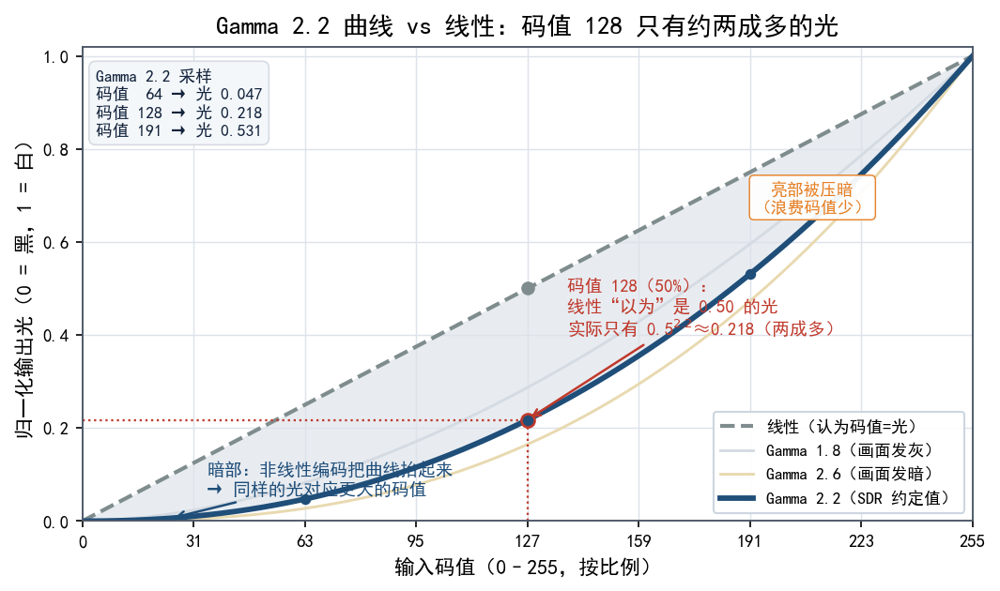
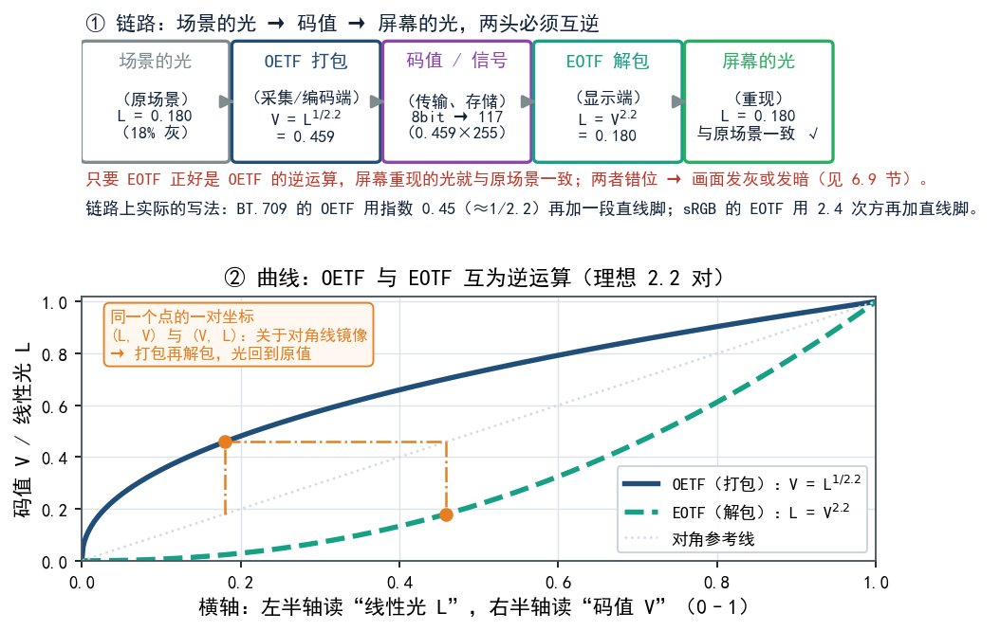
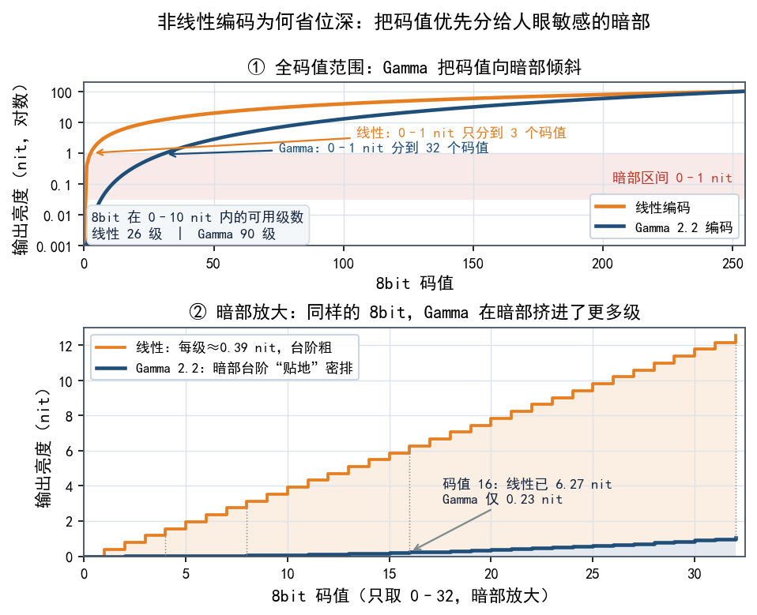
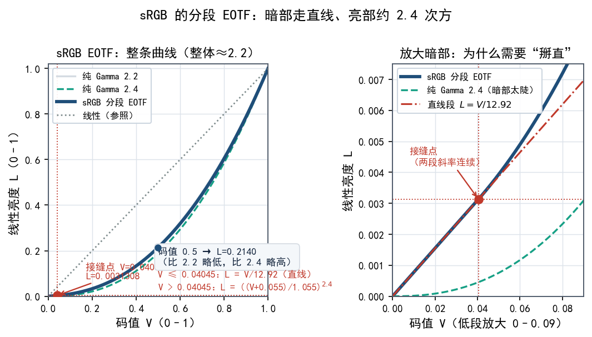
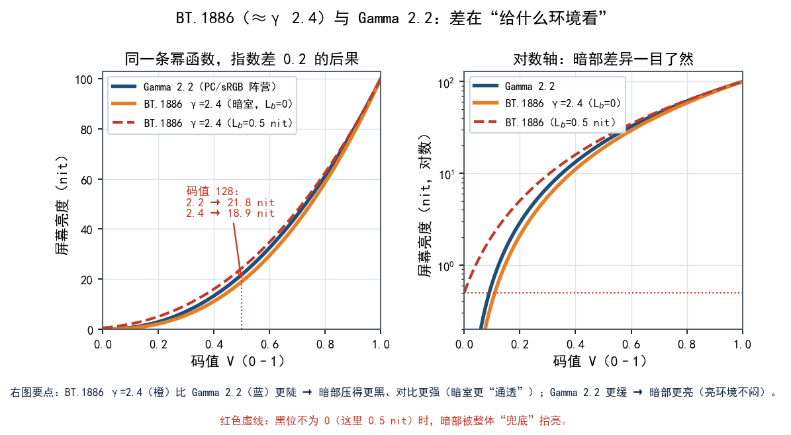

# 第 06 章 传递函数与 Gamma：从 CRT 到 sRGB

前面两章聊的是"颜色在哪里"（色度图）和"能显示多宽"（色域）。这一章换个维度：**同样的颜色，像素值和真实亮度到底是什么关系？** 很多人默认"像素值 128 就等于亮度 128"，其实差得很远。搞懂这条"码值↔光"的换算规则（也就是传递函数和 Gamma），SDR 是怎么被"约定"出来的才算真正清楚，HDR 为什么要另起一套规则也就好理解了。

## 6.1 核心误会：像素值不是光

先做个思想实验。一张 8 位灰度图里，码值 0 表示最黑，255 表示最白，128 表示"中间"。那么码值 128 的像素，亮度是不是 255 的一半？

**不是。** 它对应的光大约是最大亮度的 **百分之二十几**，而不是 50%。显示器没坏，这是行业约定好的：**码值和实际亮度之间不是直线关系，而是一条弯的曲线。**

这条"码值 ↔ 光"的换算曲线，就是**传递函数（transfer function）**。它在整个显示体系里最容易被忽略，却又最影响观感。



## 6.2 两条曲线：OETF 与 EOTF

传递函数有**两个方向**，方向搞反是初学者最常犯的错误。这两者得分开看：

| 名称 | 全称 | 方向 | 用在哪 |
|---|---|---|---|
| **OETF** | 光电转换函数（Opto-Electronic Transfer Function） | **光 → 码值** | 采集/编码端（相机、母版） |
| **EOTF** | 电光转换函数（Electro-Optical Transfer Function） | **码值 → 光** | 显示端（屏幕） |

两个方向也可以这样记：**OETF 把光"打包"成码值，EOTF 把码值"解包"成光。**

OETF 与 EOTF 的转换规则最早来自 CRT 的物理特性，由电子枪和荧光粉决定。到了现代，这对关系仍然保留，主要是编码位深的需要。LCD/OLED 的物理特性与 CRT 完全不同，今天的 OETF/EOTF 是人为规定的标准，作用有三：兼容历史、优化感知、节省位深。前面已经讲过，给暗部多分配一些 bit 位靠的就是这种映射；附带的好处是，一些很老的彩色影片依然能直接在很新的 LCD 屏幕上播放。后面两小节会展开讲。


理论上，只要显示端的 EOTF 正好是编码端 OETF 的**逆运算**，最后的光就和原来一致，"画面就对了"。但现实中这两条曲线并不严格互逆，各种"颜色不一致"的毛病，根源之一就在这里。

还有个容易绕晕的地方：在 SDR 体系里，**业界习惯用"显示端的曲线"（EOTF）来当基准，编码时取它的反函数**。于是 sRGB 标准里定义的是 EOTF，BT.709 标准里定义的是 OETF；名字不同，说的其实是链路的两头。



## 6.3 Gamma 的起源：CRT 的"先天非线性"

为什么当初要设计成弯曲的曲线，而不是划一条直线？故事要回到显像管电视（CRT）时代。

老式 CRT 靠电子枪轰击屏幕发光。它的**输入电压和输出亮度之间天生不是直线**，而近似一条幂函数：

```text
亮度 L ∝ 电压 V^γ ，  其中 γ(伽马) 约 2.2
```

电压只加到一半，亮度并不是一半，而只有大约 (0.5)^2.2 ≈ 0.22，两成多。这个指数 γ（**伽马**）就是"Gamma"一词的来历。

当年工程师发现这个特性后，做了一个"顺水推舟"的处理：**既然显示器天生是 2.2 次方，那我就在信号编码时用 1/2.2 次方（约 0.45）预先"反向弯曲"一次**，两端一抵消，总体就恢复成直线了。

**所以 Gamma 编码是一个历史副产品**——它不是为了画面更好看而精心设计的，只是为了迁就 CRT 的怪脾气。不过它意外带来了一个巨大好处，见下一节。

## 6.4 为什么非线性编码反而更省位深

假设没有 Gamma，直接用直线（线性）编码：码值 128 对应一半亮度。听起来很合理，但会出事。

还记得第 3 章的结论吗——**人眼对暗部变化远比亮部敏感**。线性编码下，亮部占了大量码值却看不出差别（浪费），暗部码值稀少、被量化得极粗糙，于是出现**色带（banding）**：本该平滑的渐变变成一圈圈台阶。

Gamma 编码恰好反过来：**把更多码值分配给人眼敏感的暗部，把少一些分给人眼不敏感的亮部。** 同样 8 位精度，暗部就细腻多了。

**Gamma 编码像一个"压缩包"**：它知道哪段信息重要（暗部），就多分点空间；哪段不重要（高光），就少分点。"感知编码"的思路正是从这里起步，后来 HDR 的 PQ 曲线（见第 7 章）把它推到了极致。

| 编码方式 | 暗部码值分配 | 8 位下暗部表现 |
|---|---|---|
| 线性 | 很少 | 色带明显、发灰 |
| Gamma（约 2.2） | 多 | 大致平滑，肉眼看不出台阶 |



### XYZ 与 RGB

回到 XYZ 和 RGB，把这里面的关系再理一遍。

sRGB 相当于在 XYZ 可见色域里选了一个由三个正原色构成的三角形。三角形内的颜色可以用非负 sRGB 码值表示；三角形外，也就是 sRGB 色域外的颜色，sRGB 不涉及，强行表示会出现负分量或超 1 分量。这跟“最原始三刺激值有负值”有关，但不能说 sRGB 直接避开了 XYZ 的负值；更准确的说法是，sRGB 用正原色定义了一个有限的、物理可实现的色域子集。

另外要分清：sRGB 选的三基色并不是先前色彩混合实验里用的 CIE RGB 三基色。CIE RGB 那组三基色只是为了探索不同波长的光与三基色之间的关系，两者别搞混。

XYZ 是线性的，8bit 在暗部精度很差，容易看到明显色带，所以要存 XYZ，常用浮点 TIFF、EXR、DPX 这类格式。sRGB 是 XYZ 的一个子集映射，sRGB 能表示的颜色都在 XYZ 里，而 XYZ 能表示的颜色远多于 sRGB。Gamma 编码是为了存储效率，sRGB 的 Gamma 曲线让码值分配更符合人眼，所以 8bit sRGB 看起来比 8bit 线性 RGB 好得多。

图像经常用 jpg、PNG 之类的格式编码。以 PNG 为例，里面存的不一定天生就是 sRGB。它可能：
- 带 sRGB chunk：明确表示按 sRGB 解释；
- 带 ICC profile：按嵌入的 ICC 解释，可能是 Adobe RGB、Display P3 等；
- 什么都没有：很多软件会默认当 sRGB，但严格说色彩含义未定义。
用不同图片查看器打开同一张图，可能会看到不同的色调，这属正常现象，要看查看器用的是哪种映射方法。


## 6.5 sRGB 的分段 EOTF：不止是一条幂函数

说了半天"约 2.2"，但 sRGB 标准里写的其实是一条**分段曲线**。原因很实际：纯幂函数在最黑处（码值 0 附近）斜率趋向无穷，数值上不好处理。

sRGB 的显示 EOTF（把码值 V（0～1）换成线性亮度 L）是这样定义的：

```text
若 V ≤ 0.04045:   L = V / 12.92
否则:             L = ((V + 0.055) / 1.055) ^ 2.4
```

拆开看：**暗部用一条直线**（斜率 12.92，接近线性），**亮部用 2.4 次方**。指数虽然是 2.4，但暗部那段被"掰直"了，**整条曲线合起来的等效效果大约就是 2.2**。所以口语里常说"sRGB 的 gamma 是 2.2"，严格讲是"分段曲线，整体约 2.2"。



## 6.6 BT.709 的 OETF：电视那边怎么写

高清电视（BT.709）定义的是编码端的 OETF，把线性光 L 转成信号 V：

```text
若 L < 0.018:   V = 4.5 × L
否则:           V = 1.099 × L^0.45 − 0.099
```

指数 **0.45 ≈ 1/2.2**，正好是接收端 2.2 的倒数。暗部同样用直线段（斜率 4.5）。结构上和 sRGB 是同一个套路。

## 6.7 BT.1886：把显示端也钉死

上面说的都是"内容怎么编码"。可如果每台显示器自己的 EOTF 都不一样，同一段内容放出来岂不是各不相同？于是还需要一份**显示端**标准。

**BT.1886** 就是为此制定的：它规定了 HDTV 显示器的 EOTF，**接近纯 γ 2.4**，并且把屏幕的黑位和峰值亮度也纳入公式（而不是假设完美的 0 到 1）。

关键前提是：**BT.1886 假定你在暗室（家庭影院）观看，屏幕黑位接近 0。** 这个假设很重要，"2.2 还是 2.4"那场争论就是从它开始的。

## 6.8 2.2 还是 2.4：一场关于环境光的争论

同样一条幂函数，为什么有人说 2.2、有人说 2.4？因为**观看环境不一样**。

- **暗室（家庭影院）**：环境光几乎没有，黑位可以压得很低。此时用稍陡的 **2.4** 能拉开暗部对比，黑更深、画面更"通透"，这就是 BT.1886 的选择。
- **明亮环境（办公、PC、客厅白天）**：环境光会"兜底"照亮屏幕，把黑位抬高，暗部被"洗白"。这时若还用 2.4，画面会显得**过暗、细节闷**；用稍缓的 **2.2** 更合适。

所以这无关对错，关键是**"给什么环境用"**：PC 传统偏 2.2，影院偏 2.4。sRGB 名义上也属于 2.2 阵营。



$L_b$ 是 BT.1886 公式中的参数，代表显示器的黑位亮度 (Black Level Luminance)，即当输入码值为 0 时，屏幕发出的光。单位是 nit (cd/m²)。 

- $L_b = 0$：理想显示器，黑位完全为 0（比如理想的 OLED）。 
- $L_b = 0.5$ nit：实际显示器，黑位不是完全 0，而是 0.5 尼特。这是传统 LCD 或环境光反射造成的“底黑”（黑位抬高）现象。

BT.1886 的公式包含 $L_b$ 和 $L_w$（峰值白亮度），其数学表达式（通常用的简化形式）是： 

$$ L = a (V + b)^{\gamma} $$

其中： 

$a = \left(L_W^{1/\gamma} - L_B^{1/\gamma}\right)^{\gamma}$

$b = \frac{L_B^{1/\gamma}}{L_W^{1/\gamma} - L_B^{1/\gamma}}$

其中，$V$ 是输入码值（0 到 1）；$L_W$ 是峰值白亮度；$L_B$ 是黑位亮度（也就是图中的 $L_b$）；
$\gamma$ 是 Gamma 值（图中取 2.4），当 $L_b = 0$ 时，公式退化为纯幂函数；
$L = L_W \cdot V^{\gamma}$，黑位从 0 开始。 当 $L_b = 0.5$ 时，公式中的常数 $b$ 会把整个暗部曲线“抬起来”，使得 $V=0$ 时，亮度 = $0.5$ nit。

如果不考虑物理黑位，直接用纯 Gamma 2.4（橙线），那么在实际黑位是 0.5 nit 的屏幕（比如 LCD）上，按纯 Gamma 2.4 算出来的暗部信号（比如 V=0.1），可能要求屏幕发出 0.01 nit 的光，但屏幕根本做不到（它最低只能到 0.5 nit），暗部细节就会死黑一片。 BT.1886 引入 $L_b = 0.5$ 的作用就是：既然屏幕黑不下去，那就把暗部整体抬亮。这样暗部细节能在这种屏幕上显示出来，不至于全黑。代价是暗室的绝对对比度降低，看起来没那么“通透”了。


## 6.9 解码链错位会怎样

编码用的是一条曲线、显示用的是另一条，画面就会"走样"：

| 内容编码 | 显示端 EOTF | 结果 |
|---|---|---|
| 2.2 | 2.2（正确） | 正常 |
| 2.2 | 偏小（如 1.8） | **发灰**，黑不够黑、像蒙了层雾 |
| 2.2 | 偏大（如 2.6） | **发暗**，暗部细节被压死 |
| 2.4 | 2.2 | 略发灰（暗部被抬亮） |

"同一张图在两台显示器上，一台发灰一台正常"，原因往往不在"面板好坏"，而在**链路上 Gamma 没对齐**。

## 6.10 一句话总结 SDR 的"约定"

到这里可以给 SDR 算总账了：**SDR 整条链路都是"相对、约定俗成"的。** 它假定显示白点大致在 100 nit（nit 即 cd/m²，二者等价）附近，EOTF 固定为约 2.2（或影院 2.4），色域锁定在 sRGB/BT.709。这些"约定"凑在一起，把 SDR 的亮度上限和色彩范围都框进一个小盒子，而 HDR 要打破的正是这个盒子（见第 7 章）。

## 本章小结与常见误区

- **码值 ≠ 亮度**：像素值 128 对应的光大约是最大亮度的两成多，而非一半。
- **OETF 是光→码值（打包，采集端）**，**EOTF 是码值→光（解包，显示端）**，方向不能混。
- **Gamma 源自 CRT 的电压-亮度非线性**（γ≈2.2），1/2.2 的编码是为了抵消它，属于历史副产品。
- **非线性编码更省位深**：把码值向人眼敏感的暗部倾斜，8 位也能大致看不出色带。
- **sRGB 是分段 EOTF**：暗部走直线，亮部约 2.4 次方，整体等效约 2.2。
- **BT.709 定义 OETF**（指数 0.45），**BT.1886 定义显示 EOTF**（接近纯 γ 2.4，假定暗室）。
- **2.2 vs 2.4 取决于观看环境**：亮环境偏 2.2，暗室偏 2.4；链路错位会导致发灰或发暗。

**几个容易混淆的点：**

1. **误区：以为 Gamma 只是"亮度调节"。** 它不是调亮暗的旋钮，而是码值与光之间固定的换算曲线；乱调会破坏整条链路。
2. **误区：把 OETF 和 EOTF 混着用。** 一个在采集端、一个在显示端，用反了画面必然失真。

## 下一章预告

SDR 这套"相对、约定俗成"的规则，到 HDR 就彻底换代了。下一章讲 HDR 的两把全新尺子——**绝对式的 PQ（ST 2084）**和**相对式的 HLG**，它们是整本教程最关键的一块拼图。
