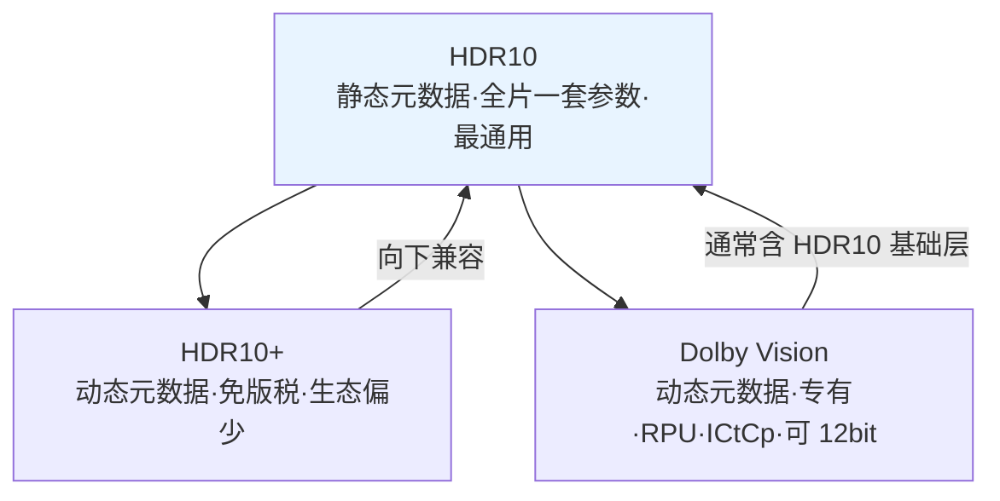

# 第 09 章 Dolby Vision 与 HDR10+：动态元数据的较量

上一章说到，HDR10 的静态元数据有个先天短板：整部片子只有一套参数，暗场和亮场只能折中。业界补这个短板的办法是**动态元数据（dynamic metadata）**，让元数据随场景、甚至随每一帧变化。围绕这条路，市场上形成了两大阵营：**Dolby Vision（杜比视界）**和 **HDR10+**。这一章要搞清楚它们各自是什么、怎么实现、谁更强，以及最重要的，对普通用户意味着什么。

## 9.1 动态元数据：每一幕换一张曝光表

先复习一下第 8 章的类比：**HDR10 = 整部电影只用一张曝光表**。

**动态元数据**要做的，就是把这张表拆开——**每个场景用一张，甚至每一帧用一张**。片子里出现烛光晚餐，就配一套适合暗场的参数；切到正午雪原，立刻换一套适合超亮场景的参数。

```text
HDR10（静态）：[———————— 一部电影，一套参数 ————————]
                       ↑ 只能折中

DV / HDR10+（动态）：[镜头A:参数1][镜头B:参数2][镜头C:参数3]...
                       ↑ 每个场景/每帧都能单独调
```

这带来什么实际好处？说起来很朴素：**暗场不糊、亮场不爆**。

- 暗场镜头：可以放心地压暗，让黑位更黑、更接近导演想要的观感。
- 高光镜头：可以专门为这片区域的亮度做映射，保留太阳、火光、灯牌的细节。
- 中间调场景：不用为了迁就极端场景而牺牲，忠于母版。

代价也明显：**元数据量变大、传输和处理更复杂，而且内容、设备、链路全都得支持**。所以动态元数据虽好，并不是"处处都有"。

动态元数据具体长什么样？可以把它想成一串"每帧的调色备注"，大致是这样一组数字：

| 帧/场景 | 该帧的峰值亮度 | 该帧的亮度分布 | 建议的映射强度 |
|---|---|---|---|
| 场景 1（烛光晚餐） | 约 300 nit | 大多很暗 | 强压高光、保护暗部 |
| 场景 2（室内白天） | 约 800 nit | 中等 | 温和映射 |
| 场景 3（正午雪原） | 约 4000 nit | 大面积明亮 | 重点压缩大范围高光 |

这些数字随着播放进度不断变化，显示端读到一组就立刻调整一次，精度自然远超"全片一套参数"。


## 9.2 Dolby Vision（杜比视界）：精细但专有

**Dolby Vision** 是目前业界公认最精细的 HDR 方案之一，由杜比（Dolby）公司主导。它的关键词是"**专有**"和"**逐级适配**"。

### 它特别在哪

| 特点 | 说明 |
|---|---|
| **专有/需授权** | 不是免费开放标准。从内容制作到播放设备，都要经过杜比授权与认证，才能打上 Dolby Vision 标志 |
| **支持 12bit 亮度精度** | 母版和处理链路可支持 12bit，比 HDR10 的 10bit 留出更细的余地（注意：这不等于普通消费级屏就是"真 12bit"，见第 10 章） |
| **使用 ICtCp 色彩编码** | 相比传统的 YCbCr，ICtCp 在广色域、高亮度下更稳定（本章先点到，第 10 章详解） |
| **用 RPU 承载元数据** | **参考处理单元（Reference Processing Unit, RPU）**：一段随画面走的"处理说明"，包含动态元数据，告诉显示端这一帧该怎么映射 |
| **逐级适配** | 同一份内容可以针对不同能力的设备给出不同映射方案，"高端屏有高端屏的版本，普通屏有普通屏的版本" |

### 单层与双层：Dolby Vision 的组织方式

Dolby Vision 的内容在结构上分"**单层（single layer）**"和"**双层（dual layer）**"两种组织方式：

- **双层**：一个 **HDR10 基础层**（大家都能放的"通用版"）+ 一个 **增强层**（额外信息，让支持 DV 的设备看到更完整的效果）。信息量最大，常见于 UHD 蓝光。
- **单层**：把信息整合在一起，文件更轻，常见于流媒体。

理解这个结构的用处在于：它解释了"为什么有些 DV 片源能在普通 HDR10 设备上放、有些却完全放不出"，差别就藏在这里。

### RPU：Dolby Vision 的核心机关

**RPU** 可以理解成"**贴在每一帧旁边的调色备注**"。它是动态元数据的载体，内容里除了一份"HDR 版"，还内置一个"**基础层**"，由此得到一个很实用的特性：

> **向下兼容**：Dolby Vision 的内容里通常包含一个 **HDR10 基础层（base layer）**。如果播放链路的某一段不支持 Dolby Vision，设备和内容可以退回去按 HDR10 播放，画面照样能看，只是少了动态元数据的精细调校。

这就是为什么很多 Dolby Vision 片源在普通 HDR10 设备上也能正常播放：它"藏了一份通用版"。


### 常见 Profile（了解即可）

Dolby Vision 针对不同使用场景分了多个 **Profile**，我们不需要记全，只要建立它"分档"的印象：

| Profile | 大致用途 |
|---|---|
| **Profile 5** | 流媒体常用，单层、不含 HDR10 基础层（所以**不做 HDR10 兼容**） |
| **Profile 7** | UHD 蓝光常用，双层（基础层 + 增强层），信息量最大 |
| **Profile 8** | 流媒体/设备常见，单层，**带 HDR10 向后兼容基础层** |

编号不必背，只要知道 **Profile 决定了这份内容"能不能退回 HDR10 播放"，以及它有多"重"**。

> **类比**：Dolby Vision 像一位"高级摄影指导跟组拍摄"，每一幕都亲手调过光；而它内置的基础层，像"顺便留了一份给普通放映机的通用拷贝"。


## 9.3 HDR10+：免版税的挑战者

Dolby Vision 很强，但"专有+授权"这套模式让不少厂商不太愿意被绑定。于是出现了 **HDR10+**——它的定位非常明确：**动态元数据 + 免版税（royalty-free）**。

| 特点 | 说明 |
|---|---|
| **动态元数据** | 逐场景提供映射信息，补上了 HDR10 的最大短板 |
| **免版税** | 开放使用，不收取类似的授权费，对厂商更友好，主要由三星（Samsung）、亚马逊等推动 |
| **基于 HDR10 扩展** | 可以理解为"HDR10 的动态元数据升级版"，天然向下兼容 HDR10 |
| **硬件支持相对较弱** | 相比 Dolby Vision，实际支持 HDR10+ 的设备、片源和内容生态**目前仍偏少**，尤其在某些电视品牌和播放设备上支持度不一致 |

总结起来：**HDR10+ 在技术上完全能打，短板主要在生态**。很多设备"支持 HDR10+ 是支持了，但内容不一定多"；反过来，很多流媒体平台给的是 Dolby Vision 或 HDR10，未必给 HDR10+。

> **类比**：如果 Dolby Vision 是"必须买门票的高级影厅"，HDR10+ 就是"免费开放的升级版普通影厅"——性价比高，但排片（内容）还得看院线（平台和厂商）脸色。

## 9.4 三者对比：HDR10 / HDR10+ / Dolby Vision

下面这张表把三者摆在一起，值得多看两眼：

| 对比项 | **HDR10** | **HDR10+** | **Dolby Vision** |
|---|---|---|---|
| 元数据 | 静态（全片一套） | 动态（逐场景/帧） | 动态（逐场景/帧） |
| 授权 | 开放免费 | 开放免费 | 专有、需授权认证 |
| 位深（母版/链路） | 10bit | 10bit | 可支持 12bit |
| 色彩编码 | BT.2020 + YCbCr | BT.2020 + YCbCr | 常用 ICtCp |
| 动态元数据载体 | 无 | 随码流 | RPU |
| 向下兼容 | ——（它就是基础） | 兼容 HDR10 | 通常含 HDR10 基础层（视 Profile） |
| 生态支持 | **最广，几乎人人支持** | 中等，硬件与内容支持偏少 | 较广，但依赖授权认证 |
| 效果潜力 | 够用，暗亮两端折中 | 优于 HDR10 | 通常最精细（视母版与设备） |




## 9.5 对普通用户，这些差别意味着什么？

技术讲完，落到你最关心的问题：**我该在意哪一个？**

**先看内容。** 片源给的是什么，比你的志向更重要。一部只发 HDR10 的片子，你的 Dolby Vision 电视也只能按 HDR10 放。

**再看全链路。** 动态元数据要生效，得**播放器、显卡/芯片、线材、接口、显示器**全都支持并正确握手。任意一环掉链子，就会"降级"到 HDR10，甚至掉回 SDR。（见第 15 章）

**别迷信标志。** 看到"Dolby Vision"或"HDR10+"标志，不代表画面一定更好看。观感取决于**母版做得好不好**（内容质量才是天花板），取决于**设备的映射实现水平**（同样的 DV，不同电视差异很大），也取决于**你调没调对**（设置、校准）。

**向下兼容是福利，别当成性能。** "能退回 HDR10 播放"是兼容性设计，不等于你在享受 Dolby Vision 的精细度。

```text
能不能看到"最好"的 HDR，是三重门：
   内容支持 DV/HDR10+ ？  →  链路全程支持 ？  →  设备映射实现好 ？
        └────────── 三道全绿灯，才轮到谈"谁更精细"
```

三者的关系可以这样看：**HDR10 是地基，HDR10+ 和 Dolby Vision 是地基上的两栋精装房；房子装得再好，地基（内容与链路）不行也白搭。**

此外，杜比视界是一项需要硬件层面认证的技术，一台仅支持HDR10的电视无法通过后续的固件升级来获得完整的杜比视界支持，因为它缺少必要的硬件基础。HDR10通常要求10-bit色深（约10.7亿种颜色），而杜比视界的目标规格支持12-bit色深（约687亿种颜色），能带来更平滑的色彩过渡，减少色带现象。只支持HDR10的屏幕在物理上就无法呈现12-bit的色彩信息。

目前许多流媒体和部分蓝光内容使用杜比视界 Profile 8.1。这种格式的设计本身就考虑了向后兼容性，它的基础层（Base Layer）就是标准的HDR10信号，动态元数据作为额外信息附加在上面。因此，在仅支持HDR10的屏幕上播放Profile 8.1内容时，播放器会忽略掉杜比视界的动态元数据，仅使用HDR10基础层进行解码和显示。你看到的画面是一个正常的HDR10画面，虽然不是杜比视界的最佳效果，但至少色彩和亮度通常是正确的。

## 本章小结与常见误区

- **动态元数据**让映射参数**逐场景、甚至逐帧**变化，解决了 HDR10"全片一套参数"的折中困境，实现**暗场不糊、亮场不爆**。
- **Dolby Vision**：专有、需授权认证；可支持 12bit；使用 **ICtCp**；动态元数据由 **RPU** 承载；有多个 **Profile**（如 5/7/8）；通常含 HDR10 基础层，可向下兼容。
- **HDR10+**：**免版税**的动态元数据方案，主要由三星、亚马逊等推动；基于 HDR10 扩展，天然兼容 HDR10；但**硬件与内容生态支持相对偏少**。
- **三者对比**：HDR10 最通用但只有静态元数据；HDR10+ 免费且动态，生态待成长；Dolby Vision 最精细但专有。
- **对用户**：看内容给什么、看链路全不全、看设备实现好不好、别被标志带节奏。

**几个容易混淆的点：**

1. **误区：设备上挂着 Dolby Vision 标，画面就一定比 HDR10 好看。**
   不一定。观感取决于**母版质量 + 设备映射实现 + 设置校准**。同一部 DV 片在不同电视上差别可能很大；实现不佳的 DV 甚至可能不如调校良好的 HDR10。
2. **误区：HDR10+ 和 Dolby Vision 可以互相替代、随便选。**
   不能。它们**不是同一套技术**，元数据格式、载体、兼容方式都不同。设备支持哪个就得用哪个；两者都能播放同一部片的前提，是片源本身就带了对应版本。

## 下一章预告

动态元数据、12bit、ICtCp 这些名词背后，都指向同一个问题——**数据量和精度**：HDR 到底要多少位深、怎么压缩才不露馅？下一章我们揭开位深、编码与色度采样的秘密。
