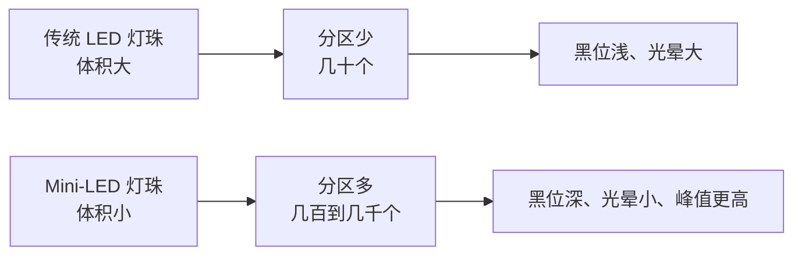

# 第 11 章 面板与背光：LCD、FALD 与 Mini-LED

这一章我们要打开显示器看里面。你会知道为什么绝大多数液晶显示器"黑不下去"，为什么厂商要在一块屏幕背后塞进几百上千个小灯泡，以及"分区背光""Mini-LED""光晕"这些广告词到底在说什么。看完这一章，再看到"直下式 500 分区"或者"侧入式 16 分区"这类宣传语，你就能立刻判断它值不值钱。

## 11.1 先记住一个比方：总亮着的灯泡 + 百叶窗

想象一个房间。天花板上装着一盏**永远亮着**的灯，窗户上装着一排可以转动的**百叶窗**。灯本身的亮度不会变，你能看到的明暗，全靠百叶窗开多大：叶片立起来，光透过去，看起来亮；叶片转平，光被挡住，看起来暗。

这就是液晶显示器（Liquid Crystal Display, LCD）的全部核心思想：**LCD 自己不发光，它只负责"挡光"。** 真正发光的另有其人——背光（backlight）。

## 11.2 一层一层拆开看

从观众的眼睛往里看，一块 LCD 是多个不同面板叠起来的。
几个关键点：

- **两片偏光片夹着液晶**：液晶分子不通电时会把光"扭"一个角度，通电后不再扭，配合偏光片就能让光"通过"或"被挡"。这就是百叶窗。
- **彩色滤光片**把每个像素分成红（R）、绿（G）、蓝（B）三个**子像素**，靠三色亮度混合配出各种颜色。
- **薄膜晶体管（Thin-Film Transistor, TFT）**是每个子像素的独立开关，负责精确控制每个光阀的开启程度。
- **背光是整块共用的**——这才是后面所有麻烦的根源。

记住一句话：**液晶控制的是"挡多少光"，不是"发多少光"。**


## 11.3 为什么 LCD 黑不下去

想显示"纯黑"，理想情况是百叶窗完全关死，一点光都不漏。但现实中做不到：

1. 液晶分子无法 100% 挡住光，总有少量光漏过去，这叫**背光泄露**。
2. 背光一直亮着，只要漏一点点，就是你看到的"发灰的黑"。
3. 偏光片、彩色滤光片、液晶层本身也会有轻微散射。

所以 LCD 的黑位（black level）通常在**约 0.1 nit 到 0.5 nit** 这个量级（nit 就是 cd/m²，两者等价，见第 2 章），而一块峰值 400 nit 的屏，对比度差不多就是 1000:1 上下——离"真黑"差得远。

这解释了一个反直觉的事实：**LCD 想更深黑，主要靠把峰值亮度做高来拉大比值，而不是把黑做得更黑。** 因为黑位已经被物理结构锁在某个下限附近了。

## 11.4 面板三兄弟：TN、IPS、VA

同样是 LCD，液晶分子的排列方式不同，性格差异很大。常见三种：

| 类型 | 全称 / 俗称 | 原生对比度（约） | 可视角度 | 响应速度 | 典型特点 |
|---|---|---|---|---|---|
| TN | Twisted Nematic 扭曲向列 | 700:1 ~ 1000:1 | 差 | 最快 | 便宜、适合高刷，但偏色、发白 |
| IPS | In-Plane Switching 平面转换 | 1000:1 ~ 1500:1 | 好 | 中等 | 色准好、视角好，但"发光"让黑更灰 |
| VA | Vertical Alignment 垂直排列 | 3000:1 ~ 6000:1（高端更高） | 稍差 | 较慢 | 对比度高、黑更沉，但暗部拖影、暗场细节易糊 |

对 HDR 来说，**VA 的原生对比度最高**，所以在中端 HDR 显示器里最常见；IPS 的优势在色准和视角，多用于偏创作/专业的机型；TN 基本已退出 HDR 舞台。

但要强调：**这三者都还是 LCD，黑位的物理上限都在那里。** VA 已经很接近液晶能做到的头了，想再深，只能动背光。

## 11.5 全局调光：整块屏一起亮暗

既然"背光恒亮"是问题，最直接的想法就是：让背光也能调。

最粗糙的做法叫**全局调光（global dimming）**——整块背光的亮度**一起调**。画面整体很暗时，把背光调暗，黑位跟着变黑；画面很亮时，把背光拉满，峰值也上去了。它就像一个"跟着场景走的整体音量旋钮"。

缺点是：

- 只能处理"整帧都暗"的情况。一旦画面里同时有明亮的太阳和漆黑的夜空，它就没辙了——要么整体调亮导致黑夜发灰，要么整体调暗导致太阳不够亮。
- 亮度在场景切换时忽明忽暗，看久了眼睛累（俗称"闪背光"）。
- 很多厂商宣传的"动态对比度几十万比一"就是靠它凑出来的数字，**不是同时能显示的真对比度**，参考价值很低。

## 11.6 分区调光（FALD）：把一个大灯泡拆成很多小灯泡

真正的解决办法是**分区调光（local dimming）**：把背光拆成很多能**独立调节亮度的小块**，画面哪一块暗，就只把那一块的背光调暗。

当背光被排成"横竖成行成列的一整片"时，就叫**分区背光（Full-Array Local Dimming, FALD，全阵列局部调光）**。
全局调光，所有区域一起亮，亮度只有 1 档。分区调光（FALD），暗处背光关小，亮度有 N 档。

分区越多，越接近"像素级控光"，黑位越深、光晕越小。


## 11.7 直下式 vs 侧入式

灯珠放在哪里，决定了分区的精细程度和机身厚度：

| 方案 | 灯珠位置 | 分区数量（典型） | 机身厚度 | 成本 |
|---|---|---|---|---|
| 侧入式（Edge-lit） | 屏幕边缘的灯条 | 很少，几条到十几条 | 薄 | 低 |
| 直下式（Direct-lit / FALD） | 屏幕正后方的灯珠阵列 | 几十到几千 | 厚 | 高 |


侧入式虽然也能做出"分区"，但因为只有边缘几条灯条，控光非常粗，HDR 效果通常有限。看到"HDR"配侧入式背光，基本可以判定它走的是保守路线。


## 11.8 Mini-LED：灯珠变小，分区暴涨

**Mini-LED** 指的是把 LED 灯珠做到很小（比传统 LED 小一个量级），从而在同样的屏幕面积里塞进更多灯珠、组成更多更小的分区。



好处是连锁的：

- **分区更多** → 暗场能关得更干净，黑位更深、光晕更小。
- **灯珠更亮更密** → 峰值亮度可以做得更高（高端 Mini-LED 常见 1000~2000 nit 甚至更高量级）。
- 尺寸还能做小、功耗更可控。

一句话：**Mini-LED 是目前 LCD 阵营把 HDR 做到最好的路线**，本质上仍是"FALD + 更多分区 + 更高亮度"，不是新物种。

## 11.9 分区与像素的巨大差距——光晕的根源

这是全章最重要的一段，请慢慢看。

一块 4K 屏幕有约 **830 万个像素**（3840×2160）。而哪怕很不错的 Mini-LED 显示器，分区数量通常也就**几百到几千个**。

```text
   像素网格（几百万个格子）          背光分区（几百个格子）
   ┌─┬─┬─┬─┬─┬─┬─┬─┬─┐            ┌────┬────┬────┐
   │ │ │ │ │ │ │ │ │ │            │    │    │    │
   ├─┼─┼─┼─┼─┼─┼─┼─┼─┤            │    │    │    │
   │ │ │ │ │ │ │ │ │ │     ≈      ├────┼────┼────┤
   ├─┼─┼─┼─┼─┼─┼─┼─┼─┤            │    │    │    │
   │ │ │ │ │ │ │ │ │ │            │    │    │    │
   └─┴─┴─┴─┴─┴─┴─┴─┴─┘            └────┴────┴────┘
   每个像素独立可关                一个分区要罩住上千个像素
```

这意味着：**一个分区的亮度是"整块共用"的。** 如果某个分区里同时有"一个小太阳"和"大片夜空"，它只能二选一：

- 为了太阳够亮，把分区背光开大 → 周围的夜空被照亮，变成灰蒙蒙的雾。
- 为了夜空够黑，把分区背光关小 → 太阳也变暗，高光不够冲。

这就是**光晕 / 泛光（blooming）**——亮物体周围出现一圈发光的光晕。

光晕还会带来副作用：局部调光算法若跟不上画面变化，会出现**闪烁、拖尾、暗部细节被压黑（black crush）**。这也是很多 HDR 显示器要提供"调光档位"（高 / 中 / 低 / 关）的原因——档位越高效果越好，但副作用越明显。

分区分得越多，每个分区覆盖的像素越少，这种现象越轻。**所以"HDR1000 + 1000 分区"和"HDR1000 + 100 分区"完全是两种东西。**


## 11.10 局部调光还会带来什么副作用

分区调光不是白拿的好处，它是一次权衡。除了光晕，你还要留意这几种现象：

- **明暗跳变（闪烁）**：画面里一块明亮区域刚移出某个分区，那块背光会从亮突然变暗，肉眼看到的就是一闪一闪。分区越少、算法越粗暴，越明显。
- **暗部被压黑（black crush）**：为了把黑做深，算法会把临近的黑一起压低，结果暗场里的细节（夜里衣服的褶皱、阴影里的脸）被吃掉。黑是黑了，但看不清东西。
- **延迟**：调光算法需要一点点时间判断画面，遇到快速镜头切换时，背光可能“晚半拍”，出现短暂的拖影或亮度滞后。
- **功耗与发热**：几百上千个分区同时高速开关，对驱动与散热都不轻松，这也解释了为什么高分区 HDR 显示器往往更贵、更厚。

所以现场调光并不是“分区数乘个系数”那么简单，**分区数、灯珠尺寸、算法质量必须一起看**。同样的分区数，算法差的产品可能比算法好的产品更难看。

## 11.11 横向对比

| 方案 | 黑位 | 峰值亮度 | 光晕 | 成本 | 适合 |
|---|---|---|---|---|---|
| 全局调光 LCD | 差 | 中 | 无（但整体发灰） | 低 | 办公 |
| 侧入式分区 | 较差 | 中 | 明显（条状） | 低-中 | 一般影音 |
| FALD（分区少） | 中 | 中-高 | 较明显 | 中 | 入门 HDR |
| FALD + Mini-LED（分区多） | 较好 | 高 | 轻微 | 高 | 高亮度 HDR |
| OLED（下一章） | 极好 | 中 | 无 | 高 | 综合 HDR |

## 11.12 选购小抄：三个问题看懂 LCD 的 HDR

看到一台 LCD 号称“HDR”，只需问三句：

1. **背光是什么结构？** → 侧入式就不必抱太大期待，直下式才算入门。
2. **多少个分区？** → 几十个是“入门”，几百个算“可以”，上千个才叫“像样的 Mini-LED”。
3. **峰值亮度多少 nit？** → 约 400 nit 是起步，600~1000 nit 开始有 HDR 味道，1000 nit 以上才能把高光做“冲”。

三个答案一凑，基本就能判断这台屏的 HDR 是“真的能用”还是“贴个标签”。

## 本章小结与常见误区

- LCD 自己不发光，靠**恒亮的背光 + 液晶"百叶窗"挡光**工作，所以天生黑不下去。
- 黑位受背光泄露限制，一般在零点几 nit 量级；要提升对比，LCD 主要靠把峰值亮度做高。
- 面板类型：TN 快但不准，IPS 准但对比低，**VA 原生对比度最高**，是主流 HDR LCD 的常见选择。
- 全局调光只能整块亮暗，厂商的"动态对比度"数字多半由此而来，参考价值低。
- **分区调光（FALD）** 才是关键：分区越多，黑位越深、光晕越小。
- 背光位置：侧入式薄但粗，**直下式**厚但精细。
- **Mini-LED = 更小的灯珠 + 更多的分区 + 更高的亮度**，是 LCD 阵营 HDR 的天花板。
- 分区数（几百~几千）远少于像素数（几百万），这是**光晕 / 泛光（blooming）**的根本原因。

**几个容易混淆的点：**

1. **"IPS/VA 能像素级控光"**——错。它们只控制"挡光"，背光仍是共用的。像素级控光要等下一章的自发光技术。
2. **"对比度 1000000:1，好厉害"**——先问这是不是动态对比度。真实的同时对比度要看"峰值亮度 ÷ 0.0x nit 的黑位"。

## 下一章预告

既然 LCD 天生黑不下去，那就干脆别要背光了——下一章我们看**自发光**的 OLED、QD-OLED 和 MicroLED，怎么把"完美黑位"变成现实。
