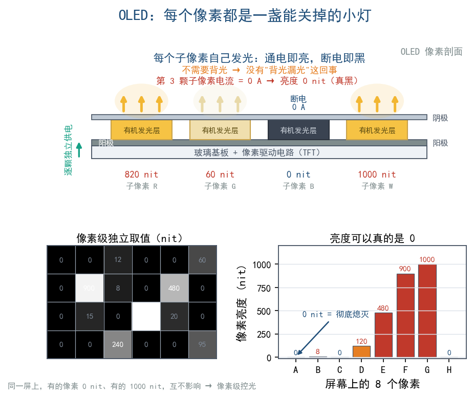
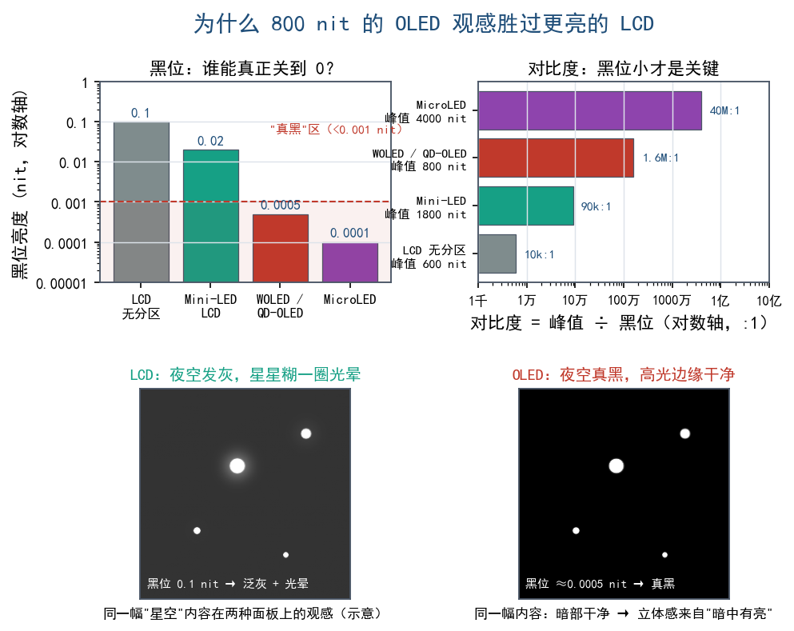
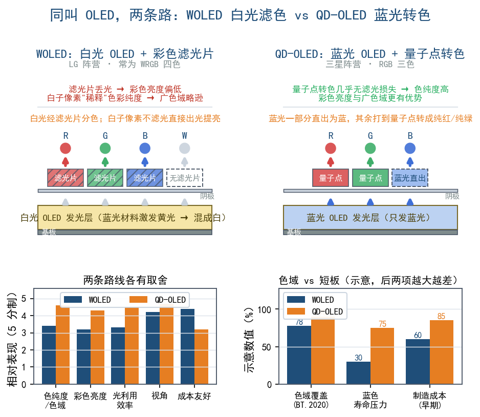
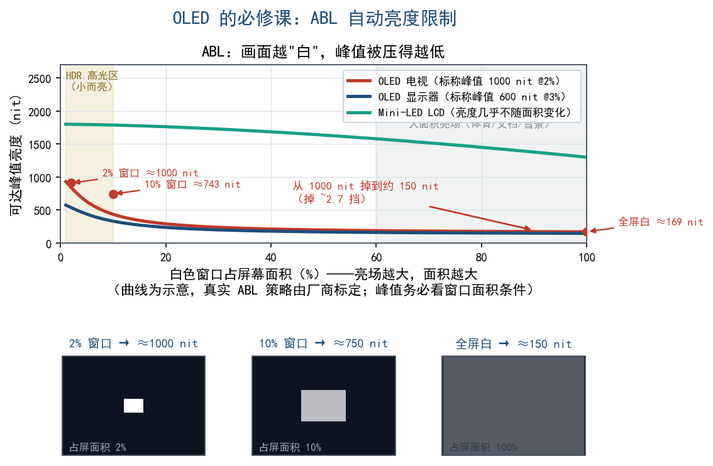
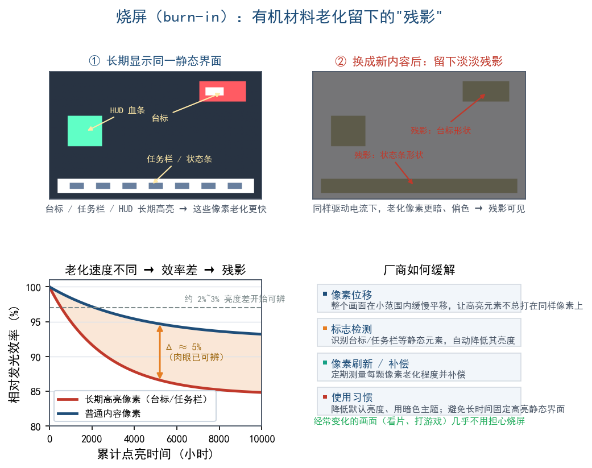
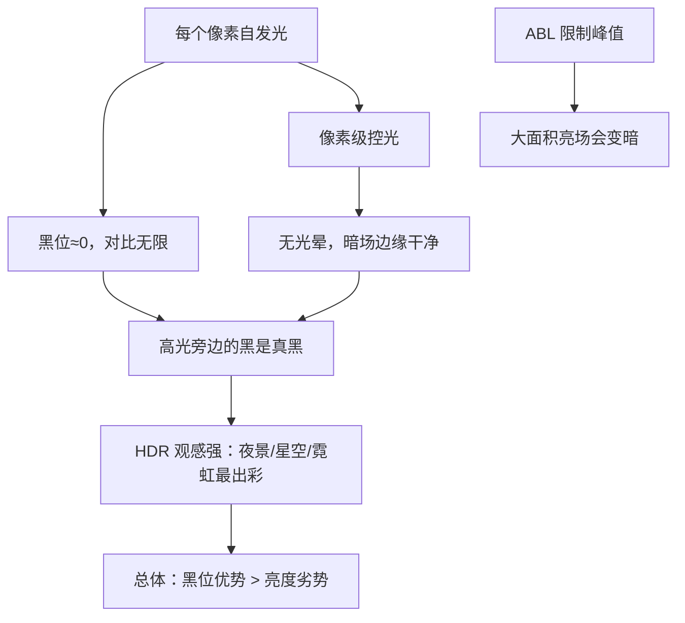

# 第 12 章 自发光时代：OLED、QD-OLED 与 MicroLED

上一章说到，LCD 的"背光共用一个总灯泡"是个死结。这一章换条路走：让每个像素自己发光、并且能彻底关掉。由此可以看清 OLED 为什么黑得漂亮、它的 HDR 观感为什么常常胜过更亮的 LCD，以及它为什么怕烧屏、为什么"越白越暗"。最后再看一眼被称为"理想终点"的 MicroLED。

## 12.1 换个思路：每个像素都是一盏能关掉的小灯

既然 LCD 的麻烦来自"背光共用一个总灯泡"，那就反过来：让**每个像素自己发光、并且可以完全关掉**。

这就是**有机发光二极管（Organic Light-Emitting Diode, OLED）**的思路：屏幕上每个像素（严格说每个子像素）都是一小块有机材料，通电就自己发光。不需要背光，也不需要百叶窗，**想黑就直接断电——黑位可以低到几乎为零**。

一个直观的对照：LCD 相当于"一个总灯泡 + 一堆百叶窗"，OLED 相当于"一墙密集的小灯泡，每个都能单独开关、单独调亮"。关掉的那颗就是真正的黑，旁边点亮的灯泡丝毫不受影响。

## 12.2 完美黑位为什么是 HDR 的王牌

第 2 章说过：对比度 = 峰值亮度 ÷ 黑位。HDR 的观感来自"最亮的白"和"最黑的黑"之间的跨度。

LCD 想靠"把白做亮"拉开跨度，OLED 反过来——**把黑做到极致**：

- 一块 800 nit 的 OLED，面对接近 0 nit 的黑位，对比度是天文数字（被称为"无限:1"）。
- 一块 1000 nit 的 LCD，黑位 0.1 nit，对比度大约 10000:1。

真正拉开差距的是**局部对比度**：画面里"一颗星星"紧挨着"夜空"时，OLED 能让星星亮、夜空真黑，边缘干净利落；LCD 会让星星周围糊一圈光晕（见第 11 章）。

人眼对"高光与相邻黑背景之间的反差"极其敏感，而夜景、星空、火光、霓虹灯这类 HDR 招牌场景，最考验的正是这种反差。**因此实际观感上，一块 800 nit 的 OLED 往往比 1000 nit 的 LCD 更"像 HDR"。**

两者的思路正好互为镜像：**Mini-LED 用亮度补黑位，OLED 用黑位补亮度。**

## 12.3 两条技术路线：WOLED 与 QD-OLED

OLED 面板目前主要有两大流派，名字都带"OLED"，做法却很不一样。

### WOLED：白光 OLED + 彩色滤光片

WOLED（White OLED，白光 OLED）代表是 LG 阵营，做法是：

- 每个像素发出的是**白光**（用蓝光 OLED 材料激发黄光，混合成白）。
- 白光再经过**彩色滤光片**分出红、绿、蓝。
- 为了提亮，很多面板额外加一个**不经过滤光片的白色子像素**（所以常叫 WRGB 排列）。

可以把它看成"OLED 版的白背光 + 滤光片"，区别只在于背光变成了每个像素自己的白光。

- 优点：技术成熟、良率高、大尺寸电视成本相对可控。
- 缺点：滤光片会损失一部分光，彩色亮度不如白光亮；白光子像素也会"稀释"色彩纯度，广色域表现略吃亏。

### QD-OLED：蓝光 OLED + 量子点转色

QD-OLED 代表是三星阵营，做法是：

- 发光层**只发蓝光**（省去白光环节）。
- 蓝光一部分直接当蓝子像素，另一部分打到**量子点（Quantum Dot, QD）**层上，量子点把蓝光"转"成纯度很高的红光和绿光。

这里蓝光相当于"原材料"，量子点承担"精确调色"的角色，转出来的红绿非常纯。

- 优点：**色纯度高、色域广**；视角好；光利用效率高，彩色亮度有优势。
- 缺点：蓝光材料的寿命与效率压力较大；早期工艺成本高。

### 对比表

| 对比项 | WOLED | QD-OLED |
|---|---|---|
| 发光来源 | 白光 OLED 层 | 蓝光 OLED 层 |
| 转色方式 | 彩色滤光片（+ 白子像素） | 量子点转红光/绿光 |
| 子像素结构 | 常为 WRGB 四色 | RGB 三色（蓝光直出） |
| 色纯度 / 色域 | 好，略逊 | 更好，广色域强 |
| 峰值亮度（彩色） | 中 | 中-高 |
| 视角 | 好 | 很好，偏色小 |
| 主要短板 | 白子像素"稀释"色彩 | 蓝光寿命压力、成本 |

## 12.4 有机材料的两个软肋：亮度与寿命

OLED 的短板几乎都来自"有机材料"本身。

### 为什么会自动降亮度：ABL

**自动亮度限制（Automatic Brightness Limiter, ABL）** 是 OLED 的必修课。

原因：OLED 每个像素自己发光，如果整屏大范围都点亮，瞬时电流和发热会急剧上升，有机材料会加速老化。所以厂商设计了 ABL：**画面亮的面积越大，整体亮度就被压得越低**。

- 一个小窗口的白光（占屏 2%~10%）：可以冲得很高，甚至到 1000 nit 量级。
- 一整屏全白（占屏 100%）：亮度可能被压到两三百 nit 甚至更低。

HDR 内容里，**高光通常是"小而亮"的**（太阳、灯、火花、爆炸核心），ABL 对观感的伤害因此没有想象中大。不过长时间盯着大面积亮场（体育直播、白底文档、雪景）时，"越白越暗"会相当明显。

另一个相关概念是**峰值亮度窗口**：厂商标的"峰值 1000 nit"，往往指 10% 甚至 3% 小窗口下的短时峰值，而非全屏。看评测时要分清"全屏亮度"和"小窗口峰值"。

### 烧屏（burn-in）

OLED 的有机材料会随使用时间**老化、发光效率下降**。如果屏幕上某块像素长期显示同一个高亮内容（任务栏、电视台台标、游戏 HUD 血条、股票行情），这块老化得比别人快，就会留下淡淡的**残影**，严重时永久可见——这就是**烧屏（burn-in）**。

严格说，所有自发光材料都会衰减，只是 OLED 更敏感。厂商的缓解手段包括：

- **像素位移**：把整个画面在极小范围内缓慢平移，让高亮元素不总是打在同样的像素上。
- **标志检测**：识别台标、任务栏这类静态元素，自动降低其亮度。
- **像素刷新 / 补偿**：定期测量每颗像素的老化程度并补偿。
- 降低默认亮度、鼓励暗色主题。

使用上的建议只有一条：**避免长时间停留在同一个高亮静态界面**；经常变动的画面（看片、打游戏）几乎不用担心。

## 12.5 为什么 OLED 的 HDR 观感强

把上面几点串起来：

归结起来：**HDR 让人惊艳的往往是"暗中有亮"，而非"亮到刺眼"。** OLED 把这件事做到了极致。

很多人第一次在 OLED 上看 HDR 片子，第一反应落在"暗部怎么这么干净、发光物体怎么这么立体"，而不是"好亮"。这种"立体感"来自高光与周围黑场之间的巨大反差，与纸面 nit 数字关系不大。

## 12.6 MicroLED：理想的终局，但现在很贵

OLED 像一堵"小灯泡墙"，**MicroLED（微型发光二极管）** 则把"小灯泡"缩到微米级，用**无机** LED 材料做每个像素。

理论上它集齐了全部优点：

- **自发光、可完全关闭** → 完美黑位、无限对比度。
- **无机材料** → 亮度可以做到极高（几千 nit 量级）、寿命长、**不烧屏**。
- 响应快、视角好、效率高。

听上去无懈可击，普及却卡在两件事上：

1. **巨量转移**：一块 4K 屏需要约 2500 万颗（含子像素）微米级 LED，要把它们精准、可靠地"搬"到基板上，良率与成本极难控制。
2. **成本**：目前主要出现在超大尺寸电视、商用大屏、高端影院以及少量高端显示产品上，普通消费级显示器还很少见。

**MicroLED 是自发光路线的"理想终点"，但在中小尺寸上真正铺开还需要时间。** 现阶段普通用户了解有这么一项技术即可；成本一旦降下来，理论上就不必再在"HDR 用黑位补还是用亮度补"之间取舍。

## 12.7 顺带一提：响应速度与视角

自发光还带来一个附带的好处：OLED 像素几乎"瞬间"点亮和熄灭，响应速度极快（微秒甚至更短量级），所以打游戏时几乎看不到液晶那种拖影（LCD 的液晶分子转动需要时间）。视角也很好，从侧面看色彩和黑位都保持得住——LCD 偏角度时黑位会明显发灰（尤其 VA）。

OLED 也谈不上完美：它仍要面对 ABL 与烧屏，而且尺寸越大、分辨率越高，成本上升越快。实际的取舍是"用极好的黑位和响应换峰值亮度与寿命"，而非"全面碾压"。

## 12.8 一张总表

| 技术 | 发光方式 | 黑位 | 峰值亮度 | 光晕 | 烧屏风险 | 现状 |
|---|---|---|---|---|---|---|
| LCD + Mini-LED | 背光 + 挡光 | 中（约 0.0x nit） | 高 | 轻微 | 无 | 主流高端 |
| WOLED | 白光 OLED + 滤光片 | ≈0 | 中 | 无 | 有 | 主流 OLED |
| QD-OLED | 蓝光 OLED + 量子点 | ≈0 | 中-高 | 无 | 有 | 主流 OLED |
| MicroLED | 无机自发光 | ≈0 | 很高 | 无 | 基本无 | 早期、昂贵 |

## 本章小结与常见误区

- OLED 让**每个像素自发光、可完全关闭**，因此有近乎完美的黑位和"无限对比度"。
- 因为黑位好，**OLED 的 HDR 观感常常胜过峰值更高的 LCD**——对比度是"比值"，不能只看亮度。
- **WOLED** 走"白光 OLED + 彩色滤光片（+ 白子像素）"，成熟但色彩略被稀释。
- **QD-OLED** 走"蓝光 OLED + 量子点转色"，色纯度和广色域更强。
- **ABL（自动亮度限制）** 让 OLED 在大面积亮场时降低亮度；小窗口峰值才是它的强项。
- **烧屏** 来自有机材料老化，靠像素位移、标志检测、像素刷新等缓解；日常避免长时间固定高亮界面即可。
- **MicroLED** 理论上最优（高亮、完美黑、不烧屏），但巨量转移与成本让它短期难以普及。

**几个容易混淆的点：**

1. **"OLED 峰值不如 LED，那 HDR 肯定更差"**——错。HDR 看的是对比度与黑位，OLED 的暗场表现常常反超。
2. **"标称 1000 nit 就是全屏 1000 nit"**——多半不是。OLED 的峰值通常指小窗口、短时峰值，全屏会因 ABL 大幅下降。

## 下一章预告

硬件原理讲完了，可显示器包装上那些贴纸又在说什么？下一章我们逐条拆解 **VESA DisplayHDR** 认证，教你一眼识破"假 HDR"。
