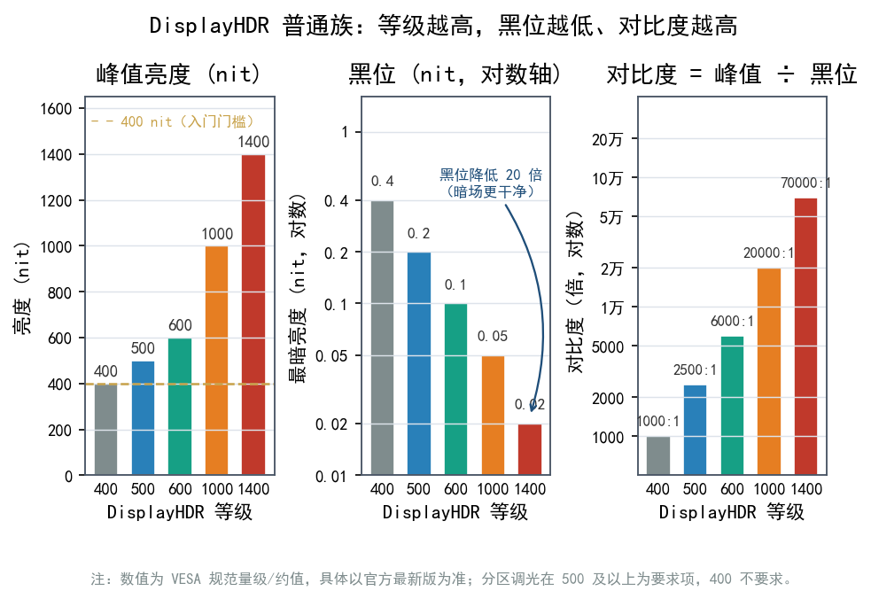
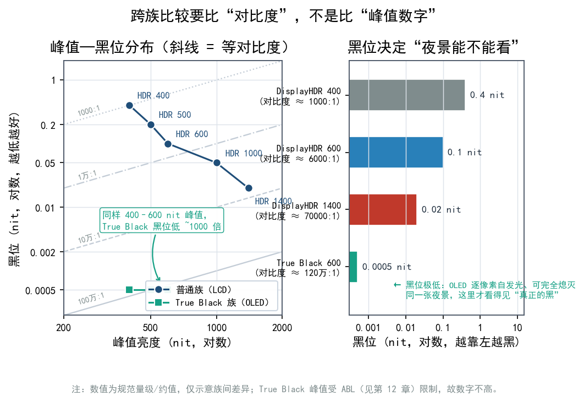
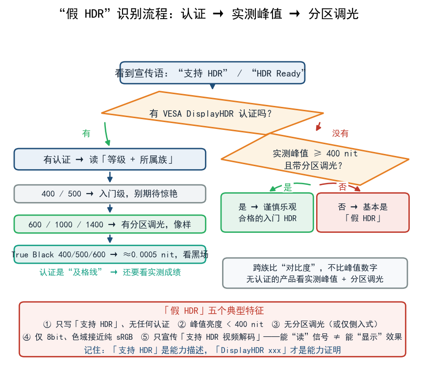
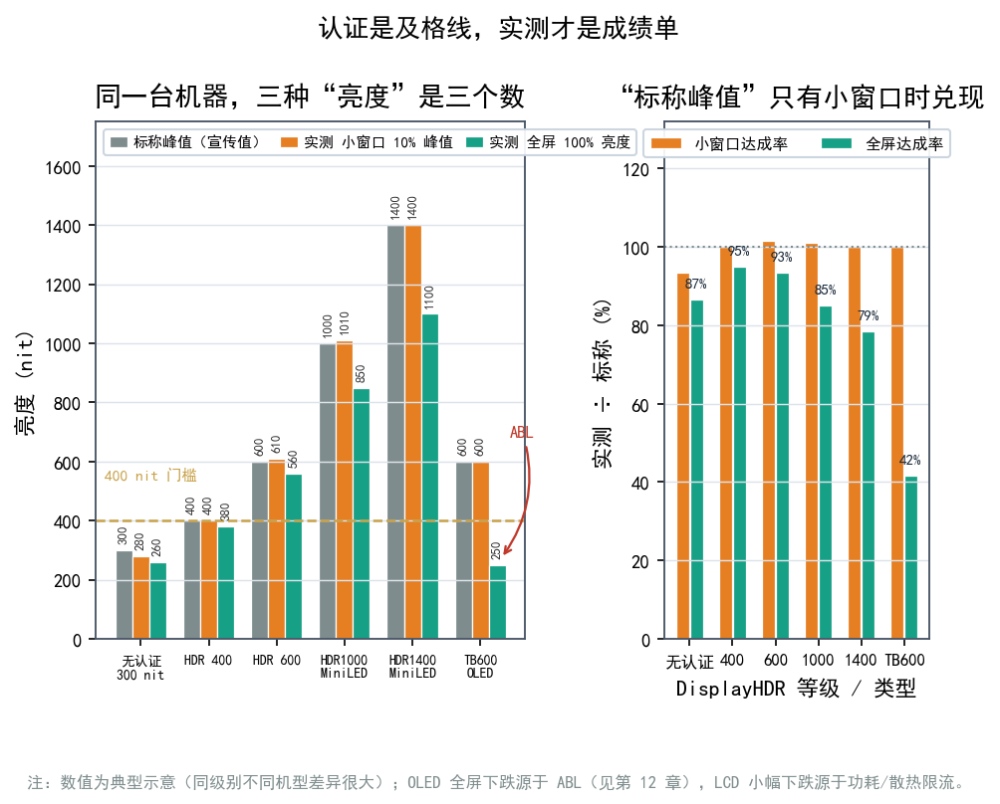

# 第 13 章 认证怎么读：VESA DisplayHDR 与亮度/黑位/调光

显示器包装角落常印着"DisplayHDR 400"或"DisplayHDR True Black 600"的小标志。它代表什么？数字越高越好吗？"支持 HDR"和"认证 HDR"差在哪里？这一章把这张贴纸彻底读透，以后就不容易被"支持 HDR"四个字带偏。

## 13.1 最重要的一句话：它是显示器的"体检报告"

最常被误会的一点，先澄清一下：

**DisplayHDR 是一个显示器硬件性能认证，不是一种内容格式。** 它由制定大量显示标准的组织 **VESA（视频电子标准协会, Video Electronics Standards Association）** 推出，用来衡量"这块屏的 HDR 硬件能力"。

它和 **HDR10** 完全是两码事：

- **HDR10** 是内容/信号格式，规定"片子怎么编码、元数据怎么传"（见第 8 章）。
- **DisplayHDR** 是显示器测试认证，规定"这块屏的亮度、黑位、色域、调光够不够格"。
- 一块显示器可以"支持 HDR10"却没有 DisplayHDR 认证；反过来，有 DisplayHDR 认证的显示器也照样能放 HDR10 内容——因为它本来就支持。

类比一下：HDR10 是"电影的语言"，DisplayHDR 是"音箱的听力测试报告"，一个管内容，一个管硬件。**看到这个标，说明的是屏幕能力，而非它能播什么格式。**

包装上还常看到 **HDR10 / HDR10+ / Dolby Vision** 的标，那些是**内容格式支持**的标志（见第 8、第 9 章），说明"能放什么"；DisplayHDR 说明"屏幕本身多能打"。两者常常同时出现，含义却完全不同，别混着看。

## 13.2 认证都测些什么

一份 DisplayHDR 认证，核心看这几项硬件指标：

| 指标 | 含义 | 为什么重要 |
|---|---|---|
| 峰值亮度 | 最亮能到多少 nit（= cd/m²） | 决定高光的"冲击力" |
| 黑位 | 最暗能到多少 nit | 决定黑场是否干净 |
| 对比度 | 峰值 ÷ 黑位 | HDR 的核心 |
| 色域覆盖 | 能覆盖多少标准色域 | 决定颜色是否鲜艳准确 |
| 色深 | 8bit / 10bit | 10bit 才不易出色带（见第 10 章） |
| 局部调光 | 有没有分区调光 | LCD 能不能做深黑场的关键（见第 11 章） |

等级越高，这几项门槛越严。最后一项尤其关键，**它是区分"真 HDR"和"贴标语"的分水岭。**



## 13.3 等级体系：从 400 到 1400，再到 True Black

DisplayHDR 分两大族：

- **普通族**：主要面向 LCD，等级有 **400 / 500 / 600 / 1000 / 1400**，数字基本对应"峰值亮度的量级"。
- **True Black 族**：面向 OLED 等自发光屏，等级有 **True Black 400 / 500 / 600**，特点是**黑位极低**（低到约 0.0005 nit），峰值亮度数字反而不高。

下面这张表是本章的干货，各等级的门槛一目了然（数值为量级/约值，具体以 VESA 官方最新版为准）：

| 等级 | 峰值亮度（约） | 黑位（约） | 对比度（约） | 色域要求 | 色深 | 分区调光 |
|---|---|---|---|---|---|---|
| DisplayHDR 400 | 400 nit | 0.4 nit | 1000:1 | 95% sRGB | 8bit | 不要求 |
| DisplayHDR 500 | 500 nit | 0.2 nit | 约 2500:1 | 95% sRGB | 10bit | 要求 |
| DisplayHDR 600 | 600 nit | 0.1 nit | 约 6000:1 | 99% sRGB | 10bit | 要求 |
| DisplayHDR 1000 | 1000 nit | 0.05 nit | 约 20000:1 | 99% sRGB | 10bit | 要求 |
| DisplayHDR 1400 | 1400 nit | 0.02 nit | 约 70000:1 | 99% sRGB | 10bit | 要求 |
| True Black 400 | 400 nit | ≈0.0005 nit | 极高（百万级） | 覆盖大部分 DCI-P3 | 10bit | —（自发光天然逐像素） |
| True Black 500 | 500 nit | ≈0.0005 nit | 极高 | 覆盖大部分 DCI-P3 | 10bit | — |
| True Black 600 | 600 nit | ≈0.0005 nit | 极高 | 覆盖大部分 DCI-P3 | 10bit | — |

几个读表要点：

- **数字不是简单的"亮度排行榜"**。True Black 600 的峰值只有 600 nit，却比 DisplayHDR 1400 更适合展现夜景——因为它黑位极低，对比度碾压。
- **黑位那一列最要紧**。从 0.4 nit 到 0.0005 nit，差了近千倍，它决定了"能不能显示真黑"。
- **分区调光**在 600 及以上的 LCD 等级里是要求项，400 则完全不管——这也是 400 被吐槽的原因。

**True Black 的峰值为什么这么“低”？** 这是 OLED 的物理特性决定的：大面积亮场时会启动 ABL（见第 12 章），它没办法像 LCD 那样靠堆灯珠冲到 1400 nit。VESA 因此为它单设了一套标准——**不比谁更亮，比谁更黑**。于是**跨族比较（普通族 vs True Black 族）要看的是“对比度”，而非峰值数字**。

```text
  峰值亮度 ──▶ 高光够不够冲
  黑位     ──▶ 黑场干不干净   ← 真正决定 HDR 观感
  对比度   ──▶ 上面两者之比
  色域/色深──▶ 颜色鲜不鲜、有没有色带
  局部调光 ──▶ LCD 能否做出深黑（分水岭）
```



## 13.4 为什么 DisplayHDR 400 被吐槽

DisplayHDR 400 是"入门 HDR"的代名词，常被调侃为"聊胜于无"。原因很直白：

- **不要求分区调光** → 黑位还是普通 LCD 水平，暗场发灰、对比度不够。
- **色域只要求 95% sRGB** → 连广色域都不强制（sRGB 相对 DCI-P3 只是个小盘子，见第 5 章）。
- **只要求 8bit** → 灰阶台阶少，容易出现色带。
- **峰值只要 400 nit** → 高光不够冲。

所以它被戏称为"贴了个标，但没什么 HDR 味道"。

但也**不该全盘否定**它：

- 它毕竟**强制了一套可测的门槛**（400 nit、0.4 nit 黑位、1000:1 对比、95% sRGB），比那些什么都没认证、只印一句"支持 HDR"的产品靠谱得多。
- 对预算有限的普通用户，一台合格的 400 认证屏，看 HDR 内容时仍能比 SDR 屏多出一些亮度与色彩表现。
- 关键是**对它建立正确预期**：它只能算"够用的入门"，离"惊艳的 HDR"还差得远。

## 13.5 如何识别"假 HDR"

比"400 够不够看"更值得警惕的，是**连认证都没有却大谈 HDR** 的产品。

典型"假 HDR"特征：

| 特征 | 说明 |
|---|---|
| 只写"支持 HDR"/"HDR Ready"，无任何认证 | 没有可对比的门槛，也无从验证 |
| 峰值亮度 < 400 nit | 连 DisplayHDR 400 都够不上，开了 HDR 反而更暗更灰 |
| 无分区调光（或仅侧入式） | 黑位没改善，暗场一片灰，谈不上 HDR 观感 |
| 只有 8bit，色域接近纯 sRGB | 易出色带，色彩也不出彩 |
| 只宣传"HDR 视频解码支持" | 能"读" HDR 信号 ≠ 能"显示"出 HDR 效果 |

记法很简单：**"支持 HDR"是能力描述，"DisplayHDR xxx"是能力证明。** 前者谁都能印，后者要过测试。

另一个细节：很多"假 HDR"产品并非骗人，它们确实能接收并"解码" HDR 信号，只是屏幕本身无法把 HDR 的高光与黑场表现出来。能"读"不等于能"显示"，这层文字游戏最容易被忽略。



## 13.6 认证之外：更该看实测数据

认证只是"及格线"，算不上"成绩单"，它划定的是下限。同样通过 1000 级认证的两块屏，实际体验可能差很远。看评测时重点抓住这几项实测数据：

| 实测项 | 为什么重要 | 怎么看 |
|---|---|---|
| 全屏亮度（100% 白） | 决定大面积亮场有多亮 | OLED 会被 ABL 压低，数字往往远小于标称峰值 |
| 小窗口峰值（如 10%、2%） | 决定高光的冲击力 | 这才是厂商标"峰值 xxx nit"的来源 |
| 最低黑位 | 决定黑场质感 | 越低越好，OLED 常在 0.0005 nit 量级 |
| 分区数 + 分区尺寸 | 决定光晕多少（LCD） | 光看"多少个分区"不够，还要看实际光晕表现 |
| 色域覆盖（如 DCI-P3） | 决定色彩鲜艳度 | 注意区分"覆盖"与"体积"（见第 5 章） |
| 调光档位表现 | 决定暗场有没有被压黑 | 高/中/低档的闪烁与黑场细节差异 |
| 色准（ΔE） | 决定颜色准不准 | 校准前后都要看（见第 19 章） |

**认证告诉你"有没有过线"，实测告诉你"过线多少"。** 买前多看第三方实测，比只看贴纸靠谱得多。



## 13.7 认证也在迭代

DisplayHDR 规范一直在改版。它从最早的版本（含 400 / 600 / 1000）一路修订，陆续补充了 500 / 1400 以及 True Black 500 / 600 等新等级，也**逐步收紧了部分要求**（比如对色深、色域、调光表现的要求）。

VESA 后来推出 DisplayHDR 1.2 规范，对 400 等级做出了关键调整：400 等级的色深要求被提升到与更高等级相同的水平，最低必须支持“8 bit + 2 bit FRC”。这等于允许显示器用 8 bit 面板配合 FRC 技术，呈现出接近 10 bit（10.7 亿色）的平滑色彩过渡效果。

带来的影响是：

- 两块都写"DisplayHDR 600"的显示器，因为认证年份/版本不同，实际门槛可能略有差别。
- 厂商有时会强调"通过某某版本认证"，实际仍要看**具体等级 + 实测数据**。

所以看认证时，**等级比版本更重要，实测数据比等级更重要**。

## 13.8 按用途挑等级

并非所有人都需要最贵的认证等级，按用途对号入座更省钱：

| 用途 | 建议 | 理由 |
|---|---|---|
| 办公 / 日常 | DisplayHDR 400 或不强求 | 主要看文字，HDR 用得少 |
| 一般影音 / 入门游戏 | DisplayHDR 600 及以上 | 有分区调光 + 10bit，HDR 才像样 |
| 高光场景多的影视 | 尽量 1000 级，或 OLED（True Black） | 高光与黑场都要兼顾 |
| 夜景 / 暗场为主的影视 | OLED（True Black 族） | 黑位是重中之重 |
| 环境光较强的房间 | 高分区 Mini-LED | 需要更高全屏亮度对抗环境光 |
| 亮房暗房两用 | 视环境而定，黑位优先 | 暗房看黑位，亮房看亮度 |

这张表只提供"方向"，真实体验还取决于房间亮度、常看的内容，以及会不会调（见第 16、第 19 章）；同一块屏换到不同房间，观感可能差得很远。

还要认清一点：认证等级是"必要条件"，不是"充分条件"。一块屏可能"峰值高但调光差、色域达标但色准糟糕"，也可能"面板本身不错但厂家不做认证"而被低估。**它可以当作高效的初筛工具，但不必当成最终结论。**

另外，光靠软件无法判断屏幕是否真的支持 10bit。软件能告诉你“正在用多少 bit”，但要确认“面板原生支持多少 bit”，还需结合视觉测试和硬件信息查证——纯软件读不到面板的物理色深，只能从信号链路和画面表现来反推。
屏幕本身不支持 10bit 时，即便播放链路全程按 10bit 处理，结果也不会是真正的 10bit。

右键桌面 →“显示设置”→“高级显示设置”，找到当前显示器，下方“颜色深度”字段会显示 8 位或 10 位，这就是 GPU 当前实际输出的色深。该数值反映信号位深，不代表面板的物理能力；这里只显示 8 位，说明信号链路没有跑在 10 bit 上。
反过来说，这里显示 10bit，也不能保证面板最终输出的就是 10bit。

### FRC控制信号

显示器怎么“知道”目标亮度是 21.3，而不是 21 或 21.5？因为输入信号（比如 10-bit 视频源）已经把“21.3”这个精确的数值交给了显示器的控制芯片。

FRC（帧率控制/像素抖动）无需去“猜”或“估算”该显示多亮，它执行的是一个严格的数学分配任务。绝大多数支持 FRC 的显示器，其内部处理芯片接收的是 10-bit（甚至更高）的信号。
在这样的精度下，亮度的取值可以带小数，不必是整数 21 或 22。

液晶或 OLED 面板的物理驱动（通常是 8-bit 面板）只能输出整数级别：要么给 21 的电压（暗一点），要么给 22 的电压（亮一点）。面板上不存在 21.3 这个挡位。

FRC 负责按比例分配：显示器的时间控制芯片（TCON）执行 FRC 算法，既然一帧之内显示不出 21.3，就在时间（或空间）上做平均。

具体做法是：目标值 21.3，小数部分 0.3，于是连续 10 帧画面中 3 帧输出 22、7 帧输出 21。人眼有视觉暂留（时间积分效应），快速交替的 3 帧 22 与 7 帧 21 会被大脑平滑平均。

FRC 做的是“时间/空间上的平均”，数学上算出来是 21.3，物理上却没有 21.3 的电压，因此带来两个问题：
- 闪烁（Flicker）：如果切换频率不够高（低于人眼融合频率），人眼会看到屏幕在 21 和 22 之间闪烁，或者看到画面有噪点（空间抖动）。
- 过渡不自然（伪影）：在平滑的色彩渐变中，FRC 可能会产生轻微的色块（Banding），或者运动画面中产生轻微的拖影。

所以 FRC 制造成本更低，但对 HDR 效果的支持仍然有限。


## 本章小结与常见误区

- **DisplayHDR 是 VESA 的显示器硬件认证，不是内容格式**，与 HDR10 各司其职、互不等价。
- 它主要考核**峰值亮度、黑位、对比度、色域、色深、局部调光**。
- 普通族等级 **400 / 500 / 600 / 1000 / 1400**，数字大致对应峰值亮度量级。
- **True Black 400 / 500 / 600** 面向自发光屏，黑位低到约 0.0005 nit，靠极低黑位取胜。
- **DisplayHDR 400 是入门级**：不要求分区调光、色域与色深门槛低，别期待惊喜，但也别全盘否定。
- 识别**"假 HDR"**：无认证、峰值 <400 nit、无分区调光、仅 8bit、或只宣传"能解码 HDR"。
- **买前看认证等级 + 实测峰值亮度**，比看"支持 HDR"四个字可靠得多。
- 认证只是“及格线”，**全屏亮度、小窗口峰值、最低黑位、分区数与调光表现**这些实测数据才是“成绩单”。

**几个容易混淆的点：**

1. **"DisplayHDR 600 就是 600 nit"**——数字只是等级命名，峰值要求约 600 nit，但你还要看黑位、分区和实测表现；而且不同版本门槛略有差异。
2. **"没认证就一定不好"**——不一定。有些厂商不做认证（出于成本或策略），但实测参数可能不错；认证只是"省心的参照，不是唯一真相"。

## 下一章预告

硬件选好了，可图像信号要"跑"进显示器，还得靠线和接口——下一章我们算清楚 **HDMI、DisplayPort 与 USB-C 的带宽账**。
