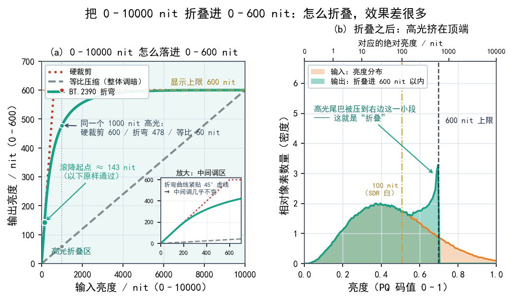
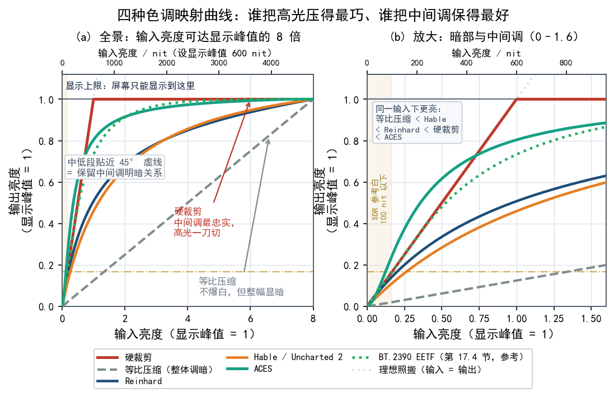
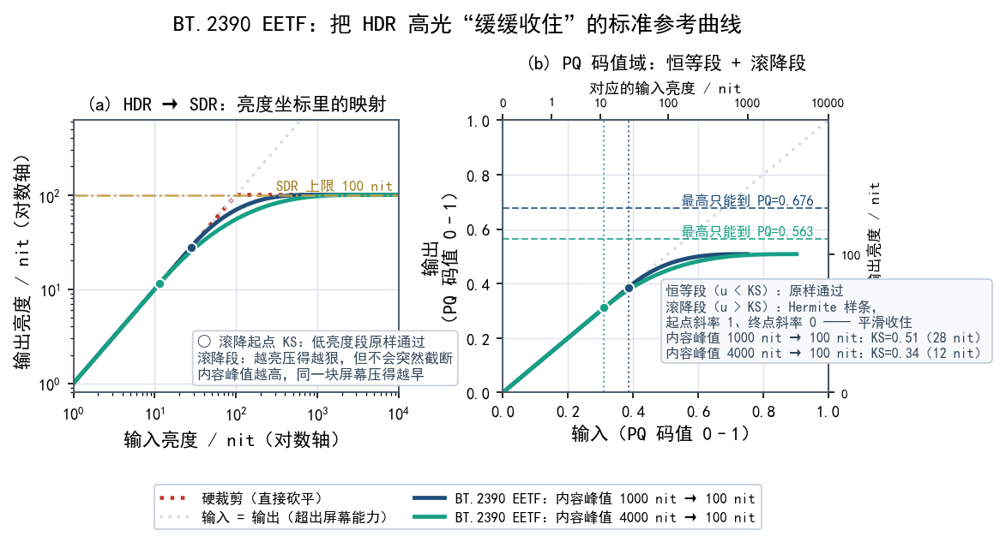
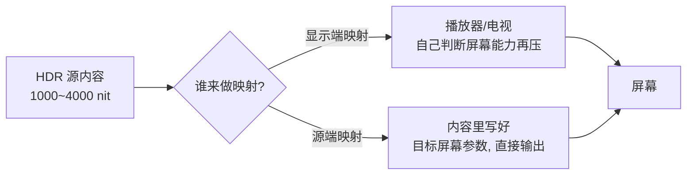
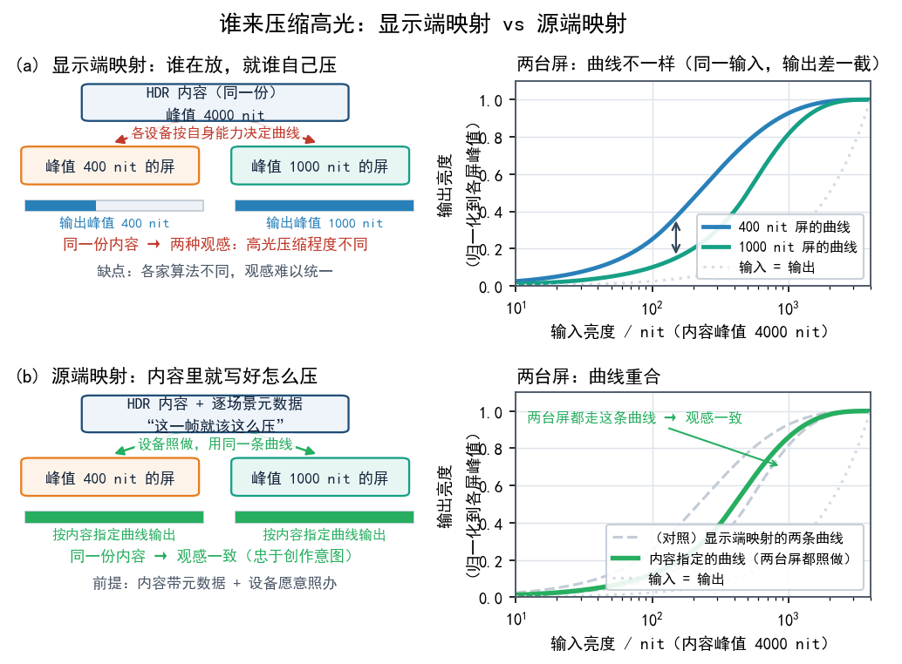

# 第 17 章 Tone Mapping：HDR 如何落进显示器

前面几章我们把 HDR 的"原材料"备齐了：内容端有 PQ 曲线，能表示到约 10000 nit 的绝对亮度（见第 7 章），还有 BT.2020 这个大色域容器（见第 5 章）。现实却不太配合：你手里的显示器峰值亮度可能只有 400 nit 或 600 nit，色域也只覆盖了 P3 的一部分。**内容的"画布"比屏幕的"画布"大得多**，中间这块差距必须被填平，否则画面要么死黑一片，要么高光糊成一团白。这一章要讲的就是这个填平动作：**色调映射（tone mapping）**。理解了它，HDR 片在不够亮的屏幕上为什么还能看，同一部片子在不同电视上"味道"为什么不一样，也就有了答案。

## 17.1 一个绕不过去的矛盾

先看一个数字对比。

| 项目 | 典型数值 |
|---|---|
| HDR 内容能表示的峰值亮度 | 最高约 10000 nit（PQ 的上限） |
| 一部电影实际用到的峰值 | 常常见于 1000～4000 nit |
| 普通 HDR 显示器峰值亮度 | 约 400～600 nit |
| 高端 Mini-LED / OLED 峰值 | 约 1000～2000 nit（小面积窗口） |

内容说"这一帧最亮的地方是 4000 nit"，屏幕摊手说"我最多只有 600 nit"。把 4000 硬塞进 600 还要保住画面，这是做不到的。超过 600 的部分如果直接砍掉（这叫**硬裁剪**），天空、灯光、爆炸这些高光区域会瞬间变成一片死白，云层纹理、灯泡的玻璃反光全没了。

反过来，为了让 4000 nit 的内容全"装下"而整体调暗画面，中间调（人物脸、室内场景）又会暗得像蒙了一层灰，HDR 该有的通透感也没了。

**矛盾就在这儿：高光细节要保，整体观感又不能牺牲。**

好比一张巨幅照片要塞进小相框。直接剪掉边缘，信息就丢了；整张等比缩小，细节又糊了。**色调映射做的是这种"缩放算法"的活**：哪些内容可以压得狠一点、哪些必须保住，它心里有数，缩进小相框之后仍然像原图。

## 17.2 色调映射到底在干什么

定义很短：**色调映射（tone mapping）是一套把高动态范围的亮度分布，重新"折叠"进显示器能显示的动态范围里的算法**，目标是让观感尽量接近创作者想表达的样子。

它通常同时做三件事：

1. **压缩高光**：把最亮的一段（比如 1000～4000 nit）按非线性曲线压下来，越往上压得越狠。这样高光不会溢出成死白，还能保住相对层次。
2. **保住中间调**：人眼最敏感的是中低亮度区域（人脸、室内），这部分要尽量接近原样，不要整体变暗。
3. **锚定观感**：让"看起来亮的部分依然显得亮、暗的部分依然显得暗"，即保住相对的明暗关系，而不是绝对数值。

## 17.3 常见算法：从硬裁剪到 ACES

色调映射的做法五花八门，几十年下来攒了一大堆算法。这里挑几个有代表性的，从简单排到精细。

### 硬裁剪（Hard Clipping）

最粗暴的做法：超过屏幕上限的一律变成上限值。

- 优点：实现零成本，中间调完全忠实于原内容。
- 缺点：高光"爆"掉，细节全丢，大块高光会糊成一片纯白。
- 场景：早期设备、算力极弱时的兜底。

### Reinhard 映射

这是一种经典、简单的全局映射，大致思想是把输入亮度 `L` 变换成 `L / (L + 1)` 这样的形式（这里 `L` 是归一化亮度，越接近 0 越暗）。

- 优点：平滑、不会突然截断，实现简单。
- 缺点：整体容易偏灰、偏平，高光的"冲击力"被过度柔和掉了。
- 场景：很多老游戏、早期 HDR 影视的参考实现。

### Hable / Uncharted 2 曲线

这是一条在游戏界很有名的"电影感"曲线（因《神秘海域 2》的使用而得名）。它故意让暗部微微抬起（有点"雾感"）、高光缓缓收住，整体观感偏胶片。

- 优点：好看、有电影味，工程上可控。
- 缺点：默认偏"灰"，需要人工调参；不算严格物理正确。
- 场景：游戏引擎、实时渲染里非常常见。

### ACES

**学院色彩编码系统（Academy Color Encoding System, ACES）** 是影视行业的一套完整色彩管理与色调映射框架，除了亮度映射，宽色域的转换也归它管。它的映射曲线经过精心设计，能让高光过渡自然、颜色不偏，被大量电影后期采用。

- 优点：行业标准、效果稳定、色彩科学扎实。
- 缺点：体系庞大、实现复杂，普通显示器固件里塞不进完整版。
- 场景：电影调色、高端影视制作。

| 算法 | 高光处理 | 中间调保真 | 实现难度 | 常见场景 |
|---|---|---|---|---|
| 硬裁剪 | 最差（直接截断） | 最好 | 极低 | 兜底、早期设备 |
| Reinhard | 柔和但偏平 | 一般 | 低 | 老游戏、早期 HDR |
| Hable | 有电影感 | 中等（偏灰） | 中 | 游戏引擎 |
| ACES | 自然细腻 | 好 | 高 | 影视后期 |

## 17.4 BT.2390 EETF：标准给的参考解

各做各的映射，就会出现"同一部电影在每台电视上都长得不太一样"的混乱。为此行业给出了参考方案：**ITU-R BT.2390** 里定义了一种叫 **EETF（Electrical-Electrical Transfer Function，电-电传递函数）** 的映射方法。

名字唬人，道理不复杂：它规定了"当内容亮度高于显示上限时，应该用一条什么样的曲线去压"，并给出了一套**可复现、可预期**的操作（通常配合"滚降（roll-off）"曲线，让高光在接近上限前就缓缓减速，别等到顶了才硬弯）。

BT.2390 还额外定义了两个重要场景：

- **HDR → SDR 的映射**：让只有普通屏幕的人也能看到还算合理的画面，不会黑成一团。
- **HDR → 更弱 HDR 的映射**：给亮度不够的 HDR 屏一个参考做法。

"有标准参照"，不同设备的映射结果就不会天差地别：在 A 电视上看到的暗部层次，换到 B 电视上大概率差不多。内容创作者想要的"一致性"，就落在这里。

> BT.2390 属于**建议做法**，没有强制力。很多厂商会在它基础上加自己的"偏好曲线"，后面要讲的"各家味道不同"就是这么来的。

## 17.5 谁来做映射：显示端 vs 源端

同一个"压缩高光"的动作，可以由不同的角色来执行，结果差别很大。

- **显示端映射**：播放器或电视"知道"自己屏幕的峰值亮度和黑位，于是按自己的能力把高光压进来。优点是**自适应**——换台屏幕自动重新算；缺点是**各家算法不同**，观感不统一，而且屏幕本身"不认识"内容想表达什么。
- **源端映射**：创作者在内容里带上元数据（比如 Dolby Vision 的逐场景元数据，见第 9 章），直接告诉设备"这一帧就该这么压"。优点是**忠于创作意图**；缺点是**依赖内容带元数据、也依赖设备愿意照办**，链路里任何一个环节不配合就白搭。

现实中大多数 HDR10 内容用的是"**静态元数据 + 显示端映射**"的组合：内容只说"我最高多少 nit、平均多少 nit"，剩下的交给你家屏幕自己发挥。于是**同一部 HDR10 片，在 400 nit 和 1000 nit 的屏幕上"好看程度不同"**，差别来自映射的主动权、能力和算法。

## 17.6 HGiG：把笔交给游戏

游戏场景有个特殊麻烦：显示器的映射曲线是"猜"的，可游戏引擎其实**知道自己想画成什么样**。两边各干各的，就容易互相打架，出现"暗场糊、亮场过曝"。

**HGiG（HDR Gaming Interest Group，HDR 游戏兴趣小组）** 就是为此提出的思路：**让显示器放弃自己的那套映射，只做最基本的硬裁剪（把超出能力的内容按上限截住），而把"怎么压缩高光"的决策完全交给游戏**。

接着前面的比方：HGiG 就是让显示器"交出画笔"，游戏负责画，屏幕只负责把画挂上去、装不下的边角裁掉。

- 好处：游戏里的高光细节、暗部层次都由开发者精心设计的曲线决定，**一致、可控**。
- 前提：游戏要支持 HGiG，显示器也要打开 HGiG 模式（很多电视和显示器都有这个开关）。
- 类比：这像是"专业摄影师自己调好图，冲洗店只按标准冲印，不擅自加滤镜"。

对游戏玩家来说，**如果游戏和显示器都支持 HGiG，通常建议打开**，画面会更"对味"。如果一方不支持，就退回普通的显示端映射。

## 17.7 动态 vs 静态映射

**静态映射**：整部片子用同一条映射曲线。麻烦在于，一个明亮的雪景镜头和一个昏暗的夜晚镜头，最优曲线并不一样，用同一条必然有一边吃亏。

**动态映射**：逐场景甚至逐帧地调整映射曲线，等于"每一幕、甚至每一帧都换一张曝光表"。

动态映射的实现方式主要有两种：

- **靠元数据**：Dolby Vision 和 HDR10+ 把逐场景/逐帧的映射参数塞进码流（见第 9 章），设备照着执行。
- **靠设备自己算**：一些高端电视会实时分析画面亮度分布，自己动态调整。效果取决于算法，未必比元数据差。

**结论**：动态映射能在"暗场不糊、亮场不爆"上明显优于静态，但**前提是内容、播放链、显示设备三方都配合**。

## 17.8 别忘了色域映射

我们一直盯着亮度，但 HDR 内容通常用 **BT.2020 容器** 装颜色，而屏幕可能只覆盖 **DCI-P3** 甚至更小（见第 5 章）。所以色调映射往往要**同时做色域映射**：把超出屏幕能力的颜色"拉"回屏幕上最接近的可显示颜色。

常见的两种策略：

- **相对色度（Relative Colorimetric）**：尽量保住色相一致，把超界的饱和色拉回到边界上，代价是那部分颜色变"淡"。
- **感知（Perceptual）**：整体压缩所有颜色以维持颜色之间的关系，代价是整幅画面饱和度略降。

处理不好，就会出现"高饱和的霓虹色变白变淡"这种典型 HDR 违和感。所以真正完整的"色调映射"，是**亮度 + 色域一起映射**。

## 本章小结与常见误区

- 色调映射要解决的根本矛盾：**内容动态范围 > 屏幕动态范围**，必须把高光"折叠"进去。
- 好的映射同时做到三件事：压缩高光、保住中间调、维持明暗观感。
- 常见算法从硬裁剪、Reinhard、Hable 到 ACES，越往后越精细、越需要算力。
- **BT.2390 EETF** 是行业参考的映射曲线，给"一致性"兜底，但不是强制。
- **显示端映射**自适应但各家不同，**源端映射**忠于创作但依赖元数据。
- **HGiG** 让游戏接管映射、显示器只做裁剪，游戏画面因此更一致。
- **动态映射**（靠 DV/HDR10+ 元数据或设备实时计算）优于静态，但要全链路支持。
- 色调映射通常还要**带上色域映射**，否则会丢颜色的"艳度"。

**几个容易混淆的点：**

1. **"显示器亮度不够就根本看不了 HDR。"** 错。亮度不足只是意味着高光被压得更多，画面依然能看，只是少了"刺眼的高光冲击"。真正决定观感的是**映射做得好不好**。
2. **"同一部 HDR 片在哪台设备上都一样。"** 错。显示器能力、映射算法、是否带动态元数据，都会让结果不同——这也是"HDR 没有唯一正确画面"的原因。

## 下一章预告

搞懂了"内容怎么落进屏幕"，下一章我们就去追问：那些 HDR 内容到底从哪来——游戏、影视、流媒体、创作软件各自是什么生态。
