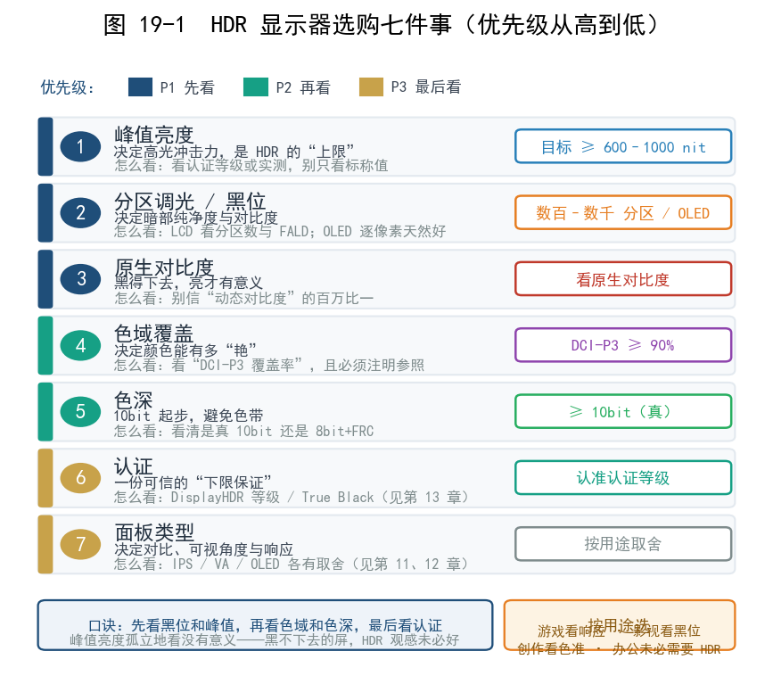
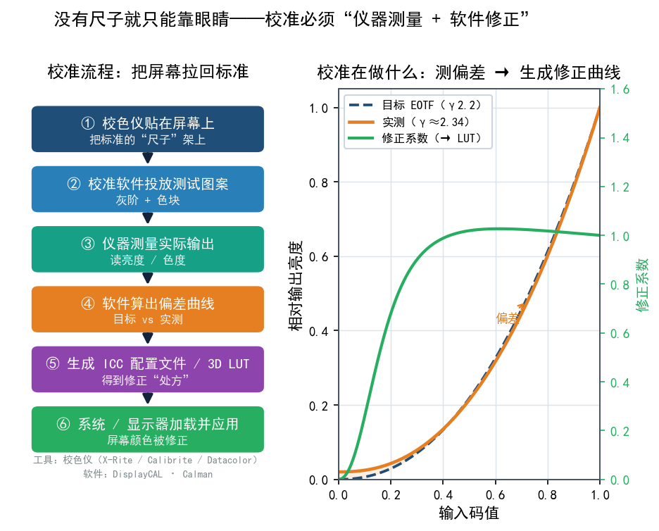
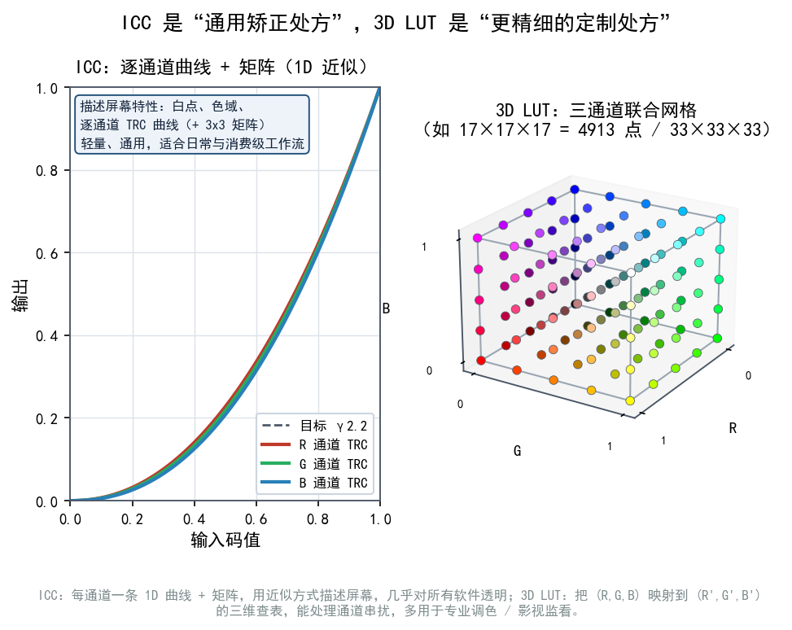
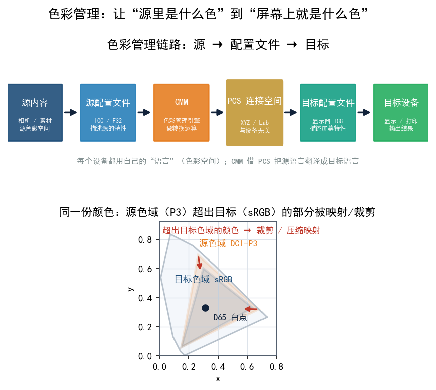

# 第 19 章 选购、校准与色彩管理

前面十八章，我们把 HDR 的原理、标准、硬件、系统和软件都过了一遍。现在到了最实际的一步：**你手里要买什么、买回来怎么调**。这一章不谈厂商广告，只给一份"防坑型"的选购清单，和一套能照着做的校准流程。核心观点先摆在这里：**好 HDR = 硬件能力 + 正确设置 + 校准，三者缺一不可**。只买贵的，或者只看纸面参数，都可能踩坑。读到这里，你已经能判断哪些参数真有用、哪些只是营销词，这一章要做的，就是把这些判断变成具体动作。

## 19.1 好 HDR 的三条腿

很多人以为"买台贵的 HDR 显示器就完事了"，其实好 HDR 靠三样东西撑起来：

```text
好 HDR 观感
   ├─ 硬件能力：能亮、能黑、色域够
   ├─ 正确设置：系统/播放器/游戏都配对
   └─ 校准：把偏差修正到你实际的环境
```

少了任何一条，观感都会打折。比如硬件很好但系统里一直开着 HDR 看桌面，SDR 内容就发灰；或者设置全对但从没校准，颜色偏得离谱。

## 19.2 选购清单：七件事

买 HDR 显示器时，按下面这份清单逐项问自己。**优先级从高到低**排列：

| # | 看什么 | 为什么重要 | 怎么看 |
|---|---|---|---|
| 1 | 峰值亮度 | HDR 的"上限"，决定高光冲击力 | 看认证等级或实测，别只看标称 |
| 2 | 分区调光 / 黑位 | 决定暗部纯净度和对比度 | LCD 看分区数与 FALD；OLED 天然好 |
| 3 | 对比度与黑位 | 黑得下去，亮才有意义 | 别信"动态对比度"的百万比一 |
| 4 | 色域覆盖 | 决定颜色能多"艳" | 看"DCI-P3 覆盖率"，注明参照 |
| 5 | 色深 | 10bit 起步，避免色带 | 看清是"真 10bit"还是 8bit+FRC |
| 6 | 认证 | 一份可信的"下限保证" | DisplayHDR 等级 / True Black（见第 13 章） |
| 7 | 面板类型 | 决定对比、可视角度、响应 | IPS/VA/OLED 各有取舍（见第 11、12 章） |

**选购口诀**：**先看黑位和峰值，再看色域和色深，最后看认证是否达标。** 峰值亮度单独拎出来看没什么意义：一台能到 1000 nit 却黑不下去的屏，HDR 观感未必比黑位完美的 OLED 好。



## 19.3 按用途选：你主要拿它做什么

没有"万能最好"的屏幕，只有"更适合你的用途"：

- **游戏为主**：优先**响应速度、刷新率、低延迟**，其次才是色准。分区调光带来的高光体验很爽，但要注意某些调光算法会造成游戏画面闪烁。
- **影视为主**：优先**黑位、对比度、映射质量**。OLED 的完美黑位在暗场电影里优势明显；大屏观看时分区调光的光晕也要重点考察。
- **创作 / 调色为主**：优先**色准、色域覆盖、可校准性、硬件 LUT 支持**，峰值亮度反而不是第一位的。专业创作更看重"准确"而不是"够亮"。
- **办公为主**：**未必需要 HDR**。办公长时间看文字，一台色彩准确的 SDR 屏可能比"高亮度 HDR 屏"更舒服。别为了一个用不上的卖点多花钱。

## 19.4 预算分档建议（只看能力，不谈价格）

这里只讲"不同投入量级能买到什么能力"，**不给具体价格和型号**：价格随市场剧烈波动，型号也在快速迭代。怎么判断能力够不够，还是回到上一节的清单。

| 档位 | 大致能获得的能力 | 适合谁 |
|---|---|---|
| 入门档 | 约 400 nit 级、无或极少分区调光、色域一般；能开 HDR 但"含水量"高 | 只想偶尔体验、预算有限 |
| 主流档 | 约 600～1000 nit、有分区调光、覆盖大部分 DCI-P3 | 多数游戏/影音用户，性价比区间 |
| 进阶档 | 约 1000 nit 以上或 OLED 完美黑位、广色域、认证达标 | 追求观感的玩家/爱好者 |
| 专业档 | 高色准、硬件 LUT、可精细校准、支持参考级工作流 | 调色、影视、设计创作 |

**提醒**：从"能开 HDR"到"看得舒服"，**主流档往往是甜蜜点**；再往上每一分提升的边际收益都在递减，是否值得要看你有多在意。

## 19.5 环境光与观看条件

校准和观感都跟**环境**强相关，这一条常被忽视：

- **环境光越暗，HDR 越"惊艳"**：因为人眼在暗环境下对高光对比更敏感（见第 3 章）。暗室看 HDR 电影，比在明亮客厅看，冲击力完全不同。
- **但全黑也不行**：完全黑暗会让暗部细节"糊"在一起。影视行业一般建议显示器背后有一点偏暗的**偏置照明（bias light）**，既能缓解眼疲劳又不破坏对比感。
- **白天办公**：环境光强时，屏幕亮度要相应提高才能看清暗部，这时 HDR 的暗场优势反而不明显。所以同一台屏幕"白天和晚上看起来不一样"是正常的。

**结论**：先把观看环境定下来，再谈校准。否则今天校好，明天光线一变又白费。

## 19.6 校准是什么，为什么要校准

**校准（calibration）** 就是"拿一个标准仪器去测量屏幕实际发出什么光，再把它的偏差修正过来"。

非校不可的理由，大致有三个：

- 出厂设置是**折中**的：厂商要在"各种环境、各种内容下都不至于难看"之间取舍，而不是为你的房间和你爱看的片调。
- 每块面板都有**个体差异**：同型号两台机器颜色可能就不一样。
- 面板会**随时间漂移**：用了久了，白点和亮度都会变。

**出厂 ≠ 完美。校准，就是把屏幕拉回标准的过程。**

你屏幕上看到的颜色，很可能并不是它“应该”呈现的颜色。这种偏差会一路误导你的视觉判断，摄影、设计这类对色彩挑剔的工作尤其吃亏。
在电脑上精修一整天的照片，打印出来颜色不对，任谁都要皱眉头。
我曾经有个屏幕，色彩非常不准，显示的颜色总比同学的电脑绿一点儿，导致论文的配图在正常屏幕上显示的配色非常丑。

显示器的色彩失准相当普遍，而且一直存在，原因大概有这几条：
- 出厂设置并不可靠：许多显示器，即便标称广色域，出厂时也可能偏色或白平衡不准。一些经过“出厂校色”的专业显示器，准确度通常也就到 90% 左右，校色后有望提升到 98% 以上。
- 色彩会随时间漂移：面板用久了，色彩稳定性会一点点下降。好的显示器也许 4 个月校一次就够，入门级显示器可能 1 个月就准不起来了。不校准，误差只会一直累积。
- 多屏协作的“灾难”：几台显示器不统一校准，同一张图在这块屏上偏红、在那块屏上偏绿，整条工作流的连贯性都会被搅乱。


## 19.7 工具：校色仪与软件

- **校色仪（色度计/分光光度计）**：常见品牌有 **X-Rite / Calibrite**（如 ColorChecker 系列）、**Datacolor**（如 Spyder 系列）。它是你"测量屏幕"的尺子，没有它，校准就只能靠眼睛——而眼睛极不可靠。
- **校准软件**：**DisplayCAL**（免费开源，功能强大，适合入门到进阶）、**Calman**（商用，专业影视常用）。校准软件负责"读测量值 → 计算修正曲线"。



校色仪干的事很朴素：用客观的硬件测量替代肉眼的估计，把一套可信的色彩基准立起来。以红蜘蛛校色仪（Spyder X）为例，讲一遍校色过程。
- 修正基础偏差，还原真实色彩：红蜘蛛的光学传感器实际测量屏幕发出的光线，与已知标准比对，再由硬件和软件配合完成校正。色偏被有效消掉，灰阶更中性，肤色看起来也更自然。Datacolor 官方指出，未校色的显示器色彩可能偏移，阴影细节可能丢失，肤色可能失真，最终削弱你的每一个创意决定。
- 生成 ICC 配置文件，实现可管理的色彩：校色的一项重要产出，是给显示器生成 ICC 配置文件。它相当于显示器的“色彩身份证”，把这块屏实际的色彩特性告诉操作系统和色彩管理软件（如 Photoshop）。有了它，软件才能在设备之间正确转换和显示色彩，跨设备一致性也才有基础。
- 统一多显示器与跨设备工作流：多屏用户可以用红蜘蛛（尤其是专业型号）的工作室匹配（StudioMatch）功能，测量并匹配多台显示器的亮度、白点和伽马，让它们看起来尽量一致。再进一步，软打样能在校准过的屏幕上模拟图像在特定打印机、纸张或其他手机/平板上的效果，输出之前就能预判最终样子。

校色只能修正偏色，变不出面板本身显示不了的颜色。色域严重不足（比如低于 95% sRGB）或素质很差的显示器，校色后同样达不到专业标准。它能让普通显示器在自己的能力范围内发挥到最好，仅此而已，变不成专业级设备。

另外，校色不是一劳永逸的事：显示器会持续老化，环境光线也会变。要求严格的工作，建议按显示器素质定期复校（比如每 1～4 个月）。


## 19.8 ICC 配置文件与 3D LUT

- **ICC 配置文件**：一份"描述这块屏幕特性的文件"。它告诉操作系统"在这块屏上，颜色应该怎么修正才准"。适合日常使用和大部分消费级工作流。
- **3D LUT**：一张更精细的"颜色映射表"，能对 RGB 三通道的组合做三维修正，适合专业调色、影视监看。很多高端显示器和专业软件都支持加载 3D LUT。

**ICC 是"通用矫正处方"，3D LUT 是"更精细的定制处方"**，这个比方大致不差。普通用户用 ICC 就够了；搞创作、尤其影视调色，才会动到 LUT。

用红蜘蛛这类校色仪做完基础校色，生成的 ICC 配置文件是一条作用于全局的色彩转换规则。它不关心某个具体像素落在屏幕的哪个位置，只定义一套数学变换：输入的颜色数值（比如 RGB 值）经过它，才能在这块显示器上呈现准确的颜色。

按 ICC 标准，这类转换靠逐通道的色调再现曲线加 3×3 矩阵完成，处理对象是颜色数值，跟像素的物理坐标无关。所以一个红色像素不管出现在屏幕中央还是角落，只要 RGB 输入值相同，经过 ICC 之后得到的校正指令就一样。这是校色最基础、也最核心的一环，为的是让显示器的色彩响应符合标准。

逐像素校色是更精细的一层，修补的是“物理不均匀”，对付的是显示器硬件的“先天缺陷”。
背光、面板制造公差等原因，会让屏幕不同区域在输入同一颜色信号时亮度和色温略有差异，比如中心比边缘更亮。要修正这种空间上的不均，就得做逐像素或分区域的补偿。

实现方式通常有两种：
- 硬件级逐像素补偿：一些高端显示器（如 EIZO 的部分型号）内置数字均匀性均衡器（DUE）这类技术。出厂前先测量屏幕各点，生成“不均匀补偿图谱”存进芯片；工作时实时分析输入信号，对每个像素的亮度单独增减，让整块屏幕的亮度和色彩看起来尽量一致。
- 软件/算法级的分区与逐像素校正：有些校准系统用两步法，先以“块”为单位粗调，修正区域性的偏差，再逐个像素微调，用更精细的修正值补个体差异。逐像素的补偿数据量极大，因此离不开高效的查找表（LUT）和算法。

普通校色仪和基础校色流程，做的多是整体色彩校准。逐像素的均匀性补偿一般出现在高端专业显示器（作为硬件功能）或更复杂的校准系统里，为的是极致的屏幕一致性。

逐像素校色的 LUT 跟 3D LUT 并不是同一回事。3D LUT 同样是整体校色，只是把 RGB 转换调得更细；走到这一步，一个简单的 3D 矩阵已经不够用了。3D LUT 本身是一张颜色查找表：任意输入 RGB 三元组，查表得到输出 RGB 三元组，跟像素在屏幕上的坐标无关。屏幕中心和角落的两个相同 RGB 值，经过同一个 3D LUT，输出必然相同。简单矩阵能描述的只有线性混合和有限校正，3D LUT 则可以表达：
- 通道间非线性串扰；
- 不同亮度/饱和度下的非线性色偏；
- 更精确的色域映射和软打样；
- 某些显示器硬件校色中的高精度校准。

红蜘蛛的基础校色产出 ICC/校准曲线，属于全局色彩校准，通常不做逐像素均匀性补偿；那类补偿更多见于 EIZO DUE、高端监视器或专业校准系统的均匀性校正功能。



## 19.9 Windows HDR 校准流程（推荐步骤）

Windows 自带一个 **"Windows HDR 校准"应用**，会显示三种测试图案让你手动调。推荐流程如下：

1. **先做基础校准**：用校色仪 + 校准软件，先把屏幕的 SDR 基础状态（白点、亮度、色域）校到标准。
2. **打开 HDR**：在系统设置里开启 HDR。
3. **运行 HDR 校准应用**：依次调整——
   - **最小亮度**：让最暗的图案刚好可见、不发灰；
   - **最大亮度（峰值）**：让最亮的图案刚好能分辨、不糊白；
   - **最大帧平均亮度**：配合你屏幕的实际能力调。
4. **生成配置文件**：应用会生成一份 ICC 配置文件，系统在 HDR 模式下会用它。
5. **打开 HGIG（如支持）**：如果显示器/游戏支持 HGiG，建议一起打开（见第 17 章）。
6. **日常用法建议**：**平时用 SDR，看片、玩游戏时再开 HDR**；一直开着 HDR，SDR 内容会发灰（见第 16 章）。

**没有校色仪怎么办？** 至少把这个 Windows 校准应用走一遍，照图案提示调，体验也能改善不少，只是到不了专业精度。



## 19.10 实测验证：HDR 到底生效没

校准完、设置完，最后一步是**验证**。别只看"屏幕上出现了 HDR 字样"，要实际测：

- **看 HDR 标识**：播放 HDR 片时，显示器/电视通常会有提示或信息页显示"HDR10 / Dolby Vision 接收中"。
- **看画面是否"拉开"**：真正的 HDR 高光应该更亮、暗部更干净；如果画面反而发灰发暗，多半是映射或设置不对。
- **用测试图/测试片**：网上有专门的 HDR 测试图案（如亮度渐变、色阶），能看出是否出现"高光爆白""暗部糊块""色带"。
- **用校色仪实测**：测量开启 HDR 后的峰值亮度、色域覆盖率，和自己的目标对比，能客观判断"达没达标"。

HDR 这东西，**眼见不一定为实，用工具测才作数。**

## 本章小结与常见误区

- 好 HDR = **硬件能力 + 正确设置 + 校准**，缺一不可。
- 选购看七件事：峰值亮度、分区调光/黑位、对比度、色域覆盖、色深、认证、面板类型；**优先黑位与峰值**。
- **按用途选**：游戏看响应、影视看黑位、创作看色准、办公未必需要 HDR。
- **预算分档只看能力不看价格**，主流档通常是性价比甜蜜点。
- **环境光**直接影响 HDR 观感，先定环境再校准。
- 校准靠**校色仪 + 软件**（DisplayCAL / Calman），产出 **ICC 配置文件**，专业场景用 **3D LUT**。
- Windows HDR 校准应用建议按"基础校准 → 开 HDR → 三项调整 → 生成 ICC"的顺序走。
- 最后一定要**实测验证**，别只看有没有"HDR"字样。

**几个容易混淆的点：**

1. **"出厂即完美，不用校。"** 错。出厂是折中设置，且有面板个体差异和随时间漂移，校准才能贴近标准。
2. **"校一次就一劳永逸。"** 错。屏幕会老化漂移，通常需要定期复校（比如每隔一段时间或大改环境后）。
3. **"色准高 = 好看。"** 这是常见混淆。**色准是"准"，好看是"合我口味"**，两者并不总是一回事：创作要准，娱乐可以稍微偏好。

## 下一章预告

到这里，HDR 的方方面面都走了一遍。最后一章把常见的坑集中起来，配一张排查流程图，再给一份"继续深造"的路线图。学完它，你差不多就能称得上懂 HDR 了。
